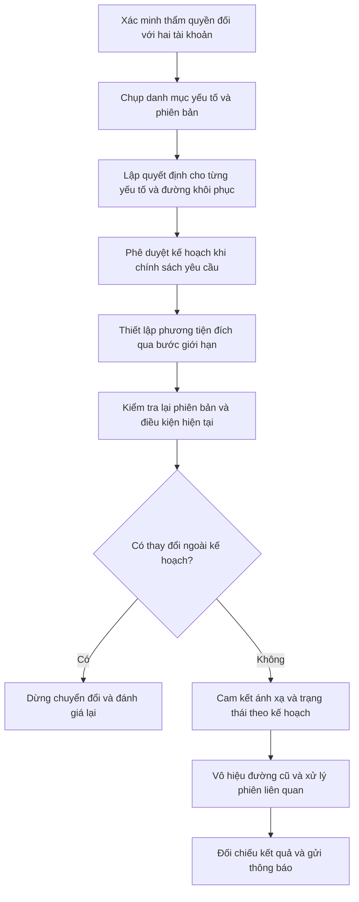

# Factor conflict resolution — Xử lý xung đột yếu tố xác thực khi hợp nhất tài khoản

## 1. Hợp nhất dữ liệu không đồng nghĩa với hợp nhất quyền đăng nhập

Một người có thể có hai tài khoản do đăng ký bằng các phương thức khác nhau, thay đổi email hoặc tạo tài khoản mới sau khi mất phương tiện xác thực. Khi người đó yêu cầu hợp nhất tài khoản, hệ thống phải quyết định dữ liệu nào được chuyển và những phương tiện nào được phép đăng nhập vào tài khoản sau hợp nhất.

Hai quyết định này khác nhau. Việc chuyển lịch sử học tập từ tài khoản B sang tài khoản A không tự cho phép mọi passkey, mã TOTP, số điện thoại hoặc mã khôi phục của B trở thành phương tiện truy cập A.

Trong `SECURITY_AUTHENTICATION_ACCOUNT_RECOVERY`, xử lý xung đột yếu tố xác thực là quá trình đánh giá các yếu tố và đường khôi phục của cả hai tài khoản, sau đó xác định yếu tố nào được giữ, phải đăng ký lại, bị loại bỏ hoặc cần cách ly để xác minh. Mục tiêu là khôi phục và hợp nhất quyền truy cập hợp lệ mà không đưa một đường truy cập yếu hoặc đã bị chiếm vào tài khoản đích.

Một bất biến quan trọng là:

> Mỗi yếu tố có thể truy cập tài khoản sau hợp nhất phải có căn cứ cho phép riêng; việc tài khoản nguồn được hợp nhất không phải căn cứ đủ để kế thừa toàn bộ phương tiện đăng nhập của nó.

Nếu không chứng minh được quyền hợp nhất hoặc không giải quyết được xung đột an toàn, hệ thống phải dừng hay chuyển xử lý phù hợp. Không dùng hợp nhất tài khoản làm lối tắt để bỏ qua xác minh khi người yêu cầu đã mất toàn bộ phương tiện xác thực.

## 2. Xác định đối tượng trước khi xử lý xung đột

Cần phân biệt các khái niệm sau:

| Khái niệm | Ý nghĩa trong quá trình hợp nhất |
|---|---|
| Tài khoản nguồn | Tài khoản sẽ chuyển một phần dữ liệu hoặc tư cách liên quan sang tài khoản khác theo kế hoạch |
| Tài khoản đích | Danh tính chuẩn được sử dụng sau khi hợp nhất theo mô hình của hệ thống |
| Yếu tố xác thực | Phương tiện dùng để chứng minh một chủ thể khi đăng nhập, chẳng hạn passkey hoặc TOTP |
| Đường khôi phục | Cơ chế lấy lại quyền truy cập, chẳng hạn mã khôi phục hoặc kênh liên hệ đã được chấp nhận |
| Tư cách thành viên và quyền | Quyền đối với tenant, nhóm hoặc tài nguyên; không tự động đi cùng yếu tố xác thực |
| Phiên và token đang tồn tại | Khả năng truy cập đã được cấp trước đó, cần chính sách riêng khi thay đổi danh tính |

Một email có thể vừa là tên đăng nhập, địa chỉ nhận thông báo hoặc kênh khôi phục. Không nên coi những vai trò này là một. Chỉ chuyển giá trị email trong hồ sơ cá nhân không có nghĩa đã xác minh và cho phép nó trở thành đường khôi phục của tài khoản đích.

Tương tự, hai tài khoản có cùng tên hiển thị hoặc số điện thoại không chứng minh chúng thuộc cùng một người. Dữ liệu có thể bị nhập sai, tái cấp, chia sẻ hoặc bị thay đổi bởi kẻ tấn công.

Trước khi lập kế hoạch, cần xác định hệ thống nào có thẩm quyền quản lý credential. Nếu một tài khoản đăng nhập qua nhà cung cấp danh tính bên ngoài, ứng dụng cục bộ không tự có quyền đổi hoặc chuyển yếu tố MFA nằm tại nhà cung cấp đó.

## 3. Những loại xung đột thường gặp

### 3.1. Xung đột do cùng loại nhưng khác mức tin cậy

Tài khoản A có passkey vừa được sử dụng để xác thực lại, còn tài khoản B có một số điện thoại từ nhiều năm trước. Nếu nhập cả hai vào danh sách phương thức đăng nhập của A, tài khoản sau hợp nhất có thể bị truy cập qua đường mà chủ thể hiện tại không còn kiểm soát.

Không thể chỉ chọn phương thức mạnh nhất rồi kết luận tài khoản an toàn. Kẻ tấn công có thể sử dụng đường khôi phục yếu nhất còn được phép để vượt qua phương thức mạnh đó.

### 3.2. Xung đột do trạng thái

Một yếu tố ở tài khoản nguồn có thể đã bị vô hiệu vì mất thiết bị, bị thu hồi vì nghi lộ hoặc đang chờ xác minh. Nếu quá trình hợp nhất chỉ chép bản ghi và đặt trạng thái mặc định là hoạt động, yếu tố nguy hiểm sẽ được kích hoạt trở lại.

Trạng thái bị thu hồi, mất hoặc nghi xâm nhập phải được giữ trong lịch sử và được xử lý theo chính sách. Không dùng hợp nhất để xóa lý do yếu tố từng bị vô hiệu.

### 3.3. Xung đột do định danh và ánh xạ

Một credential có thể gắn với định danh tài khoản hoặc miền xác thực cụ thể. Đổi chủ sở hữu của bản ghi ở cơ sở dữ liệu không tự chứng minh mọi kiểm tra của giao thức và ứng dụng vẫn đúng.

Xung đột có thể xuất hiện ở chỉ mục credential, ánh xạ người dùng, tenant hoặc nguồn danh tính liên kết. Nếu cùng một credential bị ánh xạ mơ hồ tới nhiều tài khoản, hệ thống không được chọn tùy tiện tài khoản đầu tiên tìm thấy.

### 3.4. Xung đột về quyền và chính sách

Tài khoản đích có thể là tài khoản đặc quyền hoặc chịu chính sách xác thực chặt hơn tài khoản nguồn. Một yếu tố được chấp nhận ở B chưa chắc đáp ứng yêu cầu khi truy cập A.

Hợp nhất cũng không mặc nhiên cho phép gộp mọi vai trò hoặc tư cách tenant. Quyết định đối với yếu tố xác thực và quyết định cấp quyền phải được kiểm tra riêng theo thẩm quyền tương ứng.

## 4. Lập danh mục yếu tố mà vẫn bảo vệ bí mật

Trước khi ra quyết định, hệ thống cần một ảnh chụp có phiên bản về credential và đường khôi phục liên quan. Mỗi mục nên có đủ thông tin để xác định nguồn gốc và tác động:

- Định danh yếu tố ổn định và tài khoản hiện sở hữu.
- Loại yếu tố, hệ thống quản lý và miền áp dụng.
- Trạng thái hiện tại cùng lý do vô hiệu hoặc cách ly nếu có.
- Thời điểm đăng ký, lần sử dụng đã được xác nhận và kết quả xác minh liên quan.
- Các ràng buộc kỹ thuật hoặc chính sách ảnh hưởng tới việc giữ hay đăng ký lại.
- Phiên bản bản ghi để phát hiện thay đổi đồng thời.

Danh mục không cần chứa seed TOTP, mã khôi phục nguyên văn, mật khẩu, OTP hoặc khóa riêng. Nhân viên hỗ trợ cũng không cần yêu cầu người dùng gửi những giá trị đó qua chat để “đối chiếu trùng”.

Hai passkey có cùng tên “Điện thoại” không chứng minh chúng là một credential. Hai phương thức SMS có cùng đuôi số cũng chưa đủ để xác định chúng dùng cùng một kênh. Việc phát hiện trùng cần dựa trên định danh hoặc cơ chế đối chiếu phù hợp trong hệ thống có thẩm quyền.

Nếu thật sự phát hiện một bí mật được dùng chung giữa các bản ghi lẽ ra độc lập, cần xử lý như một vấn đề bảo mật theo bối cảnh, thay vì chỉ xóa một dòng trùng. Quy trình hợp nhất không nên tạo thêm bản sao bí mật để kiểm tra tình huống này.

## 5. Chứng minh quyền kiểm soát hai tài khoản

Người yêu cầu phải đáp ứng chính sách cho cả tài khoản nguồn và tài khoản đích. Một phiên đăng nhập vào A không tự cho phép hợp nhất B, kể cả khi hai tài khoản có cùng email hiển thị.

Với phương tiện xác thực còn sử dụng được, hệ thống có thể yêu cầu xác thực lại gần thời điểm hợp nhất và ràng buộc kết quả đó với đúng hồ sơ, đúng tài khoản, mục đích hợp nhất và thời hạn. Nếu tài khoản đã mất yếu tố cần thiết, phải áp dụng quy trình khôi phục phù hợp trước khi sử dụng nó làm căn cứ hợp nhất.

Hai kết quả xác thực không nhất thiết là hai bằng chứng độc lập. Chẳng hạn, cả A và B đều có thể khôi phục qua cùng một email đã bị chiếm. Kiểm tra phải xét đường tin cậy thực tế, không chỉ đếm số lần người dùng nhập đúng mã.

Một yếu tố được trình thành công có thể chứng minh quyền kiểm soát yếu tố đó tại thời điểm kiểm tra. Nó không tự chứng minh mọi credential khác trong cùng tài khoản đều do cùng một người kiểm soát.

Với tài khoản đặc quyền, danh tính liên kết hoặc nhiều tenant, cần các phê duyệt và thẩm quyền tương ứng. Nhân viên hỗ trợ được phân công cho một tenant không nên sử dụng hợp nhất để chuyển credential của danh tính toàn cục vào tài khoản thuộc phạm vi mình quản lý.

## 6. Phân loại quyết định đối với từng yếu tố

Mỗi yếu tố cần một kết quả rõ ràng trong kế hoạch hợp nhất:

| Quyết định | Khi có thể phù hợp | Điều cần bảo đảm |
|---|---|---|
| Giữ yếu tố đã hợp lệ ở tài khoản đích | Yếu tố thuộc đúng danh tính đích, còn được phép và có căn cứ kiểm soát phù hợp | Không tự mở rộng vai trò hoặc bỏ qua giới hạn rủi ro |
| Đăng ký lại vào tài khoản đích | Chuyển ánh xạ không được hỗ trợ hoặc không đủ căn cứ an toàn | Dùng bước đăng ký được bảo vệ, gắn đúng danh tính đích |
| Chuyển theo cơ chế chuyên biệt | Sản phẩm và giao thức có quy trình hỗ trợ rõ ràng | Kiểm tra tương thích, nguồn gốc, quyền và trạng thái; tránh ánh xạ mơ hồ |
| Vô hiệu hoặc loại khỏi khả năng đăng nhập | Yếu tố bị mất, bị thu hồi, không còn được tin cậy hoặc không cần giữ | Giữ lịch sử và xử lý các đường truy cập liên quan |
| Cách ly để đánh giá | Có dấu hiệu bất thường nhưng chưa đủ kết luận | Yếu tố cách ly không được tự trở thành yếu tố hoạt động |
| Hoãn hợp nhất | Chưa đủ bằng chứng hoặc không thể tạo trạng thái truy cập an toàn | Giữ hồ sơ và chỉ cho phép tiếp tục qua quy trình phù hợp |

Tên trạng thái có thể khác nhau giữa các hệ thống. Điều quan trọng là quyết định này có hiệu lực trong dịch vụ xác thực, không chỉ là nhãn ở giao diện quản trị.

Một yếu tố nằm trong danh sách “cần xem lại” nhưng vẫn đăng nhập được không thực sự bị cách ly. Ngược lại, loại một yếu tố khỏi giao diện mà không thay đổi ánh xạ xác thực hoặc trạng thái có thẩm quyền cũng chưa làm mất khả năng sử dụng nó.

## 7. Xử lý passkey và credential dựa trên khóa công khai

Passkey không phải một mật khẩu có thể đọc rồi sao chép sang tài khoản đích. Hệ thống xác thực thường giữ khóa công khai và thông tin credential; phần bí mật tương ứng do bộ xác thực quản lý.

Khi xét credential của tài khoản nguồn, cần kiểm tra các ràng buộc của miền xác thực, định danh credential và ánh xạ người dùng. Với credential có thể được tìm thấy trên thiết bị mà không cần nhập tên đăng nhập, thông tin người dùng được trả về còn phải được xử lý nhất quán với danh tính sau hợp nhất.

Không nên chỉ sửa cột `accountId` rồi bỏ qua các kiểm tra đó. Một số sản phẩm có thể hỗ trợ chuyển ánh xạ trong phạm vi thiết kế cụ thể; những sản phẩm khác nên yêu cầu đăng ký một credential mới vào danh tính đích. Không giả định mọi thư viện hoặc nhà cung cấp đều có cùng khả năng.

Một quy trình đăng ký lại có thể gồm:

1. Xác minh hồ sơ hợp nhất và quyền kiểm soát cần thiết.
2. Cấp khả năng giới hạn chỉ cho bước đăng ký yếu tố tại tài khoản đích.
3. Thực hiện đăng ký với định danh đích và kiểm tra giao thức thông thường.
4. Xác nhận yếu tố mới đã gắn đúng tài khoản và được chính sách cho phép.
5. Vô hiệu ánh xạ nguồn theo kế hoạch chuyển đổi, bảo đảm không còn đường truy cập cũ ngoài ý muốn.

Không đánh giá số thiết bị độc lập chỉ bằng số bản ghi passkey. Một credential có thể được đồng bộ giữa các thiết bị theo cơ chế của nền tảng; ngược lại, nhiều credential có thể nằm trên cùng một thiết bị. Quyết định về phương tiện dự phòng cần dựa trên thông tin thực sự quan sát được.

## 8. Xử lý TOTP, SMS và các yếu tố dùng kênh liên hệ

### 8.1. TOTP

Việc chuyển seed TOTP từ tài khoản nguồn sang tài khoản đích có thể làm cả bản cũ và bản mới cùng có khả năng tạo mã, tùy thiết kế. Một mã TOTP đúng không tự thể hiện nó được tạo với ý định dùng cho hồ sơ hợp nhất hay cho tài khoản nào; ngữ cảnh phải được ràng buộc tại máy chủ.

Nếu chính sách chọn đăng ký lại, nên tạo một bí mật mới cho tài khoản đích qua bước đăng ký được bảo vệ, xác nhận người dùng đã thiết lập được rồi vô hiệu bí mật cũ theo kế hoạch. Không gửi seed cũ cho nhân viên hỗ trợ hoặc tái hiển thị nó chỉ để thuận tiện cho việc hợp nhất.

Cần tránh loại bỏ đường đăng nhập hợp lệ cuối cùng trước khi hoàn thành bước thiết lập thay thế, trừ khi rủi ro buộc phải chặn ngay theo quy trình ứng phó. Thứ tự chuyển đổi phải được thiết kế để vừa hạn chế truy cập sai vừa tránh tạo một vòng khôi phục không cần thiết.

### 8.2. SMS hoặc email

Một số điện thoại đã được xác minh ở tài khoản nguồn không mặc nhiên là kênh hiện còn do chủ tài khoản kiểm soát. Lịch sử thay đổi, thời gian sử dụng và dấu hiệu mất quyền kiểm soát cần được đánh giá theo chính sách.

Nếu cần xác minh lại kênh, việc nhận đúng mã chỉ xác nhận quyền kiểm soát kênh tại thời điểm đó trong ngữ cảnh đang kiểm tra. Nó không tự chứng minh người nhận vốn là chủ thể của cả hai tài khoản.

Không nâng một địa chỉ chỉ dùng nhận thông báo thành phương thức xác thực hoặc kênh khôi phục chỉ vì nó được chuyển sang hồ sơ đích. Mỗi vai trò của kênh cần một quyết định cho phép riêng.

## 9. Mã khôi phục và các yêu cầu đang chờ

Mã khôi phục thường là những khả năng dùng một lần gắn với một tài khoản và một lần phát hành. Nếu giữ cả hai bộ mã cũ sau hợp nhất, hệ thống làm tăng số bí mật còn có thể mở đường vào danh tính đích.

Một chính sách có thể chọn vô hiệu các bộ mã chịu ảnh hưởng và phát hành bộ mới sau khi người dùng đã xác thực phù hợp với tài khoản đích. Thời điểm và phạm vi vô hiệu cần nằm trong kế hoạch để tránh vừa khóa đường truy cập dự phòng vừa chưa cấp được phương tiện thay thế.

Không ghép hai danh sách mã, đặt lại cờ đã sử dụng hoặc xem mã đã tiêu thụ như mã mới chỉ vì định danh tài khoản thay đổi. Cũng không cần khôi phục mã nguyên văn từ dữ liệu bảo vệ chỉ để di chuyển chúng.

Các token đặt lại mật khẩu, link đăng ký MFA, grant khôi phục và phê duyệt đang chờ của tài khoản nguồn cần được xem xét riêng. Nếu các khả năng này còn hiệu lực và được ánh xạ tự động sang tài khoản đích, một yêu cầu cũ có thể trở thành đường truy cập mới sau hợp nhất.

Có thể vô hiệu chúng hoặc yêu cầu phát hành lại theo hồ sơ mới đã được cho phép. Nếu một loại khả năng được giữ lại, chính sách phải chứng minh được rằng phạm vi, chủ thể, phiên bản và mục đích vẫn đúng. Không coi thời hạn token chưa hết là bằng chứng đủ để chuyển nó sang danh tính mới.

## 10. Ma trận xử lý một hồ sơ cụ thể

Giả sử A là tài khoản đích và B là tài khoản nguồn. Người yêu cầu đã hoàn thành các bước xác minh cần thiết cho việc hợp nhất, nhưng vẫn phải ra quyết định cho từng yếu tố.

| Mục | Trạng thái được quan sát | Quyết định minh họa | Điều kiện hoàn tất |
|---|---|---|---|
| Passkey của A | Còn hợp lệ, vừa dùng trong bước xác thực lại được chấp nhận | Giữ | Vẫn thuộc đúng danh tính và đáp ứng chính sách sau hợp nhất |
| TOTP của A | Đã báo mất thiết bị | Giữ trạng thái vô hiệu | Không được kích hoạt lại bởi việc nhập dữ liệu |
| Passkey của B | Có bằng chứng sử dụng phù hợp nhưng sản phẩm không hỗ trợ chuyển ánh xạ | Đăng ký credential mới vào A | Hoàn thành bước đăng ký đích rồi kết thúc khả năng dùng ánh xạ cũ theo kế hoạch |
| Số điện thoại của B | Cũ, chưa đủ bằng chứng hiện còn kiểm soát | Không tự kế thừa | Chỉ thêm lại sau quy trình xác minh và cho phép phù hợp |
| Mã khôi phục của B | Có bộ chưa tiêu thụ hết | Vô hiệu theo kế hoạch | Không thể dùng qua định danh B hoặc ánh xạ về A |
| Grant đăng ký MFA đang chờ của B | Cấp trước hồ sơ hợp nhất | Hủy và cấp lại nếu còn cần | Grant mới gắn đúng A và hồ sơ hiện tại |

Ma trận là một quyết định có phiên bản, không phải dữ liệu cố định có thể dùng mãi. Nếu có yếu tố mới được đăng ký sau khi lập bảng, kế hoạch phải được đánh giá lại trước khi hoàn tất.

Việc giữ passkey của A không có nghĩa tự giữ mật khẩu, kênh khôi phục hoặc vai trò của B. Những mục đó cần được xử lý trong phần tương ứng của kế hoạch hợp nhất.

## 11. Chuyển đổi an toàn khi có thay đổi đồng thời

Giữa lúc kiểm kê và lúc hợp nhất, một người dùng hoặc kẻ tấn công có thể thêm yếu tố, đổi kênh liên hệ hoặc tạo một yêu cầu khôi phục mới. Nếu hệ thống chỉ dùng ảnh chụp cũ rồi chép tất cả bản ghi hiện tại, yếu tố chưa từng được duyệt có thể lọt vào tài khoản đích.

Một luồng xử lý có thể tổ chức như sau:



Các bước chuẩn bị có thể diễn ra trước điểm chuyển đổi cuối, nhưng quyền tạm thời phải chỉ cho phép chức năng cần thiết, chẳng hạn đăng ký yếu tố vào A. Một yếu tố mới đang chờ hoàn tất hợp nhất không được tự mở phiên toàn quyền trước khi điều kiện cho phép đã đạt.

Ở điểm cam kết, cần kiểm soát phiên bản hoặc trạng thái để chỉ áp dụng đúng kế hoạch đã duyệt. Nếu cần hạn chế thay đổi yếu tố trong khoảng chuyển đổi, phạm vi và thời gian hạn chế phải rõ ràng. Không giữ một giao dịch cơ sở dữ liệu mở suốt thời gian chờ người dùng thao tác trên thiết bị.

Mỗi lần thực thi nên có định danh để xử lý yêu cầu lặp. Một lần gọi lại do hết thời gian chờ không được tạo thêm yếu tố hoặc kích hoạt lại các bản ghi đã bị vô hiệu.

Nếu phải gọi nhà cung cấp bên ngoài, giao dịch cục bộ không tự bảo đảm thay đổi ở mọi nơi là nguyên tử. Hệ thống cần đối chiếu kết quả và trạng thái đang chuyển đổi. Khi chỉ hoàn tất một phần, trạng thái xác thực phải phản ánh các quyền đã thực sự cho phép, không coi việc hợp nhất dữ liệu đã thành công là bằng chứng rằng credential cũng đã chuyển đúng.

Nếu không thể hoàn tất, không khôi phục mù quáng các yếu tố đã bị báo mất hoặc nghi lộ. Biện pháp phục hồi cần căn cứ vào hành động đã xảy ra và đánh giá rủi ro hiện tại.

## 12. Tránh ánh xạ tài khoản cũ thành quyền đăng nhập mới

Sau hợp nhất, hệ thống có thể giữ một ánh xạ từ định danh B sang A để tìm dữ liệu hoặc chuyển hướng giao diện. Ánh xạ phục vụ dữ liệu không nên được dùng vô điều kiện trong đường xác thực.

Ví dụ nguy hiểm:

```text
Xác thực credential cũ của B thành công
Tìm tài khoản chuẩn của B, nhận được A
Cấp phiên của A
```

Chuỗi này đưa mọi credential còn dùng được của B vào A, kể cả yếu tố mà kế hoạch đã loại bỏ. Nó cũng có thể mở rộng tác động của một phiên cũ hoặc token khôi phục chưa hết hạn.

Đường xác thực cần kiểm tra một quan hệ cho phép cụ thể giữa credential, danh tính đích và kế hoạch chuyển đổi. Nếu hệ thống hỗ trợ di chuyển credential, chỉ các credential được quyết định giữ hoặc chuyển theo cơ chế đó mới được tạo phiên đích.

Với credential nguồn đã bị loại, việc người dùng còn chứng minh được quyền sở hữu nó không cho phép vượt qua quyết định loại bỏ. Máy chủ phải trả kết quả theo trạng thái có thẩm quyền thay vì tự suy ra rằng “đúng bí mật thì được đăng nhập”.

Danh tính liên kết cũng cần kiểm tra tương tự. Không tự gắn một tài khoản từ nhà cung cấp bên ngoài vào A chỉ vì claim email giống email của A. Cần đúng quan hệ nhà cung cấp, định danh chủ thể và quy trình liên kết đã được cho phép.

## 13. Phiên, token và quyền sau hợp nhất

Credential và phiên là hai lớp cần xử lý riêng. Vô hiệu yếu tố của B không tự chứng minh mọi phiên đã cấp trước đó cho B đều mất hiệu lực.

Đặc biệt, không nên đổi chủ thể của một phiên B đang hoạt động thành A chỉ bằng cách tra bảng ánh xạ. Phiên đó có thể đã được cấp trước lúc xác minh hợp nhất, dựa trên yếu tố yếu hơn hoặc đang do một người khác kiểm soát.

Chính sách nên xác định:

- Phiên nguồn nào phải kết thúc và cách chặn refresh token tương ứng.
- Phiên đích nào cần xác thực lại sau thay đổi nhạy cảm.
- Phiên hoặc grant chỉ phục vụ hợp nhất được kết thúc ở bước nào.
- Token đã phát hành được kiểm tra thu hồi đến mức nào trong hạ tầng thực tế.
- Khi nào chủ thể được cấp một phiên mới với danh tính, quyền và mức xác thực phù hợp.

Nếu hệ thống dùng token mà dịch vụ đích chỉ kiểm tra chữ ký và thời hạn, việc cập nhật một cờ trong cơ sở dữ liệu trung tâm có thể chưa làm mọi token ngừng hoạt động ngay. Thiết kế cần một cơ chế phù hợp với kiến trúc để đạt phạm vi thu hồi đã cam kết, hoặc phản ánh rõ giới hạn còn lại.

Mức xác thực của phiên mới không nên được tạo bằng cách cộng các thuộc tính từ hai phiên cũ. Hãy căn cứ vào các bước xác thực thực sự đã hoàn tất, độ mới, chính sách của tài khoản đích và mục đích đang cho phép.

Các quyền nghiệp vụ của tài khoản nguồn cũng cần được kiểm tra riêng. Giữ được một yếu tố xác thực không có nghĩa giữ toàn bộ vai trò quản trị hoặc quyền truy cập của tài khoản nguồn ở mọi tenant.

## 14. Ví dụ xuyên suốt: một passkey hợp lệ và một thiết bị đã mất

Lan có tài khoản A dùng passkey trên thiết bị hiện còn kiểm soát. Lan từng tạo tài khoản B trên thiết bị cũ và muốn chuyển lịch sử sử dụng về A. B còn một passkey, một số điện thoại cũ và bộ mã khôi phục được phát hành trước đây.

Lan hoàn thành xác thực lại với A và các bước chứng minh quyền đối với B theo chính sách. Tuy vậy, người xử lý không mặc định mọi yếu tố của B đều an toàn. Hồ sơ ghi nhận số điện thoại cũ chưa đủ căn cứ hiện còn được kiểm soát và thiết bị chứa một số phương tiện cũ đã bị báo mất.

Kế hoạch chọn A làm danh tính đích, giữ passkey hợp lệ của A, không chuyển số điện thoại cũ thành kênh khôi phục và vô hiệu bộ mã khôi phục của B tại bước chuyển đổi đã xác định. Các yếu tố bị báo mất tiếp tục bị vô hiệu.

Nếu Lan muốn giữ khả năng dùng passkey từ một thiết bị còn kiểm soát, hệ thống thực hiện bước đăng ký credential mới vào A theo chính sách của sản phẩm. Hồ sơ không yêu cầu Lan xuất khóa riêng và không chỉ đổi tên chủ sở hữu bản ghi credential nguồn.

Trước lúc hoàn tất, dịch vụ kiểm tra lại phiên bản danh mục. Nếu B vừa có một yếu tố mới được thêm mà kế hoạch chưa đánh giá, hệ thống dừng chuyển đổi cuối và xử lý thay đổi đó. Không tự nhập yếu tố mới vào A để “đảm bảo không mất dữ liệu”.

Sau chuyển đổi, các phiên nguồn thuộc phạm vi cần kết thúc bị xử lý; Lan được cấp phiên phù hợp sau bước xác thực cần thiết. Các link khôi phục cũ của B không được đi qua một ánh xạ định danh để mở quyền vào A.

Thông báo về thay đổi được gửi qua các kênh phù hợp với chính sách và mức rủi ro. Kênh vừa được thêm trong hồ sơ không nên là nơi duy nhất xác nhận tính hợp lệ của chính việc thêm kênh đó.

## 15. Dấu vết cần lưu và các sai lầm cần tránh

Mỗi quyết định đối với yếu tố nên có định danh hồ sơ, tài khoản nguồn và đích, định danh yếu tố, trạng thái trước và sau, lý do, bằng chứng tham chiếu, phiên bản kế hoạch và kết quả thực thi. Nếu có người phê duyệt hoặc dịch vụ bên ngoài tham gia, cần liên kết được các quyết định và kết quả tương ứng.

Nhật ký không chứa bí mật xác thực. Việc giữ nguồn gốc giúp giải thích tại sao yếu tố được giữ, bị loại hoặc phải đăng ký lại mà không cần nhân viên hỗ trợ nhìn thấy seed hay mã dùng một lần.

Những sai lầm thường gặp gồm:

| Sai lầm | Hậu quả |
|---|---|
| Gộp toàn bộ danh sách yếu tố của hai tài khoản | Tăng số đường có thể chiếm tài khoản đích |
| Xác minh một yếu tố rồi coi mọi yếu tố cùng tài khoản đều đáng tin | Bỏ sót yếu tố bị cấy thêm hoặc đã mất quyền kiểm soát |
| Kích hoạt lại yếu tố nguồn theo trạng thái mặc định | Làm sống lại phương tiện đã mất hoặc bị thu hồi |
| Chép seed, mã dự phòng hoặc đặt lại cờ đã dùng | Tạo bản sao bí mật và phá tính dùng một lần |
| Chỉ cập nhật chủ sở hữu credential mà bỏ qua ràng buộc giao thức | Ánh xạ đăng nhập sai, mơ hồ hoặc không tương thích |
| Chuyển hướng mọi đăng nhập của tài khoản cũ sang tài khoản đích | Vô tình cho credential, phiên hoặc grant bị loại truy cập danh tính mới |
| Xóa phương tiện cuối cùng trước khi hoàn tất thay thế an toàn | Khiến người dùng hợp lệ tiếp tục bị khóa ngoài |
| Bỏ qua thay đổi yếu tố trong lúc chờ hợp nhất | Cho yếu tố chưa được đánh giá lọt vào kế hoạch |

Xử lý xung đột yếu tố xác thực cần một quyết định theo từng phương tiện và từng đường khôi phục. Kết quả hợp nhất chỉ an toàn khi những phương tiện còn hoạt động, các ánh xạ danh tính và phiên được cấp đều phù hợp với cùng một kế hoạch đã được cho phép, thay vì chỉ có dữ liệu hồ sơ trông như đã được gộp thành công.
