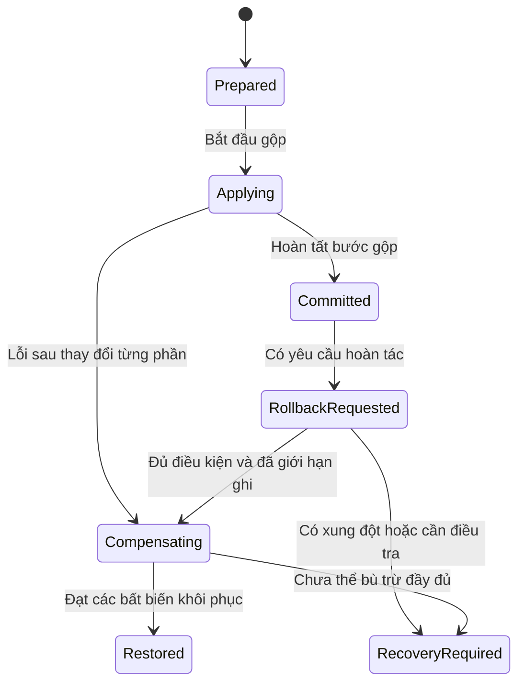

# Merge rollback strategy — Chiến lược hoàn tác gộp tài khoản

## 1. Vì sao gộp tài khoản cần một chiến lược hoàn tác riêng?

Trong quá trình khôi phục, người dùng có thể tạo tài khoản mới vì không truy cập được tài khoản cũ. Sau khi xác minh, hệ thống có thể hỗ trợ gộp dữ liệu để người dùng tiếp tục sử dụng một tài khoản thống nhất. Tuy nhiên, gộp nhầm hai tài khoản hoặc gộp theo yêu cầu của kẻ chiếm đoạt có thể làm lộ dữ liệu, chuyển quyền sở hữu và thay đổi đường đăng nhập của cả hai tài khoản.

**Merge rollback strategy** là kế hoạch đưa hệ thống về một trạng thái an toàn khi việc gộp phải bị hủy hoặc đảo ngược. Kế hoạch phải xác định thay đổi nào có thể đảo lại, thay đổi nào cần bù trừ, dữ liệu mới nào cần được giữ và khi nào không thể tự động hoàn tác đầy đủ.

Trong `SECURITY_AUTHENTICATION_ACCOUNT_RECOVERY`, mục tiêu không chỉ là khôi phục các hàng dữ liệu. Cần bảo vệ ranh giới danh tính, quyền truy cập, mật khẩu, MFA, passkey, token dùng một lần và phiên đã phát sinh. Một lần rollback thành công về dữ liệu nhưng làm sống lại phiên bị thu hồi vẫn là kết quả không an toàn.

### Ví dụ xuyên suốt

Giả sử:

- Tài khoản **A** là tài khoản cũ đang được khôi phục.
- Tài khoản **B** là tài khoản mới mà người yêu cầu muốn tiếp tục sử dụng.
- Thao tác **M** chuyển một số dữ liệu được phép từ A sang B, sau đó đưa A vào trạng thái đã gộp.

Sau khi M hoàn tất, hệ thống phát hiện bằng chứng liên kết A với B không hợp lệ. Trong thời gian đó, B đã tạo thêm một bản ghi mới và đã đọc một phần dữ liệu vốn thuộc A.

Đổi lại `owner_id` của mọi dữ liệu từ B về A không phải một chiến lược đúng: nó có thể chuyển nhầm bản ghi mới của B sang A, không giải quyết phiên đang hoạt động và không thể khiến người đã đọc dữ liệu quên thông tin đó.

## 2. Phân biệt ba cơ chế xử lý lỗi

| Cơ chế | Áp dụng khi nào? | Điều có thể bảo đảm trong phạm vi phù hợp |
|---|---|---|
| Rollback transaction | Giao dịch chưa commit và thay đổi nằm trong cùng phạm vi giao dịch | Hủy các thay đổi chưa commit của giao dịch đó |
| Bù trừ sau commit | Thay đổi đã được lưu hoặc nhiều hệ thống đã thực hiện một phần | Thực hiện những hành động mới để đảo hoặc vô hiệu hóa tác động được xác định |
| Khôi phục có điều phối | Dữ liệu phát sinh phức tạp, có xung đột hoặc tác động không thể tự đảo | Đưa tài khoản về trạng thái an toàn và xử lý từng phần theo quy trình |

Một transaction cơ sở dữ liệu không thể thu hồi email đã gửi, hoàn tác việc người dùng đã tải tệp hoặc tự khôi phục trạng thái trong mọi dịch vụ khác. Khi đã vượt ra ngoài phạm vi transaction, “rollback” thường là một chuỗi hành động bù trừ có điều kiện.

Không nhầm các thao tác sau với hoàn tác gộp:

- **Bỏ liên kết đăng nhập:** có thể chỉ loại bỏ một cách đăng nhập, không tách dữ liệu đã chuyển.
- **Xóa tài khoản đích:** có thể phá hủy cả dữ liệu gốc và dữ liệu mới của tài khoản đó.
- **Đổi tài khoản đại diện:** có thể chỉ thay con trỏ chuẩn hóa, không phục hồi quyền hoặc nguồn gốc dữ liệu.
- **Phục hồi toàn bộ cơ sở dữ liệu từ backup:** có thể làm mất thay đổi hợp lệ của nhiều người dùng không liên quan.

Chiến lược phải nêu rõ hệ thống muốn khôi phục trạng thái nào và trong giới hạn nào, thay vì gọi mọi thao tác sửa sai là “undo”.

## 3. Định nghĩa trạng thái an toàn cần đạt

Sau khi hoàn tác M, mục tiêu thường gồm:

1. A và B không còn được coi là cùng một danh tính chỉ vì M đã từng tồn tại.
2. Dữ liệu được chuyển bởi M được trả về hoặc cách ly theo nguồn gốc đã ghi nhận.
3. Dữ liệu do B tạo độc lập không tự chuyển sang A.
4. Phiên và quyền khôi phục có thể bị ảnh hưởng được vô hiệu hóa hoặc đánh giá lại.
5. Không có mật khẩu, MFA, passkey hoặc kênh liên hệ nào được kích hoạt lại chỉ do khôi phục một bản chụp cũ.
6. Các hệ thống liên quan nhận được trạng thái mới và không áp dụng lại tác vụ gộp cũ.
7. Lịch sử thể hiện rõ thao tác gộp, lý do hoàn tác và kết quả từng bước.

Trạng thái an toàn không nhất thiết giống từng byte trước khi gộp. Ví dụ, token đã dùng và phiên đã thu hồi phải tiếp tục mất hiệu lực, dù một bản chụp trước gộp từng ghi chúng còn hoạt động.

Nếu đã xảy ra truy cập trái phép, hoàn tác dữ liệu chỉ là một phần xử lý. Cần xem xét các hành động ứng phó tương ứng như giới hạn truy cập, kiểm tra phạm vi dữ liệu bị lộ và thông báo theo quy trình áp dụng. Không trình bày việc hoàn tác như bằng chứng rằng tác động bảo mật đã được xóa sạch.

## 4. Thiết kế khả năng hoàn tác trước khi bắt đầu gộp

Việc chuẩn bị phải diễn ra trước thao tác M. Sau khi đã chuyển dữ liệu mà không lưu nguồn gốc, rất khó xác định một bản ghi ở B vốn thuộc A hay được B tạo từ trước.

Một kế hoạch gộp có thể chứa:

```text
mergeOperationId
sourceAccountId
targetAccountId
tenantBoundary
sourceAccountVersion
targetAccountVersion
policyVersion
approvalReferences
createdAt
rollbackEligibleUntil
affectedResourcesManifest
expectedChanges
compensationPlanVersion
```

`affectedResourcesManifest` mô tả những tài nguyên thực sự nằm trong phạm vi gộp và cách xử lý chúng. Định danh thao tác M cần được gắn với thay đổi hoặc nhật ký thay đổi liên quan để có thể truy nguyên.

Các thông tin cần thiết có thể gồm chủ sở hữu trước đó, phiên bản trước và sau khi đổi, tham chiếu bản chụp được bảo vệ, liên kết tài nguyên và trạng thái bước thực thi. Không lưu mật khẩu, recovery code, token thô hay bí mật MFA vào manifest chỉ để làm rollback thuận tiện.

Một bản chụp có thể phục vụ phục hồi, nhưng cũng tạo thêm bản sao dữ liệu nhạy cảm. Cần giới hạn truy cập, bảo vệ khi lưu và đặt thời gian lưu phù hợp. Sau khi kế hoạch hết thời hạn, không giữ bản sao vô thời hạn chỉ vì nó được gọi là “backup rollback”.

### Cửa sổ hoàn tác không phải bảo đảm đảo ngược hoàn toàn

`rollbackEligibleUntil` có thể là giới hạn cho phép hoàn tác tự động theo chính sách. Nó không chứng minh mọi thay đổi trong khoảng đó đều có thể đảo được. Nếu dữ liệu đã bị sửa hoặc có thao tác gộp tiếp theo, hệ thống vẫn có thể phải chuyển sang xử lý có điều phối.

Ngược lại, hết cửa sổ tự động không có nghĩa bỏ mặc một sự cố. Hệ thống có thể tiếp tục hỗ trợ điều tra và phục hồi thủ công theo thẩm quyền phù hợp, với các giới hạn được báo rõ.

## 5. Phân loại tác động để chọn cách bù trừ

| Loại tác động | Cách tiếp cận minh họa | Điều cần tránh |
|---|---|---|
| Đổi chủ sở hữu một bản ghi | Trả về chủ cũ nếu phiên bản và nguồn gốc còn phù hợp | Chuyển mọi bản ghi hiện thuộc B về A |
| Sao chép dữ liệu A sang B | Xác định bản sao do M tạo, thu hồi quyền đọc hoặc xử lý bản sao theo kế hoạch | Xóa tài nguyên chỉ vì nội dung trông giống nhau |
| Gộp hồ sơ cá nhân | Phục hồi từng trường có nguồn gốc và kiểm tra xung đột | Ghi đè toàn bộ hồ sơ bằng bản chụp cũ |
| Chuyển hoặc cộng quyền | Tính lại quyền từ nguồn có thẩm quyền và loại bỏ quyền do M tạo | Giữ hợp quyền của A và B sau khi tách |
| Định tuyến A sang B | Vô hiệu hóa ánh xạ hoặc cập nhật trạng thái theo phiên bản | Để alias cũ tiếp tục bỏ qua kiểm tra tài khoản nguồn |
| Phiên và quyền khôi phục | Thu hồi hoặc yêu cầu xác thực lại theo phạm vi ảnh hưởng | Kích hoạt lại phiên từ backup |
| Email hoặc thông báo đã gửi | Gửi thông tin đính chính khi cần và lưu lịch sử | Giả định có thể thu hồi mọi thông tin đã gửi |
| Tác vụ ở dịch vụ khác | Bù trừ qua contract riêng, theo dõi kết quả từng bước | Xem một commit nội bộ là hoàn tất toàn hệ thống |
| Dữ liệu đã được người khác đọc hoặc tải | Giới hạn truy cập tiếp theo và xử lý sự cố | Khẳng định đã xóa được kiến thức hoặc bản sao ngoài hệ thống |

Các quyền nhạy cảm như vai trò quản trị tenant hoặc quyền đại diện tổ chức không nên được chuyển chỉ vì gộp hồ sơ người dùng. Nếu chính sách có cho phép một loại chuyển quyền cụ thể, kế hoạch hoàn tác phải chỉ ra cách xác định và loại bỏ chính quyền đã chuyển đó.

## 6. Mô hình trạng thái cho thao tác gộp và hoàn tác

Một mô hình minh họa:



Nếu một transaction chưa commit thất bại, trạng thái tương ứng có thể là đã hủy mà không cần chuỗi bù trừ. Sơ đồ trên tập trung vào trường hợp đã có tác động bền vững.

`Restored` phải có định nghĩa cụ thể về các bất biến đã đạt. Nếu còn dịch vụ chưa xử lý hoặc dữ liệu đang cách ly, không báo hoàn tác đầy đủ chỉ vì bảng tài khoản đã được cập nhật.

`RecoveryRequired` là trạng thái để điều phối xử lý tiếp, không phải cho phép hệ thống mở lại cả A và B theo trạng thái đoán được. Cần xác định rõ tài khoản, chức năng nào vẫn bị giới hạn và ai có quyền tiếp tục.

## 7. Trình tự hoàn tác sau khi thao tác gộp đã commit

### Bước 1: Xác thực yêu cầu và thẩm quyền hoàn tác

Một yêu cầu hoàn tác có thể đến từ người dùng, quản trị viên hoặc kết quả điều tra. Người khởi tạo phải có thẩm quyền phù hợp với cả phạm vi dữ liệu và tác động bảo mật.

Không dùng việc người gọi hiện kiểm soát B làm bằng chứng duy nhất rằng họ có quyền quyết định trạng thái của A. Nếu lý do hoàn tác liên quan đến giả mạo danh tính, cần áp dụng luồng xác minh và phân tách nhiệm vụ theo chính sách, thay vì tái sử dụng máy móc căn cứ đã bị nghi ngờ.

### Bước 2: Đọc kế hoạch và xác định tác động thực tế

Đọc bản ghi M, manifest và kết quả từng bước. Phân biệt tài nguyên dự kiến chuyển với tài nguyên thực sự đã chuyển. Một bước được gửi qua hàng đợi chưa chắc đã chạy; một bước báo timeout cũng có thể đã commit ở dịch vụ đích.

Nếu trạng thái chưa xác định, cần tra cứu bằng định danh thao tác trước khi gửi lại hoặc bù trừ. Không xem mất phản hồi là bằng chứng thay đổi chưa xảy ra.

### Bước 3: Giới hạn ghi và ngăn tác vụ cũ tiếp tục

Đặt trạng thái phù hợp để các đường ghi nhạy cảm không tiếp tục thay đổi tập tài nguyên trong lúc tách. Phạm vi giới hạn nên tương ứng với thao tác, không mặc định khóa mọi tài khoản không liên quan.

Các worker và đường ghi cần kiểm tra phiên bản hoặc fencing token của thao tác. Chỉ hủy job trên giao diện hàng đợi không đủ, vì một worker có thể đã lấy job và đang chạy.

### Bước 4: Xử lý phiên và quyền khôi phục bị ảnh hưởng

Vô hiệu hóa hoặc hạn chế các quyền có thể cho phép truy cập chéo A và B. Xác định phiên, token và quyền khôi phục nào được tạo từ M hoặc dựa vào ánh xạ do M tạo.

Không thể chỉ đổi dữ liệu rồi để phiên hiện tại tự tiếp tục với tập quyền cũ trong cache. Các đường truy cập phải nhận biết trạng thái tài khoản và phiên bản bảo mật hiện hành theo cơ chế của hệ thống.

### Bước 5: Bù trừ dữ liệu theo nguồn gốc và phiên bản

Thực hiện từng hành động đã định nghĩa, có điều kiện tiền đề và kết quả được lưu. Nếu tài nguyên đã thay đổi ngoài dự kiến, không ghi đè mù; chuyển tài nguyên sang nhánh xung đột cần giải quyết.

### Bước 6: Đồng bộ các dịch vụ và kiểm tra bất biến

Xác nhận ánh xạ tài khoản, quyền, quyền đọc dữ liệu và tác vụ đang chờ đã phù hợp với trạng thái khôi phục. Theo dõi những bước cần dịch vụ khác xác nhận trước khi coi quá trình hoàn tất.

### Bước 7: Mở lại quyền sử dụng theo căn cứ mới

Chỉ đưa A hoặc B về trạng thái được phép đăng nhập sau khi các điều kiện an toàn đã đạt. Trong trường hợp cần, người dùng phải xác minh lại và thiết lập yếu tố qua một luồng khôi phục được kiểm soát.

Ghi nhận kết quả, thông báo phù hợp và giải phóng giới hạn thao tác theo phạm vi đã xác định. Không gọi quá trình hoàn tất nếu vẫn còn các quyền có thể truy cập sai dữ liệu.

## 8. Giữ dữ liệu mới và xử lý xung đột

Giả sử M chuyển tài liệu `document-10` từ A sang B. Sau đó B sửa nội dung tài liệu. Rollback có ít nhất hai vấn đề khác nhau:

1. Ai có quyền sở hữu hoặc đọc tài liệu sau khi tách?
2. Nội dung chỉnh sửa nào được giữ, cách ly hoặc phục hồi?

Khôi phục chủ sở hữu không tự trả lời câu hỏi về nội dung. Nếu người thực hiện chỉnh sửa chưa được xác định là hợp pháp đối với A, không nên tự áp dụng thay đổi đó vào dữ liệu của A. Ngược lại, xóa mọi thay đổi mới cũng có thể làm mất dữ liệu hợp lệ.

Một cơ chế có thể dùng bản gốc, phiên bản sau gộp và lịch sử thay đổi để phân loại:

```text
Chỉ thay owner bởi M, không có thay đổi tiếp theo
    → có thể trả owner theo điều kiện đã định nghĩa

Có thay đổi nội dung sau M
    → cần xử lý phiên bản hoặc cách ly xung đột

Tài nguyên mới do B tạo độc lập
    → không tự chuyển về A

Tài nguyên đã bị xóa hoặc chuyển tiếp sang nơi khác
    → tra cứu lịch sử và xử lý theo loại tài nguyên
```

Đối với bản ghi có quan hệ cha–con, hoàn tác từng hàng độc lập có thể tạo liên kết sai. Cần xác định thứ tự theo phụ thuộc và quy tắc giữ tính toàn vẹn. Một bình luận, tệp đính kèm hoặc quyền chia sẻ có thể phải được xử lý cùng tài nguyên gốc.

Nếu B đã được gộp tiếp vào C, không áp dụng kế hoạch đảo M như thể B vẫn ở trạng thái ngay sau M. Hệ thống phải phát hiện quan hệ phụ thuộc này và xử lý theo kế hoạch mới hoặc chuyển sang phục hồi có điều phối.

## 9. Minh họa cập nhật có điều kiện

Giả sử hệ thống lưu một journal cho tài nguyên đã đổi chủ:

```text
mergeOperationId = M
resourceId = document-10
previousOwnerId = A
appliedOwnerId = B
versionAfterMerge = 8
```

Một cập nhật minh họa cho trường hợp chưa có sửa đổi sau gộp:

```sql
UPDATE document
SET owner_account_id = :previous_owner_id,
    version = version + 1
WHERE document_id = :resource_id
  AND owner_account_id = :applied_owner_id
  AND version = :version_after_merge;
```

Các tham số phải được lấy từ journal của thao tác đã được xác thực phạm vi, không lấy trực tiếp từ client để chuyển chủ sở hữu tùy ý. Ngoài các điều kiện minh họa, hệ thống thực tế cần áp dụng ràng buộc tenant và các kiểm tra quyền phù hợp.

Nếu số hàng cập nhật là 0, không kết luận tài nguyên đã được khôi phục. Có thể nó đã được xử lý ở lần trước, đã đổi phiên bản, đổi chủ hoặc không còn tồn tại. Cần đọc kết quả bước đã lưu và trạng thái hiện tại để phân loại.

Trong cùng transaction phù hợp, lưu kết quả bước bù trừ cùng thay đổi tài nguyên. Nếu chỉ cập nhật owner rồi đánh dấu hoàn tất ở một thao tác độc lập, ứng dụng dừng giữa hai bước có thể khiến retry xử lý sai.

Đoạn SQL này không tự giải quyết lịch sử nội dung, quan hệ tài nguyên, cache hoặc quyền trong dịch vụ khác. Nó minh họa nguyên tắc: chỉ đảo thay đổi khi điều kiện hiện tại còn phù hợp với giả định của kế hoạch.

## 10. Tính lặp an toàn và kiểm soát đồng thời

Một bước bù trừ cần có định danh ổn định, ví dụ:

```text
(rollbackOperationId, compensationStepId, resourceId)
```

Khi nhận lại cùng bước, hệ thống phải biết nó chưa thực hiện, đã thành công hay có kết quả chưa xác định. Không tạo thêm quyền, nhân đôi bản sao hoặc đảo qua đảo lại owner chỉ vì job được giao lại.

Một khung xử lý minh họa:

```text
compensate(step):
    xác minh operation, phạm vi và fencing version
    nếu bước đã thành công:
        trả kết quả đã ghi

    bắt đầu transaction phù hợp:
        kiểm tra hoặc khóa trạng thái operation
        kiểm tra bước chưa được xử lý
        kiểm tra tiền đề của tài nguyên
        thực hiện thay đổi bù trừ có điều kiện
        ghi kết quả bước và sự kiện outbox
    commit
```

Các thao tác trên A và B cần tuân theo thứ tự khóa hoặc cơ chế kiểm soát phiên bản nhất quán. Cũng phải ngăn một luồng khác tiếp tục gộp, thay đổi quyền hoặc khôi phục tài khoản trên cùng phạm vi mà không phát hiện operation đang xử lý.

Một lease của worker hết hạn không chứng minh worker cũ đã dừng. Nếu hệ thống dùng lease để chọn worker xử lý, cần thêm cơ chế làm cho lệnh của worker cũ không còn được chấp nhận, chẳng hạn kiểm tra fencing version ở nơi ghi dữ liệu.

Đối với tài nguyên thuộc dịch vụ khác, dịch vụ đích cần nhận định danh operation và thực thi contract retry riêng. Nếu không hỗ trợ bù trừ hoặc kiểm tra kết quả, không thể hứa hoàn tác tự động đầy đủ bằng một bộ điều phối ở bên ngoài.

## 11. Mật khẩu, MFA, passkey và token không phải dữ liệu hồ sơ thông thường

### Không phục hồi bí mật hoặc trạng thái đã mất hiệu lực một cách máy móc

Giả sử trước M có một token khôi phục chưa dùng. Sau M token bị tiêu thụ hoặc bị thu hồi. Khi rollback dữ liệu A, token đó không được trở lại trạng thái có thể sử dụng chỉ vì bản chụp cũ ghi `unused`.

Nguyên tắc tương tự áp dụng cho recovery code, liên kết đặt lại mật khẩu và quyền đăng ký yếu tố xác thực. Lịch sử tiêu thụ hoặc thu hồi là một ràng buộc bảo mật, không phải trường có thể tùy ý tua lại.

### Không hợp nhất hoặc đảo ngược liên kết yếu tố một cách ngầm định

Mật khẩu, MFA và credential passkey phải có chủ thể và phạm vi rõ ràng. Hoàn tác hồ sơ không tự cho phép di chuyển credential từ B sang A hoặc kích hoạt lại một yếu tố đã bị thu hồi.

Nếu chiến lược dùng bản chụp để phục hồi dữ liệu credential phía máy chủ, vẫn cần kiểm tra liệu credential đó có còn được phép sử dụng không. Việc có lại bản ghi không chứng minh bí mật còn an toàn. Với passkey, hệ thống không thể lấy lại khóa riêng trên thiết bị chỉ bằng phục hồi bản ghi máy chủ; không nên thiết kế rollback dựa trên giả định đó.

Khi nghi ngờ gộp do chiếm đoạt, có thể cần một lượt khôi phục hoặc đăng ký lại yếu tố được xác minh độc lập. Không dùng chính yếu tố được thêm qua thao tác gộp đang bị tranh chấp để chứng minh quyền mở lại cả hai tài khoản.

### Phiên bản bảo mật không được quay lùi

Nếu dùng một security epoch hoặc phiên bản bảo mật để vô hiệu hóa phiên, giữ quy tắc tăng phiên bản khi thay đổi trạng thái nhạy cảm. Không phục hồi giá trị cũ từ snapshot, vì điều đó có thể khiến các phiên trước đây lại khớp điều kiện chấp nhận.

Tương tự, rollback không làm mới thời hạn phê duyệt hoặc token. Muốn cấp quyền mới phải đi qua một quyết định mới theo chính sách, có căn cứ và thời hạn riêng.

## 12. Ánh xạ tài khoản, phiên và cache

Một số hệ thống gộp bằng cách giữ A và thêm ánh xạ `A → B`. Đây là thay đổi danh tính có thể tác động đến mọi dịch vụ đọc ánh xạ, không chỉ giao diện hồ sơ.

Khi hoàn tác, cần xem:

- Các endpoint có còn tự chuyển từ A sang B không?
- Phiên mang subject A hoặc B đang được diễn giải thế nào?
- Quyền đã tính trước hoặc cache có chứa hợp quyền của hai tài khoản không?
- Token hoặc liên kết đã phát hành có dựa vào ánh xạ cũ không?
- Một worker cũ có thể tạo lại ánh xạ sau khi đã hoàn tác không?

Không sửa subject của token đã phát hành bằng cách thay dữ liệu hồ sơ rồi coi token đã đổi danh tính. Đường xác thực và phân quyền phải có cơ chế phát hiện token hoặc phiên không còn phù hợp với trạng thái hiện hành.

Xóa cache là một bước vận hành, không phải bằng chứng mọi điểm truy cập đã áp dụng trạng thái mới. Những hành động nhạy cảm nên kiểm tra nguồn trạng thái hoặc phiên bản bảo mật có thẩm quyền theo thiết kế của hệ thống. Nếu chưa thể xác nhận một thành phần đã chặn quyền cũ, cần giữ giới hạn phù hợp thay vì công bố hoàn tác an toàn toàn diện.

## 13. Tác động bên ngoài và giới hạn của hoàn tác

Một thao tác gộp có thể kích hoạt email, cập nhật công cụ hỗ trợ, chỉ mục tìm kiếm, hệ thống thanh toán hoặc các quyền ở dịch vụ khác. Mỗi tác động cần được phân loại là có thể đảo, có thể bù trừ hay chỉ có thể xử lý hậu quả.

Ví dụ, hủy quyền đọc một tệp trong dịch vụ chính không xóa bản tệp đã được tải về. Gửi email đính chính không thu hồi chắc chắn email trước đó. Chuyển lại owner trong ứng dụng không tự điều chỉnh một giao dịch đã được hệ thống thanh toán ghi nhận.

Đối với tác động có ý nghĩa giao dịch hoặc nghiệp vụ riêng, cần thực hiện hành động điều chỉnh theo contract của hệ thống đó. Không xóa lịch sử giao dịch để làm cho ảnh chụp dữ liệu trông giống trước khi gộp.

Một outbox có thể giúp phát các yêu cầu bù trừ đáng tin cậy từ nguồn. Nó không bảo đảm dịch vụ đích sẽ luôn chấp nhận hoặc hoàn tất. Bộ điều phối cần theo dõi kết quả, retry có giới hạn theo quy trình và chuyển các lỗi chưa giải quyết được sang trạng thái rõ ràng.

Thông báo cho người dùng phải phản ánh giới hạn thực tế: đã tách dữ liệu trong phạm vi nào, tài khoản nào còn bị giới hạn và cần bước xác minh nào tiếp theo. Tránh thông điệp “đã khôi phục hoàn toàn” khi vẫn đang chờ xác nhận từ các hệ thống khác.

## 14. Nhật ký và điều kiện công bố hoàn tất

Lịch sử cần liên kết được thao tác gộp gốc với yêu cầu hoàn tác, người phê duyệt, lý do, kế hoạch bù trừ và kết quả từng bước.

Các sự kiện minh họa:

```text
ACCOUNT_MERGE_COMMITTED
MERGE_ROLLBACK_REQUESTED
MERGE_WRITES_RESTRICTED
MERGE_COMPENSATION_STEP_COMPLETED
MERGE_COMPENSATION_CONFLICT_DETECTED
MERGE_SECURITY_ACCESS_REVOKED
MERGE_ROLLBACK_COMPLETED
MERGE_MANUAL_RECOVERY_REQUIRED
```

Không ghi token thô, mật khẩu hoặc tài liệu danh tính vào sự kiện. Tham chiếu dữ liệu nhạy cảm phải có quyền truy cập phù hợp; bản thân journal hoàn tác cũng cần được bảo vệ vì nó mô tả quan hệ giữa các tài khoản.

Trước khi công bố hoàn tất, hệ thống cần có căn cứ cho các bất biến đã cam kết, chẳng hạn:

- Ánh xạ danh tính do M tạo đã bị vô hiệu hóa hoặc thay bằng trạng thái đúng.
- Mọi tài nguyên trong phạm vi tự động đã được khôi phục hoặc xử lý đúng kế hoạch, không có xung đột chưa được khai báo.
- Dữ liệu mới độc lập không bị chuyển nhầm hoặc mất.
- Các quyền, phiên và token bị ảnh hưởng không tiếp tục cho phép truy cập trái phạm vi.
- Worker cũ không thể áp dụng lại lệnh gộp bằng phiên bản đã hết hiệu lực.
- Những tác động bên ngoài thuộc điều kiện hoàn tất đã được xác nhận.

Nếu chính sách cho phép kết thúc một giai đoạn với tài nguyên đang cách ly, trạng thái và báo cáo phải nói rõ phạm vi đó. Không đánh dấu một bước “thành công” để che đi phần chưa thể hoàn tác.

## 15. Các tình huống cần được thiết kế rõ

Những tình huống sau minh họa hành vi mong muốn, không phải báo cáo đã chạy kiểm thử hệ thống:

| Tình huống | Hành vi phù hợp |
|---|---|
| Lỗi trước commit trong một transaction | Hủy thay đổi chưa commit trong phạm vi transaction |
| Một dịch vụ đã chuyển dữ liệu, dịch vụ khác chưa chạy | Dựa vào kết quả từng bước để bù trừ hoặc tiếp tục có điều phối |
| Worker gộp cũ chạy trong lúc hoàn tác | Lệnh bị chặn bởi trạng thái hoặc fencing version hiện hành |
| Job bù trừ được giao hai lần | Trả kết quả đã lưu, không đảo owner thêm lần nữa |
| Tài nguyên đã thay đổi sau khi gộp | Phát hiện xung đột, không ghi đè mù |
| B tạo dữ liệu mới sau gộp | Giữ đúng nguồn gốc, không tự trả dữ liệu mới về A |
| B đã gộp tiếp vào C | Phát hiện phụ thuộc và yêu cầu kế hoạch phục hồi phù hợp |
| Token đã dùng xuất hiện là chưa dùng trong snapshot | Giữ trạng thái mất hiệu lực, không cho replay |
| Phiên cũ còn được cache ở dịch vụ khác | Giữ giới hạn truy cập cần thiết và xác nhận cơ chế vô hiệu hóa |
| Đã có người tải dữ liệu của A qua B | Xử lý phạm vi lộ dữ liệu, không khẳng định đã xóa hậu quả |
| Không còn journal đủ để xác định nguồn gốc | Không tự đoán cách tách; chuyển sang phục hồi có điều phối |

Sai lầm lớn nhất là coi rollback như sao chép ngược mọi trường từ một bản chụp. Gộp tài khoản làm thay đổi cả dữ liệu lẫn quan hệ tin cậy; chiến lược hoàn tác phải xử lý hai phần đó cùng nhau, giữ dữ liệu mới hợp lệ và không làm sống lại quyền đã mất hiệu lực.

Một kế hoạch có thể thực hiện được bắt đầu từ manifest trước gộp, theo dõi nguồn gốc trong lúc gộp và xác định giới hạn ngay từ đầu. Khi phát hiện sai sót, hệ thống phải ưu tiên trạng thái truy cập an toàn, bù trừ có điều kiện và công bố chính xác phần nào đã được phục hồi.
