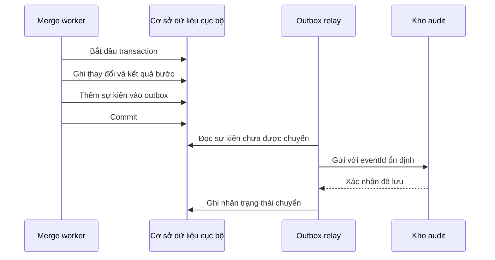

# Account merge audit

## 1. Audit phải giải thích được điều gì sau một lần hợp nhất?

Hợp nhất tài khoản không chỉ chuyển một số bản ghi từ tài khoản này sang tài khoản khác. Nó có thể thay đổi định danh đang được sử dụng, quan hệ sở hữu dữ liệu, phương thức đăng nhập, phiên hoạt động và những đường dẫn mà người dùng có thể dùng để khôi phục quyền truy cập sau này.

Trong account recovery, một lần merge còn có thể bắt đầu sau khi người dùng mất mật khẩu, MFA, passkey hoặc thiết bị xác thực. Khi có tranh chấp hay dấu hiệu chiếm đoạt tài khoản, hệ thống cần giải thích vì sao đã tin người yêu cầu và những gì thực sự xảy ra sau quyết định đó.

**Account merge audit** là cơ chế ghi nhận có cấu trúc để trả lời:

- Ai yêu cầu, xác minh, phê duyệt và thực thi việc hợp nhất?
- Tài khoản nguồn và đích là gì tại thời điểm đó?
- Hướng hợp nhất, phạm vi dữ liệu và chính sách được áp dụng là gì?
- Bằng chứng và sự chấp thuận nào hỗ trợ quyết định, với giới hạn nào?
- Những thay đổi nào đã hoàn tất, thất bại, được thử lại hoặc cần xử lý bù?
- Những phiên, token và quyền nào bị ảnh hưởng?

Audit hữu ích phải phân biệt được **ý định**, **quyết định** và **tác động thực tế**. Một dòng log “merge successful” được ghi ngay sau khi đưa job vào hàng đợi không đủ để chứng minh dữ liệu, quyền và phiên đã được xử lý xong.

## 2. Phân biệt audit với log vận hành và bản sao dữ liệu

Các nguồn quan sát khác nhau phục vụ các mục tiêu khác nhau:

| Nguồn | Mục tiêu chính | Giới hạn |
|---|---|---|
| Audit nghiệp vụ | Chứng minh quá trình ra quyết định và thay đổi trên tài khoản | Không cần chứa toàn bộ dữ liệu người dùng |
| Log vận hành | Chẩn đoán lỗi kỹ thuật, độ trễ, kết nối và xử lý job | Có thể bị lấy mẫu hoặc luân chuyển theo chu kỳ khác |
| Distributed trace | Theo dõi một luồng gọi qua nhiều dịch vụ | Một trace hoàn tất không chứng minh mọi điều kiện nghiệp vụ đã đạt |
| Backup hoặc snapshot | Hỗ trợ khôi phục dữ liệu theo thiết kế | Không thay lịch sử ai đã quyết định điều gì |
| Báo cáo phân tích | Theo dõi xu hướng và số lượng tổng hợp | Có thể không đủ chi tiết để điều tra một trường hợp |

Audit không nên bị lấy mẫu tùy tiện như một số loại log vận hành. Nếu một sự kiện là bắt buộc để chứng minh một bước nhạy cảm, hệ thống phải có cách ghi nhận bền vững cho mỗi lần bước đó thực sự diễn ra.

Ngược lại, không dùng yêu cầu audit làm lý do sao chép toàn bộ giấy tờ định danh, token recovery hay dữ liệu cá nhân vào một kho log chung. Giữ tham chiếu và những giá trị tối thiểu cần thiết thường phù hợp hơn việc tạo thêm một bản sao khó kiểm soát.

## 3. Giữ danh tính nguồn và đích theo lịch sử

Một yêu cầu merge cần được ràng buộc với các định danh nội bộ ổn định, không chỉ với email hoặc tên hiển thị. Các thuộc tính có thể đổi và có thể không còn phản ánh đúng người hoặc tài khoản tại thời điểm xảy ra sự kiện.

Ví dụ, A được hợp nhất vào B. Những sự kiện cũ do A tạo không nên bị viết lại thành “B đã thực hiện” chỉ vì B là tài khoản còn được sử dụng sau merge. Cách thể hiện phù hợp là giữ actor và đối tượng gốc, đồng thời thêm một sự kiện hoặc quan hệ lịch sử giải thích `A → B`.

Một bản ghi liên kết có thể cho biết:

```text
sourceAccountReference
targetAccountReference
mergeOperationId
effectiveAt
relationshipType
relationshipVersion
```

Quan hệ này phục vụ truy vết, không tự trở thành quyền truy cập hoặc một cách đăng nhập thay thế. Việc một account reference cũ trỏ tới target không có nghĩa mọi phiên hoặc recovery token của source được phép truy cập target.

Nếu sau đó B được hợp nhất vào C, audit cần giữ được hai thao tác riêng và thời điểm hiệu lực của từng quan hệ. Không chỉ lưu một ánh xạ hiện tại `A → C` rồi làm mất lịch sử `A → B → C`.

Các tham chiếu lịch sử và ánh xạ danh tính vẫn là dữ liệu nhạy cảm. Cần giới hạn quyền truy cập, thời hạn lưu giữ và cách giải quyết định danh theo chính sách dữ liệu của tổ chức. Không giữ mọi bản sao vô thời hạn chỉ vì chúng nằm trong hệ thống audit.

## 4. Ghi lại căn cứ cho quyết định mà không ghi bí mật

Một kết quả merge có thể được hỗ trợ bởi nhiều loại căn cứ:

- Kết quả xác minh quyền đối với source và target.
- Kết quả recovery nếu một phía trước đó không còn truy cập được.
- Phân loại rủi ro và phiên bản chính sách eligibility.
- Sự chấp thuận của người dùng cho hướng và phạm vi merge.
- Quyết định của reviewer có thẩm quyền khi cần.
- Kết quả kiểm tra quyền, trạng thái tài khoản và xung đột dữ liệu.

Audit nên ghi **tham chiếu tới căn cứ**, kết quả có cấu trúc và phạm vi áp dụng. Không ghi mật khẩu, mã OTP, recovery code, cookie phiên, bearer token hoặc liên kết recovery còn hiệu lực.

| Cần trả lời | Dữ liệu audit phù hợp | Dữ liệu nên tránh |
|---|---|---|
| Đã xác minh tài khoản nào? | Account reference và verification reference | Mật khẩu hoặc OTP đã nhập |
| Đã xác minh theo cách nào? | Loại phương thức, mức bảo đảm và thời điểm | Nội dung bí mật của yếu tố xác thực |
| Người dùng đồng ý điều gì? | Consent reference, digest và phiên bản kế hoạch | Bản sao tùy tiện toàn bộ hồ sơ cá nhân |
| Ai duyệt? | Reviewer reference, thẩm quyền và quyết định | Cookie hoặc token của reviewer |
| Đã xử lý yếu tố nào? | Loại yếu tố, tham chiếu an toàn, kết quả thu hồi | Giá trị recovery code hoặc khóa bí mật |

Hash một mã ngắn không tự làm mã đó an toàn để đưa vào log. Với không gian giá trị nhỏ như OTP, kẻ có log có thể thử các giá trị ứng viên. Tham chiếu do máy chủ tạo, không thể dùng như thông tin xác thực, thường rõ ràng hơn.

Tương tự, hash trực tiếp email có thể bị đối chiếu bằng danh sách địa chỉ dự đoán. Nếu dùng định danh giả danh, cần thiết kế cơ chế và quyền giải tham chiếu phù hợp; không gọi dữ liệu là ẩn danh chỉ vì nó đã qua một hàm hash.

## 5. Actor và thẩm quyền tại thời điểm hành động

Một luồng merge có thể có nhiều actor: người dùng, nhân viên hỗ trợ, reviewer, dịch vụ điều phối và các dịch vụ xử lý dữ liệu. Audit cần biểu diễn được sự khác biệt này.

Một sự kiện có thể mang:

```text
actorType
actorReference
actorRoleAtDecision
actorTenantReference
delegationReference
onBehalfOfReference
authenticationContextReference
authorizationDecisionReference
```

Không dùng một chuỗi `performedBy=system` cho mọi bước chỉ vì job chạy trong backend. Dịch vụ có thể là tác nhân thực thi kỹ thuật, trong khi một người dùng hoặc reviewer là tác nhân đưa ra quyết định. Cần giữ quan hệ nhân quả giữa hai phía.

Nếu nhân viên hỗ trợ thao tác thay người dùng, sự kiện phải thể hiện đúng chế độ đại diện và căn cứ cho phép. Không ghi như thể người dùng trực tiếp đăng nhập và xác nhận khi điều đó không xảy ra.

Quyền tại thời điểm sự kiện có giá trị lịch sử. Nếu nhân viên bị thu hồi quyền sau đó, dữ liệu audit vẫn cần giải thích quyền đã được đánh giá thế nào ở thời điểm trước. Nhưng lưu một role cũ không cho phép dùng role đó để tiếp tục thực hiện công việc mới.

Nguồn actor phải là ngữ cảnh đã được máy chủ xác thực. Không chấp nhận một `actorId` do client tự gửi rồi ghi vào audit như danh tính đáng tin cậy.

## 6. Các sự kiện trong vòng đời merge

Tên sự kiện cần tương ứng với điều đã xảy ra, không gộp các giai đoạn khác nhau thành một trạng thái thành công chung.

| Sự kiện minh họa | Ý nghĩa chính xác |
|---|---|
| `MERGE_REQUESTED` | Máy chủ đã tiếp nhận một yêu cầu trong phạm vi được phép |
| `MERGE_ELIGIBILITY_EVALUATED` | Đã đánh giá một cặp tài khoản và phạm vi theo chính sách |
| `MERGE_CONSENT_RECORDED` | Đã ghi nhận chấp thuận cho kế hoạch cụ thể |
| `MERGE_REVIEW_DECIDED` | Reviewer đã đưa ra quyết định có phạm vi |
| `MERGE_COMMAND_ACCEPTED` | Lệnh đã được nhận và lưu bền vững để xử lý |
| `MERGE_EXECUTION_STARTED` | Một lần xử lý lệnh đã bắt đầu |
| `MERGE_COMPONENT_APPLIED` | Một nhóm thay đổi cụ thể đã hoàn tất tại nơi thực thi |
| `MERGE_SECURITY_EFFECT_CONFIRMED` | Một tác động bảo mật bắt buộc đã được xác nhận |
| `MERGE_EXECUTION_FAILED` | Có lỗi ở một lần thực thi, với phạm vi kết quả đã biết |
| `MERGE_COMPENSATION_RECORDED` | Đã ghi nhận kết quả một bước xử lý bù cụ thể |
| `MERGE_COMPLETED` | Đã đáp ứng tiêu chí hoàn tất của kế hoạch |
| `MERGE_CANCELLED` | Đã hủy theo quy tắc, với tình trạng tác động được nêu rõ |

Không phải hệ thống nào cũng dùng đúng những tên này. Điều quan trọng là schema và ý nghĩa phải ổn định, được sử dụng nhất quán bởi producer và consumer.

Một sự kiện hủy không nên làm người đọc nghĩ chưa có gì thay đổi nếu một phần dữ liệu đã di chuyển. Sự kiện phải nêu trạng thái tác động và tham chiếu những bước đã hoàn tất hoặc còn cần xử lý.

Những yêu cầu bị từ chối cũng cần được ghi nhận ở mức phù hợp để phát hiện lạm dụng. Tuy nhiên, một người chưa có quyền trên source không nên nhận thông tin chi tiết rằng source tồn tại, có MFA hay thuộc một tenant cụ thể chỉ vì hệ thống đã tạo audit nội bộ.

## 7. Một schema sự kiện có thể truy vết

Ví dụ dưới đây dùng các định danh giả lập, không chứa bí mật xác thực:

```json
{
  "schemaVersion": 1,
  "eventId": "evt-merge-8104",
  "eventType": "MERGE_COMPONENT_APPLIED",
  "occurredAt": "2030-05-17T08:31:12Z",
  "recordedAt": "2030-05-17T08:31:12Z",
  "producer": "account-profile-service",
  "mergeOperationId": "merge-op-410",
  "commandId": "merge-command-410",
  "attemptId": "attempt-2",
  "causationEventId": "evt-merge-8100",
  "aggregateReference": "merge-op-410",
  "aggregateSequence": 8,
  "actor": {
    "type": "SERVICE",
    "reference": "account-profile-service"
  },
  "initiatingActorReference": "person-ref-29",
  "sourceAccountReference": "account-ref-A12",
  "targetAccountReference": "account-ref-B34",
  "plan": {
    "reference": "merge-plan-410",
    "version": 3,
    "digestReference": "plan-digest-ref-410-v3",
    "policyVersion": "merge-policy-v6"
  },
  "component": "PROFILE_DATA",
  "result": "APPLIED",
  "changeManifestReference": "manifest-ref-410-profile",
  "reasonCode": "AUTHORIZED_PLAN_EXECUTED"
}
```

`eventId` nhận diện một sự kiện logic. `commandId` nhận diện lệnh nghiệp vụ. `attemptId` phân biệt những lần thử xử lý lệnh. Một lệnh có thể tạo nhiều sự kiện hợp lệ, và một sự kiện có thể được truyền nhiều lần mà không có thêm thay đổi nghiệp vụ.

`causationEventId` giải thích sự kiện nào dẫn đến sự kiện này. `mergeOperationId` giúp tập hợp các sự kiện thuộc cùng quy trình. Các mã tương quan này không phải thông tin xác thực và không được dùng thay kiểm tra quyền khi mở hồ sơ.

`aggregateSequence` cần có phạm vi và cách cấp rõ ràng. Nếu do dịch vụ điều phối cấp, nó thể hiện thứ tự trong luồng điều phối, không tự chứng minh mọi dịch vụ đã thực hiện tác động theo đúng thứ tự đó.

`occurredAt` và `recordedAt` có thể khác nhau khi sự kiện được chuyển trễ. Đồng hồ giữa các dịch vụ có thể lệch, nên không chỉ dựa vào việc sắp xếp timestamp để kết luận nguyên nhân và kết quả. Cần phối hợp sequence, phiên bản và quan hệ nhân quả.

## 8. Ràng buộc audit với đúng kế hoạch và chấp thuận

Một reviewer có thể duyệt kế hoạch A → B chỉ chuyển dữ liệu cá nhân. Nếu job sau đó chuyển thêm membership doanh nghiệp, sự kiện “đã có reviewer approve” không đủ giải thích sự thay đổi đó.

Audit cần liên kết các quyết định với:

- Cặp source và target, cùng hướng merge.
- Phạm vi dữ liệu và chính sách xử lý xung đột.
- Phiên bản kế hoạch và digest của nội dung liên quan.
- Những điều kiện bảo mật phải đạt trước thực thi.
- Consent và approval còn áp dụng tại thời điểm sử dụng.

Digest phải được tính từ biểu diễn ổn định của những trường có ý nghĩa nghiệp vụ. Nếu thứ tự field hoặc cách biểu diễn làm thay đổi digest ngoài ý muốn, khó so sánh cùng một kế hoạch. Ngược lại, nếu bỏ quên trường quan trọng, hai kế hoạch khác tác động có thể được xem như giống nhau.

Một digest chỉ hỗ trợ kiểm tra sự khớp nội dung. Nó không chứng minh người dùng thực sự đã xem nội dung, không chứng minh actor có quyền và không sửa được một kế hoạch sai. Các căn cứ này cần được ghi nhận theo cơ chế riêng.

Khi kế hoạch thay đổi, các sự kiện phải thể hiện việc tạo phiên bản mới và quan hệ với phiên bản trước. Không sửa nội dung kế hoạch cũ rồi để mọi quyết định quá khứ tự trỏ sang phiên bản mới.

## 9. Ghi thay đổi và sự kiện bền vững cùng nhau

Một lỗi phổ biến là cập nhật dữ liệu trước, rồi gửi audit qua mạng sau. Nếu tiến trình dừng giữa hai bước, thay đổi đã xảy ra nhưng không có sự kiện tương ứng. Đảo thứ tự cũng có rủi ro: ghi “đã thay đổi” trước rồi transaction nghiệp vụ bị rollback.

Trong một ranh giới dữ liệu cục bộ, mẫu **transactional outbox** có thể phối hợp thay đổi nghiệp vụ và việc ghi sự kiện cần phát hành:



Pseudocode minh họa:

```java
StepResult applyProfileStep(MergeStepCommand command) {
    return transaction.run(() -> {
        MergePlan plan = plans.loadForExecution(command.planId());
        authorization.requireExecutablePlan(plan, command);

        StepResult previous = steps.findCompletedResult(command.stepKey());
        if (previous != null) {
            require(previous.matchesCommandDigest(command.digest()));
            return previous;
        }

        ProfileChange change = profiles.applyAllowedChanges(plan);
        StepResult result = steps.recordApplied(command, change.manifestReference());

        AuditEvent event = eventFactory.componentApplied(
            command, plan, result, trustedActorContext.current());
        outbox.insert(event);
        return result;
    });
}
```

Ví dụ này giả định thay đổi profile, kết quả bước và outbox dùng cùng ranh giới transaction. Cần thêm ràng buộc duy nhất hoặc cơ chế đồng thời tương ứng cho `stepKey`; chỉ đọc `previous` rồi ghi ở hai request song song là chưa đủ.

Outbox không tự tạo transaction toàn cục giữa mọi dịch vụ. Mỗi nơi thực hiện tác động cần có cách ghi nhận kết quả đáng tin cậy của chính mình. Với tác động bên ngoài không cùng transaction, có thể phải ghi ý định trước, dùng lệnh idempotent và xác nhận kết quả sau; audit phải phân biệt những giai đoạn đó.

## 10. Retry, bản tin trùng và kết quả chưa rõ

Hệ thống phân tán thường có retry do timeout, mất kết nối hoặc tiến trình khởi động lại. Một timeout không chứng minh thao tác thất bại: dịch vụ nhận có thể đã commit nhưng phản hồi chưa về.

Ba loại trùng cần được phân biệt:

1. **Request trùng:** người dùng hoặc client gửi lại cùng lệnh.
2. **Thực thi trùng:** worker cố áp dụng lại cùng một bước.
3. **Sự kiện trùng:** relay gửi lại cùng một sự kiện đã được kho audit lưu.

Mỗi loại cần khóa hoặc định danh riêng. Dùng một `correlationId` chung cho tất cả không tự cung cấp idempotency.

Kho audit có thể khử trùng theo `eventId`. Nếu nhận cùng `eventId` nhưng payload khác, cần phát hiện xung đột thay vì âm thầm ghi đè. Producer nên phát hành lại cùng payload của sự kiện logic đã lưu, không tạo nội dung mới với định danh cũ.

Một retry đã nhận ra kết quả cũ không phải một lần thay đổi dữ liệu mới. Có thể ghi sự kiện quan sát retry riêng nếu cần, nhưng không phát lại một sự kiện “đã áp dụng” với eventId mới khiến báo cáo tưởng có thêm lần merge.

Khi chưa biết tác động đã xảy ra hay chưa, trạng thái nên thể hiện chưa xác định hoặc cần đối soát. Không vội ghi `FAILED_NO_CHANGE` chỉ vì có lỗi mạng. Sau khi xác minh, thêm sự kiện kết quả hoặc đính chính có liên kết với sự kiện trước.

## 11. Audit cho lỗi từng phần và xử lý bù

Một kế hoạch có thể yêu cầu chuyển profile, hợp nhất dữ liệu hoạt động, tính lại quyền, thu hồi phiên và vô hiệu hóa token recovery cũ. Các bước có thể hoàn tất ở những thời điểm khác nhau.

Ví dụ:

| Thành phần | Trạng thái quan sát được | Điều có thể kết luận |
|---|---|---|
| Profile | Đã áp dụng, có manifest | Thay đổi profile đã commit tại dịch vụ đó |
| Dữ liệu hoạt động | Đang retry | Chưa đủ căn cứ để nói toàn bộ đã chuyển |
| Quyền | Chưa bắt đầu | Chưa được coi kết quả quyền là hoàn tất |
| Phiên source | Đã yêu cầu thu hồi | Chưa đồng nghĩa mọi điểm xác thực đã xác nhận thu hồi |
| Token recovery cũ | Đã xác nhận vô hiệu | Bước tương ứng đã đạt tiêu chí xác nhận |

Một trạng thái tổng có thể là `PARTIALLY_APPLIED`, đi kèm kết quả từng thành phần và những giới hạn đang được áp dụng. Không dùng một cờ `success=false` để che mất việc dữ liệu đã thay đổi một phần.

Nếu cần xử lý bù, audit ghi rõ lệnh bù nào được đưa ra, ai cho phép, phần nào đã thực hiện và phần nào không thể hoàn tác. Xử lý bù không nhất thiết khôi phục thế giới về đúng trạng thái trước merge: thông báo đã gửi, dữ liệu đã được xem hoặc sự kiện đã phát ra có thể không đảo ngược được.

Không xóa các sự kiện của lần áp dụng đầu chỉ vì đã xử lý bù thành công. Lịch sử cần thể hiện cả thay đổi ban đầu và hành động khắc phục.

## 12. Tiêu chí hoàn tất và tác động bảo mật

Sự kiện `MERGE_COMPLETED` phải dựa trên tiêu chí được định nghĩa cho kế hoạch, không chỉ dựa trên việc worker chính đã chạy hết hàm.

Những điều kiện cần được xem xét gồm:

- Những thành phần dữ liệu bắt buộc đã có kết quả cuối phù hợp.
- Định danh source được chuyển trạng thái và ánh xạ theo kế hoạch.
- Quyền truy cập đã được tính lại hoặc giữ theo đúng chính sách.
- Những phiên và thông tin xác thực bị ảnh hưởng đã được xử lý theo yêu cầu.
- Những token recovery hoặc lệnh cũ có thể gây xung đột đã được vô hiệu hóa theo phạm vi.
- Những sự kiện bắt buộc đã được ghi bền vững và không còn kết quả chưa rõ cần chặn hoàn tất.

“Đã ghi bền vững” có thể là đã commit vào outbox đáng tin cậy hoặc đã đến kho audit theo contract của hệ thống. Cần nói rõ contract này; không mô tả sự kiện đã đến kho trung tâm nếu thực tế mới ở hàng đợi cục bộ.

Với thu hồi phiên, cần phân biệt gửi lệnh thu hồi và đạt mức hiệu lực được yêu cầu. Nếu kiến trúc có độ trễ lan truyền, trạng thái và điều kiện hoàn tất phải phản ánh giới hạn đó. Không tuyên bố mọi phiên trên mọi dịch vụ đã mất hiệu lực chỉ vì một API trả lời đã nhận yêu cầu.

## 13. Chống sửa audit và giới hạn của cơ chế toàn vẹn

Audit cần có kiểm soát truy cập và cơ chế bảo vệ lịch sử. Các lớp thường được xem xét gồm quyền ghi theo producer, quyền đọc theo nhiệm vụ, hạn chế sửa/xóa và chuyển bản sao tới một miền quản trị tách biệt.

Một mô hình append-only có thể cho phép thêm sự kiện đính chính thay vì sửa bản ghi cũ. Sự kiện đính chính cần trỏ tới bản ghi bị ảnh hưởng, nêu lý do và người có thẩm quyền thực hiện. Điều này khác với việc mọi producer được tự viết lại lịch sử của mình.

Hash chain hoặc chữ ký có thể hỗ trợ phát hiện thay đổi nội dung khi có các giả định phù hợp. Tuy nhiên:

- Một hash chain không tự ngăn xóa cả đoạn cuối nếu không có mốc đối chiếu độc lập.
- Một chữ ký chứng minh nguồn nắm khóa đã ký nội dung, không chứng minh nội dung nghiệp vụ là sự thật.
- Nếu cả producer và khóa bị chiếm quyền, sự kiện giả có thể vẫn có chữ ký hợp lệ.
- Rotation khóa, quyền sử dụng khóa và khả năng kiểm tra lịch sử cần được thiết kế cùng cơ chế ký.

Do đó, toàn vẹn audit là sự phối hợp của kiểm soát quyền, lưu trữ, quản lý khóa, đối soát và khả năng phát hiện thiếu sự kiện. Không gọi một kho là không thể sửa chỉ vì có thêm trường hash.

## 14. Quyền đọc audit và giảm lộ dữ liệu

Người điều tra sự cố, nhân viên hỗ trợ và bộ phận phân tích không nhất thiết cần cùng một mức chi tiết. Một thiết kế có thể cho hỗ trợ xem trạng thái merge, cho điều tra viên xem actor và căn cứ, còn báo cáo vận hành chỉ nhận số liệu tổng hợp.

Cần kiểm tra tenant và phạm vi hồ sơ khi truy vấn audit. Biết `mergeOperationId` không cấp quyền xem mọi tài khoản liên quan. Việc xuất báo cáo hoặc giải tham chiếu danh tính nhạy cảm cũng cần được kiểm soát và ghi nhận phù hợp.

Đối với input do người dùng cung cấp như lý do hoặc ghi chú, nên dùng trường có cấu trúc, giới hạn độ dài và xử lý hiển thị theo ngữ cảnh. Không ghép trực tiếp nội dung chưa tin cậy vào một dòng log khiến dấu xuống dòng hoặc ký tự điều khiển có thể giả tạo thêm sự kiện.

Thời hạn lưu giữ cần được xác định theo nhu cầu điều tra, yêu cầu dữ liệu và chính sách của tổ chức. Các bản sao trong kho tìm kiếm, bản xuất, hàng đợi lỗi và backup cần được đưa vào thiết kế lưu giữ; chỉ xóa bản ghi ở giao diện chính không xử lý mọi bản sao.

Khi cần hạn chế hoặc xóa dữ liệu nhận diện, một thiết kế tách tham chiếu khỏi dữ liệu giải tham chiếu có thể hữu ích. Tuy nhiên, cần đánh giá mức độ còn có thể liên kết lại từ những trường khác; giả danh không đồng nghĩa với không còn khả năng nhận diện.

## 15. Khi hệ thống audit gặp sự cố

Không nên để lỗi kho phân tích từ xa làm mất sự kiện mà không ai biết. Đồng thời, không phải mọi gián đoạn của kho đọc audit đều đồng nghĩa phải dừng mọi hoạt động nếu hệ thống vẫn ghi nhận bền vững được theo contract.

Có thể phân biệt:

| Sự cố | Phản ứng cần cân nhắc |
|---|---|
| Không ghi được sự kiện bắt buộc cùng thay đổi cục bộ | Không commit thay đổi nhạy cảm nếu contract yêu cầu cả hai cùng bền vững |
| Outbox đã commit nhưng kho audit tạm không nhận | Giữ sự kiện, retry có kiểm soát, theo dõi backlog |
| Backlog vượt giới hạn an toàn | Giới hạn hoặc tạm dừng công việc mới theo chính sách |
| Consumer đọc lỗi một sự kiện | Cách ly để xử lý, giữ khả năng truy vết và cảnh báo |
| Chưa xác định một tác động đã commit hay chưa | Đối soát kết quả, không tạo kết luận thành công hoặc thất bại sai |

Hàng đợi cách ly hoặc dead-letter cũng cần bảo vệ dữ liệu. Một sự kiện bị lỗi schema không phải lý do để in toàn bộ payload nhạy cảm ra log chẩn đoán hoặc sao chép sang nơi có quyền đọc rộng hơn.

Khi khôi phục, cần xác nhận các sự kiện chưa chuyển đã được xử lý và các xung đột eventId được giải quyết. Việc relay hết lỗi không chứng minh không còn khoảng trống lịch sử.

## 16. Đối soát và phát hiện hành vi bất thường

Đối soát kết hợp trạng thái nghiệp vụ, kết quả từng bước và lịch sử audit để tìm điểm không nhất quán. Ví dụ:

- Một source đã ở trạng thái merged nhưng không có kế hoạch hoặc lệnh tương ứng.
- Có `MERGE_COMPLETED` nhưng một bước bảo mật bắt buộc chưa được xác nhận.
- Có thay đổi dữ liệu nhưng thiếu sự kiện áp dụng ở producer liên quan.
- Có hai hướng merge xung đột cùng được ghi nhận như đang hoạt động.
- Có quyết định dựa trên phiên bản kế hoạch khác với phiên bản đã thực thi.
- Một chuỗi sự kiện có khoảng thiếu mà chưa có lý do được ghi nhận.

Không phải mọi khoảng thiếu sequence hoặc bản tin đến trễ đều là tấn công. Chúng có thể do cách phân vùng, cơ chế cấp số hoặc độ trễ truyền tin. Quy tắc phát hiện cần dựa trên contract đã thiết kế, rồi xác minh bằng nguồn dữ liệu có thẩm quyền.

Audit cũng hỗ trợ nhận diện một actor thực hiện nhiều merge bất thường, nhiều tài khoản nguồn cùng chảy về một target, hoặc nhiều lần override xuất hiện sau recovery. Các mẫu này là tín hiệu điều tra, không tự chứng minh hành vi sai phạm.

Chỉ số số lượng merge hoặc thời gian xử lý không đủ để đánh giá an toàn. Cần nhìn cả tỷ lệ lỗi từng phần, backlog audit, số kết quả chưa rõ và những quyết định không khớp chính sách.

## 17. Tình huống tổng hợp: timeout sau khi dữ liệu đã thay đổi

Người dùng có tài khoản A vừa recovery và tài khoản B đang dùng. Sau khi xác minh quyền trên cả hai, hệ thống tạo kế hoạch A → B chỉ chuyển dữ liệu cá nhân, yêu cầu thu hồi các phiên bị ảnh hưởng và vô hiệu hóa token recovery cũ.

Người dùng xác nhận đúng kế hoạch phiên bản 3. Lệnh được lưu bền vững, rồi dịch vụ profile áp dụng thay đổi và ghi outbox trong cùng transaction. Phản hồi tới dịch vụ điều phối bị mất.

Dịch vụ điều phối không nên ghi “profile thất bại, không có thay đổi”. Nó đánh dấu cần xác định kết quả hoặc retry theo cùng khóa bước. Dịch vụ profile nhận retry, tìm kết quả đã lưu và trả lại kết quả đó, không áp dụng lần hai.

Outbox có thể gửi cùng sự kiện hai lần. Kho audit khử trùng theo eventId và giữ một sự kiện logic. Một sự kiện quan sát retry, nếu có, được phân biệt với sự kiện thay đổi dữ liệu.

Trong lúc đó, thu hồi phiên mới ở trạng thái đã nhận yêu cầu. Quy trình chưa được coi là hoàn tất theo tiêu chí yêu cầu xác nhận tác động bảo mật. Khi đủ các xác nhận bắt buộc và kết quả dữ liệu cuối cùng, dịch vụ điều phối mới ghi `MERGE_COMPLETED`.

Sau này, điều tra viên có thể nối consent phiên bản 3, lệnh, lần thử, kết quả profile và xác nhận thu hồi. Lịch sử giữ actor gốc của A, đồng thời thể hiện quan hệ merge sang B; không cần xem mật khẩu, OTP hay token recovery để hiểu quá trình.

## 18. Những lỗi audit dễ dẫn tới kết luận sai

| Lỗi | Hệ quả | Cách thể hiện đúng hơn |
|---|---|---|
| Ghi thành công khi mới xếp hàng | Tưởng tác động đã hoàn tất | Phân biệt accepted, started, component applied và completed |
| Ghi actor luôn là system | Mất căn cứ ai yêu cầu và ai duyệt | Tách actor thực thi với actor khởi tạo và phê duyệt |
| Đổi mọi sự kiện nguồn sang target | Sai lịch sử và mất khả năng điều tra | Giữ định danh gốc cùng quan hệ merge theo thời gian |
| Ghi raw token để tiện tra cứu | Audit trở thành nguồn chiếm quyền | Dùng tham chiếu không phải bí mật |
| Timeout được coi là không thay đổi | Bỏ sót tác động đã commit | Ghi kết quả chưa rõ và đối soát hoặc retry idempotent |
| Gửi audit sau commit mà không có bảo đảm | Có thay đổi không có dấu vết | Phối hợp ghi bền vững theo ranh giới transaction phù hợp |
| Retry tạo sự kiện áp dụng mới mỗi lần | Báo cáo đếm thêm các thay đổi không tồn tại | Giữ eventId logic và tách sự kiện retry |
| Ghi đè audit khi xử lý bù | Che mất tác động và quyết định ban đầu | Thêm sự kiện bù hoặc đính chính có liên kết |
| Chỉ sắp xếp timestamp để suy ra nhân quả | Kết luận sai khi đồng hồ lệch hoặc bản tin trễ | Dùng thêm causation, sequence và phiên bản |
| Coi chữ ký là bằng chứng nội dung đúng | Tin sự kiện giả từ producer bị chiếm quyền | Phối hợp toàn vẹn, phân quyền và đối soát nghiệp vụ |

Audit account merge cần giữ được chuỗi căn cứ từ người yêu cầu đến kết quả cuối, với trạng thái và phạm vi rõ ở từng bước. Khi dữ liệu, định danh và quyền truy cập thay đổi sau recovery, lịch sử này giúp hệ thống chứng minh điều đã xảy ra, nhận diện điều chưa chắc chắn và xử lý sự cố mà không tạo thêm một kho bí mật dễ bị lạm dụng.
