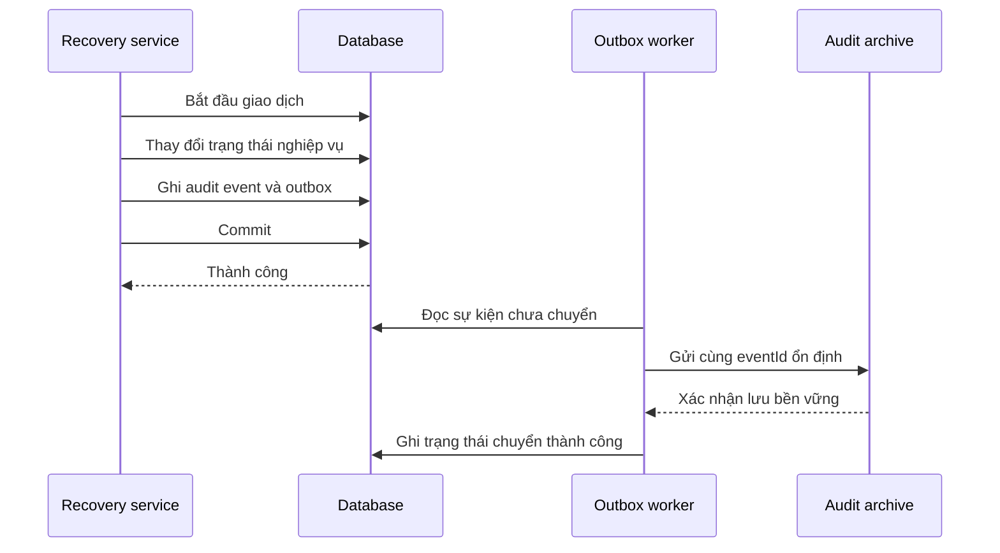

# Preserving audit history

## 1. Vì sao recovery phải giữ được lịch sử?

Khôi phục tài khoản có thể làm thay đổi mật khẩu, MFA, passkey, kênh liên hệ và các phiên đang hoạt động. Sau những thay đổi đó, hệ thống vẫn cần trả lời được: ai đề nghị, ai xác minh, quyết định nào được đưa ra, thay đổi nào thực sự hoàn tất và dữ liệu nào đã được giữ hoặc chuyển.

**Preserving audit history** là bảo toàn lịch sử sự kiện có ý nghĩa kiểm toán qua toàn bộ vòng đời recovery, kể cả khi tài khoản được hợp nhất, đổi định danh, đóng hoặc phục hồi từ bản sao lưu. Bảo toàn không chỉ là “log vẫn còn”: sự kiện phải giữ đúng chủ thể, ngữ cảnh, thứ tự có thể giải thích và mức tin cậy của nguồn ghi nhận.

Trong phạm vi `SECURITY_AUTHENTICATION_ACCOUNT_RECOVERY`, lịch sử giúp điều tra yêu cầu giả mạo, giải quyết tranh chấp, phát hiện sai sót xử lý và chứng minh chuỗi hành động đã xảy ra. Nó không thay thế xác minh danh tính hoặc tự cấp quyền khôi phục.

Ví dụ: một tài khoản bị đổi MFA qua hỗ trợ rồi được hợp nhất vào tài khoản khác. Nếu hệ thống sửa mọi sự kiện cũ thành tên tài khoản đích, người điều tra có thể không còn phân biệt được người gửi yêu cầu ban đầu, tài khoản chịu tác động và nhân viên đã phê duyệt. Dữ liệu vẫn tồn tại nhưng ý nghĩa lịch sử đã mất.

## 2. Audit history khác log vận hành

Các loại dữ liệu có mục đích khác nhau:

| Loại | Mục đích chính | Ví dụ |
|---|---|---|
| Audit event | Ghi nhận hành động và kết quả có ý nghĩa trách nhiệm | Request recovery bị từ chối bởi chủ thể có thẩm quyền |
| Log vận hành | Chẩn đoán hoạt động phần mềm | Gọi dịch vụ thông báo bị timeout |
| Security telemetry | Phát hiện hành vi hoặc rủi ro | Nhiều lần thử token sai trong một khoảng thời gian |
| Bằng chứng xác minh | Hỗ trợ đánh giá quyền recovery | Kết quả đánh giá hoặc tài liệu trong kho chuyên dụng |

Không phải mọi dòng debug đều cần lưu như audit, và không nên đưa toàn bộ bằng chứng vào log để gọi đó là “đầy đủ”. Audit thường giữ kết luận cùng tham chiếu phiên bản bằng chứng; dữ liệu nhạy cảm gốc được bảo vệ ở nơi phù hợp.

Audit cũng không nhất thiết là nguồn dùng để phát lại toàn bộ trạng thái nghiệp vụ. Nếu hệ thống dùng event sourcing, cần hợp đồng riêng cho các sự kiện có thể tái dựng trạng thái. Không lấy mọi audit event rồi chạy lại thao tác đổi mật khẩu hoặc cấp token.

## 3. Những sự kiện cần bảo toàn trong recovery

Danh mục sự kiện cần theo mô hình sản phẩm. Một chuỗi điển hình có thể gồm:

```text
RECOVERY_CASE_CREATED
RECOVERY_EVIDENCE_SUBMITTED
RECOVERY_ASSESSMENT_RECORDED
RECOVERY_APPROVAL_REQUEST_CREATED
RECOVERY_DECISION_RECORDED
RECOVERY_GRANT_ISSUED
RECOVERY_GRANT_CONSUMED
AUTHENTICATION_FACTOR_CHANGED
SESSION_REVOCATION_REQUESTED
SESSION_REVOCATION_COMPLETED
RECOVERY_CASE_CLOSED
```

Tên chỉ minh họa; mỗi sự kiện phải có ngữ nghĩa rõ ràng.

Đặc biệt cần tách:

- Đề nghị một thay đổi và thay đổi đã hoàn tất.
- Phê duyệt recovery và cấp quyền thực thi recovery.
- Phát hành token và token đã được sử dụng thành công.
- Yêu cầu thu hồi phiên và dịch vụ phiên đã xác nhận thu hồi.
- Đưa thông báo vào hàng đợi và gửi thông báo thành công.

Không ghi `AUTHENTICATION_FACTOR_CHANGED` trước khi giao dịch thay yếu tố xác thực có hiệu lực. Nếu thao tác thất bại, lịch sử phải phản ánh thất bại hoặc chỉ có sự kiện đề nghị, không tạo ấn tượng rằng tài khoản đã đổi thành công.

Các yêu cầu bị từ chối, bị hủy hoặc hết hạn cũng cần dấu vết phù hợp. Chỉ giữ các ca thành công sẽ làm mất dữ liệu quan trọng về lạm dụng và quá trình ra quyết định.

## 4. Giữ đúng danh tính của các bên

Một sự kiện recovery thường có nhiều chủ thể:

| Trường khái niệm | Ý nghĩa |
|---|---|
| `actor` | Người hoặc dịch vụ thực hiện thao tác |
| `subject` | Tài khoản hoặc đối tượng chịu tác động |
| `initiator` | Chủ thể khởi đầu chuỗi yêu cầu, nếu khác actor |
| `reviewer` | Chủ thể đưa ra quyết định xét duyệt, nếu có |
| `executor` | Dịch vụ thực thi thay đổi, nếu tách khỏi reviewer |

Ví dụ: một nhân viên duyệt đề nghị, còn dịch vụ recovery thực hiện đổi phương thức xác thực. Sự kiện quyết định có actor là nhân viên; sự kiện thực thi có actor là dịch vụ và liên kết tới quyết định đã cho phép. Không gộp cả hai thành một trường “user”.

Nên dùng định danh nội bộ ổn định, không tái cấp cho một tài khoản khác sau khi xóa. Email, tên hiển thị và số điện thoại có thể thay đổi hoặc được tái sử dụng; chúng không phù hợp làm khóa lịch sử duy nhất.

Thông tin vai trò và phạm vi tại thời điểm quyết định cần được lưu hoặc tham chiếu tới phiên bản có thể kiểm tra. Việc nhân viên hôm nay có quyền quản trị không tự chứng minh họ đã có quyền đó khi xử lý case trước đây.

Ngược lại, quyền xem lịch sử hôm nay phải kiểm tra theo chính sách hiện hành. Có tên trong một sự kiện cũ không đồng nghĩa mãi mãi được đọc toàn bộ lịch sử của tài khoản.

## 5. Một cấu trúc sự kiện tối thiểu

Ví dụ một sự kiện ghi nhận quyết định:

```json
{
  "eventId": "ae_example_173",
  "schemaVersion": 2,
  "eventType": "RECOVERY_DECISION_RECORDED",
  "tenantRef": "tenant_example_28",
  "subjectRef": "account_example_490",
  "actorRef": "staff_example_61",
  "actorKind": "SUPPORT_REVIEWER",
  "caseRef": "rc_example_327",
  "requestRef": "ar_example_820",
  "proposalRevision": 4,
  "operationRef": "op_example_916",
  "outcome": "REJECTED",
  "reasonCode": "EVIDENCE_REQUIREMENTS_NOT_MET",
  "policyVersion": "recovery-policy-example-v7",
  "assessmentVersionRef": "assessment_example_79_v3",
  "occurredAt": "2030-02-15T09:12:00Z",
  "recordedAt": "2030-02-15T09:12:01Z",
  "streamRef": "stream_example_94",
  "streamSequence": 842
}
```

Giá trị là minh họa. Các mã tham chiếu không phải token và không tự cấp quyền truy cập dữ liệu.

Các trường quan trọng cần được giải thích nhất quán:

- `eventId` nhận diện một sự kiện logic để chống trùng.
- `operationRef` nối các sự kiện thuộc cùng thao tác hoặc một lần xử lý.
- `schemaVersion` cho biết cách diễn giải dữ liệu, không phải phiên bản tài khoản.
- `proposalRevision` gắn quyết định với đúng nội dung được xét.
- `occurredAt` và `recordedAt` tách thời điểm sự kiện được xác lập với thời điểm nơi lưu nhận nó.
- `streamSequence` cung cấp thứ tự trong một stream được định nghĩa, không mặc nhiên là thứ tự toàn hệ thống.

Một số thông tin có thể được chuyển thành tham chiếu tới snapshot được bảo vệ để giảm dữ liệu trong event. Nhưng tham chiếu phải còn đủ ý nghĩa và được quản lý vòng đời; một đường dẫn trỏ tới bản ghi đã bị ghi đè không bảo toàn ngữ cảnh cũ.

## 6. Bảo toàn lịch sử khi tài khoản thay đổi hoặc hợp nhất

Khi tài khoản A được merge vào B, không sửa `subjectRef=A` của mọi sự kiện cũ thành B. Các sự kiện đó đã xảy ra đối với A và cần giữ nguyên sự thật này.

Thay vào đó, ghi một sự kiện liên kết riêng:

```text
ACCOUNT_MERGE_COMPLETED
source_subject_ref = A
target_subject_ref = B
merge_operation_ref = M
policy_version = P
completed_at = T
```

Lớp tra cứu có thể hiển thị lịch sử liên quan qua quan hệ merge, nhưng phải phân biệt “sự kiện gốc của A” và “sự kiện gốc của B”. Không chỉ nối danh sách rồi xóa mất nguồn.

Quan hệ liên kết cũng phải có phạm vi quyền đọc. Chủ tài khoản B sau merge không tự động được xem mọi ghi chú nội bộ, thông tin tổ chức hoặc dữ liệu của bên thứ ba từng xuất hiện trong lịch sử A. Hợp nhất dữ liệu nghiệp vụ và cho phép xem lịch sử là các quyết định khác nhau.

Khi tài khoản bị đóng hoặc xóa theo chính sách, cần tránh việc khóa ngoại `ON DELETE CASCADE` vô tình xóa toàn bộ audit cần giữ. Có thể dùng subject registry hoặc bản ghi tham chiếu tối thiểu để bảo toàn định danh lịch sử trong phạm vi được phép.

Bản ghi tham chiếu không nên trở thành bản sao hồ sơ đầy đủ được lưu vô thời hạn. Nó chỉ cần đủ để diễn giải sự kiện theo chính sách dữ liệu áp dụng. Không dùng việc “giữ audit” làm lý do mặc định giữ mọi email, giấy tờ và dữ liệu cá nhân gốc.

Đổi email hoặc tên hiển thị cũng không nên làm giao diện lịch sử khẳng định rằng giá trị hiện tại đã tồn tại vào thời điểm cũ. Nếu hiển thị thông tin hiện tại để tiện tra cứu, phải gắn nhãn rõ và không nhầm với snapshot lịch sử.

## 7. Ghi audit cùng ranh giới giao dịch

Một rủi ro phổ biến là dữ liệu nghiệp vụ đã thay đổi nhưng sự kiện kiểm toán bị mất vì tiến trình dừng giữa hai bước.

Ví dụ thiết kế dễ mất dấu:

```text
1. Commit thay đổi MFA.
2. Gửi audit qua mạng.
3. Tiến trình dừng trước khi bước 2 hoàn tất.
```

Có thể dùng một bản ghi audit bền vững hoặc outbox trong cùng giao dịch với thay đổi có thẩm quyền:



Đối với thao tác bảo mật được yêu cầu phải có audit, nếu không ghi được phần audit bền vững bắt buộc trong giao dịch thì không nên báo thao tác đã hoàn tất. Không âm thầm bỏ audit chỉ vì kho lưu trữ ở xa đang lỗi.

Kho lưu trữ ở xa có thể tạm không truy cập được trong khi outbox tại nguồn vẫn bền vững. Hệ thống cần giới hạn backlog, cảnh báo và chính sách xử lý khi không còn khả năng bảo đảm lưu. Quyết định vận hành đó phải rõ ràng thay vì mặc định bỏ sự kiện cũ khi hàng đợi đầy.

Nếu thay đổi trải qua nhiều dịch vụ, mỗi nơi ghi sự thật mà nó có thẩm quyền xác nhận và liên kết bằng operation reference. Một sự kiện “đã yêu cầu” ở dịch vụ recovery không được thay cho xác nhận “đã hoàn tất” ở dịch vụ quản lý phiên.

## 8. Chống mất, trùng và sai thứ tự

Vận chuyển sự kiện thường có thể giao lại sau timeout. Kho audit cần chống trùng bằng `eventId` hoặc định danh tương đương, thay vì loại trùng theo timestamp và nội dung gần giống nhau.

| Tình huống | Xử lý cần có |
|---|---|
| Cùng eventId, cùng nội dung đã xác thực | Xác nhận đã lưu, không thêm sự kiện logic mới |
| Cùng eventId, nội dung khác | Báo xung đột tính toàn vẹn; không ghi đè |
| Thiếu một sequence trong stream | Đánh dấu khoảng trống và kiểm tra nguồn hoặc backlog |
| Sự kiện đến trễ | Giữ thời điểm nhận và thứ tự stream; không giả vờ đã đến đúng lúc |
| Hai stream khác nhau | Dùng quan hệ nhân quả nếu có; không suy ra thứ tự tuyệt đối chỉ từ giờ máy |

Timestamp giúp tìm kiếm nhưng không phải bằng chứng duy nhất về thứ tự. Đồng hồ có thể lệch; một sự kiện được chuyển chậm có thể tới kho sau sự kiện xảy ra muộn hơn.

Sequence chỉ có ý nghĩa khi được cấp theo một quy trình nhất quán. Nếu nhiều writer cùng ghi một stream, phải phối hợp việc cấp số và ghi dữ liệu bằng cơ chế phù hợp. Không để hai writer cùng lấy “số hiện tại cộng một” mà không có kiểm soát đồng thời.

Có thể chia stream theo tenant hoặc đối tượng để giảm tranh chấp, nhưng cần định nghĩa cách truy vết thao tác liên quan nhiều stream. Một số sequence liền nhau không chứng minh rằng mọi hành động nghiệp vụ đều đã được ghi: nguồn có thể đã bỏ qua sự kiện trước khi nó được cấp sequence.

## 9. Append-only và khả năng phát hiện sửa đổi

Lịch sử kiểm toán thường được lưu theo mô hình append-only: không sửa trực tiếp kết luận cũ khi có thông tin mới. Khi cần đính chính, ghi sự kiện bổ sung liên kết tới sự kiện trước, nêu điều được sửa và căn cứ.

Ví dụ: một quyết định từ chối sau đó được xét lại. Giữ sự kiện từ chối ban đầu và thêm sự kiện mở lại hoặc quyết định mới. Không đổi bản ghi cũ từ `REJECTED` thành `APPROVED` rồi làm mất dấu vết về quá trình.

Append-only ở tầng ứng dụng chưa đủ nếu tài khoản ứng dụng vẫn có quyền `UPDATE` và `DELETE` toàn bảng audit. Cần phân quyền lưu trữ, tách quyền vận hành, kiểm soát tác vụ quản trị và cơ chế lưu giữ phù hợp với yêu cầu thực tế.

Có thể sử dụng chuỗi hash hoặc MAC để hỗ trợ phát hiện chỉnh sửa. Một dạng khái quát:

```text
tag[n] = HMAC(
    key,
    domain || tag[n-1] || sequence[n] || length(event[n]) || event[n]
)
```

Trong đó `event[n]` là các byte của envelope đã được chuẩn hóa theo schema; envelope phải gắn với stream, định danh sự kiện và thông tin phiên bản cần bảo vệ. Việc đóng khung độ dài và quy định encoding tránh hai cách biểu diễn khác nhau bị hiểu như cùng một chuỗi ghép.

Chuỗi này chỉ hữu ích khi nơi kiểm tra có mốc tin cậy và khóa được bảo vệ. Nếu người tấn công kiểm soát cả dữ liệu, khóa và mọi mốc cuối, họ có thể tạo lại chuỗi. Một chuỗi hợp lệ cũng không chứng minh sự kiện là thật nếu nguồn ghi đã bị chiếm quyền.

## 10. Minh họa tạo MAC liên kết bằng Java

Đoạn mã sau minh họa phần tính MAC cho một sự kiện. Nó không tự lưu audit, cấp sequence hay quản lý khóa.

```java
import java.nio.ByteBuffer;
import java.nio.charset.StandardCharsets;
import java.security.GeneralSecurityException;
import java.util.Objects;
import javax.crypto.Mac;
import javax.crypto.SecretKey;

public final class AuditChainMac {
    private static final byte[] DOMAIN =
        "RECOVERY_AUDIT_CHAIN_V1".getBytes(StandardCharsets.UTF_8);

    public byte[] calculate(
            SecretKey key,
            byte[] previousTag,
            long sequence,
            byte[] canonicalEnvelope) throws GeneralSecurityException {
        Objects.requireNonNull(key);
        Objects.requireNonNull(previousTag);
        Objects.requireNonNull(canonicalEnvelope);

        if (previousTag.length != 32
                || sequence < 1
                || canonicalEnvelope.length == 0) {
            throw new IllegalArgumentException("Invalid audit chain input");
        }

        Mac mac = Mac.getInstance("HmacSHA256");
        mac.init(key);
        mac.update(DOMAIN);
        mac.update(previousTag);
        mac.update(ByteBuffer.allocate(Long.BYTES).putLong(sequence).array());
        mac.update(ByteBuffer.allocate(Integer.BYTES)
            .putInt(canonicalEnvelope.length).array());
        return mac.doFinal(canonicalEnvelope);
    }
}
```

Các điều kiện ngoài đoạn mã cần được quy định:

- `canonicalEnvelope` có encoding, thứ tự và kiểu trường nhất quán; không dựa vào thứ tự key ngẫu nhiên của một serializer.
- Envelope chứa `streamRef`, `eventId`, sequence, schema version và tham chiếu khóa tương ứng; sequence trong envelope phải khớp tham số tính MAC.
- Envelope không bao gồm chính tag đang tính. Tag và metadata vận chuyển được lưu tách theo định dạng đã định nghĩa.
- Giá trị mở đầu stream, định danh stream và quy tắc nối segment được xác lập qua metadata tin cậy. Một mảng zero không tự chứng minh đâu là đầu lịch sử hợp lệ.
- Sequence được cấp và chuỗi được nối theo thứ tự nhất quán, có bảo vệ khỏi ghi đồng thời.
- Khóa không được hardcode, ghi vào log hoặc lưu cùng quyền truy cập với dữ liệu cần bảo vệ.

HMAC dùng khóa đối xứng: bên có khóa kiểm tra cũng có thể tạo MAC. Vì vậy nó không cung cấp khả năng chứng minh một tác giả duy nhất trước các bên cùng giữ khóa. Nếu cần kiểm chứng độc lập, có thể dùng cơ chế chữ ký và mốc lưu độc lập phù hợp với mô hình tin cậy.

Khi luân chuyển khóa, cần lưu tham chiếu khóa và quy tắc xác minh qua từng giai đoạn. Không xóa khóa kiểm tra còn cần thiết trước khi kết thúc thời hạn của dữ liệu tương ứng, trừ khi có thiết kế lưu trữ và kiểm chứng thay thế rõ ràng.

## 11. Mốc tin cậy và giới hạn của kiểm chứng

Một người có thể xóa phần cuối của chuỗi, để lại phần đầu vẫn kiểm chứng được. Nếu không biết đã từng có bao nhiêu sự kiện, người kiểm tra có thể không phát hiện việc cắt đuôi.

Do đó có thể định kỳ lưu checkpoint gồm stream, sequence cuối và tag cuối ở nơi độc lập hoặc trong manifest được bảo vệ. Khi kiểm tra, so sánh dữ liệu với mốc đã biết thay vì chỉ kiểm tra những dòng còn hiện hữu.

Mốc cũng cần được bảo vệ khỏi rollback. Khôi phục kho audit và checkpoint về cùng một bản cũ có thể che giấu sự kiện mới nếu không có nguồn đối chiếu độc lập.

Tính toàn vẹn của chuỗi không chứng minh tính đầy đủ của toàn bộ nghiệp vụ. Cần đối chiếu các quyết định và thao tác nhạy cảm với bản ghi tại nguồn, outbox, trạng thái chuyển giao và các kiểm soát vận hành. Một hành động bị thực hiện ngoài đường code có audit có thể không xuất hiện trong chuỗi dù mọi tag hiện có đều đúng.

Kiểm chứng còn cần bộ đọc tương thích schema cũ. Không sửa dữ liệu lịch sử cho phù hợp schema mới rồi tính lại tag như thể chưa từng thay đổi. Có thể tạo biểu diễn dẫn xuất để tìm kiếm, nhưng giữ bản gốc được bảo vệ cùng quy tắc diễn giải của nó.

## 12. Bảo vệ dữ liệu nhạy cảm trong lịch sử

Giữ audit đầy đủ không có nghĩa giữ mọi bí mật. Không đưa các dữ liệu sau vào audit payload hoặc log thông thường:

- Mật khẩu, password hash, mã OTP hoặc recovery code.
- Token recovery đầy đủ, session cookie hoặc bearer token.
- Bí mật MFA, private key hoặc dữ liệu có thể tái tạo quyền đăng nhập.
- Ảnh giấy tờ và nội dung xác minh gốc khi chỉ cần tham chiếu.
- Ghi chú tự do chứa thông tin cá nhân không cần thiết cho mục đích kiểm toán.

Muốn liên kết một token với hành động, dùng token reference không mang quyền, thay vì lưu token. Muốn liên kết bằng chứng, dùng evidence reference được kiểm soát truy cập và phiên bản đánh giá.

Một hash của dữ liệu nhạy cảm không tự trở thành dữ liệu vô danh. Giá trị có không gian đoán nhỏ có thể bị thử lại để đối chiếu; định danh vẫn có thể liên kết với người dùng qua nguồn khác. Cần xác định nhu cầu, phạm vi người đọc và cơ chế bảo vệ thích hợp.

Mã hóa lưu trữ, quyền truy cập theo vai trò và tách khóa giúp giảm rủi ro. Nhưng mã hóa không thay thế việc hạn chế nội dung thu thập: người có quyền giải mã vẫn đọc được dữ liệu không cần thiết đã bị ghi vào đó.

Truy cập và xuất audit cũng cần dấu vết riêng. Người hỗ trợ được xem trạng thái case có thể không được tải toàn bộ lịch sử hoặc bằng chứng; nhân viên điều tra cần phạm vi cụ thể thay vì quyền đọc mọi tenant.

## 13. Retention, xóa có kiểm soát và lưu trữ dài hạn

Append-only là nguyên tắc bảo toàn diễn biến trong thời gian lưu hợp lệ, không phải cam kết giữ mọi dữ liệu mãi mãi. Thời hạn của audit, bằng chứng, log vận hành và bản sao lưu có thể khác nhau theo chính sách áp dụng.

Cần xác định cho từng nhóm:

- Mục đích giữ và chủ thể chịu trách nhiệm.
- Thời hạn lưu, điều kiện gia hạn hoặc giữ đặc biệt được cho phép.
- Người được đọc và điều kiện xuất dữ liệu.
- Cách xóa, ẩn danh hoặc giảm thông tin khi kết thúc vòng đời.
- Cách xử lý bản sao, chỉ mục tìm kiếm, cache và backup.

Nếu dùng chuỗi toàn vẹn, việc xóa một payload giữa chuỗi có thể làm các kiểm chứng không còn thực hiện được như trước. Thiết kế cần tính trước, chẳng hạn chia thành segment theo vòng đời, giữ manifest được bảo vệ hoặc ghi nhận việc hủy dữ liệu theo chính sách mà không giả vờ payload còn nguyên.

Metadata còn giữ lại sau khi xóa cũng cần được đánh giá về dữ liệu cá nhân và mục đích. Không mặc nhiên giữ một fingerprint hoặc định danh ổn định vô thời hạn chỉ vì nó nhỏ hơn payload.

Nếu dùng mã hóa theo nhóm dữ liệu và hủy khóa để kết thúc khả năng đọc, cần xử lý cả các bản sao khóa và ảnh hưởng tới kiểm chứng. Đây là một lựa chọn thiết kế có điều kiện, không phải bằng chứng rằng mọi bản sao dữ liệu đã tự biến mất.

Mọi thao tác xóa đặc biệt cần có quyền, phạm vi và dấu vết thích hợp. Không cho nhân viên sửa hoặc xóa một quyết định bất lợi chỉ bằng chức năng đóng ticket.

## 14. Sao lưu, khôi phục và di chuyển kho audit

Backup có ích khi có thể khôi phục được dữ liệu cùng ngữ cảnh cần để đọc và kiểm tra nó: schema, khóa hoặc vật liệu kiểm chứng cần thiết, metadata stream và mốc đối chiếu.

Khi di chuyển kho, cần giữ nguyên eventId, chủ thể gốc, thời điểm, sequence và dữ liệu gốc được bảo vệ. Thời điểm nhập kho mới là metadata di chuyển, không ghi đè thời điểm sự kiện cũ.

Một kế hoạch đối chiếu có thể sử dụng manifest theo segment, số lượng sự kiện, khoảng sequence, tag hoặc checksum phù hợp. Chỉ so tổng số dòng là chưa đủ: hai kho có thể cùng số dòng nhưng khác sự kiện hoặc chủ thể.

Khôi phục audit không được phát lại các sự kiện như lệnh nghiệp vụ. Một sự kiện `RECOVERY_GRANT_ISSUED` cũ không được làm token hết hạn trở nên hợp lệ, và một sự kiện đổi MFA không được chạy lại thao tác thay đổi tài khoản.

Nếu đồng thời phục hồi cơ sở dữ liệu nghiệp vụ từ snapshot cũ, cần đối chiếu các trạng thái bảo mật có nguy cơ rollback: grant đã tiêu thụ, token đã thu hồi, phiên đã vô hiệu hóa, tài khoản đã đóng và các liên kết merge. Lịch sử giúp nhận diện điều cần phục hồi, nhưng việc tái lập trạng thái phải qua quy trình có thẩm quyền riêng.

Không để tài khoản nguồn đã merge được hoạt động lại chỉ vì bản sao lưu được tạo trước merge. Định danh, trạng thái đóng và quan hệ liên kết phải được xem xét cùng nhau khi phục hồi.

## 15. Tình huống xuyên suốt

An mất thiết bị MFA, gửi yêu cầu hỗ trợ, được xét duyệt rồi hoàn tất thay MFA. Sau đó tài khoản cũ A được merge vào tài khoản B đã được xác minh đủ điều kiện.

1. Case recovery lưu actor khởi đầu, tài khoản A và các assessment có phiên bản.
2. Nhân viên đưa ra quyết định; audit ghi chủ thể quyết định, thẩm quyền và chính sách được áp dụng.
3. Dịch vụ cấp grant giới hạn. Sự kiện phát hành chỉ chứa grant reference, không chứa token.
4. Khi thay MFA thực sự commit, nguồn có thẩm quyền ghi sự kiện hoàn tất cùng operation reference liên quan.
5. Outbox chuyển sự kiện tới kho audit. Một lần gửi lại được nhận diện bằng cùng eventId, không thành hai lần thay MFA.
6. Khi merge, lịch sử của A vẫn giữ `subjectRef=A`; một sự kiện riêng liên kết A với B.
7. An xem lịch sử bảo mật được sản phẩm cho phép, còn ghi chú nội bộ nhạy cảm vẫn có giới hạn truy cập riêng.
8. Khi cần điều tra, người có quyền lần theo case, quyết định, grant và sự kiện thực thi; không chỉ dựa vào tên hiển thị hiện tại của B.
9. Khi phục hồi kho audit từ backup, các sự kiện được đưa về để tra cứu, không làm sống lại grant đã tiêu thụ hoặc phương thức MFA cũ.

Nếu quyết định sau này bị phát hiện sai, hệ thống ghi kết luận điều tra và hành động xử lý mới. Sự kiện cũ vẫn phản ánh quyết định đã thực sự xảy ra, thay vì bị sửa để lịch sử trông như luôn đúng.

## 16. Những lỗi làm lịch sử mất giá trị

- **Ghi đè tài khoản nguồn bằng tài khoản đích:** mất đối tượng gốc của các hành động trước merge.
- **Xóa cascade theo hồ sơ:** làm audit biến mất khi tài khoản bị đóng hoặc xóa.
- **Ghi sự kiện thành công trước commit:** lịch sử nói thay đổi đã xảy ra dù giao dịch thất bại.
- **Gửi audit không có lưu bền tại nguồn:** có thể mất sự kiện sau khi thao tác bảo mật đã hoàn tất.
- **Đếm retry như sự kiện mới:** phóng đại số lần quyết định hoặc thực thi.
- **Chỉ sắp theo timestamp:** suy ra sai thứ tự giữa các dịch vụ và sự kiện đến trễ.
- **Tin chuỗi hash mà không có mốc tin cậy:** không phát hiện được một số kiểu viết lại hoặc cắt đuôi.
- **Lưu token để tiện điều tra:** biến kho audit thành nơi có thể lấy quyền recovery.
- **Chỉnh sự kiện cũ khi có quyết định mới:** mất diễn biến và trách nhiệm của từng thời điểm.
- **Phát lại audit như lệnh sau restore:** có thể tái tạo quyền đã hết hạn hoặc hành động đã hoàn tất.

Lịch sử recovery được bảo toàn khi sự kiện giữ đúng nguồn gốc, ngữ nghĩa và liên kết xuyên suốt các thay đổi tài khoản. Ghi bền vững, bảo vệ tính toàn vẹn, kiểm soát truy cập và quản lý vòng đời dữ liệu giúp audit phục vụ truy vết mà không trở thành một kênh rò rỉ bí mật hoặc khôi phục quyền ngoài ý muốn.
