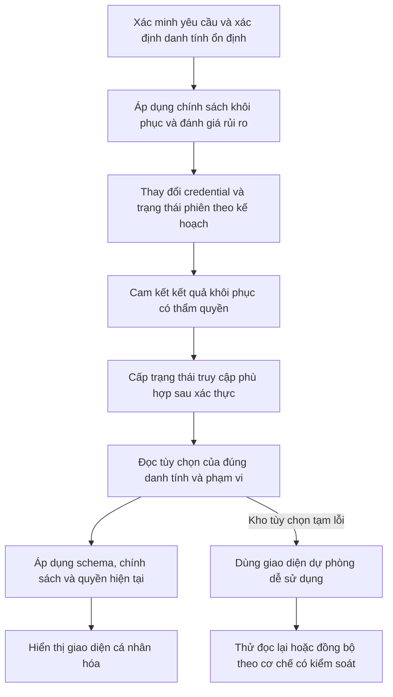

# Preserving user preferences — Bảo toàn tùy chọn người dùng khi khôi phục tài khoản

## 1. Khôi phục quyền truy cập không nên làm mất trải nghiệm đã thiết lập

Khi người dùng mất mật khẩu, MFA, passkey hoặc thiết bị xác thực, mục tiêu chính của khôi phục là giúp chủ thể hợp lệ lấy lại quyền truy cập an toàn. Người dùng thường mong rằng sau khi đăng nhập lại, ngôn ngữ, giao diện, múi giờ và các tùy chọn trợ năng vẫn còn như trước.

Nếu thao tác đặt lại mật khẩu vô tình tạo một hồ sơ mới hoặc ghi đè toàn bộ cấu hình bằng giá trị mặc định, người dùng có thể mất những thiết lập quan trọng. Với tùy chọn trợ năng, tác động không chỉ là bất tiện: giao diện sau khôi phục có thể trở nên khó sử dụng đúng lúc người dùng đang cần hoàn tất các bước bảo vệ tài khoản.

Trong `SECURITY_AUTHENTICATION_ACCOUNT_RECOVERY`, bảo toàn tùy chọn người dùng là giữ lại các lựa chọn hợp lệ thuộc đúng danh tính và đúng phạm vi, trong khi cập nhật phương tiện xác thực, đánh giá rủi ro, xử lý token dùng một lần và kiểm soát phiên theo chính sách.

Điều đó không có nghĩa giữ nguyên mọi thứ có tên là `settings`. Một đối tượng cấu hình có thể chứa cả màu nền lẫn email khôi phục. Những dữ liệu có ảnh hưởng đến quyền truy cập phải được xử lý theo quy trình bảo mật riêng, dù chúng xuất hiện cùng trang tùy chọn của sản phẩm.

## 2. Phân loại dữ liệu theo ý nghĩa thay vì vị trí trên giao diện

Trước khi thiết kế bảo toàn, cần biết mỗi trường thực sự điều khiển điều gì.

| Nhóm dữ liệu | Ví dụ | Cách xử lý trong khôi phục |
|---|---|---|
| Tùy chọn trình bày | Chủ đề sáng hoặc tối, mật độ hiển thị, cách sắp xếp giao diện | Giữ lựa chọn hợp lệ của đúng chủ thể nếu không có lý do thay đổi |
| Ngôn ngữ và thời gian hiển thị | Ngôn ngữ giao diện, múi giờ, định dạng ngày | Bảo toàn và áp dụng qua cơ chế kiểm tra giá trị hợp lệ |
| Tùy chọn trợ năng | Giảm chuyển động, cỡ chữ trong phạm vi hỗ trợ | Ưu tiên khả năng sử dụng trong và sau khôi phục |
| Tùy chọn tiện ích | Trang bắt đầu, bố cục bảng điều khiển | Giữ nếu tài nguyên hoặc tính năng liên quan vẫn được phép truy cập |
| Thông báo tùy chọn | Nhận bản tin sản phẩm, nhắc học tập | Bảo toàn theo ngữ nghĩa của từng nhóm thông báo |
| Cấu hình bảo mật | Email khôi phục, số điện thoại MFA, yếu tố xác thực, thiết bị tin cậy | Không coi là tùy chọn thông thường để sao chép hoặc khôi phục tự động |
| Quyền và trạng thái danh tính | Vai trò, tenant, chủ sở hữu tài nguyên, trạng thái xác minh | Không được cấp lại chỉ vì lưu trong cùng hồ sơ |
| Quyết định về quyền riêng tư hoặc sự đồng ý | Lựa chọn chia sẻ dữ liệu, ghi nhận chấp thuận | Có chính sách và lịch sử riêng; không suy ra hoặc bật lại từ bản sao cũ |

Một trường tưởng như chỉ để trình bày vẫn có thể có tác động gián tiếp. Chẳng hạn, `defaultWorkspaceId` chỉ nên mở một workspace mà người dùng hiện còn quyền; `notificationSettings` có thể chứa cả bản tin tiếp thị và cảnh báo thay đổi MFA.

Do đó, quyết định bảo toàn nên dựa trên danh sách trường được phép với ngữ nghĩa rõ ràng. Không dùng quy tắc “sao chép mọi khóa trong JSON trừ `password`”. Cách loại trừ đó dễ bỏ sót trường nhạy cảm mới được thêm sau này.

## 3. Giữ định danh ổn định và tách dữ liệu xác thực khỏi tùy chọn

Một thiết kế thuận lợi là tùy chọn được gắn với định danh tài khoản ổn định do hệ thống quản lý, trong khi credential và phiên có vòng đời riêng.

```text
identityId
  ├── Hồ sơ và tùy chọn cá nhân
  ├── Tùy chọn theo tenant hoặc workspace
  ├── Phương tiện xác thực
  ├── Các đường khôi phục
  └── Phiên và token đã cấp
```

Đặt lại mật khẩu hoặc thay MFA thường không cần tạo một `identityId` mới. Nếu danh tính không thay đổi, cách bảo toàn đơn giản nhất thường là không ghi vào kho tùy chọn trong thao tác khôi phục. Dịch vụ xác thực cập nhật đúng dữ liệu thuộc quyền của nó, còn tùy chọn tiếp tục nằm ở danh tính cũ.

Email không phải khóa ổn định phù hợp cho mọi hệ thống. Nếu đổi email làm dịch vụ tùy chọn tạo một bản ghi mới theo email mới, trải nghiệm có thể trông như mất toàn bộ cấu hình dù dữ liệu cũ vẫn tồn tại. Ngược lại, tra tùy chọn chỉ bằng email có thể lấy nhầm dữ liệu khi địa chỉ bị thay đổi hoặc tái sử dụng.

Nếu hệ thống thực sự cần chuyển sang danh tính khác, đây là một tác vụ di chuyển danh tính có thẩm quyền và ánh xạ rõ ràng. Không tự suy ra quyền sao chép tùy chọn từ việc hai hồ sơ có cùng tên, email hoặc số điện thoại.

## 4. Xác định phạm vi cá nhân, tenant và thiết bị

Không phải mọi tùy chọn của một người đều thuộc cùng một phạm vi.

### 4.1. Tùy chọn cấp tài khoản

Ngôn ngữ giao diện mặc định hoặc lựa chọn giảm chuyển động có thể được lưu ở cấp tài khoản để áp dụng trên nhiều thiết bị. Việc khôi phục credential không nên xóa những lựa chọn này nếu danh tính và chính sách vẫn giữ nguyên.

### 4.2. Tùy chọn theo tenant hoặc workspace

Một tài khoản có thể có bố cục khác nhau ở các tổ chức. Khóa dữ liệu nên thể hiện cả định danh người dùng và phạm vi liên quan, chẳng hạn `(identityId, tenantId, preferenceKey)`.

Khôi phục tài khoản không tự gia hạn tư cách thành viên đã bị thu hồi. Có thể giữ một tùy chọn theo tenant trong kho dữ liệu theo chính sách lưu giữ, nhưng không hiển thị hoặc sử dụng nó để mở tài nguyên khi người dùng không còn quyền.

### 4.3. Tùy chọn cục bộ của thiết bị

Thiết bị bị mất có thể chứa lựa chọn trong cookie hoặc bộ nhớ trình duyệt mà máy chủ chưa từng lưu. Hệ thống không nên tuyên bố sẽ phục hồi được các giá trị đó nếu không có nguồn dữ liệu hợp lệ.

Trên thiết bị mới, có thể bắt đầu bằng mặc định phù hợp hoặc tùy chọn cấp tài khoản. Không cần khôi phục trạng thái “thiết bị tin cậy” của thiết bị cũ để giữ lại giao diện tối. Hai loại dữ liệu này có ý nghĩa và mức rủi ro khác nhau.

### 4.4. Tùy chọn ở màn hình chưa xác thực

Người dùng có thể chọn ngôn ngữ hoặc cỡ chữ ngay trên trang khôi phục. Lựa chọn cục bộ đó giúp hoàn tất thao tác, nhưng chưa chứng minh quyền sửa tùy chọn của tài khoản đang được tìm kiếm.

Trước khi xác minh chủ thể, không trả về ngôn ngữ hoặc trợ năng đã lưu của một tài khoản chỉ vì người gọi nhập đúng email. Điều này có thể làm lộ sự tồn tại hoặc thông tin hồ sơ. Sau khi xác thực và được phép, sản phẩm có thể hỏi người dùng có muốn lưu lựa chọn của thiết bị hiện tại vào tài khoản hay không.

## 5. Nguồn có thẩm quyền và độ mới của dữ liệu

Bảo toàn không đồng nghĩa với lấy một bản sao cũ rồi ghi đè trạng thái hiện tại. Cần xác định nguồn có thẩm quyền và phiên bản dữ liệu.

Một bản ghi tùy chọn có thể có cấu trúc như:

```json
{
  "identityId": "identity-482",
  "scope": "ACCOUNT",
  "schemaVersion": 3,
  "revision": 27,
  "values": {
    "locale": "vi-VN",
    "timeZone": "Asia/Ho_Chi_Minh",
    "theme": "DARK",
    "reducedMotion": true,
    "textScale": "LARGE"
  }
}
```

Đây là một ví dụ mô hình, không phải schema bắt buộc. Điều cần thiết là xác định được chủ sở hữu, phạm vi, phiên bản cấu trúc và phiên bản cập nhật của dữ liệu.

Nếu tùy chọn hiện tại vẫn hợp lệ và không bị tác động, không cần chụp rồi phục hồi chúng trong mỗi lần đặt lại mật khẩu. Bản sao phục hồi chỉ cần khi quy trình thật sự phải di chuyển hoặc chuyển đổi dữ liệu.

Nếu có nghi ngờ tài khoản đã bị chiếm, “giá trị mới nhất” không tự có nghĩa là “lựa chọn của chủ thể hợp lệ”. Kẻ tấn công có thể đã đổi các giá trị này. Cần căn cứ lịch sử, phạm vi sự cố và chính sách để quyết định giữ, phục hồi một mốc đáng tin hơn hoặc hỏi lại người dùng.

Một ảnh chụp cũ cũng không nên làm sống lại dữ liệu người dùng đã chủ động xóa. Cần giữ ngữ nghĩa xóa, chẳng hạn qua lịch sử hoặc trạng thái xóa có phiên bản, nếu hệ thống phải hợp nhất nhiều nguồn dữ liệu.

## 6. Bảo toàn đúng nghĩa của giá trị

### 6.1. Phân biệt thiếu trường, giá trị rỗng và lựa chọn rõ ràng

Một trường không có trong bản ghi có thể nghĩa là dùng mặc định. Giá trị rỗng có thể là lựa chọn xóa hoặc không hợp lệ, tùy schema. `false` là một lựa chọn cụ thể, không phải trường bị thiếu.

Ví dụ, nếu người dùng đã chọn `reducedMotion: false`, đoạn mã coi mọi giá trị không đúng thành mặc định `true` sẽ thay đổi lựa chọn của họ. Ngược lại, một mảng thông báo rỗng có thể là chủ ý không nhận các loại tùy chọn, chứ không phải lời mời nạp lại tất cả mặc định.

Hệ thống cần quy ước rõ cho từng trường thay vì áp dụng một phép hợp nhất JSON chung cho mọi dữ liệu.

### 6.2. Tách lựa chọn đã lưu và giá trị có hiệu lực

Một tổ chức có thể áp dụng chính sách giới hạn tùy chọn. Giá trị người dùng yêu cầu và giá trị thực tế được áp dụng có thể khác nhau.

```text
Tùy chọn đã lưu
       + mặc định của sản phẩm
       + chính sách trong phạm vi hiện tại
       + khả năng hỗ trợ của thiết bị
       → giá trị có hiệu lực
```

Ví dụ, tùy chọn trang bắt đầu vẫn được giữ nhưng trang đó hiện không còn khả dụng. Giao diện có thể mở trang thay thế được phép và giải thích phù hợp, thay vì xóa mọi tùy chọn hoặc cố truy cập tài nguyên bị cấm.

Không dùng bản sao giá trị có hiệu lực để ghi đè vô điều kiện lựa chọn đã lưu. Nếu không phân biệt hai lớp, một hạn chế tạm thời có thể trở thành thay đổi lâu dài mà người dùng chưa từng chọn.

### 6.3. Kiểm tra khả năng tương thích của schema

Trong thời gian người dùng mất quyền truy cập, sản phẩm có thể đổi tên một giá trị giao diện hoặc thay đổi cấu trúc tùy chọn. Dữ liệu cũ cần được chuyển đổi bằng quy tắc có phiên bản.

Chỉ chuyển các trường được hiểu rõ. Nếu gặp giá trị không hỗ trợ, dùng phương án dự phòng an toàn theo từng trường và ghi nhận để có thể giải thích. Không vì một tên theme cũ mà bỏ toàn bộ ngôn ngữ, múi giờ và trợ năng còn hợp lệ.

## 7. Tách thông báo tiện ích khỏi cảnh báo bảo mật

Một người dùng có thể tắt bản tin sản phẩm hoặc thông báo nhắc việc. Việc bảo toàn lựa chọn đó không được vô tình tắt cảnh báo bắt buộc của quy trình khôi phục theo chính sách hệ thống.

Nên phân loại thông báo theo mục đích thay vì một cờ tổng quát như `notificationsEnabled`. Các sự kiện đặt lại mật khẩu, thay MFA hoặc thay kênh khôi phục có thể cần quy tắc riêng về người nhận, thời điểm và nội dung.

Kênh nhận cảnh báo bảo mật cũng không chỉ là một tùy chọn giao diện. Nếu kênh vừa bị thay đổi hoặc có dấu hiệu bị chiếm, cách gửi phải xét chính sách rủi ro và tránh phát tán token hoặc thông tin nhạy cảm.

Không dùng một lựa chọn như “không nhận email tiếp thị” để suy ra người dùng muốn che mọi thay đổi xác thực. Ngược lại, cũng không dùng khôi phục tài khoản làm lý do bật lại các thông báo tùy chọn mà họ đã tắt.

Múi giờ hoặc giờ yên lặng có thể áp dụng cho một số nhắc việc. Chúng không nên làm thay đổi thời điểm hết hạn token hoặc tạo ra việc trì hoãn cảnh báo bảo mật trái chính sách. Hạn token phải dựa trên thời điểm máy chủ có thẩm quyền, còn múi giờ chỉ phục vụ hiển thị.

## 8. Tránh ghi đè khi có cập nhật đồng thời

Giả sử quy trình khôi phục đọc tùy chọn ở phiên bản 27. Trong lúc hồ sơ đang được xử lý, một phiên hợp lệ khác cập nhật cỡ chữ và tạo phiên bản 28. Nếu bước hoàn tất ghi lại toàn bộ ảnh chụp 27, lựa chọn mới sẽ bị mất.

Với khôi phục trên cùng danh tính, cách tốt thường là chỉ cập nhật dữ liệu xác thực và không ghi vào bảng tùy chọn. Như vậy, lựa chọn ở phiên bản 28 không bị ảnh hưởng.

Nếu bắt buộc phải di chuyển hoặc chuyển đổi tùy chọn, cần một cơ chế như kiểm tra phiên bản trước khi cập nhật. Có thể dùng quy tắc ở mức ý tưởng:

```text
Chỉ áp dụng kế hoạch chuyển đổi nếu:
  đúng identityId và phạm vi
  phiên bản hiện tại khớp phiên bản mà kế hoạch đã đọc
  schema và danh sách trường nằm trong phạm vi được phép
```

Khi phiên bản không khớp, tải lại và giải quyết theo từng trường hoặc đưa về trạng thái cần xử lý. Không mặc định “bản khôi phục thắng” hay chọn giá trị có thời gian cập nhật lớn nhất trong mọi tình huống.

Việc hợp nhất theo trường cũng cần ngữ nghĩa. Có thể giữ một cập nhật theme mới nếu đã xác định đó là thay đổi hợp lệ, nhưng không tự giải quyết xung đột về chia sẻ dữ liệu hoặc thông báo bảo mật như một xung đột màu nền.

Định danh thao tác giúp xử lý yêu cầu lặp. Nếu cùng một lần hoàn tất khôi phục được gửi lại vì lỗi mạng, hệ thống không nên chép lại một ảnh chụp cũ lần nữa, tái bật các mặc định hoặc tạo thêm nhiều công việc đồng bộ giống nhau.

## 9. Thiết kế ranh giới dữ liệu trong dịch vụ Java

Một lỗi triển khai dễ gặp là dùng một đối tượng hồ sơ lớn cho cả cập nhật tùy chọn và hoàn tất khôi phục. Dữ liệu từ trình duyệt hoặc từ một bản sao có thể chứa những trường mà thao tác hiện tại không được phép sửa.

Ví dụ yêu cầu không nên được hiểu theo cách sau:

```text
completeRecovery(newCredential, toàn_bộ_profile_JSON)
  → thay credential
  → ghi đè mọi trường của profile_JSON lên tài khoản
```

Thay vào đó, contract hoàn tất khôi phục chỉ nhận những dữ liệu cần cho hành động được cấp quyền. Việc thay tùy chọn là một thao tác riêng hoặc một bước di chuyển được giới hạn rõ ràng.

Một kiểu Java mô tả danh sách tùy chọn trình bày có thể như sau:

```java
record DisplayPreferences(
        String locale,
        String timeZone,
        Theme theme,
        boolean reducedMotion,
        TextScale textScale) {
}

enum Theme {
    SYSTEM,
    LIGHT,
    DARK
}

enum TextScale {
    DEFAULT,
    LARGE,
    EXTRA_LARGE
}

record PreferenceSnapshot(
        String identityId,
        long revision,
        int schemaVersion,
        DisplayPreferences display) {
}
```

Đây chỉ là mô hình minh họa. Nó chưa triển khai kiểm tra locale, múi giờ, phân quyền, phạm vi tenant hoặc cập nhật có điều kiện. Điều có ích là các trường như vai trò, email khôi phục, trạng thái MFA và thiết bị tin cậy không có mặt trong kiểu dữ liệu bảo toàn tùy chọn trình bày.

Không dùng định danh trong snapshot do bên gọi tự gửi làm bằng chứng về quyền sở hữu. Danh tính được phép xử lý phải đến từ ngữ cảnh xác minh có thẩm quyền của máy chủ, sau đó mới đối chiếu với chủ sở hữu dữ liệu.

Nếu không cần di chuyển tùy chọn, dịch vụ khôi phục không nhất thiết phải tải `PreferenceSnapshot`. Chỉ vì có một lớp dữ liệu để dùng khi cần không có nghĩa mọi lần đặt lại mật khẩu đều phải đọc và ghi lại tùy chọn.

Các giá trị được đọc lại vẫn cần qua cơ chế hiển thị và kiểm tra dữ liệu thông thường. Một chuỗi không mong đợi không được biến thành HTML, đường dẫn hoặc cấu hình thực thi chỉ vì nó xuất phát từ hồ sơ cũ đã lưu.

## 10. Trình tự xử lý trong và sau khôi phục

Một luồng phổ biến trên cùng danh tính có thể tổ chức như sau:



Sơ đồ chỉ mô tả quan hệ giữa khôi phục và tùy chọn; các điều kiện xác thực, dùng token một lần và cấp phiên phải được thực hiện đầy đủ theo thiết kế của hệ thống.

Khi dữ liệu xác thực và tùy chọn nằm trong cùng cơ sở dữ liệu, tránh một thao tác cập nhật rộng vô tình thay cả hai. Khi chúng nằm ở nhiều dịch vụ, cần xác định dịch vụ nào có quyền ghi và cách phát hành sự kiện về kết quả đã cam kết.

Nếu dùng sự kiện để yêu cầu đọc lại hoặc đồng bộ tùy chọn, sự kiện cần định danh thao tác, danh tính, phạm vi và phiên bản phù hợp. Nó không nên chứa credential mới hay token khôi phục. Bên nhận cần xử lý lặp và phát hiện sự kiện cũ thay vì áp dụng mọi bản tin theo thứ tự đến.

Một giao dịch cục bộ không tự bảo đảm cập nhật nguyên tử trên mọi dịch vụ. Cần biểu diễn riêng kết quả khôi phục và tiến độ đồng bộ tùy chọn để có thể xử lý lỗi mà không làm sai trạng thái bảo mật.

## 11. Xử lý lỗi mà không xóa dữ liệu hoặc làm yếu xác thực

### 11.1. Kho tùy chọn tạm không truy cập được

Nếu credential đã được khôi phục đúng và tất cả điều kiện bảo mật đã đạt, lỗi đọc theme không nhất thiết phải làm người dùng thực hiện lại toàn bộ khôi phục. Có thể hiển thị giao diện dự phòng và đọc lại khi dịch vụ sẵn sàng.

Không ghi giá trị dự phòng thành lựa chọn lâu dài chỉ vì một lần đọc bị lỗi. “Không lấy được dữ liệu” khác với “người dùng chưa có dữ liệu”. Nếu nhầm hai trường hợp, hệ thống có thể xóa cấu hình thật khi kho hoạt động trở lại.

Các tùy chọn trợ năng cục bộ do người dùng chọn để hoàn tất thao tác có thể tiếp tục được dùng trên thiết bị trong thời gian chờ. Việc lưu vào tài khoản cần đi qua một thao tác được phép, không âm thầm ghi đè lựa chọn máy chủ.

### 11.2. Một phần tùy chọn không tương thích

Nếu một giá trị bố cục không còn hỗ trợ, có thể thay bằng bố cục dự phòng và giữ các trường hợp lệ khác. Cần ghi nhận rõ trường nào được chuyển đổi hoặc bỏ qua theo chính sách.

Không báo “khôi phục toàn bộ tùy chọn thành công” khi thực tế đã bỏ một số mục. Thông báo có thể đơn giản, nhưng trạng thái kỹ thuật và thông tin hỗ trợ phải phản ánh đúng giới hạn.

### 11.3. Có xung đột hoặc nghi bị sửa trái phép

Không tự quyết định mọi xung đột bằng bản sao cũ. Có thể giữ nguyên dữ liệu hiện tại trong khi chờ xác minh, giới hạn một chức năng liên quan hoặc yêu cầu người dùng xác nhận lại lựa chọn sau xác thực, tùy mức tác động.

Nếu xung đột nằm ở cấu hình bảo mật, chuyển sang chính sách của miền đó. Không coi việc cảnh báo MFA bị tắt là một lỗi tiện ích có thể bỏ qua để tăng tỷ lệ hoàn tất.

### 11.4. Lỗi tùy chọn không phải lý do bỏ kiểm soát an toàn

Khả năng dùng giao diện dự phòng chỉ áp dụng khi các điều kiện bảo mật cho phép truy cập đã đạt. Không bỏ qua xác minh người dùng, thu hồi phiên bắt buộc hoặc kiểm tra token vì muốn trang cá nhân hóa tải nhanh hơn.

Ngược lại, không hoàn tác credential đã được thay hợp lệ và kích hoạt lại yếu tố bị mất chỉ vì một bước đồng bộ cỡ chữ thất bại. Hai loại thay đổi cần kết quả và cơ chế phục hồi riêng.

## 12. Bản sao, nhật ký và quyền truy cập dữ liệu

Tùy chọn có thể tiết lộ thói quen sử dụng, ngôn ngữ hoặc nhu cầu trợ năng. Dù không phải bí mật đăng nhập, chúng vẫn cần được giới hạn quyền đọc và lưu giữ phù hợp.

Nếu quy trình cần tạo snapshot, chỉ lấy các trường cần cho nhiệm vụ và gắn với đúng danh tính, phạm vi, phiên bản và mục đích. Không xuất toàn bộ hồ sơ ra một tệp hỗ trợ có thể chứa credential, dữ liệu bằng chứng hoặc quyền quản trị.

Snapshot cần được bảo vệ khi lưu và truyền theo thiết kế của hệ thống, có thời hạn giữ và cơ chế dọn phù hợp. Không biến mỗi lần khôi phục thành một bản sao hồ sơ tồn tại vô hạn bên ngoài kho chính.

Nhật ký hữu ích có thể ghi định danh thao tác, revision đã đọc và đã áp dụng, phiên bản schema, nhóm trường được giữ hoặc chuyển đổi, lý do dùng mặc định và kết quả đồng bộ. Thường không cần ghi toàn bộ giá trị tùy chọn vào log vận hành.

Người hỗ trợ có thể chỉ cần biết “đã đọc lại tùy chọn của đúng danh tính” hoặc “một bố cục cũ không còn hỗ trợ”. Không mặc định cấp cho họ quyền xem mọi tùy chọn cá nhân chỉ vì họ đang xử lý đặt lại mật khẩu.

## 13. Ví dụ xuyên suốt: mất điện thoại nhưng giữ ngôn ngữ và trợ năng

Minh mất điện thoại chứa MFA. Tài khoản `identity-482` có giao diện tiếng Việt, theme tối, cỡ chữ lớn, lựa chọn giảm chuyển động và bố cục riêng trong tenant A.

Quy trình khôi phục xác định đúng danh tính ổn định và cho phép Minh đăng ký yếu tố thay thế theo chính sách. Dịch vụ xác thực vô hiệu yếu tố bị mất và xử lý phiên thuộc phạm vi cần thu hồi. Nó không tạo một hồ sơ người dùng mới và không ghi đè bản ghi tùy chọn.

Trong lúc hồ sơ đang được xử lý, Minh sử dụng một phiên hợp lệ khác để đổi theme sang sáng. Tùy chọn tăng từ revision 27 lên 28. Khi hoàn tất khôi phục, ứng dụng đọc revision hiện tại, vì vậy theme mới vẫn được giữ cùng với các tùy chọn trợ năng. Không có bước chép lại ảnh chụp 27.

Trên thiết bị mới, Minh chọn cỡ chữ rất lớn ở màn hình khôi phục để dễ thao tác. Lựa chọn này được dùng cục bộ. Sau khi xác thực xong, giao diện có thể cho Minh chọn giữ cỡ chữ đã lưu hay cập nhật tài khoản theo thiết bị hiện tại; không tự coi cookie trước xác thực là quyết định thay đổi hồ sơ.

Giả sử quyền truy cập tenant A của Minh đã bị thu hồi bởi một quy trình quản trị độc lập. Việc khôi phục MFA không cấp lại quyền đó. Bố cục cũ có thể được giữ trong kho theo chính sách, nhưng ứng dụng không mở workspace của tenant A chỉ vì nó từng là trang bắt đầu.

Nếu kho tùy chọn tạm lỗi, ứng dụng hiển thị giao diện dự phòng dễ sử dụng và đọc lại sau. Nó không ghi theme mặc định xuống kho, không báo rằng tất cả tùy chọn đã bị xóa và không yêu cầu khôi phục MFA lần nữa chỉ để tải được giao diện tối.

## 14. Các sai lầm thường gặp và nguyên tắc thiết kế

| Sai lầm | Tác động |
|---|---|
| Tạo người dùng mới khi đặt lại credential | Tùy chọn bị tách khỏi danh tính hoặc dữ liệu liên quan bị mất liên kết |
| Ghi đè toàn bộ profile từ yêu cầu khôi phục | Có thể sửa cả quyền, kênh khôi phục hoặc trạng thái bảo mật ngoài phạm vi |
| Chép một snapshot cũ sau khi người dùng đã cập nhật | Làm mất lựa chọn mới và có thể làm sống lại dữ liệu đã xóa |
| Dùng email làm căn cứ duy nhất để lấy tùy chọn | Có nguy cơ lấy nhầm dữ liệu khi email thay đổi hoặc được sử dụng lại |
| Coi lỗi đọc là bản ghi trống rồi ghi mặc định | Xóa dữ liệu hợp lệ vì một lỗi tạm thời |
| Chuyển tùy chọn cục bộ trước xác thực vào tài khoản | Cho dữ liệu chưa có thẩm quyền ghi đè lựa chọn của chủ thể |
| Dùng một cờ thông báo cho cả tiện ích và cảnh báo bảo mật | Có thể che thay đổi xác thực hoặc bật lại thông báo người dùng đã tắt |
| Khôi phục tùy chọn tenant đồng thời khôi phục quyền đã mất | Mở lại tài nguyên không còn được phép truy cập |
| Giữ mọi khóa trong đối tượng settings mà không phân loại | Kéo theo thiết bị tin cậy, phương thức khôi phục hoặc dữ liệu nhạy cảm |

Bảo toàn tùy chọn bắt đầu từ việc giữ đúng danh tính, tách ranh giới ghi dữ liệu và tránh cập nhật những trường không cần thay đổi. Khi phải chuyển đổi, cần danh sách trường được phép, schema có phiên bản và cơ chế xử lý cạnh tranh phù hợp.

Một lần khôi phục có thể đồng thời thay phương tiện xác thực, kết thúc phiên cũ và giữ nguyên trải nghiệm cá nhân hóa. Kết quả đó chỉ đáng tin khi tùy chọn được áp dụng theo quyền hiện tại, không làm yếu kiểm soát khôi phục và không trở thành một đường khôi phục các đặc quyền đã bị thu hồi.
