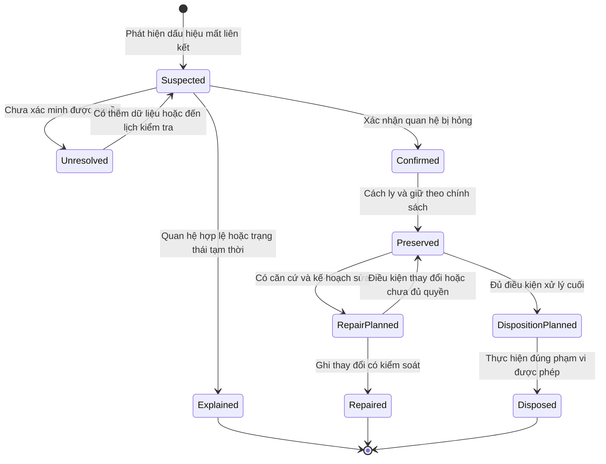

# Handling orphaned records

## 1. Bản ghi mồ côi trong account recovery là gì?

**Orphaned record**, hay bản ghi mồ côi, là một bản ghi còn tồn tại nhưng không còn liên kết hợp lệ tới đối tượng cha, chủ sở hữu hoặc thực thể mà nó phụ thuộc theo mô hình dữ liệu. Trong hệ thống tài khoản, đó có thể là một tài liệu trỏ tới account ID không còn được nhận diện, một tệp đã được tải lên nhưng không có metadata tương ứng, hoặc một tác vụ recovery tham chiếu một hồ sơ đã bị loại khỏi luồng xử lý.

Tuy nhiên, không phải mọi liên kết không tra cứu được đều là bản ghi mồ côi thật. Một tài khoản bị khóa, bị ẩn bởi phân quyền hoặc chưa xuất hiện trong bản sao đọc vẫn có thể tồn tại ở nguồn dữ liệu có thẩm quyền.

Trong account recovery, xử lý sai bản ghi mồ côi có hai hậu quả đối lập:

- Xóa nhầm dữ liệu hợp lệ của người dùng khi họ đang mất khả năng đăng nhập.
- Gán nhầm dữ liệu của tài khoản cũ cho người khác, tạo ra sự cố lộ dữ liệu hoặc chiếm quyền.

Mục tiêu của xử lý không phải làm cho mọi bản ghi đều có một `ownerId` bằng mọi cách. Mục tiêu là xác định trạng thái thực, bảo toàn dữ liệu trong phạm vi được phép và chỉ sửa liên kết khi có căn cứ đủ mạnh về quyền sở hữu cùng thẩm quyền thực hiện.

## 2. Phân biệt bản ghi mồ côi và bản ghi chỉ chưa truy cập được

Một hệ thống phân tán có nhiều lý do khiến một tham chiếu tạm thời không được giải quyết:

| Tình huống | Có thể kết luận ngay là mồ côi không? | Việc cần làm |
|---|---|---|
| Dịch vụ tài khoản timeout | Không | Ghi nhận chưa xác định, kiểm tra lại nguồn có thẩm quyền |
| Tài khoản không thấy ở search index | Không | Đối chiếu với kho tài khoản gốc |
| Người gọi nhận lỗi không có quyền xem | Không | Không diễn giải lỗi phân quyền thành không tồn tại |
| Tài khoản bị khóa hoặc đang recovery | Không | Giữ liên kết và áp dụng chính sách truy cập |
| Account ID cũ có ánh xạ merge hợp lệ | Không nhất thiết | Kiểm tra quan hệ lịch sử và quyền hiện tại |
| Nguồn có thẩm quyền xác nhận tham chiếu không còn hợp lệ | Có thể | Phân loại nguyên nhân và lập phương án xử lý |
| Bản ghi đang trong một transaction hoặc job chưa hoàn tất | Chưa đủ căn cứ | Xem trạng thái công việc và thời gian nhất quán dự kiến |

Một API trả `404` cho người dùng để hạn chế dò tài khoản có thể che cả trường hợp không có quyền truy cập. Tác vụ đối soát nội bộ không được tự dùng phản hồi đó làm bằng chứng chắc chắn rằng chủ sở hữu đã bị xóa.

Tác vụ kiểm tra cần có quyền và nguồn dữ liệu phù hợp để phân biệt trạng thái theo chính sách. Điều đó không có nghĩa tác vụ được phép công khai sự tồn tại của tài khoản cho người đang yêu cầu recovery.

## 3. Các dạng mất liên kết thường gặp

### 3.1. Mồ côi về quan hệ dữ liệu

Một hàng `document.owner_account_id` trỏ tới account ID không còn có bản ghi hoặc quan hệ lịch sử hợp lệ. Nếu parent và child cùng nằm trong một cơ sở dữ liệu, ràng buộc tham chiếu có thể giảm rủi ro này, nhưng không tự giải quyết toàn bộ vòng đời soft delete, archive hoặc di chuyển dữ liệu.

### 3.2. Mồ côi trong lưu trữ đối tượng

Tệp đã được ghi vào object storage nhưng transaction tạo metadata thất bại. Hoặc metadata còn nhưng tệp đã bị xóa, di chuyển hay không thể truy cập. Hai tình huống cần cách xử lý khác nhau; không có metadata không đồng nghĩa tệp được tự do gán cho người đầu tiên yêu cầu.

### 3.3. Mồ côi ở mức nghiệp vụ

Một bản ghi có foreign key hợp lệ nhưng không còn ngữ cảnh nghiệp vụ phù hợp. Ví dụ, một yêu cầu xác minh còn trỏ tới tài khoản nhưng vòng recovery đã kết thúc, hoặc một quyền chia sẻ vẫn dựa trên membership đã bị thu hồi.

### 3.4. Tham chiếu lịch sử có chủ đích

Một sự kiện audit có thể giữ account ID của actor đã bị xóa hoặc hợp nhất. Nếu mô hình lịch sử cho phép và có cách diễn giải hợp lệ, đây không phải lỗi cần sửa actor thành một tài khoản đang hoạt động.

### 3.5. Dữ liệu không còn giải mã được

Bản ghi và chủ sở hữu có thể vẫn tồn tại nhưng khóa giải mã không còn khả dụng. Đây là vấn đề khả dụng mật mã, không nhất thiết là mất liên kết sở hữu. Sửa `ownerId` hoặc đặt lại mật khẩu không tự khôi phục dữ liệu được mã hóa bằng một khóa đã mất.

Việc phân loại cần nêu rõ loại quan hệ bị hỏng. Chỉ dùng một cờ `orphan=true` cho tất cả trường hợp sẽ dễ dẫn tới một thao tác sửa quá rộng.

## 4. Vì sao recovery có thể làm lộ vấn đề này?

Một luồng recovery đúng thiết kế thường khôi phục khả năng xác thực cho **cùng một định danh tài khoản ổn định**, thay vì tạo người dùng mới rồi sao chép dữ liệu sang. Nếu hệ thống vô tình tạo account ID mới, dữ liệu cũ có thể trông như mất chủ, dù người dùng chỉ thay phương thức đăng nhập.

Những nguồn phát sinh khác gồm:

- Di chuyển từ một nhà cung cấp danh tính sang nhà cung cấp khác nhưng ánh xạ không đầy đủ.
- Hợp nhất tài khoản bị lỗi giữa chừng.
- Xóa tài khoản trong khi các dịch vụ phụ chưa xử lý xong.
- Import dữ liệu chỉ thành công một phần.
- Retry tạo tài nguyên nhưng không tạo liên kết hoặc tạo trùng liên kết.
- Job cũ tiếp tục chạy sau khi trạng thái tài khoản đã thay đổi.
- Tác vụ dọn dữ liệu dùng tiêu chí tồn tại không đúng nguồn.

Ví dụ, A mất điện thoại MFA và sau recovery được gán định danh A2. Một job tìm các bản ghi có owner A không thấy A trong danh sách tài khoản hiện tại rồi định xóa chúng. Nguyên nhân gốc là định danh bị thay đổi sai hoặc thiếu ánh xạ migration, không phải bằng chứng dữ liệu không còn cần giữ.

## 5. Nguyên tắc đầu tiên: không suy quyền sở hữu từ thuộc tính dễ thay đổi

Không gán bản ghi mồ côi cho tài khoản mới chỉ vì trùng email, số điện thoại, tên hiển thị hoặc tên tệp. Những thuộc tính này có thể được thay đổi, dùng chung, tái cấp hoặc bị người khác biết.

Email cũ được một người mới kiểm soát không chứng minh người đó sở hữu dữ liệu do tài khoản trước đây tạo. Tương tự, một tệp có tên chứa username không phải bằng chứng đủ để cấp quyền đọc.

Các căn cứ có thể cần kết hợp gồm:

- Account ID ổn định đã được xác minh theo luồng recovery.
- Quan hệ migration hoặc merge được ghi nhận bởi hệ thống có thẩm quyền.
- Manifest di chuyển dữ liệu, phiên bản và phạm vi đã được phê duyệt.
- Lịch sử tạo tài nguyên và liên kết sở hữu được bảo vệ phù hợp.
- Kết quả xác minh danh tính và quyền đối với tài khoản liên quan.
- Phê duyệt từ đúng chủ thể có thẩm quyền nếu dữ liệu thuộc tổ chức.

Không phải mọi hệ thống đều có đủ các nguồn này. Khi thiếu căn cứ, kết quả có thể là chưa thể gán lại. Giữ dữ liệu trong trạng thái được kiểm soát theo chính sách thường phù hợp hơn việc gán sai để làm cho số lượng orphan giảm xuống.

## 6. Bảo toàn dữ liệu và quyền truy cập là hai việc riêng

**Preservation** nghĩa là bảo vệ khả năng xử lý dữ liệu đúng cách trong thời gian cho phép. Nó không có nghĩa mở dữ liệu cho người yêu cầu recovery, cũng không có nghĩa lưu mọi thứ vô thời hạn.

Một bản ghi nghi ngờ mất chủ có thể được cách ly logic: không hiển thị cho người dùng mới, không đưa vào các thao tác tự động có thể phá hủy, nhưng vẫn giữ khả năng kiểm tra của nhóm có thẩm quyền.

| Biện pháp | Mục đích | Không tự cấp quyền gì? |
|---|---|---|
| Đánh dấu cần điều tra | Ngăn coi dữ liệu là hợp lệ bình thường | Không cấp quyền xem nội dung |
| Tạm giữ dọn dữ liệu trong thời hạn | Tránh xóa trước khi xác minh | Không ghi đè chính sách lưu giữ có thẩm quyền |
| Hạn chế hiển thị và chia sẻ | Giảm rủi ro lộ dữ liệu | Không chứng minh người yêu cầu là chủ |
| Lưu manifest và tham chiếu | Giữ khả năng truy vết | Không biến manifest thành token truy cập |
| Tách quyền điều tra và quyền sửa | Giảm khả năng tự quyết định và tự gán | Không làm mọi sửa chữa cần thêm quyền rộng toàn hệ thống |

Trạng thái cách ly nên có lý do, thời điểm bắt đầu, người hoặc dịch vụ chịu trách nhiệm và thời điểm đánh giá lại. Một cờ cách ly không có vòng đời dễ trở thành kho dữ liệu bị bỏ quên.

Nếu có yêu cầu lưu giữ, xóa hoặc hạn chế xử lý khác, cần giải quyết theo chính sách dữ liệu được áp dụng. Tác vụ repair không tự quyết định rằng mục tiêu recovery được quyền vượt mọi ranh giới đó.

## 7. Lập danh mục và đối soát từ nguồn có thẩm quyền

Một lượt phát hiện nên tạo **candidate** để xem xét, không sửa sở hữu ngay trong cùng truy vấn tìm kiếm.

Thông tin tối thiểu cho candidate có thể gồm:

```text
candidateId
resourceType
resourceReference
tenantReference
originalOwnerReference
observedRelationshipVersion
detectedAt
detectionRuleVersion
authoritativeLookupResult
possibleCause
relatedOperationReferences
nextReviewAt
```

Không cần đưa toàn bộ nội dung tài liệu, giấy tờ định danh hoặc bí mật xác thực vào danh mục này. Những tham chiếu nhạy cảm cũng phải được bảo vệ theo phạm vi tenant và nhiệm vụ.

Quá trình đối soát có thể kiểm tra:

1. Bản ghi và phiên bản quan hệ đang quan sát có còn tồn tại không?
2. Chủ thể có tồn tại ở nguồn tài khoản có thẩm quyền không?
3. Có tombstone, trạng thái archive hoặc quan hệ migration hợp lệ không?
4. Có job tạo, xóa, merge hoặc di chuyển nào chưa hoàn tất không?
5. Có ranh giới nhất quán tạm thời đang giải thích tình trạng này không?
6. Dữ liệu có đang được giữ hoặc chờ xóa theo một quyết định hợp lệ không?

Quyền của tác vụ đối soát cần đủ để đọc trạng thái cần thiết nhưng không mặc nhiên có quyền chuyển dữ liệu. Hạn chế phạm vi quét theo tenant hoặc phân vùng giúp giảm tác động của một lỗi cấu hình.

## 8. Dùng trạng thái rõ thay cho sửa hoặc xóa ngay

Một mô hình trạng thái minh họa:



`Unresolved` khác `Confirmed`: timeout hoặc lỗi dịch vụ không nên đi thẳng tới xóa dữ liệu. `RepairPlanned` cũng khác `Repaired`: một đề xuất được duyệt chưa chứng minh thay đổi đã commit.

`Disposed` có thể là xóa, ẩn danh hoặc cách xử lý cuối khác theo chính sách. Tên trạng thái không tự định nghĩa quyền xóa; quyền và điều kiện cụ thể phải được kiểm tra riêng.

## 9. Khi nào được gán lại liên kết?

Một kế hoạch sửa cần trả lời rõ nguồn và đích của quan hệ, không chỉ nêu “sửa owner bị thiếu”.

Các điều kiện thường cần có:

- Tài nguyên được nhận diện bằng định danh ổn định và đúng tenant.
- Có căn cứ về quan hệ sở hữu hoặc quan hệ migration hợp lệ.
- Người hoặc dịch vụ đề xuất có quyền trên đúng phạm vi cần sửa.
- Tài khoản đích tồn tại, có trạng thái phù hợp và được phép nhận loại dữ liệu đó.
- Không có quyết định xóa, hạn chế hoặc xung đột đang chặn thao tác.
- Tác động tới chia sẻ, quyền truy cập và dữ liệu liên quan đã được xét.
- Phiên bản tài nguyên và kế hoạch vẫn khớp tại thời điểm ghi.
- Có khả năng ghi nhận kết quả và xử lý lỗi theo ranh giới thực thi.

Tài khoản đích được recovery thành công không làm mọi bản ghi có email giống tài khoản đó đủ điều kiện nhận lại. Cần chứng minh quan hệ của từng phạm vi tài nguyên theo chính sách, đặc biệt khi dữ liệu có nguồn gốc từ tổ chức hoặc được chia sẻ với người khác.

Trong trường hợp tài khoản bị tạo ID mới do lỗi migration, một ánh xạ đã được xác nhận có thể hỗ trợ sửa theo lô. Nhưng lô phải được giới hạn bằng manifest, không phải một câu lệnh cập nhật mọi owner có cùng email.

## 10. Manifest sửa chữa và kiểm tra trước ghi

Manifest mô tả chính xác những quan hệ sẽ thay đổi. Nó giúp người phê duyệt hiểu phạm vi và giúp worker không tự mở rộng công việc khi chạy.

```text
repairOperationId
caseReference
tenantReference
sourcePrincipalReference
targetPrincipalReference
resourceReferences
expectedRelationshipVersions
evidenceReferences
authorizationReference
approvalReferences
policyVersion
manifestDigest
createdAt
expiresAt
```

Các giá trị trong manifest phải đến từ dữ liệu đã kiểm tra phía máy chủ. Digest giúp ràng buộc nội dung đã được xem xét với nội dung thực thi; nó không tự chứng minh quyền sở hữu hoặc thẩm quyền.

Nếu thêm tài nguyên, đổi target hoặc thay loại quan hệ, cần đánh giá lại phạm vi và phê duyệt theo chính sách. Không giữ nguyên một approval cũ rồi thay danh sách tài nguyên bên dưới.

Trước ghi, cần xác nhận trạng thái tài khoản, quyền và phiên bản quan hệ hiện tại. Một resource đã được người khác sửa sau khi manifest được tạo không nên bị ghi đè để ép khớp bản kế hoạch cũ.

## 11. Ghi có điều kiện, idempotency và công việc đồng thời

Một lần sửa có thể được retry sau timeout. Hai worker cũng có thể cùng nhìn thấy một candidate. Cần ngăn việc một tài nguyên bị gán cho hai đích hoặc bị chuyển lặp.

Các cơ chế có thể gồm khóa cục bộ, optimistic concurrency, ràng buộc duy nhất cho tác vụ đang hoạt động và idempotency cho từng bước. Cơ chế cần phù hợp với ranh giới dữ liệu thực tế.

Pseudocode sau minh họa một bước sửa trong cùng cơ sở dữ liệu:

```java
RepairResult repairOwner(RepairCommand command,
                         AuthenticatedActor actor) {
    return transaction.run(() -> {
        RepairManifest manifest = manifests.loadForExecution(command.manifestId());
        permissions.requireRepairAuthority(actor, manifest);
        require(manifest.isExecutableAt(clock.now()));
        require(manifest.matches(command));

        RepairResult previous = repairs.findResult(command.stepKey());
        if (previous != null) {
            require(previous.matchesManifestDigest(manifest.digest()));
            return previous;
        }

        Resource resource = resources.loadForUpdate(command.resourceId());
        require(resource.tenantId().equals(manifest.tenantId()));
        require(resource.ownerReference().equals(manifest.sourcePrincipal()));
        require(resource.relationshipVersion() == command.expectedVersion());

        Principal target = principals.loadCurrent(manifest.targetPrincipal());
        policy.requireAllowedDestination(resource, target, manifest);
        evidence.requireConfirmedLineage(resource, target, manifest);
        restrictions.requireNoBlockingDecision(resource, target);

        resource.changeOwnerReference(target.id());
        RepairResult result = repairs.recordApplied(command, resource.newVersion());
        outbox.recordRepairApplied(manifest, resource, result, actor);
        return result;
    });
}
```

Đây là mô hình kiểm soát, không phải mã triển khai hoàn chỉnh. Cần thêm ràng buộc hoặc cơ chế nguyên tử để bảo đảm hai request không cùng vượt qua kiểm tra `previous`. Nếu quyền và trạng thái tài khoản ở dịch vụ khác, transaction cục bộ không tự ngăn một thay đổi bảo mật đồng thời ở dịch vụ đó.

Với một câu lệnh cập nhật có điều kiện, cần kiểm tra số bản ghi thực sự được cập nhật. Kết quả bằng không có thể là xung đột phiên bản, trạng thái đã đổi hoặc target không còn phù hợp; không tự coi đó là thành công.

Không giữ transaction mở trong khi chờ người dùng xác minh danh tính hoặc reviewer phê duyệt. Những bước đó thuộc giai đoạn chuẩn bị; điểm ghi kiểm tra lại các điều kiện cần thiết bằng cơ chế có thời hạn và phiên bản phù hợp.

## 12. Tệp, chỉ mục, cache và các dịch vụ phụ

Sửa liên kết trong một bảng không bảo đảm mọi nơi đã nhất quán. Object storage, search index, cache, dịch vụ chia sẻ và hệ thống phân tích có thể giữ tham chiếu khác.

Một kế hoạch cần phân biệt:

- **Nguồn có thẩm quyền:** nơi quyết định quan hệ sở hữu thực sự.
- **Bản chiếu dẫn xuất:** dữ liệu có thể được xây dựng lại từ nguồn đó.
- **Tác động bên ngoài:** thay đổi cần được xác nhận ở hệ thống khác.

Không sửa ownership trong search index rồi coi quyền truy cập đã đúng. Endpoint trả nội dung phải xác nhận quyền từ cơ chế có thẩm quyền; chỉ mục có thể hỗ trợ tìm kiếm nhưng không được trở thành một lối vượt phân quyền.

Với object storage, tên bucket, prefix hoặc tên tệp có thể hỗ trợ đối soát nhưng không thay thế metadata và chính sách quyền. Nếu thay owner metadata mà một URL chia sẻ cũ vẫn cấp quyền tải, cần đánh giá và xử lý đường truy cập đó riêng.

Nếu job chạy qua nhiều dịch vụ, có thể cần điều phối các bước, sự kiện bền vững và xác nhận kết quả. Không đánh dấu toàn bộ `REPAIRED` khi mới đưa yêu cầu cập nhật cache hoặc chia sẻ vào hàng đợi nếu kế hoạch yêu cầu xác nhận những tác động đó trước khi hoàn tất.

## 13. Dữ liệu xác thực và khóa mã hóa cần xử lý riêng

Một bản ghi recovery token không có account hợp lệ không nên được gán sang một tài khoản khác để “giữ dữ liệu”. Thông tin xác thực có mục đích, chủ thể và thời hạn riêng; gán lại có thể biến một bí mật cũ thành quyền truy cập mới.

Các nhóm cần kiểm soát chặt gồm:

- Token reset mật khẩu, token recovery và mã dùng một lần.
- Recovery codes và bản ghi thiết bị đã tin cậy.
- Credential MFA hoặc passkey cùng metadata liên quan.
- Refresh token, session và khóa API.
- Khóa mã hóa dữ liệu hoặc tham chiếu tới khóa được bảo vệ.

Đối với token mất liên kết hoặc không còn đúng mục đích, hướng xử lý có thể là vô hiệu hóa và tạo lại qua luồng được phép, thay vì chuyển nguyên trạng. Cần bảo đảm một token của vòng recovery cũ không áp dụng cho một tài khoản hoặc vòng xử lý mới.

Với dữ liệu mã hóa, quyền sở hữu logic và quyền giải mã phải được đánh giá riêng. Nếu không có đường khôi phục khóa hợp lệ, sửa metadata không tạo lại được khóa đã mất. Không giải quyết bằng cách dùng một khóa chung hoặc sao chép khóa từ tài khoản khác để vượt mô hình bảo mật.

Nếu sản phẩm có cơ chế phục hồi khóa được thiết kế trước, việc dùng cơ chế đó cần đúng căn cứ, thẩm quyền và audit. Không ghi vật liệu khóa hoặc bí mật giải mã vào manifest sửa chữa.

## 14. Đối tượng cha đã bị xóa hoặc hợp nhất

### 14.1. Cha bị khóa hoặc vô hiệu hóa

Trạng thái này thường không làm quan hệ sở hữu biến mất. Dữ liệu vẫn có chủ, nhưng quyền truy cập bị giới hạn. Không chuyển dữ liệu sang tài khoản khác chỉ để giúp người dùng tránh trạng thái khóa.

### 14.2. Cha đã merge

Cần kiểm tra kế hoạch merge, ánh xạ lịch sử và trạng thái từng thành phần. Một quan hệ source cũ có thể được giữ có chủ đích cho audit, hoặc là một bước di chuyển còn thiếu. Hai trường hợp này cần hai hành động khác nhau.

Không chạy truy vấn thay tất cả account ID cũ thành ID đích, vì actor lịch sử và owner hiện tại có thể là hai quan hệ có ý nghĩa khác nhau.

### 14.3. Cha đã bị xóa theo quyết định hợp lệ

Bản ghi còn lại có thể là dữ liệu đang chờ xử lý theo chính sách, dữ liệu lịch sử được giữ có giới hạn hoặc lỗi cleanup. Phải xác định loại dữ liệu và quyết định gốc trước khi chọn giữ, xóa hoặc sửa liên kết.

Nếu cùng email được dùng để đăng ký tài khoản mới, tài khoản mới không tự kế thừa dữ liệu của chủ thể cũ. Định danh nội bộ và lịch sử phải ngăn việc tái sử dụng thuộc tính liên hệ trở thành đường phục hồi dữ liệu không có thẩm quyền.

## 15. Cleanup chỉ diễn ra sau phân loại và quyết định

Một quy tắc kiểu “không tìm thấy owner trong 24 giờ thì xóa” có thể phá hủy dữ liệu khi dịch vụ tài khoản gián đoạn hoặc khi một migration kéo dài hơn dự kiến. Khoảng chờ cần căn cứ vào vòng đời thực tế và chính sách, không chỉ là một hằng số tiện triển khai.

Trước xử lý cuối, cần kiểm tra:

1. Phân loại đã được xác nhận và không chỉ dựa vào nguồn tạm thời.
2. Không có recovery, merge hoặc repair hợp lệ đang giữ phạm vi này.
3. Quyết định lưu giữ hoặc xóa phù hợp với loại dữ liệu.
4. Phạm vi tài nguyên được liệt kê rõ, với trạng thái và phiên bản còn khớp.
5. Tác động tới bản sao, tệp và hệ thống phụ đã được xác định.
6. Quyền thực hiện và ghi nhận kết quả đáp ứng yêu cầu.

Nếu chính sách yêu cầu khả năng khôi phục trước khi xóa vĩnh viễn, cần kiểm tra cơ chế đó thực sự tồn tại và có thời hạn phù hợp. Không tuyên bố có thể phục hồi chỉ vì hệ thống nói chung có backup; bản backup có thể không bao phủ đúng tài nguyên hoặc không hỗ trợ phục hồi đơn lẻ.

Quá trình xử lý cuối cũng cần idempotency và trạng thái từng phần. Ví dụ, đã xóa metadata nhưng chưa xóa tệp không được mô tả như toàn bộ dữ liệu đã biến mất.

## 16. Audit, đối soát sau sửa và xử lý bù

Audit nên ghi loại quan hệ bị hỏng, căn cứ xác minh, manifest, actor, phạm vi tenant, phiên bản trước và sau cùng kết quả từng bước. Không cần chép nội dung tài liệu hoặc bí mật xác thực để chứng minh quan hệ đã được sửa.

Những sự kiện có thể phân biệt gồm:

```text
ORPHAN_CANDIDATE_DETECTED
ORPHAN_STATUS_CONFIRMED
RESOURCE_PRESERVATION_STARTED
OWNERSHIP_REPAIR_AUTHORIZED
OWNERSHIP_REPAIR_APPLIED
OWNERSHIP_REPAIR_CONFLICTED
OWNERSHIP_REPAIR_COMPENSATED
RESOURCE_DISPOSITION_COMPLETED
```

Sau sửa cần đối soát các bất biến quan trọng: tài nguyên không có hai chủ hiện tại ngoài mô hình cho phép, tenant không đổi ngoài phạm vi, quyền đọc không rộng hơn kế hoạch, các tham chiếu dẫn xuất đạt trạng thái yêu cầu và những token không phù hợp không được khôi phục hiệu lực.

Nếu phát hiện gán sai, không chạy một rollback rộng ép mọi bản ghi trở về giá trị cũ. Tài nguyên có thể đã được cập nhật hợp lệ sau lần sửa. Hành động khắc phục cần kiểm tra phiên bản, phạm vi tác động, quyền hiện tại và lựa chọn hạn chế truy cập khi cần.

Audit ghi nhận cả lần sửa đầu và lần khắc phục, không xóa lịch sử để tạo cảm giác chưa từng có sai sót. Nếu dữ liệu đã bị người khác xem, khôi phục owner không tự thu hồi được kiến thức hoặc bản sao đã được tải xuống.

## 17. Tình huống tổng hợp: migration làm thiếu liên kết

Một người dùng mất thiết bị MFA và hoàn tất recovery của tài khoản A. Trong thời gian trước đó, hệ thống chuyển sang nhà cung cấp danh tính mới. Một phần tài liệu vẫn tham chiếu định danh migration cũ, nên người dùng không thấy tài liệu sau đăng nhập.

Quy trình phù hợp có thể diễn ra như sau:

1. Luồng hỗ trợ xác minh rằng người dùng đang truy cập đúng A sau recovery, thay vì tạo tài khoản mới chỉ vì không thấy tài liệu.
2. Tác vụ đối soát kiểm tra nguồn tài khoản có thẩm quyền và manifest migration, không chỉ search index.
3. Các tài liệu liên quan được đưa vào danh sách cần xem xét và được bảo vệ khỏi cleanup tự động trong phạm vi thời hạn được phép.
4. Hệ thống xác nhận quan hệ giữa định danh cũ và A, đồng thời kiểm tra tenant và quyền của từng nhóm tài liệu.
5. Một manifest sửa liệt kê tài nguyên và phiên bản quan hệ; tài liệu thuộc tổ chức khác không được tự nhập vào.
6. Worker ghi thay đổi có điều kiện, lưu kết quả và sự kiện bền vững, rồi cập nhật các bản chiếu cần thiết.
7. Đối soát xác nhận quyền truy cập đúng và giải phóng trạng thái tạm giữ khi đủ điều kiện.

Giả sử một tài liệu đổi chủ hợp lệ giữa bước 5 và 6. Worker phải báo xung đột cho tài liệu đó, không ép chuyển lại theo manifest cũ. Các tài liệu đã sửa và tài liệu còn chờ được ghi riêng để không mô tả cả lô là hoàn tất.

Giả sử thay vào đó chỉ có email trùng nhưng không có căn cứ migration hoặc quyền đối với tài khoản cũ. Hệ thống không đủ điều kiện gán lại tài liệu. Có thể cần xác minh thêm hoặc một quyết định xử lý dữ liệu khác theo chính sách; không được dùng nhu cầu hỗ trợ nhanh để bỏ qua căn cứ sở hữu.

## 18. Những lỗi thiết kế cần tránh

| Lỗi | Hệ quả | Kiểm soát phù hợp |
|---|---|---|
| Timeout bị coi là owner không tồn tại | Xóa hoặc chuyển dữ liệu nhầm | Có trạng thái chưa xác định và đối soát nguồn có thẩm quyền |
| Trùng email là gán lại owner | Lộ dữ liệu khi email đổi chủ | Dùng định danh ổn định và căn cứ quan hệ |
| Recovery luôn tạo account ID mới | Đứt liên kết tài nguyên cũ | Giữ định danh hoặc có migration được kiểm soát |
| Thay mọi ID cũ bằng ID đích | Viết sai actor lịch sử và ý nghĩa quan hệ | Phân loại từng loại tham chiếu |
| Cách ly đồng nghĩa với cấp quyền xem | Người yêu cầu đọc được dữ liệu chưa xác minh | Tách preservation khỏi authorization |
| Sửa database nhưng bỏ qua URL chia sẻ | Đường truy cập cũ vẫn làm lộ dữ liệu | Kiểm tra tác động ở các nơi thực thi quyền |
| Gán lại recovery token như dữ liệu thường | Bí mật cũ cấp quyền cho chủ thể mới | Xử lý thông tin xác thực theo mục đích và vòng đời riêng |
| Retry sửa lại tài nguyên đã đổi | Ghi đè thay đổi hợp lệ hoặc gán hai đích | Phiên bản, ghi có điều kiện và idempotency |
| Quarantine không có thời hạn đánh giá | Tích tụ dữ liệu bị bỏ quên | Có chủ thể chịu trách nhiệm và vòng đời xử lý |
| Rollback hàng loạt không kiểm tra trạng thái | Làm hỏng dữ liệu phát sinh sau sửa | Kế hoạch khắc phục có phạm vi và kiểm tra lại |

Xử lý bản ghi mồ côi an toàn bắt đầu từ việc xác minh có thực sự mất liên kết hay không, sau đó giữ dữ liệu và quyền truy cập trong những ranh giới riêng. Trong account recovery, một liên kết chỉ nên được khôi phục khi có căn cứ về chủ thể, tài nguyên và thẩm quyền; việc làm cho dữ liệu xuất hiện trở lại không được đánh đổi bằng nguy cơ đưa dữ liệu của người khác vào sai tài khoản.
