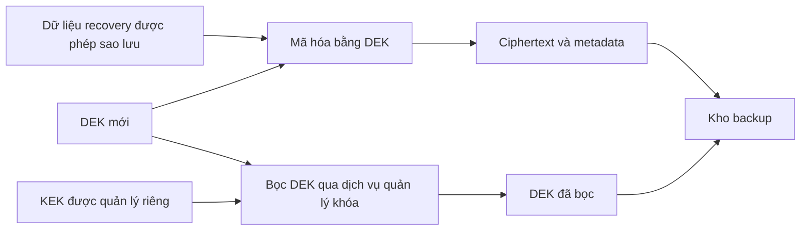

# Recovery data encryption

## 1. Mã hóa dữ liệu recovery để bảo vệ điều gì?

Hệ thống khôi phục tài khoản xử lý nhiều dữ liệu nhạy cảm: thông tin liên hệ, kết quả xác minh danh tính, bằng chứng hỗ trợ, quyết định phê duyệt và trạng thái các quyền recovery. Khi những dữ liệu đó được sao lưu, ranh giới bảo vệ mở rộng sang kho backup, công cụ xuất dữ liệu, môi trường khôi phục và hệ thống quản lý khóa.

**Recovery data encryption** là việc mã hóa các dữ liệu recovery cần bảo mật trong quá trình lưu, truyền và phục hồi, đi kèm cách quản lý khóa, kiểm tra toàn vẹn và kiểm soát quyền giải mã.

Trong phạm vi `SECURITY_AUTHENTICATION_ACCOUNT_RECOVERY`, mục tiêu không chỉ là làm cho một tệp backup khó đọc. Hệ thống phải bảo đảm người lấy được bản sao dữ liệu không đồng thời lấy được khả năng giải mã, còn người vận hành restore không mặc nhiên có quyền khôi phục tài khoản của người dùng.

Mã hóa cũng không tự chứng minh một yêu cầu recovery là hợp lệ. Một bản sao lưu được giải mã thành công vẫn có thể chứa token đã hết hạn, quyền đã bị thu hồi hoặc kết quả xác minh không còn đủ độ mới. Tính bí mật của dữ liệu và tính hợp lệ của quyền truy cập là hai vấn đề riêng.

## 2. Phân loại dữ liệu trước khi mã hóa

Không nên giải quyết mọi loại dữ liệu bằng cách lưu bản rõ rồi mã hóa chung một thư mục.

| Dữ liệu | Cách xử lý chính | Lưu ý cho backup |
|---|---|---|
| Mật khẩu | Cơ chế băm mật khẩu phù hợp, không lưu bản rõ có thể giải mã | Password hash vẫn là dữ liệu nhạy cảm cần bảo vệ |
| Token recovery ngẫu nhiên | Thường chỉ lưu giá trị kiểm chứng một chiều nếu không cần đọc lại token | Backup không nên chứa token bearer bản rõ |
| Recovery code | Lưu theo cơ chế kiểm chứng và trạng thái sử dụng phù hợp | Restore không được làm mã đã dùng thành chưa dùng |
| Bằng chứng và dữ liệu xác minh | Thu thập tối thiểu, mã hóa và giới hạn quyền đọc | Có vòng đời riêng, không đưa toàn bộ vào mọi backup |
| Kênh liên hệ | Mã hóa khi cần cùng kiểm soát truy cập | Phải bảo toàn liên kết giữa giá trị và trạng thái xác minh |
| Quyết định, trạng thái case | Bảo vệ bí mật và toàn vẹn theo mức nhạy cảm | Cần phiên bản, provenance và cơ chế chống rollback |
| Bí mật cần đọc để vận hành | Mã hóa có quản lý khóa chuyên dụng nếu thực sự cần lưu | Không đưa khóa giải mã vào cùng gói backup |

Ví dụ, nếu backend chỉ cần kiểm tra token do người dùng đưa lại, không nên lưu token bản rõ chỉ vì đã có mã hóa ổ đĩa. Giảm dữ liệu có thể đọc lại giúp giảm hậu quả khi cả kho dữ liệu và quyền giải mã bị xâm phạm.

Một hash của giá trị có thể đoán được không tự bảo đảm bí mật. Không dùng hash thông thường của số điện thoại hoặc thông tin định danh có không gian tìm kiếm nhỏ như một cách thay thế tùy ý cho mã hóa. Mỗi mục đích cần một cơ chế được thiết kế riêng.

## 3. Mô hình đe dọa cho backup và restore

Cần xác định đối tượng tấn công có thể lấy được những gì:

- Một tệp backup hoặc snapshot bị lộ từ kho lưu trữ.
- Một tài khoản vận hành có quyền tải backup nhưng không có quyền giải mã.
- Một ứng dụng bị chiếm quyền và có thể gọi dịch vụ quản lý khóa trong phạm vi của nó.
- Một tệp backup bị sửa, thay bằng bản cũ hoặc ghép các phần từ nhiều snapshot.
- Một môi trường restore ghi bản rõ vào thư mục tạm, log hoặc crash dump.
- Một cấu hình cấp quyền giải mã quá rộng cho nhiều tenant.

Mã hóa backup hữu ích khi người lấy dữ liệu không có khóa hoặc quyền dùng khóa. Nó không tự bảo vệ khỏi một ứng dụng đang được cấp quyền giải mã mà đã bị chiếm quyền. Tình huống đó cần thêm giới hạn phạm vi, phát hiện sử dụng khóa bất thường và kiểm soát truy cập tới dữ liệu.

Cũng cần bảo vệ đường xuất và nhập. Backup đã mã hóa trong object storage không giúp được nhiều nếu công cụ tạo backup trước đó lưu bản rõ không được kiểm soát trong thư mục tạm hoặc hệ thống CI.

## 4. Các lớp mã hóa và phạm vi của chúng

| Lớp | Bảo vệ điển hình | Giới hạn |
|---|---|---|
| Mã hóa đường truyền | Dữ liệu giữa các dịch vụ và nơi lưu | Không bảo vệ bản rõ sau khi một đầu kết nối nhận được |
| Mã hóa ổ đĩa hoặc dịch vụ lưu trữ | Thiết bị, snapshot hoặc vật mang tin trong mô hình tương ứng | Người có quyền đọc qua dịch vụ vẫn có thể nhận bản rõ |
| Mã hóa tệp backup | Gói dữ liệu được tải hoặc sao chép ra ngoài hệ thống | Cần bảo vệ khóa và công cụ giải mã riêng |
| Mã hóa ở tầng ứng dụng | Các trường hoặc đối tượng nhạy cảm trước khi tới nơi lưu | Tăng yêu cầu về schema, truy vấn, khóa và di chuyển dữ liệu |

Các lớp có thể bổ sung cho nhau. Không nên gọi mọi thứ là “đã mã hóa” mà không biết người dùng dịch vụ nào vẫn có thể đọc bản rõ.

Metadata cũng cần được xem xét: tên tệp, đường dẫn object, tag, số lượng bản ghi và kích thước có thể làm lộ tenant hoặc sự tồn tại của một case. Mã hóa payload không che giấu toàn bộ metadata đó.

## 5. Envelope encryption và tách khóa khỏi dữ liệu

Một mô hình thường dùng là **envelope encryption**:

1. Tạo khóa mã hóa dữ liệu, gọi là DEK, bằng nguồn ngẫu nhiên mật mã hoặc dịch vụ quản lý khóa được phép.
2. Dùng DEK để mã hóa backup hoặc một phân đoạn của backup.
3. Bọc DEK bằng khóa quản lý cấp cao hơn, gọi là KEK, qua dịch vụ quản lý khóa hoặc phần cứng thích hợp.
4. Lưu ciphertext, DEK đã bọc và metadata giải mã cần thiết.
5. Giữ KEK cùng quyền sử dụng nó ngoài gói backup.



Lưu DEK đã bọc cạnh ciphertext là bình thường trong mô hình này: DEK đã bọc chỉ có thể dùng sau khi được giải bọc hợp lệ. Lưu DEK bản rõ hoặc thông tin đăng nhập toàn quyền của dịch vụ khóa cạnh backup sẽ làm mất ranh giới bảo vệ.

Phân tách khóa có thể theo backup, segment, tenant hoặc nhóm dữ liệu. Mỗi lựa chọn ảnh hưởng tới phạm vi thiệt hại, khả năng phục hồi, số thao tác khóa và vòng đời lưu trữ. Không có một mức phân tách phù hợp cho mọi hệ thống.

Quyền tải backup, quyền giải bọc khóa và quyền đưa dữ liệu vào production nên được xem xét riêng. Một tác vụ máy được phép restore không có nghĩa mọi người vận hành nó đều cần xem nội dung bản rõ.

## 6. Mã hóa có xác thực và dữ liệu ngữ cảnh

Đối với dữ liệu cần bảo mật và phát hiện sửa đổi, nên dùng cơ chế mã hóa có xác thực theo thiết kế được hỗ trợ, chẳng hạn AES-GCM trong một cấu hình hợp lệ.

Mã hóa có xác thực cung cấp ciphertext và tag kiểm tra. Khi giải mã, nếu khóa, nonce, ciphertext hoặc dữ liệu xác thực bổ sung không khớp, hệ thống phải coi giải mã là thất bại. Không trả về một phần bản rõ rồi tiếp tục restore.

**AAD**, tức dữ liệu xác thực bổ sung, được bảo vệ tính toàn vẹn nhưng không được mã hóa. Nó có thể ràng buộc ciphertext với ngữ cảnh:

```text
application = account-recovery
format_version = 2
tenant_reference = tenant_example_31
backup_reference = backup_example_607
segment_reference = segment_example_12
data_category = recovery-evidence
```

Không đưa bí mật hoặc thông tin cá nhân không cần thiết vào AAD vì AAD có thể được lưu, vận chuyển hoặc ghi nhận ở dạng đọc được.

AAD phải có encoding và định dạng xác định. Không ghép chuỗi tùy ý có thể diễn giải theo nhiều cách. Khi restore, ngữ cảnh mong đợi phải được đối chiếu với manifest và kế hoạch restore đã được xác thực, không chỉ tin mọi metadata trong tệp người dùng đưa vào.

Ràng buộc ngữ cảnh giúp phát hiện việc tráo dữ liệu giữa tenant hoặc segment, nhưng không tự chứng minh đây là backup mới nhất. Một backup cũ nguyên vẹn vẫn có tag hợp lệ; chống rollback cần mốc và chính sách riêng.

## 7. Nonce, phạm vi dùng khóa và giới hạn dữ liệu

Với AES-GCM, không được tái sử dụng cùng nonce cho hai lần mã hóa khác nhau dưới cùng khóa. Vi phạm điều này có thể phá vỡ bảo đảm bảo mật của chế độ mã hóa.

Nonce 12 byte là một cấu hình phổ biến cho GCM. Có thể dùng nguồn ngẫu nhiên mật mã theo một chính sách có giới hạn số lần dùng khóa, hoặc một cơ chế cấp nonce bảo đảm duy nhất. Không tự lấy timestamp, mã tài khoản hoặc số thứ tự dễ bị reset làm nonce nếu chưa có thiết kế bảo đảm tính duy nhất.

Nonce ngẫu nhiên không có nghĩa xác suất trùng bằng không. Hệ thống cần giới hạn khối lượng mã hóa theo khóa và có chính sách thay khóa phù hợp với thiết kế mật mã đang dùng. Tạo DEK mới cho mỗi backup hoặc nhóm phân đoạn thích hợp giúp quản lý phạm vi đó.

Khôi phục snapshot của một bộ đếm nonce có thể làm bộ đếm quay về giá trị cũ. Việc nhân bản môi trường chứa trạng thái sinh ngẫu nhiên cũng cần được xem xét. Sau restore, tác vụ tạo backup mới không được vô tình tiếp tục sử dụng lại một cặp khóa và nonce cũ.

Giới hạn kích thước mỗi thông điệp, tổng dữ liệu và số lần mã hóa bằng một khóa phải theo thư viện, chế độ và chính sách được áp dụng. Không thiết kế một tệp backup không giới hạn rồi đưa tất cả vào một lần gọi mật mã.

## 8. Định dạng gói dữ liệu được mã hóa

Một envelope minh họa:

```json
{
  "formatVersion": 2,
  "algorithm": "AES-256-GCM",
  "keyReference": "kek-version-example-9",
  "wrappedDek": "<base64-cua-DEK-da-boc>",
  "nonce": "<base64-cua-nonce>",
  "aadFormatVersion": 1,
  "backupRef": "backup_example_607",
  "segmentRef": "segment_example_12",
  "ciphertextWithTag": "<base64-cua-ciphertext-va-tag>"
}
```

Base64 chỉ là cách biểu diễn byte, không phải mã hóa bảo mật. Các placeholder trên không phải dữ liệu có thể sử dụng để giải mã.

Metadata phải đủ để đọc dữ liệu cũ nhưng không được cho phép người gửi chọn tùy ý thuật toán yếu hoặc tham chiếu khóa ngoài phạm vi. Bộ đọc cần allowlist định dạng, thuật toán, độ dài nonce, kích thước payload và nguồn khóa được phép.

`keyReference` cần nhận diện khóa hoặc phiên bản thích hợp để tìm đúng khóa giải bọc. Nếu dùng alias thay đổi theo thời gian, phải bảo toàn thông tin cần thiết để không nhầm rằng alias hiện tại chính là khóa từng bảo vệ backup cũ.

Không giải bọc khóa từ mọi envelope chưa được phân loại và phân quyền. Yêu cầu restore phải ràng buộc với backup và tenant được phép trước khi tác vụ dùng quyền gọi dịch vụ khóa.

## 9. Minh họa AES-GCM bằng Java

Ví dụ sau mã hóa một payload nhỏ trong bộ nhớ. `dek` là khóa AES có kích thước được chính sách cho phép và được cấp qua cơ chế quản lý khóa riêng. Ví dụ không triển khai bọc DEK, manifest, lưu trữ hoặc phân quyền restore.

```java
import java.security.GeneralSecurityException;
import java.security.SecureRandom;
import java.util.Objects;
import javax.crypto.Cipher;
import javax.crypto.SecretKey;
import javax.crypto.spec.GCMParameterSpec;

public final class RecoveryDataCipher {
    private static final int NONCE_BYTES = 12;
    private static final int TAG_BITS = 128;
    private final SecureRandom random = new SecureRandom();

    public record SealedData(byte[] nonce, byte[] ciphertextWithTag) {
        public SealedData {
            Objects.requireNonNull(nonce);
            Objects.requireNonNull(ciphertextWithTag);
            if (nonce.length != NONCE_BYTES
                    || ciphertextWithTag.length < TAG_BITS / 8) {
                throw new IllegalArgumentException("Invalid encrypted envelope");
            }
            nonce = nonce.clone();
            ciphertextWithTag = ciphertextWithTag.clone();
        }

        @Override
        public byte[] nonce() { return nonce.clone(); }

        @Override
        public byte[] ciphertextWithTag() { return ciphertextWithTag.clone(); }
    }

    public SealedData encrypt(SecretKey dek, byte[] plaintext, byte[] aad)
            throws GeneralSecurityException {
        Objects.requireNonNull(dek);
        Objects.requireNonNull(plaintext);
        Objects.requireNonNull(aad);

        byte[] nonce = new byte[NONCE_BYTES];
        random.nextBytes(nonce);
        Cipher cipher = Cipher.getInstance("AES/GCM/NoPadding");
        cipher.init(Cipher.ENCRYPT_MODE, dek,
            new GCMParameterSpec(TAG_BITS, nonce));
        cipher.updateAAD(aad);
        return new SealedData(nonce, cipher.doFinal(plaintext));
    }

    public byte[] decrypt(SecretKey dek, SealedData data, byte[] expectedAad)
            throws GeneralSecurityException {
        Objects.requireNonNull(dek);
        Objects.requireNonNull(data);
        Objects.requireNonNull(expectedAad);

        Cipher cipher = Cipher.getInstance("AES/GCM/NoPadding");
        cipher.init(Cipher.DECRYPT_MODE, dek,
            new GCMParameterSpec(TAG_BITS, data.nonce()));
        cipher.updateAAD(expectedAad);
        return cipher.doFinal(data.ciphertextWithTag());
    }
}
```

Những điểm cần hiểu:

- Không có khóa hardcode hay mật khẩu được cắt thành một mảng byte để làm DEK.
- Mỗi lần mã hóa tạo một nonce mới; hệ thống ngoài ví dụ vẫn phải quản lý giới hạn dùng khóa và rủi ro trùng nonce.
- Nonce được lưu cùng ciphertext, không cần giữ bí mật.
- Tag được kiểm tra trong `doFinal`; caller chỉ nhận bản rõ khi bước này thành công.
- AAD khi giải mã phải khớp đúng các byte khi mã hóa, đồng thời phản ánh ngữ cảnh restore được phép.
- Sao chép mảng trong record tránh việc bên gọi sửa envelope qua tham chiếu mảng đã truyền hoặc nhận.

Nếu xác thực tag thất bại, tầng gọi phải dừng xử lý payload, không thử bỏ tag hoặc chuyển sang chế độ “giải mã không kiểm tra”. Lỗi bên ngoài không nên tiết lộ chi tiết khóa hay phân biệt quá mức các trạng thái nội bộ cho người không có quyền.

Đoạn mã giữ payload trong bộ nhớ nên không phù hợp để đọc một backup lớn không giới hạn. Bản rõ và khóa trong bộ nhớ, heap dump hoặc crash dump vẫn cần được bảo vệ; thu gom rác không phải cam kết xóa bí mật tức thì.

## 10. Mã hóa backup lớn theo phân đoạn

Với dữ liệu lớn, có thể dùng định dạng streaming được thiết kế cho mã hóa có xác thực hoặc chia thành các phân đoạn có ranh giới rõ ràng. Không tự sáng tác cách nối các ciphertext rồi bỏ qua kiểm tra toàn gói.

Nếu mã hóa từng chunk, cần ràng buộc ít nhất:

```text
backup_reference
segment_reference
chunk_index
format_version
data_category
```

Manifest được bảo vệ cần mô tả tập chunk mong đợi, thứ tự, độ dài hoặc các thông tin đối chiếu thích hợp và cách nhận diện hoàn tất. Mỗi chunk hợp lệ riêng lẻ chưa chứng minh backup không bị cắt phần cuối, đảo thứ tự hoặc ghép từ nhiều backup.

Nonce phải không trùng trong phạm vi khóa. Nếu suy ra nonce từ chỉ số chunk, cần bảo đảm cùng khóa không được dùng lại cho một backup khác có cùng chỉ số. Một thiết kế có DEK mới theo backup vẫn cần quy tắc quản lý khóa và chỉ số rõ ràng.

Không đưa bản rõ đã giải mã vào cơ sở dữ liệu đang phục vụ người dùng trước khi các kiểm tra bắt buộc của đơn vị phục hồi hoàn tất. Có thể dùng staging cách ly rồi chỉ chuyển sang bước nhập khi manifest và dữ liệu cần thiết đã được xác minh.

Nếu dữ liệu có nén, giới hạn kích thước đầu ra và tài nguyên giải nén. Một payload được xác thực không có nghĩa nó luôn có kích thước an toàn để xử lý; nguồn tạo hoặc môi trường trước đó cũng có thể đã bị xâm phạm.

## 11. Quản lý vòng đời khóa

Khóa mã hóa dữ liệu, khóa bọc dữ liệu và thông tin truy cập dịch vụ khóa cần vòng đời riêng.

| Hoạt động | Yêu cầu chính |
|---|---|
| Tạo khóa | Dùng nguồn mật mã phù hợp, xác định mục đích và phạm vi |
| Cấp quyền | Chỉ workload được phép mới giải bọc khóa của backup thuộc phạm vi |
| Sử dụng | Ghi nhận thao tác khóa mà không ghi vật liệu khóa hoặc bản rõ |
| Luân chuyển | Giữ khả năng đọc dữ liệu còn trong thời hạn, xác định dữ liệu nào cần mã hóa lại |
| Thu hồi | Phân biệt ngăn sử dụng mới với hậu quả đối với backup cũ |
| Hủy khóa | Có thẩm quyền, kiểm tra phụ thuộc và xử lý các bản sao khóa |

Thay KEK có thể chỉ cần bọc lại DEK, tùy cơ chế của dịch vụ và mô hình đe dọa. Thay DEK thường cần mã hóa lại dữ liệu liên quan. Bọc lại DEK không làm dữ liệu an toàn trở lại nếu DEK bản rõ đã bị lộ; người có DEK và ciphertext cũ vẫn có thể đọc bản cũ.

Nếu nghi một khóa bị xâm phạm, cần xác định dữ liệu, khoảng thời gian và các bản sao chịu ảnh hưởng. Chỉ cập nhật alias “current-key” không xóa được khả năng đọc các ciphertext đã bị lấy trước đó.

Mất khóa cũng là mất khả năng phục hồi dữ liệu. Kế hoạch bảo vệ khóa phải cân bằng kiểm soát truy cập với khả năng restore được phép, tránh đặt mọi phương tiện mở khóa vào đúng hệ thống đang cần khôi phục.

Quy trình khẩn cấp cần có phạm vi, thời hạn, người chịu trách nhiệm và dấu vết; không duy trì một khóa giải mã chung được chia sẻ qua chat chỉ để thuận tiện khi có sự cố.

## 12. Quy trình giải mã và restore an toàn

Một trình tự khái quát:

1. Xác thực yêu cầu restore và thẩm quyền của tác nhân hoặc workload.
2. Xác định chính xác backup, tenant, loại dữ liệu và mục đích sử dụng.
3. Kiểm tra manifest, định dạng, phiên bản và các mốc tin cậy cần thiết.
4. Kiểm tra tham chiếu khóa và quyền giải bọc trong phạm vi cho phép.
5. Giải bọc DEK bằng ngữ cảnh được quy định.
6. Giải mã có xác thực vào môi trường staging được bảo vệ.
7. Kiểm tra cấu trúc, phạm vi và tính đầy đủ của dữ liệu đã giải mã.
8. Đối chiếu trạng thái bảo mật hiện hành trước khi đưa dữ liệu vào hoạt động.
9. Nhập dữ liệu theo quy trình restore có kiểm soát và lưu audit cần thiết.
10. Dọn các bản rõ tạm và kết thúc quyền truy cập tạm theo chính sách.

Encryption context của một dịch vụ quản lý khóa, nếu được sử dụng, cần khớp quy tắc bọc khóa. Nó không thay thế mọi kiểm tra phân quyền của ứng dụng và không nên chứa dữ liệu nhạy cảm nếu dịch vụ có thể ghi context vào audit.

Môi trường staging cần kiểm soát người đọc, tệp tạm, dump và kết nối mạng. Không tải backup thật vào máy cá nhân hoặc môi trường phát triển chỉ vì có thể lấy khóa.

Nếu thiếu khóa hoặc xác thực dữ liệu thất bại, báo restore chưa hoàn tất. Không tự chuyển sang backup bất kỳ khác mà không kiểm tra phạm vi, độ mới và sự cho phép của kế hoạch phục hồi.

## 13. Giải mã thành công không đồng nghĩa quyền còn hợp lệ

Giả sử backup lúc T0 chứa một recovery grant chưa dùng. Tại T1, grant đã được sử dụng và MFA đã thay đổi. Nếu restore về T0, ciphertext có thể hoàn toàn nguyên vẹn nhưng trạng thái nghiệp vụ đã bị lùi.

Các dữ liệu cần đối chiếu có thể gồm:

- Token và recovery code đã tiêu thụ hoặc thu hồi.
- Phiên đã bị vô hiệu hóa và mốc phiên bản bảo mật tài khoản.
- Quyết định đã bị hủy, request đã hết hạn hoặc bị từ chối.
- Kênh liên hệ và trạng thái xác minh đã thay đổi.
- Tài khoản đã đóng hoặc đã merge vào tài khoản khác.
- Cảnh báo rủi ro và điều kiện kiểm soát đang có hiệu lực.

Không dùng thời điểm ghi trong tệp backup làm nguồn duy nhất để xác định thời gian hiện tại. Thời hạn phải được kiểm tra theo ngữ cảnh có thẩm quyền của quá trình restore và hệ thống hoạt động sau đó.

Nếu không thể chứng minh các quyền recovery cũ vẫn hợp lệ, chính sách an toàn có thể yêu cầu vô hiệu hóa chúng và cấp lại qua quy trình mới được cho phép. Không giải mã token cũ rồi gửi lại cho người dùng như một cách “khôi phục đầy đủ”.

Tương tự, dữ liệu bằng chứng đã mã hóa được đọc lại không có nghĩa kết luận xác minh cũ vẫn đủ cho mọi quyết định mới. Phải kiểm tra mục đích, phạm vi và độ mới theo chính sách recovery hiện hành.

## 14. Audit, retention và xử lý sự cố

Audit cho thao tác mã hóa và restore có thể lưu:

```text
backup_reference / segment_reference
tenant_reference / data_category
format_version / algorithm_identifier
key_reference, không phải khóa
actor_or_workload_reference
restore_operation_reference
requested_at / completed_at
outcome / controlled_error_code
manifest_reference
```

Không ghi DEK bản rõ, token recovery, payload đã giải mã hoặc nội dung bằng chứng vào log lỗi. Cũng cần kiểm tra cơ chế ghi request của proxy, tracing và công cụ chẩn đoán để tránh dữ liệu nhạy cảm lọt qua đường khác.

Phân biệt lỗi quyền dùng khóa, khóa không còn sẵn có, metadata không hợp lệ, tag không khớp và dữ liệu nghiệp vụ không đủ điều kiện restore trong hệ thống giám sát nội bộ. Phản hồi bên ngoài giới hạn theo quyền và mục đích; không biến lỗi giải mã thành công cụ dò tenant hay trạng thái backup.

Vòng đời backup phải phù hợp với dữ liệu bên trong. Mã hóa không cho phép bỏ qua việc xóa hoặc hạn chế lưu. Hủy khóa có thể là một phần của thiết kế kết thúc khả năng đọc, nhưng cần xét bản sao khóa, DEK đã giải bọc, bản rõ tạm và những bản sao dữ liệu khác.

Không hủy khóa đang bảo vệ các backup còn phải đọc mà chưa xác định hậu quả. Ngược lại, không giữ mọi khóa và mọi backup vô thời hạn chỉ vì lo mất khả năng phục hồi.

## 15. Tình huống xuyên suốt

Một dịch vụ có backup dữ liệu recovery chứa metadata case, kết quả assessment và các tham chiếu bằng chứng. Bằng chứng nhạy cảm được lưu theo nhóm dữ liệu riêng, không sao chép vào mọi log hoặc bản xuất hỗ trợ.

1. Tác vụ backup chọn đúng phạm vi dữ liệu, tạo DEK mới cho đơn vị mã hóa và bọc DEK qua dịch vụ khóa.
2. Payload được mã hóa có xác thực, gắn AAD với backup, segment, tenant và phiên bản định dạng.
3. Kho backup giữ ciphertext, nonce, DEK đã bọc và manifest phù hợp; không có DEK bản rõ trong gói dữ liệu.
4. Một người có quyền tải backup nhưng không có quyền giải bọc khóa không thể đọc payload chỉ bằng tệp đã tải.
5. Khi cần restore, workload được cấp quyền giới hạn đối với backup cụ thể, kiểm tra manifest rồi giải mã vào staging.
6. Một segment bị tráo từ backup khác không khớp ngữ cảnh mong đợi và không được nhập vào hệ thống.
7. Dữ liệu nguyên vẹn được đối chiếu với các mốc thu hồi, tiêu thụ token và phiên bản bảo mật hiện hành.
8. Grant đã dùng sau thời điểm backup không được tái kích hoạt; trạng thái cũ được xử lý theo quy trình phục hồi bảo mật.
9. Sau khi hoàn tất, hệ thống lưu audit kết quả và xử lý bản rõ tạm theo chính sách, không đưa nội dung vào báo cáo vận hành.

Nếu không lấy được khóa, tác vụ báo lỗi có kiểm soát và giữ nguyên trạng thái chưa restore. Nhân viên không được yêu cầu người dùng gửi mật khẩu, OTP hoặc recovery code để thay thế khóa mã hóa backup của hệ thống.

## 16. Những lỗi thiết kế thường gặp

- **Lưu khóa bản rõ cạnh backup:** người lấy tệp có đủ điều kiện giải mã.
- **Dùng mã hóa thay cho băm mật khẩu:** giữ khả năng đọc lại bí mật không cần thiết.
- **Lưu bearer token chỉ vì ổ đĩa đã mã hóa:** tăng hậu quả khi quyền giải mã bị lộ.
- **Tái sử dụng nonce dưới cùng DEK:** làm hỏng bảo đảm mật mã.
- **Bỏ kiểm tra tag khi gặp lỗi:** nhập dữ liệu không được xác thực.
- **Tin metadata do người gửi chọn:** cho phép tráo tenant, chọn khóa hoặc thuật toán ngoài phạm vi.
- **Xác thực từng chunk nhưng không kiểm tra manifest:** bỏ sót cắt ngắn, tráo thứ tự hoặc thiếu dữ liệu.
- **Giải mã trực tiếp vào hệ thống đang hoạt động:** có thể để dữ liệu chưa đủ kiểm tra gây tác động.
- **Coi backup cũ nguyên vẹn là trạng thái hiện hành:** làm sống lại token, phiên hoặc tài khoản đã bị vô hiệu hóa.
- **Ghi bản rõ vào log hoặc tệp tạm không kiểm soát:** tạo đường rò rỉ nằm ngoài kho backup đã mã hóa.

Mã hóa dữ liệu recovery hiệu quả khi định dạng, ngữ cảnh, khóa và quyền giải mã được quản lý cùng nhau. Trong backup và restore, hệ thống cần bảo vệ bí mật của dữ liệu, phát hiện sửa đổi và kiểm tra lại ý nghĩa bảo mật của trạng thái được phục hồi, để một bản sao cũ không trở thành đường vòng cấp lại quyền truy cập.
