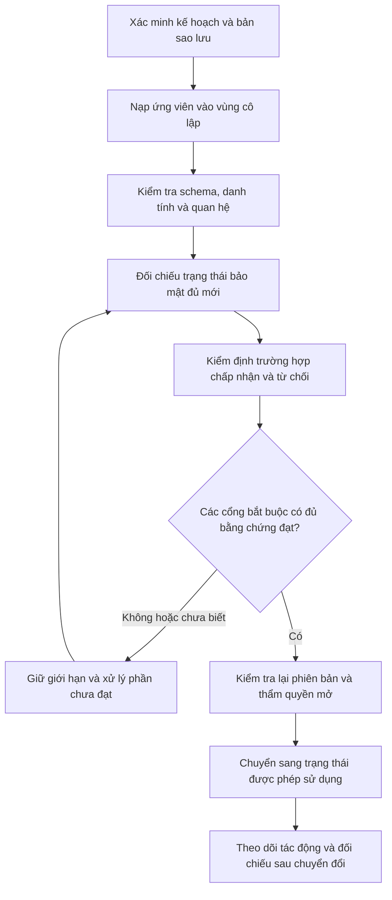

# Restore validation — Kiểm định dữ liệu và trạng thái bảo mật sau phục hồi

## 1. Phục hồi thành công về kỹ thuật chưa có nghĩa là an toàn để mở truy cập

Một bản sao lưu có thể được giải nén, nhập vào cơ sở dữ liệu và đọc ra mà không báo lỗi. Điều đó chỉ chứng minh một phần quá trình phục hồi hoạt động. Nó chưa chứng minh dữ liệu thuộc đúng tài khoản, trạng thái xác thực còn phù hợp hoặc các bí mật đã bị vô hiệu không bị kích hoạt lại.

Trong `SECURITY_AUTHENTICATION_ACCOUNT_RECOVERY`, restore validation là tập kiểm định để quyết định một trạng thái được phục hồi có thể được sử dụng cho mục đích nào. Phạm vi cần bao gồm dữ liệu của chủ thể, credential, yếu tố MFA hoặc passkey, token dùng một lần, bằng chứng, phê duyệt và phiên liên quan.

Ví dụ, bản sao lưu được tạo trước lúc người dùng báo mất điện thoại có thể vẫn ghi yếu tố MFA trên điện thoại là hoạt động. Nếu phục hồi nguyên trạng rồi mở đăng nhập, hệ thống vô tình đảo ngược quyết định bảo mật đã thực hiện sau thời điểm sao lưu.

Một kết quả kiểm định tốt phải trả lời được:

1. Bản phục hồi đến từ đâu và có bị thay đổi ngoài dự kiến không?
2. Nó thuộc đúng danh tính, tenant và phạm vi được phép không?
3. Các quan hệ dữ liệu và phiên bản có nhất quán không?
4. Trạng thái bảo mật nào đã thay đổi sau thời điểm sao lưu?
5. Những chức năng nào được phép hoạt động, bị giới hạn hoặc cần khôi phục lại qua xác minh mới?

Mục tiêu không phải giữ nguyên mọi byte của quá khứ. Mục tiêu là lấy lại dữ liệu hợp lệ mà không đưa hệ thống trở về một trạng thái truy cập đã không còn được phép.

## 2. Phân biệt phục hồi hạ tầng và khôi phục tài khoản

Phục hồi hạ tầng thường nhằm đưa kho dữ liệu hoặc dịch vụ trở lại sau sự cố. Khôi phục tài khoản nhằm xác minh chủ thể và thiết lập lại quyền truy cập khi họ mất phương tiện xác thực. Hai quy trình có thể gặp nhau nhưng có thẩm quyền khác nhau.

Người vận hành được quyền nhập một bản sao lưu không vì thế được phép quyết định ai là chủ tài khoản. Ngược lại, một nhân viên hỗ trợ đã xác minh người dùng cũng không tự có quyền khôi phục toàn bộ cơ sở dữ liệu hoặc chọn một bản sao lưu chưa được kiểm định.

Trong cả hai tình huống, nên tách ba kết quả:

| Kết quả | Điều được khẳng định | Điều chưa được khẳng định |
|---|---|---|
| Nạp dữ liệu thành công | Hệ thống đọc được cấu trúc dữ liệu theo quy trình phục hồi | Nội dung đúng, mới hoặc an toàn để dùng cho đăng nhập |
| Dữ liệu được kiểm định trong một phạm vi | Các điều kiện đã nêu có đủ bằng chứng đạt yêu cầu | Mọi hệ thống phụ thuộc đều đã đồng bộ hoặc mọi dữ liệu đều đã kiểm tra |
| Được phép mở truy cập | Các cổng bảo mật tương ứng với chức năng đã đạt | Có thể bỏ qua xác thực hoặc cấp lại mọi quyền lịch sử |

Một tài khoản có thể có dữ liệu nghiệp vụ được phục hồi nhưng vẫn cần đăng ký lại yếu tố xác thực. Trạng thái này nên được mô tả rõ thay vì gắn một nhãn chung “restore complete”.

## 3. Lập kế hoạch và phạm vi kiểm định trước khi nạp dữ liệu

Kế hoạch phục hồi cần chỉ rõ bản sao lưu, thời điểm dữ liệu đại diện, phạm vi tài khoản hoặc tenant, nơi nhận dữ liệu và các nguồn dùng để đối chiếu. Không chỉ ghi tên một tệp rồi để công cụ tự suy ra tất cả đối tượng.

Một manifest minh họa có thể chứa:

```text
restoreRunId: restore-318
backupId: backup-204
snapshotAt: 2026-11-23T18:00:00Z
sourceEnvironment: production
destinationMode: isolated-candidate
identityScope: identity-482
credentialAuthorityId: tenant-A
schemaVersion: 12
dataCategories:
  - profile
  - preferences
  - recovery-case-metadata
securityReconciliationRequired: true
```

Đây là ví dụ về thông tin điều phối, không phải schema bắt buộc. Những thông tin nhạy cảm trong manifest cũng cần được bảo vệ và xác thực nguồn gốc.

Phải phân biệt thời điểm tạo gói sao lưu, thời điểm chụp dữ liệu và thời điểm hoàn tất sao chép. Chúng không nhất thiết trùng nhau. Với nhiều kho dữ liệu, cần biết các phần có thuộc cùng một mốc nhất quán hay chỉ là những ảnh chụp được tạo gần nhau.

Kế hoạch cũng cần xác định điều kiện dừng, người quyết định mở truy cập và cách xử lý dữ liệu chưa đủ căn cứ. Nếu chỉ một phần phạm vi thất bại, có thể cô lập phần đó khi thiết kế chứng minh được tính độc lập; không tự mở toàn bộ hệ thống chỉ vì đa số kiểm định đã đạt.

## 4. Kiểm tra nguồn gốc, tính toàn vẹn và khả năng giải mã

Trước khi sử dụng nội dung, cần xác minh gói phục hồi là đối tượng được chọn trong kế hoạch, đến từ nguồn được phép và chưa bị thay đổi ngoài dự kiến.

Các kiểm tra có thể gồm định danh bản sao lưu, nguồn lưu trữ, quyền truy cập, manifest, cơ chế xác thực gói dữ liệu và kết quả giải mã. Nếu dùng checksum, giá trị kỳ vọng phải đến từ nguồn được bảo vệ phù hợp.

Một checksum đặt cạnh tệp và cùng có thể bị sửa không tự chứng minh nguồn gốc đáng tin. Tương tự, mã hóa giúp bảo vệ dữ liệu trong những điều kiện tương ứng, nhưng việc giải mã thành công không chứng minh nội dung phản ánh chủ thể hợp lệ hoặc không chứa thay đổi do kẻ tấn công tạo trước khi sao lưu.

Khóa giải mã cần được quản lý theo đúng phạm vi. Không đưa khóa, mật khẩu hoặc dữ liệu khôi phục nguyên văn vào log để chứng minh rằng bước giải mã đã chạy.

Nếu khóa cần thiết không còn khả dụng, phải ghi nhận giới hạn đó. Không bỏ kiểm tra bảo vệ hoặc tự chuyển dữ liệu về dạng ít bảo vệ hơn để làm trạng thái kiểm định trông thành công.

Đối với passkey, bản sao lưu phía dịch vụ xác thực thường chứa thông tin credential và khóa công khai, không phải khóa riêng do bộ xác thực quản lý. Phục hồi bản ghi phía máy chủ không tự tái tạo được một passkey mà người dùng đã mất ở phía thiết bị hoặc nền tảng giữ khóa.

## 5. Nạp vào vùng cô lập để tránh tác động ngoài ý muốn

Dữ liệu ứng viên nên được kiểm định trong một chế độ không tự mở quyền đăng nhập hoặc phát sinh tác động bên ngoài. Nếu đưa dữ liệu cũ vào một dịch vụ hoạt động bình thường, các tác vụ nền có thể gửi email, chạy lại lệnh hoặc phát hành khả năng khôi phục trước khi kiểm định xong.

Các ranh giới cần xem xét gồm:

- Không gửi thông báo thật hoặc token từ môi trường kiểm định tới người dùng.
- Không kết nối nhầm hệ thống xác thực sản xuất bằng cấu hình sao chép từ bản sao lưu.
- Không chạy lại hàng đợi sự kiện hoặc tác vụ khôi phục cũ như lệnh mới.
- Không cho endpoint đăng nhập sử dụng credential ứng viên trước khi được phép.
- Hạn chế người và dịch vụ có thể đọc dữ liệu cá nhân trong vùng phục hồi.

Tắt một tác vụ giao diện chưa chắc đã cô lập được hệ thống. Cần xét cả worker, lịch chạy, outbox, webhook và các tích hợp có thể tạo tác động.

Việc dùng dữ liệu thật để kiểm định cũng không làm nó trở thành dữ liệu không nhạy cảm. Các bản tạm, báo cáo lỗi và kết quả đối chiếu cần nằm trong phạm vi bảo vệ của quy trình.

## 6. Kiểm tra schema, định danh và quan hệ dữ liệu

### 6.1. Khả năng tương thích cấu trúc

Bản sao lưu có thể thuộc phiên bản ứng dụng cũ. Cần kiểm tra schema, trường bắt buộc, giá trị trạng thái và những quy tắc chuyển đổi đã được cho phép.

Không tự đặt mọi trạng thái không nhận biết thành `ACTIVE`. Một giá trị cũ hoặc thiếu trường có thể cần cách ly hoặc chuyển đổi cụ thể. Mặc định thuận tiện cho dữ liệu trình bày không nhất thiết an toàn cho dữ liệu xác thực.

### 6.2. Đúng danh tính và tenant

Dữ liệu phải được gắn với định danh ổn định và miền có thẩm quyền. Không dùng tên hiển thị hoặc email giống nhau làm căn cứ duy nhất để nhập hồ sơ vào một tài khoản đang tồn tại.

Nếu tài khoản đã được hợp nhất hoặc chuyển đổi danh tính sau thời điểm sao lưu, cần kế hoạch ánh xạ đã được xác minh. Ánh xạ phục vụ tìm dữ liệu không tự cho phép credential của tài khoản cũ đăng nhập vào danh tính mới.

### 6.3. Tính nhất quán của quan hệ

Các quan hệ cần đối chiếu có thể gồm credential thuộc đúng chủ thể, token trỏ đúng hồ sơ, phê duyệt gắn đúng phiên bản kế hoạch, bằng chứng tham chiếu còn tồn tại và tư cách tenant không mâu thuẫn.

Số lượng bản ghi đúng không chứng minh các quan hệ đúng. Hai bộ dữ liệu có thể có cùng số dòng nhưng credential bị gắn sang người khác. Cần kiểm tra các bất biến liên quan đến quyền truy cập, không chỉ đếm tổng.

Không sửa các liên kết không xác định bằng cách tự chọn tài khoản gần giống nhất. Những mục chưa chứng minh được cần được tách khỏi phần được phép dùng.

## 7. Chống quay lùi trạng thái bảo mật

Một bản sao lưu là ảnh quá khứ. Nó có thể thiếu các sự kiện thu hồi, tiêu thụ token, đổi mật khẩu, khóa tài khoản hoặc thay đổi quyền xảy ra sau đó.

Ví dụ dòng thời gian:

```text
18:00                19:00                 20:00               21:00
  |                     |                     |                    |
Chụp bản sao lưu     Báo mất thiết bị      Token đã được dùng   Phục hồi bản 18:00
                    và thu hồi MFA        cho một lần khôi phục
```

Nếu chỉ nhập lại ảnh 18:00, yếu tố bị thu hồi ở 19:00 có thể trở thành hoạt động và token đã dùng ở 20:00 có thể lại xuất hiện là chưa dùng.

Kiểm định cần đối chiếu với nguồn trạng thái bảo mật đủ mới và có thẩm quyền, chẳng hạn nhật ký sự kiện bền vững, sổ thu hồi hoặc hệ thống quản lý credential còn đáng tin. Nguồn này phải có khả năng cung cấp thông tin không bị mất cùng chính ảnh sao lưu đang phục hồi.

Không chỉ áp dụng quy tắc lấy timestamp lớn nhất trên các bản ghi. Sự kiện tiêu thụ, thu hồi hoặc xóa có ngữ nghĩa riêng; đồng hồ và dữ liệu cũng có thể không đồng nhất. Cần quy tắc đối chiếu theo loại đối tượng và phiên bản trạng thái.

Nếu không còn nguồn đủ mới để chứng minh một credential hoặc khả năng khôi phục vẫn được phép, không nên coi việc nó xuất hiện trong backup là căn cứ để mở truy cập. Có thể phải vô hiệu khả năng cũ trong phạm vi bị ảnh hưởng và đưa chủ thể qua một quy trình xác minh, thiết lập mới.

Điều này không đồng nghĩa phải xóa dữ liệu nghiệp vụ của người dùng. Có thể bảo toàn nội dung được xác định hợp lệ trong khi giữ các đường xác thực chưa đủ căn cứ ở trạng thái không sử dụng được.

## 8. Kiểm định theo từng loại đối tượng xác thực và khôi phục

| Đối tượng | Rủi ro khi phục hồi nguyên trạng | Điều cần đối chiếu hoặc xử lý |
|---|---|---|
| Mật khẩu đã băm | Mật khẩu cũ từng bị thay hoặc lộ có thể được chấp nhận lại | Trạng thái credential đủ mới; yêu cầu thiết lập lại nếu không chứng minh được hiệu lực |
| TOTP hoặc yếu tố trên thiết bị mất | Bí mật hoặc bản ghi bị thu hồi có thể hoạt động trở lại | Nguồn thu hồi, lý do vô hiệu và điều kiện đăng ký lại |
| Passkey phía máy chủ | Credential bị xóa hoặc sai ánh xạ có thể được chấp nhận | Quan hệ danh tính, trạng thái thu hồi và ràng buộc xác thực của hệ thống |
| Mã khôi phục | Mã đã dùng có thể xuất hiện là chưa dùng | Lịch sử tiêu thụ; vô hiệu hoặc phát hành bộ mới khi cần |
| Token đặt lại mật khẩu hoặc grant đăng ký yếu tố | Khả năng dùng một lần có thể bị phát lại | Trạng thái tiêu thụ, thời hạn, mục đích, phiên bản và hiệu lực hiện tại |
| Phê duyệt | Quyết định cũ có thể đã hết hạn, bị thu hồi hoặc sai kế hoạch | Vòng duyệt, phiên bản, thời hạn và điều kiện thực thi hiện tại |
| Phiên và refresh token | Phiên bị chặn sau mốc sao lưu có thể quay lại | Trạng thái thu hồi và cơ chế chặn tại những nơi thực sự kiểm tra truy cập |
| Kênh khôi phục | Kênh cũ có thể không còn do chủ thể kiểm soát | Lịch sử thay đổi và quy trình xác minh phù hợp |

Đối với token có chữ ký, việc chữ ký đúng và thời hạn trên token chưa qua không chứng minh token vẫn được phép sau phục hồi. Nó có thể đã bị tiêu thụ hoặc thu hồi. Đối với mật khẩu, việc hàm băm khớp chỉ chứng minh chuỗi nhập phù hợp với bản ghi cũ, không chứng minh bản ghi đó còn được phép dùng.

Các đối tượng đã bị xóa cũng cần được xem xét. Nếu bản sao lưu có trước thời điểm xóa, nhập lại có thể làm sống lại dữ liệu hoặc quyền mà chủ thể hay hệ thống đã chủ động loại bỏ. Việc bảo toàn dấu vết cần thiết và việc cho đối tượng hoạt động trở lại là hai quyết định khác nhau.

## 9. Khi mất lịch sử thu hồi hoặc lịch sử tiêu thụ

Một tình huống khó là cả dữ liệu chính và nhật ký trạng thái mới đều bị mất. Khi đó, hệ thống không có đủ căn cứ để kết luận token hoặc credential trong backup chưa từng bị vô hiệu.

Cần xác định một chiến lược giới hạn ảnh hưởng thay vì giả định mọi bản ghi cũ đều còn tốt. Tùy kiến trúc, chiến lược có thể gồm vô hiệu các grant cũ trong phạm vi, yêu cầu đăng nhập lại, chặn credential chưa được tái xác minh và tổ chức khôi phục chủ thể theo quy trình được phép.

Một số hệ thống dùng một thế hệ bảo mật hoặc mốc hiệu lực để phân biệt các khả năng truy cập trước và sau sự kiện phục hồi. Nếu áp dụng cách này, giá trị có thẩm quyền cần được thiết lập và bảo vệ ngoài trạng thái cũ có thể bị quay lùi.

Chỉ tăng một bộ đếm trong cơ sở dữ liệu vừa phục hồi không tự bảo đảm an toàn: bộ đếm đó có thể đã thấp hơn các giá trị từng được sử dụng trước sự cố. Thiết kế cần chứng minh không tái chấp nhận thế hệ cũ, chẳng hạn bằng một định danh thế hệ mới và quy tắc chỉ chấp nhận thế hệ hiện hành ở mọi nơi liên quan.

Cơ chế thế hệ cũng chỉ có hiệu lực tại những đường thực sự kiểm tra nó. Một dịch vụ chỉ xác minh chữ ký token mà không kiểm tra thế hệ hoặc chính sách thu hồi tương ứng sẽ không tự bị chặn bởi thay đổi ở cơ sở dữ liệu khác.

Không phải hệ thống nào cũng có sẵn khả năng này. Nếu chưa có, kế hoạch phục hồi phải dựa trên những cơ chế thực tế đang được triển khai và ghi rõ phần nào chưa chặn được. Không tuyên bố thu hồi toàn cục khi vẫn có dịch vụ chấp nhận khả năng truy cập cũ.

## 10. Các tình huống cần đưa vào kế hoạch kiểm định

Kiểm định cần có trường hợp phải được chấp nhận và trường hợp bắt buộc bị từ chối. Chỉ đọc được một hồ sơ hợp lệ chưa đủ để chứng minh không có đường tái sử dụng bí mật cũ.

| Tình huống | Kết quả cần chứng minh trong phạm vi kiểm định |
|---|---|
| Dữ liệu hồ sơ của đúng danh tính | Được đọc lại đầy đủ theo quyền và phiên bản được phép |
| Dữ liệu tương tự nhưng khác tenant | Không bị nhập hoặc hiển thị cho danh tính đang xử lý |
| Credential bị thu hồi sau mốc sao lưu | Không được chấp nhận lại chỉ vì còn trong backup |
| Mã khôi phục đã tiêu thụ | Không tạo thêm một lần khôi phục mới |
| Grant còn thời hạn nhưng đã bị hủy | Không được dùng để đăng ký yếu tố |
| Phê duyệt gắn với kế hoạch cũ | Không cho phép hành động của kế hoạch mới |
| Phiên bị thu hồi trước sự cố | Không truy cập được theo cơ chế thu hồi đã cam kết |
| Yêu cầu phục hồi được gửi lặp | Không tạo thêm credential hoặc phát hành nhiều khả năng truy cập ngoài kế hoạch |
| Lỗi ở một hệ thống phụ thuộc | Có trạng thái chưa hoàn tất rõ ràng, không mở quyền dựa trên giả định thành công |
| Giá trị tùy chọn cũ không còn hỗ trợ | Được xử lý theo chính sách từng trường mà không làm yếu kiểm soát xác thực |

Những tình huống này được thực hiện bằng dữ liệu và môi trường phù hợp với kế hoạch kiểm định. Không cần thử các token thật trên đường sản xuất hoặc phát hành bí mật thật chỉ để minh họa kết quả.

Khi dùng dữ liệu tổng hợp, cần ghi giới hạn: chúng chứng minh một số quy tắc hoạt động với đầu vào đã chọn, không tự chứng minh mọi bản ghi thật trong một lần phục hồi đều đúng. Khi kiểm định trên ứng viên thật, phải đối chiếu đủ phạm vi dữ liệu và bất biến đã nêu trong kế hoạch.

## 11. Cổng quyết định và biểu diễn trạng thái chưa biết

Một báo cáo nên phân biệt đạt, không đạt và chưa đủ bằng chứng. Trạng thái thiếu dữ liệu không được mặc định chuyển thành đạt.

Ví dụ Java dưới đây minh họa cách tổng hợp các cổng bắt buộc. Nó chỉ thể hiện quy tắc tổng hợp, không tự thực hiện kiểm định hay thay thế thẩm quyền mở truy cập.

```java
import java.util.Map;
import java.util.Set;

enum RestoreGate {
    BACKUP_PROVENANCE,
    IDENTITY_BINDING,
    RELATION_INTEGRITY,
    CURRENT_SECURITY_STATE,
    SESSION_CONTAINMENT
}

enum GateResult {
    PASS,
    FAIL,
    UNKNOWN
}

final class RestoreReleasePolicy {
    boolean requiredGatesPassed(
            Set<RestoreGate> required,
            Map<RestoreGate, GateResult> results) {

        if (required.isEmpty()) {
            return false;
        }
        return required.stream().allMatch(gate ->
                results.getOrDefault(gate, GateResult.UNKNOWN)
                        == GateResult.PASS);
    }
}
```

Tập `required` phải do chính sách có thẩm quyền quy định cho đúng phạm vi, không do bên gọi tự bớt đi để đạt kết quả. Các giá trị trong báo cáo phải liên kết với bằng chứng, ứng viên, phiên bản và lần phục hồi cụ thể.

Ngay cả khi hàm trả về `true`, hệ thống vẫn cần xác nhận báo cáo áp dụng cho trạng thái đang chuẩn bị đưa vào sử dụng. Nếu ứng viên hoặc nguồn bảo mật đã thay đổi sau kiểm định, kết quả cũ có thể không còn đủ.

Một cảnh báo về theme không hỗ trợ có thể cho phép dùng giao diện dự phòng khi các cổng bảo mật đã đạt. Một kết quả `UNKNOWN` về token đã tiêu thụ không nên được xử lý như cảnh báo trình bày tương đương.

## 12. Quy trình từ ứng viên phục hồi đến mở truy cập



Ở điểm chuyển đổi, cần bảo đảm dữ liệu đang đưa vào hoạt động chính là ứng viên đã kiểm định hoặc một phiên bản có thay đổi đã được đánh giá. Không kiểm định một bản tạm rồi triển khai một bản khác chỉ vì chúng có cùng tên tệp.

Nếu có hàng đợi hoặc outbox được phục hồi, phải quyết định mục nào là lịch sử và mục nào được phép tiếp tục. Một sự kiện “cấp token khôi phục” cũ không được trở thành một lệnh cấp mới chỉ vì worker nhìn thấy nó sau khi khởi động lại.

Theo dõi sau chuyển đổi giúp phát hiện lỗi đồng bộ, chỉ mục credential cũ, cache hoặc dịch vụ vẫn giữ phiên trước phục hồi. Tuy nhiên, theo dõi không thay thế cổng an toàn cần đạt trước khi mở quyền.

## 13. Xử lý không đạt và giới hạn của việc quay lại bản cũ

Khi một kiểm định thất bại, cần ghi đối tượng bị ảnh hưởng, bằng chứng, mức tác động, người chịu trách nhiệm và điều kiện để đánh giá lại. Không chỉ thử phục hồi lần nữa bằng đúng cách cũ rồi hy vọng kết quả đổi khác.

Một số hướng xử lý có thể gồm chọn nguồn dữ liệu phù hợp hơn, sửa một quy tắc chuyển đổi đã xác định lỗi, bổ sung đối chiếu trạng thái hoặc yêu cầu chủ thể thiết lập credential mới sau xác minh.

Nếu phải quay lại trạng thái trước bước chuyển đổi, không mặc định có thể phục hồi toàn bộ bảo mật bằng cách nhập lại một snapshot. Trong khoảng thời gian đó có thể đã xuất hiện thu hồi mới, credential mới hoặc thay đổi quyền cần được giữ hiệu lực.

Quay lại bản cũ mà làm sống lại yếu tố bị đánh dấu mất là một lần quay lùi bảo mật khác. Kế hoạch phục hồi hoặc quay lại đều cần đối chiếu với nguồn trạng thái có thẩm quyền tại thời điểm áp dụng.

Nếu một hành động đã phát sinh ra ngoài, chẳng hạn gửi link hoặc đăng ký yếu tố tại nhà cung cấp danh tính, việc xóa dòng cục bộ không tự xóa tác động đó. Cần kiểm tra và xử lý ở nơi có thẩm quyền thực sự.

## 14. Ví dụ xuyên suốt: bản sao lưu có trước lần thu hồi MFA

Minh có tài khoản `identity-482` tại tenant A. Bản sao lưu lúc 18:00 chứa hồ sơ, tùy chọn, một yếu tố TOTP đang hoạt động và một bộ mã khôi phục có các mã chưa dùng.

Lúc 19:00, Minh báo mất điện thoại. Quy trình được phép đã vô hiệu yếu tố TOTP. Lúc 20:00, một mã khôi phục được tiêu thụ trong một bước xử lý hợp lệ. Sau đó hệ thống gặp sự cố và cần dùng bản sao lưu 18:00.

Nhóm phục hồi xác minh gói sao lưu, nạp vào vùng cô lập và đối chiếu đúng danh tính. Dữ liệu hồ sơ và các quan hệ phù hợp, nhưng trạng thái TOTP và bộ mã chưa đủ mới.

Nếu nhật ký bảo mật còn nguyên ở một nguồn đáng tin, nhóm phục hồi áp dụng kết quả thu hồi và tiêu thụ theo quy tắc đối chiếu. Ứng viên được kiểm định để bảo đảm TOTP đã mất không hoạt động và mã đã tiêu thụ không mở được một lần khôi phục mới.

Nếu nhật ký đó không còn đủ, hệ thống không thể chứng minh mọi mã trong bộ cũ đều chưa từng được dùng. Kế hoạch có thể vô hiệu bộ mã trong phạm vi ảnh hưởng và yêu cầu phát hành bộ mới qua quy trình được phép, thay vì đặt lại tất cả thành chưa dùng.

Trong cả hai trường hợp, dữ liệu học tập và tùy chọn hợp lệ có thể vẫn được bảo toàn. Mở truy cập diễn ra sau các điều kiện xác minh và thiết lập phương tiện phù hợp, không dựa trên việc file backup đã nhập thành công.

## 15. Bằng chứng hoàn tất và các lỗi cần tránh

Báo cáo hoàn tất nên xác định bản sao lưu, ứng viên, phạm vi, phiên bản đã áp dụng, nguồn đối chiếu trạng thái bảo mật và kết quả từng cổng bắt buộc. Các mục chưa đạt hoặc chưa biết phải được nêu cùng giới hạn vận hành còn hiệu lực.

Bằng chứng nên tham chiếu đến kết quả được bảo vệ, tránh đính kèm mật khẩu, seed TOTP, mã khôi phục hoặc token thật. Nếu có đối tượng bị vô hiệu, đăng ký lại hoặc loại khỏi phục hồi, cần ghi lý do và trạng thái cuối được xác nhận.

| Lỗi thiết kế | Hậu quả |
|---|---|
| Coi import thành công là kiểm định hoàn tất | Mở truy cập trên dữ liệu sai hoặc trạng thái cũ |
| Chỉ so tổng số bản ghi | Không phát hiện credential gắn nhầm danh tính |
| Tin checksum không có nguồn kỳ vọng được bảo vệ | Không chứng minh được nguồn gốc hoặc tính toàn vẹn như mong muốn |
| Đặt trạng thái không nhận biết thành hoạt động | Có thể kích hoạt dữ liệu chưa được phép |
| Phục hồi cờ chưa dùng của token từ backup | Phá tính dùng một lần |
| Đưa phiên cũ vào hoạt động mà không đối chiếu thu hồi | Mở lại quyền đã bị chặn |
| Chạy worker và tích hợp thật trong lúc kiểm định | Gửi token, phát lại lệnh hoặc thay đổi hệ thống ngoài ý muốn |
| Coi thiếu dữ liệu đối chiếu là đạt | Che khuất rủi ro chưa được đánh giá |
| Quay lại snapshot mà bỏ qua sự kiện bảo mật mới | Làm sống lại credential hoặc quyền đã bị loại bỏ |

Restore validation phải kiểm tra cả điều được giữ lại và điều tuyệt đối không được sống lại. Một bản phục hồi hữu ích bảo toàn dữ liệu hợp lệ, giữ ranh giới danh tính và áp dụng trạng thái bảo mật phù hợp với hiện tại, thay vì biến quá khứ thành nguồn cấp quyền mới.
