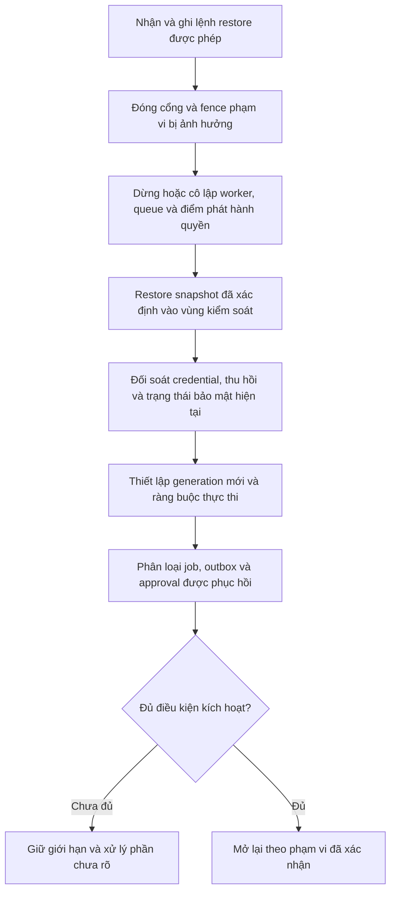

# Restore replay protection

## 1. Vì sao restore có thể làm sống lại quyền truy cập cũ?

Bản sao lưu ghi lại một trạng thái đã tồn tại trong quá khứ. Khi đưa trạng thái đó trở lại hệ thống, những thay đổi xảy ra sau thời điểm sao lưu có thể biến mất khỏi dữ liệu được phục hồi. Với dữ liệu thông thường, điều này có thể là mất một bản chỉnh sửa. Với dữ liệu bảo mật, nó có thể là làm sống lại một quyền đã bị thu hồi.

Ví dụ, một recovery token được tạo lúc 09:00, nằm trong backup lúc 09:02 và được dùng lúc 09:05. Nếu restore bản backup đó lúc 09:08, cờ `usedAt` có thể trở lại rỗng. Token vẫn còn trong thời hạn, nên một bộ kiểm tra chỉ nhìn dữ liệu đã restore có thể chấp nhận nó lần thứ hai.

**Restore replay protection** là tập cơ chế ngăn việc khôi phục trạng thái cũ làm các lệnh, token, bằng chứng hoặc quyền truy cập cũ được sử dụng lại ngoài ý định. Cơ chế này cần bảo vệ cả việc thực hiện một lệnh restore lặp và những tác động bảo mật được tái phát sau restore.

Trong account recovery, yêu cầu quan trọng là: phục hồi dữ liệu không được tự động phục hồi hiệu lực của mọi phiên, yếu tố xác thực, quyết định phê duyệt và liên kết recovery từng tồn tại trong dữ liệu đó.

## 2. Những dạng replay cần phân biệt

| Dạng replay | Ví dụ | Rủi ro |
|---|---|---|
| Lặp lệnh restore | Operator gửi lại cùng yêu cầu sau timeout | Áp dụng snapshot hai lần hoặc ghi đè dữ liệu mới |
| Rollback trạng thái dùng một lần | Token đã dùng lại trở thành chưa dùng | Thực hiện recovery thêm lần nữa |
| Khôi phục phiên cũ | Session hoặc refresh token đã thu hồi xuất hiện lại | Kẻ giữ phiên cũ lấy lại quyền truy cập |
| Khôi phục credential cũ | Hash mật khẩu hoặc MFA đã thay được đưa về bản cũ | Bí mật từng bị lộ lại được chấp nhận khi đăng nhập |
| Phát lại công việc | Queue, outbox hoặc job cũ được đọc lại | Gửi lại liên kết, thực thi quyết định hoặc đổi trạng thái lần nữa |
| Phát lại phê duyệt | Approval cũ lại trông như chưa được dùng | Cho phép một thao tác không còn đúng nội dung hoặc thời điểm |

Các dạng này có liên quan nhưng không được giải quyết bằng một cờ chung. Idempotency của lệnh restore không tự ngăn token cũ được dùng lại. Thu hồi session sau restore cũng không tự ngăn đăng nhập mới bằng mật khẩu cũ đã được phục hồi.

## 3. Chữ ký và mã hóa backup chưa đủ chống rollback

Một backup có chữ ký hợp lệ có thể chứng minh nội dung khớp với bản đã được bên có khóa ký tạo ra. Mã hóa có thể bảo vệ tính bí mật của backup. Cả hai đều không tự chứng minh đó là trạng thái bảo mật hiện tại hoặc trạng thái an toàn để kích hoạt.

Một snapshot cũ vẫn có thể hợp lệ về chữ ký trong khi chứa token chưa dùng, phiên chưa thu hồi và quyền đã bị xóa sau đó. Chọn bản mới nhất hiện thấy trong thư mục cũng không phải kiểm soát đầy đủ nếu danh sách hoặc metadata có thể bị rollback cùng hệ thống.

Restore cần trả lời thêm:

- Snapshot nào và phiên bản đối tượng nào được phép dùng?
- Phạm vi nào được phục hồi, vào môi trường nào?
- Những thay đổi bảo mật nào sau snapshot vẫn phải được giữ hiệu lực?
- Nguồn nào cung cấp trạng thái hiện tại mà restore không được ghi đè?
- Điều kiện nào phải đạt trước khi mở lại đọc dữ liệu, đăng nhập và thao tác nhạy cảm?

Hash hoặc chữ ký của snapshot là một đầu vào của quyết định, không phải toàn bộ quyết định.

## 4. Đặt các bất biến bảo mật trước khi thiết kế

Một thiết kế có thể bắt đầu từ các bất biến sau:

1. Token hoặc bằng chứng thuộc ngữ cảnh bảo mật cũ không được tự có hiệu lực trong ngữ cảnh mới.
2. Thu hồi đã có hiệu lực không bị mất chỉ vì restore một kho dữ liệu cũ.
3. Không phát hành quyền mới dựa trên credential hoặc approval cũ chưa được đối soát.
4. Lệnh restore gắn với snapshot, môi trường, phạm vi và kế hoạch cụ thể.
5. Một lần thử xử lý lại không tự tạo thêm một lần thay đổi nghiệp vụ.
6. Công việc cũ phải được kiểm tra tại nơi thực hiện tác động, không chỉ ở bộ điều phối.
7. Khi không xác minh được trạng thái bảo mật bắt buộc, hệ thống chưa mở lại thao tác liên quan.

Những bất biến này giúp tránh một giải pháp chỉ xử lý token trong bảng recovery nhưng bỏ qua refresh token, job gửi liên kết hoặc mật khẩu bị rollback.

## 5. Tách miền restore khỏi trạng thái chống rollback

Nếu cờ đã dùng, danh sách thu hồi, số phiên bản bảo mật và dữ liệu nghiệp vụ đều nằm trong cùng snapshot rồi cùng bị restore, tất cả có thể quay về quá khứ. Hệ thống cần một nguồn trạng thái chống rollback có ranh giới khác với phạm vi được phục hồi.

Nguồn này có thể là một control plane, một kho trạng thái bảo mật hoặc một dịch vụ có cơ chế bảo vệ độc lập phù hợp. Điều quan trọng không phải tên công nghệ mà là contract:

- Restore dữ liệu ứng dụng không được tự hạ trạng thái ở nguồn này.
- Quyền ghi được giới hạn và có audit.
- Cách xử lý sự cố của chính nguồn này được định nghĩa rõ.
- Các thành phần phát hành và kiểm tra quyền thực sự tham chiếu trạng thái đó.

| Trạng thái | Mục đích | Rủi ro nếu bị restore cùng dữ liệu cũ |
|---|---|---|
| Restore operation registry | Nhận diện lệnh đã nhận, đang chạy hoặc đã hoàn tất | Cùng lệnh có thể được coi như mới |
| Security generation hiện hành | Phân biệt quyền cũ và ngữ cảnh được chấp nhận hiện tại | Token cũ lại khớp ngữ cảnh |
| Credential hoặc revocation authority | Giữ quyết định thay thế và thu hồi có hiệu lực | Bí mật cũ có thể được dùng lại |
| Fencing state | Ngăn worker cũ tiếp tục gây tác động | Worker trước restore vẫn ghi dữ liệu |

Một kho “bên ngoài” nhưng được phục hồi đồng thời từ cùng một mốc mà không có kiểm soát bổ sung chưa tạo ra khả năng chống rollback. Phải xét cả quy trình vận hành và quyền của operator, không chỉ vị trí máy chủ.

Nếu không còn nguồn trạng thái hiện tại đáng tin cậy, cần một quy trình tái thiết lập bảo mật được cho phép, có phạm vi và kiểm soát rõ. Không mặc định coi trạng thái cũ nhất còn đọc được là đúng.

## 6. Security generation để vô hiệu hóa quyền cũ

Một kỹ thuật thường hữu ích là gắn thông tin xác thực ngắn hạn với một **security generation** do nguồn đáng tin cậy quản lý. Trước khi mở lại hệ thống sau restore, tạo hoặc kích hoạt generation mới cho phạm vi bị ảnh hưởng.

Ví dụ token hoặc bản ghi phiên có thể tham chiếu:

```text
subjectReference
purpose
audience
securityGeneration
issuedAt
expiresAt
tokenIdentifier
```

Máy chủ chỉ chấp nhận khi generation của quyền khớp generation hiện hành cho đúng phạm vi, ngoài các kiểm tra khác như chữ ký, mục đích, thời hạn và trạng thái dùng một lần.

Có hai kiểu biểu diễn cần phân biệt:

- **Số thế hệ tăng:** cần bảo đảm không bị hạ hoặc tái sử dụng khi restore.
- **Định danh thế hệ mới, không tái sử dụng:** có thể so khớp bằng với thế hệ đang hoạt động; không cần diễn giải thứ tự lớn nhỏ của định danh.

Không tăng một số chỉ nằm trong cơ sở dữ liệu vừa restore rồi cho rằng đã chống rollback. Giá trị đó có thể trùng với một thế hệ từng được sử dụng sau snapshot. Nguồn quản lý phải bảo đảm không tái kích hoạt ngữ cảnh cũ ngoài ý định.

Generation có thể áp dụng ở cấp dịch vụ, tenant hoặc tài khoản tùy phạm vi restore và kiến trúc. Phạm vi hẹp giảm gián đoạn nhưng đòi hỏi định tuyến kiểm tra chính xác. Phạm vi rộng đơn giản hơn nhưng có thể buộc nhiều người đăng nhập lại. Đây là lựa chọn kiến trúc cần được xác định trước.

## 7. Generation không thay thế mọi kiểm tra

Một generation mới giúp từ chối session hoặc token cũ nếu mọi nơi xác thực đều kiểm tra đúng. Nó không tự làm dữ liệu credential được restore trở nên đúng.

Giả sử người dùng đã đổi mật khẩu từ P1 sang P2 sau snapshot. Snapshot chứa hash của P1. Sau restore, nếu dịch vụ đăng nhập vẫn kiểm tra P1 rồi phát hành token thuộc generation mới, kẻ biết P1 vẫn đăng nhập được. Generation mới chỉ bảo vệ token cũ, không bảo vệ quyết định phát hành token mới sai căn cứ.

Do đó cần tách:

1. **Kiểm tra quyền đã phát hành:** token, session và proof hiện có có được tiếp tục dùng không?
2. **Kiểm tra căn cứ phát hành mới:** mật khẩu, yếu tố xác thực, trạng thái tài khoản và approval nào được tin ở thời điểm hiện tại?

Trước khi cho phép đăng nhập hoặc recovery mới, hệ thống cần đối soát credential với nguồn có thẩm quyền hiện tại, áp dụng các thay đổi bảo mật đã được ghi nhận sau snapshot, hoặc yêu cầu tái xác minh theo một quy trình an toàn được định nghĩa.

Không dùng chính yếu tố cũ đang nghi ngờ bị rollback làm bằng chứng duy nhất để tái kích hoạt tài khoản. Đối với MFA/passkey và các yếu tố khác, cần xác định cái nào đã bị thu hồi hoặc thay thế; không tự chuyển mọi bản ghi từ backup thành enrollment đang hoạt động.

## 8. Token dùng một lần: phải chống cả rollback và cạnh tranh

Một token recovery cần kiểm tra ít nhất mục đích, đối tượng, thời hạn, ngữ cảnh bảo mật và trạng thái tiêu thụ. Sau restore, bộ kiểm tra còn cần biết trạng thái tiêu thụ có bị lùi về quá khứ hay không.

Các lựa chọn có thể gồm:

- Vô hiệu hóa toàn bộ token thuộc generation cũ trong phạm vi bị ảnh hưởng.
- Giữ một sổ tiêu thụ hoặc trạng thái thu hồi có khả năng chống rollback theo thiết kế.
- Kết hợp hai cách nếu cần phạm vi chọn lọc và khả năng đối soát.

Thời hạn token là một lớp giới hạn, không thay cho cơ chế này. Một token bị phục hồi có thể vẫn chưa hết hạn. Thời gian phải được đánh giá từ nguồn thời gian hiện tại đáng tin cậy, không từ đồng hồ hoặc trạng thái thời gian bị kéo về mốc snapshot.

Pseudocode minh họa điều kiện kiểm tra:

```java
RecoveryResult consumeRecoveryToken(TokenInput input) {
    ValidatedToken token = tokenValidator.verifyFormatAndAuthenticity(input);
    SecurityContext context = securityAuthority.requireCurrentContext(token.scope());

    require(context.allowsRecoveryExecution());
    require(token.generation().equals(context.generation()));
    require(token.hasExpectedPurposeAndAudience());
    require(token.isValidAt(trustedClock.now()));

    return transaction.run(() -> {
        RecoveryRecord record = recoveryRecords.lock(token.reference());
        require(record.matches(token));
        require(record.isUnused());
        require(record.caseVersion() == token.expectedCaseVersion());

        // Cơ chế thực thi phải bảo đảm context chưa bị fence hoặc thay thế.
        executionFence.requireCurrentAtCommit(context);
        record.markConsumed(trustedClock.now());
        RecoveryResult result = recovery.applyAuthorizedTransition(record);
        outbox.recordTokenConsumedAndTransition(record, result);
        return result;
    });
}
```

Đây là mô hình kiểm soát, không phải mã triển khai đầy đủ. Đọc context trước transaction rồi so sánh một lần không tự ngăn cuộc đua với thay đổi generation. Cần cơ chế fencing hoặc điểm quyết định nguyên tử phù hợp với nơi thực hiện tác động.

Tương tự, việc tiêu thụ token và thay đổi recovery cần được phối hợp an toàn. Nếu dùng sổ tiêu thụ ở một dịch vụ khác, phải thiết kế trạng thái đặt chỗ, retry và kết quả chưa rõ; không giả định hai kho dữ liệu cùng nằm trong một transaction.

## 9. Lệnh restore phải có phạm vi và idempotency

Bản thân lệnh restore là một thao tác đặc quyền. Một yêu cầu hợp lệ cần được ràng buộc với:

```text
restoreOperationId
requestingActorReference
targetEnvironment
targetScope
backupObjectReference
backupObjectVersion
snapshotDigest
restorePlanDigest
approvalReferences
expectedControlPlaneVersion
createdAt
expiresAt
```

Không chỉ dùng tên tệp như `latest-backup` vì đối tượng phía sau có thể thay đổi. Cần nhận diện phiên bản snapshot thực sự đã được kiểm tra và phê duyệt.

Idempotency cần có khóa và fingerprint nội dung. Nếu cùng operation ID được gửi lại với snapshot hoặc phạm vi khác, hệ thống phải từ chối xung đột. Nếu lệnh đã hoàn tất, trả trạng thái đã lưu theo quyền của người gọi thay vì tự thực hiện lại.

Một operation ở trạng thái đang chạy sau khi worker gặp lỗi cần được tiếp tục hoặc đối soát theo cùng quy trình. Không xóa bản ghi operation rồi tạo lại để né kiểm tra lặp.

Sổ operation phải nằm ngoài phần trạng thái có thể bị chính lệnh đó rollback, hoặc có cơ chế bảo vệ tương đương. Nếu restore làm mất bản ghi rằng một lệnh đã chạy, bộ chống lặp sẽ không còn căn cứ.

## 10. Đóng cổng, fence worker cũ và mở lại theo giai đoạn

Trong quá trình restore, người dùng và worker cũ không nên tiếp tục thực thi thao tác trên trạng thái đang bị thay thế. Có thể cần đóng các điểm ghi, điểm phát hành token và các consumer có tác động nhạy cảm.

Một luồng minh họa:



Cổng kiểm soát không nên chỉ là một cờ trong database đang bị restore. Nếu snapshot đặt cờ đó trở lại `OPEN`, hệ thống có thể tự mở trước khi hoàn tất đối soát. Control plane hoặc cơ chế triển khai cần giữ quyền quyết định kích hoạt độc lập phù hợp.

Fencing mạnh hơn việc gửi thông báo “hãy dừng”. Một worker cũ có thể mất kết nối, bỏ lỡ thông báo hoặc đang giữ lệnh trong bộ nhớ. Nơi nhận ghi hoặc thực hiện tác động phải từ chối ngữ cảnh thực thi cũ theo cơ chế đã thiết kế.

Nếu hệ thống dùng cache generation hoặc revocation, phải xử lý độ trễ cache trước khi mở lại. Phát một sự kiện invalidation chưa bảo đảm mọi validator đã áp dụng; điều kiện kích hoạt cần phản ánh mức nhất quán mà hệ thống yêu cầu.

## 11. Đừng phát lại queue, outbox và job cũ một cách mù quáng

Snapshot có thể chứa một outbox event đã được gửi sau thời điểm backup nhưng chưa được đánh dấu trong bản snapshot. Khi restore, relay có thể gửi lại. Queue riêng cũng có thể giữ những lệnh cũ trong khi database quay về trạng thái khác.

Mỗi công việc cần được phân loại theo mục đích:

| Công việc | Cách đánh giá sau restore |
|---|---|
| Tạo lại một search index | Có thể chạy lại nếu chỉ tạo bản chiếu và không mở rộng quyền |
| Gửi email chứa liên kết recovery | Không tự gửi lại bí mật cũ; kiểm tra mục đích, generation và trạng thái hồ sơ |
| Thực thi approval để thay MFA | Kiểm tra lại đề xuất, quyền, thời hạn và ngữ cảnh hiện hành |
| Thu hồi phiên | Cần tránh việc replay cũ ghi đè hoặc làm yếu trạng thái thu hồi mới |
| Di chuyển dữ liệu tài khoản | Đối soát kết quả và idempotency theo từng bước |

Một consumer không nên tin lệnh chỉ vì nó đến từ queue nội bộ. Lệnh cần có phạm vi, phiên bản, ngữ cảnh bảo mật và thông tin để nơi thực thi kiểm tra trạng thái hiện tại.

Các sự kiện trước restore có thể vẫn cần được giữ cho audit. Giữ để điều tra không có nghĩa đưa chúng vào consumer nghiệp vụ để thực hiện tác động lần nữa. Replay cho phân tích và replay để thực thi phải có ranh giới rõ.

Hàng đợi lỗi hoặc dead-letter cũng cần được xem xét. Một operator đưa toàn bộ bản tin cũ trở lại queue sau restore có thể tái kích hoạt những thao tác đã bị vô hiệu hóa, dù luồng chính đã được bảo vệ.

## 12. Approval và bằng chứng identity proofing sau restore

Một approval có thể đã được dùng, hết hạn hoặc không còn đúng với nội dung đề xuất. Snapshot cũ có thể làm những trạng thái này biến mất.

Trước khi dùng lại approval hoặc kết quả proofing, hệ thống cần xác nhận:

- Đúng hồ sơ, tài khoản đích và mục đích.
- Đúng phiên bản đề xuất và digest nội dung.
- Thời hạn và trạng thái sử dụng còn hợp lệ theo nguồn hiện hành.
- Reviewer có thẩm quyền tại điểm quyết định theo chính sách.
- Không có quyết định từ chối, tạm giữ hoặc thu hồi mới hơn phải được áp dụng.
- Bằng chứng còn có thể được tin sau sự cố dẫn tới restore.

Nếu không thể xác nhận, có thể cần hủy vòng recovery đang chờ và bắt đầu lại bằng một luồng xác minh được phép. Không suy ra “đã có approve trong backup” đồng nghĩa hiện tại được phát hành một token mới.

Đặc biệt, cấp token mới thuộc generation mới dựa trên approval cũ bị rollback vẫn là một lỗi phát hành. Chống token replay tại endpoint không sửa được lỗi này nếu nguồn cấp token đã tin sai căn cứ.

## 13. Credential, khóa và trạng thái thu hồi

Một kế hoạch restore cần kiểm kê những loại dữ liệu bảo mật thực sự nằm trong backup:

- Hash mật khẩu và metadata thay đổi mật khẩu.
- Enrollment MFA/passkey và trạng thái hoạt động.
- Session, refresh token và thông tin thiết bị tin cậy.
- Recovery codes, token recovery và trạng thái tiêu thụ.
- Tham chiếu khóa ký, khóa giải mã và trạng thái vô hiệu hóa khóa.
- Role, membership và những quyết định thu hồi quyền.

Nếu khóa ký cũ xuất hiện trở lại hoặc trạng thái tin cậy khóa bị rollback, hệ thống có thể chấp nhận token mà chính sách hiện tại đã không còn cho phép. Trạng thái chấp nhận khóa cần được đối soát với nguồn có thẩm quyền; việc đọc được một khóa từ backup không phải lý do để kích hoạt nó.

Không phải mọi restore đều cần thay toàn bộ khóa. Quyết định phụ thuộc phạm vi sự cố, nguy cơ lộ khóa và chính sách. Điều bắt buộc về mặt thiết kế là không tự đảo ngược quyết định thu hồi hoặc thay thế đã có hiệu lực.

Với credential người dùng, có thể cần giữ dữ liệu bảo mật hiện tại ngoài phạm vi restore nghiệp vụ, áp lại lịch sử thay đổi đáng tin cậy hoặc đặt tài khoản vào trạng thái cần tái xác minh. Mỗi cách có giới hạn và yêu cầu dữ liệu riêng; không có một cờ generation thay thế mọi bước.

## 14. Hai lần restore liên tiếp và rollback của chính cơ chế bảo vệ

Giả sử lần restore thứ nhất chuyển từ generation G7 sang G8. Sau đó có một lần restore khác từ snapshot còn cũ hơn. Nếu quy trình lấy generation trong snapshot rồi cộng một, nó có thể tạo lại G7 hoặc G8 đã từng được dùng.

Nguồn quản lý generation phải ngăn tái sử dụng ngoài ý định. Với số tăng, cần bảo đảm giá trị mới lớn hơn mốc đã được chấp nhận trong nguồn chống rollback. Với định danh thế hệ mới, cần bảo đảm duy nhất và chỉ chấp nhận định danh đang hiện hành cho phạm vi đó.

Tương tự, sổ operation, trạng thái thu hồi và fencing không được tự hạ khi khôi phục control plane. Quy trình khôi phục những thành phần này phải xét một miền tin cậy và khả năng phục hồi riêng, không sao chép cơ chế của dữ liệu nghiệp vụ một cách máy móc.

Nếu các nguồn hiện hành bị mất hoặc mâu thuẫn, trạng thái đúng có thể là chưa đủ điều kiện mở lại. Cần tái thiết lập quyền và ngữ cảnh theo quy trình được cho phép, thay vì chọn tùy ý một bản sao rồi tuyên bố mọi thu hồi vẫn được bảo toàn.

## 15. Timeline minh họa một token bị làm sống lại

| Thời điểm | Sự kiện | Trạng thái liên quan |
|---|---|---|
| T0 | Phát hành token R thuộc G7 | Token chưa dùng, có thời hạn |
| T1 | Tạo snapshot S | Snapshot chứa R chưa dùng |
| T2 | R được tiêu thụ, mật khẩu được thay | R không còn được dùng; credential cũ bị thay |
| T3 | Hệ thống gặp sự cố | Cần restore dữ liệu từ S |
| T4 | Restore trong phạm vi đang đóng | Database có thể lại chứa R chưa dùng và credential cũ |
| T5 | Đối soát bảo mật, thiết lập G8 | R thuộc G7 bị từ chối; căn cứ đăng nhập mới cũng được xử lý |
| T6 | Mở lại sau khi đạt điều kiện | Chỉ quyền và căn cứ hiện hành được chấp nhận |

Nếu chỉ thêm G8 nhưng bỏ qua credential cũ tại T5, kẻ biết mật khẩu cũ có thể đăng nhập và nhận token mới thuộc G8. Nếu chỉ sửa credential nhưng bỏ qua token R, kẻ giữ R có thể chạy lại recovery. Cả đường kiểm tra quyền cũ và đường phát hành quyền mới đều phải được bảo vệ.

Nếu một worker từ trước T3 vẫn giữ lệnh thay MFA trong bộ nhớ, generation hoặc fence của lệnh đó cần được kiểm tra ở nơi thực hiện tác động. Việc đóng giao diện tại T4 không tự dừng worker này.

## 16. Audit và đối soát sau restore

Audit cần phân biệt lệnh restore, các lần thử thực thi và thời điểm kích hoạt ngữ cảnh bảo mật mới. Các sự kiện minh họa gồm:

```text
RESTORE_COMMAND_ACCEPTED
RESTORE_SCOPE_FENCED
RESTORE_SNAPSHOT_APPLIED
RESTORE_SECURITY_RECONCILIATION_RECORDED
SECURITY_GENERATION_ACTIVATED
RESTORE_WORK_ITEM_QUARANTINED
RESTORE_SCOPE_REOPENED
STALE_SECURITY_CONTEXT_REJECTED
```

Thông tin hữu ích gồm operation reference, snapshot reference và phiên bản, phạm vi đích, actor có thẩm quyền, approval reference, generation cũ và mới, kết quả từng thành phần cùng các trạng thái còn chưa rõ.

Không ghi raw token, recovery code, cookie hoặc bí mật credential vào audit. Định danh sự kiện và tham chiếu kế hoạch phải không thể dùng như quyền truy cập.

Đối soát có thể kiểm tra token cũ bị từ chối theo ngữ cảnh, không còn điểm phát hành dùng dữ liệu bảo mật chưa được xác nhận, công việc cũ được phân loại và trạng thái thu hồi có hiệu lực ở những nơi bắt buộc. Một báo cáo rằng snapshot đã giải nén thành công chưa chứng minh những điều này.

Tần suất từ chối ngữ cảnh cũ có thể tăng ngay sau restore do client hoặc worker hợp lệ retry. Đây là tín hiệu cần quan sát trong ngữ cảnh, không tự chứng minh có tấn công. Cần phân biệt retry dự kiến với những mẫu phát lại có chủ đích.

## 17. Những giới hạn cần thiết kế rõ

Chống replay dựa vào những giả định phải được kiểm soát trong vận hành:

- Tất cả điểm xác nhận quyền nhạy cảm đều áp dụng generation hoặc cơ chế tương đương.
- Control plane và nguồn thu hồi không bị rollback cùng miền dữ liệu mà không có quy trình riêng.
- Cache và kết nối dài được xử lý theo mức trễ cho phép.
- Worker, consumer và dịch vụ bên ngoài có ranh giới thực thi đủ để chặn ngữ cảnh cũ.
- Thời gian, policy và dữ liệu credential được đối soát trước khi cấp quyền mới.
- Các tác động đã xảy ra trước khi đóng cổng được xác định và xử lý riêng.

Một fence không thể làm tác động đã commit trước đó trở thành chưa từng xảy ra. Nếu một email chứa bí mật đã được gửi hoặc dữ liệu đã bị tải, cần ứng phó với hậu quả thực tế, không chỉ tăng generation.

Tương tự, không nên hứa “exactly once” cho toàn bộ restore qua nhiều hệ thống chỉ vì có idempotency key. Thiết kế cần mô tả trạng thái bền vững, những bước có thể thử lại, cách xác định kết quả và những phần cần đối soát khi phản hồi bị mất.

## 18. Những lỗi thường gặp

| Lỗi | Vì sao nguy hiểm? | Hướng thiết kế phù hợp |
|---|---|---|
| Backup có chữ ký nên được kích hoạt ngay | Tính toàn vẹn không chứng minh trạng thái bảo mật mới nhất | Đối soát trạng thái và kiểm soát kích hoạt |
| Cờ usedAt nằm trong snapshot là đủ | Restore có thể làm mất trạng thái đã dùng | Generation mới hoặc sổ tiêu thụ chống rollback |
| Chỉ đợi token hết hạn | Token phục hồi có thể vẫn còn hạn | Kiểm tra ngữ cảnh, mục đích và trạng thái tiêu thụ |
| Tăng generation trong database vừa restore | Có thể tái sử dụng ngữ cảnh từng có hiệu lực | Nguồn quản lý không bị rollback cùng phạm vi |
| Thu hồi session nhưng tin mật khẩu cũ | Kẻ tấn công đăng nhập mới và nhận quyền mới | Đối soát căn cứ phát hành, không chỉ token đã cấp |
| Cờ mở cổng nằm trong snapshot | Restore có thể tự mở hệ thống quá sớm | Cổng kiểm soát ở ranh giới độc lập phù hợp |
| Dừng worker bằng thông báo | Worker bỏ lỡ thông báo vẫn gây tác động | Fencing được kiểm tra tại nơi thực thi |
| Requeue toàn bộ outbox cũ | Lệnh và liên kết cũ được thực hiện lại | Phân loại công việc, kiểm tra ngữ cảnh và idempotency |
| Approval cũ phát token G mới | Token mới hợp lệ nhưng được cấp sai căn cứ | Kiểm tra lại phiên bản, trạng thái và thẩm quyền approval |
| Restore registry cũng bị rollback | Cùng operation lại được nhận như mới | Bảo vệ trạng thái operation ngoài miền rollback tương ứng |

Restore replay protection cần giữ được sự khác biệt giữa dữ liệu quá khứ và quyền đang được chấp nhận hiện tại. Trong account recovery, một lần phục hồi an toàn phải bảo vệ cả token cũ, căn cứ cấp quyền mới và những công việc đang chờ, rồi chỉ mở lại phạm vi đã được đối soát theo ngữ cảnh bảo mật hiện hành.
