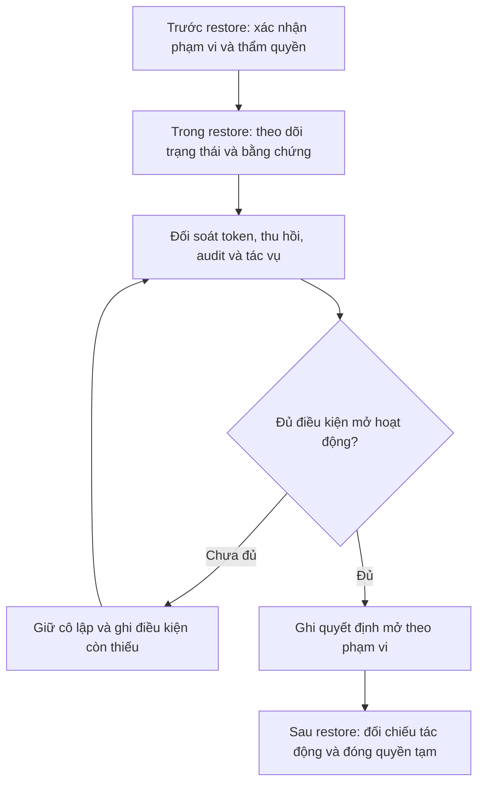

# Backup recovery audit: kiểm toán sao lưu và phục hồi dữ liệu recovery

## 1. Audit phải chứng minh điều gì?

Một tác vụ báo “restore completed” chưa chứng minh dịch vụ khôi phục tài khoản đã an toàn để hoạt động. Database có thể đọc được nhưng token đã dùng lại xuất hiện như chưa dùng, phê duyệt đã bị thu hồi vẫn còn trong snapshot hoặc worker chuẩn bị gửi lại một đường dẫn reset cũ.

**Backup recovery audit** là việc ghi nhận, bảo vệ và đối chiếu các bằng chứng về tạo, truy cập, phục hồi và đưa bản sao vào sử dụng. Mục tiêu là giải thích được ai cho phép thao tác, dữ liệu nào đã được dùng, những trạng thái bảo mật nào đã được đối soát và vì sao hệ thống được phép mở lại.

Trong `SECURITY_AUTHENTICATION_ACCOUNT_RECOVERY`, audit phải gắn với khả năng khôi phục an toàn khi mất mật khẩu, MFA, passkey hoặc thiết bị xác thực. Nó cần phản ánh tác động tới xác minh danh tính, token dùng một lần, chống lạm dụng, phiên đăng nhập và các quyết định recovery.

Cần trả lời ít nhất năm câu hỏi:

1. Ai yêu cầu, ai phê duyệt và danh tính nào thực thi backup hoặc restore?
2. Bản sao nào, thuộc môi trường và phạm vi tenant nào, được sử dụng?
3. Tính toàn vẹn và các phụ thuộc cần thiết đã được xác minh bằng gì?
4. Trạng thái token, thu hồi, bằng chứng và authorization sau restore đã được xử lý ra sao?
5. Ai quyết định mở lưu lượng, vào thời điểm nào và còn điều kiện hạn chế nào?

Audit không tự ngăn mọi lỗi. Nó cần được nối với các cổng kiểm soát thực thi, thay vì chỉ ghi log sau khi một thao tác có quyền cao đã diễn ra.

## 2. Tách audit trail, log vận hành và bằng chứng kiểm tra

Ba loại thông tin thường bị gộp chung nhưng có vai trò khác nhau.

| Loại | Ví dụ | Công dụng |
| --- | --- | --- |
| Audit trail | Người phê duyệt restore bản B vào môi trường T | Truy trách nhiệm và tái dựng chuỗi quyết định |
| Log vận hành | Thời gian nạp database, lỗi kết nối kho object | Chẩn đoán và quan sát thực thi |
| Bằng chứng kiểm tra | Báo cáo đối soát token, receipt kiểm chứng manifest | Chứng minh một điều kiện cụ thể đã được kiểm tra |

Một dòng log “verification passed” do chính script restore in ra là một tuyên bố, chưa chắc là bằng chứng đủ mạnh. Báo cáo cần xác định đã kiểm tra đối tượng nào, phiên bản nào, bằng phương pháp nào và kết quả được lưu tại đâu.

Ngược lại, một checksum hợp lệ không cho biết người thực hiện restore có quyền hay không. Một audit event có actor và thời gian không tự chứng minh backup còn giải mã được. Muốn kết luận đầy đủ phải liên kết đúng các nguồn bằng chứng.

Không dùng log debug làm nơi duy nhất lưu sự kiện nhạy cảm. Debug log có thể bị tắt, bị lấy mẫu, xoay vòng sớm hoặc vô tình chứa bí mật. Audit cần schema, quyền truy cập, thời hạn lưu và chính sách xử lý lỗi rõ ràng.

## 3. Phạm vi audit theo vòng đời backup

Audit không chỉ bắt đầu khi có thảm họa. Một người tải xuống bản backup có thể tiếp cận dữ liệu nhạy cảm mà không hề thực hiện restore.

Các sự kiện nên được mô hình hóa theo hành động:

| Giai đoạn | Sự kiện tiêu biểu | Thông tin cần liên kết |
| --- | --- | --- |
| Tạo bản sao | Yêu cầu, bắt đầu, hoàn tất, thất bại | Job, phạm vi, checkpoint, manifest |
| Truy cập | Đọc metadata, tải xuống, giải mã, xuất dữ liệu | Actor, quyền, mục đích, phạm vi được đọc |
| Quản lý | Đổi retention, khóa bảo vệ, xóa hoặc thay cấu hình | Chính sách trước/sau và người cho phép |
| Chuẩn bị restore | Chọn bản sao, yêu cầu và phê duyệt | Backup ID, môi trường đích, plan version |
| Thực hiện restore | Bắt đầu, nạp dữ liệu, kiểm tra phụ thuộc | Run ID, công cụ hoặc dịch vụ thực thi |
| Đối soát an ninh | Áp dụng thu hồi, chuyển generation, xử lý outbox | Checkpoint nguồn chuẩn và báo cáo kết quả |
| Mở hoạt động | Mở từng phạm vi lưu lượng hoặc worker | Người cho phép, điều kiện và hạn chế còn lại |
| Kết thúc | Hoàn tất, hủy, dọn dữ liệu tạm, thu hồi quyền tạm | Bằng chứng đóng run và trạng thái cuối |

Các lần bị từ chối hoặc thất bại cũng cần dấu vết. Ví dụ, một tài khoản thử giải mã nhiều backup ngoài phạm vi tenant là tín hiệu quan trọng dù không đọc được dữ liệu.

Không cần ghi mọi byte đã đọc vào audit. Cần ghi đúng sự kiện và phạm vi ở mức đủ để giải thích quyền truy cập, đồng thời tránh tạo thêm một kho dữ liệu nhạy cảm trong hệ thống logging.

## 4. Định danh actor và phân tách trách nhiệm

Restore thường liên quan người yêu cầu, người duyệt, tài khoản automation và người mở dịch vụ. Nếu mọi bước chỉ hiện `actor=backup-service`, không thể xác định ai đã khởi xướng và chịu trách nhiệm cho quyết định.

Nên phân biệt:

- **Initiator:** người hoặc tiến trình yêu cầu công việc.
- **Approver:** chủ thể chấp thuận phạm vi kế hoạch.
- **Executor:** danh tính kỹ thuật đang thực thi.
- **Delegation context:** người được đại diện hoặc chuỗi ủy quyền, nếu có.
- **Release authority:** chủ thể được phép mở hoạt động sau đối soát.

Thông tin actor phải được lấy từ ngữ cảnh xác thực có thẩm quyền. Không tin `initiatorId` hoặc `approvedBy` chỉ vì chúng có trong request client gửi lên. Một service account cần ghi được liên kết tới yêu cầu và phê duyệt đã xác minh, không nhận một tên nhân viên tùy ý làm bằng chứng.

Quyền tạo backup, đọc backup, dùng khóa giải mã, restore và xóa bằng chứng nên được đánh giá riêng. Người có quyền chạy restore không nên vì thế mà có quyền sửa lịch sử để che thao tác đó.

Phê duyệt phải ràng buộc với backup, đích phục hồi, tenant scope, kế hoạch và thời hạn. Nếu đổi bản sao hoặc chuyển từ môi trường diễn tập sang production, phê duyệt cũ không được mặc nhiên áp dụng.

Tài khoản dùng chung làm suy yếu khả năng quy trách nhiệm. Nếu một đường khẩn cấp bắt buộc tồn tại, audit cần ghi đúng ngoại lệ và bằng chứng sử dụng, không giả vờ đó là luồng phân tách nhiệm vụ thông thường.

## 5. Schema sự kiện: đủ ngữ cảnh nhưng không chứa bí mật

Một sự kiện cần có định danh riêng và liên kết tới đúng đối tượng. Ví dụ khái niệm:

```json
{
  "auditSchemaVersion": 1,
  "eventId": "event_example_50",
  "eventType": "RESTORE_SECURITY_GATE_PASSED",
  "occurredAt": "2030-03-01T03:20:00Z",
  "sourceId": "restore-controller-example",
  "sourceSequence": 1904,
  "restoreRunId": "restore_run_example",
  "backupId": "backup_example",
  "targetEnvironment": "production-example",
  "tenantScopeReference": "scope_reference",
  "initiatorReference": "initiator_reference",
  "executorReference": "service_identity_reference",
  "approvalReference": "approval_reference",
  "planVersion": 3,
  "manifestReference": "manifest_reference",
  "reconciliationReportReference": "report_reference",
  "recoveryGenerationBefore": 81,
  "recoveryGenerationAfter": 82,
  "outcome": "SUCCEEDED",
  "reasonCode": "REQUIRED_SECURITY_CHECKS_SATISFIED"
}
```

Các giá trị chỉ minh họa cấu trúc. Một event thật phải tham chiếu được tới hồ sơ có thẩm quyền; không coi một JSON tự khai là bằng chứng đã vượt cổng an ninh.

Không ghi những dữ liệu sau vào audit:

- Token recovery, refresh token, access token hoặc session cookie.
- Secret TOTP, mã OTP, recovery code hoặc mật khẩu.
- Khóa giải mã, khóa ký hoặc URL chứa credential truy cập kho backup.
- Nội dung giấy tờ định danh, toàn bộ bằng chứng hoặc dữ liệu cá nhân không cần thiết.
- Stack trace hay câu truy vấn chứa tham số bí mật dưới dạng message tùy ý.

Nên dùng mã lý do có cấu trúc và tham chiếu được bảo vệ. Whitelist tên field chưa đủ nếu một giá trị `reference` lại chứa toàn bộ token; quy trình tạo tham chiếu và nguồn dữ liệu cũng phải được kiểm soát.

## 6. Liên kết sự kiện và thứ tự khi hệ thống phân tán

Một restore run có thể đi qua scheduler, database service, KMS, object store, verifier và hệ thống thông báo. `restoreRunId` giúp nối chuỗi, nhưng không tự chứng minh các sự kiện thuộc cùng một công việc được ủy quyền.

Các liên kết hữu ích gồm:

- Event ID do nguồn có thẩm quyền sinh.
- Run ID và plan version.
- Backup ID, manifest revision và checkpoint.
- Parent event hoặc command reference đã được xác minh.
- Source ID, source sequence và thời điểm tiếp nhận tại kho audit.

Correlation ID từ client có thể phục vụ truy vết nhưng không nên quyết định quyền hoặc thay thế run ID do máy chủ quản lý. Kẻ tấn công có thể gửi một ID giống run hợp lệ để làm nhiễu phân tích.

Thời gian cũng cần được hiểu đúng. `occurredAt` và `receivedAt` có thể khác nhau do hàng đợi hoặc gián đoạn mạng. Đồng hồ các máy có thể lệch; không chỉ sắp xếp timestamp rồi kết luận thứ tự nhân quả.

Sequence theo nguồn giúp phát hiện thiếu hoặc đảo thứ tự trong phạm vi nguồn đó. Nó không mặc nhiên tạo thứ tự toàn cục giữa mọi dịch vụ. Nếu cần biết một quyết định thu hồi đã được áp dụng trước khi mở lưu lượng, cần checkpoint hoặc receipt có ý nghĩa nghiệp vụ từ các thành phần liên quan.

Khi resend sự kiện, giữ event ID ổn định để kho nhận có thể deduplicate. Tuy nhiên, hai lần thử khác nhau cần attempt ID hoặc sự kiện riêng; không dùng cùng khóa đến mức che mất một chuỗi truy cập bị từ chối.

## 7. Bảo vệ audit khỏi sửa, xóa và rollback

Audit được lưu cùng database và cùng quyền quản trị với dữ liệu cần phục hồi có thể bị quay về cùng thời điểm. Khi đó, các sự kiện “token đã dùng”, “case đã thu hồi” hoặc “backup đã bị truy cập” sau checkpoint có thể biến mất.

Một kiến trúc cần cân nhắc nguồn audit bền vững ngoài miền rollback và quyền vận hành được tách phù hợp. Điều này có thể bao gồm lưu trữ append-only, bảo vệ retention, sao chép sang miền lỗi khác và hạn chế quyền sửa hoặc xóa. Cần đánh giá những bảo đảm thực tế của từng thành phần, không chỉ đặt tên bucket là “immutable”.

Hash chain có thể giúp phát hiện sửa hoặc mất mắt xích:

```text
eventHash[n] = H(
  canonicalEvent[n]
  + sourceIdentity
  + sourceSequence[n]
  + eventHash[n-1]
)
```

Phép tính khái niệm này cần cách mã hóa chuẩn hóa, ranh giới trường rõ ràng và quy tắc phiên bản. Trường chứa hash hoặc chữ ký của chính sự kiện phải được xử lý theo định dạng đã định, không tự đưa vào vòng tính mơ hồ.

Hash chain tự nó không ngăn kẻ có quyền viết lại cả chuỗi. Chữ ký hoặc MAC cần quản lý khóa phù hợp; checkpoint đầu chuỗi hoặc đầu mới nhất được neo tại nguồn độc lập có thể giúp phát hiện cắt cụt lịch sử. Nếu cả chuỗi lẫn checkpoint đều bị rollback, bảo đảm đó không còn như kỳ vọng.

Mã hóa giúp bảo mật nội dung, nhưng không thay thế kiểm soát tính toàn vẹn và khả năng phát hiện sự kiện bị thiếu. Ngược lại, hash toàn vẹn không bảo vệ dữ liệu cá nhân khỏi người được phép đọc file.

## 8. Audit bền vững tại ranh giới quyết định

Nếu thực thi một thay đổi nhạy cảm rồi mới cố gửi log qua mạng, lỗi gửi có thể để lại trạng thái “thay đổi thành công nhưng không có dấu vết”. Với quyết định trong một database, có thể ghi thay đổi nghiệp vụ và audit journal hoặc transactional outbox trong cùng giao dịch.

```text
BEGIN TRANSACTION
  kiểm tra quyền và phạm vi restore plan
  kiểm tra điều kiện chuyển trạng thái
  cập nhật trạng thái điều phối
  ghi audit event bền vững
  ghi outbox phục vụ xuất audit hoặc tác vụ tiếp theo
COMMIT
```

Consumer xuất audit cần idempotent và có cơ chế retry, giám sát độ trễ, phát hiện thiếu event. Ghi vào outbox không đồng nghĩa hệ thống kiểm toán độc lập đã nhận và bảo vệ sự kiện.

Nếu chính sách yêu cầu bằng chứng độc lập trước một hành động đặc biệt nhạy cảm, cổng thực thi phải đợi receipt phù hợp. Không tự đổi yêu cầu “đã được kho độc lập xác nhận” thành “đã tạo một dòng log local”.

Với tác động bên ngoài như nạp dữ liệu hoặc mở traffic, không nên giả vờ có một transaction duy nhất bao trùm mọi dịch vụ. Có thể ghi ý định trước, trạng thái bắt đầu, receipt thực thi và kết quả đối soát sau đó. Các trạng thái chưa biết cần được thể hiện rõ để run có thể được điều tra và tiếp tục an toàn.

Khi audit không ghi bền vững được, hành vi phải theo chính sách của hành động. Đường cấp quyền recovery nhạy cảm có thể phải dừng; các thao tác chẩn đoán chỉ đọc có thể có quy tắc khác. Không dùng một chế độ “bỏ audit khi lỗi” chung cho mọi API.

## 9. Ví dụ Java: biểu diễn sự kiện bằng kiểu dữ liệu có giới hạn

Ví dụ sau mô tả event cho quá trình restore. Nó dùng trường có kiểu rõ và reason code thay vì một map tùy ý chứa toàn bộ request. Mã chỉ tạo đối tượng sự kiện, không xác minh phê duyệt, ký event hoặc ghi vào kho audit.

```java
import java.time.Instant;
import java.util.Objects;
import java.util.UUID;

public final class RestoreAuditModel {
    public enum EventType {
        RESTORE_REQUESTED,
        RESTORE_APPROVED,
        RESTORE_STARTED,
        RESTORE_DATA_LOADED,
        RESTORE_SECURITY_GATE_PASSED,
        RESTORE_TRAFFIC_OPENED,
        RESTORE_FAILED
    }

    public enum Outcome { SUCCEEDED, DENIED, FAILED, PENDING }

    public enum ReasonCode {
        REQUEST_RECORDED,
        APPROVED_SCOPE_MATCHED,
        REQUIRED_SECURITY_CHECKS_SATISFIED,
        AUTHORIZATION_DENIED,
        EVIDENCE_INCOMPLETE,
        DEPENDENCY_UNAVAILABLE
    }

    public record ActorReferences(
            UUID initiatorReference,
            UUID executorReference) {
        public ActorReferences {
            Objects.requireNonNull(initiatorReference);
            Objects.requireNonNull(executorReference);
        }
    }

    public record AuditEvent(
            UUID eventId,
            EventType eventType,
            Instant occurredAt,
            UUID restoreRunId,
            UUID backupId,
            long planVersion,
            ActorReferences actors,
            UUID approvalReference,
            UUID evidenceReference,
            Outcome outcome,
            ReasonCode reasonCode) {
        public AuditEvent {
            Objects.requireNonNull(eventId);
            Objects.requireNonNull(eventType);
            Objects.requireNonNull(occurredAt);
            Objects.requireNonNull(restoreRunId);
            Objects.requireNonNull(backupId);
            Objects.requireNonNull(actors);
            Objects.requireNonNull(outcome);
            Objects.requireNonNull(reasonCode);
            if (planVersion < 1) {
                throw new IllegalArgumentException("Invalid plan version");
            }
            if (eventType == EventType.RESTORE_SECURITY_GATE_PASSED
                    && (outcome != Outcome.SUCCEEDED
                        || reasonCode != ReasonCode
                            .REQUIRED_SECURITY_CHECKS_SATISFIED
                        || approvalReference == null
                        || evidenceReference == null)) {
                throw new IllegalArgumentException(
                        "Security gate event requires approval and evidence");
            }
        }
    }
}
```

UUID ở đây là tham chiếu opaque đến dữ liệu có quyền truy cập riêng, không phải bằng chứng rằng dữ liệu đó hợp lệ. Event builder ở máy chủ phải lấy actor từ phiên đã xác thực, approval từ quyết định đã kiểm tra và evidence từ kết quả thực thi thật.

Các kiểm tra constructor chỉ ngăn một số tổ hợp biểu diễn không hợp lệ. Chúng không chứng minh cổng an ninh đã thực sự vượt qua. Ghi `RESTORE_SECURITY_GATE_PASSED` cần được gắn với bước điều phối có quyền và báo cáo đã được xác nhận cho đúng run, backup và plan version.

Không đưa exception message tùy ý vào reason code. Chi tiết chẩn đoán có thể được lưu ở nguồn vận hành được bảo vệ và liên kết bằng tham chiếu đã kiểm soát. Việc serialize, ký, đánh số thứ tự và ghi bền vững phải tuân thủ giao thức audit của hệ thống.

## 10. Đối soát trước khi mở lại dịch vụ recovery

Một audit report sau restore cần thể hiện các điều kiện cụ thể, thay vì một kết quả tổng `PASS` không có phạm vi.

| Điều kiện | Bằng chứng nên có | Điều không được kết luận chỉ từ đó |
| --- | --- | --- |
| Đúng bản sao | Backup ID, manifest đã kiểm chứng, scope | Dữ liệu trong đó vẫn là trạng thái hiện hành |
| Đọc được dữ liệu | Receipt restore, schema compatibility | Credential và token cũ còn được phép dùng |
| Phụ thuộc còn đủ | Key reference, evidence object, policy reference | Mọi bằng chứng cũ vẫn đủ điều kiện cấp recovery |
| Trạng thái dùng một lần an toàn | Generation mới hoặc ledger đối soát | Mọi loại token khác tự bị vô hiệu hóa |
| Thu hồi được áp dụng | Checkpoint và receipt từ nguồn có thẩm quyền | Không còn bất kỳ thay đổi nào ngoài khoảng đã đối soát |
| Outbox được kiểm soát | Danh sách công việc giữ, hủy hoặc được phép retry | Tác động bên ngoài chưa từng diễn ra |
| Verifier thực thi trạng thái mới | Xác nhận từ các cổng liên quan | Chỉ thay số version trong database là đủ |

Cần xác định phạm vi của từng receipt. Ví dụ, một verifier áp dụng recovery generation mới không chứng minh refresh token đã bị thu hồi nếu refresh token dùng cơ chế khác.

Phê duyệt account recovery trong backup cần được kiểm tra theo chính sách hiện hành, quyền hiện hành, thời hạn và trạng thái case. Audit phải phân biệt “giữ lại bản ghi phê duyệt để điều tra” với “cho phép tiếp tục thực thi phê duyệt”.

Audit cũng cần ghi các quyết định không mở dịch vụ: chưa đủ bằng chứng, chỉ cho đọc lịch sử, mở một nhóm tenant hoặc giữ tác vụ phát token ở trạng thái chặn. Đây là trạng thái hợp lệ của quá trình phục hồi, không nên bị ép thành thành công hoặc thất bại chung chung.

## 11. Khoảng trống lịch sử phải được ghi nhận là khoảng trống

Giả sử database được restore về checkpoint C1, còn audit độc lập chỉ chắc chắn đến C2. Nếu không biết các sự kiện sau C2 đã được ghi bền vững hay chưa, không thể kết luận “không có thay đổi thu hồi nào sau C2”.

Cần phân biệt:

- **Không thấy sự kiện:** truy vấn hiện tại không trả kết quả.
- **Đã chứng minh không thiếu sự kiện trong một phạm vi:** có checkpoint, sequence và độ bền phù hợp để xác nhận phạm vi đó đầy đủ.

RPO của audit và độ trễ xuất log phải được xét cùng RPO của dữ liệu chính. Nếu cả hai mất cùng một khoảng quyết định nhạy cảm, việc đối soát từ audit có thể không đủ. Khi đó cần vô hiệu hóa khả năng cũ hoặc hạn chế hoạt động theo chính sách thay vì suy đoán.

Báo cáo nên ghi rõ thời gian hoặc sequence bị thiếu, nguồn đã đối chiếu, mức chắc chắn và hành động bù trừ. Có thể cần yêu cầu xác minh account recovery mới thay vì tiếp tục các case nằm trong vùng không xác định.

Không tạo event có timestamp cũ để lấp lịch sử như thể nó đã được quan sát lúc đó. Nếu có bằng chứng bổ sung về một hành động trước đây, ghi một sự kiện reconciliation ở thời điểm hiện tại, tham chiếu hành động cũ và nêu nguồn bằng chứng.

## 12. Cảnh báo và phát hiện hành vi bất thường

Audit có ích nhất khi các tín hiệu cần thiết được đưa tới người chịu trách nhiệm, thay vì chỉ lưu để tìm sau sự cố.

Các tín hiệu có thể gồm:

- Đọc hoặc giải mã nhiều bản backup ngoài mẫu công việc thông thường.
- Restore vào môi trường hoặc tenant không khớp phê duyệt.
- Một người vừa đề xuất vừa duyệt bằng tài khoản khác của cùng chủ thể.
- Đổi retention, quyền xóa hoặc chính sách bảo vệ ngay trước sự cố.
- Nhiều lần cố mở traffic trước khi có receipt cổng an ninh.
- Độ trễ audit tăng, nguồn ngừng phát hoặc sequence bị thiếu.
- Sử dụng quyền khẩn cấp nhưng không có bằng chứng đóng nhiệm vụ.

Mỗi cảnh báo cần có run, actor và đối tượng đủ để điều tra, nhưng không đính kèm bí mật. Một URL dashboard không nên chứa token truy cập kho backup hoặc toàn bộ tham số nhạy cảm.

Cần quản lý tải của chính audit. Ghi nhận mọi lần bị từ chối mà không kiểm soát có thể bị lợi dụng gây đầy kho hoặc cản trở dịch vụ. Có thể áp dụng rate limit và tổng hợp có cấu trúc cho luồng phù hợp, nhưng phải giữ bằng chứng cần thiết và không lấy mẫu mất các quyết định bảo mật quan trọng.

Một cặp actor thường xuyên làm việc cùng nhau chưa tự chứng minh thông đồng. Cảnh báo là tín hiệu điều tra; kết luận cần đối chiếu thẩm quyền, bối cảnh, bằng chứng và hành vi thực tế.

## 13. Quy trình audit một restore run

Một quy trình có thể tổ chức theo ba thời điểm:



Trước restore, người đánh giá xác nhận backup và đích, thẩm quyền của actor, phạm vi phê duyệt, plan version và nguồn bằng chứng dự kiến. Cần biết nguồn nào vẫn đáng tin nếu dữ liệu chính bị rollback.

Trong restore, đối chiếu chuỗi trạng thái với receipt thực tế. Phân biệt `DATA_LOADED`, `SECURITY_GATE_PASSED` và `TRAFFIC_OPENED`; không dùng một trạng thái duy nhất cho cả ba.

Sau restore, xác nhận việc mở hoạt động đúng phạm vi, các công việc giữ lại không bị phát mù quáng và các quyền tạm đã được xử lý. Nếu một bước vẫn cần reconciliation, báo cáo cần giữ trạng thái mở và người chịu trách nhiệm rõ ràng.

Các phát hiện nên ghi đối tượng, bằng chứng, tác động và hành động xử lý. Ví dụ, “chưa có receipt từ refresh service nên giữ chặn cấp phiên mới” hữu ích hơn “có rủi ro token”. Không đánh dấu run đã hoàn tất chỉ vì báo cáo được tạo thành file.

## 14. Ví dụ xuyên suốt: bản sao hợp lệ nhưng lịch sử chưa đủ

Một đội vận hành chọn backup B để phục hồi dịch vụ recovery. Manifest và checksum được kiểm chứng, khóa giải mã có thể truy cập và dữ liệu nạp thành công. Audit ghi rõ đây mới là `RESTORE_DATA_LOADED`.

Trong bước đối soát, nguồn audit độc lập xác nhận một số case đã bị thu hồi sau checkpoint của B, nhưng còn một khoảng chưa có bằng chứng đầy đủ. Đội không kết luận các case trong khoảng đó vẫn được phép tiếp tục. Họ áp dụng chính sách hủy capability recovery thế hệ cũ và giữ những case cần xác minh lại.

Nguồn điều khiển độc lập cấp generation mới. Các verifier liên quan xác nhận đã áp dụng. Outbox cũ được kiểm tra để không gửi lại link reset. Refresh service được đối soát riêng vì không dùng cùng cơ chế generation với token recovery.

Báo cáo đối soát giữ các tham chiếu receipt và ghi rõ khoảng lịch sử còn thiếu cùng hành động bù trừ. Chỉ sau khi các điều kiện mở dịch vụ đạt, chủ thể đủ quyền mới cho phép mở traffic. Audit ghi sự kiện đó cho đúng run và plan version.

Nếu sau đó phát hiện worker thông báo vẫn giữ công việc cũ, hệ thống mở phát hiện mới và xử lý tác động; không sửa báo cáo trước như thể bước đó chưa từng có vấn đề. Lịch sử phải phản ánh điều đã biết ở từng thời điểm.

Ví dụ cho thấy backup có tính toàn vẹn không đồng nghĩa toàn bộ trạng thái bảo mật trong đó còn hiệu lực. Audit tốt làm rõ sự khác biệt này và liên kết quyết định mở hoạt động với bằng chứng thực tế.

## 15. Những lỗi thường gặp

| Lỗi | Hậu quả | Cách thiết kế phù hợp |
| --- | --- | --- |
| Chỉ ghi `restore success` | Không phân biệt nạp dữ liệu với mở dịch vụ an toàn | Ghi trạng thái và bằng chứng theo từng cổng |
| Chỉ có actor là service account | Không xác định người khởi xướng và phê duyệt | Giữ initiator, approver, executor và ngữ cảnh ủy quyền |
| Audit nằm cùng miền rollback duy nhất | Mất các sự kiện cần để đối soát | Có nguồn bền vững và checkpoint ngoài miền lỗi phù hợp |
| Checksum nằm cạnh file được coi là bằng chứng nguồn gốc | Người có quyền sửa có thể thay cả hai | Bảo vệ manifest và cơ chế kiểm chứng độc lập |
| Ghi request hoặc exception nguyên vẹn | Lộ token, khóa hoặc dữ liệu cá nhân | Dùng schema có giới hạn, reason code và tham chiếu |
| Không thấy event thì coi như không có hành động | Bỏ qua khoảng trống lịch sử | Đánh giá tính đầy đủ và ghi mức không chắc chắn |
| Dùng outbox là bằng chứng audit độc lập đã nhận | Đánh giá sai độ bền của lịch sử | Phân biệt local commit với receipt từ nguồn nhận |
| Phê duyệt không khóa phạm vi | Đổi backup hoặc môi trường mà vẫn dùng chữ ký cũ | Ràng buộc backup, target, scope và plan version |
| Tự sửa lịch sử để lấp dữ liệu thiếu | Mất độ tin cậy của audit | Ghi reconciliation mới với nguồn bằng chứng rõ ràng |

Backup recovery audit cần kết nối thẩm quyền, bản sao, quá trình thực thi và trạng thái bảo mật hiện hành thành một chuỗi giải thích được. Một báo cáo có giá trị phải chỉ ra điều đã được chứng minh, phạm vi bằng chứng còn thiếu và các cổng thực thi bảo đảm dữ liệu quá khứ không tự trở thành quyền recovery mới.
