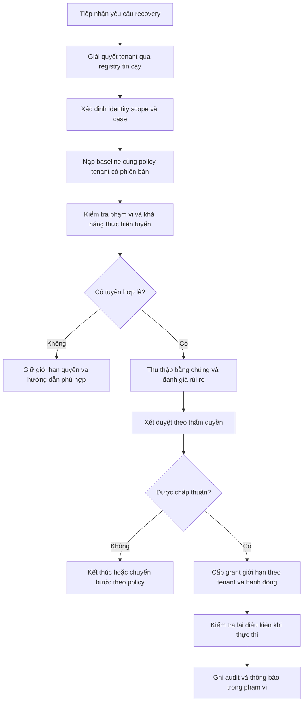

# Tenant recovery policy

## 1. Chính sách recovery theo tenant giải quyết điều gì?

Một nền tảng nhiều tenant phục vụ nhiều tổ chức trên cùng hệ thống. Mỗi tổ chức có thể dùng cách đăng nhập, yêu cầu xác minh và mô hình hỗ trợ khác nhau. Khi người dùng mất mật khẩu, MFA, passkey hoặc thiết bị xác thực, hệ thống phải áp dụng đúng quy trình của phạm vi liên quan mà vẫn giữ các ràng buộc bảo mật chung của nền tảng.

**Tenant recovery policy** là tập quy tắc xác định ai được đề nghị khôi phục, bằng chứng nào được chấp nhận, tuyến xử lý nào được dùng, ai có thể phê duyệt và thay đổi nào được phép thực hiện trong phạm vi một tenant.

Trong module `SECURITY_AUTHENTICATION_ACCOUNT_RECOVERY`, chính sách này phải bảo đảm một yêu cầu được xử lý đúng tổ chức, đúng đối tượng và đúng thẩm quyền. Tenant không chỉ là nhãn để chọn giao diện: nó là một phần của ranh giới truy cập và quyết định recovery.

Ví dụ: Công ty A yêu cầu người dùng quay lại qua nhà cung cấp danh tính doanh nghiệp. Công ty B cho phép khôi phục tài khoản cục bộ bằng mã dự phòng. Một người là thành viên cả hai công ty không được chọn tuyến của B để bỏ qua các điều kiện bảo vệ danh tính hoặc quyền truy cập của A.

## 2. Xác định đối tượng thực sự cần khôi phục

Trước khi viết chính sách, cần xác định mô hình danh tính của sản phẩm.

| Mô hình | Đặc điểm | Phạm vi chính sách tenant |
|---|---|---|
| Tài khoản riêng theo tenant | Mỗi tenant có tài khoản và yếu tố xác thực riêng | Có thể điều khiển recovery của tài khoản cục bộ trong giới hạn nền tảng |
| Danh tính toàn cục, nhiều membership | Một principal dùng chung, tham gia nhiều tenant | Điều khiển quyền vào tenant; không mặc nhiên được reset danh tính toàn cục |
| Danh tính liên kết qua IdP | Xác thực do nhà cung cấp danh tính quản lý | Định tuyến về nguồn có thẩm quyền và quản lý quyền trong ứng dụng |
| Mô hình kết hợp | Có cả đăng nhập liên kết và một số tài khoản cục bộ | Cần phân loại từng trường hợp, không tự tạo tuyến dự phòng |

Ba đối tượng thường cần tách:

```text
Global principal: danh tính dùng chung của người dùng trên nền tảng.
Tenant membership: quan hệ và quyền của principal trong một tổ chức.
Tenant-local account: tài khoản xác thực thực sự thuộc namespace tenant.
```

Một quản trị viên tenant có thể có quyền đình chỉ hoặc phục hồi membership theo chính sách. Điều đó không đồng nghĩa họ được thay MFA toàn cục, đổi email đăng nhập chung hoặc đăng xuất người dùng khỏi mọi tổ chức khác.

Nếu một thay đổi tác động tới principal toàn cục, phải dùng tuyến recovery có thẩm quyền toàn cục. Không dùng tenant “đang được chọn trên giao diện” làm cơ sở duy nhất để cấp quyền thay đổi đó.

## 3. Ràng buộc nền tảng và tùy chỉnh của tenant

Nền tảng cần một baseline không được tenant tùy ý hạ thấp. Ví dụ:

- Chỉ xử lý đúng tenant và đối tượng đã được ràng buộc với case.
- Không cấp quyền recovery chỉ dựa trên email, tên hiển thị hoặc thông tin công khai.
- Token và grant có mục đích, phạm vi, thời hạn cùng cơ chế chống dùng lại.
- Không cho người yêu cầu tự chọn người phê duyệt không có thẩm quyền.
- Ghi nhận quyết định và thao tác bảo mật bằng audit phù hợp.
- Không biến sự cố dịch vụ thành tuyến bỏ qua xác minh.
- Không dùng tenant policy để thay đổi bí mật xác thực của phạm vi khác.

Tenant có thể yêu cầu điều kiện chặt hơn hoặc tắt một số tuyến được nền tảng hỗ trợ. Tenant không được bật một tuyến mà nền tảng cấm cho loại tài khoản đó.

Một cách biểu diễn tư duy:

```text
Tuyến được phép = giao của các tuyến được mọi lớp chính sách cho phép.
Điều kiện bắt buộc = các điều kiện áp dụng từ mọi lớp chính sách liên quan.
Giới hạn thời gian = giới hạn chặt nhất trong các giới hạn áp dụng.
```

Đây không phải công thức đủ cho mọi chính sách. Hai phương thức xác minh có thể không tương đương; một tuyến chỉ khả thi khi có đủ điều kiện riêng. Nếu các lớp chính sách mâu thuẫn tới mức không còn tuyến hợp lệ, kết quả phải là không thể tiếp tục theo cấu hình hiện tại, thay vì tự chọn một tuyến yếu hơn.

## 4. Nội dung cần có trong một tenant recovery policy

Một chính sách có thể gồm các nhóm sau:

| Nhóm | Câu hỏi cần trả lời |
|---|---|
| Phạm vi danh tính | Chính sách bảo vệ tài khoản cục bộ, membership hay đối tượng nào? |
| Điều kiện mở case | Ai được bắt đầu và trong ngữ cảnh nào? |
| Tuyến recovery | Tự phục vụ, mã dự phòng, IdP, hỗ trợ hay xét duyệt chuyên trách? |
| Bằng chứng | Điều kiện nào cần được xác lập, độ mới và nguồn nào được tin cậy? |
| Rủi ro | Khi nào trì hoãn, chuyển tuyến hoặc không cho tiếp tục? |
| Phê duyệt | Ai có quyền, có cần tách người đề nghị và người duyệt không? |
| Quyền thực thi | Được reset yếu tố nào, không được thay đổi gì? |
| Token và grant | Phạm vi, thời hạn, mục đích, ràng buộc với case và tenant |
| Thông báo | Kênh tin cậy, nội dung được công bố và giới hạn gửi |
| Hạn mức | Kiểm soát spam, thử sai và bão yêu cầu hỗ trợ |
| Audit và dữ liệu | Sự kiện cần ghi, quyền đọc, tham chiếu bằng chứng và vòng đời |
| Quản trị chính sách | Ai được thay đổi, khi nào có hiệu lực và xử lý case đang chạy ra sao? |

Không nên biến policy thành một tập cờ không có quan hệ, chẳng hạn bật hỗ trợ thủ công nhưng không có nhóm nào đủ quyền xét duyệt. Cấu hình phải được kiểm tra cả tính hợp lệ và tính khả thi.

Một cấu trúc minh họa cho tài khoản cục bộ:

```yaml
policyId: tenant-recovery-example
version: 12
identityScope: TENANT_LOCAL_ACCOUNT
allowedRoutes:
  - BACKUP_CODE
  - TENANT_SUPPORT_REVIEW
requiredControls:
  - CURRENT_RISK_ASSESSMENT
  - AUDIT_DECISION
review:
  separateSubmitterAndReviewer: true
  routeReference: tenant-support-reviewers-example
execution:
  allowedActions:
    - REPLACE_TENANT_MFA
  maximumGrantLifetime: PT10M
notification:
  usePreexistingTrustedChannels: true
publicResponse:
  accountEnumerationProtection: true
```

Đây là schema minh họa trong bài học, không phải cấu hình có thể áp dụng trực tiếp. Khoảng thời gian cũng chỉ minh họa; giá trị thực tế cần theo rủi ro và hợp đồng sản phẩm. Baseline nền tảng vẫn được áp dụng dù không xuất hiện trong đoạn cấu hình tenant.

## 5. Xác định tenant từ ngữ cảnh đáng tin cậy

Ở giai đoạn recovery, người dùng có thể chưa đăng nhập đầy đủ. Hệ thống cần một cách định tuyến tenant nhưng không được coi dữ liệu định tuyến là bằng chứng thẩm quyền.

Các nguồn định tuyến có thể là hostname đã đăng ký, đường dẫn tổ chức, lời mời được kiểm chứng hoặc case đã tồn tại. Backend phải ánh xạ chúng qua registry do hệ thống quản lý.

Không tin trực tiếp một header `X-Tenant-Id` do client gửi. Nếu reverse proxy thêm header nội bộ, cần bảo đảm client không thể tự cung cấp hoặc ghi đè nó và chỉ nhận từ hạ tầng được tin cậy.

Tương tự, không tạo URL recovery từ `Host` tùy ý trong request. Hostname và tên miền tùy chỉnh phải qua danh sách định tuyến được phép, tránh link gửi ra trỏ tới máy chủ do kẻ tấn công kiểm soát.

Email có đuôi giống tên miền công ty không tự chứng minh người đó thuộc tenant. Tên miền có thể chỉ là gợi ý định tuyến; membership và quyền vẫn phải được xác minh ở nguồn có thẩm quyền.

Sau khi mở case, tenant cần được ràng buộc vào case. Không cho người dùng đổi tenant trong một bước sau rồi tiếp tục sử dụng assessment, quyết định hoặc token đã được tạo cho tenant trước.

Nếu không xác định được tenant hoặc có nhiều kết quả khả dĩ, dùng luồng hướng dẫn phù hợp mà không tiết lộ danh sách tổ chức người dùng tham gia. Không tự chọn tenant có chính sách dễ nhất.

## 6. Quyền quản trị tenant không phải quyền recovery toàn cục

Thẩm quyền nên mô tả theo thao tác và đối tượng, không chỉ một nhãn “admin”.

Ví dụ:

```text
manage_tenant_recovery_policy
review_tenant_local_recovery
restore_tenant_membership
view_tenant_recovery_audit
execute_global_principal_recovery
```

Quyền cuối có phạm vi khác với các quyền tenant phía trên. Không cho một phép kiểm tra như `isTenantAdmin()` tự mở mọi chức năng recovery.

Tài khoản quản trị đang mất MFA cũng không nên tự hạ chính sách rồi dùng tuyến yếu hơn để khôi phục chính mình. Thay đổi policy là thao tác control plane có rủi ro, cần xác thực phù hợp, kiểm tra quyền hiện tại và các bước phê duyệt theo mô hình sản phẩm.

Đối với tenant mất toàn bộ quản trị viên còn truy cập được, cần một tuyến bootstrap hoặc xét duyệt nền tảng đã được thiết kế trước. Không cho người đầu tiên chứng minh quyền kiểm soát một hộp thư mới trở thành quản trị viên thay thế.

Quyền của người duyệt phải được kiểm tra lúc ra quyết định, không chỉ lúc gửi thông báo. Một nhân viên chuyển tenant hoặc bị thu hồi quyền không tiếp tục có quyền trên các request cũ chỉ vì link vẫn còn hiệu lực.

## 7. Kết hợp chính sách bằng Java: một mô hình thu gọn

Đoạn mã sau minh họa ba phép kết hợp: giao các tuyến, hợp các điều kiện bắt buộc và lấy thời hạn ngắn hơn. Nó không triển khai toàn bộ ngữ nghĩa của xác minh hay phân quyền.

```java
import java.time.Duration;
import java.util.HashSet;
import java.util.Objects;
import java.util.Set;

public final class RecoveryPolicyCompiler {
    public enum Route {
        BACKUP_CODE, IDP_REENTRY, TENANT_SUPPORT_REVIEW, PLATFORM_REVIEW
    }

    public enum Control {
        CURRENT_RISK_ASSESSMENT,
        INDEPENDENT_REVIEW,
        AUDIT_DECISION
    }

    public record PolicySlice(
        Set<Route> allowedRoutes,
        Set<Control> requiredControls,
        Duration maximumGrantLifetime
    ) {
        public PolicySlice {
            allowedRoutes = Set.copyOf(allowedRoutes);
            requiredControls = Set.copyOf(requiredControls);
            Objects.requireNonNull(maximumGrantLifetime);
            if (maximumGrantLifetime.isZero()
                    || maximumGrantLifetime.isNegative()) {
                throw new IllegalArgumentException("Invalid grant lifetime");
            }
        }
    }

    public PolicySlice compile(PolicySlice platform, PolicySlice tenant) {
        Objects.requireNonNull(platform);
        Objects.requireNonNull(tenant);

        Set<Route> routes = new HashSet<>(platform.allowedRoutes());
        routes.retainAll(tenant.allowedRoutes());
        if (routes.isEmpty()) {
            throw new IllegalStateException("No permitted recovery route");
        }

        Set<Control> controls = new HashSet<>(platform.requiredControls());
        controls.addAll(tenant.requiredControls());

        Duration lifetime = platform.maximumGrantLifetime()
            .compareTo(tenant.maximumGrantLifetime()) <= 0
                ? platform.maximumGrantLifetime()
                : tenant.maximumGrantLifetime();

        return new PolicySlice(routes, controls, lifetime);
    }
}
```

Đầu vào phải đến từ cấu hình đã xác thực, đúng scope và đúng phiên bản, không phải policy object trong body của người gửi recovery.

Tập điều kiện trong ví dụ biểu diễn các yêu cầu bổ sung đồng thời, không biểu diễn phương án thay thế như “passkey hoặc một bộ bằng chứng tương đương”. Với điều kiện có nhánh, cần mô hình biểu thức rõ ràng và không được tùy tiện chuyển tất cả thành số lượng điểm.

Có tuyến xuất hiện trong giao chưa có nghĩa tuyến đó khả thi. Chẳng hạn, tenant yêu cầu xét duyệt độc lập nhưng chỉ còn một người vừa đề nghị vừa duyệt. Bước kiểm tra tiếp theo phải xác định không thể hoàn thành tuyến đó, thay vì bỏ yêu cầu độc lập.

Compiler cũng cần một lớp kiểm tra identity scope trước khi kết hợp. Một policy cho `TENANT_LOCAL_ACCOUNT` không thể được áp thẳng vào thao tác reset MFA của principal toàn cục.

## 8. Phiên bản chính sách và case đang chạy

Mỗi case và quyết định cần biết các phiên bản đã được áp dụng, chẳng hạn:

```text
platform_policy_version
tenant_policy_id / tenant_policy_version
risk_policy_version
effective_policy_reference
identity_scope
tenant_reference
```

Không ghi duy nhất “dùng policy hiện tại”, vì policy hiện tại có thể khác khi điều tra sau này. Đồng thời, lưu snapshot cũ không có nghĩa mọi case được phép chạy mãi theo quy tắc cũ.

Khi chính sách thay đổi, cần quy định cách áp dụng cho các case đang mở:

| Thay đổi | Cách xử lý có thể cần |
|---|---|
| Tắt một tuyến vì có rủi ro | Chặn tiếp tục tuyến, chuyển xét lại hoặc hủy quyền chưa dùng |
| Thêm bằng chứng bắt buộc | Yêu cầu đánh giá lại trước quyết định hoặc thực thi |
| Đổi nhóm người duyệt | Kiểm tra thẩm quyền hiện hành, định tuyến lại nếu cần |
| Nới điều kiện theo cấu hình mới | Chỉ áp dụng qua quy tắc có thẩm quyền; không tự làm hợp lệ quyết định cũ |
| Thay đổi cách diễn đạt giao diện | Có thể không ảnh hưởng kết luận bảo mật nếu ngữ nghĩa không đổi |

Quy tắc chuyển tiếp cần do sản phẩm định nghĩa. Không chọn tùy tiện giữa “mọi thứ theo snapshot” và “mọi thứ tự động theo bản mới” ở các service khác nhau.

Trước khi cấp hoặc tiêu thụ grant, hệ thống cần kiểm tra hiệu lực của quyết định và các điều kiện hiện hành bắt buộc. Nếu policy version đã đổi theo cách làm mất hiệu lực quyền cũ, không chỉ kiểm tra chữ ký token rồi cho tiếp tục.

## 9. Ràng buộc dữ liệu và token với tenant

Tenant context phải đi xuyên suốt case, assessment, request phê duyệt, grant, audit và công việc bất đồng bộ.

Một grant recovery có thể cần các ràng buộc:

```text
tenant_reference
subject_reference
identity_scope
case_reference
decision_reference
allowed_actions
policy_reference
issued_at / expires_at
grant_reference / consumption_state
```

Tùy thiết kế, dữ liệu được lưu phía server hoặc một phần trong token được bảo vệ. Dù cách nào, token hợp lệ về mật mã vẫn phải khớp tenant, đối tượng, mục đích, trạng thái case và thao tác đang thực hiện.

Không dùng token phát cho tenant B để truy cập endpoint tenant A bằng cách sửa URL hoặc header. Không cho token chỉ phục hồi membership được dùng để thay mật khẩu toàn cục.

Ở tầng dữ liệu, truy vấn nên nhận tenant context bắt buộc khi đối tượng thuộc tenant:

```sql
SELECT id, subject_id, identity_scope, state, policy_version
FROM recovery_case
WHERE tenant_id = :tenant_id
  AND id = :case_id;
```

Chỉ tra theo caseId rồi tin tenant trong body là cách dễ bỏ sót kiểm soát. Các liên kết giữa bảng cũng nên bảo đảm không tham chiếu chéo tenant ngoài mô hình được cho phép, ví dụ thông qua khóa và ràng buộc có tenant.

Cache cần namespace theo phạm vi thích hợp, không chỉ theo email hoặc caseId cục bộ có thể trùng. Hạn mức, khóa idempotency và tham chiếu object storage cũng phải được thiết kế cùng ranh giới đó.

Không để một worker xử lý tenant trước rồi vô tình giữ tenant context trong thread cho job sau. Mỗi job cần ngữ cảnh được xác lập, kiểm tra và dọn theo vòng đời của nó.

## 10. Đăng nhập liên kết và tuyến khôi phục qua IdP

Nếu tenant dùng IdP doanh nghiệp, nền tảng cần biết phần xác thực nào do IdP làm chủ. Một thao tác “reset mật khẩu” trong ứng dụng có thể không có ý nghĩa nếu mật khẩu thực tế không nằm ở ứng dụng.

Tuyến phù hợp có thể hướng người dùng tới quy trình recovery chính thức của IdP, sau đó kiểm tra lại liên kết và quyền membership khi người dùng quay lại. Không tự tạo tài khoản cục bộ cùng email để bỏ qua việc không truy cập được IdP.

Cũng không coi việc IdP xác thực một email là đủ để nối vào bất kỳ principal cũ nào có email tương tự. Liên kết cần dựa trên định danh và quy tắc federation của sản phẩm, gồm tenant, issuer và chủ thể liên quan.

Nếu IdP tạm lỗi, đó là vấn đề khả dụng, không phải bằng chứng cho phép hỗ trợ thủ công bỏ xác minh. Nếu sản phẩm có tài khoản khẩn cấp hoặc tuyến dự phòng, tuyến đó phải được thiết lập, kiểm soát và giám sát từ trước.

Chính sách tenant nên thể hiện rõ cách xử lý người dùng local, người dùng federated và các trường hợp lai, thay vì để nhân viên tự đoán theo tên miền email.

## 11. Trình tự xử lý một yêu cầu

Một workflow khái quát:



Ở mỗi bước có thay đổi trạng thái, cần kiểm tra đồng thời và idempotency phù hợp. Một policy đúng về nội dung vẫn có thể bị phá vỡ nếu request từ chối và request cấp grant ghi đè trạng thái của nhau.

Sự kiện gửi thông báo nên được ghi bền vững cùng thay đổi nghiệp vụ có liên quan, rồi chuyển qua cơ chế outbox hoặc thiết kế tương đương. Gửi email thất bại không làm case đổi sang chính sách khác hoặc tự tạo grant mới.

## 12. Thông báo và chống lộ membership

Trước khi có đủ quyền, hệ thống không nên trả lời rằng một email thuộc tenant A nhưng không thuộc tenant B. Luồng recovery có thể trở thành công cụ dò danh sách nhân viên hoặc khách hàng.

Phản hồi công khai có thể dùng dạng:

> Nếu yêu cầu phù hợp với thông tin và chính sách của tổ chức, hướng dẫn tiếp theo sẽ được cung cấp qua kênh được phép. Mã tham chiếu chỉ dùng để theo dõi yêu cầu.

Nội dung cụ thể phụ thuộc thiết kế, nhưng cần nhất quán ở API, giao diện, kênh hỗ trợ và tra cứu trạng thái. Một câu thông báo khái quát không bù được endpoint khác đang trả danh sách tenant của người dùng.

Thông báo nhạy cảm phải gửi qua kênh được hệ thống xác định theo policy. Không lấy email mới từ body làm người nhận toàn bộ thông tin case. Nếu người dùng cần thay kênh liên hệ, đó là bước có điều kiện riêng.

Mẫu email và URL phải đúng tenant, nhưng không để tenant tùy biến nội dung thành yêu cầu gửi mật khẩu, OTP hoặc recovery code cho nhân viên. Branding không được thay thế các ràng buộc an toàn của nền tảng.

## 13. Hạn mức, sự cố và khả năng vận hành

Multi-tenant recovery cần hạn mức ở nhiều cấp để một tenant hoặc một người tấn công không chiếm toàn bộ năng lực hỗ trợ và gửi thông báo.

Các chiều kiểm soát có thể gồm nguồn gọi, phiên recovery, case, tenant, kênh gửi và tín hiệu rủi ro. Với danh tính dùng chung, có thể cần thêm kiểm soát toàn cục, nhưng không để người ngoài tiêu hết hạn mức của nạn nhân chỉ bằng cách biết định danh.

Không chỉ giới hạn theo IP vì nhiều người dùng hợp lệ có thể chung mạng. Cũng không chỉ giới hạn theo accountId vì điều đó tạo cơ hội gây từ chối dịch vụ nhắm vào tài khoản.

Nếu không tải được policy, không mặc định dùng một cấu hình dễ nhất. Có thể tạm dừng thao tác nhạy cảm hoặc dùng snapshot đã được xác minh theo một chính sách cache có hiệu lực rõ ràng. Phải biết bản nào đang được dùng và khi nào nó không còn được phép sử dụng.

Khi dịch vụ rủi ro, phê duyệt hoặc IdP lỗi, phản ứng vận hành cần giữ ranh giới quyền. Chuyển hỗ trợ không đồng nghĩa tự hạ yêu cầu chứng minh. Các tuyến sự cố phải được định nghĩa trước với phạm vi và thẩm quyền riêng.

## 14. Audit và dữ liệu của từng tenant

Audit recovery cần giữ tenant gốc cùng scope của thao tác, ngay cả khi tài khoản đổi tên, chuyển membership hoặc được hợp nhất theo tuyến hợp lệ.

Các tham chiếu thường hữu ích:

```text
tenant_reference
identity_scope / subject_reference
case_reference / operation_reference
actor_reference / authority_context
platform_policy_version / tenant_policy_version
assessment_reference / decision_reference
action / outcome / controlled_reason_code
occurred_at
```

Không ghi token, mật khẩu, OTP hoặc bằng chứng gốc vào log để tiện phân biệt tenant. Các tham chiếu nội bộ và quyền đọc đúng phạm vi thường phù hợp hơn.

Quản trị viên tenant chỉ được xem các dữ liệu recovery trong quyền được cấp. Đối với principal toàn cục, một sự kiện có thể liên quan tới bảo mật nền tảng nhưng không nên tiết lộ membership hoặc hoạt động ở các tenant khác.

Vòng đời bằng chứng và audit phải được cấu hình trong ranh giới chính sách nền tảng. Tenant không nên tự xóa mọi dấu vết quyết định có liên quan tới kiểm soát chung, cũng không nên tự yêu cầu lưu mọi dữ liệu nhạy cảm vô thời hạn. Sản phẩm cần định nghĩa rõ quyền quản lý dữ liệu và giới hạn cấu hình.

## 15. Tình huống xuyên suốt

Minh có một principal toàn cục, là thành viên của tenant A và tenant B. A yêu cầu truy cập qua IdP doanh nghiệp; B có tuyến hỗ trợ phục hồi membership theo chính sách riêng.

1. Minh mất thiết bị xác thực và chọn B trên giao diện recovery.
2. Backend giải quyết tenant B qua registry, mở case với scope phục hồi membership của B.
3. Nhóm hỗ trợ B xử lý bằng chứng và xét duyệt trong phạm vi được cấp.
4. Grant, nếu được cấp, chỉ cho thao tác membership của B; không có quyền thay MFA hoặc mật khẩu của principal toàn cục.
5. Minh không thể mang grant đó tới endpoint A hoặc endpoint đổi yếu tố xác thực toàn cục.
6. Để khôi phục danh tính toàn cục, Minh phải dùng tuyến nền tảng có thẩm quyền; để trở lại A, các điều kiện của A và IdP vẫn phải được đáp ứng.
7. Nếu policy B đổi trong lúc case đang chạy, hệ thống áp dụng quy tắc chuyển tiếp đã định, không âm thầm chọn phiên bản thuận lợi hơn.
8. Audit của B chỉ hiển thị thông tin B được phép xem, không lộ dữ liệu nội bộ của A.

Trong một sản phẩm khác dùng tài khoản hoàn toàn riêng theo tenant, B có thể cho phép thay MFA cục bộ của B. Nhưng grant vẫn phải ràng buộc với tài khoản cục bộ và không tác động tới tài khoản ở A dù chúng có cùng email.

## 16. Những lỗi thiết kế thường gặp

- **Chỉ dùng tenant để đổi giao diện:** các quyết định và token phía sau vẫn không có phạm vi tenant.
- **Tin tenantId trong body hoặc header công khai:** người gọi tự chuyển sang phạm vi khác.
- **Áp policy của tenant yếu nhất cho principal chung:** tạo đường vòng khôi phục toàn cục.
- **Đồng nhất admin tenant với admin nền tảng:** trao quyền thay đổi danh tính ngoài thẩm quyền.
- **Tự tạo tài khoản local khi IdP lỗi:** bỏ qua chính sách liên kết danh tính.
- **Không lưu phiên bản policy:** không giải thích được quyết định và xử lý sai case đang chạy.
- **Dùng token sai scope:** quyền membership bị sử dụng như quyền reset xác thực toàn cục.
- **Cache hoặc job thiếu tenant context:** dữ liệu và quyết định của hai tenant bị trộn.
- **Dùng lỗi hạ tầng làm lý do hạ chuẩn xác minh:** biến vấn đề khả dụng thành đường vượt kiểm soát.
- **Trả danh sách membership trong recovery công khai:** làm lộ quan hệ tổ chức trước khi có quyền.

Tenant recovery policy hiệu quả bắt đầu từ mô hình danh tính và phạm vi hành động. Khi baseline, cấu hình tenant, phiên bản chính sách, quyền xét duyệt và grant cùng giữ một ranh giới nhất quán, hệ thống có thể hỗ trợ nhiều tổ chức mà không cho một tuyến recovery trở thành đường vượt kiểm soát của tổ chức khác hoặc của toàn nền tảng.
