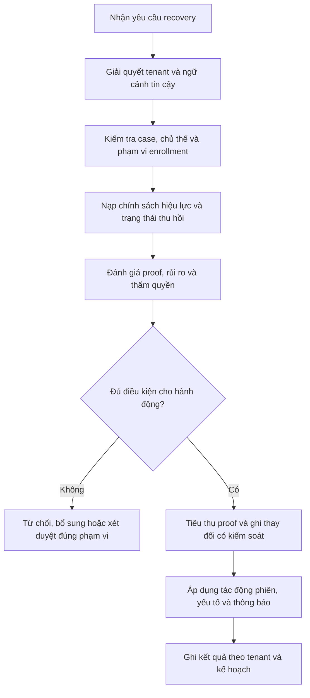

# Tenant factor configuration

## 1. Cấu hình yếu tố xác thực theo tenant để làm gì?

Trong hệ thống nhiều tenant, các tổ chức có thể sử dụng những cách xác thực khác nhau. Một tenant yêu cầu passkey cho tài khoản quản trị, tenant khác sử dụng MFA qua ứng dụng, trong khi một tổ chức chỉ cho phép đăng nhập qua nhà cung cấp danh tính của mình.

Khi người dùng mất mật khẩu, MFA, passkey hoặc thiết bị xác thực, hệ thống cần biết chính xác tenant nào đang được truy cập, yếu tố nào thuộc phạm vi nào và ai có quyền khôi phục điều gì. Nếu áp dụng sai cấu hình, một luồng recovery dễ hơn ở tenant A có thể trở thành đường truy cập trái phép vào tenant B.

**Tenant factor configuration** là tập chính sách quy định cách đăng ký, chấp nhận, khôi phục, thay thế và thu hồi yếu tố xác thực trong ngữ cảnh một tenant. Nó không chỉ là danh sách bật hoặc tắt các phương thức MFA trên giao diện.

Thiết kế cần đạt hai mục tiêu đồng thời: cho phép tenant áp dụng yêu cầu phù hợp và giữ những ranh giới bảo mật mà tenant không được tự hạ hoặc vượt qua.

## 2. Phân biệt danh tính, membership và yếu tố xác thực

Một người có thể dùng một danh tính nền tảng để tham gia nhiều tenant. Danh tính đó có thể có credential dùng chung, còn mỗi membership có role và chính sách truy cập riêng.

| Thành phần | Ý nghĩa | Ví dụ phạm vi |
|---|---|---|
| Danh tính nền tảng | Chủ thể được hệ thống xác thực | Một người có thể tham gia A và B |
| Membership | Quan hệ tham gia và quyền trong tenant | Là nhân viên ở A, khách ở B |
| Credential hoặc enrollment | Yếu tố đã được đăng ký cho một chủ thể | Credential toàn danh tính hoặc enrollment được giới hạn |
| Chính sách tenant | Điều kiện để truy cập hoặc recovery trong tenant | B yêu cầu yếu tố mạnh hơn A |
| Recovery case | Một yêu cầu khôi phục cụ thể | Khôi phục quyền truy cập membership ở B |

Khôi phục membership không nhất thiết là đặt lại credential dùng chung. Quản trị viên của A có thể được phép hỗ trợ người dùng lấy lại quyền truy cập A nhưng không có quyền đặt lại mật khẩu nền tảng hoặc yếu tố có thể dùng để truy cập B.

Ngược lại, một lần recovery danh tính nền tảng có thể tác động tới nhiều tenant. Luồng đó cần thẩm quyền và chính sách ở phạm vi danh tính, đồng thời từng tenant vẫn có thể yêu cầu điều kiện bổ sung trước khi chấp nhận truy cập trở lại.

Không dùng email làm khóa duy nhất để suy quan hệ giữa danh tính và tenant. Email có thể thay đổi, được tái cấp hoặc tồn tại trong nhiều ngữ cảnh. Với danh tính liên kết, cần hiểu định danh trong phạm vi nhà phát hành tương ứng, không chỉ so tên hiển thị hoặc email.

## 3. Cần mô hình hóa phạm vi của từng yếu tố

Một bản ghi enrollment nên thể hiện rõ chủ thể, loại yếu tố, trạng thái và phạm vi có hiệu lực. Tùy kiến trúc, có thể có các nhóm sau:

1. **Yếu tố thuộc danh tính nền tảng:** được quản lý bởi dịch vụ danh tính và có thể được xem xét trong nhiều tenant.
2. **Enrollment giới hạn theo tenant:** chỉ được chấp nhận cho một tenant hoặc mục đích đã định.
3. **Yếu tố do nhà cung cấp danh tính bên ngoài quản lý:** ứng dụng dựa vào kết quả xác thực theo quan hệ tin cậy đã thiết lập.
4. **Yếu tố quản trị đặc quyền:** chịu yêu cầu riêng cho thao tác điều hành hoặc recovery hành chính.

Phạm vi không nên chỉ tồn tại trong tên như `tenantPasskey`. Một passkey được tạo dưới một relying party dùng chung không tự trở thành credential chỉ dành cho một tenant. Nếu sản phẩm muốn giới hạn theo tenant, cần biểu diễn và thực thi giới hạn tại phía máy chủ trong luồng xác thực và phân quyền tương ứng.

Tương tự, một TOTP secret hoặc recovery code được gắn nhãn tenant không được chấp nhận ở tenant khác chỉ vì cùng thuộc một tài khoản nền tảng. Bộ kiểm tra phải kiểm tra phạm vi enrollment và phạm vi challenge, không chỉ giá trị mã có đúng hay không.

Thông tin cấu hình chính sách không nên chứa secret của người dùng. Chính sách cho biết phương thức nào được phép; kho credential quản lý dữ liệu bí mật và vòng đời của enrollment với quyền truy cập riêng.

## 4. Tách những câu hỏi cấu hình thường bị gộp chung

Một tenant cho phép đăng ký phương thức X không có nghĩa X được phép dùng làm bằng chứng duy nhất để recovery. Những khả năng sau nên được mô hình hóa riêng:

| Khả năng | Câu hỏi cần trả lời |
|---|---|
| Enrollment | Người dùng có được đăng ký phương thức này trong ngữ cảnh tenant không? |
| Authentication acceptance | Phương thức này có đáp ứng yêu cầu truy cập hiện tại không? |
| Recovery proof | Phương thức này có được dùng để chứng minh quyền khôi phục không? |
| Replacement authority | Ai được phép vô hiệu hóa hoặc thay thế enrollment này? |
| New factor confirmation | Yếu tố mới được xác nhận và kích hoạt thế nào? |
| Notification | Kênh nào được dùng để thông báo thay đổi? |

Một địa chỉ email nhận thông báo không tự là một yếu tố đủ mạnh để thay thế mọi MFA. Một liên kết reset mật khẩu là một công cụ thực thi có phạm vi, không phải bằng chứng độc lập chỉ vì nó được tạo thành công.

Nếu recovery sử dụng nhiều bước, cần đánh giá tính độc lập thực tế. Hai mã gửi tới hai địa chỉ đều chuyển tiếp về cùng một hộp thư không tự tạo thành hai nguồn xác minh độc lập. Cấu hình không nên chỉ đếm số bước mà bỏ qua quan hệ giữa các kênh.

## 5. Chính sách hiệu lực là sự kết hợp của các ràng buộc

Một mô hình tư duy có thể biểu diễn:

```text
EffectivePolicy =
    PlatformSecurityConstraints
    AND ApprovedTenantPolicy
    AND SubjectAndActionRequirements
    AND CurrentRiskRestrictions
```

Đây là cách nói rằng mọi ràng buộc áp dụng đều phải được đáp ứng, không phải một phép giao đơn giản giữa các danh sách phương thức. Chính sách có thể chứa quorum, điều kiện thời gian, loại bằng chứng và phạm vi thẩm quyền; cần bộ đánh giá hiểu ý nghĩa của chúng.

Ví dụ, nền tảng không cho phép một kênh liên hệ chưa xác minh là căn cứ duy nhất để thay MFA. Tenant có thể yêu cầu thêm reviewer hoặc chỉ chấp nhận một tập phương thức phù hợp. Tenant không được bật một tùy chọn để bỏ ràng buộc tối thiểu đó.

Tài khoản đặc quyền có thể chịu yêu cầu cao hơn tài khoản thông thường trong cùng tenant. Một cấu hình chung “MFA optional” không nên tự áp dụng cho chức năng khôi phục tài khoản quản trị nếu chính sách đặc quyền yêu cầu khác.

Khi các ràng buộc không có phương án nào đáp ứng, hệ thống cần báo cấu hình không khả thi hoặc không có đường recovery phù hợp. Không âm thầm chuyển sang một fallback yếu hơn để bảo đảm mọi hồ sơ đều có thể hoàn tất.

## 6. Những trường chính sách cần cân nhắc

Cấu hình có thể gồm các nhóm sau, tùy loại sản phẩm:

- Phương thức được phép đăng ký và được chấp nhận để truy cập.
- Yêu cầu riêng theo loại tài khoản, role hoặc mức nhạy cảm của hành động.
- Bằng chứng được chấp nhận khi mất một hoặc nhiều yếu tố.
- Điều kiện xác thực mới trước khi thay yếu tố hoặc thông tin liên hệ.
- Thẩm quyền của hỗ trợ, reviewer và quản trị tenant.
- Cách xác nhận yếu tố mới trước khi kích hoạt.
- Cách thu hồi yếu tố, phiên và token bị ảnh hưởng.
- Thời hạn challenge, proof và recovery case.
- Điều kiện giới hạn sau recovery và yêu cầu xác minh bổ sung.
- Kênh thông báo, mẫu nội dung và địa chỉ điều hướng đã được cho phép.
- Rate limit, giới hạn gửi mã và các ràng buộc chống lạm dụng.

Các giá trị thời gian hoặc hạn mức cần nằm trong miền được nền tảng cho phép. Không chấp nhận giá trị âm, vô hạn ngoài ý định hoặc một hạn mức quá lớn khiến kiểm soát mất ý nghĩa.

Cấu hình cũng phải nói rõ phạm vi ảnh hưởng. “Reset factor” có thể là hủy một enrollment ở tenant, hủy credential dùng chung hoặc gửi yêu cầu tới nhà cung cấp danh tính. Ba hành động có quyền và tác động khác nhau.

## 7. Ví dụ cấu hình chính sách

YAML sau chỉ minh họa cách tổ chức ý nghĩa chính sách, không phải schema của một framework cụ thể và không chứa secret enrollment:

```yaml
policyReference: tenant-recovery-policy-A
revision: 18
state: PUBLISHED

scope:
  tenantReference: tenant-A
  authority: TENANT_ACCESS

enrollment:
  allowedMethods:
    - PASSKEY
    - TOTP
  requireVerifiedEnrollment: true

recovery:
  acceptedProofTypes:
    - ENROLLED_RECOVERY_CODE
    - APPROVED_TENANT_IDENTITY_PROOFING
  allowUnverifiedContactAsSoleProof: false
  requireNewFactorConfirmation: true
  requireIndependentReviewForPrivilegedAccount: true

effects:
  allowGlobalCredentialReset: false
  reevaluateTenantSessionsAfterFactorChange: true

notifications:
  usePreviouslyVerifiedContact: true
  includeRecoverySecretInAudit: false
```

`authority: TENANT_ACCESS` giới hạn thẩm quyền của chính sách này. Việc cho phép sử dụng một loại proof không tự cấp quyền đặt lại credential toàn danh tính. Phương thức cụ thể vẫn phải có enrollment, chủ thể và trạng thái phù hợp khi đánh giá một hồ sơ.

`PASSKEY` trong danh sách là loại phương thức được cân nhắc, không phải lời khẳng định mọi passkey đều đáp ứng mọi yêu cầu. Bộ đánh giá cần kiểm tra ngữ cảnh credential, đặc tính có thể xác minh và chính sách của hành động.

Những boolean trong ví dụ không đủ thay một bộ chính sách hoàn chỉnh. Chẳng hạn yêu cầu reviewer độc lập còn cần định nghĩa ai đủ điều kiện, độc lập với ai và phê duyệt nội dung nào.

## 8. Xác định tenant từ ngữ cảnh đáng tin cậy

Một request có thể mang tenant trong URL, hostname, header, claim hoặc một trường biểu mẫu. Những dữ liệu này không mặc nhiên có cùng mức tin cậy.

Máy chủ cần giải quyết tenant theo cơ chế đã được thiết lập, rồi kiểm tra mọi tham chiếu liên quan khớp với ngữ cảnh đó. Một header `X-Tenant-Id` do trình duyệt tùy ý gửi không phải bằng chứng người gọi có quyền trong tenant được nêu.

Với người chưa đăng nhập đang bắt đầu recovery, tenant route có thể giúp chọn luồng nhưng chưa chứng minh danh tính hay membership. Hệ thống vẫn cần xác minh người yêu cầu và tránh tiết lộ membership trước khi đủ quyền.

Với tên miền tùy chỉnh, cần dùng ánh xạ tên miền đã được xác nhận và cấu hình hạ tầng phù hợp. Không lấy một host header chưa được kiểm soát để tạo liên kết recovery hoặc chọn tenant tùy ý.

Những trường cần được đối chiếu có thể gồm:

```text
resolvedTenantReference
recoveryCaseTenantReference
targetMembershipTenantReference
factorEnrollmentScope
challengeTenantReference
policyTenantReference
actorAuthorityScope
```

Nếu các trường mâu thuẫn, request bị từ chối hoặc được đưa vào xử lý phù hợp. Không chọn ngẫu nhiên một trường làm đúng rồi tiếp tục.

## 9. Challenge và proof phải gắn với tenant, chủ thể và mục đích

Một challenge recovery cần ràng buộc với đúng tài khoản hoặc membership, tenant, loại hành động, enrollment nếu có, thời hạn và trạng thái sử dụng.

Một mô hình tham chiếu có thể gồm:

```text
challengeReference
tenantReference
subjectReference
membershipReference
purpose
factorEnrollmentReference
policyReference
policyRevision
caseReference
caseVersion
expiresAt
usedAt
```

OTP đúng về giá trị nhưng thuộc tenant A không được dùng cho case ở B. Proof xác nhận thay TOTP không được dùng để đổi email nhận recovery nếu mục đích không cho phép. Một proof còn hạn cũng không áp dụng cho case đã đổi nội dung ngoài phạm vi xác nhận.

Định danh mờ hoặc token có chữ ký giúp kiểm soát tham chiếu, nhưng bộ kiểm tra vẫn phải xác minh tenant, audience, mục đích và trạng thái hiện tại. Việc token được tạo bởi cùng nền tảng không có nghĩa mọi tenant đều được chấp nhận nó.

Tiêu thụ proof dùng một lần và ghi thay đổi cần được phối hợp an toàn. Chỉ kiểm tra `usedAt == null` rồi cập nhật ở bước không nguyên tử có thể để hai request cùng thực hiện một thay đổi yếu tố.

## 10. Thay đổi cấu hình phải có vòng đời

Chính sách recovery là một phần của bề mặt đặc quyền. Người có thể hạ yêu cầu recovery có thể gián tiếp tạo đường vào tài khoản khác, nên quyền sửa cấu hình cần được quản lý như quyền nhạy cảm.

Một vòng đời có thể gồm bản nháp, kiểm tra ràng buộc, phê duyệt khi cần, xuất bản phiên bản bất biến và theo dõi hiệu lực. Không sửa tại chỗ một cấu hình đã được tham chiếu trong proof hoặc approval rồi coi nội dung cũ vẫn tồn tại.

Các kiểm tra trước xuất bản có thể bao gồm:

- Không vi phạm mức tối thiểu của nền tảng.
- Không cấp quyền toàn danh tính cho quản trị viên chỉ có quyền tenant.
- Không tạo vòng phụ thuộc khiến người mất yếu tố không có phương án được phép.
- Phương thức được tham chiếu có khả năng triển khai và tích hợp phù hợp.
- Thời hạn, hạn mức và kênh điều hướng nằm trong miền cho phép.
- Có quy tắc rõ cho case và proof đang hoạt động.

Người sửa chính sách không nhất thiết được tự phê duyệt thay đổi rủi ro cao của mình. Nếu cần tách nhiệm vụ, sự độc lập phải được kiểm tra theo danh tính và quyền thực tế, không chỉ theo hai tài khoản đăng nhập khác nhau.

Rollback về nội dung cấu hình cũ nên tạo một phiên bản xuất bản mới có audit, thay vì hạ revision hoặc sửa lịch sử. Nó cũng cần được đánh giá lại với những ràng buộc hiện hành của nền tảng.

## 11. Xử lý recovery case đang chạy khi chính sách đổi

Pin một case vào revision giúp giải thích chính sách đã dùng khi phát hành challenge. Nhưng pin không cho phép tiếp tục dùng một cấu hình đã bị vô hiệu hóa vì sự cố.

Cần phân biệt những loại thay đổi:

| Thay đổi | Cách xử lý cần được định nghĩa |
|---|---|
| Đổi nội dung hiển thị không ảnh hưởng bảo mật | Có thể không cần hủy proof nếu nội dung đã xác nhận không đổi |
| Siết yêu cầu yếu tố hoặc reviewer | Case cũ cần được đánh giá lại theo quy tắc chuyển tiếp |
| Vô hiệu hóa một phương thức vì nguy cơ bị lộ | Proof dựa trên phương thức đó có thể phải bị thu hồi |
| Nới một chính sách theo quy trình hợp lệ | Không tự suy rằng mọi proof cũ được mở rộng phạm vi |
| Đổi thẩm quyền hoặc phạm vi credential | Cần xem lại quyền và tác động của toàn bộ case liên quan |

Revision lớn hơn không tự có nghĩa chính sách mạnh hơn. Bộ đánh giá phải hiểu loại thay đổi và quy tắc hiệu lực, không chỉ so hai số.

Một cách thiết kế là giữ snapshot chính sách cho khả năng giải thích, đồng thời có quyết định hiện hành về những revision hoặc phương thức còn được phép thực thi. Nếu case không đáp ứng ràng buộc mới bắt buộc, hệ thống yêu cầu bổ sung hoặc bắt đầu lại theo quy trình được phép.

Không âm thầm đánh giá bằng cấu hình mới yếu hơn rồi dùng lại approval cũ cho phạm vi rộng hơn. Nội dung người dùng và reviewer đã xác nhận phải tiếp tục khớp với thay đổi sắp thực hiện.

## 12. Quy trình thực thi theo tenant

Luồng minh họa:



Pseudocode dưới đây tập trung vào các ranh giới, không phải mã triển khai đầy đủ:

```java
RecoveryResult replaceTenantFactor(RecoveryRequest request) {
    TenantContext context = tenantResolver.resolveTrustedRoute(request);
    EffectivePolicy policy = policies.requireCurrent(context.tenantId());

    return transaction.run(() -> {
        RecoveryCase recoveryCase = cases.lock(
            context.tenantId(), request.caseReference());
        authorization.requireAllowedActorOrFlow(request, context, recoveryCase);
        require(recoveryCase.tenantId().equals(context.tenantId()));
        require(recoveryCase.version() == request.expectedCaseVersion());

        FactorEnrollment enrollment = factors.loadForUpdate(
            recoveryCase.factorReference());
        scopes.requireAllowedReplacement(
            context, recoveryCase, enrollment, policy);

        RecoveryProof proof = proofs.lock(request.proofReference());
        proof.requireCurrentBinding(context, recoveryCase, enrollment);
        policy.requireStillExecutable(proof.policyReference(), proof.policyRevision());
        policy.requireAcceptedProofAndApprovals(recoveryCase, proof);
        require(proof.isUnusedAndUnexpired(clock.now()));

        // Phiên bản quyền và chính sách cần được ràng buộc tại điểm ghi.
        executionGuard.requireCurrentAuthorization(context, policy, recoveryCase);
        proof.consume(clock.now());
        RecoveryResult result = factors.recordAuthorizedReplacement(recoveryCase);
        outbox.recordEffectsAndAudit(context, recoveryCase, result);
        return result;
    });
}
```

Nếu enrollment là credential toàn danh tính nhưng case chỉ có thẩm quyền tenant, `requireAllowedReplacement` phải từ chối thao tác vượt phạm vi hoặc chuyển sang luồng có thẩm quyền phù hợp. Không sửa credential trước rồi mới kiểm tra ảnh hưởng tới tenant khác.

Transaction cục bộ không tự bảo vệ mọi dịch vụ ngoài. Cần ranh giới kiểm tra phiên bản, fencing hoặc cơ chế tương đương để một lần thu hồi quyền hoặc chính sách không bị bỏ qua do cuộc đua. Nếu việc kích hoạt yếu tố mới ở hệ thống khác, phải có trạng thái và kết quả xác nhận phù hợp thay vì coi ghi outbox là đã hoàn tất toàn bộ.

## 13. Cache, key và tích hợp không được lẫn tenant

Một lỗi cấu hình phổ biến là cache chỉ theo `userId` hoặc loại phương thức, trong khi kết quả phụ thuộc tenant. Kết quả A chấp nhận TOTP có thể bị dùng lại cho B đang yêu cầu phương thức khác.

Cache chính sách nên có khóa thể hiện tenant và phiên bản cần thiết. Cache một quyết định cho hành động cụ thể còn có thể cần chủ thể, loại hành động và trạng thái bảo mật tương ứng. Không có một khóa cache chung phù hợp cho mọi loại dữ liệu.

Client của nhà cung cấp, sender gửi mã, template thông báo, callback và dữ liệu cấu hình tích hợp cũng cần đúng tenant. Không để một cấu hình fallback lấy secret hoặc địa chỉ điều hướng của tenant đầu tiên được nạp.

Secret tích hợp cần được quản lý bằng tham chiếu và quyền truy cập phù hợp, không chép vào policy công khai hoặc audit. Việc rotate một secret tích hợp cũng khác với rotate credential của người dùng.

Khi nguồn chính sách tạm không khả dụng, cần quy tắc rõ về cấu hình đã xác nhận gần nhất, thời hạn sử dụng và thông tin thu hồi. Một cache cũ không được tiếp tục dùng nếu không đáp ứng yêu cầu hiện hành của thao tác. Nếu không chứng minh được điều kiện bắt buộc, giữ hoặc từ chối thao tác nhạy cảm thay vì dùng cấu hình mặc định yếu hơn.

## 14. Giới hạn gửi mã và chống lạm dụng theo nhiều phạm vi

Tenant có thể cấu hình hạn mức trong khoảng được nền tảng cho phép, nhưng không nên xóa các giới hạn chống lạm dụng chung. Một kẻ tấn công có thể luân phiên tenant để tránh giới hạn chỉ tính theo từng tenant.

Các khóa giới hạn cần được cân nhắc theo nhiều chiều: tenant, chủ thể hoặc mục tiêu đã được giải quyết an toàn, kênh nhận, nguồn gửi request và chiến dịch lạm dụng. Không nhất thiết mọi chiều đều được công khai cho tenant.

Việc một tenant biết người dùng bị chặn bởi tín hiệu liên quan đến tenant khác có thể làm lộ thông tin không cần thiết. Nền tảng có thể áp dụng kiểm soát toàn hệ thống nhưng trả thông báo phù hợp với phạm vi được phép.

Cần tránh hai cực: giới hạn quá hẹp khiến dễ vượt bằng cách đổi tenant, hoặc giới hạn dùng chung thiếu kiểm soát khiến một tenant làm cạn khả năng recovery của mọi tenant khác. Chính sách cần hỗ trợ bảo vệ tổng thể và cô lập tác động vận hành.

Thông báo lỗi, thời gian phản hồi và số lần gửi không nên trở thành công cụ dò membership hoặc phương thức đã đăng ký của một người tại các tenant khác.

## 15. Đăng nhập liên kết và thẩm quyền của tenant

Một tenant chỉ dùng nhà cung cấp danh tính doanh nghiệp có thể không cho phép nền tảng đặt lại yếu tố tại nhà cung cấp đó. Cấu hình recovery cần chỉ ra thẩm quyền nào quản lý yếu tố và nền tảng được phép làm gì.

Nếu người dùng mất MFA ở nhà cung cấp bên ngoài, hướng xử lý có thể là quy trình recovery của nhà cung cấp hoặc tổ chức tương ứng. Nền tảng không nên tự mở một mật khẩu cục bộ làm fallback nếu điều đó phá chính sách đăng nhập đã cam kết cho tenant.

Một tài khoản có thể có nhiều liên kết đăng nhập, nhưng việc thêm một liên kết mới cũng có thể mở đường truy cập. Cần xem xét quyền thêm liên kết, yêu cầu xác minh và tác động tới các tenant khác, không coi đó là thay đổi hồ sơ ít rủi ro.

Kết quả xác thực liên kết chỉ được chấp nhận theo issuer, audience, quan hệ tin cậy và những điều kiện có thể xác minh. Một trường mô tả như “MFA passed” trong dữ liệu tùy ý không tự đủ để đáp ứng yêu cầu yếu tố của tenant.

## 16. Audit thay đổi chính sách và recovery

Audit cần cho biết tenant, actor, loại thẩm quyền, policy reference và revision, phạm vi credential, loại hành động, proof reference và kết quả. Không ghi secret TOTP, recovery code, cookie hoặc raw token.

Các sự kiện nên phân biệt:

```text
TENANT_FACTOR_POLICY_DRAFTED
TENANT_FACTOR_POLICY_PUBLISHED
TENANT_FACTOR_POLICY_REVOKED
TENANT_RECOVERY_POLICY_EVALUATED
TENANT_FACTOR_REPLACEMENT_AUTHORIZED
TENANT_FACTOR_REPLACEMENT_CONFIRMED
TENANT_RECOVERY_SCOPE_REJECTED
```

Xuất bản cấu hình không đồng nghĩa tất cả case đang chạy đã được chuyển sang cấu hình mới. Audit cần thể hiện những hành động chuyển tiếp, vô hiệu hóa proof hoặc yêu cầu bổ sung khi có.

Quyền đọc audit cũng theo phạm vi tenant và nhiệm vụ. Quản trị viên A không được xem enrollment, case hoặc chi tiết từ B chỉ vì cùng liên quan một danh tính nền tảng. Nền tảng có thể có vai trò điều tra xuyên tenant với thẩm quyền và dấu vết riêng.

## 17. Tình huống tổng hợp

Một người dùng tham gia tenant A và B bằng cùng danh tính nền tảng. A chấp nhận một số bằng chứng recovery trong phạm vi tenant; B yêu cầu phương thức và reviewer chặt hơn cho tài khoản đặc quyền.

Người dùng mất điện thoại TOTP và yêu cầu hỗ trợ ở A. Nhân viên A được phép xử lý case lấy lại quyền truy cập A. Nếu yếu tố cần thay là enrollment chỉ thuộc A, hệ thống áp dụng chính sách A, xác minh đúng bằng chứng, xác nhận enrollment mới và xử lý phiên theo phạm vi tác động.

Nếu yếu tố đó thực chất là credential dùng chung của danh tính, nhân viên A không được tự đặt lại nó bằng thẩm quyền tenant. Luồng phải chuyển sang thẩm quyền danh tính phù hợp. Sau khi recovery danh tính hoàn tất, B vẫn đánh giá yêu cầu của mình trước khi cấp quyền truy cập đặc quyền.

Trong lúc case A đang chạy, nền tảng vô hiệu hóa một phương thức proof vì có sự cố. Case đã pin revision cũ không được tiếp tục dùng proof bị ảnh hưởng chỉ vì chưa hết hạn. Bộ thực thi kiểm tra quyết định hiện hành và yêu cầu phương án xác minh còn được phép.

Nếu người dùng đổi tenant trên giao diện rồi gửi proof của A tới case B, máy chủ phát hiện sự không khớp tenant, case và mục đích. Không có thao tác thay yếu tố nào được thực hiện, dù giá trị proof vẫn đúng đối với ngữ cảnh A.

## 18. Những lỗi cấu hình cần tránh

| Lỗi | Rủi ro | Kiểm soát phù hợp |
|---|---|---|
| Chỉ có một danh sách MFA bật/tắt | Nhầm enrollment, login, recovery và notification | Tách từng khả năng và thẩm quyền |
| Tin tenant ID do client gửi | Vượt ranh giới tenant | Giải quyết ngữ cảnh đáng tin cậy và đối chiếu đối tượng |
| Quản trị tenant reset credential dùng chung | Ảnh hưởng trái phép tới tenant khác | Kiểm tra phạm vi credential và quyền thực thi |
| Đếm hai OTP là hai nguồn độc lập | Đánh giá quá cao bằng chứng | Xét kênh và quan hệ phụ thuộc thực tế |
| Pin revision là bỏ qua thu hồi hiện hành | Proof cũ tiếp tục được dùng sau sự cố | Snapshot để giải thích, trạng thái hiện hành để quyết định thực thi |
| Cache chỉ theo user | Chính sách của A bị dùng cho B | Khóa cache thể hiện đúng tenant và ngữ cảnh |
| Cấu hình lỗi thì dùng fallback yếu | Tạo đường vượt chính sách | Chặn hoặc chuyển theo phương án được cho phép |
| Tự bật mật khẩu cục bộ khi SSO lỗi | Vượt thẩm quyền nhà cung cấp danh tính | Giữ đúng mô hình tin cậy và luồng recovery được duyệt |
| Tenant được bỏ mọi rate limit | Tạo đường gửi mã và dò tài khoản | Giới hạn tenant trong ràng buộc nền tảng |
| Audit chứa secret hoặc dữ liệu tenant khác | Lộ dữ liệu qua hệ thống giám sát | Tham chiếu an toàn và quyền đọc đúng phạm vi |

Cấu hình yếu tố theo tenant cần mô tả cả phương thức, phạm vi và thẩm quyền, rồi được kiểm tra trong từng hành động recovery. Một hệ thống nhiều tenant an toàn cho phép các tổ chức có chính sách khác nhau mà không biến chính sách dễ hơn của một tenant thành quyền khôi phục cho những tenant còn lại.
