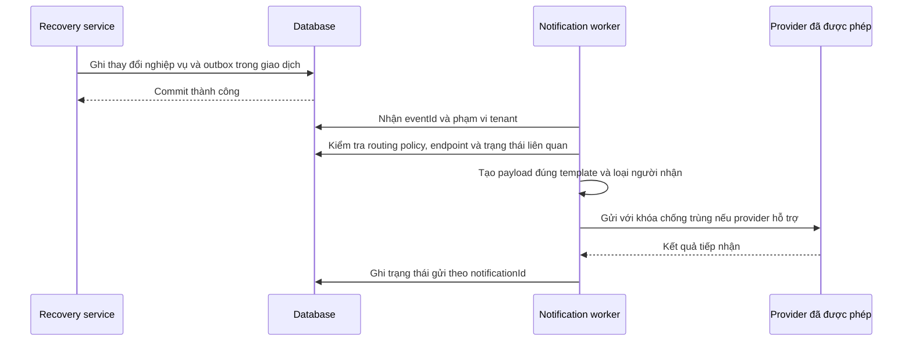

# Tenant notification routing

## 1. Định tuyến thông báo recovery là một quyết định bảo mật

Trong hệ thống nhiều tenant, một sự kiện recovery có thể cần thông báo cho người yêu cầu, chủ tài khoản, người phê duyệt hoặc nhóm hỗ trợ. Mỗi bên có quyền biết thông tin khác nhau; mỗi tổ chức có thể sử dụng tên miền, kênh gửi và nhà cung cấp khác nhau.

**Tenant notification routing** là quá trình xác định thông báo nào được gửi, cho ai, qua địa chỉ hoặc endpoint nào, dùng cấu hình tenant nào và trong điều kiện nào.

Trong phạm vi `SECURITY_AUTHENTICATION_ACCOUNT_RECOVERY`, định tuyến sai có thể làm lộ việc một người thuộc tổ chức, chuyển link recovery cho người ngoài hoặc để thông báo của tenant A xuất hiện dưới danh tính tenant B. Vì thế, routing không chỉ là chọn một SMTP server hay một mẫu email.

Ví dụ: một người tham gia cả tổ chức A và B, rồi yêu cầu thay MFA trong tài khoản cục bộ của B. Người duyệt của A không được nhận hồ sơ B; mẫu email B không được chứa tên A; địa chỉ người dùng vừa nhập không tự trở thành nơi nhận link cấp quyền recovery.

Một kế hoạch gửi cần trả lời riêng các câu hỏi:

```text
Sự kiện thuộc phạm vi nào?
Ai được phép biết hoặc hành động với sự kiện đó?
Endpoint nhận nào đang đủ điều kiện cho mục đích này?
Tenant nào quản lý tuyến gửi?
Nội dung và link được phép chứa những gì?
Thông báo còn hợp lệ khi worker thực sự gửi hay không?
```

## 2. Phân biệt phạm vi tenant và danh tính toàn cục

Nếu nền tảng dùng principal toàn cục cho nhiều membership, không phải mọi thông báo bảo mật đều thuộc tenant đang được chọn trên giao diện.

| Phạm vi sự kiện | Ví dụ | Nguồn quyết định tuyến |
|---|---|---|
| Tài khoản cục bộ của tenant | Thay MFA chỉ áp dụng trong tổ chức B | Policy và cấu hình gửi của B trong baseline nền tảng |
| Membership của tenant | Xem xét phục hồi quyền vào B | Tuyến của B, nội dung giới hạn trong membership đó |
| Principal toàn cục | Đổi phương thức xác thực dùng chung | Policy bảo mật toàn cục của nền tảng |
| Quyết định nội bộ | Nhóm hỗ trợ cần xử lý case B | Tuyến người duyệt đủ thẩm quyền của B hoặc nhóm nền tảng được phép |

Không chọn provider, người nhận hay template toàn cục chỉ dựa trên tenantId do client gửi. Phạm vi phải đến từ case, đối tượng và sự kiện do backend xác lập.

Quản trị viên tenant B không mặc nhiên được nhận cảnh báo về hoạt động của người dùng tại A. Ngay cả khi cùng một principal xuất hiện ở cả hai nơi, membership ở tổ chức khác có thể là thông tin không được phép tiết lộ.

## 3. Phân loại thông báo trước khi chọn người nhận

Mỗi loại thông báo có mục đích và mức nhạy cảm riêng:

| Loại | Mục đích | Người nhận điển hình | Ràng buộc quan trọng |
|---|---|---|---|
| Xác nhận tiếp nhận | Cho biết yêu cầu đã được ghi nhận | Người liên hệ qua kênh được phép | Không khẳng định tài khoản tồn tại khi chưa đủ quyền |
| Challenge xác minh kênh | Kiểm tra quyền kiểm soát một endpoint | Chính endpoint đang được xác minh | Không tự chứng minh quyền sở hữu tài khoản |
| Cảnh báo bảo mật | Báo có yêu cầu hoặc thay đổi nhạy cảm | Kênh tin cậy đã thiết lập cho đúng chủ thể | Giới hạn tần suất, không gửi chi tiết cho địa chỉ tùy ý |
| Yêu cầu xét duyệt | Đưa hồ sơ tới người có thẩm quyền | Nhân viên hoặc người duyệt được policy xác định | Link không tự thay thế xác thực và phân quyền |
| Kết quả quyết định | Thông báo được chấp thuận, từ chối hoặc hết hạn | Các bên được phép biết kết quả | Phân biệt kết quả case với thay đổi đã thực thi |
| Hướng dẫn thực thi recovery | Cho phép bước tiếp theo trong phạm vi được cấp | Endpoint đủ điều kiện nhận quyền đó | Token giới hạn mục đích, thời hạn và chống dùng lại |

Không thể dùng một danh sách email chung cho mọi hàng trong bảng. Người đủ quyền nhận lời nhắc xét duyệt chưa chắc được nhận token thực thi recovery của chủ tài khoản.

Thông báo gửi tới endpoint mới phải giữ đúng ý nghĩa: xác minh hộp thư mới chỉ chứng minh người nhận kiểm soát hộp thư đó. Nó không tự biến endpoint thành kênh recovery đã được tài khoản cũ tin cậy.

## 4. Nguồn dữ liệu dùng để routing

Routing nên kết hợp các nguồn server có thẩm quyền:

1. Sự kiện và case gốc: tenant, scope, subject, trạng thái, revision và loại thông báo.
2. Policy: các bên được nhận, kênh cho phép, nội dung được công bố và điều kiện gửi.
3. Registry endpoint: địa chỉ, trạng thái xác minh, mục đích được dùng và phiên bản.
4. Registry người duyệt: membership, vai trò, phạm vi và tình trạng quyền hiện hành.
5. Cấu hình tenant: sender, provider, template, locale hỗ trợ và các giới hạn vận hành.
6. Trạng thái gửi: lần thử, kết quả trước, khóa chống trùng và hạn dùng payload nếu có.

Một trường `email` trong body không thể thay thế toàn bộ các nguồn trên. Tương tự, `tenantId`, `providerId`, `templateId` hoặc `callbackUrl` do người yêu cầu gửi không tự cấp quyền chọn tuyến gửi.

Đối với dữ liệu thuộc tenant, mọi truy vấn và tham chiếu phải giữ phạm vi đó. Một endpoint reference hợp lệ ở tenant A không được tra ra rồi dùng cho B chỉ vì mã định danh tồn tại trong cơ sở dữ liệu.

Cache cũng phải phân biệt tenant, scope, loại thông báo và phiên bản cần thiết. Cache chỉ theo tên template như `recovery-success` có thể trả nhầm branding hoặc nội dung của tenant khác.

## 5. Lập kế hoạch gửi bằng tham chiếu có phiên bản

Một delivery plan nên nêu rõ các lựa chọn đã được xác lập:

```json
{
  "notificationId": "nt_example_705",
  "eventRef": "event_example_281",
  "tenantRef": "tenant_example_42",
  "identityScope": "TENANT_LOCAL_ACCOUNT",
  "caseRef": "case_example_516",
  "noticeType": "RECOVERY_FACTOR_CHANGED",
  "recipientKind": "ACCOUNT_SUBJECT",
  "recipientRef": "account_example_63",
  "endpointRef": "endpoint_example_99",
  "endpointVersion": 4,
  "routingPolicyVersion": "routing-example-v8",
  "templateVersionRef": "template_example_14_v3",
  "providerRouteRef": "provider_route_example_7",
  "locale": "vi",
  "deliveryState": "QUEUED"
}
```

Các mã chỉ minh họa. Plan không cần mang địa chỉ đầy đủ hoặc dữ liệu nhạy cảm nếu worker có thể truy xuất chúng đúng quyền ngay trước khi gửi.

Tham chiếu endpoint có phiên bản giúp tránh một lỗi nguy hiểm: worker nhận lệnh gửi tới “email hiện tại”, nhưng email đã bị thay sau khi sự kiện được tạo. Nếu tiếp tục dùng địa chỉ mới, nội dung của một sự kiện cũ có thể tới người chưa từng đủ điều kiện nhận nó.

Chính sách phải xác định endpoint nào phù hợp với sự kiện, chẳng hạn kênh tin cậy trước thay đổi hoặc kênh hiện hành đủ điều kiện. Không tự động thay bằng địa chỉ mới nhất khi endpoint trong plan không còn hợp lệ.

Đóng băng plan cũng không có nghĩa bỏ qua thu hồi quyền. Trước khi gửi, worker cần kiểm tra lại các điều kiện có thể làm mất hiệu lực việc gửi, rồi thực hiện bỏ qua, hủy hoặc lập kế hoạch lại theo policy.

## 6. Chọn kênh và fallback theo mục đích

Một tenant có thể hỗ trợ email, SMS, thông báo trong ứng dụng hoặc các tích hợp nội bộ. Không phải kênh nào cũng phù hợp với mọi loại thông báo.

Ví dụ:

- Người mất thiết bị duy nhất có thể không đọc được push notification trên thiết bị đó.
- Một SMS chỉ dùng cảnh báo không mặc nhiên được phép mang token thay MFA.
- Email người duyệt có thể chỉ chứa mã tham chiếu và link tới công cụ nội bộ, không chứa toàn bộ bằng chứng.
- Inbox trong ứng dụng chỉ hữu ích nếu người nhận còn có phiên đủ quyền để đọc.

Fallback cần được định nghĩa cho từng loại thông báo. Provider email lỗi có thể được chuyển sang provider khác đã được phê duyệt cho cùng kênh và phạm vi. Việc chuyển từ email tin cậy sang một số điện thoại mới là thay đổi về người nhận và mức bảo đảm, không chỉ thay phương tiện vận chuyển.

Nếu không có fallback hợp lệ, giữ trạng thái lỗi hoặc chờ xử lý theo quy trình. Không gửi tới “địa chỉ gần giống”, email của quản trị viên bất kỳ hay endpoint người dùng vừa đề nghị chỉ để hoàn tất công việc.

Locale có thể fallback sang ngôn ngữ hỗ trợ của cùng tuyến. Không fallback template bằng cách lấy mẫu của tenant khác. Nội dung vẫn phải giữ đúng loại thông báo, phạm vi và các giới hạn an toàn chung.

## 7. Provider, sender và tên miền

Cấu hình gửi thường có các thành phần:

```text
provider_route_reference
credential_reference
sender_identity_reference
verified_sender_domain
allowed_notice_types
allowed_channels
template_namespace
delivery_limits
```

Worker lấy thông tin truy cập provider qua cơ chế quản lý bí mật được phép, không nhận khóa API trong payload sự kiện. Khi chuyển giữa các job, không giữ lại cấu hình tenant trước trong biến dùng chung hoặc thread context chưa được dọn.

Sender và tên miền phải thuộc cấu hình đã được xác lập. Không cho người liên hệ đặt `From`, `Reply-To`, tiêu đề hoặc header tùy ý để giả mạo tổ chức. Mọi giá trị đưa vào header cần được xử lý theo thư viện và giới hạn hợp lệ, tránh chèn header từ chuỗi đầu vào.

Tên miền trong link phải lấy từ registry tin cậy. Không xây link từ `Host`, `X-Forwarded-Host` hoặc callback URL công khai chưa kiểm chứng. Một email đúng người nhận vẫn có thể bị dùng để phishing nếu link trỏ tới máy chủ của kẻ tấn công.

Provider dự phòng cũng phải được cho phép đối với tenant và loại dữ liệu. Không tự gửi payload tới một dịch vụ khác chỉ vì dịch vụ đó đang hoạt động, trong khi cấu hình phạm vi hoặc chính sách xử lý dữ liệu không cho phép.

## 8. Minh họa kiểm tra phạm vi một tuyến bằng Java

Ví dụ sau giới hạn ở thông báo tới tài khoản cục bộ của tenant. Nó trả ra tham chiếu endpoint, không nhận địa chỉ tùy ý từ client và không giải quyết tuyến principal toàn cục hoặc người duyệt.

```java
import java.util.Objects;
import java.util.Set;
import java.util.UUID;

public final class TenantNoticeRouter {
    public enum Channel { EMAIL, SMS, IN_APP }
    public enum NoticeType { RECOVERY_REQUESTED, RECOVERY_FACTOR_CHANGED }

    public record Notice(
        UUID eventId, UUID tenantId, UUID accountId, NoticeType type
    ) {}

    public record Endpoint(
        UUID tenantId, UUID accountId, UUID endpointId, long version,
        Channel channel, boolean active, boolean allowedForSecurityNotices
    ) {}

    public record RouteConfig(
        UUID tenantId, NoticeType type, Set<Channel> allowedChannels,
        String providerReference, String templateVersionReference
    ) {
        public RouteConfig {
            allowedChannels = Set.copyOf(allowedChannels);
        }
    }

    public record DeliveryPlan(
        UUID eventId, UUID tenantId, UUID endpointId, long endpointVersion,
        String providerReference, String templateVersionReference
    ) {}

    public DeliveryPlan resolve(Notice notice, Endpoint endpoint,
                                RouteConfig config) {
        Objects.requireNonNull(notice);
        Objects.requireNonNull(endpoint);
        Objects.requireNonNull(config);
        Objects.requireNonNull(notice.eventId());
        Objects.requireNonNull(notice.tenantId());
        Objects.requireNonNull(notice.accountId());
        Objects.requireNonNull(notice.type());
        Objects.requireNonNull(endpoint.endpointId());
        Objects.requireNonNull(endpoint.channel());

        if (!notice.tenantId().equals(endpoint.tenantId())
                || !notice.tenantId().equals(config.tenantId())
                || !notice.accountId().equals(endpoint.accountId())
                || notice.type() != config.type()) {
            throw new IllegalArgumentException("Routing scope mismatch");
        }

        if (!endpoint.active()
                || !endpoint.allowedForSecurityNotices()
                || endpoint.version() < 1
                || !config.allowedChannels().contains(endpoint.channel())) {
            throw new IllegalStateException("No eligible endpoint route");
        }

        requireText(config.providerReference());
        requireText(config.templateVersionReference());
        return new DeliveryPlan(
            notice.eventId(), notice.tenantId(), endpoint.endpointId(),
            endpoint.version(), config.providerReference(),
            config.templateVersionReference()
        );
    }

    private static void requireText(String value) {
        if (value == null || value.isBlank()) {
            throw new IllegalArgumentException("Missing route reference");
        }
    }
}
```

Các record đầu vào phải được tạo từ nguồn server có thẩm quyền. Cờ `allowedForSecurityNotices` không được bind từ JSON người yêu cầu gửi, và tên kiểu `Endpoint` không tự bảo đảm dữ liệu đã được xác minh.

Ví dụ chỉ kiểm tra một phần ranh giới. Lựa chọn endpoint phải đã xét thời điểm, loại thông báo, policy và quyền nhận. Worker gửi còn phải đối chiếu lại phiên bản cùng các điều kiện hiện hành, rồi tra địa chỉ thật trong phạm vi được phép.

Một hàm riêng cho người duyệt cần kiểm tra quyền xét duyệt request, tenant và trạng thái membership. Không tái sử dụng phép so accountId ở trên để suy ra một reviewer có quyền nhận thông tin case.

## 9. Outbox và thời điểm gửi

Thông báo cần liên kết với một sự kiện nghiệp vụ đã có hiệu lực. Nếu gửi email “MFA đã được thay đổi” trước khi giao dịch commit rồi giao dịch thất bại, người dùng sẽ nhận thông tin sai.

Một luồng có thể là:



Không áp một quy tắc “case đóng thì bỏ mọi thông báo”. Link challenge cũ của case đã từ chối có thể phải hủy, nhưng thông báo kết quả từ chối hoặc thông báo thay đổi đã hoàn tất vẫn có thể cần gửi. Điều kiện hợp lệ phụ thuộc notice type.

Khi policy bắt buộc một bước thông báo hoặc xác nhận trước thực thi recovery, workflow phải mô hình hóa điều kiện chờ đó. Không được coi việc đưa email vào outbox là bằng chứng người nhận đã được thông báo hoặc đã xác nhận.

## 10. Thông báo có token hoặc link nhạy cảm

Không phải thông báo nào cũng được mang quyền. Phần lớn cảnh báo và lời nhắc xét duyệt chỉ cần link tới một giao diện kiểm tra quyền riêng.

Nếu tuyến recovery thực sự cần gửi token hoặc link challenge mới:

- Token được tạo ngẫu nhiên theo thiết kế bảo mật, có mục đích và thời hạn rõ ràng.
- Quyền được ràng buộc với case, tenant, chủ thể và hành động cho phép.
- Giá trị kiểm chứng phía server không bị nhầm với token cần giao cho người nhận.
- Payload giao token được bảo vệ, giới hạn người đọc và vòng đời; không nằm bản rõ trong log, analytics hay outbox thông thường.
- Mã hoặc token đã dùng không được gửi lại như một quyền mới.

Trong luồng bất đồng bộ, có thể dùng một secret reference tới payload giao hàng ngắn hạn được mã hóa và kiểm soát truy cập. Chỉ worker được phép mới đọc được nội dung cần gửi. Thiết kế phải xử lý retry, hết hạn và dọn dữ liệu rõ ràng; một reference không tự giải quyết toàn bộ vòng đời bí mật.

Retry cùng một lần giao cần giữ quan hệ với cùng token và sự kiện còn hợp lệ. Không tạo token mới sau mỗi lỗi provider khiến các email đến chậm liên tục vô hiệu hóa nhau. Nếu cần cấp lại, đó là thao tác có chính sách riêng, có xử lý token cũ và thông báo phù hợp.

Link có token cần tránh lộ qua log URL, tài nguyên bên thứ ba và các đường truyền referrer không được kiểm soát. Trang tiếp nhận phải được thiết kế cho nguy cơ trình quét email mở link. GET không nên tự thay mật khẩu, gỡ MFA hoặc đưa ra quyết định phê duyệt.

Không gửi mật khẩu hiện tại, bí mật MFA hoặc recovery code đã có cho nhân viên để “xác nhận”. Việc delivery một challenge mới theo quy trình không đồng nghĩa hỗ trợ được quyền thu thập mọi bí mật của người dùng.

## 11. Retry, chống trùng và trạng thái giao nhận

Nên phân biệt các trạng thái như:

```text
QUEUED -> DISPATCHING -> ACCEPTED_BY_PROVIDER
                     -> RETRY_SCHEDULED
                     -> FAILED_PERMANENTLY
QUEUED -> SUPPRESSED_BY_POLICY
QUEUED -> EXPIRED_BEFORE_SEND
```

`ACCEPTED_BY_PROVIDER` không chứng minh đã tới hộp thư, đã đọc hoặc đã hoàn tất recovery. Những trạng thái đó, nếu có dữ liệu đáng tin cậy, cần được lưu riêng.

Khóa chống trùng có thể gắn với sự kiện, notice type, người nhận, endpoint version và đơn vị gửi logic. Không chỉ dùng caseId, vì cùng một case có thể có nhiều thông báo hợp lệ khác nhau.

Khi provider timeout sau khi đã nhận yêu cầu, hệ thống có thể chưa biết email đã gửi hay chưa. Nếu provider hỗ trợ idempotency, dùng cùng khóa. Nếu không, phải thiết kế retry có giới hạn và chấp nhận khả năng giao trùng; không hứa bảo đảm gửi đúng một lần cho mọi kênh.

Đặc biệt tránh đổi provider ngay sau một kết quả không xác định rồi gửi hàng loạt bản sao. Fallback cần xét kết quả trước, mức khẩn cấp và chính sách gửi, không chỉ xét provider nào phản hồi nhanh hơn.

Lỗi gửi không tự đảo ngược quyết định đã commit. Nếu việc giao nhận là điều kiện bắt buộc trước bước tiếp theo, giữ workflow ở trạng thái chờ hoặc chuyển tuyến theo policy, thay vì tự bỏ điều kiện đó.

## 12. Thay đổi endpoint, quyền và cấu hình khi đang chờ

Một thông báo có thể nằm trong hàng đợi trong khi:

- Người dùng thay đổi email hoặc thu hồi một endpoint.
- Nhân viên mất quyền xét duyệt.
- Case hết hạn, bị từ chối hoặc được thay bằng revision mới.
- Tenant thay template hoặc đổi provider.
- Khóa truy cập provider được luân chuyển.

Không phải thay đổi nào cũng có cùng tác động. Luân chuyển thông tin đăng nhập provider có thể vẫn giữ nguyên ý nghĩa tuyến. Đổi địa chỉ người nhận hoặc thay phạm vi nội dung có thể yêu cầu hủy và lập plan mới.

Đối với reviewer đã mất quyền, không gửi tiếp bằng chứng nhạy cảm chỉ vì người đó từng có tên trong plan. Đối với endpoint đã bị thu hồi, không tự chuyển thông báo chứa quyền sang endpoint mới mà chưa đánh giá lại.

Kiểm tra ngay trước khi gửi giúp giảm rủi ro, nhưng sau khi provider đã nhận nội dung, hệ thống thường không thể bảo đảm thu hồi bản đã giao. Vì thế payload cần tối thiểu hóa thông tin, link phải kiểm tra quyền và token phải có khả năng hết hiệu lực độc lập với email.

## 13. Webhook và tích hợp nội bộ của tenant

Một tenant có thể muốn nhận sự kiện recovery qua webhook hoặc hệ thống ticket. Đây là một tuyến có người nhận và phạm vi riêng, không phải bản sao tự động của mọi email.

Trước khi bật cần xác định:

- Tenant có quyền đăng ký endpoint đó và cấu hình đã qua xác nhận phù hợp.
- Loại sự kiện và trường dữ liệu được phép gửi.
- Địa chỉ đích được kiểm soát để tránh truy cập mạng nội bộ hoặc endpoint không được phép.
- Cơ chế xác thực nguồn thông báo và chống replay.
- Retry, chống trùng, giới hạn tài nguyên và cách xử lý endpoint ngừng hoạt động.

Không nhận `callbackUrl` từ một yêu cầu recovery rồi cho backend gọi trực tiếp. Kiểm soát đích cần tính tới redirect, phân giải DNS và thay đổi địa chỉ; chỉ kiểm tra chuỗi URL ở một thời điểm có thể chưa đủ để chặn truy cập ngoài phạm vi.

Nếu ký webhook, chữ ký cần gắn với payload và metadata cần thiết theo định dạng xác định. Phía nhận kiểm tra chữ ký, thời hạn hoặc mốc chống replay và eventId. Khóa của tenant này không được dùng để xác thực thay tenant khác.

Webhook không nên chứa token thực thi recovery hoặc bằng chứng gốc nếu không có mục đích và tuyến được phê duyệt riêng. Tạo một ticket không đồng nghĩa hệ thống ticket trở thành nơi được phép phê duyệt tài khoản.

## 14. Hạn mức, audit và bảo vệ thông tin tenant

Kẻ tấn công có thể tạo nhiều yêu cầu để gây bão email cho nạn nhân hoặc tiêu hết ngân sách của tenant. Hạn mức cần kết hợp nhiều chiều: nguồn gọi, phiên, case, tenant, endpoint và loại thông báo, cùng tín hiệu rủi ro phù hợp.

Không chỉ khóa theo email đích, vì người ngoài có thể dùng hạn mức đó để chặn thông báo hợp lệ của nạn nhân. Đồng thời cần tránh một tenant lớn chiếm hết hàng đợi khiến cảnh báo bảo mật của các tenant khác bị chậm.

Audit routing có thể ghi:

```text
notification_id / event_reference
tenant_reference / identity_scope
notice_type / recipient_kind
recipient_reference / endpoint_reference / endpoint_version
routing_policy_version / template_version_reference
provider_route_reference
attempt_reference / delivery_outcome
suppression_reason_code, nếu có
occurred_at
```

Không ghi token, khóa provider, toàn bộ địa chỉ hoặc nội dung nhạy cảm nếu không cần thiết. Mã tham chiếu vẫn có thể là dữ liệu cần bảo vệ; quyền xem audit phải theo phạm vi.

Quản trị viên tenant có thể được xem kết quả gửi thuộc tenant mình, nhưng không mặc nhiên được đọc token recovery, ghi chú chống gian lận hoặc thông tin principal ở các tổ chức khác. Các màn hình hỗ trợ và xuất báo cáo cần giữ cùng ranh giới như worker gửi.

## 15. Tình huống xuyên suốt

Phương có tài khoản cục bộ trong tenant B và gửi yêu cầu thay MFA. Case được xác minh theo chính sách B, có một request cần nhóm hỗ trợ B xét duyệt.

1. Sự kiện xét duyệt được ghi cùng tenant B, case, revision và scope tài khoản cục bộ.
2. Routing policy xác định nhóm có thẩm quyền, không lấy danh sách email do người yêu cầu gửi.
3. Người duyệt nhận mẫu B với mã tham chiếu và link tới công cụ yêu cầu đăng nhập. Không có token thực thi recovery trong lời nhắc.
4. Một người duyệt mất quyền trước khi worker gửi. Tuyến của người đó bị hủy hoặc định tuyến lại theo chính sách, không tiếp tục giao dữ liệu chỉ vì plan cũ tồn tại.
5. Sau khi quyết định và thao tác thay MFA hoàn tất, hệ thống tạo thông báo kết quả riêng tới kênh tin cậy đủ điều kiện của Phương.
6. Email bị timeout ở provider. Worker dùng cùng notificationId và cơ chế chống trùng được hỗ trợ, không tạo thêm quyết định hoặc token.
7. Nếu endpoint thay đổi trong lúc chờ, worker không tự gửi nội dung cũ tới địa chỉ mới; hệ thống đánh giá lại tuyến đúng loại thông báo.
8. Không có thông báo nào gửi tới quản trị viên tenant A, dù Phương cũng tham gia A bằng một danh tính khác hoặc principal liên quan.

Nếu cần challenge cho một email mới, đó là thông báo riêng với mục đích xác minh endpoint. Hoàn tất challenge không tự làm email mới đủ quyền nhận grant thay MFA của case đang xét.

## 16. Những lỗi định tuyến thường gặp

- **Chọn tenant từ body thay vì case:** gửi theo phạm vi do người gọi tự khai.
- **Dùng email mới cho mọi thông báo:** chuyển thông tin và quyền tới endpoint chưa đủ điều kiện.
- **Một danh sách người nhận dùng cho mọi sự kiện:** người duyệt nhận cả token thực thi hoặc chủ tài khoản nhận dữ liệu nội bộ.
- **Cache template không có namespace tenant:** gửi sai thương hiệu hoặc nội dung tổ chức khác.
- **Dùng Host hoặc callback tùy ý để tạo link:** biến thông báo chính thức thành công cụ phishing.
- **Fallback sang kênh yếu hơn mà không xét policy:** thay đổi mức bảo đảm chỉ vì provider lỗi.
- **Gửi trước khi giao dịch có hiệu lực:** thông báo kết quả chưa thực sự xảy ra.
- **Xem provider nhận yêu cầu là người dùng đã đọc:** bỏ qua các trạng thái giao nhận khác nhau.
- **Không kiểm tra endpoint và quyền lúc gửi:** plan cũ tiếp tục giao dữ liệu sau thu hồi.
- **Đưa token vào log hoặc webhook chung:** tạo thêm nơi có thể lấy quyền recovery.

Tenant notification routing an toàn giữ được liên kết giữa sự kiện, phạm vi tenant, người nhận đủ quyền và endpoint phù hợp với mục đích. Kế hoạch có phiên bản, kiểm tra trước khi gửi, payload tối thiểu và xử lý retry rõ ràng giúp thông báo hỗ trợ recovery mà không trở thành đường rò rỉ dữ liệu hoặc chuyển quyền sang sai người.
