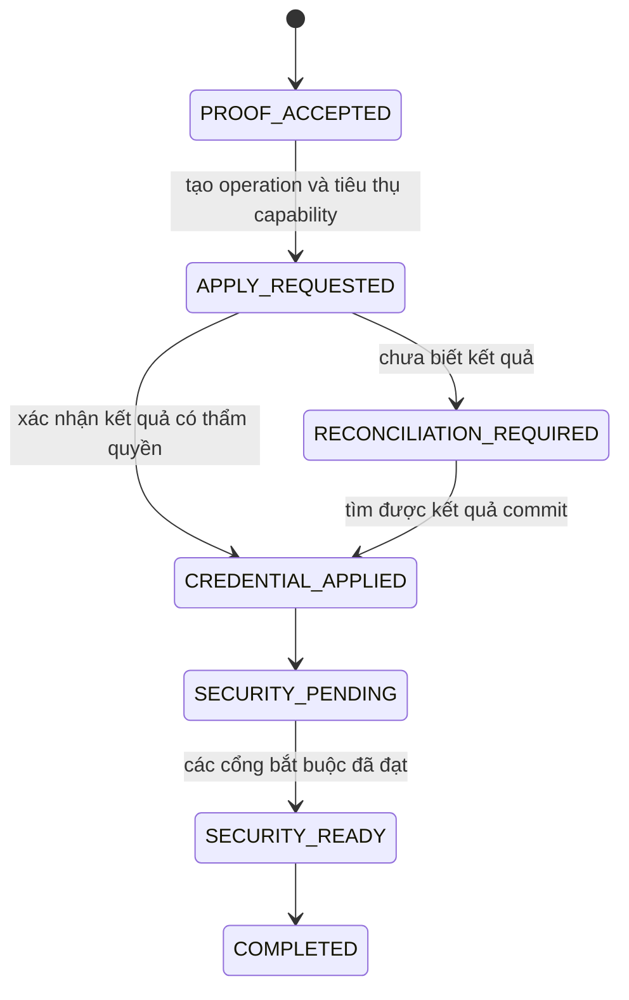

# Cross service consistency: tính nhất quán xuyên dịch vụ trong account recovery

## 1. Một lần recovery có thể đi qua nhiều nguồn trạng thái

Người dùng hoàn tất xác minh danh tính, thay mật khẩu và nhận thông báo thành công. Nhưng dịch vụ session chưa thu hồi refresh token cũ, dịch vụ risk vẫn giữ một yêu cầu chặn và worker đang chuẩn bị phát lại email chứa link recovery trước đó. Mỗi thành phần có thể báo thành công theo góc nhìn riêng, trong khi kết quả toàn hệ thống chưa đáp ứng điều kiện bảo mật.

**Cross service consistency** là việc giữ đúng các quan hệ và điều kiện nghiệp vụ khi một quy trình được thực thi qua nhiều dịch vụ, database, message và cache. Trong account recovery, điều quan trọng không chỉ là dữ liệu cuối cùng giống nhau, mà là không xuất hiện một cửa sổ khiến token dùng lại được, credential bị thay hai lần hoặc phiên cũ tiếp tục có quyền ngoài chính sách.

Trong `SECURITY_AUTHENTICATION_ACCOUNT_RECOVERY`, chuỗi này có thể gồm xác minh danh tính khi mất mật khẩu, MFA, passkey hoặc thiết bị; đánh giá rủi ro; token dùng một lần; chống lạm dụng; thay credential và kiểm soát phiên. Không thể giả định một transaction local bao trùm tất cả các bước đó.

Thiết kế cần trả lời: dịch vụ nào có thẩm quyền với từng trạng thái, thời điểm nào một quyết định được xem là có hiệu lực và bằng chứng nào đủ để công bố recovery hoàn tất?

## 2. Bắt đầu bằng bất biến, không bắt đầu bằng message broker

Các bất biến xác định phần nào cần nhất quán chặt và phần nào có thể cập nhật trễ.

| Bất biến | Điều phải bảo vệ | Hệ quả thiết kế |
| --- | --- | --- |
| Một capability không tạo nhiều thao tác độc lập | Token hoặc code dùng một lần | Tiêu thụ gắn nguyên tử với một operation bền vững |
| Một operation không thay credential nhiều lần | Retry và message trùng | Idempotency tại dịch vụ thực thi, không chỉ gateway |
| Không áp lệnh cho sai chủ thể | Tenant, account, factor và purpose | Ràng buộc scope trên command và kiểm tra tại nơi nhận |
| Lệnh cũ không vượt qua quyết định mới hơn | Thu hồi, hủy, thay phiên bản | Version hoặc fencing được thực thi tại nguồn có thẩm quyền |
| Không báo hoàn tất khi điều kiện bảo mật chưa đạt | Factor mới, phiên cũ, restriction | Cổng hoàn tất dựa trên trạng thái và receipt cụ thể |
| Không mất dấu thay đổi đã commit | Credential đã đổi nhưng event chưa gửi | Audit hoặc outbox ghi cùng transaction phù hợp |
| Không làm sống lại credential nguy hiểm khi bù trừ | Xử lý lỗi giữa chừng | Chuyển tiếp tới trạng thái an toàn thay vì rollback mù quáng |

Các projection phục vụ giao diện, thống kê hoặc nội dung thông báo thường có thể cập nhật trễ trong giới hạn đã định. Quyết định chấp nhận token hoặc cho phép một phiên cũ truy cập dữ liệu nhạy cảm không nên dựa vào cùng giả định trễ đó nếu chính sách đòi hiệu lực ngay.

“Eventual consistency” không phải lời giải thích đủ cho một token dùng hai lần. Cần chỉ rõ bất biến nào vẫn được giữ trong thời gian các thành phần chưa đồng bộ.

## 3. Chỉ định nguồn có thẩm quyền cho từng trạng thái

Một cách phân công trách nhiệm minh họa:

| Thành phần | Trạng thái có thẩm quyền |
| --- | --- |
| Recovery coordinator | Case, bằng chứng được chấp nhận, operation và tiến độ điều phối |
| Authentication service | Credential, factor, authentication epoch và fencing liên quan |
| Session service | Refresh token family, phiên và trạng thái thu hồi thuộc phạm vi của nó |
| Risk service | Tín hiệu hoặc quyết định rủi ro theo giao thức đã định |
| Authorization service | Membership, role, grant và security hold thuộc nguồn đó |
| Notification service | Trạng thái bàn giao thông báo, không quyết định recovery hợp lệ |

Đây là cách phân chia khái niệm, không bắt buộc phải tách thành từng microservice. Nếu một số trạng thái cùng nằm trong một transaction có thẩm quyền, thiết kế có thể đơn giản hơn.

Không để hai dịch vụ cùng tự nhận quyền quyết định một factor đang hoạt động. Một bản cache trong coordinator có thể nói “pending” trong khi authentication service đã commit; cần có giao thức lấy kết quả từ nguồn chuẩn thay vì ghi ngược để ép chúng giống nhau.

Lệnh giữa dịch vụ phải được xác thực cả danh tính máy lẫn quyền thực hiện trên tài nguyên. Một service account hợp lệ không mặc nhiên được reset mọi tài khoản hoặc bỏ qua tenant scope. Command cần gắn với purpose, case, operation, account và phiên bản đã được cho phép.

## 4. Tiêu thụ token gắn với operation bền vững

Một lỗi phổ biến là đánh dấu token đã dùng, gọi authentication service, gặp timeout rồi không biết tiếp tục thế nào. Nếu cho token dùng lại, có thể tạo thêm thao tác; nếu bỏ luôn, người dùng có thể bị kẹt dù credential chưa đổi.

Giải pháp là chuyển quyền dùng một lần thành **một operation có thể theo dõi và retry**, thay vì coi mỗi request mạng là một thao tác mới.

```text
Transaction tại nguồn quản lý capability:
  xác minh token, purpose, tenant, account, hạn và phiên bản
  kiểm tra token chưa bị tiêu thụ hoặc thu hồi
  tạo operation O gắn với đúng phạm vi recovery
  đánh dấu token đã được tiêu thụ cho O
  ghi command cần gửi vào outbox
  commit
```

Sau commit, token không được tạo operation khác. Mọi retry tiếp tục theo O và kết quả của O. Nếu token và operation nằm ở hai nguồn không có cùng transaction, cần một giao thức có thẩm quyền để giữ quan hệ này; không giả vờ hai lệnh ghi tuần tự là nguyên tử.

Điểm tuyến tính hóa quan trọng ở đây là lúc hệ thống chấp nhận một operation duy nhất. Nó không có nghĩa credential đã được đổi hoặc recovery đã hoàn tất.

Một request retry phải được xử lý theo quyền truy cập trạng thái hiện hành. Không trả toàn bộ case hoặc bí mật mới chỉ vì client biết operation ID. Token hết hạn sau khi operation đã được chấp nhận cũng không tự quyết định operation đang chạy bị hủy; thời hạn tiếp tục và điều kiện thực thi cần được định nghĩa riêng.

## 5. Idempotency phải tồn tại tại nơi tạo tác động

Gateway giữ idempotency key không đủ nếu worker hoặc dịch vụ downstream có thể gửi lại cùng lệnh. Dịch vụ thay credential cần biết operation nào đã được áp dụng.

Một khóa có thể bao gồm phạm vi:

```text
tenantId + accountId + operationId
```

Kèm theo đó là fingerprint của nội dung đã cho phép: purpose, factor đích hoặc candidate factor, expected version, case version và các trường quyết định có liên quan. Không đưa bí mật vào log hoặc sự kiện chỉ để tính fingerprint; có thể dùng tham chiếu credential material được bảo vệ theo thiết kế.

Các quy tắc:

- Cùng operation và cùng nội dung: trả kết quả đã lưu, không thay credential lần nữa.
- Cùng operation nhưng nội dung khác: từ chối xung đột và tạo dấu vết.
- Operation mới: kiểm tra quyền, phiên bản, thời hạn và trạng thái trước khi tạo tác động.
- Kết quả thành công đã commit: không bị đổi thành thất bại chỉ vì phản hồi mạng bị mất.

Một transaction tại authentication service có thể tổ chức:

```text
BEGIN TRANSACTION
  khóa trạng thái security của tài khoản theo scope
  tra kết quả operation đã áp dụng
  nếu đã có, kiểm tra fingerprint và trả kết quả đã lưu
  xác minh command, candidate factor, version và fence hiện hành
  áp dụng thay credential được phép
  tăng authentication epoch và đặt restriction cần thiết
  ghi kết quả operation
  ghi audit hoặc outbox của thay đổi
COMMIT
```

Bản ghi operation và thay đổi credential cần cùng ranh giới nguyên tử hoặc cơ chế tương đương. Nếu đánh dấu “đã xử lý” trước nhưng credential update thất bại ở transaction khác, retry có thể bỏ mất tác động cần thiết. Nếu chỉ ghi kết quả sau một tác động không được bảo vệ, retry có thể tạo tác động lần hai.

## 6. Transactional outbox và inbox giải quyết phần nào?

Outbox giúp nối một thay đổi local với ý định phát message. Ví dụ, credential đã được cập nhật và sự kiện `CredentialRecoveryApplied` được ghi trong cùng transaction. Một relay gửi sự kiện từ outbox ra broker.

Relay có thể gửi thành công rồi lỗi trước khi đánh dấu đã gửi. Vì vậy consumer phải xử lý message trùng. Một broker có tính năng chống trùng không tự bảo đảm mọi tác động ở database hoặc dịch vụ bên ngoài đều chỉ xảy ra một lần.

Inbox hoặc bảng kết quả đã xử lý ở consumer cần được cập nhật nguyên tử với tác động local tương ứng:

```text
BEGIN TRANSACTION
  nhận diện source, tenant và event ID
  nếu sự kiện đã được xử lý với cùng nội dung: không tạo tác động mới
  kiểm tra scope, version và điều kiện áp dụng
  cập nhật trạng thái local
  ghi inbox hoặc receipt
COMMIT
```

Khóa deduplication phải có namespace phù hợp. Cùng ID nhưng nội dung khác cần được xử lý như sai lệch, không ghi đè lịch sử. Nếu consumer còn gọi một API bên ngoài, transaction local không bao trùm tác động đó; API bên ngoài cần idempotency hoặc một cách đối soát riêng.

Outbox không giải quyết mọi vấn đề thứ tự, thu hồi hoặc an ninh. Nó không chứng minh session service đã áp dụng epoch mới, và không ngăn một command cũ được nhận sau khi case đã bị hủy nếu nơi nhận không kiểm tra fence.

## 7. Timeout là kết quả chưa biết, không mặc nhiên là thất bại

Một tình huống thường gặp:

```text
T0: Coordinator gửi operation O.
T1: Authentication service commit credential mới và kết quả O.
T2: Phản hồi bị mất trên mạng.
T3: Coordinator hết thời gian chờ.
```

Ở T3, coordinator không biết kết quả; nó không có bằng chứng rằng authentication service chưa làm gì. Cách đúng là giữ O ở trạng thái cần xác nhận, truy vấn kết quả hoặc gửi lại cùng O theo giao thức idempotent.

Không tạo O2 chỉ vì O timeout. Không tự đưa token về chưa dùng. Không khôi phục credential cũ để làm giao diện quay về trạng thái ban đầu.

API người dùng có thể trả trạng thái “đang xử lý” và một tham chiếu theo dõi có kiểm soát truy cập. Thông báo “thất bại, hãy bắt đầu lại” chỉ phù hợp khi đã biết operation không tạo tác động hoặc đã có quy trình kết thúc rõ ràng.

Retry cần có giới hạn, backoff và khả năng quan sát. Khi chưa thể xác định kết quả, chuyển sang reconciliation có người hoặc tác vụ chịu trách nhiệm; không retry vô hạn mà không biết trạng thái.

## 8. Version và fencing ngăn lệnh cũ tạo tác động mới

Idempotency chặn lặp lại cùng operation, nhưng không đủ để ngăn một operation cũ chưa từng được áp dụng vượt qua một quyết định mới hơn.

Ví dụ, O1 được tạo khi case ở phiên bản 4. Sau đó hồ sơ bị thu hồi và một recovery mới được mở. Nếu O1 đến muộn, authentication service cần phát hiện rằng phạm vi hoặc quyền thực thi không còn phù hợp.

Command có thể chứa:

```yaml
operationId: operation_example
tenantId: tenant_example
accountId: account_example
purpose: REPLACE_RECOVERY_FACTOR
caseVersion: 4
expectedCredentialVersion: 12
recoveryFence: 57
candidateFactorReference: candidate_reference
scopeDigest: approved_scope_digest
```

Các trường được máy chủ phát và kiểm tra theo giao thức, không phải quyền mà client tự khai.

`expectedCredentialVersion` giúp phát hiện credential đã thay đổi. `recoveryFence` giúp phân biệt quyền thực thi cũ với thế hệ quyết định mới. Fence chỉ có tác dụng khi nơi tạo tác động so sánh nó với trạng thái có thẩm quyền ngay tại ranh giới áp dụng.

Nếu coordinator tăng fence nhưng chỉ phát event bất đồng bộ, authentication service chưa nhận event có thể vẫn áp O1. Do đó, không được hứa “hủy có hiệu lực tức thời” chỉ bằng việc đổi trạng thái ở coordinator.

Một cách thiết kế là đặt fence thực thi tại authentication service. Lệnh áp dụng và lệnh hủy hoặc tăng fence cạnh tranh qua cùng trạng thái có kiểm soát đồng thời. Nếu hủy thắng trước, lệnh cũ bị từ chối. Nếu áp dụng đã commit trước, hủy không thể giả vờ credential chưa đổi; nó phải nhận kết quả và chuyển sang bảo vệ hoặc khắc phục theo chính sách.

Nguồn quyết định rủi ro hoặc security hold khác cũng cần giao thức hiệu lực rõ ràng. Một cache rủi ro cũ không thể cung cấp bảo đảm thu hồi ngay mà hệ thống chưa thiết kế.

## 9. Event đến trễ và không đúng thứ tự

Projection có thể nhận event phiên bản 15 trước phiên bản 14. Cách xử lý phụ thuộc event là snapshot đầy đủ hay delta.

- Với snapshot đầy đủ cho một aggregate, có thể chỉ nhận snapshot mới hơn theo revision có thẩm quyền.
- Với delta, bỏ event cũ có thể làm mất một phần thay đổi chưa được thể hiện trong event mới; cần kiểm tra sequence, xử lý theo thứ tự hoặc đọc lại nguồn chuẩn.

Không dùng timestamp client làm phiên bản. Đồng hồ lệch hoặc message chậm có thể khiến sự kiện cũ trông mới hơn. Revision cần có ngữ nghĩa rõ trong phạm vi aggregate và nguồn phát.

Ví dụ Java dưới minh họa một cổng nhận **snapshot đầy đủ** của trạng thái security. Nó chưa ghi database, chưa xác thực producer và chưa triển khai inbox. Các bước đó phải được thực hiện trong cơ chế ghi local phù hợp.

```java
import java.util.Objects;
import java.util.UUID;

public final class SecuritySnapshotGate {
    public enum State { RECOVERY_RESTRICTED, SECURITY_READY }
    public enum Action { APPLY, IGNORE_OLDER, DUPLICATE, CONFLICT }

    public record Snapshot(
            UUID tenantId,
            UUID accountId,
            long revision,
            long authenticationEpoch,
            long recoveryFence,
            State state,
            String canonicalDigest) {
        public Snapshot {
            Objects.requireNonNull(tenantId);
            Objects.requireNonNull(accountId);
            Objects.requireNonNull(state);
            Objects.requireNonNull(canonicalDigest);
            if (revision < 1 || authenticationEpoch < 0 || recoveryFence < 0) {
                throw new IllegalArgumentException("Invalid security version");
            }
        }
    }

    public static Action decide(Snapshot current, Snapshot incoming) {
        Objects.requireNonNull(incoming);
        if (current == null) {
            return Action.APPLY;
        }
        if (!current.tenantId().equals(incoming.tenantId())
                || !current.accountId().equals(incoming.accountId())) {
            return Action.CONFLICT;
        }
        if (incoming.revision() < current.revision()) {
            return Action.IGNORE_OLDER;
        }
        if (incoming.revision() == current.revision()) {
            return current.canonicalDigest().equals(incoming.canonicalDigest())
                    ? Action.DUPLICATE : Action.CONFLICT;
        }
        if (incoming.authenticationEpoch() < current.authenticationEpoch()
                || incoming.recoveryFence() < current.recoveryFence()) {
            return Action.CONFLICT;
        }
        return Action.APPLY;
    }
}
```

Digest phải được tạo và kiểm tra từ biểu diễn chuẩn hóa của toàn snapshot liên quan, không tin một chuỗi client gửi là đúng. Trường hợp chưa có projection vẫn phải xác thực nguồn và scope trước khi áp dụng.

Sau khi hàm quyết định `APPLY`, ghi projection cần kiểm tra revision một cách nguyên tử. Nếu hai consumer cùng đọc revision cũ rồi ghi không có điều kiện, snapshot thấp hơn vẫn có thể ghi đè snapshot cao hơn.

Revision của một aggregate cũng không tự sắp xếp được mọi dịch vụ. Nếu kết quả phụ thuộc cả trạng thái session và credential, coordinator cần receipt hoặc kiểm tra điều kiện của từng nguồn, không so hai con số revision không cùng ý nghĩa.

## 10. Thu hồi phiên là một cổng thực thi, không chỉ một event

Credential đã đổi không tự vô hiệu hóa refresh token hoặc access token cũ ở mọi dịch vụ. Hệ thống cần định nghĩa chính sách thu hồi và cách các verifier thực thi.

Các lựa chọn có thể gồm introspection, kiểm tra epoch có thẩm quyền, danh sách thu hồi hoặc cơ chế phân phối trạng thái với giới hạn độ trễ rõ ràng. Nếu một dịch vụ chỉ kiểm tra chữ ký token cũ và không biết epoch mới, event “sessions revoked” ở coordinator không làm token đó tự mất hiệu lực.

Một thiết kế cần hiệu lực ngay cho thao tác nhạy cảm có thể yêu cầu verifier kiểm tra trạng thái hiện hành trước khi cho phép hành động. Nếu nguồn đó không truy cập được, hành vi phải theo chính sách và không tự mở quyền bằng cache cũ.

Một thiết kế chấp nhận độ trễ thu hồi có giới hạn phải công bố và kiểm soát giới hạn đó bằng cơ chế thực tế. Không gọi nó là thu hồi tức thời. Việc chưa đánh dấu recovery `COMPLETED` cũng không tự ngăn kẻ đang giữ token cũ; tài nguyên phải có cổng chặn thật.

Receipt có thể cần ràng buộc:

```text
operationId + tenantId + accountId
authenticationEpoch được áp dụng
token family hoặc phạm vi phiên đã xử lý
verifier hoặc nguồn có thẩm quyền phát receipt
revision và kết quả thực thi
```

Không cần đợi mọi cache thống kê nếu các cổng truy cập đã thực thi trạng thái đúng. Ngược lại, nhận đủ message không chứng minh truy cập cũ đã bị chặn nếu các consumer chỉ cập nhật dashboard.

## 11. State machine toàn quy trình và điều kiện hoàn tất

Một coordinator có thể biểu diễn:



Các nhánh từ chối, hủy và hết hạn cần được định nghĩa theo giai đoạn trong triển khai thực tế. Không dùng một nhãn `FAILED` cho cả “chưa gửi lệnh” và “credential đã đổi nhưng session service chưa xác nhận”.

Điều kiện hoàn tất có thể yêu cầu:

- Operation đúng phạm vi đã được áp dụng hoặc đạt kết quả hợp lệ được định nghĩa.
- Factor mới đã hoàn thành kiểm chứng cần thiết.
- Cơ chế chống dùng lại capability và phiên cũ đã có hiệu lực theo chính sách.
- Security hold, restriction và authorization hiện hành được tôn trọng.
- Audit bắt buộc đã được ghi bền vững tại ranh giới yêu cầu.

Thông báo thường là tác vụ có thể retry sau thay đổi bảo mật. Nếu chính sách yêu cầu một thông báo hoặc khoảng chờ trước bước cụ thể, điều kiện đó phải nằm trong state machine. Không để gửi email thất bại làm hệ thống tự khôi phục credential bị nghi lộ.

## 12. Saga và bù trừ: ưu tiên chuyển tiếp an toàn

Một saga chia quy trình thành các bước local và cách xử lý khi bước sau không hoàn tất. Tuy nhiên, bù trừ trong recovery không giống hoàn tác một phép tính.

Ví dụ, factor cũ đã bị thu hồi vì nghi lộ và factor mới đã được đăng ký. Session service tạm ngừng hoạt động không phải lý do tự kích hoạt lại factor cũ. Email thông báo chưa gửi được cũng không có nghĩa mật khẩu mới phải bị đổi về mật khẩu trước đó.

Các hành động phù hợp hơn có thể là:

- Giữ tài khoản trong trạng thái hạn chế với credential mới đã commit.
- Retry thu hồi phiên bằng cùng operation và phạm vi.
- Thu hồi capability chưa sử dụng còn sót.
- Chuyển case sang reconciliation với người chịu trách nhiệm.
- Yêu cầu xác minh bổ sung nếu trạng thái hoặc bằng chứng không còn đáng tin.

Orchestration giúp một coordinator biểu diễn tiến độ và điều kiện hoàn tất rõ ràng. Choreography giảm điều phối tập trung nhưng dễ khó theo dõi khi mỗi consumer tự quyết định bước tiếp theo. Dù dùng cách nào, cần một nguồn hoặc giao thức xác định được trạng thái recovery có thẩm quyền, tránh vòng event kích hoạt lẫn nhau vô hạn.

Không có phép bù trừ nào xóa được dữ liệu đã bị xem hoặc một token đã được bên ngoài sử dụng. Audit phải giữ dấu vết tác động đã biết, không viết lại lịch sử để run trông như chưa từng bắt đầu.

## 13. Phân vùng mạng, retry và reconciliation

Khi một dịch vụ phụ thuộc không truy cập được, hệ thống phải chọn hành vi theo bất biến đang bảo vệ. Có thể tiếp tục nhận hồ sơ hoặc lưu bằng chứng, nhưng chặn cấp quyền recovery nếu không xác minh được điều kiện bắt buộc.

Các quy tắc vận hành hữu ích:

- Phân biệt lỗi chắc chắn không tạo tác động với lỗi chưa biết kết quả.
- Giữ operation ID ổn định qua retry cùng một thao tác.
- Tách lỗi có thể retry, lỗi scope hoặc policy và lỗi cần điều tra.
- Đặt thời hạn công việc và backoff, tránh retry storm.
- Theo dõi operation bị kẹt cùng nguồn trạng thái cần đối soát.
- Không cho dead-letter queue trở thành nơi tác vụ bảo vệ tài khoản bị bỏ quên.

Reconciliation có thể đọc kết quả từ authentication service, trạng thái thu hồi từ session service và trạng thái case từ coordinator rồi xác định bước còn thiếu. Nó không nên ghi đè mọi nơi bằng snapshot của coordinator vì một thành phần khác có thể đã có trạng thái mới hơn.

Nếu dữ liệu không đủ để xác định trạng thái an toàn, giữ hạn chế và chuyển xử lý theo chính sách. Không suy ra “không thấy result event” đồng nghĩa credential chưa đổi; event có thể bị trễ trong khi transaction đã commit.

## 14. Audit và quan sát phải nối được toàn operation

Mỗi thành phần cần giữ các tham chiếu đủ để đối soát:

```text
tenantId, accountId, recoveryCaseId, caseVersion
operationId, commandId, eventId, causationReference
purpose, scopeDigest, expectedCredentialVersion
recoveryFence, authenticationEpoch, sourceRevision
stateBefore, stateAfter, resultCode, receiptReference
occurredAt, receivedAt, retryAttempt
```

Không ghi token, password hash, secret factor hoặc toàn bộ evidence vào message và log chỉ để dễ debug. Các dữ liệu nhạy cảm cần kênh và kho chuyên biệt; event thường chỉ giữ tham chiếu có phạm vi.

Các chỉ số cần quan sát có thể gồm tuổi operation pending, độ trễ outbox, số message trùng, xung đột fingerprint, lệnh bị chặn bởi fence, thời gian áp dụng thu hồi và số case cần reconciliation. Một operation commit thành công nhưng chưa đạt security gate cần xuất hiện như một trạng thái cần xử lý.

Thời gian không thay thế quan hệ nhân quả. Dùng operation, version và receipt để nối quyết định, rồi dùng timestamp cho quan sát và điều tra. Các event từ tenant khác hoặc nguồn không đủ quyền phải bị chặn theo phạm vi ngay cả khi correlation ID trông đúng.

## 15. Ví dụ xuyên suốt: mất phản hồi sau khi thay factor

An mất thiết bị MFA và hoàn tất bằng chứng recovery. Coordinator tiêu thụ capability cho operation O, lưu phạm vi và ghi command vào outbox trong cùng transaction. Authentication service xác nhận quyền thực thi, candidate factor và fence, rồi đổi factor, tăng epoch, lưu kết quả O và outbox của nó.

Phản hồi mạng bị mất. Coordinator không tạo operation mới hoặc mở lại capability. Nó giữ O ở trạng thái chưa xác nhận và gửi lại O. Authentication service tìm kết quả đã commit, kiểm tra fingerprint và trả lại kết quả mà không đổi factor lần hai.

Trong khi đó, session service đang chậm. Các cổng truy cập nhạy cảm theo thiết kế vẫn kiểm tra trạng thái có thẩm quyền và không cho phiên cũ vượt restriction. Coordinator chờ các điều kiện bắt buộc, thay vì coi việc đã phát event là thu hồi hoàn tất.

Một event snapshot revision thấp đến muộn không được hạ epoch hoặc ghi đè trạng thái mới. Các consumer dùng đúng quy tắc snapshot, version và giao dịch ghi projection. Nếu sự kiện là delta, họ không áp dụng quy tắc bỏ qua tùy tiện mà phải xử lý khoảng thiếu theo giao thức.

Khi xác nhận thu hồi và những điều kiện còn lại đạt, coordinator chuyển tới `SECURITY_READY` rồi `COMPLETED`. Thông báo được gửi theo cơ chế retry riêng. Nếu cần hủy sau khi credential đã commit, hệ thống xử lý tác động và bảo vệ tài khoản; không giả vờ O chưa từng xảy ra.

Tính nhất quán xuyên dịch vụ trong recovery được tạo bởi các ranh giới có thẩm quyền, operation bền vững, idempotency tại nơi thực thi, version và fencing đúng chỗ, cùng cổng hoàn tất dựa trên bằng chứng. Message đáng tin cậy giúp vận chuyển thay đổi, nhưng chính các bất biến và cách thực thi chúng mới giữ quy trình an toàn khi có trễ, trùng, lỗi và retry.
