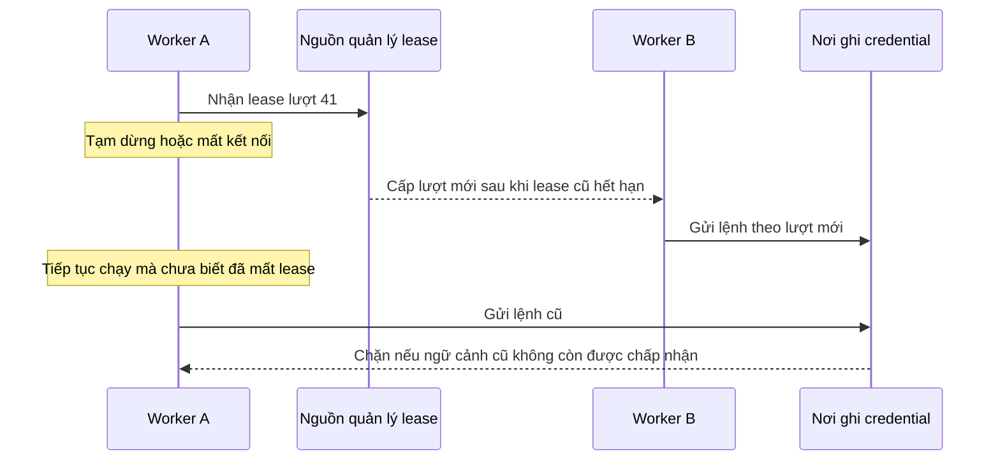

# Distributed lock strategy

## 1. Vì sao recovery cần phối hợp thao tác đồng thời?

Một yêu cầu khôi phục tài khoản có thể được xử lý bởi nhiều instance hoặc worker. Người dùng có thể mở hai tab, client có thể gửi lại sau timeout, và hàng đợi có thể giao cùng một lệnh nhiều lần. Đồng thời, nhân viên hỗ trợ có thể hủy hồ sơ hoặc một hệ thống khác có thể thu hồi phiên của tài khoản đó.

Nếu các thao tác không được phối hợp, hai request có thể cùng thấy một token chưa dùng rồi cùng đổi credential. Một worker cũ cũng có thể tiếp tục ghi sau khi worker mới đã tiếp quản công việc.

**Distributed lock strategy** là cách chọn phạm vi, nơi quản lý và vòng đời quyền thực thi độc quyền giữa những tiến trình khác nhau. Trong account recovery, chiến lược này phải phục vụ các bất biến như chỉ dùng một quyền thực thi một lần, không ghi đè credential mới bằng lệnh cũ và không bỏ qua hủy hoặc thu hồi có hiệu lực.

Khóa không tự chứng minh người gọi là chủ tài khoản. Nó cũng không tự làm một token hết hạn trở nên hợp lệ. Khóa chỉ là một thành phần của thiết kế đồng thời, bên cạnh phân quyền, transaction, phiên bản và idempotency.

## 2. Bắt đầu từ bất biến, không bắt đầu từ dịch vụ khóa

Trước khi chọn công nghệ, cần xác định những cuộc cạnh tranh nào thực sự không được cùng thành công.

| Tình huống | Bất biến cần bảo vệ |
|---|---|
| Hai request dùng cùng recovery token | Một quyền dùng một lần không tạo hai thay đổi ngoài phạm vi |
| Hai hồ sơ cùng thay một yếu tố | Kết quả cuối không bị lệnh cũ ghi đè trái chính sách |
| Thực thi cạnh tranh với hủy | Có điểm quyết định rõ cho việc lệnh còn được phép hay không |
| Worker mất lease rồi tiếp tục chạy | Worker không còn quyền không được ghi ngoài contract |
| Retry sau khi credential đã đổi | Trả kết quả operation cũ hoặc đối soát, không thực thi lại |
| Merge hoặc migration cạnh tranh với recovery | Thao tác vẫn gắn đúng chủ thể, phạm vi và phiên bản |

Không phải mọi công việc trên cùng tài khoản đều phải dùng cùng một khóa dài hạn. Hiển thị trạng thái, gửi thông báo và cập nhật bản chiếu có thể có cơ chế riêng. Nhưng các thao tác cùng ảnh hưởng một bất biến bảo mật phải gặp nhau tại một điểm kiểm soát có thẩm quyền.

Ví dụ, khóa theo token chỉ ngăn hai request dùng cùng token nếu cơ chế được thực thi đúng. Nó không ngăn hai token khác nhau của hai hồ sơ cùng đổi một mật khẩu. Nếu chính sách cần tuần tự hóa cả hai, phạm vi token là quá hẹp.

## 3. Phân biệt các lớp kiểm soát

| Cơ chế | Giải quyết chủ yếu | Không tự giải quyết |
|---|---|---|
| Lock | Giới hạn thao tác đồng thời trong phạm vi và vòng đời nhất định | Quyền của người gọi hoặc hiệu lực token |
| Transaction | Tính nguyên tử trong ranh giới dữ liệu hỗ trợ | Tác động ở mọi dịch vụ ngoài |
| Conditional update hoặc CAS | Chỉ ghi khi phiên bản hoặc trạng thái còn khớp | Phê duyệt có đúng nội dung không |
| Idempotency | Nhận diện cùng lệnh để tránh tạo thêm tác động | Hai lệnh khác nhau cùng xung đột |
| One-time consumption | Bảo đảm một quyền được sử dụng theo quy tắc | Mọi cuộc cạnh tranh trên cùng tài khoản |
| Fencing | Ngăn ngữ cảnh thực thi cũ ghi theo contract của nơi nhận | Tự động thu hồi một tác động đã commit |

Một triển khai an toàn thường kết hợp nhiều lớp. Ví dụ, distributed lease giảm việc hai worker cùng xử lý một job; transaction tại dịch vụ credential vẫn kiểm tra phiên bản tài khoản, tiêu thụ quyền và lưu kết quả operation nguyên tử.

Không nên xem lease là lý do để bỏ các điều kiện tại nơi ghi. Mất kết nối, tiến trình bị tạm dừng hoặc lỗi gia hạn có thể làm giả định “chỉ có một worker đang chạy” không còn đúng.

## 4. Chọn điểm quyết định có thẩm quyền

Nếu thay đổi credential, tiêu thụ quyền thực thi và lưu operation nằm trong cùng một cơ sở dữ liệu, row lock hoặc cập nhật có điều kiện thường là cách trực tiếp để bảo vệ điểm commit.

Trong mô hình đó, nhiều instance ứng dụng vẫn được phối hợp qua cùng nguồn dữ liệu. Không nhất thiết cần thêm một dịch vụ distributed lock chỉ vì ứng dụng có nhiều instance.

Nếu quy trình đi qua nhiều dịch vụ, có thể dùng lease để điều phối worker, nhưng từng dịch vụ sở hữu tác động phải kiểm tra contract tại nơi của mình. Giữ một khóa ở bộ điều phối không tạo transaction bao phủ dịch vụ danh tính, dịch vụ phiên và nhà cung cấp thông báo.

Một cách phân chia dễ hiểu là:

```text
Điều phối công việc:
    lease hoặc quyền nhận job

Quyết định thay credential:
    transaction, phiên bản và quyền thực thi tại dịch vụ sở hữu credential

Phối hợp các bước tiếp theo:
    operation có định danh, sự kiện bền vững và kết quả có thể đối soát
```

Mỗi lớp cần có trách nhiệm rõ. Nếu khóa điều phối chỉ là tối ưu vận hành, mất khóa không được làm mất tính đúng đắn ở lớp credential. Nếu một khóa là điều kiện an toàn bắt buộc, hệ thống phải từ chối thao tác khi không chứng minh được quyền giữ khóa theo contract.

## 5. Phạm vi và định danh khóa

Khóa nên gắn với tài nguyên hoặc miền bất biến ổn định, không với thuộc tính có thể thay đổi như email hay tên hiển thị.

Một dạng định danh minh họa:

```text
environment / authority-domain / resource-kind / stable-subject-reference
```

Các phần cần do máy chủ giải quyết từ dữ liệu có thẩm quyền. Không để client tùy ý chọn một lock key khác để tránh khóa đang bảo vệ cùng tài nguyên.

### 5.1. Khóa theo tài khoản hoặc chủ thể bảo mật

Phù hợp khi các hành động recovery có thể tác động tới cùng credential, phiên bản bảo mật hoặc tập phiên. Nó giúp các loại thao tác khác nhau gặp nhau tại cùng một guard.

Tuy nhiên, không được lấy tenant làm phạm vi duy nhất nếu credential dùng chung toàn danh tính. Một người thuộc tenant A và B có thể có hai case khác nhau nhưng cùng tác động tới một credential nền tảng. Hai khóa `A/account` và `B/account` sẽ không loại trừ nhau nếu thực chất cần bảo vệ cùng đối tượng.

### 5.2. Khóa theo case hoặc operation

Phù hợp để tránh hai worker cùng xử lý một bước của hồ sơ. Nó không thay khóa hoặc điều kiện tại tài nguyên cuối nếu các case khác nhau có thể xung đột.

### 5.3. Khóa toàn tenant hoặc toàn hệ thống

Phạm vi quá rộng có thể làm một tài khoản bị tấn công gây nghẽn recovery của nhiều người. Chỉ sử dụng khi bất biến thực sự ở phạm vi đó và đã đánh giá tác động vận hành. Không khóa toàn tenant chỉ vì dễ tạo key hơn.

## 6. Quyền sở hữu khóa và giải phóng có điều kiện

Một khóa dạng lease cần nhận diện lượt sở hữu, không chỉ có một boolean `locked=true`.

Handle minh họa:

```text
lockReference
ownerToken
fencingToken
acquiredAt
leaseDeadline
boundOperationReference
```

`ownerToken` phân biệt lượt giữ khóa. Nó có thể là một giá trị khó đoán do hệ thống tạo và được bảo vệ phù hợp nếu có thể dùng để gia hạn hoặc giải phóng khóa. Không dùng một tên worker cố định cho mọi lần acquire.

Giải phóng phải kiểm tra nguyên tử rằng lượt sở hữu hiện tại vẫn khớp ownerToken. Một chuỗi đọc rồi xóa tách rời có thể xảy ra như sau:

1. Worker A đọc thấy mình vẫn là chủ.
2. Lease A hết hạn và worker B nhận khóa mới.
3. A gửi xóa, vô tình xóa khóa của B.

Do đó cần thao tác release có điều kiện ở nguồn quản lý khóa, không phải `get`, so sánh trong ứng dụng rồi `delete` tùy ý. Gia hạn cũng phải có kiểm tra sở hữu tương ứng.

Một worker nhận thông báo release thất bại không nên cố xóa cưỡng bức để “dọn khóa”. Thất bại có thể là bằng chứng lượt sở hữu đã thay đổi.

## 7. Lease hết hạn không có nghĩa worker đã dừng

Lease là quyền giữ khóa có thời hạn. Tiến trình có thể bị tạm dừng, mất mạng hoặc xử lý chậm hơn thời gian dự kiến. Trong lúc đó, nguồn khóa có thể cho worker khác tiếp quản.



Nếu nơi ghi không kiểm tra được quyền thực thi hiện tại, cả A và B có thể ghi. Việc nguồn khóa chỉ hiển thị một chủ tại mỗi thời điểm không chứng minh chỉ một tiến trình đang gây tác động.

Worker nên dừng công việc khi biết mất lease, nhưng đây là phản ứng hợp tác. Để bảo vệ trước worker chậm hoặc thông báo bị mất, cần kiểm soát tại nơi nhận ghi.

Không dùng đồng hồ cục bộ của worker như bằng chứng duy nhất về lease. Tiến trình có thể quan sát thời gian không chính xác hoặc bị trì hoãn giữa lần kiểm tra và lúc ghi. Contract phải xác định nơi nào quyết định hiệu lực và ở điểm nào.

## 8. Fencing token: tác dụng và giới hạn

Fencing thường dùng một thế hệ hoặc số thứ tự lượt thực thi do nguồn có thẩm quyền cấp. Nơi ghi giữ mốc đã chấp nhận và từ chối ngữ cảnh thấp hơn theo cơ chế nguyên tử phù hợp.

Ví dụ, sau khi nơi ghi đã chấp nhận lượt 42, một lệnh từ lượt 41 không được phép ghi đè kết quả mới. Số lượt không phải quyền của người dùng; phân quyền và kiểm tra nội dung vẫn cần được thực hiện.

Một fencing token chỉ hữu ích khi:

- Được cấp theo contract bảo đảm thứ tự hoặc thế hệ cần thiết.
- Gắn với đúng miền tài nguyên.
- Không bị tái sử dụng ngoài ý định sau sự cố hoặc restore.
- Được nơi thực hiện tác động kiểm tra cùng với thay đổi cần bảo vệ.
- Có quy tắc rõ cho lệnh lặp trong cùng lượt.

Chỉ kiểm tra “không nhỏ hơn mốc đã thấy” có một giới hạn quan trọng: nếu lượt 42 vừa được cấp nhưng chưa tới nơi ghi, nơi đó có thể vẫn chưa biết phải từ chối 41. Cơ chế này không tự bảo đảm mọi lệnh của 41 bị chặn ngay tại khoảnh khắc lease hết hạn.

Nếu yêu cầu là hủy quyền cũ có hiệu lực tại điểm cấp lượt mới hoặc tại một điểm commit cụ thể, cần cơ chế phối hợp đủ mạnh: chẳng hạn nơi ghi tham gia kích hoạt quyền thực thi mới, hoặc quyền thực thi được quản lý cùng guard có thẩm quyền tại nơi ghi. Không gán ý nghĩa mạnh hơn những gì giao thức thực sự bảo đảm.

Với token bằng nhau, cũng không được cho phép mọi payload ghi lại tùy ý. Lệnh lặp phải khớp operation và digest đã ràng buộc; nhiều hành động trong cùng lượt cần contract riêng.

## 9. Giữ phần được khóa ngắn và có giới hạn

Không giữ khóa trong suốt thời gian người dùng đọc hướng dẫn, nhập OTP, cung cấp giấy tờ hoặc chờ reviewer. Các bước này có thể kéo dài và không phù hợp với một vùng độc quyền trên tài khoản.

Một thiết kế thường tách:

1. Thu thập bằng chứng và tạo quyết định có phạm vi, thời hạn, phiên bản.
2. Chuẩn bị dữ liệu tốn tài nguyên nhưng chưa ghi tác động.
3. Vào vùng quyết định ngắn, kiểm tra lại điều kiện hiện tại và commit.
4. Phát các bước tiếp theo bằng cơ chế bền vững phù hợp.

Ví dụ, tính toán một giá trị credential mới có thể được chuẩn bị trước khi lấy row lock, nhưng phải gắn kết quả với đúng lệnh được xác nhận. Không để một tham số nhạy cảm bị thay đổi sau lúc tính digest rồi vẫn dùng approval cũ.

Nếu cần gọi dịch vụ ngoài trong vùng được bảo vệ, phải hiểu độ trễ và khả năng thất bại. Giữ một transaction mở trong khi chờ nhiều lời gọi mạng có thể gây nghẽn và deadlock. Có thể cần quyền thực thi hạn chế hoặc một operation bền vững thay vì kéo dài khóa.

Lease dài giảm số lần gia hạn nhưng làm chậm tiếp quản khi worker chết. Lease ngắn giảm thời gian chờ nhưng làm tăng khả năng mất lease trong xử lý bình thường. Không có một thời lượng cố định phù hợp cho mọi luồng; cần dựa trên công việc và cơ chế chặn worker cũ.

## 10. Kết hợp khóa với tiêu thụ token và idempotency

Idempotency giúp nhận diện cùng một lệnh. Khóa giúp phối hợp những lệnh có thể cạnh tranh. Cả hai phải được ràng buộc với thẩm quyền và tài nguyên thực sự.

Một kết quả operation nên cho biết tenant hoặc miền thẩm quyền, chủ thể, loại hành động, digest nội dung và định danh lệnh. Cùng idempotency key nhưng khác target hoặc payload phải bị từ chối xung đột.

Với token dùng một lần, cần lưu kết quả tiêu thụ và tác động phù hợp trong cùng ranh giới nguyên tử, hoặc dùng giao thức có trạng thái rõ nếu chúng ở các nơi khác nhau.

Không thực hiện theo cách:

```text
Acquire distributed lock
Đọc token chưa dùng
Gọi dịch vụ đổi mật khẩu
Đánh dấu token đã dùng
Release lock
```

Chuỗi trên vẫn có khoảng hở nếu đổi mật khẩu đã commit nhưng phản hồi mất, hoặc lease hết hạn trước lúc đánh dấu token. Distributed lock không biến những bước rời rạc thành một transaction.

Một contract tốt cho dịch vụ credential có thể tiếp nhận operation có định danh, kiểm tra quyền thực thi, thay credential và ghi kết quả có thể tra cứu. Khi retry, bên điều phối hỏi lại operation cũ thay vì cấp thêm một quyền mới.

## 11. Ví dụ điểm commit trong cùng cơ sở dữ liệu

Pseudocode sau minh họa trường hợp guard tài khoản, quyền thực thi, credential và operation ở cùng một ranh giới transaction. Những nguồn phân quyền ngoài cần được chuyển thành contract phù hợp hoặc kiểm tra bằng cơ chế đủ mạnh cho yêu cầu thực tế.

```java
RecoveryResult executeRecovery(PreparedRecoveryCommand command,
                               AuthenticatedActor actor) {
    requestValidation.requireStructurallyValid(command);
    authorization.requireAllowedRequest(actor, command);

    return transaction.run(() -> {
        SecurityGuard guard = guards.lockForUpdate(command.securitySubject());
        authorization.requireCurrentAuthority(actor, guard, command);

        OperationResult previous = operations.findBoundResult(
            command.operationId());
        if (previous != null) {
            require(previous.matchesActorScopeAndDigest(actor, command));
            return previous.result();
        }

        require(guard.version() == command.expectedSecurityVersion());
        require(guard.allowsRecoveryAction(command.action()));

        ExecutionGrant grant = grants.lockForUpdate(command.grantReference());
        grant.requireBoundTo(command, actor);
        grant.requireUnusedAndUnexpired(clock.now());
        grant.requireCurrentAuthorizationUnderContract(guard);

        grant.consume(clock.now());
        credentials.applyPreparedChange(command);
        guard.advanceSecurityVersion();

        RecoveryResult result = operations.recordCommitted(command, guard.version());
        outbox.appendCredentialChangedAndRequiredEffects(command, result);
        return result;
    });
}
```

Trong ví dụ, các request cạnh tranh cùng gặp guard của chủ thể bảo mật. Sau khi request đầu commit, request thứ hai sẽ thấy operation đã có kết quả hoặc phiên bản đã thay đổi. Một token khác không tự vượt được kiểm tra phiên bản chỉ vì nó có một idempotency key mới.

Ràng buộc duy nhất tại kho operation vẫn cần thiết cho định danh lệnh. Những đường ghi khác phải cùng tuân theo guard hoặc điều kiện tương đương; một endpoint hỗ trợ cũ bỏ qua cơ chế này có thể phá bất biến.

Nếu credentials nằm ở dịch vụ khác, không thể sao chép pseudocode rồi giả định transaction cục bộ bao phủ lời gọi mạng. Cần đặt điểm quyết định tại dịch vụ thực thi hoặc thiết kế giao thức operation xuyên dịch vụ với kết quả và lỗi rõ ràng.

## 12. Cancellation, thu hồi và thay đổi quyền cạnh tranh với thực thi

Một yêu cầu có thể bị hủy sau khi worker đã nhận job. Kiểm tra `cancelled=false` ở đầu rồi thực hiện nhiều giây sau không tự bảo đảm hủy có hiệu lực ở điểm commit.

Cần xác định thứ tự có thẩm quyền giữa hủy và thực thi. Nếu cùng guard và ranh giới transaction quản lý cả hai, một thao tác được tuần tự hóa trước và thao tác sau quan sát kết quả đó. Nếu ở các dịch vụ khác nhau, cần cơ chế phối hợp đáp ứng ngữ nghĩa mong muốn.

Phân biệt:

- Hủy trước điểm quyết định có hiệu lực: lệnh không được thực hiện.
- Hủy sau khi thay đổi đã commit: không thể tuyên bố chưa có thay đổi; có thể cần một hành động bảo mật tiếp theo.
- Chưa biết thứ tự do timeout: đối soát operation thay vì suy đoán.

Lease của worker không phải phê duyệt và không gia hạn quyền. Một worker còn giữ khóa vẫn phải từ chối grant hết hạn hoặc quyền của actor đã không còn được chấp nhận theo contract.

Ngược lại, mất lease sau khi commit không làm credential tự quay về giá trị cũ. Kết quả operation cần được giữ để bên tiếp quản biết điều gì đã xảy ra.

## 13. Khóa nhiều tài nguyên và tránh deadlock

Một số luồng như merge, migration hoặc chuyển quan hệ có thể liên quan hai tài khoản. Nếu worker A giữ khóa X rồi chờ Y, còn worker B giữ Y rồi chờ X, hệ thống có thể mắc kẹt.

Một chiến lược là xác định thứ tự khóa ổn định theo định danh chuẩn và mọi đường thực thi đều tuân theo. Không dựa vào source hoặc target để quyết định thứ tự vì hai lệnh có thể đảo hướng.

```text
resolve authoritative resource references
    → sort by a stable total order
    → acquire in that order
    → validate all current conditions
    → commit or release according to the contract
```

Thứ tự cần xét cả những loại khóa hoặc bảng liên quan nếu transaction có nhiều guard. Chỉ sắp xếp hai account ID nhưng các dịch vụ lấy khóa phụ theo thứ tự ngược vẫn có thể tạo deadlock.

Lock timeout và cơ chế phát hiện deadlock giúp thoát khỏi tình huống mắc kẹt, không thay thế thiết kế thứ tự. Khi retry một transaction bị hủy, giữ nguyên nhận diện lệnh và kiểm tra lại trạng thái; không tự cấp một quyền thực thi mới.

Với nhiều dịch vụ không có khóa nguyên tử chung, việc lấy lần lượt nhiều lease có thể gây khóa từng phần. Cần quy trình giải phóng, thời hạn và điều kiện thực thi rõ, hoặc đổi mô hình để một nơi sở hữu quyết định tổng thể theo contract phù hợp.

## 14. Timeout và lỗi mạng không chứng minh khóa hay tác động đã mất

Acquire timeout có thể nghĩa request chưa được xử lý hoặc nguồn khóa đã cấp nhưng phản hồi bị mất. Gia hạn timeout có thể để worker không biết lease còn hiệu lực. Timeout khi ghi credential có thể xảy ra sau commit.

| Lỗi quan sát được | Điều không được suy ra ngay |
|---|---|
| Không nhận phản hồi acquire | Chắc chắn không có lượt khóa nào được cấp |
| Gia hạn không có phản hồi | Lease chắc chắn còn hiệu lực |
| Không release được | Có thể xóa mọi khóa của tài nguyên |
| Đổi credential timeout | Credential chắc chắn chưa đổi |
| Worker chết | Mọi tác động trước đó đều rollback |

API khóa và operation nên có định danh để tra cứu hoặc giải quyết trạng thái chưa rõ theo contract. Nếu không thể xác nhận quyền thực thi bắt buộc, worker dừng bước nhạy cảm; không tự kéo dài lease bằng suy đoán.

Retry nên có backoff, jitter, giới hạn thời gian và kiểm tra hạn của quyền nghiệp vụ. Việc tiếp tục chờ khóa không làm proof hoặc approval có thêm thời gian sử dụng.

Không yêu cầu người dùng tạo token mới chỉ để né lỗi operation chưa rõ. Nếu lệnh cũ có thể đã commit, tạo lệnh mới ngay có thể làm hệ thống thực hiện thêm thay đổi ngoài ý định.

## 15. Khả dụng và chống lạm dụng khóa

Một kẻ tấn công có thể cố chiếm vùng khóa của tài khoản nạn nhân bằng nhiều request không hợp lệ. Nếu mỗi request đều lấy khóa rồi mới kiểm tra dữ liệu cơ bản, khóa trở thành công cụ gây từ chối dịch vụ.

Cần thực hiện những bước kiểm tra phù hợp trước vùng độc quyền: định dạng, phạm vi request, giới hạn tốc độ và các xác minh có thể làm mà chưa gây tác động. Tại điểm ghi vẫn kiểm tra lại các điều kiện cần tính hiện thời; kiểm tra trước không thay kiểm tra cuối.

Không giữ khóa trong khi gửi email hoặc chờ người dùng. Hạn chế số lần thử, độ dài hàng chờ và mức song song theo chủ thể hoặc miền cần thiết giúp tránh một tài khoản nóng làm nghẽn toàn bộ dịch vụ.

Thông báo cho client cũng cần tránh lộ trạng thái nội bộ nhạy cảm. Một phản hồi cho biết chính xác tài khoản đang có recovery ở tenant khác có thể hỗ trợ dò thông tin. Có thể trả trạng thái chờ hoặc retry phù hợp mà không công khai chi tiết không được phép.

Nếu dịch vụ lease tạm lỗi, cách xử lý phụ thuộc vai trò đã định của nó. Nếu lease là điều kiện an toàn duy nhất mà contract yêu cầu, không được thực thi khi thiếu xác nhận. Nếu lease chỉ giảm trùng và điểm commit vẫn được bảo vệ độc lập, một đường xử lý khác chỉ hợp lệ khi đã được thiết kế và giới hạn rõ, không phải fallback tùy hứng bỏ khóa.

## 16. Quan sát và audit quyền thực thi

Những chỉ số có ích gồm thời gian chờ khóa, tỷ lệ timeout, số lần mất lease, số lần bị fencing từ chối, xung đột phiên bản và operation chưa rõ kết quả. Cần xem theo phạm vi vận hành phù hợp, tránh đưa email hoặc account ID vào nhãn metrics có quyền đọc rộng.

Audit một thao tác nhạy cảm nên nối được case, operation, actor, chủ thể bảo mật, phiên bản guard và kết quả commit. Có thể có tham chiếu lượt lease hoặc fencing token nếu cần điều tra, nhưng không ghi ownerToken bí mật nếu nó cho phép điều khiển khóa.

Các sự kiện có thể phân biệt:

```text
RECOVERY_WORK_CLAIMED
RECOVERY_LEASE_LOST
RECOVERY_STALE_EXECUTION_REJECTED
RECOVERY_SECURITY_VERSION_CONFLICTED
RECOVERY_OPERATION_COMMITTED
RECOVERY_OPERATION_RESULT_RECONCILED
```

Một sự kiện acquire thành công không chứng minh thay credential thành công. Một sự kiện lease hết hạn cũng không chứng minh không có tác động. Kết quả tại nơi sở hữu credential mới là căn cứ về việc thay đổi đã commit.

Đối soát cần tìm job mắc kẹt, lease không còn phù hợp và operation đã có kết quả nhưng bộ điều phối chưa biết. Nó không tự bỏ qua phê duyệt hay mở lại token chỉ để làm trạng thái hiển thị đẹp hơn.

## 17. Tình huống tổng hợp: worker cũ quay lại sau khi mất lease

Một người dùng mất điện thoại MFA và đã hoàn tất các bước xác minh. Bộ điều phối tạo operation R, gắn với hành động đăng ký lại MFA và phiên bản bảo mật 12 của tài khoản.

Worker A nhận lease để xử lý R rồi bị tạm dừng. Lease hết hạn và worker B tiếp quản. B gửi cùng operation tới dịch vụ credential. Dịch vụ này kiểm tra quyền, khóa guard tài khoản, tiêu thụ grant, ghi thay đổi và lưu kết quả của R cùng phiên bản bảo mật mới.

A tiếp tục chạy và gửi lại R. Dịch vụ credential xác nhận request vẫn có quyền nhận kết quả, kiểm tra nội dung khớp và trả kết quả đã lưu. Nó không đăng ký lại MFA lần nữa chỉ vì request đến từ một worker khác.

Nếu A mang một lệnh khác dựa trên phiên bản bảo mật 12, guard hiện tại phát hiện phiên bản không còn khớp. Lệnh phải được đánh giá lại theo quy trình, không ghi đè kết quả B.

Nếu thiết kế còn dùng fencing token, nơi ghi áp dụng contract của token đó để chặn ngữ cảnh cũ. Nhưng tính đúng đắn không chỉ dựa vào việc A tự nhận biết đã mất lease; điểm commit vẫn có các ràng buộc bền vững.

Nếu phản hồi cho B bị mất sau commit, bộ điều phối tra cứu R. Nó không cấp một grant mới và không khôi phục trạng thái chưa dùng của grant ban đầu chỉ vì thấy timeout.

## 18. Những lỗi chiến lược khóa thường gặp

| Lỗi | Hệ quả | Hướng thiết kế phù hợp |
|---|---|---|
| Khóa theo token nhưng bỏ qua xung đột tài khoản | Hai token khác nhau cùng thay credential | Guard theo miền bất biến thực sự |
| Chỉ dùng mutex trong một instance | Instance khác vẫn ghi song song | Phối hợp qua nguồn dữ liệu hoặc contract chung |
| Lease hết hạn được coi là worker đã dừng | Worker cũ tiếp tục gây tác động | Kiểm soát tại nơi ghi và fencing theo contract |
| Release bằng đọc rồi xóa | Xóa khóa của lượt sở hữu mới | Release nguyên tử có điều kiện sở hữu |
| Fencing token chỉ được ghi vào log | Không ngăn được lệnh cũ | Kiểm tra cùng thao tác ghi tại nơi thực thi |
| Mốc fencing được coi là thu hồi tức thời ở mọi nơi | Tin sai về điểm hiệu lực khi nơi ghi chưa thấy lượt mới | Định nghĩa và thực thi ranh giới kích hoạt quyền |
| Giữ khóa lúc người dùng nhập OTP | Gây nghẽn và tạo đường từ chối dịch vụ | Tách chuẩn bị khỏi vùng quyết định ngắn |
| Distributed lock thay cho transaction | Có khoảng hở giữa đổi credential và tiêu thụ quyền | Phối hợp nguyên tử hoặc operation có giao thức rõ |
| Retry luôn tạo operation mới | Tạo nhiều thay đổi từ một ý định | Giữ nhận diện lệnh và tra cứu kết quả |
| Tenant lock bảo vệ credential toàn danh tính | Hai tenant vẫn có thể tác động cùng tài nguyên | Khóa theo phạm vi chủ thể có thẩm quyền |

Chiến lược khóa trong recovery cần bảo vệ đúng tài nguyên và đúng điểm quyết định, đồng thời chịu được lease hết hạn, worker chậm và phản hồi bị mất. Khóa điều phối giúp giảm cạnh tranh; quyền thực thi, phiên bản, tiêu thụ dùng một lần và kết quả operation bền vững mới tạo thành cơ chế đầy đủ để thay mật khẩu, MFA hoặc passkey an toàn.
