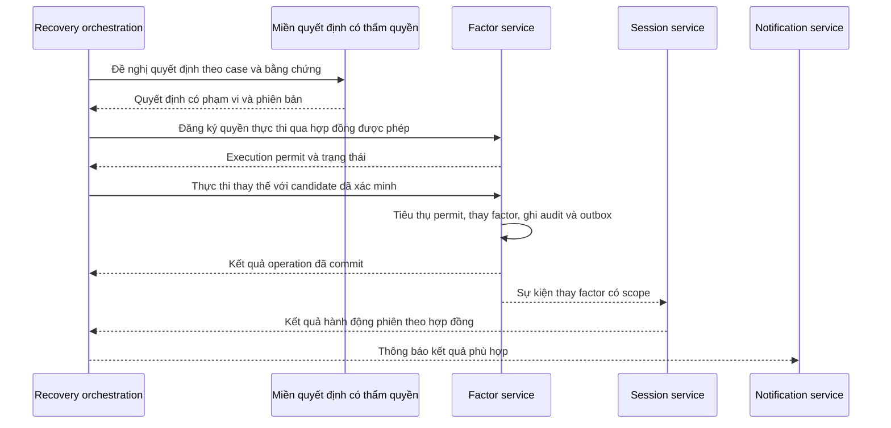

# Factor service responsibility

## 1. Factor service nằm ở đâu trong quy trình recovery?

Khi người dùng mất điện thoại chứa MFA, passkey hoặc thiết bị xác thực cuối cùng, hệ thống cần quyết định có cho phép khôi phục hay không, rồi thực hiện thay đổi đúng yếu tố xác thực. Hai việc đó liên quan nhưng không có cùng trách nhiệm.

**Factor service** là thành phần có thẩm quyền quản lý các yếu tố xác thực mà kiến trúc giao cho nó: dữ liệu đăng ký, trạng thái, ràng buộc với chủ thể, xác minh bằng yếu tố và các chuyển trạng thái bảo mật trong vòng đời.

Trong `SECURITY_AUTHENTICATION_ACCOUNT_RECOVERY`, factor service bảo đảm một thay đổi đã được cho phép chỉ tác động tới đúng factor, đúng tài khoản, đúng phạm vi và đúng phiên bản. Nó không tự kết luận người liên hệ hỗ trợ là chủ tài khoản chỉ vì yêu cầu có câu “xin gỡ MFA”.

Tùy kiến trúc, password có thể thuộc credential service riêng, còn factor service quản lý MFA và passkey. Bài học sử dụng cách phân chia đó để minh họa; điều quan trọng là mỗi loại dữ liệu có một chủ thể ghi chính thức, không phải mọi sản phẩm phải có cùng tên microservice.

Tách trách nhiệm không nhất thiết đòi hỏi triển khai nhiều tiến trình. Trong một monolith có module rõ ràng, các ranh giới sở hữu và bất biến tương tự vẫn cần được giữ.

## 2. Những gì factor service sở hữu

Các trách nhiệm cốt lõi có thể gồm:

| Trách nhiệm | Nội dung |
|---|---|
| Registry factor | Biết factor nào gắn với chủ thể và phạm vi xác thực nào |
| Vòng đời | Tạo đăng ký chờ, xác minh, kích hoạt, đình chỉ hoặc thu hồi theo hợp đồng |
| Xác minh sử dụng factor | Kiểm tra bằng chứng mật mã hoặc mã hợp lệ cho mục đích được giao |
| Thực thi thay thế | Thay factor cũ bằng factor mới theo quyền recovery hợp lệ |
| Kiểm soát đồng thời | Ngăn request cũ, request trùng hoặc hai lần thay thế xung đột |
| Bảo vệ vật liệu xác thực | Lưu hoặc tham chiếu bí mật, khóa và metadata theo loại factor |
| Audit và sự kiện | Ghi sự thật về đăng ký, thu hồi và thay đổi đã hoàn tất |

Factor service cần phân biệt **quyền thực hiện thay đổi** với **bằng chứng rằng factor mới hoạt động**. Một người tấn công hoàn toàn có thể tạo một passkey hợp lệ trên thiết bị của họ. Việc hoàn thành ceremony đăng ký passkey mới không tự chứng minh họ được quyền thay passkey của nạn nhân.

Tương tự, một quyết định recovery hợp lệ không tự bảo đảm factor mới đã được đăng ký đúng. Hệ thống vẫn phải hoàn thành các bước kiểm tra phương thức mới trước khi kích hoạt.

## 3. Những gì không nên tự quyết định

Một cách phân chia trách nhiệm minh họa:

| Thành phần | Có thẩm quyền chính với | Không tự suy diễn |
|---|---|---|
| Recovery orchestration | Case, tiến trình và phối hợp các bước | Không ghi trực tiếp bí mật hoặc trạng thái factor |
| Identity proofing hoặc risk service | Kết quả xác minh, tín hiệu và đánh giá theo phạm vi | Không tự kích hoạt factor |
| Approval hoặc authorization domain | Quyết định và quyền thay đổi có phạm vi | Không coi mọi trạng thái đã duyệt là mọi thay đổi đều được phép |
| Factor service | Factor và việc thực thi thay đổi thuộc miền của nó | Không tự xác minh danh tính bằng câu chuyện hỗ trợ |
| Session service | Phiên, refresh token và cơ chế thu hồi tương ứng | Không suy ra mọi yêu cầu factor đều cần đăng xuất toàn tài khoản |
| Notification service | Giao thông báo theo tuyến được phép | Không dùng kết quả gửi email làm quyết định recovery |

Factor service không nên quản lý toàn bộ ticket hỗ trợ, đọc mọi giấy tờ, chọn người phê duyệt hoặc thay chính sách tenant. Nó có thể cần tham chiếu tới quyết định và policy để kiểm tra quyền thực thi, nhưng không cần sao chép toàn bộ hồ sơ nhạy cảm.

Ngược lại, không được hiểu rằng “dịch vụ khác đã duyệt” thì factor service bỏ mọi kiểm tra. Điểm thực thi vẫn phải kiểm tra quyền gọi, mục đích, scope, hiệu lực, trạng thái thu hồi và các điều kiện cục bộ bắt buộc.

## 4. Ràng buộc factor với chủ thể và phạm vi

Một factor không chỉ có mã định danh và loại. Nó cần gắn với miền danh tính cụ thể:

```text
factor_reference
subject_reference
identity_scope_reference
factor_type
lifecycle_state
factor_version
enrollment_reference
created_at / activated_at / revoked_at
method_specific_metadata
```

`identity_scope_reference` có thể biểu diễn tài khoản cục bộ của tenant hoặc principal toàn cục, tùy sản phẩm. Không lấy tenant đang chọn trên giao diện làm bằng chứng factor thuộc tenant đó.

Ví dụ: một principal dùng passkey chung để vào nhiều tổ chức. Quản trị viên tổ chức A có quyền phục hồi membership của A không mặc nhiên có quyền thay passkey toàn cục đó. Factor service phải thực thi đúng scope của factor và quyền thay đổi.

Mã factor nên ổn định trong vòng đời của bản đăng ký. Khi thay thế, thường cần một bản đăng ký mới với định danh riêng, thay vì ghi đè bí mật trong factor cũ rồi làm mất lịch sử. Dữ liệu cũ được giữ hoặc hủy theo chính sách tương ứng, nhưng không bị trình bày như vẫn là cùng một phiên bản không đổi.

Trong dữ liệu nhiều tenant, truy vấn, liên kết và cache đều cần giữ phạm vi. Một `factorId` tồn tại trong hệ thống không tự chứng minh người gọi được phép tác động tới nó.

## 5. Vòng đời: đăng ký chờ khác factor đang hoạt động

Một mô hình đơn giản có thể là:

```text
PENDING_ENROLLMENT
        |
        v
VERIFIED_PENDING_ACTIVATION
        |
        v
      ACTIVE ------> REVOKED
        |
        v
     SUSPENDED
```

Các trạng thái chỉ minh họa. Mỗi chuyển trạng thái cần hợp đồng rõ ràng, đặc biệt việc phục hồi từ `SUSPENDED` có thể cần điều kiện khác với tạo mới.

Một candidate đã hoàn tất kiểm tra đăng ký có thể vẫn chưa được dùng đăng nhập vì quyền thay thế chưa được thực thi. Không để một secret vừa tạo trong luồng recovery trở thành factor hoạt động chỉ vì người dùng đã quét QR hoặc gửi một mã đúng.

Factor bị thu hồi không tự được kích hoạt lại khi người dùng mở một trang cũ, retry request hoặc khi một sự kiện chậm tới. Muốn đăng ký lại phải dùng quy trình hợp lệ với trạng thái mới.

Nếu sản phẩm yêu cầu luôn có ít nhất một phương thức xác thực mạnh sau thay đổi, invariant đó phải được kiểm tra tại miền thực thi phù hợp. Không thu hồi phương thức cuối trước rồi hy vọng bước kích hoạt phương thức mới chắc chắn thành công.

## 6. Dữ liệu theo loại factor

### TOTP và mã dự phòng

Đối với TOTP, dịch vụ có thể cần sử dụng shared secret để xác minh. Secret cần được mã hóa hoặc bảo vệ qua cơ chế quản lý khóa thích hợp; không ghi vào audit, sự kiện công khai hoặc log request.

Mã dự phòng dùng một lần cần giá trị kiểm chứng và trạng thái tiêu thụ theo thiết kế. Nếu chỉ cần kiểm tra mã người dùng đưa lại, tránh lưu bản rõ có thể đọc lại không cần thiết. Dùng một mã thành công phải được ghi nhất quán để hai request đồng thời không cùng dùng được nó.

Cửa sổ thời gian, hạn mức thử và cơ chế chống replay cần thuộc hợp đồng của verifier. Không để mỗi service gọi tự chọn một cửa sổ rộng khác nhau.

### Passkey hoặc public-key authenticator

Factor service thường quản lý public key cùng credential identifier và metadata cần để kiểm tra ceremony. Private key thuộc authenticator theo mô hình phương thức, không phải dữ liệu backend cần yêu cầu người dùng gửi để recovery.

Các kiểm tra như challenge, ngữ cảnh relying party, origin và yêu cầu xác minh người dùng phải được thực hiện theo hợp đồng giao thức và chính sách sản phẩm. Không chỉ lưu một public key do client đưa rồi xem đó là đăng ký hợp lệ.

Metadata như bộ đếm hoặc trạng thái đồng bộ cần được diễn giải theo loại authenticator và giao thức. Không áp một giả định cứng rằng mọi bộ đếm không tăng đều chắc chắn là tấn công, cũng không bỏ qua toàn bộ tín hiệu bất thường.

### Thiết bị hoặc yếu tố do bên ngoài quản lý

Nếu factor thực chất do một IdP hoặc dịch vụ khác làm chủ, cần phân biệt registry liên kết với quyền sửa yếu tố gốc. Factor service của ứng dụng không được giả vờ đã gỡ MFA tại IdP chỉ vì nó xóa một dòng liên kết cục bộ.

## 7. Hợp đồng thay factor trong recovery

Một command thay thế cần đủ cụ thể để ngăn mở rộng quyền:

```json
{
  "operationRef": "operation_example_462",
  "executionPermitRef": "permit_example_89",
  "caseRef": "case_example_316",
  "decisionRef": "decision_example_72",
  "identityScopeRef": "tenant-account-scope-example",
  "subjectRef": "account_example_48",
  "action": "REPLACE_FACTOR",
  "oldFactorRef": "factor_example_old",
  "candidateEnrollmentRef": "enrollment_example_new",
  "expectedAuthenticationVersion": 19
}
```

Các tham chiếu không phải bằng chứng tự thân. Workload gọi phải được xác thực và được phép gửi loại command đó; quyền thực thi cần được kiểm chứng qua cơ chế được kiến trúc quy định.

Những điều kiện tại điểm thực thi thường gồm:

1. Permit đúng audience, action, subject và identity scope.
2. Permit còn hiệu lực, chưa thu hồi, chưa tiêu thụ hoặc đã gắn với chính lần retry này.
3. Quyết định gắn với đúng nội dung được phép, không chỉ một cờ `approved=true`.
4. Factor cũ thuộc chủ thể và đang ở trạng thái được phép thay.
5. Candidate mới thuộc đúng phiên đăng ký và đã hoàn tất kiểm tra cần thiết.
6. Các phiên bản trạng thái liên quan vẫn khớp với điều kiện cấp quyền.
7. Loại factor mới và cách chuyển đổi được policy cho phép.
8. Không có request khác đã thực hiện thay đổi xung đột trước đó.

Command đề nghị thay một factor không tự cho phép xóa mọi factor, đổi email và reset mật khẩu. Một service tài khoản hỗ trợ chung không nên có endpoint “bỏ mọi xác thực” để các hệ thống khác gọi tùy ý.

## 8. Tính nguyên tử thuộc ranh giới nào?

Đây là điểm dễ sai trong kiến trúc microservice: kiểm tra một grant ở service A rồi cập nhật factor ở service B không tự trở thành một giao dịch nguyên tử.

Nếu A trả “còn hiệu lực”, sau đó permit bị hủy trước khi B thực thi, một phép kiểm tra từ xa thông thường có thể để lại khoảng đua. Ngược lại, A đánh dấu đã dùng rồi B lỗi có thể để workflow chưa thay factor nhưng quyền không còn dùng được theo cách đơn giản.

Một phương án là đặt bản ghi quyền thực thi cuối cùng trong miền giao dịch của factor service. Quyết định được chuyển qua hợp đồng có thẩm quyền để tạo một execution permit có phạm vi; factor service quản lý trạng thái sử dụng permit đó cùng thay đổi factor.

Trong phương án này:

- Tiêu thụ permit, thu hồi factor cũ, kích hoạt candidate và ghi audit hoặc outbox có thể nằm trong cùng giao dịch cục bộ.
- Yêu cầu hủy permit cũng phải được thực thi tại cùng nguồn trạng thái đó.
- Recovery orchestration không được tuyên bố permit đã bị hủy có hiệu lực chỉ vì đã đưa lệnh hủy vào hàng đợi.
- Nếu permit đã được tiêu thụ trước lệnh hủy, hệ thống ghi nhận kết quả thực tế và chuyển sang quy trình xử lý tiếp theo, không viết lại lịch sử.

Phương án khác có thể dùng cơ chế cấp quyền và reservation có điểm tuần tự hóa rõ ràng. Cần xác định chủ thể nào sở hữu quyết định cuối và trạng thái nào được coi là cam kết thực thi. Không để hai service cùng là nguồn chính thức cho một cờ `consumed` nhưng cập nhật không nhất quán.

Một token có chữ ký cũng không tự bảo đảm thu hồi tức thời hoặc dùng một lần. Cần trạng thái hoặc cơ chế thực thi tương ứng; chữ ký chỉ giải quyết một phần về nguồn và tính toàn vẹn của quyền.

## 9. Giao dịch thay thế và phiên bản bảo mật

Trong một phương án có permit cục bộ, luồng giao dịch có thể là:

```text
BEGIN
  Kiểm tra hoặc khóa execution permit và aggregate xác thực.
  Đối chiếu scope, trạng thái, thời hạn và expected version.
  Kiểm tra candidate cùng factor cũ.
  Đánh dấu permit đã tiêu thụ bởi operation hiện tại.
  Chuyển factor cũ sang REVOKED.
  Chuyển candidate sang ACTIVE.
  Tăng phiên bản trạng thái xác thực theo hợp đồng.
  Ghi kết quả operation, audit và outbox.
COMMIT
```

Nếu một bước bắt buộc thất bại, rollback phần ghi cục bộ. Không để candidate hoạt động mà permit vẫn dùng lại được, hoặc factor cũ bị thu hồi nhưng kết quả được báo là chưa có thay đổi nào.

Khóa có thể nằm ở aggregate tài khoản hoặc dùng optimistic concurrency tùy mô hình. Điều kiện quan trọng là hai lần thay factor dựa trên cùng một phiên bản cũ không cùng thắng nếu chúng xung đột.

Phiên bản ở mức factor giúp bảo vệ bản đăng ký đó. Phiên bản xác thực ở mức chủ thể có thể cần để phát hiện thay đổi tập factor hoặc điều kiện bảo mật tổng thể. Hai phiên bản phục vụ mục đích khác nhau; phải chọn đúng phiên bản cho từng invariant.

Không giữ transaction trong khi gửi email hoặc chờ dịch vụ phiên trả lời. Các tác động ngoài giao dịch cần cơ chế phối hợp và trạng thái kết quả rõ ràng.

## 10. Minh họa chuyển trạng thái bằng Java

Ví dụ sau chỉ dựng trạng thái thay thế cho hai bản đăng ký. Nó giả định lớp ngoài đã kiểm chứng quyền thực thi và chính sách. Nó không tự tiêu thụ permit, lưu dữ liệu hoặc bảo đảm đồng thời.

```java
import java.util.Objects;
import java.util.UUID;

public final class FactorReplacementTransition {
    public enum Kind { TOTP, PASSKEY }
    public enum State { VERIFIED_PENDING_ACTIVATION, ACTIVE, REVOKED }

    public record Factor(
        UUID id,
        UUID subjectId,
        String identityScopeRef,
        Kind kind,
        State state,
        long version
    ) {
        public Factor {
            Objects.requireNonNull(id);
            Objects.requireNonNull(subjectId);
            Objects.requireNonNull(identityScopeRef);
            Objects.requireNonNull(kind);
            Objects.requireNonNull(state);
            if (identityScopeRef.isBlank() || version < 1) {
                throw new IllegalArgumentException("Invalid factor metadata");
            }
        }
    }

    public record Result(Factor revokedOldFactor, Factor activeNewFactor) {}

    public Result apply(Factor oldFactor, Factor candidate,
                        long expectedOldVersion, long expectedCandidateVersion) {
        Objects.requireNonNull(oldFactor);
        Objects.requireNonNull(candidate);

        if (oldFactor.id().equals(candidate.id())
                || !oldFactor.subjectId().equals(candidate.subjectId())
                || !oldFactor.identityScopeRef()
                    .equals(candidate.identityScopeRef())) {
            throw new IllegalArgumentException("Factor binding mismatch");
        }
        if (oldFactor.version() != expectedOldVersion
                || candidate.version() != expectedCandidateVersion) {
            throw new IllegalStateException("Factor version changed");
        }
        if (oldFactor.state() != State.ACTIVE
                || candidate.state() != State.VERIFIED_PENDING_ACTIVATION) {
            throw new IllegalStateException("Invalid replacement state");
        }

        Factor revoked = new Factor(
            oldFactor.id(), oldFactor.subjectId(), oldFactor.identityScopeRef(),
            oldFactor.kind(), State.REVOKED,
            Math.addExact(oldFactor.version(), 1)
        );
        Factor activated = new Factor(
            candidate.id(), candidate.subjectId(), candidate.identityScopeRef(),
            candidate.kind(), State.ACTIVE,
            Math.addExact(candidate.version(), 1)
        );
        return new Result(revoked, activated);
    }
}
```

`identityScopeRef` là tham chiếu chuẩn do backend phân giải, không phải chuỗi tenant client tự khai. Một record được tạo thành công cũng chưa chứng minh metadata đến từ nguồn đáng tin; tầng đọc và phân quyền phải bảo đảm điều đó.

Ví dụ cho phép hai loại khác nhau về mặt chuyển trạng thái, nhưng việc được đổi từ TOTP sang passkey hay ngược lại vẫn do quyền thực thi và policy quyết định. Không lấy việc hàm trả kết quả làm bằng chứng rằng mọi chuyển loại đều được phép.

Kết quả phải được lưu cùng điều kiện version và các thay đổi bắt buộc trong transaction phù hợp. Kiểm tra version trong bộ nhớ rồi ghi không có điều kiện sẽ không ngăn một request khác thay dữ liệu giữa hai bước.

## 11. Idempotency và kết quả không xác định

Mạng có thể timeout sau khi factor service đã commit. Recovery orchestration cần phân biệt “không nhận được phản hồi” với “không có thay đổi”.

Một operation reference ổn định và bản ghi kết quả tại factor service giúp xử lý:

| Tình huống | Kết quả mong muốn |
|---|---|
| Cùng operation, cùng payload và scope | Trả kết quả đã ghi nhận, không thay lần nữa |
| Cùng operation nhưng khác candidate hoặc subject | Báo xung đột, không diễn giải thành thao tác mới |
| Permit đã dùng bởi operation khác | Không thực thi tiếp |
| Timeout chưa biết kết quả | Tra cứu hoặc retry cùng operation theo hợp đồng |
| Request mới dựa trên version cũ | Phát hiện xung đột, không ghi đè trạng thái mới |

Khóa idempotency phải có namespace và phạm vi quyền phù hợp. Một mã do người gọi chọn không được dùng để đọc kết quả của tenant hoặc chủ thể khác.

Không bù trừ lỗi bằng cách tự kích hoạt lại factor cũ. Factor đó có thể đã bị mất, bị lộ hoặc bị thu hồi vì rủi ro. Nếu đã thay thành công nhưng bước sau lỗi, cần tiếp tục workflow hoặc dùng quy trình bảo mật mới, không giả vờ mọi thứ có thể đảo ngược an toàn bằng một lệnh update.

## 12. Phối hợp với session service

Thay factor và thu hồi phiên không luôn nằm trong cùng cơ sở dữ liệu. Factor service cần phát sự kiện có ý nghĩa chính xác, còn session domain thực thi hành động thuộc quyền của nó.

Một sự kiện có thể mang:

```json
{
  "eventType": "AUTHENTICATION_FACTOR_REPLACED",
  "eventId": "event_example_537",
  "operationRef": "operation_example_462",
  "subjectRef": "account_example_48",
  "identityScopeRef": "tenant-account-scope-example",
  "oldFactorRef": "factor_example_old",
  "newFactorRef": "factor_example_new",
  "authenticationVersion": 20,
  "decisionRef": "decision_example_72"
}
```

Không đưa shared secret, private key, token hoặc recovery code vào sự kiện này. Việc có sự kiện thay factor không có nghĩa mọi phiên liên quan đã được thu hồi.

Nếu chính sách yêu cầu vô hiệu hóa phiên ngay khi thay đổi, cần một cổng thực thi đủ mạnh: ví dụ các nơi kiểm tra phiên phải đối chiếu mốc bảo mật có thẩm quyền theo thiết kế. Chỉ phát sự kiện bất đồng bộ rồi tuyên bố mọi access token cũ đã vô hiệu tức thì là một bảo đảm không có cơ sở.

Có thể cần trạng thái như `FACTOR_CHANGE_COMMITTED`, `SESSION_ACTION_PENDING` và `RECOVERY_COMPLETED`. Chỉ báo hoàn tất toàn bộ khi các điều kiện bắt buộc của workflow đã đạt, không chỉ khi factor service trả thành công.

Phạm vi thu hồi cũng phải đúng. Thay factor cục bộ của tenant không tự cho phép đăng xuất toàn bộ principal ở các tổ chức khác; ngược lại, thay yếu tố toàn cục có thể đòi hỏi hành động rộng hơn theo chính sách nền tảng.

## 13. Phối hợp, sự kiện và ranh giới dữ liệu

Một luồng khái quát với quyền thực thi cục bộ:



Sơ đồ mô tả trách nhiệm, không khẳng định mỗi mũi tên có một transaction chung. Việc đăng ký permit phải kiểm tra quyết định có thẩm quyền và các điều kiện hiện hành; không chỉ tin một command nói rằng case đã được duyệt.

Outbox giúp sự kiện không bị mất giữa commit và gửi. Consumer vẫn cần chống trùng và xử lý thứ tự theo version. Một sự kiện `ACTIVE` cũ không được làm factor đã `REVOKED` sống lại trong read model.

Các dịch vụ khác có thể giữ projection để hiển thị số factor hoặc trạng thái recovery. Projection không được trở thành nguồn mới cho phép ghi trực tiếp trạng thái hoặc bỏ qua kiểm tra ở factor service.

## 14. Bảo vệ API và vật liệu xác thực

API nội bộ vẫn cần xác thực workload và phân quyền theo action, subject, tenant hoặc identity scope. Kết nối được mã hóa chỉ chứng minh một phần về kênh và bên gọi; nó không tự cho mọi service quyền thay mọi factor.

Các endpoint quản trị cần tách khỏi endpoint xác minh thông thường. Service gửi thông báo không cần quyền đọc shared secret; service thống kê không cần quyền kích hoạt factor; nhân viên hỗ trợ không cần xem QR chứa secret để xử lý case.

Những dữ liệu cần được bảo vệ gồm bí mật TOTP, vật liệu khóa, token đăng ký, challenge và metadata có thể tiết lộ thiết bị. Mỗi loại có cơ chế lưu, thời hạn và quyền đọc riêng. Public key không phải private secret, nhưng metadata đi kèm vẫn có thể là dữ liệu cần giới hạn.

Đường xác minh cần giới hạn thử và chống lạm dụng theo nhiều chiều thích hợp. Không để một workload nội bộ có quyền gọi verifier trở thành công cụ đoán mã không giới hạn.

Backup hoặc restore dữ liệu factor cần giữ trạng thái thu hồi và phiên bản bảo mật. Một snapshot cũ không được tự làm factor đã thay thế hoặc mã dự phòng đã dùng trở nên hợp lệ trở lại.

## 15. Audit, lỗi và quan sát hệ thống

Factor service nên ghi sự thật thuộc miền của nó: candidate đã được xác minh, factor đã kích hoạt, permit đã tiêu thụ, factor bị thu hồi hoặc operation bị chặn vì version không khớp.

Một audit record có thể giữ:

```text
operation_reference / execution_permit_reference
case_reference / decision_reference
subject_reference / identity_scope_reference
actor_reference / calling_workload_reference
old_factor_reference / new_factor_reference
factor_versions / authentication_version
action / outcome / controlled_reason_code
occurred_at
```

Không ghi mã OTP người dùng đưa, secret, token đăng ký hoặc nội dung có thể tái tạo quyền. Thông tin chi tiết về số factor và loại factor cũng không nên trả cho người chưa có quyền biết tài khoản tồn tại.

Lỗi cần giữ đúng bản chất: candidate chưa xác minh, quyền hết hạn, version xung đột, workload không có quyền hoặc hạ tầng không sẵn sàng. Không gán mọi lỗi thành “người dùng thất bại xác minh danh tính”.

Các chỉ số như số operation lặp, permit bị dùng khác scope, độ trễ hành động phiên và sự kiện outbox tồn đọng giúp phát hiện lỗi phối hợp. Khi không đọc được trạng thái quyền có thẩm quyền, không dùng một cờ cache cũ để cho phép thay factor.

## 16. Tình huống xuyên suốt và những sai lầm cần tránh

Minh mất điện thoại chứa TOTP. Recovery domain hoàn thành đánh giá và phê duyệt thay yếu tố trong đúng tài khoản. Minh đăng ký một passkey candidate qua ceremony hợp lệ; policy cho phép tuyến chuyển đổi này.

1. Miền quyết định xác lập hành động, chủ thể, scope và các điều kiện thực thi.
2. Factor service nhận quyền thực thi qua hợp đồng được xác thực, không đọc một cờ do giao diện tự gửi.
3. Candidate được kiểm tra riêng và chỉ ở trạng thái chờ kích hoạt, chưa dùng để đăng nhập.
4. Trong giao dịch cục bộ, factor service đối chiếu version, tiêu thụ permit, thu hồi TOTP cũ, kích hoạt passkey và ghi kết quả operation cùng outbox.
5. Phản hồi bị timeout. Recovery orchestration retry cùng operation và nhận lại kết quả, không tạo thêm passkey hay tiêu thụ quyền khác.
6. Session service áp dụng hành động phiên theo chính sách; workflow không tuyên bố mọi phiên đã bị thu hồi khi chưa có bảo đảm tương ứng.
7. Thông báo kết quả dùng dữ liệu tối thiểu, không mang secret TOTP hoặc vật liệu passkey.

Những sai lầm thường làm ranh giới bị phá vỡ:

- Recovery service ghi trực tiếp bảng factor hoặc sửa shared secret.
- Factor service tự duyệt case chỉ vì bằng chứng dạng văn bản nghe thuyết phục.
- Candidate mới được coi là bằng chứng quyền với tài khoản cũ.
- Command có thể đổi subject, scope hoặc candidate sau khi đã được duyệt.
- Remote check rồi update được mô tả sai thành dùng một lần nguyên tử.
- Retry tạo thao tác mới thay vì trả kết quả operation đã commit.
- Sự kiện thay factor bị coi là xác nhận mọi phiên đã thu hồi.
- Bù trừ bằng cách tự kích hoạt lại factor cũ có thể đã bị lộ.
- Service nội bộ được trao quyền thay factor toàn nền tảng không giới hạn.

Factor service làm tốt trách nhiệm khi nó là nguồn chính thức cho trạng thái yếu tố xác thực và thực thi chặt chẽ quyền thay đổi thuộc phạm vi của mình. Recovery quyết định tiến trình, các miền chuyên trách cung cấp căn cứ và quyền, còn factor service giữ các bất biến cục bộ cùng kết quả thực thi có thể truy vết. Ranh giới rõ giúp khôi phục tài khoản mà không biến một thao tác hỗ trợ thành quyền sửa mọi phương thức đăng nhập.
