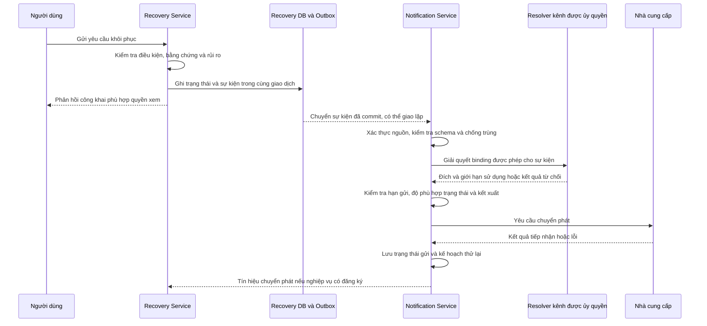

# Notification service responsibility

## 1. Dịch vụ thông báo chịu trách nhiệm đến đâu?

Trong hệ thống khôi phục tài khoản, **Notification Service** chịu trách nhiệm chuyển một quyết định nghiệp vụ đã được xác lập thành thông điệp phù hợp và gửi đến đúng đích qua kênh được phép. Dịch vụ này có thể quản lý mẫu nội dung, bản địa hóa, tích hợp nhà cung cấp, hàng đợi gửi, thử lại và trạng thái chuyển phát.

Quyết định cho phép đặt lại mật khẩu, gỡ MFA, đăng ký passkey mới hoặc khôi phục quyền truy cập vẫn thuộc các dịch vụ nghiệp vụ có thẩm quyền. **Gửi được thông báo không đồng nghĩa đã xác minh danh tính; thông báo đã giao không đồng nghĩa tài khoản được phép khôi phục.**

Xét tình huống người dùng mất điện thoại chứa MFA:

1. Dịch vụ khôi phục tiếp nhận yêu cầu, đánh giá rủi ro và kiểm tra các bằng chứng theo chính sách.
2. Yêu cầu được đặt vào khoảng chờ hoặc chuyển sang bước xác minh tiếp theo.
3. Một sự kiện hoặc lệnh gửi thông báo được tạo từ trạng thái đã ghi nhận.
4. Notification Service kết xuất thông điệp bằng mẫu được phép và gửi đến kênh phù hợp.
5. Kết quả gửi được ghi nhận để theo dõi, hỗ trợ và cung cấp tín hiệu cho nghiệp vụ khi cần.

Nếu ở bước 4 nhà cung cấp email gặp lỗi, Notification Service có thể thử lại việc gửi. Nó không được vì thế mà bỏ bước xác minh, đặt lại khoảng chờ, cấp token mới hoặc tạo session đã đăng nhập đầy đủ.

Ranh giới đúng giúp hệ thống vừa thông báo đáng tin cậy vừa hạn chế hậu quả khi một nhà cung cấp hoặc thành phần gửi bị xâm nhập. Ranh giới này dựa vào **quyền quyết định và quyền thay đổi dữ liệu**, không chỉ dựa vào việc tách các lớp Java hoặc triển khai thành các tiến trình khác nhau.

## 2. Bảng phân chia trách nhiệm

Tên các dịch vụ dưới đây minh họa những vai trò logic. Một ứng dụng nhỏ có thể triển khai chúng trong cùng một hệ thống nhưng vẫn nên giữ ranh giới quyền hạn rõ ràng.

| Trách nhiệm | Thành phần có thẩm quyền | Vai trò của Notification Service |
|---|---|---|
| Chấp nhận, từ chối hoặc tạm giữ yêu cầu khôi phục | Recovery Service phối hợp Risk/Identity theo thiết kế | Nhận trạng thái được phép công bố và gửi thông điệp tương ứng |
| Xác minh bằng chứng danh tính | Dịch vụ xác minh hoặc Identity Service | Không suy ra danh tính từ việc email đã giao hoặc được mở |
| Chọn thời lượng chờ bảo mật | Chính sách khôi phục và Risk Service | Hiển thị mốc đã được quyết định, không tự tính lại từ thời điểm gửi |
| Phát hành, tiêu thụ, thu hồi token khôi phục | Dịch vụ sở hữu capability khôi phục | Chỉ xử lý phần nội dung hoặc tham chiếu được ủy quyền để gửi |
| Thay mật khẩu, gỡ MFA, thêm passkey | Dịch vụ quản lý thông tin xác thực | Gửi thông báo đúng thay đổi đã được ghi nhận |
| Thu hồi session hoặc tăng mức hạn chế truy cập | Session/Auth Service theo quyết định nghiệp vụ | Gửi cảnh báo, không tự thu hồi session từ kết quả gửi |
| Xác lập email hoặc số điện thoại tin cậy | Identity/Contact Service theo chính sách xác minh | Tra cứu hoặc sử dụng binding được cấp, không tự nâng địa chỉ mới thành kênh tin cậy |
| Chọn đối tượng phải nhận cảnh báo bảo mật | Chính sách bảo mật của nghiệp vụ | Thực thi chính sách chọn người nhận và kênh đã được ủy quyền |
| Kết xuất mẫu, ngôn ngữ, định dạng kênh | Notification Service theo hợp đồng nội dung | Sở hữu logic kết xuất và khả năng tương thích mẫu |
| Tích hợp nhà cung cấp, timeout, retry, chống trùng | Notification Service | Sở hữu vận hành chuyển phát |
| Trạng thái tiếp nhận và chuyển phát | Notification Service cùng tín hiệu nhà cung cấp | Ghi nhận theo đúng mức độ tin cậy của từng tín hiệu |
| Hồ sơ kiểm toán quyết định khôi phục | Recovery Service và các dịch vụ quyết định liên quan | Cung cấp nhật ký gửi có thể liên kết, không thay thế hồ sơ quyết định |

Dịch vụ thông báo có thể sở hữu cấu hình “mẫu nào được gửi bằng kênh nào”, trong khi quyết định “cảnh báo này bắt buộc phải gửi cho ai” thuộc chính sách bảo mật. Nếu chính sách được tập trung trong một dịch vụ riêng, Notification Service nhận và thực thi kết quả; nó không tự tạo ngoại lệ để giao được thông báo bằng mọi giá.

## 3. Tách trạng thái nghiệp vụ khỏi trạng thái chuyển phát

Một yêu cầu khôi phục có thể mang các trạng thái như `WAITING`, `REVIEW_REQUIRED`, `READY_FOR_NEXT_STEP`, `CANCELED` hoặc `COMPLETED`. Một tác vụ gửi lại có vòng đời khác, chẳng hạn `ACCEPTED`, `QUEUED`, `PROVIDER_ACCEPTED`, `DELIVERED`, `FAILED` hoặc `EXPIRED`.

Hai loại trạng thái không nên dùng chung một trường `status` rồi suy diễn qua lại.

| Trạng thái chuyển phát | Có thể kết luận | Không thể kết luận |
|---|---|---|
| `ACCEPTED` | Notification Service đã tiếp nhận hợp đồng gửi hợp lệ | Thông điệp đã rời hệ thống hoặc người nhận là chủ tài khoản |
| `QUEUED` | Tác vụ đang chờ xử lý | Nhà cung cấp đã nhận hoặc sắp giao đúng hạn |
| `PROVIDER_ACCEPTED` | Nhà cung cấp đã chấp nhận yêu cầu theo giao thức tích hợp | Hộp thư hoặc thiết bị đích đã nhận được |
| `DELIVERED` | Có tín hiệu giao thành công theo định nghĩa của kênh | Chủ tài khoản đã đọc, hiểu hoặc đồng ý khôi phục |
| `FAILED` | Tác vụ gửi thất bại tại một bước xác định | Tài khoản không tồn tại hoặc yêu cầu khôi phục phải bị từ chối |
| `EXPIRED` | Tác vụ không còn được phép gửi theo thời hạn của nó | Token nghiệp vụ chắc chắn đã hết hạn hoặc yêu cầu khôi phục đã bị hủy |

Không phải kênh nào cũng cung cấp được tất cả trạng thái. Một sự kiện mở email còn có thể xuất phát từ tải ảnh tự động, hệ thống quét hoặc công cụ bảo vệ quyền riêng tư; nó không phải bằng chứng người dùng đã xác thực.

Nếu nghiệp vụ yêu cầu một mức chuyển phát nhất định trước khi xét tiếp, Recovery Service phải lưu và kiểm tra điều kiện đó một cách rõ ràng. Notification Service cung cấp tín hiệu có nguồn gốc, định danh và ý nghĩa cụ thể. Chính sách khôi phục quyết định tín hiệu đó đáp ứng điều kiện gì; worker gửi không trực tiếp chuyển yêu cầu sang `COMPLETED`.

## 4. Hợp đồng đầu vào: yêu cầu có giới hạn thay vì quyền gửi tùy ý

Một API như `sendEmail(to, html, actionUrl)` dùng chung cho mọi thành phần rất dễ trở thành điểm lạm dụng. Nếu bên gọi có thể chọn bất kỳ địa chỉ, nội dung và URL nào, quyền gửi có thể bị dùng để giả mạo cảnh báo bảo mật hoặc đưa token đến địa chỉ của kẻ tấn công.

Một hợp đồng nội bộ nên thể hiện rõ:

- **Nguồn phát được xác thực:** dịch vụ nào đang yêu cầu gửi và có quyền tạo loại thông báo này hay không.
- **Loại thông báo:** ví dụ bắt đầu khôi phục, bắt đầu chờ, cần bằng chứng bổ sung hoặc đã thay đổi yếu tố xác thực.
- **Định danh tương quan:** ID sự kiện, ID yêu cầu và phiên bản trạng thái, đủ để chống trùng và truy vết.
- **Tham chiếu người nhận:** liên kết đến một kênh được nghiệp vụ cho phép, thay vì mặc định tin địa chỉ vừa nhập ở biểu mẫu công khai.
- **Dữ liệu trình bày tối thiểu:** mốc thời gian, ngôn ngữ hoặc nội dung đã lọc theo quyền xem.
- **Thời hạn gửi:** sau mốc nào nội dung không còn phù hợp hoặc không được phép chuyển phát.
- **Tham chiếu hành động nếu cần:** chức năng đã được hệ thống có thẩm quyền tạo, với phạm vi rõ ràng.

Ví dụ một sự kiện không mang bí mật khôi phục:

```json
{
  "eventId": "7cc9b9ae-4a6b-4c40-8f79-5ba2c59d7e31",
  "eventType": "RecoveryDelayStarted",
  "schemaVersion": 1,
  "requestId": "6957188a-6877-4a80-95d1-b7b1f2f303d1",
  "stateVersion": 4,
  "recipientBindingRef": "25a4dba7-685a-4cf4-8d9e-40340e37690a",
  "recipientBindingVersion": 2,
  "occurredAt": "2026-12-10T07:30:00Z",
  "sendBefore": "2026-12-10T08:00:00Z",
  "presentation": {
    "eligibleAt": "2026-12-11T07:30:00Z",
    "locale": "vi-VN",
    "zoneId": "Asia/Ho_Chi_Minh"
  }
}
```

Các mốc trong ví dụ chỉ minh họa hợp đồng. `sendBefore` là hạn xử lý thông báo, còn `eligibleAt` là mốc sớm nhất nghiệp vụ cho phép xét tiếp; chúng không thay thế nhau. `schemaVersion` biểu diễn cấu trúc sự kiện, `stateVersion` biểu diễn phiên bản trạng thái khôi phục, và phiên bản mẫu nội dung là một khái niệm khác nữa.

ID sự kiện và ID yêu cầu phục vụ liên kết dữ liệu, không mặc nhiên là bí mật cấp quyền. API đọc trạng thái vẫn phải kiểm tra quyền của người gọi. Việc biết `requestId` không được đủ để đọc hồ sơ, hủy yêu cầu hoặc tiêu thụ token.

Nguồn gốc hợp lệ cũng không làm mọi field tự động an toàn. Notification Service cần kiểm tra schema, kích thước, loại sự kiện, phạm vi mẫu được phép và cấu hình đích. Dữ liệu động phải được escape theo ngữ cảnh kết xuất.

## 5. Ai quyết định kênh và địa chỉ nhận?

### 5.1. Tách “địa chỉ được cung cấp” khỏi “kênh được tin cậy”

Trong luồng mất mật khẩu, người yêu cầu có thể nhập một địa chỉ liên hệ mới. Địa chỉ này có thể dùng để trao đổi trong phạm vi chính sách cho phép, nhưng chưa trở thành kênh cảnh báo của chủ tài khoản chỉ vì nó gửi thư được.

Notification Service cần nhận một binding hoặc một chỉ định người nhận được cấp quyền bởi dịch vụ sở hữu dữ liệu liên hệ. Có hai cách triển khai thường gặp:

1. Sự kiện mang tham chiếu; lúc gửi, một resolver được ủy quyền giải quyết ra đích phù hợp.
2. Sự kiện mang một snapshot đích nhận đã được phê duyệt, với biện pháp bảo vệ dữ liệu và thời hạn sử dụng rõ ràng.

Cách đầu giảm dữ liệu cá nhân trong hàng đợi nhưng tạo phụ thuộc vào resolver. Cách sau có thể giảm phụ thuộc lúc gửi nhưng cần bảo vệ dữ liệu và xử lý trường hợp thông tin liên hệ thay đổi. Cả hai đều cần quy tắc về phiên bản binding và chính sách chọn người nhận.

### 5.2. Không luôn lấy “địa chỉ mới nhất” cho mọi sự kiện

Giả sử kẻ tấn công đã thay địa chỉ liên hệ và một cảnh báo về chính thay đổi đó đang chờ gửi. Nếu resolver luôn lấy email mới nhất, cảnh báo vốn dành cho kênh cũ có thể chuyển đến kẻ tấn công.

Ngược lại, một đích cũ đã bị thu hồi vì không còn thuộc người dùng cũng không nên tiếp tục nhận mọi thông báo trong tương lai. Do đó phải xác định rõ **sự kiện nào cần gửi cho binding nào và binding còn hợp lệ cho mục đích đó hay không**. Không thể giải quyết bằng một quy tắc chung “luôn dùng snapshot cũ” hoặc “luôn dùng giá trị mới”.

Notification Service thực thi lựa chọn đã được chính sách xác định và có thể kiểm tra lại tính hợp lệ ngay trước khi gửi. Nếu có mâu thuẫn, nó ghi nhận không thể gửi hoặc yêu cầu nghiệp vụ đánh giá lại; không tự chuyển sang địa chỉ khác để hoàn thành chỉ tiêu chuyển phát.

### 5.3. Fallback phải giữ cùng ranh giới tin cậy

Email lỗi không tự cho phép chuyển sang số điện thoại mới được nhập trong yêu cầu. Một kênh dự phòng chỉ được dùng nếu chính sách cho phép cho đúng loại thông báo, đúng người nhận và đúng mức dữ liệu.

Tùy loại sự kiện, người dùng có thể tắt thông báo tiếp thị nhưng vẫn phải nhận cảnh báo bảo mật theo chính sách của sản phẩm. Quy tắc này phải được xác định rõ; không dùng cờ “bắt buộc” để gửi mọi thông điệp hoặc bỏ qua việc một đích nhận đã mất hiệu lực.

## 6. Luồng phối hợp với Recovery Service



Giao dịch cơ sở dữ liệu nghiệp vụ không thể tự động bao trùm nhà cung cấp email bên ngoài. Ghi trạng thái yêu cầu và bản ghi outbox trong cùng giao dịch giúp tránh trường hợp trạng thái đã đổi nhưng không có sự kiện gửi tương ứng. Cơ chế chuyển outbox vẫn cần khả năng phục hồi và xử lý giao lặp.

Phản hồi biểu mẫu công khai không nên thay đổi theo việc có tìm thấy tài khoản hay nhà cung cấp đã chấp nhận email. Cần đồng thời xem xét mã HTTP, cấu trúc, thời gian phản hồi và giới hạn tốc độ để tránh làm lộ trạng thái tài khoản.

Với sự kiện có thể lỗi thời, Notification Service có thể kiểm tra lại phiên bản hoặc nhận lệnh thay thế/hủy tác vụ. Việc kiểm tra trước gửi giảm thông điệp sai nhưng không loại bỏ hoàn toàn tranh chấp: trạng thái vẫn có thể đổi sau khi nhà cung cấp nhận thư. Nội dung nên ghi thời điểm cập nhật và hướng người dùng đến trạng thái hiện hành trong kênh chính thức.

## 7. Retry và chống trùng: chỉ thử lại thao tác gửi

Hàng đợi thường có thể giao lại cùng một sự kiện. Nhà cung cấp có thể xử lý yêu cầu nhưng phản hồi bị mất. Tiến trình gửi có thể dừng sau khi gọi nhà cung cấp và trước khi ghi kết quả. Đây là những tình huống cần thiết kế trước.

Một khóa chống trùng nội bộ có thể dựa trên:

```text
logicalDeliveryId = eventId + recipientBindingRef + channel
```

Nếu một sự kiện tạo nhiều thông điệp khác nhau trên cùng kênh, cần thêm mục đích gửi hoặc một delivery ID được tạo ổn định cho từng thông điệp. Lần retry dùng lại cùng định danh; thay đổi nhà cung cấp hoặc triển khai phiên bản mẫu mới không tự tạo một lần gửi nghiệp vụ mới.

Notification Service nên lưu một tác vụ chuyển phát với thông tin như:

```text
logical_delivery_id
source_event_id
recipient_binding_ref
channel
pinned_template_version
state
attempt_count
next_attempt_at
send_before
provider_message_id
last_error_category
```

`pinned_template_version` giúp các lần thử lại cùng tác vụ dùng nội dung nhất quán theo chính sách. Khi một lỗi mẫu nghiêm trọng cần sửa, việc thay mẫu hoặc gửi đính chính phải có quy trình rõ, không âm thầm làm mỗi lần retry mang một thông điệp khác.

Các lưu ý vận hành:

- Bản ghi inbox và khóa duy nhất giúp phát hiện sự kiện trùng trong hệ thống nội bộ; chúng không làm thao tác gửi bên ngoài trở thành giao dịch nguyên tử.
- Đánh dấu “đã gửi” trước khi gọi nhà cung cấp có thể làm mất thông báo nếu tiến trình dừng giữa chừng.
- Đánh dấu “đã gửi” sau khi gọi có thể tạo bản sao nếu tiến trình dừng sau khi gửi nhưng trước khi lưu kết quả.
- Khi nhà cung cấp hỗ trợ khóa chống trùng, dùng khóa ổn định cho các lần thử lại cùng tác vụ. Cơ chế này vẫn phụ thuộc phạm vi và thời hạn bảo đảm của nhà cung cấp.
- Khi kết quả không xác định, cần đối soát hoặc thử lại theo chính sách chịu được bản sao; không suy ra rằng timeout đồng nghĩa chưa gửi.
- Dùng thời gian chờ tăng dần kèm độ ngẫu nhiên, giới hạn số lần thử và thời hạn gửi. Lỗi đích không hợp lệ cần cách xử lý khác lỗi mạng tạm thời.
- Hết hạn gửi hoặc thất bại lâu dài phải tạo kết quả cuối cùng có thể quan sát và chuyển xử lý phù hợp; không thử lại vô hạn.

Retry không được phát hành token mới, đặt lại thời điểm khởi đầu khoảng chờ, thay email nhận, gỡ MFA hoặc tạo session. Các hành động đó thuộc giao dịch nghiệp vụ khác với yêu cầu quyền hạn riêng.

Nếu chuyển nhà cung cấp sau một kết quả không xác định, hệ thống có thể gửi trùng dù từng nhà cung cấp hỗ trợ chống trùng riêng. Cần cân nhắc đánh đổi giữa khả năng bỏ lỡ và lặp thông báo, đặc biệt với thông điệp chứa capability hoặc nội dung rất nhạy cảm.

## 8. Token và liên kết hành động thuộc ranh giới nào?

Một thông báo “có cập nhật bảo mật” có thể chỉ dẫn người dùng mở ứng dụng chính thức và không cần mang token. Một email đặt lại mật khẩu có thể phải chứa liên kết có bí mật. Hai trường hợp không nên bị đánh đồng.

### 8.1. Dịch vụ nghiệp vụ sở hữu vòng đời capability

Dịch vụ có thẩm quyền phát hành token cần kiểm soát ít nhất mục đích sử dụng, tài khoản/yêu cầu liên quan, thời hạn và khả năng dùng lại. Nơi tiêu thụ token phải kiểm tra trạng thái hiện tại và thực hiện việc tiêu thụ theo cách tránh hai yêu cầu đồng thời cùng thành công ngoài ý muốn.

Notification Service không tự kéo dài hạn token vì email gửi chậm và không đánh dấu token đã dùng chỉ vì nhà cung cấp báo `DELIVERED`. Một URL được hệ thống quét email mở cũng không chứng minh người dùng đã yêu cầu thay đổi bảo mật. Hành động có tác dụng thay đổi trạng thái cần một bước được bảo vệ phù hợp; không dùng GET của liên kết email để tự động gỡ MFA hoặc hoàn tất khôi phục.

### 8.2. Giảm phạm vi tiếp xúc với bí mật

Khi kiến trúc cho phép, sự kiện chỉ mang tham chiếu để một thành phần được ủy quyền lấy phần nội dung cần gửi ngay trước khi chuyển phát. Cần xem khả năng đổi tham chiếu thành token là một quyền nhạy cảm; thay token bằng ID không tự làm hệ thống an toàn nếu mọi worker đều có thể dùng ID đó để lấy bí mật.

Nếu bộ gửi phải tiếp xúc với token ở dạng rõ để kết xuất email, cần coi nó là một phần của vùng tin cậy xử lý bí mật:

- Giới hạn quyền đọc theo đúng loại thông báo, yêu cầu và mục đích.
- Bảo vệ đường truyền, dữ liệu lưu và thời gian lưu; tránh lưu bản rõ lâu hơn nhu cầu chuyển phát.
- Loại token và URL có bí mật khỏi log, trace, báo cáo lỗi, hệ thống phân tích và hàng đợi lỗi có nhiều người truy cập.
- Kiểm soát cả nhà cung cấp và các tính năng bổ sung có thể nhìn thấy nội dung.
- Không ghi token vào khóa chống trùng hoặc nhãn metric.

Không bật cơ chế theo dõi click, rút gọn hoặc viết lại URL cho liên kết khôi phục có bí mật khi cơ chế đó làm lộ capability sang thành phần không được phép. Nếu cần URL hành động, nguồn gốc và miền đích phải lấy từ cấu hình tin cậy hoặc từ một hợp đồng đã được xác minh; không lấy trực tiếp từ header hay dữ liệu do người yêu cầu tùy ý cung cấp.

### 8.3. Hết hạn thông báo không thay thế thu hồi token

Một tác vụ gửi bị đánh dấu `EXPIRED` chỉ có nghĩa nó không còn được gửi. Nếu token đã được phát hành, việc token còn hiệu lực hay không vẫn do dịch vụ sở hữu token quyết định. Ngược lại, token hết hạn không nhất thiết đóng toàn bộ hồ sơ khôi phục; nghiệp vụ có thể cung cấp một bước tiếp tục khác theo chính sách.

Thông báo hết hạn cần được bỏ qua hoặc chuyển về xử lý phù hợp, không được tự tạo token kế tiếp. Nội dung hướng dẫn người dùng mở luồng chính thức để lấy trạng thái và hành động hiện hành.

## 9. Ví dụ Java: lập kế hoạch gửi từ một hợp đồng có giới hạn

Ví dụ dưới đây dùng Java có hỗ trợ `record` và chỉ thể hiện bước chọn mẫu cùng định danh chuyển phát. Nó không chứa logic phê duyệt khôi phục, kiểm tra mật khẩu, gỡ MFA hoặc cấp session.

```java
import java.time.Clock;
import java.time.Instant;
import java.util.Objects;
import java.util.Optional;
import java.util.UUID;

public final class RecoveryNotificationPlanner {
    public enum Kind {
        RECOVERY_STARTED,
        RECOVERY_DELAY_STARTED,
        RECOVERY_COMPLETED
    }

    public enum Channel {
        EMAIL,
        PUSH
    }

    public enum Template {
        RECOVERY_STARTED_V1,
        RECOVERY_DELAY_V1,
        RECOVERY_COMPLETED_V1
    }

    public record AuthorizedEvent(
            UUID eventId,
            UUID requestId,
            long stateVersion,
            UUID recipientBindingRef,
            long recipientBindingVersion,
            Kind kind,
            Channel channel,
            Instant sendBefore) {
        public AuthorizedEvent {
            Objects.requireNonNull(eventId);
            Objects.requireNonNull(requestId);
            Objects.requireNonNull(recipientBindingRef);
            Objects.requireNonNull(kind);
            Objects.requireNonNull(channel);
            Objects.requireNonNull(sendBefore);
            if (stateVersion < 1 || recipientBindingVersion < 1) {
                throw new IllegalArgumentException("Invalid version");
            }
        }
    }

    public record DeliveryKey(
            UUID eventId,
            UUID recipientBindingRef,
            Channel channel) {}

    public record DeliveryPlan(
            DeliveryKey key,
            Template template,
            AuthorizedEvent event) {}

    private final Clock clock;

    public RecoveryNotificationPlanner(Clock clock) {
        this.clock = Objects.requireNonNull(clock);
    }

    public Optional<DeliveryPlan> plan(AuthorizedEvent event) {
        Objects.requireNonNull(event);
        if (!clock.instant().isBefore(event.sendBefore())) {
            return Optional.empty();
        }

        Template template = switch (event.kind()) {
            case RECOVERY_STARTED -> Template.RECOVERY_STARTED_V1;
            case RECOVERY_DELAY_STARTED -> Template.RECOVERY_DELAY_V1;
            case RECOVERY_COMPLETED -> Template.RECOVERY_COMPLETED_V1;
        };

        DeliveryKey key = new DeliveryKey(
                event.eventId(),
                event.recipientBindingRef(),
                event.channel());

        return Optional.of(new DeliveryPlan(key, template, event));
    }
}
```

Tên `AuthorizedEvent` là một giả định đầu vào của ví dụ, không phải một cơ chế bảo mật. Trước khi tạo đối tượng này từ dữ liệu nhận qua mạng, tầng tiếp nhận phải xác thực nguồn, kiểm tra quyền phát loại sự kiện và xác minh schema. Một record do người gọi tự tạo không chứng minh sự kiện đã được cấp quyền.

Các bước ngoài phạm vi đoạn mã nhưng cần có khi tích hợp:

1. Lưu và nhận diện tác vụ bằng `DeliveryKey` cùng ràng buộc duy nhất, để sự kiện lặp không tạo tác vụ mới.
2. Chốt phiên bản mẫu khi tạo tác vụ; nếu tác vụ đã tồn tại thì dùng kế hoạch đã lưu thay vì ghi đè bằng phiên bản mới của chương trình.
3. Giải quyết người nhận theo binding và chính sách của sự kiện. Trong ví dụ, phiên bản binding là thông tin kiểm tra, không phải lý do để âm thầm chuyển cùng tác vụ sang đích khác.
4. Kiểm tra trạng thái yêu cầu khi loại thông báo yêu cầu điều đó, và kiểm tra lại hạn gửi trước mỗi lần thử thực tế.
5. Kết xuất nội dung cho đúng kênh, với dữ liệu trình bày tối thiểu và cách escape phù hợp.
6. Gọi adapter nhà cung cấp, ghi kết quả gửi và xử lý kết quả không xác định.

`Optional.empty()` ở đây chỉ báo không lập kế hoạch cho một sự kiện đã hết hạn. Tầng điều phối cần lưu kết quả bỏ qua phù hợp; không lặp mãi cùng một sự kiện với hy vọng nó sẽ trở lại hợp lệ. `Clock` được truyền vào để logic thời gian không phụ thuộc trực tiếp vào đồng hồ toàn cục khi kiểm chứng hành vi.

Ví dụ cố ý dùng một thông điệp trên mỗi sự kiện, binding và kênh. Nếu nghiệp vụ cần nhiều thông điệp riêng trên cùng bộ ba đó, phải bổ sung định danh mục đích trong khóa. Khóa này cũng chưa phải toàn bộ giải pháp bảo đảm gửi đúng một lần qua hệ thống bên ngoài.

## 10. Giới hạn quyền của Notification Service

Một dịch vụ dùng chung cho nhiều nghiệp vụ có nguy cơ trở thành nơi tập trung quá nhiều quyền. Với thông báo khôi phục tài khoản, cần giữ quyền truy cập sát mục đích gửi.

| Tài nguyên hoặc thao tác | Quyền phù hợp cho thành phần gửi |
|---|---|
| Hàng đợi cảnh báo khôi phục | Nhận đúng nhóm sự kiện và ghi nhận xử lý theo thiết kế |
| Mẫu thông báo | Đọc mẫu đã phát hành; thay mẫu qua quy trình quản lý riêng |
| Đích nhận | Chỉ giải quyết binding được ủy quyền cho tác vụ cụ thể |
| Token hoặc nội dung chứa bí mật | Chỉ khi thật sự cần gửi, với phạm vi và thời hạn truy cập hẹp |
| Cơ sở dữ liệu mật khẩu, seed MFA, private key passkey | Không cần quyền đọc để thực hiện chuyển phát |
| API reset mật khẩu, gỡ MFA, cấp session | Không cấp cho worker chỉ phục vụ gửi thông báo |
| Thông tin tích hợp nhà cung cấp | Chỉ credential của kênh cần dùng, có kiểm soát truy cập và luân chuyển |
| API quản trị hàng đợi và gửi lại | Giới hạn theo vai trò, lưu dấu thao tác, giữ nguyên kiểm tra quyền và hạn gửi |

Không cần yêu cầu dịch vụ thông báo đọc trực tiếp toàn bộ bảng tài khoản chỉ để lấy một địa chỉ email. Một resolver có phạm vi hẹp hoặc dữ liệu đã lọc theo hợp đồng giúp giảm phạm vi dữ liệu bị ảnh hưởng khi có sự cố.

Xác thực giữa các dịch vụ cần đi kèm phân quyền theo thao tác. Biết bên gọi là một dịch vụ nội bộ không có nghĩa bên gọi được yêu cầu gửi mọi mẫu bảo mật đến mọi địa chỉ. Khi dùng chữ ký cho sự kiện hoặc token nội bộ, vẫn phải quản lý khóa và giới hạn quyền của nguồn phát tương ứng.

## 11. Kết quả gửi và callback từ nhà cung cấp

Nhà cung cấp có thể gọi webhook để báo thư bị trả lại, đã giao hoặc bị từ chối. Endpoint nhận callback là đầu vào từ bên ngoài và cần xử lý như dữ liệu không đáng tin cho đến khi kiểm tra nguồn gốc.

Các kiểm soát thường gồm xác minh chữ ký theo giao thức tích hợp, giới hạn phát lại khi giao thức hỗ trợ, chống trùng và ràng buộc ID nhà cung cấp với đúng tác vụ đã gửi. Payload không được quyền chỉ định một `accountId` bất kỳ rồi yêu cầu hệ thống đóng hồ sơ khôi phục.

Callback có thể trùng, đến muộn hoặc đến không theo thứ tự. Notification Service cần chính sách hợp nhất trạng thái theo ngữ nghĩa thực tế của nhà cung cấp. Không đơn giản cho phép callback đến cuối cùng ghi đè mọi trạng thái trước đó hoặc giả định mọi tín hiệu có thể xếp thành một thang thành công duy nhất.

Nếu phát sự kiện `NotificationDelivered`, cần mô tả rõ đây là tín hiệu của kênh nào, nguồn nào và cho tác vụ nào. Không đặt tên nó thành `IdentityVerified` hoặc `RecoveryApproved`, vì những tên đó gán thêm một quyết định mà callback không chứng minh được.

## 12. Khi Notification Service hoặc nhà cung cấp ngừng hoạt động

Dịch vụ khôi phục cần biết sự cố gửi ảnh hưởng điều kiện nghiệp vụ nào, còn Notification Service cần có cách báo tình trạng và phục hồi chuyển phát.

| Sự cố | Hành vi thuộc Notification Service | Quyết định vẫn thuộc nghiệp vụ |
|---|---|---|
| Nhà cung cấp timeout | Ghi kết quả không xác định, đối soát hoặc thử lại có giới hạn | Có cần giữ yêu cầu ở trạng thái chờ hay không |
| Hàng đợi tồn đọng | Theo dõi tuổi tác vụ, ưu tiên theo chính sách, bỏ tác vụ hết hạn | Có dời mốc nghiệp vụ hoặc phát cảnh báo khác hay không |
| Binding không còn được phép sử dụng | Không gửi đến đích không hợp lệ, phát kết quả phù hợp | Cách xác minh kênh khác hoặc xử lý hồ sơ |
| Token đã hết hạn trước khi gửi | Không tiếp tục gửi nội dung hành động đã vô hiệu | Có phát hành bước xác minh mới hay không |
| Mẫu bị lỗi kết xuất | Cô lập lỗi, ghi mã lỗi đã lọc dữ liệu, dùng fallback được phê duyệt nếu có | Có tạm giữ bước khôi phục phụ thuộc cảnh báo hay không |
| Kênh chính thất bại | Chuyển kênh nếu có chính sách cho phép | Có cho phép dùng kênh mới và cần bằng chứng gì |

Nếu chủ tài khoản cần một khoảng thời gian thực tế để nhận cảnh báo và phản đối, việc cảnh báo bị chậm có thể ảnh hưởng mốc xét tiếp. Quy tắc tính lại mốc phải được thiết kế trong nghiệp vụ, dựa trên tín hiệu gửi được định nghĩa; Notification Service không tự cộng thêm thời gian vào hồ sơ.

Cần phân biệt lỗi hạ tầng với quyết định bảo mật. Gửi thất bại không được biến thành việc tự bỏ điều kiện bảo vệ, nhưng cũng không nên khiến worker gửi lặp vô hạn hoặc tự khóa tài khoản không có căn cứ.

## 13. Nhật ký, quan sát và quyền riêng tư

Các thông tin hữu ích để liên kết sự cố gồm ID sự kiện, ID chuyển phát, loại thông báo, phiên bản mẫu, kênh, số lần thử, nhóm lỗi và thời điểm. Nếu dùng request ID để liên kết, nó vẫn cần được bảo vệ theo chính sách dữ liệu nội bộ dù không phải một capability.

Không ghi toàn bộ body email, token, URL chứa bí mật, OTP hay bằng chứng danh tính vào log thông thường. Một dead-letter queue có thể chứa dữ liệu nhạy cảm giống hàng đợi gốc; nó cần cùng mức kiểm soát truy cập và thời hạn lưu phù hợp. Việc chuyển tác vụ vào đó không làm dữ liệu trở nên vô hại.

Các chỉ số vận hành hữu ích gồm:

- Độ trễ từ sự kiện đã commit đến lúc nhà cung cấp tiếp nhận.
- Tuổi tác vụ chưa xử lý và tỷ lệ hết hạn trước gửi.
- Tỷ lệ lỗi theo kênh, nhà cung cấp và nhóm lỗi.
- Số tác vụ trùng được nhận diện và số lần thử lại.
- Tỷ lệ bị trả lại hoặc bị giới hạn tốc độ theo mức tổng hợp phù hợp.

Tránh đưa email, số điện thoại hoặc account ID vào nhãn metric có số lượng giá trị rất lớn. Dashboard vận hành không cần công khai dữ liệu cá nhân chỉ để đếm tỷ lệ lỗi.

Công cụ hỗ trợ cần hiển thị kết quả theo đúng nghĩa: “đã gửi yêu cầu đến nhà cung cấp” khác “người dùng đã nhận”. Chức năng gửi lại từ công cụ quản trị phải kiểm tra quyền, tính hợp lệ hiện tại và giới hạn gửi; không cung cấp nút gửi lại vô điều kiện cho token đã hết hạn.

## 14. Các tình huống học tập để kiểm chứng ranh giới

| Tình huống | Hành vi mong đợi |
|---|---|
| Cùng sự kiện được hàng đợi giao hai lần | Không tạo hai tác vụ nghiệp vụ khác nhau; vẫn xử lý trường hợp bản sao từ nhà cung cấp |
| Timeout sau khi nhà cung cấp có thể đã nhận | Không khẳng định chắc chắn chưa gửi; đối soát hoặc thử lại theo chính sách |
| Một dịch vụ nội bộ không có quyền gửi cảnh báo khôi phục | Bị từ chối dù đã xác thực được danh tính dịch vụ |
| Người yêu cầu nhập email mới | Không tự dùng làm kênh cảnh báo chủ tài khoản |
| Binding thay đổi khi tác vụ còn trong hàng đợi | Áp dụng chính sách cho đúng sự kiện, không tự thay đích theo giá trị mới nhất |
| Yêu cầu đã bị hủy trước khi gửi cảnh báo bước tiếp theo | Không gửi nội dung khẳng định yêu cầu vẫn đủ điều kiện; xử lý tác vụ lỗi thời |
| Nhà cung cấp báo thư được giao | Chỉ cập nhật chuyển phát, không xác minh danh tính hoặc hoàn tất khôi phục |
| Callback giả mạo hoặc phát lại | Không thay đổi tác vụ ngoài phạm vi, không tác động trạng thái tài khoản |
| Email chứa token bị đưa vào hàng đợi lỗi | Dữ liệu vẫn được bảo vệ, không xuất bản rõ trong dashboard hay log |
| Bộ quét email mở liên kết | Không gỡ MFA, đặt mật khẩu mới hoặc cấp session chỉ từ GET |
| Hạn gửi thông báo đã qua | Không gửi nội dung lỗi thời và không tự phát hành token mới |
| Kênh chính ngừng hoạt động | Chỉ fallback sang kênh đã được cho phép, không hạ yêu cầu xác minh |
| Triển khai phiên bản mẫu mới giữa các lần retry | Tác vụ cũ giữ kế hoạch đã chốt hoặc được thay theo quy trình rõ ràng |
| Biểu mẫu công khai nhận tài khoản không tồn tại | Phản hồi không lộ tài khoản qua kết quả tra cứu hay trạng thái gửi |

## 15. Những dấu hiệu ranh giới đang bị phá vỡ

**Worker email gọi API gỡ MFA khi gửi thành công.** Quyền thay đổi yếu tố xác thực đã bị đưa vào thành phần chuyển phát. Cần để nghiệp vụ khôi phục quyết định sau khi kiểm tra đầy đủ điều kiện.

**Retry email tạo token mới và kéo dài khoảng chờ.** Một thao tác vận hành đã âm thầm biến thành giao dịch nghiệp vụ, khiến trạng thái khó dự đoán và có thể bị lạm dụng bằng cách gửi lặp.

**Mọi dịch vụ đều có thể truyền HTML, email và URL tùy ý.** Notification Service đang bị dùng như công cụ gửi cảnh báo không có giới hạn. Cần hợp đồng loại thông báo, nguồn phát và người nhận phù hợp.

**Một field `success` được dùng cho gửi email, xác minh danh tính và khôi phục.** Các bằng chứng khác nhau đã bị gộp thành một cờ mơ hồ. Cần lưu trạng thái và chuyển tiếp giữa các dịch vụ theo ý nghĩa cụ thể.

**Thông tin gửi được xem là hồ sơ quyết định duy nhất.** Nhật ký chuyển phát không thể giải thích ai phê duyệt gỡ MFA, bằng chứng nào được chấp nhận hoặc session nào bị thu hồi. Các dịch vụ có thẩm quyền phải lưu dấu quyết định riêng.

**Lỗi gửi được xử lý bằng cách đổi sang một địa chỉ bất kỳ hoặc bỏ qua kiểm soát.** Khả năng giao thư đã được ưu tiên hơn ranh giới tin cậy của tài khoản. Fallback và hành vi khi lỗi cần nằm trong chính sách được xác định trước.

Một Notification Service được giới hạn đúng vẫn đủ khả năng kết xuất, chuyển phát và theo dõi các cảnh báo quan trọng. Giá trị của nó nằm ở việc giao thông điệp đúng ngữ cảnh và cung cấp kết quả có thể kiểm chứng, trong khi quyền xác minh danh tính, thay đổi thông tin xác thực và điều khiển session tiếp tục được thực thi bởi các dịch vụ có thẩm quyền.
