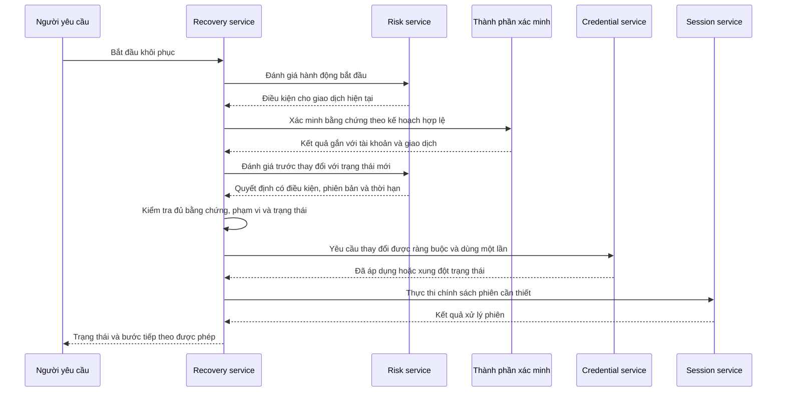

# Risk service responsibility — Trách nhiệm của dịch vụ đánh giá rủi ro

## 1. Risk service đứng ở đâu trong khôi phục tài khoản?

Trong module `SECURITY_AUTHENTICATION_ACCOUNT_RECOVERY`, mục tiêu của khôi phục tài khoản là đưa đúng chủ tài khoản trở lại hệ thống khi họ mất mật khẩu, MFA, passkey hoặc thiết bị xác thực. Luồng này phải chấp nhận những hoàn cảnh bất thường của người dùng hợp lệ, đồng thời hạn chế khả năng kẻ tấn công lợi dụng đường khôi phục để chiếm tài khoản.

Risk service là dịch vụ phân tích các tín hiệu liên quan và đưa ra đánh giá cho **một hành động khôi phục cụ thể trong một ngữ cảnh cụ thể**. Ví dụ: một yêu cầu đặt lại mật khẩu từ thiết bị mới có cần thêm bằng chứng không; thay MFA sau khi email khôi phục vừa đổi có cần rà soát không; hoặc yêu cầu hiện tại có đủ dấu hiệu lạm dụng để phải dừng không.

Risk service không trả lời toàn bộ câu hỏi “ai là chủ tài khoản?”. Nó cũng không tự thực hiện đặt lại mật khẩu, cấp token dùng một lần, xóa MFA hay thu hồi phiên. Những hành động đó thuộc các dịch vụ có thẩm quyền riêng và cần kiểm tra bằng chứng, trạng thái cùng quyền thực thi.

Hai câu hỏi phải được phân biệt:

- **Bằng chứng đã đáp ứng yêu cầu nào?** Đây là kết quả của việc kiểm tra mã khôi phục, xác thực authenticator, xác minh kênh hoặc quy trình xác minh danh tính.
- **Với bằng chứng và hoàn cảnh hiện tại, hành động này cần điều kiện bổ sung nào?** Đây là phần Risk service có thể đánh giá theo chính sách rủi ro.

Một thiết bị quen thuộc có thể làm giảm mức nghi ngờ, nhưng không thay thế mã dùng một lần. Ngược lại, một địa chỉ mạng mới có thể làm tăng mức nghi ngờ, nhưng không tự chứng minh rằng người dùng là kẻ tấn công.

## 2. Ranh giới trách nhiệm giữa các dịch vụ

Đặt tên dịch vụ chưa đủ để tạo ranh giới. Cần xác định dữ liệu nào do ai sở hữu, ai có quyền kết luận điều gì và ai được thay đổi trạng thái tài khoản.

| Thành phần | Trách nhiệm chính | Không nên tự quyết định |
| --- | --- | --- |
| Recovery service | Điều phối giao dịch khôi phục, chọn các bước hợp lệ, kết hợp kết quả và kiểm soát tiến trình | Tự coi một điểm rủi ro thấp là bằng chứng danh tính |
| Risk service | Chuẩn hóa tín hiệu, đánh giá rủi ro theo hành động, đề xuất hoặc quyết định điều kiện theo hợp đồng chính sách | Kiểm tra bí mật của người dùng thay dịch vụ xác minh; trực tiếp thay thông tin xác thực |
| Verification service hoặc thành phần xác minh | Kiểm tra mã, liên kết, authenticator hoặc bằng chứng thuộc loại được giao; trả kết quả có nguồn đáng tin cậy | Mở rộng quyền từ một bằng chứng sang mọi hành động khôi phục |
| Identity proofing hoặc quy trình rà soát | Đánh giá bằng chứng danh tính theo quy trình và ghi nhận kết quả rà soát | Mặc định giấy tờ bất kỳ đều liên kết với một tài khoản bí danh |
| Credential service | Sở hữu mật khẩu, MFA, passkey và các thay đổi thông tin xác thực được phép | Bỏ qua quyền thực thi vì lời gọi đến từ một dịch vụ nội bộ |
| Session service | Thực thi vòng đời phiên, refresh token, phiên bản bảo mật hoặc cơ chế thu hồi tương ứng | Tự suy ra mọi yêu cầu khôi phục đều cần thu hồi toàn bộ phiên |
| Notification service | Gửi thông báo hoặc challenge theo lệnh được phép, kiểm soát mẫu và kênh gửi | Cho phép gửi tới một kênh mới để tự chứng minh quyền sở hữu tài khoản |

Risk service có thể sở hữu bản ghi đánh giá, phiên bản chính sách và dữ liệu đặc trưng phục vụ tính toán. Nó không vì vậy trở thành chủ sở hữu bản ghi gốc của tài khoản, authenticator hay phiên.

Ví dụ, thông tin “email khôi phục đã thay đổi cách đây ít phút” nên có nguồn từ dịch vụ sở hữu kênh liên lạc. Risk service sử dụng sự kiện hoặc API tương ứng, thay vì tự sửa bảng email để thuận tiện cho việc tính điểm.

## 3. Chấm điểm và quyết định chính sách là hai trách nhiệm khác nhau

Một mô hình có thể sinh điểm `0.82`, nhưng con số đó chưa đủ để biết phải làm gì. Điểm có thể biểu diễn xác suất, mức xếp hạng hoặc một thang nội bộ; ý nghĩa phụ thuộc mô hình và cách hiệu chỉnh.

Trong khi đó, quyết định chính sách phải nói rõ hệ thống cần cho phép tiếp tục, yêu cầu thêm bằng chứng, chuyển rà soát hay dừng giao dịch. Cùng một đánh giá có thể dẫn đến yêu cầu khác nhau đối với đặt lại mật khẩu và thay toàn bộ MFA.

Có hai cách chia ranh giới thường gặp:

1. Risk service chỉ cung cấp đánh giá và tín hiệu. Một thành phần chính sách khác ánh xạ kết quả sang điều kiện khôi phục.
2. Risk service chứa cả đánh giá và chính sách thích ứng, trả về điều kiện có ý nghĩa nghiệp vụ cho Recovery service.

Cả hai cách đều có thể sử dụng nếu hợp đồng rõ ràng. Vấn đề xuất hiện khi Risk service nghĩ nó chỉ cung cấp tham khảo, còn Recovery service lại coi kết quả là lệnh có đủ thẩm quyền để đặt lại tài khoản.

Trong bài này, giả sử Risk service trả về một **quyết định có điều kiện theo chính sách rủi ro**. Recovery service là nơi thực thi quyết định trong luồng khôi phục, kết hợp với các điều kiện bắt buộc của tài khoản và bằng chứng.

Một quan hệ khái niệm có thể viết như sau:

```text
Được thực hiện thay đổi =
    bằng chứng đáp ứng yêu cầu nền
    AND yêu cầu bổ sung từ chính sách rủi ro đã được đáp ứng
    AND quyền khôi phục đúng tài khoản và đúng hành động
    AND quyền chưa dùng, còn hạn
    AND trạng thái tài khoản vẫn cho phép thay đổi
```

Quan hệ này không phải công thức cộng điểm. Không được dùng điểm rủi ro tốt để bù cho việc không có bằng chứng hoặc dùng một token đã hết hạn.

## 4. Các đầu vào mà Risk service cần hiểu

### 4.1. Ngữ cảnh của hành động

Một yêu cầu đánh giá cần gắn với hành động như `START_RECOVERY`, `VERIFY_RECOVERY_EVIDENCE`, `RESET_PASSWORD` hoặc `REPLACE_MFA`. Các tên này chỉ minh họa cho hợp đồng nội bộ, không phải tên API bắt buộc.

Risk service còn cần biết giai đoạn của giao dịch, loại tài khoản, mức nhạy cảm và ngữ cảnh bằng chứng đã được xác minh. Không nên áp dụng một kết quả chung cho mọi hành động chỉ vì chúng có cùng `accountId`.

Đặt lại mật khẩu khi người dùng còn authenticator mạnh khác với thay MFA khi họ không còn yếu tố nào. Tài khoản giảng viên có quyền quản trị lớp học cũng có thể cần điều kiện khác tài khoản chỉ đọc nội dung công khai.

### 4.2. Tín hiệu và nguồn tin cậy

| Nhóm tín hiệu | Ví dụ | Điểm cần kiểm soát |
| --- | --- | --- |
| Lịch sử khôi phục | Số yêu cầu gần đây, số lần thử sai, nhiều kênh được yêu cầu liên tiếp | Đổi phương thức hoặc đổi IP không được xóa lịch sử liên quan |
| Trạng thái tài khoản | Thay email gần đây, thay MFA gần đây, báo cáo bị xâm phạm | Phải biết nguồn sở hữu và độ mới của dữ liệu |
| Thiết bị và phiên | Dấu hiệu thiết bị quen thuộc, tuổi phiên, sự kiện thu hồi | Cookie hoặc dấu vân tay thiết bị có thể bị đánh cắp hay giả mạo |
| Mạng và vị trí suy luận | Nguồn truy cập bất thường, mạng có nhiều yêu cầu lạm dụng | VPN, chuyển mạng hoặc đi du lịch có thể là hành vi hợp lệ |
| Bằng chứng đã kiểm tra | Loại bằng chứng, thời điểm kiểm tra, phạm vi đã được chứng minh | Nhận từ thành phần xác minh đáng tin cậy, không nhận kết luận tự khai từ trình duyệt |
| Tương quan lạm dụng | Một nguồn thử nhiều tài khoản, nhiều nguồn nhắm một tài khoản | Cần giới hạn theo mục đích, quyền truy cập và phạm vi tenant |

Trình duyệt có thể báo múi giờ, loại thiết bị hoặc khả năng hỗ trợ passkey. Đó là dữ liệu có thể hữu ích, nhưng không nên được coi là sự thật không thể thay đổi. Những giá trị như `mfaVerified=true`, `trustedDevice=true` hoặc `riskScore=0` do máy khách gửi phải bị bỏ qua hoặc được kiểm chứng bằng nguồn phía máy chủ.

Risk service thường chỉ cần biết rằng một bằng chứng đã được kiểm tra theo chính sách nào. Nó không cần nhận OTP còn hiệu lực, mã dự phòng nguyên văn, mật khẩu, private key hoặc ảnh giấy tờ chỉ để tính điểm.

### 4.3. Dữ liệu thiếu không đồng nghĩa với tín hiệu tốt

Một tín hiệu có thể vắng mặt vì thiết bị mới, người dùng hạn chế theo dõi, nguồn dữ liệu bị lỗi hoặc sự kiện chưa đồng bộ. Hệ thống nên phân biệt:

- Giá trị đã được quan sát và không đáng ngờ.
- Chưa có dữ liệu để đánh giá.
- Có dữ liệu nhưng đã quá cũ.
- Nguồn dữ liệu đang không khả dụng.

Nếu chuyển tất cả các trường hợp thiếu thành điểm `0`, hệ thống có thể vô tình cho phép người tấn công được đánh giá tốt hơn bằng cách làm mất tín hiệu.

Ngược lại, thiếu dấu vết thiết bị cũng không nên tự động trở thành kết luận gian lận. Người dùng chặn theo dõi, dùng trình duyệt mới hoặc công nghệ hỗ trợ vẫn cần có đường xác minh phù hợp. Chính sách phải biểu diễn sự không chắc chắn và chọn cách xử lý tương ứng.

## 5. Hợp đồng yêu cầu đánh giá

Một hợp đồng rõ ràng cần ràng buộc kết quả với chủ thể, giao dịch, hành động và ảnh chụp trạng thái đã đánh giá. Ví dụ dưới đây dùng các mã nội bộ thay vì email hoặc số điện thoại thật.

```json
{
  "requestId": "risk-req-81",
  "tenantId": "tenant-learning-a",
  "accountId": "account-482",
  "attemptId": "recovery-917",
  "phase": "BEFORE_CREDENTIAL_CHANGE",
  "action": "REPLACE_MFA",
  "accountSecurityVersion": 42,
  "recoveryStateVersion": 7,
  "verifiedEvidenceRef": "evidence-set-63",
  "proposedChangeDigest": "digest-of-bound-change-context",
  "contextRef": "server-context-24"
}
```

`verifiedEvidenceRef` phải trỏ tới kết quả đáng tin cậy, không phải một chuỗi tùy ý mà người dùng tự tạo. Tùy kiến trúc, Risk service có thể kiểm tra tham chiếu qua API hoặc nhận một bản tóm tắt có tính toàn vẹn và nguồn đã xác thực.

`proposedChangeDigest` minh họa việc ràng buộc đánh giá với nội dung thay đổi. Nếu đánh giá chỉ cho phương án giữ nguyên email khôi phục, nó không được tái sử dụng cho một phương án vừa thay MFA vừa chuyển email sang người khác. Có thể dùng tham chiếu trạng thái bất biến thay cho digest nếu đạt cùng mục tiêu.

Các phiên bản trạng thái không phải vật trang trí. Chúng giúp thành phần thực thi phát hiện rằng tài khoản, tập bằng chứng hoặc giao dịch đã thay đổi sau lúc đánh giá. Muốn sử dụng được, hợp đồng phải quy định ai tăng phiên bản, khi nào tăng và nơi nào kiểm tra.

`requestId` phục vụ tương quan hoặc idempotency theo thiết kế. Nếu dùng cho idempotency, cùng một mã với payload khác phải bị từ chối hoặc xử lý như xung đột; không được trả lại một quyết định cũ cho nội dung mới.

## 6. Hợp đồng kết quả: trả về điều kiện có thể thực thi

Một kết quả minh họa:

```json
{
  "assessmentId": "assessment-551",
  "requestId": "risk-req-81",
  "tenantId": "tenant-learning-a",
  "accountId": "account-482",
  "attemptId": "recovery-917",
  "action": "REPLACE_MFA",
  "accountSecurityVersion": 42,
  "recoveryStateVersion": 7,
  "outcome": "REQUIRE_ADDITIONAL_EVIDENCE",
  "requirementSetId": "mfa-replacement-enhanced-v3",
  "policyVersion": "recovery-policy-18",
  "modelVersion": "recovery-risk-6",
  "evaluatedAt": "2026-11-24T03:00:00Z",
  "validUntil": "2026-11-24T03:02:00Z",
  "inputCompleteness": "PARTIAL",
  "reasonCodes": ["NEW_DEVICE", "RECENT_RECOVERY_CHANNEL_CHANGE"]
}
```

Thời gian hai phút ở đây chỉ minh họa cho thời hạn đánh giá. Thời hạn thực phải phù hợp độ biến động của tín hiệu, tác động hành động và cách kiểm tra lại trước thực thi.

Một tập outcome có thể được định nghĩa như sau:

| Outcome | Nghĩa trong hợp đồng | Hành vi của Recovery service |
| --- | --- | --- |
| `CONTINUE_UNDER_BASE_POLICY` | Không có điều kiện rủi ro bổ sung tại thời điểm đánh giá | Tiếp tục kiểm tra bằng chứng nền và các điều kiện thực thi còn lại |
| `REQUIRE_ADDITIONAL_EVIDENCE` | Cần đáp ứng một tập yêu cầu bổ sung được định danh | Lập kế hoạch xác minh hợp lệ, thu thập kết quả rồi đánh giá lại khi cần |
| `REQUIRE_REVIEW` | Cần quy trình rà soát có thẩm quyền | Giữ giao dịch ở trạng thái chờ, chưa cấp quyền thay thông tin xác thực |
| `DENY_ATTEMPT` | Giao dịch hiện tại không được tiếp tục theo chính sách | Dừng giao dịch, ghi nhận lý do và cung cấp đường xử lý được phép |
| `UNDETERMINED` | Không đủ cơ sở kết luận, ví dụ thiếu nguồn dữ liệu quan trọng | Áp dụng chính sách suy giảm đã định nghĩa cho hành động đó |

`CONTINUE_UNDER_BASE_POLICY` không phải quyền đăng nhập và không phải quyền đặt lại MFA. `DENY_ATTEMPT` cũng không mặc nhiên yêu cầu khóa tài khoản vĩnh viễn hoặc thu hồi mọi phiên. Nếu một quyết định cần tác động rộng hơn giao dịch hiện tại, nó phải đi qua thẩm quyền và quy trình riêng.

Không nên chỉ trả về một trường `approved: true`. Trường này dễ che khuất việc phê duyệt điều gì, còn điều kiện nào và hiệu lực kéo dài bao lâu.

### 6.1. Điều kiện bổ sung phải gắn với khả năng thực tế

Nếu Risk service yêu cầu xác thực lại bằng chính điện thoại người dùng vừa khai báo bị mất, Recovery service không có cách thực thi hữu ích. Hai dịch vụ cần thống nhất danh mục yêu cầu và phương án đáp ứng được chính sách chấp nhận.

Ví dụ, một tập yêu cầu có thể cho phép một authenticator khác đã đăng ký hoặc một quy trình rà soát phù hợp. Recovery service chọn cách khả dụng trong phạm vi được phép; không tự thay bằng câu hỏi ngày sinh để làm luồng kết thúc thành công.

Khi không có phương án khả dụng, luồng chuyển tới kết quả đã định nghĩa như rà soát, tạm dừng hoặc không thể khôi phục. Việc người dùng gặp khó khăn không làm thay đổi chất lượng bằng chứng đã có.

### 6.2. Không để kết quả trở thành bí mật mang quyền ngoài ý muốn

Một `assessmentId` dùng để tra cứu không nên tự đủ để gọi endpoint thay mật khẩu. Nếu kết quả cần đi qua nhiều dịch vụ, phải bảo vệ tính toàn vẹn, xác thực bên phát hành, kiểm tra bên nhận và ràng buộc phạm vi sử dụng.

Ngay cả khi kết quả có chữ ký, bên thực thi vẫn phải kiểm tra thời hạn, tài khoản, hành động, phiên bản và trạng thái liên quan. Chữ ký chỉ giúp chứng minh nội dung đến từ bên ký và chưa bị sửa; nó không tự đảm bảo dữ liệu vẫn mới hoặc quyền chưa bị thu hồi.

## 7. Đánh giá rủi ro ở các điểm có ý nghĩa

Không nhất thiết gọi Risk service sau mọi lần nhấn nút. Cũng không nên chỉ gọi một lần ở đầu rồi dùng kết quả đó cho cả quá trình có thể kéo dài nhiều ngày.



Sơ đồ diễn tả trách nhiệm và các điểm quyết định; nó không giả định rằng lời gọi tuần tự đã tạo transaction phân tán. Nếu thay đổi credential thành công nhưng xử lý phiên gặp lỗi, cần có trạng thái trung gian và cơ chế phục hồi phù hợp.

Những thời điểm thường đáng xem xét đánh giá lại gồm: có bằng chứng mới, thay phương thức khôi phục, thay nội dung hành động, vượt thời hạn đánh giá, xuất hiện báo cáo xâm phạm hoặc sắp thực hiện thay đổi nhạy cảm.

Tùy hành động, giai đoạn đầu có thể tập trung vào chống lạm dụng và bảo vệ kênh gửi. Giai đoạn trước thay đổi tập trung vào điều kiện thực thi và trạng thái an ninh hiện tại. Đánh giá ở đầu không thay thế đánh giá cần thiết ở cuối.

## 8. Tính mới, cache và lỗi kiểm tra trước khi sử dụng

### 8.1. Một kết quả còn hạn vẫn có thể đã cũ

Giả sử Risk service cho phép tiếp tục ở phiên bản bảo mật `42`. Trước khi thay MFA, chủ tài khoản báo bị chiếm đoạt và hệ thống chuyển sang phiên bản `43` với cờ bảo vệ bổ sung.

Nếu bên thực thi chỉ kiểm tra `validUntil`, nó có thể chấp nhận quyết định thuộc trạng thái cũ. Vì vậy, thời hạn cần đi cùng ràng buộc phiên bản, loại hành động và những điều kiện vô hiệu hóa có ý nghĩa.

Ranh giới nguyên tử quan trọng nằm ở nơi thực hiện thay đổi: phải kiểm tra trạng thái được kỳ vọng và tiêu thụ quyền khôi phục cùng với thay đổi credential bằng cơ chế phù hợp. Không nên giữ một khóa cơ sở dữ liệu trong khi chờ một lời gọi mạng kéo dài tới Risk service.

Một cách tiếp cận là lấy đánh giá trước, sau đó thực hiện thao tác có điều kiện đối với phiên bản tài khoản và giao dịch. Nếu phiên bản đã đổi, dừng thao tác để tải trạng thái và đánh giá lại. Cách này bảo vệ được những thay đổi có tham gia cơ chế phiên bản đã định nghĩa.

### 8.2. Phân biệt dữ liệu đồng bộ và dữ liệu cập nhật qua sự kiện

Một đặc trưng của Risk service có thể được cập nhật qua sự kiện chậm hơn dữ liệu gốc. Chỉ kiểm tra phiên bản trong cơ sở dữ liệu của Recovery service không chứng minh rằng mọi nguồn tín hiệu đã được Risk service đọc đến cùng thời điểm.

Với tín hiệu bắt buộc phải có hiệu lực ngay, thiết kế cần chọn cơ chế rõ ràng: đọc nguồn có thẩm quyền ở điểm quyết định, kiểm tra cờ bảo vệ ngay tại nơi thực thi, hoặc yêu cầu Risk service xác nhận đã xử lý tới phiên bản cần thiết. Nếu không đạt điều kiện về độ mới, trả trạng thái chưa thể kết luận hoặc chờ theo chính sách.

Các tín hiệu chỉ dùng để bổ sung dự đoán có thể chấp nhận độ trễ được giới hạn và quan sát. Không nên hứa rằng mọi quyết định luôn phản ánh tức thì toàn bộ dữ liệu nếu hệ thống thực tế vận hành theo nhất quán cuối cùng.

### 8.3. Cache phải bảo toàn phạm vi quyết định

Cache chỉ theo `accountId` sẽ trộn các giao dịch hoặc hành động khác nhau. Một kết quả cache cần có khóa hoặc fingerprint tương ứng với ngữ cảnh thực sự ảnh hưởng tới đánh giá, ví dụ tenant, tài khoản, giao dịch, hành động, tập bằng chứng, phiên bản trạng thái và phiên bản chính sách.

Thời hạn cache không được vượt hiệu lực sử dụng đã quy định. Khi thay chính sách hoặc xuất hiện tín hiệu làm vô hiệu hóa kết quả, hệ thống cần bỏ cache hoặc yêu cầu đánh giá lại theo cơ chế đã thiết kế.

Không trả lại một kết quả tốt đã cache chỉ vì Risk service đang lỗi. Nếu muốn dùng kết quả cũ trong một trường hợp suy giảm, phải quy định trước trường hợp nào được dùng, độ cũ tối đa và những điều kiện vẫn phải kiểm tra.

## 9. Risk service gặp lỗi: xử lý theo hành động

Timeout, lỗi mạng và hết năng lực xử lý không có nghĩa người yêu cầu có rủi ro thấp. Đường lỗi phải là một phần của hợp đồng, thay vì được ánh xạ thành `score=0` để giao diện tiếp tục chạy.

| Tình huống | Hướng xử lý có thể được thiết kế | Điều cần tránh |
| --- | --- | --- |
| Đọc hướng dẫn khôi phục công khai | Vẫn cung cấp nội dung và lựa chọn chung | Buộc mọi nội dung công khai phụ thuộc dịch vụ đánh giá |
| Bắt đầu yêu cầu gửi liên kết | Áp dụng hạn mức và chính sách dự phòng đã duyệt; có thể trì hoãn gửi | Gửi không giới hạn vì không lấy được điểm |
| Hoàn tất thay MFA hoặc kênh khôi phục | Chờ đánh giá lại, chuyển rà soát hoặc sử dụng chính sách tĩnh được cho phép rõ ràng | Tự coi lỗi là cho phép thực hiện thay đổi |
| Đánh giá thiếu nguồn bắt buộc | Trả trạng thái chưa thể kết luận và lý do nội bộ | Giấu dữ liệu thiếu trong một quyết định có vẻ đầy đủ |

Một chính sách tĩnh dự phòng chỉ hợp lệ nếu chính sách sản phẩm cho phép và các điều kiện của nó vẫn được thực thi. Nó không được bỏ qua bằng chứng nền, ràng buộc hành động hay giới hạn thử.

Đặt timeout phù hợp, giới hạn retry và dùng cơ chế ngắt gọi tạm thời khi nguồn lỗi kéo dài giúp tránh dây chuyền quá tải. Retry phải giữ ngữ nghĩa: một lời gọi đánh giá có thể chạy lại, nhưng gửi challenge, tạo hồ sơ hoặc thay credential có tác động riêng và cần kiểm soát idempotency ở dịch vụ sở hữu.

Người dùng nên nhận trạng thái có thể hiểu như “Chưa thể xác minh điều kiện để hoàn tất. Bạn có thể thử lại sau hoặc dùng kênh hỗ trợ”. Không cần tiết lộ dịch vụ nội bộ nào đang lỗi hoặc quy tắc nào đã được kích hoạt.

## 10. Sự kiện, đồng bộ và chống xử lý lặp

Risk service thường nhận sự kiện như `RecoveryAttemptFailed`, `RecoveryChannelChanged`, `AuthenticatorRevoked` hoặc `AccountCompromiseReported`. Đây là tên minh họa; hợp đồng thực tế cần định nghĩa payload, phiên bản và nguồn phát.

Sự kiện liên quan có thể chứa:

- Mã sự kiện duy nhất và phiên bản schema.
- Tenant, chủ thể và mã giao dịch khi cần.
- Loại hành động, kết quả và thời điểm sự kiện xảy ra.
- Phiên bản trạng thái hoặc thứ tự tương ứng trong phạm vi chủ thể.
- Tham chiếu tương quan để truy vết mà không sao chép bí mật.

Không nên giả định broker chỉ gửi một lần hoặc mọi sự kiện luôn đến đúng thứ tự. Consumer cần chống xử lý lặp theo mã sự kiện, nhận biết sự kiện cũ và cập nhật dữ liệu theo quy tắc phù hợp. Một sự kiện cũ “tài khoản bình thường” không được ghi đè trạng thái bảo vệ mới hơn chỉ vì nó đến sau.

Khi cần bảo đảm sự kiện gắn với thay đổi dữ liệu gốc, bên phát có thể dùng transactional outbox hoặc một cơ chế tương đương. Outbox giúp tránh mất thông báo giữa commit và publish, nhưng không tự làm quá trình truyền và xử lý trở thành tức thì.

Phản hồi từ Risk service cũng có thể đến muộn: giao dịch đã hủy nhưng kết quả đánh giá vẫn được trả về. Recovery service phải kiểm tra trạng thái hiện tại trước khi chấp nhận kết quả. Không được hồi sinh một giao dịch đã kết thúc chỉ vì vừa nhận một quyết định cho phép tiếp tục.

## 11. Bảo vệ giao tiếp nội bộ và quyền truy cập

Risk service nằm trong mạng nội bộ vẫn cần xác thực danh tính dịch vụ gọi, kiểm tra quyền và giới hạn dữ liệu theo mục đích. Tùy hạ tầng, có thể dùng danh tính workload, kênh được xác thực và credential dành riêng cho dịch vụ.

Một lời gọi được xác thực từ Recovery service không tự cho phép truy vấn mọi tenant hoặc xuất toàn bộ lịch sử tài khoản. Các tham số phạm vi cần được kiểm tra với thẩm quyền của bên gọi, đặc biệt trong hệ thống nhiều tenant.

Các điểm cần giữ rõ gồm:

- Endpoint đánh giá không công khai trực tiếp cho trình duyệt.
- Thành phần gọi không được tự gửi kết luận rằng bằng chứng đã hợp lệ nếu không có thẩm quyền xác minh.
- Reason code chi tiết, điểm và ngưỡng nội bộ chỉ tới các bên cần biết.
- Bản ghi đánh giá và log không chứa token một lần hoặc bí mật đăng nhập.
- Quyền điều chỉnh chính sách được tách khỏi quyền gửi yêu cầu đánh giá và có dấu vết thay đổi.

Các dữ liệu như IP, lịch sử thiết bị và tương quan hành vi có thể nhạy cảm. Thu thập tối thiểu, xác định mục đích, giới hạn thời gian lưu và kiểm soát truy cập giúp giảm việc Risk service trở thành kho theo dõi không giới hạn.

Nếu có phát hiện lạm dụng liên tenant, phải thiết kế riêng quyền truy cập và kết quả được phép chia sẻ. Không trả danh tính hoặc hoạt động của tenant khác cho một khách hàng chỉ để giải thích rằng nguồn truy cập có mức rủi ro cao.

## 12. Quan sát, giải thích và phản hồi sau sự cố

Một hệ thống có thể trả quyết định rất nhanh nhưng vẫn sai hoặc khiến chủ tài khoản hợp lệ không thể hoàn tất. Theo dõi vận hành cần bao gồm cả chất lượng quyết định và khả năng phục hồi.

| Nhóm chỉ số | Ví dụ | Cách diễn giải |
| --- | --- | --- |
| Khả dụng | Tỷ lệ timeout, độ trễ, số quyết định chưa thể kết luận | Cho biết khả năng phục vụ, chưa nói mô hình tốt hay xấu |
| Độ mới dữ liệu | Độ trễ sự kiện, tỷ lệ thiếu nguồn, số kết quả bị từ chối vì phiên bản cũ | Cho biết mức đáng tin của đầu vào tại thời điểm thực thi |
| Hành vi chính sách | Tỷ lệ yêu cầu thêm bằng chứng, chuyển rà soát hoặc dừng giao dịch | Cần so sánh theo loại hành động và phiên bản chính sách |
| Kết quả khôi phục | Tỷ lệ hoàn tất, thời gian chờ, số hồ sơ bị mắc kẹt | Cần xét những phương thức khả dụng với người dùng |
| An ninh sau khôi phục | Báo cáo chiếm đoạt, quyết định bị rà soát lại | Có thể đến muộn và cần xác minh nguồn phản hồi |

Reason code nên giúp nhân viên hiểu quyết định ở mức phù hợp, ví dụ “kênh khôi phục thay đổi gần đây” hoặc “nguồn dữ liệu bắt buộc chưa cập nhật”. Một điểm số đơn lẻ không đủ cho việc giải thích hồ sơ hoặc điều tra sự cố.

Không mặc định mọi lượt khôi phục thành công đều là nhãn “chủ tài khoản hợp lệ”. Kẻ tấn công thành công cũng có thể đăng nhập bình thường. Phản hồi dùng để hiệu chỉnh mô hình hoặc chính sách cần có nguồn và mức tin cậy rõ ràng để tránh làm sai lệch dữ liệu học.

Khi thay chính sách, nên quản lý phiên bản, đánh giá tác động và có cách quay lại phiên bản trước. Có thể chạy một chính sách mới ở chế độ quan sát để so sánh trước khi cho nó ảnh hưởng người dùng, nhưng phải tránh tạo thêm tác động như gửi challenge hoặc khóa giao dịch trong chế độ chỉ quan sát.

## 13. Tình huống thực tế và cách phân chia quyết định

### 13.1. Chủ tài khoản mất điện thoại khi đang đi xa

Minh mất điện thoại chứa passkey và ứng dụng OTP trong chuyến công tác. Anh mở khôi phục bằng một máy tính mới, từ một mạng chưa từng dùng. Các tín hiệu thiết bị và vị trí đều khác lịch sử trước đây.

Risk service có thể yêu cầu thêm bằng chứng hoặc rà soát. Nó không nên kết luận chiếm đoạt chỉ vì ngữ cảnh khác thường. Recovery service tìm những phương thức đủ điều kiện mà Minh còn sử dụng được, chẳng hạn một mã dự phòng đã phát hành hoặc authenticator khác đã đăng ký.

Kết quả xác minh được gửi lại với nguồn đáng tin cậy. Trước khi thay yếu tố bị mất, hệ thống đánh giá hành động và trạng thái mới, áp dụng đúng phạm vi quyền và xử lý phiên theo chính sách. Risk service không trực tiếp đăng ký thiết bị mới cho Minh.

### 13.2. Kẻ tấn công có cookie phiên trên thiết bị quen thuộc

Một người khác lấy được cookie phiên của tài khoản rồi yêu cầu thay MFA. Tín hiệu mạng hoặc thiết bị có thể trông quen thuộc, nên kết quả rủi ro không nhất thiết cao.

Nếu hệ thống vẫn giữ yêu cầu bằng chứng nền và quyền thay MFA có phạm vi riêng, kết quả rủi ro thuận lợi không đủ cho hành động. Nếu Recovery service chỉ nhìn điểm số rồi bỏ qua xác minh, ranh giới giữa tín hiệu và thẩm quyền đã bị phá vỡ.

### 13.3. Kênh khôi phục vừa đổi trong lúc giao dịch đang chạy

Một đánh giá ban đầu được tạo trước khi email khôi phục thay đổi. Sau đó, một sự kiện an ninh làm tăng phiên bản trạng thái hoặc đặt cờ cần kiểm tra bổ sung.

Kết quả cũ phải bị phát hiện tại điểm thực thi hoặc bị vô hiệu hóa theo hợp đồng. Nếu bản sao dữ liệu Risk service chưa nhận sự kiện, thành phần thực thi vẫn phải kiểm tra điều kiện bắt buộc ở nguồn có thẩm quyền theo thiết kế. Không thể coi thời hạn token còn dài là bằng chứng rằng hoàn cảnh chưa thay đổi.

### 13.4. Risk service không khả dụng khi sắp thay MFA

Người dùng đã hoàn thành một bước xác minh, nhưng đánh giá trước thay đổi bị timeout. Recovery service giữ bằng chứng trong thời hạn hợp lệ và chuyển tới trạng thái chờ hoặc đường dự phòng đã được duyệt.

Nó không ghi `risk=LOW` để hoàn tất cho nhanh, cũng không buộc người dùng thử lại vô hạn. Nếu chờ quá thời hạn của bằng chứng hoặc đánh giá, hệ thống phải yêu cầu bước tương ứng được làm lại. Giao diện cần nêu bước tiếp theo và bảo toàn những phần có thể bảo toàn hợp lệ.

## 14. Kiểm thử ranh giới trách nhiệm

| Tình huống kiểm thử | Kết quả cần bảo đảm |
| --- | --- |
| Risk trả kết quả tiếp tục nhưng chưa có bằng chứng nền | Credential không bị thay đổi |
| Trình duyệt tự gửi `trustedDevice=true` hoặc `mfaVerified=true` | Không biến thành dữ liệu xác minh đáng tin cậy |
| Kết quả thuộc tài khoản, tenant hoặc hành động khác | Bên thực thi từ chối sử dụng |
| Cùng idempotency key nhưng payload khác | Phát hiện xung đột, không trả quyết định cũ như thể phù hợp |
| Kết quả còn hạn nhưng phiên bản tài khoản đã đổi | Dừng thay đổi và yêu cầu xử lý trạng thái mới |
| Nguồn tín hiệu bắt buộc chậm hoặc mất dữ liệu | Không ánh xạ thành rủi ro thấp |
| Risk yêu cầu một phương thức người dùng không còn dùng được | Chỉ chọn phương án tương đương đã được phép hoặc chuyển trạng thái phù hợp |
| API đánh giá timeout | Đi vào chính sách suy giảm của đúng hành động |
| Hai yêu cầu hoàn tất dùng cùng quyền khôi phục | Tối đa một thay đổi có hiệu lực theo cơ chế tiêu thụ quyền |
| Sự kiện bị gửi lặp hoặc đảo thứ tự | Không đếm sai vô hạn hoặc ghi đè trạng thái mới bằng trạng thái cũ |
| Kết quả đánh giá tới sau khi giao dịch bị hủy | Không mở lại giao dịch |
| Credential đổi thành công nhưng xử lý phiên lỗi | Có trạng thái và cơ chế phục hồi; không tuyên bố đã thu hồi phiên khi chưa thực hiện |

Các kiểm thử này nên được đặt ở ranh giới hợp đồng và nơi thực thi hành động. Chỉ kiểm thử một hàm tính điểm sẽ bỏ sót những lỗi nguy hiểm nhất: dùng sai chủ thể, tái sử dụng kết quả cũ, bỏ qua bằng chứng và thực hiện thay đổi nhiều lần.

## 15. Bài tập vận dụng

Thiết kế hợp đồng đánh giá cho hai hành động: đặt lại mật khẩu và thay MFA khi mất điện thoại. Với mỗi hành động, hãy xác định bằng chứng nền, tín hiệu Risk service sử dụng, các outcome hợp lệ và nơi thực thi từng điều kiện.

Tiếp theo, mô tả ba thay đổi khiến đánh giá phải được làm lại: thay kênh khôi phục, phát hiện tài khoản bị xâm phạm và thay nội dung hành động đã dự kiến. Chỉ rõ phiên bản hoặc nguồn dữ liệu nào giúp phát hiện mỗi thay đổi, cùng giới hạn về độ trễ nếu dùng sự kiện.

Cuối cùng, xử lý trường hợp Risk service ngừng hoạt động ngay trước khi Credential service nhận lệnh. Thiết kế cần nói được giao dịch dừng ở trạng thái nào, dữ liệu nào còn hiệu lực, người dùng có đường tiếp tục nào và điều gì bảo đảm một lỗi hạ tầng không tự trở thành quyền chiếm đoạt tài khoản.
