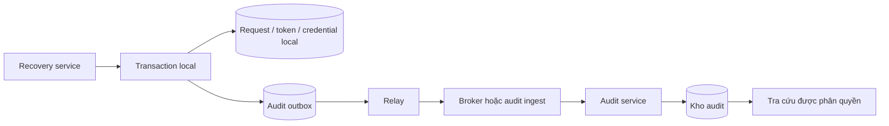

# Audit service responsibility

## 1. Audit service chịu trách nhiệm về điều gì?

Trong module `SECURITY_AUTHENTICATION_ACCOUNT_RECOVERY`, luồng khôi phục cho phép người dùng lấy lại quyền truy cập khi mất mật khẩu, MFA, passkey hoặc thiết bị xác thực. Mỗi quyết định quan trọng cần để lại dấu vết: yêu cầu nào được mở, bằng chứng nào đã được đánh giá, chính sách nào cho phép thay credential, token nào đã được tiêu thụ và việc thu hồi session đã đạt tới trạng thái nào.

Audit service chịu trách nhiệm tiếp nhận, bảo quản và cung cấp dấu vết có thể đối chiếu về các hành động đó. Dịch vụ này phải giúp điều tra trả lời được: ai hoặc thành phần nào thực hiện hành động, tác động tới đối tượng nào, kết quả là gì, do chính sách nào, và sự kiện đến từ đâu. Để làm được điều đó, audit service cần kiểm soát nguồn gửi, chống ghi trùng, bảo vệ dữ liệu, phát hiện thiếu hụt và giới hạn quyền tra cứu.

Audit service không mặc nhiên có quyền xác minh danh tính, phát hành token khôi phục hoặc thay credential. Một sự kiện `recovery.completed` cũng không phải mệnh lệnh để audit service đặt lại mật khẩu. Đây là ranh giới quan trọng: thành phần giữ bằng chứng không nên đồng thời trở thành đường vòng để giành quyền tài khoản.

Bài học tập trung vào ranh giới trách nhiệm giữa audit với các microservice khôi phục. Sau bài học, người học có thể phân công chủ sở hữu sự kiện, thiết kế hợp đồng audit, xử lý gửi lặp hoặc gián đoạn, và giải thích giới hạn của tính bất biến trong một hệ thống phân tán.

## 2. Phân biệt audit record, domain event và application log

Một lần khôi phục có thể tạo cả ba loại dữ liệu, nhưng mục đích và yêu cầu bảo vệ khác nhau.

| Loại dữ liệu | Câu hỏi chính | Ví dụ | Yêu cầu thường gặp |
| --- | --- | --- | --- |
| Domain event | Điều gì đã xảy ra trong miền nghiệp vụ? | Credential đã được thay | Hợp đồng nghiệp vụ, phục vụ tích hợp, xử lý lặp an toàn |
| Audit record | Ai làm gì, đối với ai, với kết quả và căn cứ nào? | Yêu cầu MFA reset được phê duyệt theo policy phiên bản 8 | Nguồn gửi được xác thực, truy vết, retention, kiểm soát đọc và tính toàn vẹn |
| Application log | Phần mềm hoạt động ra sao? | Repository timeout, broker mất kết nối | Chẩn đoán, correlation ID, mức log, kiểm soát dữ liệu nhạy cảm |
| Metric | Hệ thống đang có xu hướng gì? | Tỉ lệ audit ingest thất bại | Tổng hợp theo thời gian, nhãn có số lượng giá trị được kiểm soát |
| Trace | Một request đi qua những thành phần nào? | Recovery → risk → credential | Quan hệ nhân quả và độ trễ, có thể được sampling |

Một domain event có thể là nguồn để tạo audit record nếu chứa đủ ngữ cảnh và được bảo vệ đúng cách. Tuy nhiên, tên sự kiện nghiệp vụ không tự bảo đảm rằng actor, tenant, policy và kết quả đã đầy đủ. Application log hoặc trace có thể bị sampling, hết retention sớm hay chỉ tồn tại tại một instance, nên không thể mặc định dùng thay audit bắt buộc.

Ngược lại, audit service cũng không cần sao chép mọi dòng debug hoặc toàn bộ payload nghiệp vụ. Lưu nhiều hơn làm tăng bề mặt rò rỉ và chi phí điều tra. Mục tiêu là lưu đủ bằng chứng có ý nghĩa, với danh mục trường đã được thiết kế.

## 3. Phân chia quyền quyết định và quyền ghi nhận

Ranh giới nên bám theo nơi sở hữu quyết định và dữ liệu nguồn, thay vì gom mọi thứ liên quan tới bảo mật vào audit service.

| Thành phần | Sở hữu trách nhiệm | Dữ liệu hoặc sự kiện cung cấp cho audit |
| --- | --- | --- |
| Recovery service | Vòng đời yêu cầu, binding tài khoản và mục đích, điều phối khôi phục | Request mở, hủy, hết hạn, được chấp thuận hoặc hoàn tất |
| Identity verification service | Đánh giá bằng chứng theo hợp đồng xác minh | Kết quả xác minh, mã phương thức, mức bảo đảm và phiên bản chính sách |
| Risk service | Tính toán và đánh giá tín hiệu rủi ro | Decision ID, kết quả, mã lý do đã giảm dữ liệu |
| Credential service | Thay mật khẩu, vô hiệu hóa MFA, đăng ký credential mới | Kết quả thay đổi credential, phiên bản hoặc operation ID |
| Session service | Thu hồi hoặc giới hạn session theo chính sách | Yêu cầu thu hồi được nhận, thực thi xong hoặc thất bại |
| Audit service | Kiểm tra envelope, lưu bền, chống trùng, truy vấn và export có kiểm soát | Audit record đã tiếp nhận, dấu vết truy cập và báo cáo thiếu hụt |
| Detection/SIEM | Phân tích chuỗi sự kiện để phát hiện hành vi đáng ngờ | Cảnh báo liên quan tới sự kiện gốc |
| Support/admin service | Thực hiện thao tác hỗ trợ đã được phân quyền | Người thao tác, người phê duyệt, ticket tham chiếu và hành động thực tế |

Audit service có thể cung cấp dữ liệu cho risk hoặc detection, nhưng không vì vậy mà sở hữu chính sách cho phép khôi phục. Nếu một quyết định phụ thuộc vào lịch sử audit, hệ thống phải xác định yêu cầu về độ mới và tính đầy đủ của dữ liệu. Một projection còn trễ không nên được coi là nguồn khẳng định rằng “chưa có hành động rủi ro nào”.

Tương tự, lưu một sự kiện hỗ trợ nói rằng nhân viên đã được phân quyền không thay thế kiểm tra quyền ở nơi thực hiện thay đổi. Audit ghi lại căn cứ và kết quả mà nguồn có thẩm quyền cung cấp; quyền hạn phải được thực thi trước hành động.

## 4. Audit service nên cung cấp những năng lực nào?

### 4.1. Tiếp nhận sự kiện từ nguồn có danh tính

Nguồn gửi phải được xác thực bằng danh tính workload hoặc cơ chế tương đương. Dịch vụ không tin trường `producer_id` trong JSON chỉ vì người gửi tự điền. Danh tính thực tế từ kết nối, token của workload, broker hoặc gateway phải được đối chiếu với registry của nguồn.

Registry có thể quy định nguồn nào được phát loại sự kiện nào, phạm vi tenant nào và phiên bản schema nào. Ví dụ credential service được công bố kết quả thay credential, nhưng không được tự nhận vai trò nguồn quyết định xác minh giấy tờ nếu không sở hữu nghiệp vụ đó.

Kiểm tra schema chỉ chứng minh payload đúng hình dạng. Một producer bị chiếm quyền vẫn có thể phát sự kiện sai sự thật trong phạm vi quyền của nó. Giới hạn quyền producer, đối chiếu nhiều nguồn và giám sát hành vi bất thường vẫn cần thiết.

### 4.2. Bảo quản bản ghi và nguồn gốc

Audit record cần giữ định danh sự kiện gốc, danh tính nguồn đã xác thực, thời gian nguồn ghi nhận, thời gian audit tiếp nhận và thông tin schema. Nếu audit bổ sung trường dẫn xuất, phải phân biệt rõ với trường do producer khai báo.

Không cho phép producer sửa đè sự kiện đã chấp nhận. Khi phát hiện thông tin sai, ghi một sự kiện hiệu chỉnh có tham chiếu tới bản ghi gốc, người thực hiện và lý do. Điều này giữ được lịch sử đã xảy ra thay vì làm quá khứ thay đổi âm thầm.

### 4.3. Cung cấp khả năng tìm kiếm có phân quyền

Nhân viên hỗ trợ có thể chỉ cần xem trạng thái khôi phục và các mốc xử lý. Người điều tra có thể được cấp quyền xem thêm decision ID hoặc chuỗi thao tác đặc quyền. Quyền đọc phải tách theo tenant, vai trò, mục đích công việc và mức nhạy cảm của trường.

Tenant trong truy vấn phải xuất phát từ ngữ cảnh đã được cấp quyền, không chỉ từ query parameter của người dùng. Mọi export hoặc truy cập đặc quyền cần được ghi audit riêng, giới hạn khối lượng và theo dõi để tránh biến kho audit thành nguồn thu thập dữ liệu hàng loạt.

### 4.4. Báo cáo sức khỏe của đường audit

Audit service cần cho biết hệ thống đang nhận sự kiện đầy đủ tới đâu: backlog, độ trễ, lỗi schema, producer không còn gửi, sự kiện bị cách ly và dấu hiệu thiếu sequence. Không có thông báo lỗi không đồng nghĩa đường audit vẫn hoạt động.

Một thành phần chỉ nhận HTTP rồi ghi log ra console chưa cung cấp năng lực audit đáng tin cậy. Nó cần có định nghĩa rõ về thời điểm xác nhận đã nhận bền, cách phục hồi sau crash và cách điều tra những sự kiện chưa vào kho truy vấn.

## 5. Thiết kế hợp đồng sự kiện audit

Một hợp đồng tối thiểu phải hỗ trợ định danh, binding và đối chiếu. Ví dụ dưới đây biểu diễn sự kiện do recovery service phát sau khi transaction hoàn tất nội bộ đã thành công; các giá trị chỉ dùng để minh họa cấu trúc.

```json
{
  "event_id": "8f25b1a1-245d-4f6c-bf9e-8f404d2c41d4",
  "event_type": "recovery.completed",
  "schema_version": 1,
  "producer_id": "account-recovery",
  "tenant_ref": "tenant_2f8",
  "request_ref": "rr_7b2",
  "subject_ref": "subject_91a",
  "source_sequence": 12,
  "occurred_at": "2026-11-24T09:12:13.420Z",
  "correlation_id": "corr_6f1",
  "causation_event_id": "c82792af-9f12-4e21-b940-f3dde731664b",
  "actor": {
    "kind": "END_USER",
    "actor_ref": "actor_b10",
    "authentication_context_ref": "authctx_31"
  },
  "action": "PASSWORD_RESET",
  "outcome": "SUCCEEDED",
  "decision": {
    "decision_ref": "decision_22",
    "policy_version": "recovery-policy-8",
    "reason_code": "RECOVERY_REQUIREMENTS_SATISFIED"
  },
  "effect": {
    "credential_operation_ref": "cop_17",
    "auth_version_after": 42,
    "session_revocation_state": "REQUESTED"
  }
}
```

Các định danh tham chiếu nên là opaque ID hoặc giá trị được giảm khả năng nhận diện theo thiết kế. Opaque ID vẫn có thể là dữ liệu nhạy cảm khi liên kết với tài khoản; tên gọi không tự làm dữ liệu trở nên vô danh.

`occurred_at` là thời gian nguồn ghi nhận sự kiện theo định nghĩa hợp đồng. Nếu event được tạo trong transaction trước commit rồi chỉ công bố sau commit, không được mô tả timestamp đó như thời điểm commit chính xác khi hệ thống chưa thực sự đo được. Audit bổ sung `received_at` để biết thời điểm tiếp nhận, chứ không thay thế ý nghĩa của thời gian nguồn.

`source_sequence` trong ví dụ tăng tuần tự theo một request tại producer và được cấp cùng transaction với sự kiện. Nếu producer không bảo đảm được điều này, bỏ cam kết sequence hoặc dùng một cơ chế khác có định nghĩa rõ. Sequence của request không tạo ra thứ tự toàn cục giữa mọi service.

`session_revocation_state = REQUESTED` chỉ nói rằng yêu cầu thu hồi đã được ghi nhận theo hợp đồng, chưa chứng minh tất cả session đã bị vô hiệu hóa. Khi session service hoàn tất, nó phát sự kiện kết quả riêng với cùng operation reference hoặc quan hệ nhân quả.

### 5.1. Những trường không nên xuất hiện

Không đưa các dữ liệu sau vào payload audit thông thường:

- Mật khẩu mới hoặc cũ, raw recovery token, OTP, recovery code và khóa bí mật.
- Private key, credential material hoặc session cookie có thể sử dụng lại.
- Bản sao giấy tờ, ảnh khuôn mặt, video xác minh hoặc câu trả lời nhận diện đầy đủ.
- Toàn bộ request body, URL mang token hoặc header authorization.
- Chi tiết thuật toán và tín hiệu chống gian lận mà người đọc audit không cần biết.

Thay vào đó, dùng decision ID, loại phương thức, mức bảo đảm hoặc reference tới kho bằng chứng được phân quyền riêng. Nếu cần lưu địa chỉ IP hoặc thông tin thiết bị, phải xác định mục đích, mức chi tiết, quyền đọc và retention. Không tự động sao chép vì “sau này có thể cần”.

### 5.2. Thay đổi schema và ý nghĩa sự kiện

Thêm một trường tùy chọn khác với thay đổi ý nghĩa của `SUCCEEDED`. Producer và consumer cần thỏa thuận trường bắt buộc, tập giá trị hợp lệ, giới hạn kích thước và cách xử lý phiên bản chưa hỗ trợ.

Không âm thầm đổi `recovery.completed` từ “credential đã đổi trong giao dịch local” thành “mọi tác động ở mọi service đã xong”. Khi ý nghĩa hoàn tất thay đổi, cần phiên bản hoặc loại sự kiện thể hiện rõ hợp đồng mới.

## 6. Ghi nhận hành động cùng transaction với dữ liệu nguồn

### 6.1. Hai khoảng trống thường gặp

Nếu recovery service commit thay đổi rồi mới gọi audit bằng HTTP, process có thể crash ở giữa. Tài khoản đã thay đổi nhưng không có sự kiện được gửi.

Nếu gọi audit trước rồi mới commit, audit có thể lưu “đã đổi mật khẩu” trong khi transaction nghiệp vụ rollback. Gửi HTTP đồng bộ không tự biến hai database thành một transaction.

Cách thường dùng là transactional outbox. Dữ liệu nghiệp vụ và sự kiện cần công bố được ghi vào cùng database, trong cùng transaction local. Relay đọc outbox đã commit và gửi đi sau đó.



Sơ đồ chỉ thể hiện dữ liệu local thực sự nằm trong transaction của recovery service. Nếu credential được sở hữu bởi database của service khác, không được vẽ mũi tên rồi coi nó đã tham gia cùng transaction. Khi đó mỗi service ghi nhận kết quả của phần việc mình sở hữu và giao thức điều phối phải phân biệt các trạng thái trung gian.

### 6.2. Đường ghi minh họa

Pseudocode sau thể hiện ranh giới transaction, không phải implementation đầy đủ của việc khôi phục:

```text
completePasswordRecovery(command):
    validateCommandAndRequiredProofs(command)
    preparedPasswordHash = hashPassword(command.newPassword)

    begin local transaction
        lock account and recovery request in a fixed order
        recheck request purpose, expiry and final decision validity
        consume recovery token with a conditional update
        require exactly one token consumed

        apply credential change if owned by this database
        record session revocation intent / version as designed
        mark local recovery outcome

        event = buildAllowlistedAuditEventFromCommittedIntent()
        insert event into local audit_outbox
        require outbox insert succeeded
    commit local transaction

    return the outcome defined by the recovery contract
```

Tên hàm dựng event diễn đạt ý định sẽ commit; relay chỉ công bố hàng sau commit. Không gửi sự kiện “đã hoàn tất” ra ngoài từ bên trong transaction trước khi biết kết quả commit. Nếu insert outbox thất bại với hành động bắt buộc audit, rollback thay đổi nghiệp vụ thay vì bắt exception rồi chỉ ghi application log.

Các giá trị bắt buộc của event phải được kiểm tra trước commit. Outbox chỉ bảo đảm có hàng dữ liệu tồn tại; nó không tự bảo đảm event đủ trường, không lộ bí mật hoặc được consumer chấp nhận. Schema contract và kiểm tra allowlist ở nguồn giúp tránh tích lũy những sự kiện không thể ingest.

### 6.3. Không phát biểu quá mức về “exactly once”

Relay có thể gửi thành công rồi crash trước khi đánh dấu đã gửi. Lần chạy sau nó gửi lại cùng sự kiện. Vì vậy đường đi thường có ngữ nghĩa ít nhất một lần: sự kiện có thể lặp, và consumer phải chịu được việc đó.

Mỗi sự kiện có một `event_id` được cấp khi ghi outbox và được giữ nguyên qua retry. Không tạo ID mới ở mỗi lần gửi. Audit chỉ xác nhận ingest thành công sau khi bản ghi đã được lưu bền theo hợp đồng; relay chỉ đánh dấu hoàn tất khi nhận được xác nhận bền thích hợp từ broker hoặc audit endpoint.

Nếu xác nhận đến từ broker, nó chỉ chứng minh broker đã nhận theo cấu hình độ bền của broker, chưa chứng minh kho audit cuối cùng đã ingest. Việc xóa outbox, retention broker và đối soát cuối đường phải dựa trên bảo đảm thực tế mà kiến trúc đã chọn.

## 7. Audit service xử lý trùng, sai thứ tự và sự kiện lỗi

### 7.1. Chống trùng mà không ghi đè lịch sử

Một khóa chống trùng có thể là `(authenticated_producer_id, event_id)`. Thành phần producer trong khóa lấy từ danh tính nguồn đã xác thực, không chỉ từ JSON. Một giao dịch ingest điển hình là kiểm tra envelope, insert bản ghi audit và thông tin dedup, commit rồi mới acknowledge.

Nếu khóa đã tồn tại và nội dung tương ứng khớp, đây có thể là retry hợp lệ. Nếu cùng ID nhưng nội dung khác, dịch vụ phải phát hiện xung đột và cách ly hoặc báo lỗi có thể điều tra. Không dùng upsert để thay payload cũ bằng payload mới.

Có thể dùng fingerprint trên biểu diễn dữ liệu đã chuẩn hóa để hỗ trợ đối chiếu nội dung. Fingerprint chỉ phục vụ so sánh; hash không có khóa không chứng minh producer đáng tin hay dữ liệu không bị người có quyền sửa đồng thời thay đổi. Cần định nghĩa cách chuẩn hóa, các trường được tính và phiên bản của quy tắc đó để không coi khác biệt thứ tự key JSON là thay đổi nghiệp vụ.

### 7.2. Thứ tự đến không phải thứ tự xảy ra

Sự kiện hoàn tất có thể đến trước sự kiện phê duyệt do retry, nhiều partition hoặc độ trễ khác nhau. Audit vẫn có thể lưu dữ liệu nguồn bất biến, đánh dấu quan hệ còn thiếu và cập nhật projection phục vụ tìm kiếm khi sự kiện đến sau.

Không sửa timestamp để ép câu chuyện trông có thứ tự. Dùng request reference, causation ID, sequence theo phạm vi đã cam kết và danh tính producer để tái dựng chuỗi. `received_at` giúp điều tra đường truyền; nó không tự xác định thứ tự nghiệp vụ giữa hai service có đồng hồ lệch.

Một khoảng thiếu sequence có thể là dấu hiệu sự kiện bị mất, nhưng cũng có thể do đến chậm. Chỉ sử dụng sequence để kết luận thiếu khi biết nguồn cấp số như thế nào, cửa sổ chờ bao lâu và có loại sự kiện nào bị lọc khỏi luồng đang xem hay không.

### 7.3. Sự kiện lỗi phải có nơi xử lý

Sự kiện sai schema, quá lớn hoặc không đúng quyền producer không được âm thầm bỏ qua. Cần cơ chế từ chối hoặc cách ly, cảnh báo cho chủ sở hữu nguồn và quy trình xử lý lại có kiểm soát. Không để một poison message bị retry vô hạn làm nghẽn cả partition.

Kho cách ly cũng là dữ liệu nhạy cảm. Một payload bị từ chối vì chứa raw token vẫn có thể làm lộ token nếu được sao chép nguyên văn vào dead-letter queue hay log lỗi. Nên giảm dữ liệu trong báo lỗi, bảo vệ chặt payload cần điều tra và áp dụng retention ngắn phù hợp.

## 8. Khi audit gián đoạn, luồng khôi phục nên làm gì?

Không có một quy tắc “audit lỗi thì luôn cho qua” hoặc “audit lỗi thì dừng tất cả” phù hợp với mọi hành động. Cần xác định bằng chứng tối thiểu phải được lưu bền ở đâu trước khi cho phép một tác động nhạy cảm, rồi thiết kế chính sách khả dụng theo điều kiện đó.

Với outbox, việc audit trung tâm tạm thời không truy cập được khác với việc nguồn không thể ghi bằng chứng local. Trong trường hợp thứ nhất, dữ liệu nghiệp vụ và sự kiện vẫn có thể được commit cùng nhau, trong giới hạn backlog và thời gian gián đoạn đã chấp nhận. Trong trường hợp thứ hai, cho thay credential thành công sẽ làm mất bảo đảm đã đặt ra.

| Tình huống | Điều kiện cần xem xét | Hành vi theo một chính sách bắt buộc lưu audit bền |
| --- | --- | --- |
| Kho audit trung tâm tạm ngừng, outbox local vẫn ghi được | Backlog và thời gian trễ còn trong giới hạn vận hành | Có thể tiếp tục hành động đã được cho phép, lưu outbox và theo dõi việc chuyển tiếp |
| Outbox local không ghi được khi đặt lại mật khẩu | Không có bằng chứng bền cùng transaction | Rollback thay đổi; trả kết quả chưa thành công theo hợp đồng |
| Outbox gần đầy hoặc trễ vượt ngưỡng chính sách | Khả năng tiếp tục bảo đảm không mất sự kiện | Backpressure hoặc tạm dừng nhóm hành động nhạy cảm được quy định |
| Nhân viên hỗ trợ thay MFA bằng quy trình khẩn cấp | Quyền đặc biệt, phê duyệt và bằng chứng cần thiết | Chỉ thực hiện khi đáp ứng điều kiện của quy trình khẩn cấp đã thiết kế |
| Đọc trạng thái yêu cầu khôi phục | Độ nhạy của nội dung và yêu cầu audit truy cập | Áp dụng chính sách riêng cho truy cập, không suy từ chính sách thay credential |
| Có nhiều lần gửi token không hợp lệ trước khi xác thực | Nguy cơ flood và giới hạn dữ liệu | Ghi sự kiện bảo mật qua đường phù hợp, giới hạn tài nguyên và quan sát phần không ghi được |

Những hàng trong bảng là một mô hình chính sách để phân tích. Hệ thống thực tế cần chốt nhóm hành động, yêu cầu lưu bền và điều kiện dừng trước khi triển khai; không tự chuyển sang best effort khi gặp lỗi.

### 8.1. “Fail closed” cần xác định chính xác phạm vi

Đối với một thay đổi credential đã yêu cầu audit bắt buộc, có thể hiểu fail closed là không commit nếu không ghi được bản ghi bằng chứng tối thiểu trong transaction nguồn. Điều đó không bắt buộc phải có round trip tới kho audit tập trung ở mọi lần khôi phục.

Nếu chính sách đặc biệt yêu cầu xác nhận của kho trung tâm trước khi thực hiện hành động, cần giao thức nhiều bước với trạng thái pending, định danh thao tác, timeout và xử lý kết quả không rõ. Không phát sự kiện `SUCCEEDED` chỉ để xin phép thực hiện một hành động chưa xảy ra.

Khi client timeout sau commit, trạng thái từ góc nhìn client có thể chưa rõ. Dịch vụ phải dùng định danh thao tác và kết quả đã lưu để đối chiếu, thay vì đoán rằng timeout đồng nghĩa rollback rồi chạy lại một lần thay credential khác.

### 8.2. Audit thất bại của một hành động thất bại

Các lần thử token sai hoặc request bị chặn có thể không tạo transaction nghiệp vụ thành công. Nếu ghi sự kiện thất bại trong chính transaction sắp rollback, bản ghi audit cũng mất theo.

Cần đường ghi riêng hoặc transaction thích hợp cho sự kiện bị từ chối, với chính sách độ bền và tài nguyên rõ ràng. Trước xác thực, không nên lưu toàn bộ giá trị người dùng gửi hoặc tạo một bản ghi lớn cho từng payload tùy ý. Kết hợp rate limit, giới hạn kích thước, mức chi tiết được cho phép và metric về sự kiện bị hạn chế để giảm khả năng lạm dụng đường audit.

## 9. Tính bất biến và tính toàn vẹn có giới hạn nào?

### 9.1. Append-only là một chính sách quyền và vận hành

Một bảng không có endpoint `PUT` vẫn có thể bị DBA, migration hoặc tài khoản có quyền rộng sửa trực tiếp. Muốn bảo vệ lịch sử, cần tách quyền append, query, quản trị retention và vận hành hạ tầng; hạn chế quyền sửa hoặc xóa theo vai trò; theo dõi thao tác đặc quyền và có bản sao hoặc cơ chế lưu trữ phù hợp.

Mã hóa khi lưu giúp bảo vệ dữ liệu trước một số hình thức truy cập trái phép vào thiết bị lưu trữ. Nó không tự ngăn một ứng dụng đã có quyền giải mã sửa bản ghi. TLS bảo vệ đường truyền giữa các điểm kết nối, không chứng minh nội dung do nguồn gửi là đúng sự thật.

Khi yêu cầu điều tra cao hơn, có thể dùng chữ ký nguồn, manifest được ký, hash chain, lưu trữ chống sửa trong một khoảng thời gian hoặc mốc kiểm chứng nằm ngoài quyền kiểm soát của kho chính. Chọn cơ chế phải gắn với mô hình đe dọa và khả năng quản lý khóa thực tế.

### 9.2. Hash chain không biến mọi bản ghi thành chân lý

Nếu mỗi bản ghi chứa hash của bản ghi trước, việc thay đổi một bản ghi sẽ làm chuỗi kiểm tra không khớp với mốc đã biết. Tuy nhiên, nếu kẻ tấn công sửa được toàn bộ dữ liệu và mọi mốc kiểm chứng liên quan, nó có thể tính lại chuỗi. Muốn phát hiện trường hợp đó cần mốc hoặc chữ ký được bảo vệ độc lập.

Chữ ký hợp lệ chứng minh thông điệp gắn với khóa ký theo giả định khóa được bảo vệ. Nó không chứng minh người dùng thực sự đã vượt qua mọi bước xác minh nếu producer sở hữu khóa đã bị chiếm quyền hoặc logic xác minh sai.

Tính toàn vẹn của kho và tính đầy đủ của luồng cũng khác nhau. Một triệu bản ghi còn nguyên vẹn không chứng minh sự kiện thứ một triệu lẻ một chưa từng bị bỏ sót. Muốn kiểm tra tính đầy đủ phải đối soát với outbox, producer sequence hoặc dữ liệu nguồn có thẩm quyền.

### 9.3. Hiệu chỉnh và lưu giữ dữ liệu

Giữ lịch sử bất biến không đồng nghĩa giữ mọi thông tin cá nhân vô thời hạn. Thiết kế retention phải quy định loại dữ liệu, khoảng lưu, mục đích, quyền truy cập, bản sao và cách thực hiện xóa có kiểm soát. Trường hợp có yêu cầu lưu giữ phục vụ điều tra cần quy trình riêng đã được xác định.

Khi có yêu cầu hiệu chỉnh, có thể thêm bản ghi chỉ rõ trường thông tin nào được đính chính và tham chiếu bản gốc. Khi đến hạn xóa dữ liệu nhạy cảm, cần thiết kế trước tác động lên index, export, backup, hash chain và khả năng kiểm chứng. Không dùng việc có hash chain như lý do để âm thầm giữ dữ liệu vượt chính sách.

## 10. Bảo vệ tenant, actor và quyền đọc audit

### 10.1. Tenant trong payload là một lời khai cần kiểm tra

Trong mô hình một producer phục vụ nhiều tenant, audit ingest phải xác định producer được phép phát sự kiện cho phạm vi nào. Một token của workload hợp lệ không mặc nhiên cho quyền ghi sự kiện mang tên mọi tenant.

Ở chiều đọc, mọi truy vấn và export đều phải áp dụng phạm vi tenant đã được cấp quyền. Cache, index tìm kiếm, đường dẫn object storage và công việc xuất dữ liệu cũng phải giữ ranh giới đó. Kiểm tra đúng tenant ở API nhưng bỏ điều kiện khi truy vấn kho tìm kiếm vẫn có thể làm lộ lịch sử khôi phục.

### 10.2. Actor thực hiện khác với tài khoản chịu tác động

Trong khôi phục tự phục vụ, actor có thể là người dùng đang chứng minh quyền sở hữu nhưng chưa có session bình thường. Trong thao tác hỗ trợ, actor là nhân viên hoặc workload thực hiện thay đổi, còn subject là tài khoản khách hàng. Không ghi actor thành chủ tài khoản chỉ vì credential của tài khoản đó đã được thay.

Nếu có ủy quyền hoặc phê duyệt nhiều người, cần biểu diễn người khởi xướng, người thực thi, người phê duyệt và reference tới quyết định phân quyền phù hợp. Không ghi “SYSTEM” cho mọi thao tác đi qua backend vì sẽ xóa mất khả năng phân biệt hành động tự động với hành động con người.

Đối với request chưa xác thực, trường actor phải thể hiện đúng mức độ chưa biết. Không khẳng định một email nhập vào là danh tính đã được chứng minh. Nếu cần liên kết các lần thử theo địa chỉ nhập, dùng cơ chế giảm dữ liệu được thiết kế và bảo vệ khóa phù hợp; hash email không có khóa có thể bị dò bằng danh sách địa chỉ phổ biến.

### 10.3. Audit việc đọc audit

Tra cứu lịch sử khôi phục và xuất dữ liệu có thể tiết lộ thời điểm mất thiết bị, thay MFA hoặc hoạt động hỗ trợ. Cần ghi ai đã xem, phạm vi nào, mục đích hoặc ticket nào và có export hay không.

Đường ghi dấu vết truy cập này phải tránh vòng lặp vô hạn kiểu “đọc bản ghi audit lại tạo một lần đọc audit mới”. Có thể dành luồng sự kiện truy cập riêng với quy tắc rõ ràng. Người điều tra không được tùy ý xóa dấu vết truy cập của chính mình.

Quyền break-glass, nếu có, phải có điều kiện sử dụng, giới hạn thời gian và giám sát riêng. Tên gọi khẩn cấp không tạo quyền mặc định để bỏ qua phân quyền tenant hoặc ghi audit.

## 11. Giám sát và đối soát đầu cuối

Một pipeline audit cần nhiều tín hiệu hơn số lượng record trong bảng đích. Các tín hiệu hữu ích gồm:

- Số hàng outbox chưa chuyển tiếp, tuổi của hàng cũ nhất và dung lượng còn lại.
- Độ trễ từ lúc tạo sự kiện tới khi broker nhận, rồi tới khi audit lưu bền và projection tìm kiếm cập nhật.
- Số sự kiện trùng hợp lệ, trùng ID khác nội dung và nguồn gửi không đúng quyền.
- Lỗi schema, phiên bản chưa hỗ trợ, sự kiện bị cách ly và thời gian chưa được xử lý.
- Khoảng thiếu sequence theo phạm vi có cam kết, heartbeat hoặc dấu hiệu producer im lặng.
- Số bản ghi xuất, truy vấn bị từ chối và truy cập đặc quyền bất thường.

Không đặt `request_id`, email hay token thành nhãn metric. Chúng làm tăng số lượng chuỗi thời gian và có thể đưa dữ liệu nhạy cảm sang hệ thống giám sát. Sử dụng nhãn hữu hạn như loại sự kiện, tên producer và lớp kết quả; chi tiết điều tra đặt trong kênh có kiểm soát.

Đối soát đầu cuối cần xem xét cả trường hợp đã đánh dấu relay gửi thành công nhưng audit chưa lưu vì chỉ mới có xác nhận từ broker. Cần xác định ai sở hữu replay, dữ liệu replay còn được lưu bao lâu, và việc nhận lại có giữ nguyên `event_id` hay không.

### 11.1. Reconciliation không tự tái tạo bằng chứng đã mất

Giả sử database nguồn cho biết request đã hoàn tất nhưng audit thiếu sự kiện tương ứng. Công việc đối soát có thể phát hiện chênh lệch và tạo bản ghi phục hồi có provenance, thời gian phát hiện và reference tới dữ liệu nguồn.

Không tạo lại một sự kiện như thể nó đã được ghi tại thời điểm gốc nếu không còn actor, policy hoặc decision reference đáng tin cậy. Bản ghi phục hồi phải nói rõ phần nào được xác nhận từ dữ liệu hiện tại và phần nào không thể tái dựng. Đối soát giúp phát hiện và giải quyết lỗ hổng, không làm biến mất việc lỗ hổng từng tồn tại.

### 11.2. SLO phải phản ánh điều cần bảo đảm

Tách thời gian lưu bền khỏi thời gian có thể tìm kiếm. Một event có thể đã an toàn trong kho ingest nhưng index tìm kiếm chưa cập nhật. Giao diện điều tra cần thể hiện độ mới hoặc mốc dữ liệu đã xử lý, tránh khiến người xem hiểu rằng không có kết quả là không có sự kiện.

Ngưỡng cảnh báo và chính sách dừng hành động phải dựa trên mức nhạy cảm của luồng, khả năng chứa backlog, thời gian phục hồi và yêu cầu phát hiện. Không chọn một con số tùy ý rồi coi đó là bảo đảm an toàn.

## 12. Ví dụ: thay MFA qua hỗ trợ và thu hồi session bất đồng bộ

Một người dùng mất thiết bị MFA, nhân viên hỗ trợ tiếp nhận yêu cầu và quy trình yêu cầu phê duyệt độc lập. Audit service lưu các sự kiện từ từng nguồn, nhưng không thay các nguồn đó quyết định có cho phép khôi phục hay không.

| Mốc | Nguồn sở hữu | Sự kiện hoặc trạng thái cần ghi | Điều chưa thể kết luận |
| --- | --- | --- | --- |
| Tiếp nhận yêu cầu | Recovery service | Request mở, actor khởi tạo, mục đích `MFA_RESET` | Chưa chứng minh người yêu cầu có quyền thay MFA |
| Hoàn tất xác minh | Verification service | Kết quả, decision reference, phương thức và policy version | Chưa chứng minh credential đã thay |
| Có phê duyệt cần thiết | Support/approval service | Người phê duyệt, ticket, phạm vi và hạn của phê duyệt | Chưa có quyền dùng lại phê duyệt cho mục đích khác |
| Áp dụng thay đổi | Credential service | Credential operation đã commit hoặc thất bại | Chưa chứng minh mọi session cũ đã mất hiệu lực |
| Gửi yêu cầu thu hồi session | Thành phần điều phối | Operation ID, trạng thái `REQUESTED` | Chưa phải `APPLIED` |
| Thực thi thu hồi | Session service | Phạm vi đã thu hồi, kết quả và thời gian nguồn ghi nhận | Cần hiểu bảo đảm của cache hoặc token stateless |
| Tiếp nhận và lập chỉ mục | Audit service | Receipt ingest, provenance và mốc projection | Không tạo thêm quyền khôi phục |

Nếu credential service thành công nhưng session service tạm ngừng, recovery phải ở trạng thái đúng với hợp đồng điều phối. Có thể là “credential changed, session revocation pending”, hoặc một trạng thái chờ khác được sản phẩm thiết kế. Audit lưu các sự kiện phản ánh tình trạng này và detection có thể cảnh báo khi chờ quá lâu.

Không phát `SESSION_REVOCATION_APPLIED` từ recovery service chỉ vì đã publish một message. Session service là nguồn biết nó đã thực thi tới đâu. Cũng không rollback giả bằng cách sửa event thành “không có thay đổi nào” khi credential thực tế đã đổi ở service khác.

Trong điều tra, người xem liên kết các record theo request reference, operation reference và causation. Họ phải nhìn được cả những mốc bị thiếu hoặc chưa xác nhận. Timeline đẹp nhưng che trạng thái pending nguy hiểm hơn một timeline phản ánh đúng sự chưa hoàn tất.

## 13. Những tình huống cần kiểm chứng khi triển khai

Các tình huống dưới đây là tiêu chí thiết kế và kiểm chứng cho một ứng dụng thực tế, không phải tuyên bố rằng pipeline của dự án đã được chạy hoặc kiểm thử trong bài viết này.

| Tình huống | Kết quả mong đợi |
| --- | --- |
| Nguồn rollback thao tác khôi phục sau khi insert outbox | Không công bố sự kiện thành công của transaction đã rollback |
| Process nguồn crash sau commit nhưng trước khi relay chạy | Sự kiện còn trong outbox và có thể chuyển tiếp sau phục hồi |
| Relay gửi thành công rồi crash trước khi đánh dấu | Retry giữ nguyên ID; audit không tạo hai bản ghi nghiệp vụ giống nhau |
| Hai payload khác nhau dùng cùng ID của cùng producer | Phát hiện xung đột, không ghi đè bản gốc |
| Producer khai tenant ngoài phạm vi cho phép | Bị từ chối hoặc cách ly theo chính sách, có tín hiệu điều tra |
| Sự kiện hoàn tất đến trước sự kiện mở request | Giữ record nguồn, projection thể hiện thiếu liên kết hoặc chờ bổ sung |
| Audit trung tâm ngừng nhưng outbox vẫn ghi bền | Hành vi theo chính sách backlog; có theo dõi và phục hồi chuyển tiếp |
| Outbox insert thất bại khi thực hiện thay credential bắt buộc audit | Transaction nghiệp vụ không commit |
| Session revocation còn pending | Không hiển thị hoặc phát sự kiện như đã thu hồi xong |
| Payload lỗi chứa token bí mật | Không sao chép bí mật vào log lỗi hoặc nơi cách ly thiếu bảo vệ |
| Người hỗ trợ tenant A truy vấn tenant B | Không nhận dữ liệu; truy cập bị từ chối được ghi nhận phù hợp |
| Thiếu một sự kiện trong audit nhưng nguồn đã hoàn tất | Đối soát phát hiện, điều tra hoặc ghi phục hồi có nguồn gốc rõ ràng |
| Người quản trị sửa lịch sử hoặc thay chính sách lưu | Bị giới hạn hoặc có dấu vết theo mô hình quyền và kiểm chứng đã thiết kế |

Kiểm chứng nên bao gồm nhiều instance, message lặp, lỗi tại ranh giới commit/acknowledge và độ trễ projection. Chỉ gọi endpoint một lần rồi thấy một dòng trong bảng chưa chứng minh được độ bền hay khả năng chống mất dấu vết.

## 14. Những lỗi phân chia trách nhiệm thường gặp

| Lỗi thiết kế | Hệ quả đối với luồng khôi phục | Hướng điều chỉnh |
| --- | --- | --- |
| Audit service tự quyết định có cho reset tài khoản | Tạo thêm nơi cấp quyền và chính sách dễ lệch | Để quyết định ở nguồn nghiệp vụ có thẩm quyền; audit giữ căn cứ và kết quả |
| Dùng application log có sampling thay audit bắt buộc | Thiếu dấu vết của hành động nhạy cảm | Xây đường sự kiện có hợp đồng độ bền và kiểm soát dữ liệu |
| Gọi audit sau commit rồi bỏ qua lỗi | Có thay đổi credential không có event bền | Ghi outbox cùng transaction nguồn |
| Gửi `SUCCEEDED` trước khi thay đổi commit | Lịch sử khẳng định một việc chưa xảy ra | Công bố kết quả đã commit; phân biệt ý định với kết quả |
| Tin `producer_id` và tenant do JSON khai báo | Nguồn có thể mạo danh hoặc ghi chéo tenant | Đối chiếu danh tính workload và quyền phát sự kiện |
| Upsert theo event ID để xử lý retry | Payload cũ có thể bị thay đổi âm thầm | Dedup bất biến, so nội dung và phát hiện xung đột |
| Ghi raw token để dễ điều tra | Kho audit trở thành nơi lấy quyền khôi phục | Dùng reference và allowlist; loại bỏ bí mật có thể sử dụng lại |
| Coi broker ack là audit đã tra cứu được | Mất khả năng nhận biết chậm hoặc lỗi ingest cuối đường | Theo dõi từng mốc lưu bền và projection |
| Gọi hash chain là bằng chứng hệ thống luôn nói thật | Bỏ qua nguồn bị chiếm quyền và sự kiện bị mất | Tách bảo vệ toàn vẹn, xác thực nguồn và kiểm tra tính đầy đủ |
| Quyền xem audit gộp với quyền sửa credential | Nhân sự hoặc workload có quyền quá rộng | Tách vai trò đọc, ghi, điều tra, quản trị và thực thi hành động |

Ranh giới đúng giúp mỗi thành phần có một trách nhiệm có thể kiểm chứng. Recovery và các service xác thực quyết định, thực thi phần việc mình sở hữu rồi ghi sự kiện nguồn bền. Audit service bảo quản dấu vết, thể hiện nguồn gốc và mức đầy đủ, cung cấp khả năng truy vấn được phân quyền. Khi có thất bại phân tán, lịch sử phải thể hiện đúng điều đã biết và điều còn chờ xác nhận, để việc điều tra và ứng phó không dựa trên một kết quả hoàn tất được suy đoán.
