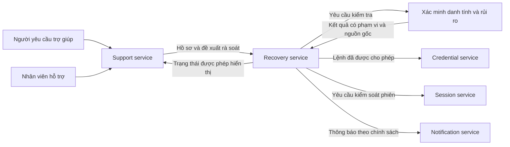

# Support service responsibility — Trách nhiệm của dịch vụ hỗ trợ trong khôi phục tài khoản

## 1. Dịch vụ hỗ trợ là một ranh giới bảo mật

Trong luồng khôi phục tài khoản, **support service** là thành phần quản lý tương tác giữa người yêu cầu trợ giúp, nhân viên hỗ trợ và các bộ phận xét duyệt. Thành phần này thường lưu ticket, phân công nhân viên, hướng dẫn bước tiếp theo, ghi nhận kết quả rà soát và hiển thị tiến độ.

Khi người dùng mất mật khẩu, thiết bị MFA hoặc passkey, bộ phận hỗ trợ có thể là điểm tiếp xúc cuối cùng họ còn sử dụng được. Điều đó cũng khiến support trở thành mục tiêu của giả mạo danh tính, gây áp lực tâm lý, lạm dụng quyền nhân viên và tấn công qua nhà cung cấp phần mềm ticket.

Ranh giới quan trọng là: **quyền xử lý hồ sơ hỗ trợ không tự động tạo ra quyền kiểm soát tài khoản được hỗ trợ**. Một ticket được đánh dấu “đã xử lý” không phải bằng chứng rằng người gửi ticket đã vượt qua yêu cầu xác minh danh tính. Một nhân viên được phép xem tiến độ cũng không mặc nhiên được phép xóa MFA, thay địa chỉ khôi phục hoặc phát hành phiên đăng nhập.

Bài học này đặt support service trong phạm vi khôi phục tài khoản an toàn: tiếp nhận đúng thông tin, phối hợp đúng bước và chuyển yêu cầu đến dịch vụ có thẩm quyền mà vẫn giữ được kiểm soát token dùng một lần, chống lạm dụng và quản lý session.

Các tên dịch vụ dưới đây là một cách phân chia trách nhiệm minh họa. Một hệ thống có thể thực hiện các ranh giới này bằng module trong cùng ứng dụng hoặc bằng nhiều microservice. Điểm cần giữ là quyền sở hữu dữ liệu và nơi thực thi quyết định, không phải số lượng tiến trình triển khai.

## 2. Phân chia quyền sở hữu rõ ràng

Một thiết kế dễ kiểm soát tách trạng thái hồ sơ hỗ trợ khỏi trạng thái bảo mật của yêu cầu khôi phục.

| Thành phần | Trách nhiệm chính | Dữ liệu hoặc quyết định thuộc quyền sở hữu |
|---|---|---|
| Support service | Tiếp nhận ticket, phân công, liên lạc, ghi nhận rà soát và chuyển cấp | Ticket, ghi chú nghiệp vụ, lịch sử phân công, liên kết đến hồ sơ khôi phục |
| Recovery service | Điều phối quy trình khôi phục và áp dụng chính sách | Trạng thái recovery case, yêu cầu bằng chứng, thời hạn, kết luận có được tiếp tục hay không |
| Thành phần xác minh danh tính | Kiểm tra bằng chứng theo phương thức đã được chấp thuận | Kết quả kiểm tra, nguồn gốc bằng chứng, mức tin cậy và phạm vi kết quả |
| Credential hoặc identity service | Thực thi thay đổi thông tin xác thực | Mật khẩu, đăng ký hoặc thu hồi authenticator, trạng thái yếu tố xác thực |
| Session service | Quản lý phiên và cơ chế thu hồi liên quan | Session, refresh token hoặc cơ chế phiên tương ứng của hệ thống |
| Notification service | Gửi thông báo theo chỉ thị được cho phép | Trạng thái gửi, template và kết quả chuyển phát; không tự chọn người được khôi phục |
| Audit và giám sát | Lưu dấu vết và phát hiện bất thường | Chuỗi sự kiện bảo mật, nguồn thực hiện và bằng chứng vận hành cần thiết |

Trong thực tế, một số trách nhiệm có thể cùng thuộc identity service. Dù triển khai chung hay riêng, support không nên ghi trực tiếp vào bảng credential, kho token hoặc bảng session để “sửa nhanh” một hồ sơ.

Recovery service có thể tham chiếu ticket để giải thích tại sao có bước rà soát thủ công. Chiều tham chiếu này không có nghĩa trạng thái ticket trở thành nguồn chuẩn cho quyền truy cập.



Sơ đồ thể hiện hướng phối hợp nghiệp vụ. Mỗi lời gọi vẫn cần xác thực bên gọi và phân quyền ở dịch vụ nhận; một mũi tên trong kiến trúc không tự tạo ra quan hệ tin cậy vô điều kiện.

## 3. Support nên làm gì và chuyển việc gì cho dịch vụ khác?

### 3.1. Tiếp nhận và phân loại

Support cần xác định người dùng đang gặp tình huống nào: quên mật khẩu nhưng còn phương thức khác, mất điện thoại MFA, không truy cập được email khôi phục, mất passkey trên thiết bị hay nghi ngờ tài khoản đã bị chiếm đoạt.

Việc phân loại giúp chọn hướng dẫn đúng. Nó chưa xác nhận rằng người gửi là chủ tài khoản. Các dữ kiện như tên hiển thị, ngày sinh, số đơn hàng hoặc ảnh chụp màn hình có thể hữu ích để hiểu vấn đề nhưng không tự trở thành bằng chứng đủ mạnh cho mọi hành động khôi phục.

Support nên hướng dẫn người dùng sử dụng các phương thức khôi phục đã có khi phù hợp. Nhân viên không yêu cầu người dùng đọc mật khẩu, mã OTP, mã dự phòng hoặc khóa bí mật vào cuộc gọi hay gửi chúng trong ticket. Nếu cần nhập một mã, người dùng thực hiện trên giao diện xác minh được thiết kế cho mục đích đó.

### 3.2. Điều phối rà soát thủ công

Một phương thức hỗ trợ thủ công cần có quy trình cụ thể: loại bằng chứng nào được chấp nhận, ai kiểm tra, kết quả có giá trị trong phạm vi nào, trường hợp nào phải chuyển cấp và ai có quyền quyết định bước tiếp theo.

OWASP xem việc liên hệ support với quy trình xác minh nghiêm ngặt là một lựa chọn khôi phục MFA; đồng thời nhấn mạnh rằng đường khôi phục có thể trở thành cách vượt qua MFA nếu thiết kế yếu. [OWASP: Resetting MFA](https://cheatsheetseries.owasp.org/cheatsheets/Multifactor_Authentication_Cheat_Sheet.html#resetting-mfa)

NIST SP 800-63B-4 mô tả các nhóm phương thức khôi phục và cho phép phương thức riêng của ứng dụng, như tương tác với nhân viên, dựa trên phân tích rủi ro có tài liệu. Việc một người đã liên hệ nhân viên không tự thay thế điều kiện của phương thức đã chọn. [NIST: Account Recovery](https://pages.nist.gov/800-63-4/sp800-63b.html#account-recovery)

Một biểu mẫu “Tôi đã xác minh người dùng” không đủ để mô tả quy trình đó. Kết quả cần thể hiện được phương pháp, nguồn bằng chứng, người thực hiện, thời điểm, phiên bản chính sách và các giới hạn áp dụng.

### 3.3. Hiển thị tiến độ và hỗ trợ tiếp tục

Support cần trả lời các câu hỏi mà người dùng thực sự cần biết: hồ sơ đã được tiếp nhận chưa, còn thiếu bước nào, có cần đợi xét duyệt không và bước tiếp theo được thực hiện ở đâu.

Thông tin hiển thị không cần bao gồm toàn bộ dữ liệu bảo mật. Ví dụ, nhân viên có thể được biết “đã gửi hướng dẫn qua kênh đủ điều kiện” nhưng không được xem token hoặc toàn bộ địa chỉ nhận. Quyền xem chi tiết phụ thuộc nhiệm vụ và ngữ cảnh truy cập.

Khi yêu cầu hết hạn hoặc bị từ chối, support hướng dẫn làm lại hay chuyển cấp theo chính sách. Nhân viên không tự đặt lại thời hạn, tăng số lần thử mã hoặc xóa dấu hiệu lạm dụng để giúp ticket chuyển sang trạng thái thuận lợi hơn.

### 3.4. Những thao tác nhạy cảm cần ở đúng nơi thực thi

| Yêu cầu từ hỗ trợ | Cách thực hiện có kiểm soát |
|---|---|
| Người dùng cần đặt mật khẩu mới | Recovery service cho phép bước đặt mật khẩu; người dùng nhập trực tiếp vào giao diện chuyên dụng |
| Người dùng mất thiết bị MFA | Áp dụng phương thức khôi phục tương ứng; credential service thực thi thu hồi hoặc đăng ký lại khi đủ điều kiện |
| Người dùng mất passkey | Hỗ trợ đường khôi phục và đăng ký credential mới; không hứa phục hồi private key mà dịch vụ không sở hữu |
| Người dùng muốn đổi email khôi phục | Đánh giá như thay đổi dữ liệu bảo mật; chứng minh kiểm soát email mới không tự chứng minh quyền sở hữu tài khoản cũ |
| Có dấu hiệu phiên bị chiếm đoạt | Chuyển sang luồng ứng phó có thẩm quyền, phối hợp kiểm soát session và xác minh chủ tài khoản |
| Có yêu cầu ưu tiên hoặc ngoại lệ | Chuyển cấp theo chính sách đã định nghĩa; độ khẩn cấp không tự tạo quyền bỏ qua kiểm tra |

## 4. Một luồng hỗ trợ khôi phục có ranh giới rõ ràng

Giả sử người dùng mất điện thoại và không còn sử dụng được yếu tố MFA trên thiết bị đó. Một luồng minh họa gồm các bước sau:

1. **Tiếp nhận:** Support tạo ticket với loại vấn đề và thông tin tối thiểu. Tại bước này, người gửi vẫn là bên đang tuyên bố quyền sở hữu tài khoản.
2. **Liên kết hồ sơ:** Thông qua API được phép, support tạo hoặc liên kết recovery case. Dịch vụ khôi phục kiểm tra quyền liên kết, tenant và tính phù hợp của yêu cầu.
3. **Chọn phương thức:** Recovery service xác định những phương thức nào đủ điều kiện. Support có thể hướng dẫn, nhưng không tự thêm một phương thức yếu hơn vì phương thức hiện tại khó thực hiện.
4. **Thu thập qua kênh phù hợp:** Người dùng gửi bằng chứng vào thành phần chuyên dụng nếu phương thức đó yêu cầu. Ticket lưu tham chiếu hoặc trạng thái thay vì sao chép toàn bộ bí mật và tài liệu.
5. **Rà soát:** Nhân viên hoặc nhóm chuyên trách ghi nhận kết quả trong phạm vi được giao. Hồ sơ rủi ro cao có thể cần người xét duyệt độc lập theo chính sách.
6. **Đánh giá quyết định:** Recovery service đối chiếu kết quả, thời hạn, trạng thái tài khoản và các kiểm soát chống lạm dụng. Đề xuất của support là một đầu vào được kiểm tra.
7. **Thực thi:** Khi đủ điều kiện, dịch vụ sở hữu credential thực hiện thay đổi được cho phép. Session và thông báo được xử lý theo kế hoạch khôi phục tương ứng.
8. **Phản ánh kết quả:** Support hiển thị kết quả thực tế và cập nhật ticket. Hoàn tất công việc của nhân viên không được ghi nhầm thành hoàn tất thay đổi bảo mật.

Nếu tài khoản chưa từng trải qua xác minh danh tính theo giấy tờ, yêu cầu một ảnh giấy tờ mới không tự chứng minh người trong ảnh chính là chủ tài khoản đó. Phương thức khôi phục cần xác lập được mối liên hệ với tài khoản đã tồn tại, thay vì chỉ xác định danh tính của người đang liên hệ.

Tương tự, người gọi kiểm soát một số điện thoại mới chỉ chứng minh được điều gì đó về số mới. Không được lấy kết quả đó làm lý do trực tiếp thay số cũ và sau đó dùng chính số mới để khôi phục tài khoản.

## 5. Phân quyền phải kiểm tra cả dịch vụ và nhân viên

### 5.1. Hai danh tính có hai ý nghĩa

Một yêu cầu đi từ support service đến recovery service có thể mang hai danh tính:

- **Danh tính workload:** Dịch vụ nào đang gọi, có được phép dùng API này và token có đúng nơi nhận không?
- **Danh tính người thao tác:** Nhân viên nào khởi tạo hành động, có quyền với hồ sơ này và đã đáp ứng điều kiện xác thực cần thiết chưa?

Xác thực workload bằng mTLS hoặc token dịch vụ không trả lời đầy đủ câu hỏi thứ hai. Ngược lại, tên nhân viên xuất hiện trong JSON không chứng minh request đến từ một dịch vụ được phép.

OWASP khuyến nghị mỗi microservice thực thi quyền truy cập cho thao tác được bảo vệ, kể cả lời gọi nội bộ; ngữ cảnh người dùng được truyền đi phải kiểm chứng được và dịch vụ gọi cần được xác thực riêng. [OWASP: Microservices Security](https://cheatsheetseries.owasp.org/cheatsheets/Microservices_Security_Cheat_Sheet.html#service-level-authorization)

Những header tự khai như `X-Agent-Role: ADMIN` hoặc `X-Verified-User: true` không đủ làm căn cứ. Dịch vụ nhận cần xác định nguồn danh tính đáng tin, kiểm tra tính hợp lệ và áp dụng quyền theo tài nguyên, tenant cùng trạng thái nghiệp vụ.

### 5.2. Quyền nhỏ và gắn với nhiệm vụ

Một mô hình quyền có thể phân biệt các khả năng:

| Khả năng | Phạm vi minh họa | Giới hạn cần giữ |
|---|---|---|
| `support:case:read` | Xem phần được phép của ticket được phân công | Không đồng nghĩa xem toàn bộ bằng chứng hoặc tài khoản |
| `support:review:submit` | Gửi nhận xét rà soát của một hồ sơ | Không tự chuyển thành quyền phê duyệt khôi phục |
| `recovery:review:decide` | Nhóm xét duyệt chuyên trách ra quyết định theo phương thức | Vẫn chịu kiểm tra chính sách, độ mới và phân tách nhiệm vụ |
| `recovery:instruction:request` | Đề nghị gửi hướng dẫn theo luồng đã có | Không tự chọn địa chỉ nhận tùy ý hoặc đọc token |
| `security:incident:escalate` | Chuyển cấp khi nghi ngờ chiếm đoạt | Không tự cho phép khóa hoặc mở mọi tài khoản |

Các tên quyền chỉ minh họa. Một quyền phải đi kèm ràng buộc về đối tượng: nhân viên nào, tenant nào, hồ sơ nào, hành động gì và trong thời gian nào. Quyền toàn cục như `support_admin` dễ che giấu quá nhiều hành động nhạy cảm.

Nhân viên cũng cần cơ chế đăng nhập phù hợp, xác thực mạnh cho công cụ hỗ trợ và xác thực lại đối với thao tác nhạy cảm khi chính sách yêu cầu. Việc nhân viên đang có một phiên console không chứng minh rằng mọi quyết định trong phiên đó đều được cho phép.

Nếu dùng hai người xét duyệt, hệ thống phải kiểm tra đó là hai chủ thể độc lập theo quy tắc tổ chức. Hai lần nhấn nút của cùng người hoặc hai tài khoản do cùng người điều khiển không tạo ra mức bảo vệ dự kiến. Hai người đồng ý cũng không thay thế bằng chứng vốn còn thiếu.

## 6. Thiết kế hợp đồng API để support không cấp quyền gián tiếp

### 6.1. Tránh một API “khôi phục ngay” quá rộng

Một hợp đồng nguy hiểm có thể trông như sau:

```http
POST /internal/accounts/account-482/reset
Content-Type: application/json

{
  "verifiedBySupport": true,
  "disableMfa": true,
  "newRecoveryEmail": "new-address@example.test"
}
```

Nếu dịch vụ nhận chỉ tin rằng request đến từ mạng nội bộ rồi thực hiện, support đã trở thành nơi cấp quyền thay đổi tài khoản. Kẻ chiếm được công cụ hỗ trợ có thể dùng cùng một request để thay kênh khôi phục và loại bỏ lớp bảo vệ hiện có.

Khắc phục không chỉ bằng đổi tên endpoint. Cần tách loại hành động, yêu cầu bằng chứng và dịch vụ sở hữu quyết định; các trường khai báo từ caller không được tự nâng thành kết quả xác minh.

### 6.2. Gửi kết quả rà soát thay vì gửi mệnh lệnh bỏ kiểm tra

Một API minh họa có phạm vi hẹp hơn:

```http
POST /internal/recovery-cases/rc-731/review-submissions
Authorization: Bearer <access-token-danh-cho-recovery-service>
Idempotency-Key: review-submit-91
Content-Type: application/json

{
  "supportCaseId": "sc-204",
  "expectedCaseVersion": 12,
  "reviewRef": "review-91",
  "evidenceRefs": ["evidence-58"],
  "recommendation": "CONTINUE_REVIEW",
  "reasonCode": "ASSIGNED_REVIEW_COMPLETED"
}
```

Các ID là dữ liệu minh họa. Bên nhận phải kiểm tra ticket và recovery case thực sự liên kết, bằng chứng thuộc đúng hồ sơ, review có nguồn gốc hợp lệ và người gửi có quyền. Một reference không phải bằng chứng hợp lệ chỉ vì định dạng của nó đúng.

Danh tính nhân viên được lấy từ ngữ cảnh đã xác thực và kiểm chứng, thay vì tin một trường `agentId` do trình duyệt tự gửi. Trong luồng bất đồng bộ, có thể truyền thông tin truy nguyên đã được xác nhận bởi producer có thẩm quyền; không lưu access token thô của nhân viên vào message để phát lại sau.

Phản hồi sau khi nhận có thể là:

```json
{
  "submissionId": "submission-91",
  "recoveryCaseId": "rc-731",
  "status": "RECEIVED",
  "nextAction": "WAIT_FOR_POLICY_EVALUATION"
}
```

`RECEIVED` chỉ xác nhận đã tiếp nhận submission theo hợp đồng. Nó không chứng minh bằng chứng đã đủ, không có nghĩa mật khẩu đã được đổi và không phải quyền đăng ký passkey mới.

Các lựa chọn tiếp theo cũng cần được thiết kế theo trạng thái. Ví dụ, `ADDITIONAL_EVIDENCE_REQUIRED` có thể trả về loại bước cần thực hiện; không cần trả các quy tắc chấm điểm rủi ro chi tiết mà người yêu cầu có thể lợi dụng để điều chỉnh tấn công.

### 6.3. Không đưa token khôi phục vào ticket

Khi người dùng đủ điều kiện tiếp tục, recovery service có thể tạo một quyền thực hiện hẹp hoặc một phiên khôi phục hạn chế theo thiết kế của hệ thống. Quyền đó phải ràng buộc với đúng tài khoản, mục đích, thời hạn và điều kiện sử dụng; việc chuyển giao cần theo kênh đã được cho phép.

Support có thể được biết “hướng dẫn đã được tạo” hoặc “yêu cầu gửi đã được tiếp nhận”. Nhân viên không cần có token dùng một lần trong màn hình hay bản sao URL để dán vào chat.

Một URL chỉ chứa ID ticket có thể dùng để xem tiến độ theo quyền tương ứng. Nếu URL chứa bearer token cho phép thay đổi credential, việc sao chép nó sang hệ thống hỗ trợ sẽ tạo thêm nơi có thể lộ quyền truy cập.

## 7. Trạng thái ticket không phải trạng thái recovery case

Một ticket có thể đóng vì người dùng ngừng phản hồi, tự giải quyết được vấn đề hoặc được chuyển sang bộ phận khác. Không trường hợp nào trong số đó tự xác nhận quyền truy cập tài khoản đã được khôi phục.

| Trạng thái hồ sơ hỗ trợ | Ý nghĩa | Điều không được suy diễn |
|---|---|---|
| `OPEN` | Vấn đề đã được tiếp nhận | Người gửi đã được xác minh |
| `ASSIGNED` | Nhân viên đang phụ trách | Nhân viên có quyền thay credential |
| `REVIEW_SUBMITTED` | Đã gửi nhận xét hoặc kết quả rà soát | Recovery case đã được phê duyệt |
| `WAITING_FOR_USER` | Chờ một bước từ người dùng | Được phép kéo dài token vô hạn |
| `ESCALATED` | Chuyển nhóm có thẩm quyền | Các kiểm soát hiện tại bị tạm bỏ qua |
| `CLOSED` | Công việc hỗ trợ đã kết thúc theo lý do được ghi nhận | Toàn bộ hậu quả bảo mật đã được thực thi thành công |

Recovery service cần quản lý trạng thái riêng, chẳng hạn `PENDING_EVIDENCE`, `UNDER_REVIEW`, `ELIGIBLE_TO_CONTINUE`, `EXECUTING`, `COMPLETED`, `REJECTED` hoặc `EXPIRED`. Tên cụ thể phụ thuộc hệ thống; quan trọng là có điều kiện chuyển trạng thái rõ ràng.

Ví dụ, support có thể đóng ticket sau khi người dùng xác nhận đã nhận được hướng dẫn, trong khi recovery case vẫn chờ người dùng đăng ký yếu tố mới. Nếu sản phẩm cần cả hai trạng thái, giao diện phải hiển thị chúng bằng nhãn dễ phân biệt.

Support lưu một bản chiếu tiến độ để phục vụ giao diện thì bản chiếu đó phải có thời điểm cập nhật và cách xử lý dữ liệu cũ. Không lấy một bản chiếu chậm cập nhật làm căn cứ thực hiện thay đổi bảo mật tiếp theo.

## 8. Tính nhất quán khi nhiều dịch vụ cùng tham gia

### 8.1. Gửi lại không được tạo thêm quyền

Nhân viên có thể bấm hai lần, trình duyệt có thể gửi lại sau timeout hoặc message có thể được giao nhiều lần. Các thao tác cần hỗ trợ idempotency theo đúng phạm vi chủ thể và tài nguyên.

Ví dụ, một idempotency key phải gắn với tenant, loại thao tác, hồ sơ và bên khởi tạo phù hợp. Nếu dùng lại cùng key với nội dung khác, hệ thống phải phát hiện xung đột. Nếu trả kết quả đã lưu, request hiện tại vẫn phải đáp ứng yêu cầu xác thực và quyền đọc kết quả đó.

Mã giả sau minh họa việc support lưu review và sự kiện cùng một giao dịch cục bộ:

```text
submitReview(authenticatedContext, ticketId, command):
    begin local transaction

    ticket = load ticket by authenticated tenant and ticketId, with lock
    require permission for this ticket and this review action

    previous = find idempotent result for scoped command key
    if previous exists:
        require payload matches the original command
        return previous result

    require ticket version matches expected version
    require this ticket is in a state that accepts review
    require evidence references belong to the linked recovery case

    review = store immutable review with verified actor context
    append outbox event with review ID and provenance references
    mark ticket as REVIEW_SUBMITTED
    store idempotent result

    commit local transaction
    return submission received
```

Mã giả chỉ bao phủ thao tác do support sở hữu. Consumer phía recovery vẫn cần kiểm tra nguồn message, quyền, liên kết hồ sơ, phiên bản và giá trị của kết quả trước khi đưa vào quyết định. Sự kiện “đã gửi review” không có quyền thay credential.

Outbox giúp tránh tình huống đã lưu review nhưng quên phát sự kiện trong cùng ranh giới cơ sở dữ liệu. Nó không tạo giao dịch nguyên tử bao trùm mọi microservice. Consumer vẫn cần chống xử lý trùng, xử lý lỗi và có cơ chế đối soát.

### 8.2. Bằng chứng và quyết định có thể cũ đi

Giữa lúc support rà soát và lúc hệ thống thực thi, người dùng có thể đã hoàn tất khôi phục ở nơi khác, yêu cầu bị thu hồi, kênh khôi phục bị thay đổi hoặc tài khoản phát sinh dấu hiệu chiếm đoạt.

Do đó, một review cần gắn với phiên bản hoặc ngữ cảnh đã được xét. Trước hành động nhạy cảm, dịch vụ có thẩm quyền kiểm tra lại những điều kiện phải còn đúng. Không dùng một kết luận “được phép tiếp tục” của tuần trước cho một yêu cầu mới chỉ vì cùng account ID.

Nếu có quyền dùng một lần cho thay đổi credential, dịch vụ thực thi phải bảo đảm quyền đó không được sử dụng lại khi nhiều request chạy đồng thời. Việc tiêu thụ quyền và thay đổi tương ứng cần có cơ chế nhất quán tại ranh giới sở hữu; trường hợp tách nhiều dịch vụ phải có giao thức rõ ràng, không chỉ kiểm tra cờ rồi gửi lệnh.

### 8.3. Xử lý lỗi mà không bỏ qua chính sách

| Sự cố | Cách phản ánh và xử lý |
|---|---|
| API recovery timeout sau khi gửi review | Giữ trạng thái chưa xác định kết quả, tra cứu theo submission hoặc idempotency key; không tạo quyền khôi phục mới |
| Dịch vụ xác minh chưa hoạt động | Chờ, thử lại có kiểm soát hoặc chuyển cấp; không tự chuyển thành đã xác minh |
| Credential đã đổi nhưng cập nhật ticket thất bại | Đối soát và cập nhật bản chiếu; không hoàn tác bảo mật chỉ để khớp trạng thái ticket |
| Thu hồi session chưa hoàn tất | Hiển thị tiến trình đúng thực tế; áp dụng trạng thái hạn chế nếu chính sách cần, không tuyên bố đã thu hồi toàn bộ |
| Message đến lặp hoặc sai thứ tự | Dùng định danh sự kiện, phiên bản và điều kiện chuyển trạng thái; không mở lại case đã hoàn tất |
| Gửi thông báo bị lỗi | Retry và giám sát theo chính sách; không đánh đồng đã xếp hàng với đã chuyển phát thành công |

Đặc biệt, một sự kiện gửi đến session service không chứng minh mọi access token đã mất hiệu lực. Hiệu quả thu hồi phụ thuộc cách các dịch vụ tài nguyên kiểm tra phiên, thời hạn token, cache và cơ chế thu hồi đang dùng. Recovery workflow phải định nghĩa kết quả hoàn tất dựa trên các bảo đảm thật của hệ thống.

Nếu quy trình yêu cầu chặn truy cập trong khi khôi phục, cơ chế chặn phải được thực thi tại các điểm quyết định truy cập liên quan. Dòng chữ “đang khôi phục” trong ticket không tạo ra cơ chế đó.

## 9. Bảo vệ dữ liệu và công cụ hỗ trợ

### 9.1. Giảm dữ liệu xuất hiện trong ticket

Ticket thường được tìm kiếm, gửi email, xuất báo cáo, sao chép sang hệ thống phân tích hoặc truy cập bởi nhà cung cấp ngoài. Vì vậy, nó không phải nơi thích hợp để tập trung toàn bộ bằng chứng nhạy cảm.

Nên lưu metadata tối thiểu: mã hồ sơ, loại vấn đề, bước còn thiếu, reference của bằng chứng và mã lý do xử lý. Khi cần xem tài liệu, nhân viên truy cập kho bằng chứng qua quyền riêng, có thời hạn và có audit. Reference cũng phải được kiểm tra quyền truy cập; không biến ID khó đoán thành cơ chế phân quyền duy nhất.

Nếu tài liệu nhạy cảm là một phần hợp lệ của phương thức khôi phục, cần xác định mục đích, phạm vi truy cập và thời gian lưu. Không thu thêm giấy tờ chỉ vì biểu mẫu ticket có trường đính kèm. Tệp được tải lên cũng cần xử lý như nội dung không tin cậy để tránh trở thành đường tấn công công cụ nhân viên.

Không đưa các dữ liệu sau vào ghi chú tự do, message thông thường hoặc log hỗ trợ:

- Mật khẩu hiện tại hoặc mật khẩu mới của người dùng.
- Token đặt lại mật khẩu, mã OTP, mã khôi phục hoặc seed TOTP.
- Cookie phiên, refresh token hoặc private key.
- Bản sao đầy đủ của bằng chứng danh tính khi chỉ cần lưu kết quả hoặc reference.

Nếu người dùng vô tình gửi bí mật vào ticket, cần quy trình hạn chế tiếp tục lộ, xử lý bản sao trong các tích hợp liên quan và thay thế hoặc thu hồi bí mật khi phù hợp. Chỉ xóa chữ khỏi giao diện ticket không chứng minh mọi bản sao đã biến mất.

### 9.2. Ghi nhận đủ để truy nguyên hành động

Một sự kiện audit có thể bao gồm: actor là dịch vụ nào và nhân viên nào, tenant, support case, recovery case, hành động, mã lý do, phiên bản chính sách, kết quả, thời điểm và correlation ID.

Ví dụ:

```json
{
  "eventType": "SUPPORT_REVIEW_SUBMITTED",
  "serviceActor": "support-service",
  "humanActorRef": "staff-27",
  "tenantRef": "tenant-08",
  "supportCaseRef": "sc-204",
  "recoveryCaseRef": "rc-731",
  "reviewRef": "review-91",
  "policyVersion": "assisted-recovery-v4",
  "result": "SUBMISSION_RECEIVED",
  "correlationId": "correlation-912"
}
```

Những trường này phục vụ truy nguyên, không phải bằng chứng tự đủ để cấp quyền. Log phải được bảo vệ khỏi sửa đổi trái phép; nhân viên thao tác hồ sơ không nên có khả năng xóa dấu vết tương ứng. Ghi chú hội thoại có thể chỉnh sửa cần được phân biệt với lịch sử hành động bảo mật.

### 9.3. Phân biệt kênh liên lạc với kênh đủ điều kiện khôi phục

Người gửi có thể đề nghị “xin phản hồi qua email mới này”. Support có thể dùng địa chỉ đó để trao đổi thông tin chung nếu chính sách cho phép, nhưng không tự nâng nó thành kênh nhận quyền khôi phục tài khoản.

Kênh đủ điều kiện cần được xác định theo recovery workflow và trạng thái tài khoản. Việc lựa chọn thông báo cho tài khoản nghi bị chiếm đoạt cũng cần xét kênh nào còn an toàn. Support không được tự chuyển toàn bộ thông báo sang địa chỉ người đang yêu cầu vừa cung cấp.

## 10. Đối phó với lạm dụng quy trình hỗ trợ

Một kịch bản thường gặp là người gọi biết nhiều thông tin công khai, nói tài khoản rất quan trọng, yêu cầu xử lý gấp và muốn đổi đồng thời email lẫn MFA. Nếu nhân viên thực hiện cả hai thay đổi chỉ dựa trên cuộc gọi, người gọi có thể nắm toàn bộ đường đăng nhập và khôi phục tiếp theo.

Một thiết kế giữ ranh giới sẽ ghi nhận yêu cầu, chuyển đúng phương thức xét duyệt và để dịch vụ sở hữu chính sách quyết định. Tình trạng khẩn cấp có thể thay đổi thứ tự ưu tiên trong hàng chờ, nhưng không tự thay đổi mức bằng chứng cần có.

Các tình huống khác cần dự liệu:

- **Mở nhiều ticket với nhiều nhân viên:** hệ thống liên kết tín hiệu lạm dụng và các recovery case theo quyền được phép, tránh mỗi ticket được xử lý như một cơ hội xác minh độc lập.
- **Dùng tài khoản nhân viên bị chiếm đoạt:** giới hạn quyền theo nhiệm vụ, xác thực lại khi cần, kiểm soát truy cập dữ liệu và phát hiện chuỗi hành động bất thường.
- **Thử lại qua nhiều kênh để tránh giới hạn:** giới hạn và trạng thái chống lạm dụng thuộc workflow chung, không bị đặt lại khi đổi từ chat sang điện thoại.
- **Tự nhận là quản lý, đối tác hoặc người có thẩm quyền:** kiểm tra qua quy trình tổ chức đã định nghĩa; lời tự khai không trở thành quyền trong hệ thống.
- **Yêu cầu nhân viên đăng nhập hộ để kiểm tra:** không phát hành session của người dùng cho support như một phần mặc định của recovery. Công cụ hỗ trợ đặc biệt, nếu có, cần phạm vi và audit riêng.

Cũng cần tránh tạo cơ chế từ chối dịch vụ. Việc ai đó mở ticket hoặc báo mất tài khoản không tự động đủ để khóa tài khoản nạn nhân. Những thao tác hạn chế bảo mật phải có điều kiện, giới hạn và thẩm quyền được thiết kế trước.

Trước khi xác minh quyền truy cập hồ sơ, các phản hồi công khai cần tránh làm lộ tài khoản tồn tại hay không. Trong console nội bộ, khả năng tìm tài khoản và xem trạng thái cũng cần được cấp đúng nhiệm vụ, thay vì xem mọi nhân viên support là người được phép tra cứu mọi người dùng.

## 11. Các tình huống cần kiểm chứng khi triển khai

| Tình huống | Kết quả mong đợi |
|---|---|
| Nhân viên tenant A gửi review cho hồ sơ tenant B | Bị từ chối ở dịch vụ nhận, không chỉ bị ẩn nút trên console |
| Caller tự sửa `agentId` hoặc vai trò trong request | Danh tính và quyền được lấy từ nguồn kiểm chứng; trường tự khai không nâng quyền |
| Workload đúng nhưng nhân viên không có quyền với ticket | Không thực hiện hành động được yêu cầu |
| Nhân viên có quyền nhưng token dịch vụ sai nơi nhận | Lời gọi không được chấp nhận |
| Review tham chiếu bằng chứng của recovery case khác | Bị từ chối và có dấu vết phù hợp |
| Gửi lại cùng idempotency key và cùng nội dung | Trả kết quả tương ứng, không tạo thêm submission hoặc quyền khôi phục |
| Dùng lại key với nội dung khác | Phát hiện xung đột theo hợp đồng |
| Case hết hạn sau khi review đã được gửi | Quyết định hoặc thực thi không dùng kết quả cũ để bỏ qua hạn |
| Ticket được đánh dấu `CLOSED` | Credential và session không thay đổi chỉ do trạng thái đó |
| Hai nhân viên cùng thao tác trên phiên bản case cũ | Có xử lý cạnh tranh; không tạo hai quyết định hoặc hai quyền dùng một lần ngoài ý định |
| Credential đã đổi nhưng phản hồi mạng bị mất | Tra cứu và đối soát được kết quả; không đổi lại hoặc phát thêm quyền một cách mù quáng |
| Dịch vụ xác minh hoặc phân quyền không truy cập được | Giữ yêu cầu chờ hoặc từ chối an toàn, không cho phép theo mặc định |
| Người dùng gửi OTP vào ticket | Có quy trình xử lý lộ bí mật và bản sao trong tích hợp |
| Yêu cầu hỗ trợ từ người chưa xác minh | Không tiết lộ tài khoản hoặc thực hiện khóa, thay đổi credential ngoài điều kiện cho phép |

Các kiểm thử này cần bao phủ cả API nội bộ, consumer message và quyền truy cập dữ liệu. Kiểm thử console chỉ chứng minh một giao diện đang hạn chế thao tác; nó không chứng minh các đường gọi khác cũng thực thi cùng ranh giới.

Về vận hành, có thể theo dõi số hồ sơ được chuyển cấp, số submission bị từ chối do sai quyền, tỷ lệ dùng bằng chứng hết hạn, thời gian chờ xét duyệt và độ trễ cập nhật trạng thái. Số ticket đóng nhanh không nên là thước đo duy nhất, vì có thể tạo áp lực bỏ bước xác minh.

Support service làm tốt trách nhiệm khi người dùng được hướng dẫn rõ ràng, nhân viên có đủ công cụ để xử lý hồ sơ và mọi thay đổi quyền kiểm soát tài khoản vẫn đi qua nơi có thẩm quyền. Ranh giới đó giúp một tài khoản nhân viên, một ticket hoặc một tích hợp hỗ trợ bị lạm dụng không lập tức trở thành quyền thay mật khẩu, MFA, passkey và session của người dùng.
