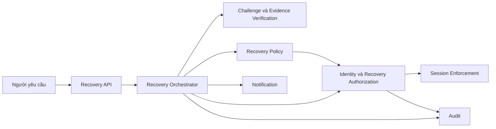
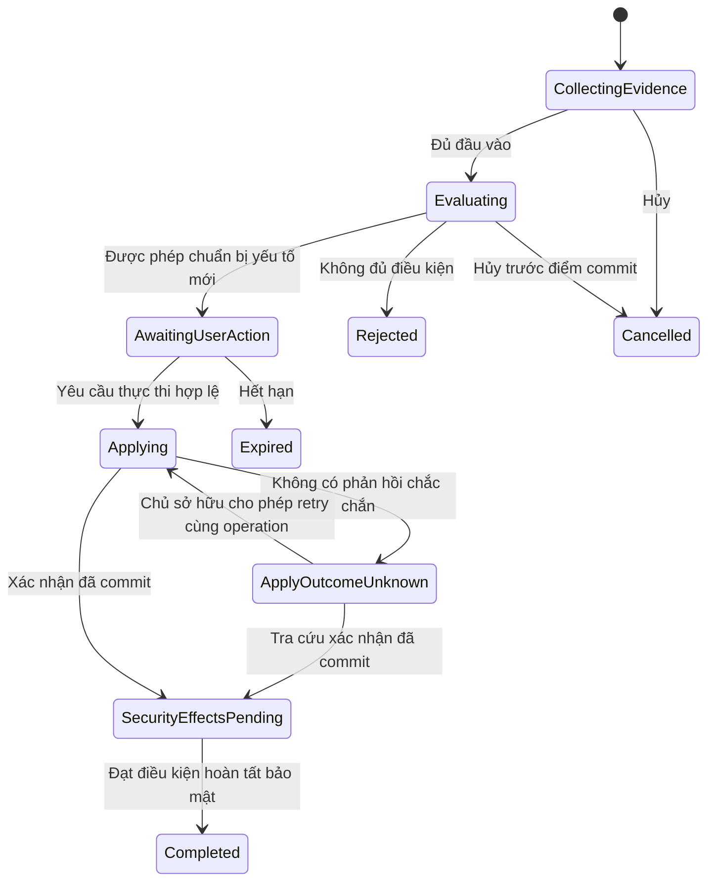

# Recovery orchestration boundary — Ranh giới điều phối khôi phục tài khoản

## 1. Điều phối luồng khôi phục là trách nhiệm gì?

Trong module `SECURITY_AUTHENTICATION_ACCOUNT_RECOVERY`, một yêu cầu lấy lại quyền truy cập có thể liên quan đến mật khẩu, MFA, passkey, thiết bị xác thực, bằng chứng danh tính và các session đang hoạt động. Các thành phần xử lý những dữ liệu này thường có chủ sở hữu khác nhau.

**Recovery orchestration boundary** là ranh giới xác định bộ điều phối khôi phục được giữ trạng thái nào, gửi lệnh nào, tin kết quả nào và dựa vào đâu để chuyển sang bước tiếp theo.

Bộ điều phối trả lời các câu hỏi như:

- Hồ sơ này đang chờ bằng chứng, chờ quyết định hay đang thực thi thay đổi?
- Bước nào đã có kết quả được xác nhận và bước nào cần tra cứu lại?
- Khi dịch vụ phụ thuộc lỗi, có thể thử lại thao tác nào?
- Khi người dùng hủy hoặc hồ sơ hết hạn, còn hành động nào được phép tiếp tục?

Quyết định “cho phép thay MFA” và thao tác ghi thay đổi MFA cần có chủ thể thực thi chính sách rõ ràng. Việc một workflow đã chạy đến bước cuối không tự tạo quyền sửa tài khoản.

Mục tiêu của bài là thiết kế sự phối hợp giữa các miền sao cho mất phản hồi, chạy lại workflow, sự kiện trùng hoặc hồ sơ cạnh tranh không trở thành đường chiếm đoạt tài khoản. Những ranh giới dưới đây là một mô hình thiết kế minh họa; chúng có thể được triển khai trong nhiều dịch vụ hoặc trong các module có giao diện nội bộ chặt chẽ.

## 2. Phân biệt ba loại quyền quyết định

Một thiết kế dễ kiểm soát tách ba trách nhiệm:

| Trách nhiệm | Câu hỏi cần trả lời | Ví dụ đầu ra |
|---|---|---|
| Điều phối tiến trình | Bước tiếp theo là gì dựa trên kết quả đã có? | Yêu cầu đánh giá hồ sơ, tra cứu trạng thái thao tác |
| Đánh giá và cho phép | Bằng chứng và rủi ro có đủ cho thao tác cụ thể không? | Quyết định cho phép thay đúng yếu tố bị mất |
| Thực thi thay đổi | Quyền này còn hiệu lực tại lúc ghi và thay đổi nào được phép? | Tiêu thụ quyền, cập nhật credential, ghi kết quả |

Nếu gộp cả ba thành một hàm có quyền ghi mọi cơ sở dữ liệu, bộ điều phối trở thành điểm có khả năng sửa tài khoản ngoài quy tắc của từng miền.

Tách trách nhiệm không có nghĩa mỗi trách nhiệm phải là một microservice riêng. Điểm cần giữ là quyền sở hữu dữ liệu, hợp đồng gọi và nơi cưỡng chế các điều kiện bảo mật.

Ví dụ, dịch vụ Identity có thể chứa module thực thi recovery grant, còn logic đánh giá rủi ro nằm ở một module khác. Bộ điều phối chỉ gửi tham chiếu quyết định và yêu cầu thao tác; Identity vẫn kiểm tra grant, chủ thể, phạm vi, trạng thái hiện tại và phiên bản credential tại thời điểm ghi.

## 3. Bản đồ ranh giới và dữ liệu sở hữu

Một sơ đồ logic cho luồng khôi phục:



Sơ đồ biểu diễn giao tiếp logic, không yêu cầu tất cả lời gọi đều đồng bộ. Chẳng hạn, Identity có thể phát sự kiện cho session enforcement và audit qua outbox, còn bộ điều phối theo dõi kết quả qua API hoặc sự kiện.

Một phân công dữ liệu có thể như sau:

| Thành phần | Dữ liệu sở hữu | Quyền mà bộ điều phối nên có |
|---|---|---|
| Recovery Orchestrator | Hồ sơ, trạng thái tiến trình, liên kết bước, lịch retry | Đọc/ghi dữ liệu tiến trình của chính nó |
| Challenge Verification | Challenge, hạn, số lần thử, kết quả tiêu thụ | Tạo challenge theo chính sách, nhận kết quả đã xác thực |
| Evidence Verification | Bằng chứng, phiên bản, kết quả kiểm tra | Gửi yêu cầu và tham chiếu; hạn chế quyền đọc dữ liệu gốc |
| Recovery Policy | Yêu cầu bằng chứng, quyết định, phiên bản chính sách | Yêu cầu đánh giá, đọc quyết định theo quyền |
| Identity | Credential, authorization grant, phiên bản bảo mật tài khoản | Gọi thao tác recovery chuyên biệt; không ghi trực tiếp bảng |
| Session Enforcement | Session, refresh token hoặc cơ chế kiểm tra hiệu lực | Yêu cầu/quan sát tác động theo hợp đồng |
| Notification | Mẫu, trạng thái gửi, quyền truy cập kênh giao nhận | Yêu cầu thông báo đến đích được phép |
| Audit | Sự kiện kiểm toán theo chính sách lưu giữ | Ghi sự kiện cần thiết, không sửa lịch sử tùy ý |

Trong mô hình này, orchestrator lưu `challengeRef`, `evidenceSetRef`, `decisionRef` hoặc `operationId`. Nó không cần giữ bản rõ OTP, ảnh giấy tờ, mật khẩu mới hoặc private key.

Cụ thể với đổi mật khẩu, giao diện có thể gửi mật khẩu trực tiếp đến endpoint được Identity quản lý. Với đăng ký passkey, quá trình xác minh đăng ký và lưu credential thuộc miền xác thực. Workflow chỉ cần biết bước đó đã tạo ra một kết quả hợp lệ, gắn với đúng chủ thể và mục đích.

## 4. Các bất biến cần giữ qua mọi dịch vụ

Một luồng recovery cần các điều kiện luôn đúng, kể cả khi có lỗi mạng:

1. Mỗi thao tác thay đổi credential chỉ áp dụng cho đúng tenant, tài khoản, hồ sơ và mục đích đã được cho phép.
2. Một kết quả xác minh chỉ có giá trị cho bộ bằng chứng và phiên bản mà nó thực sự đánh giá.
3. Quyền khôi phục có hạn, có phạm vi và được kiểm tra khi thực thi.
4. Một quyền một lần không thể tạo ra hai thay đổi bảo mật khác nhau.
5. Retry của cùng thao tác không được trở thành yêu cầu thay đổi mới.
6. Hồ sơ bị hủy hoặc hết hạn không được mở lại chỉ vì có sự kiện đến muộn.
7. Trạng thái thành công của workflow phải dựa trên kết quả từ miền sở hữu thay đổi.
8. Tác động lên session phải có tiêu chí hoàn tất rõ ràng.
9. Không tiết lộ sự tồn tại tài khoản hoặc chi tiết xác minh cho người chưa có quyền.
10. Quyền truy cập giữa dịch vụ không thay thế quyền nghiệp vụ của hồ sơ.

Điểm cuối đặc biệt quan trọng: workload identity của orchestrator chứng minh dịch vụ nào đang gọi. Nó không chứng minh tài khoản nào cũng được phép reset. Identity cần cả quyền của caller lẫn quyền của thao tác recovery cụ thể.

### Ví dụ phạm vi thao tác

`RESET_PASSWORD`, `REPLACE_LOST_MFA`, `REMOVE_LOST_PASSKEY` và `REGISTER_REPLACEMENT_PASSKEY` có thể cần bằng chứng hoặc điều kiện khác nhau. Không dùng một cờ `recoveryApproved=true` cho mọi thao tác.

Tương tự, được thay thiết bị MFA không mặc nhiên được đổi email khôi phục, thêm người được ủy quyền hoặc truy cập dữ liệu thanh toán. Nếu quy trình cần nhiều thay đổi, chính sách phải thể hiện rõ tập hành động và thứ tự được phép.

## 5. Một luồng khôi phục mẫu

Giả sử người dùng mất điện thoại chứa MFA. Họ còn một kênh khôi phục đã đăng ký nhưng chính sách yêu cầu thêm bằng chứng trước khi thay yếu tố xác thực.

### Bước 1: Tiếp nhận yêu cầu

Recovery API kiểm tra đầu vào và giới hạn lạm dụng trước khi mở công việc tốn tài nguyên. Phản hồi công khai cần được thiết kế để hạn chế dò tài khoản.

Bộ điều phối tạo hồ sơ nội bộ, thời hạn và phiên bản tiến trình. Không vô hiệu hóa MFA hiện tại chỉ vì có yêu cầu công khai; nếu làm vậy, kẻ tấn công có thể gây gián đoạn bằng cách liên tục mở recovery.

OWASP khuyến nghị phản hồi nhất quán khi yêu cầu reset mật khẩu, token có hạn và dùng một lần, cùng cơ chế chống gửi yêu cầu quá mức. Đây là nền tảng cho bước tiếp nhận; khôi phục MFA hoặc passkey vẫn cần chính sách chuyên biệt. Xem [Forgot Password Cheat Sheet](https://cheatsheetseries.owasp.org/cheatsheets/Forgot_Password_Cheat_Sheet.html).

### Bước 2: Thu thập kết quả xác minh

Bộ điều phối yêu cầu các thành phần chuyên trách thực hiện challenge và đánh giá bằng chứng. Mỗi yêu cầu có định danh ổn định và liên kết với hồ sơ.

`EmailDelivered` chỉ nói về kết quả giao nhận trong phạm vi hợp đồng. `ChallengeVerified` có thể nói challenge đã được chứng minh. Hai sự kiện này không tương đương.

Khi bằng chứng thay đổi, cần một phiên bản mới. Kết quả đánh giá ảnh cũ không được dùng để phê duyệt ảnh mới chỉ vì cùng `caseId`.

### Bước 3: Đánh giá quyền thực hiện

Policy đánh giá thao tác được yêu cầu, bộ bằng chứng, bối cảnh rủi ro và điều kiện hiện hành. Kết quả cho phép cần gắn với phiên bản cụ thể thay vì một kết luận chung không có hạn.

Trong mô hình của bài, Identity lưu bản ghi authorization grant có thẩm quyền cho việc thực thi. Việc kích hoạt grant dựa trên quyết định từ chủ thể được phép; orchestrator không được tự tạo một grant hợp lệ bằng cách gửi JSON có trường `approved=true`.

### Bước 4: Chuẩn bị yếu tố thay thế

Nếu người dùng đăng ký yếu tố mới, miền Identity thực hiện challenge hoặc thủ tục chứng minh cần thiết và tạo một bản ghi chuẩn bị.

Bản ghi chuẩn bị phải gắn với tài khoản, hồ sơ, mục đích và thời hạn. Một chuỗi `newCredentialRef` do client nhập không được tin là bằng chứng sở hữu yếu tố mới.

Không cần đưa secret của yếu tố mới vào lịch sử workflow. Đặc biệt, không ghi OTP seed, mật khẩu hoặc recovery token vào tham số activity được hệ thống điều phối tự động lưu.

### Bước 5: Thực thi thay đổi

Orchestrator gửi lệnh chuyên biệt đến Identity, tham chiếu grant và bản ghi yếu tố mới. Identity kiểm tra quyền hiện hành rồi thực hiện thay đổi trong ranh giới giao dịch của chính nó.

Kết quả cần có định danh thao tác và phiên bản bảo mật mới để có thể tra cứu sau khi mất phản hồi.

### Bước 6: Xác nhận tác động bảo mật

Bộ điều phối theo dõi các điều kiện bắt buộc như vô hiệu hóa yếu tố bị mất và áp dụng chính sách đối với session cũ.

Nếu thay credential thành công nhưng chưa chứng minh session cũ đã bị chặn theo mục tiêu đã đặt, tiến trình phải phản ánh phần việc còn lại. Không dùng thông báo “Khôi phục hoàn tất” để che trạng thái chưa rõ.

### Bước 7: Kết thúc và thông báo

Thông báo được gửi đến những kênh mà chính sách cho phép. Đích thông báo cần được phân giải từ dữ liệu có thẩm quyền; không nhận tùy ý một email mới từ request rồi coi đó là kênh đáng tin để nhận cảnh báo bảo mật.

Một hồ sơ hoàn tất cũng không mặc nhiên cấp session đăng nhập đầy đủ. Nếu thiết kế yêu cầu đăng nhập lại, người dùng đi qua luồng xác thực thông thường với yếu tố đã được thiết lập.

## 6. Trạng thái tiến trình và trạng thái bảo mật

Nên phân biệt trạng thái mà orchestrator biết với trạng thái có thẩm quyền tại Identity.



Sơ đồ lược bớt một số nhánh lỗi để thể hiện điểm quan trọng: timeout khi ghi không đủ để kết luận thay đổi đã thất bại.

Ví dụ dữ liệu tiến trình:

```json
{
  "caseId": "rcv-example-71",
  "tenantId": "tenant-example",
  "subjectRef": "subject-internal-18",
  "requestedAction": "REPLACE_LOST_MFA",
  "evidenceSetVersion": 4,
  "decisionRef": "decision-example-9",
  "authorizationRef": "authorization-example-26",
  "operationId": "operation-example-44",
  "state": "APPLY_OUTCOME_UNKNOWN",
  "workflowVersion": 12
}
```

Đây là ví dụ nội bộ, không phải payload trả nguyên vẹn cho người yêu cầu công khai. `subjectRef` không phải secret, nhưng vẫn là dữ liệu cần kiểm soát truy cập.

Một thay đổi `workflowVersion` giúp phát hiện hai tiến trình cùng cập nhật hồ sơ. Nó không thay thế kiểm tra phiên bản credential hoặc grant trong Identity. Mỗi ranh giới cần xử lý cạnh tranh đối với dữ liệu mà nó sở hữu.

## 7. Hợp đồng command và event

### 7.1. Command yêu cầu thực hiện một hành động

Ví dụ hợp đồng nội bộ:

```json
{
  "commandType": "ApplyRecoveryChange",
  "schemaVersion": 1,
  "tenantId": "tenant-example",
  "caseId": "rcv-example-71",
  "authorizationRef": "authorization-example-26",
  "operationId": "operation-example-44",
  "action": "REPLACE_LOST_MFA",
  "expectedCredentialVersion": 8,
  "preparedCredentialRef": "prepared-example-63"
}
```

Identity không chấp nhận command chỉ vì các trường có đủ. Nó phải kiểm tra:

- Caller được phép gọi loại thao tác này.
- Grant thuộc đúng tenant, chủ thể, hồ sơ và action.
- Grant còn hiệu lực, chưa bị hủy và chưa bị tiêu thụ cho thao tác khác.
- `expectedCredentialVersion` phù hợp trạng thái hiện hành.
- Yếu tố chuẩn bị thực sự được tạo cho đúng chủ thể và recovery context.
- Điều kiện thực thi bổ sung của miền vẫn được đáp ứng.

`operationId` dùng cho idempotency, không phải credential. `authorizationRef` cũng không nên được coi là bí mật tự mang toàn bộ quyền; nếu sử dụng capability dạng bearer thay vì tham chiếu, cần thiết kế riêng về bảo mật token, audience, scope, hạn và tiêu thụ.

### 7.2. Event thông báo một sự kiện đã xảy ra

Ví dụ:

```json
{
  "eventType": "RecoveryChangeApplied",
  "schemaVersion": 1,
  "eventId": "event-example-105",
  "producer": "identity",
  "tenantId": "tenant-example",
  "caseId": "rcv-example-71",
  "operationId": "operation-example-44",
  "authorizationRef": "authorization-example-26",
  "credentialVersion": 9,
  "securityEpoch": 23
}
```

Consumer chỉ sử dụng event khi nguồn phát được xác thực và được phép phát loại sự kiện tương ứng. Trường `producer` trong JSON không tự chứng minh nguồn.

Event cần đủ thông tin liên kết kết quả với command, nhưng không chứa mật khẩu, OTP, tài liệu gốc hoặc token khôi phục. Correlation ID và trace ID hỗ trợ quan sát; chúng không tạo quyền chuyển trạng thái.

Khi có event cũ hoặc sai thứ tự, orchestrator cần dựa vào định danh thao tác, phiên bản theo nguồn và trạng thái hiện hành. Không áp dụng quy tắc “event đến sau cùng luôn thắng” trên toàn hệ thống, vì các dịch vụ không có một thứ tự toàn cục tự nhiên.

## 8. Điểm commit và giao dịch trong miền Identity

Điểm nhạy cảm nhất là lúc quyền được tiêu thụ và credential được thay đổi. Nếu làm thành hai thao tác không có tính nguyên tử, có thể xảy ra:

- Đã đổi credential nhưng grant vẫn dùng được.
- Đã tiêu thụ grant nhưng không có kết quả để tra cứu.
- Hai tiến trình cùng vượt kiểm tra “chưa dùng” rồi cùng thay đổi tài khoản.

Trong mô hình minh họa, Identity giữ grant, dữ liệu credential liên quan, kết quả thao tác và outbox trong cùng ranh giới giao dịch có thể bảo đảm tính nguyên tử cần thiết.

Đoạn Java giả mã sau chỉ mô tả thứ tự kiểm tra và ghi; các repository, phương thức và cơ chế khóa là giao diện minh họa:

```java
RecoveryResult applyRecovery(
        ApplyRecoveryCommand command,
        WorkloadIdentity caller) {

    access.requireRecoveryExecutionPermission(caller, command.tenantId());

    return identityTransaction.execute(() -> {
        // Cùng quy tắc khóa được dùng ở đường cancel/revoke.
        RecoveryGrant grant = grants.lock(command.authorizationRef());
        grant.requireBoundContext(command, caller);

        RecoveryResult existing =
                results.find(command.tenantId(), command.operationId());

        if (existing != null) {
            existing.requireSameRequest(command.canonicalRequestHash());
            return existing;
        }

        grant.requireActive(databaseClock.now());

        AccountSecurity account = accounts.lock(grant.subjectRef());
        account.requireCredentialVersion(command.expectedCredentialVersion());

        PreparedCredential prepared =
                preparedCredentials.lock(command.preparedCredentialRef());
        prepared.requireValidFor(grant, databaseClock.now());

        account.replaceLostFactor(prepared);
        account.advanceSecurityEpoch();
        grant.consume(command.operationId());

        RecoveryResult result = RecoveryResult.applied(
                command, account.credentialVersion(), account.securityEpoch());

        results.insertUnique(result);
        outbox.append(RecoveryChangeApplied.from(result));
        return result;
    });
}
```

Các điều kiện để giả mã có ý nghĩa:

- Tất cả dữ liệu được ghi ở đây thuộc cùng giao dịch Identity; `@Transactional` bên orchestrator không mở rộng sang cơ sở dữ liệu dịch vụ khác.
- Có ràng buộc duy nhất phù hợp cho kết quả thao tác, cùng cơ chế khóa hoặc so sánh phiên bản để xử lý cạnh tranh.
- Hash yêu cầu được tính từ biểu diễn chuẩn hóa của các trường nghiệp vụ; không tin hash do client gửi.
- Đường trả kết quả cũ vẫn kiểm tra quyền truy cập và ngữ cảnh. Grant đã hết hạn sau khi commit có thể cho phép tra cứu kết quả cũ theo hợp đồng, nhưng không cho phép thay đổi mới.
- Việc thay yếu tố và tăng security epoch chỉ có tác dụng bảo vệ session khi cơ chế xác thực phía sau thực sự cưỡng chế epoch đó.
- Mọi đường hủy, thu hồi hoặc thực thi cần quy tắc cạnh tranh nhất quán đối với bản ghi có thẩm quyền.

Nếu kiến trúc hiện tại đặt grant, credential và khóa thu hồi ở ba dịch vụ khác nhau, không thể giả định có giao dịch như ví dụ. Cần xác định lại miền sở hữu hoặc thiết kế protocol có các điều kiện và trạng thái trung gian rõ ràng.

### Hủy và thực thi cạnh tranh thế nào?

Cờ `cancelled=true` trong database orchestrator chưa đủ để chặn một command đã đến Identity.

Trong mô hình này, hiệu lực hủy được quyết định ở bản ghi authorization của Identity:

- Nếu hủy được ghi trước theo cơ chế tuần tự hóa của chủ sở hữu, thực thi phải bị từ chối.
- Nếu thực thi đã commit trước, hủy không được báo rằng thay đổi chưa xảy ra.
- Nếu chưa rõ thứ tự, orchestrator tra cứu kết quả từ Identity.

Một quyết định thu hồi ở Policy chưa được chuyển đến Identity cũng không bảo đảm chặn tức thời. Nếu nghiệp vụ đòi hỏi thứ tự chặt chẽ hơn, thao tác thu hồi và commit phải có cơ chế phân xử chung hoặc protocol được thiết kế cho yêu cầu đó. Không thể giải quyết bằng cách chỉ tăng tốc hàng đợi.

## 9. Retry, outbox và phục hồi sau lỗi

### 9.1. Retry cần giữ nguyên ý nghĩa nghiệp vụ

Giả sử Identity đã commit nhưng phản hồi bị mất. Nếu orchestrator tạo operation mới, cùng một thao tác của người dùng có thể bị hiểu thành yêu cầu mới.

Quy trình phù hợp hơn:

1. Giữ nguyên `operationId` và dữ liệu nghiệp vụ đã chốt.
2. Chuyển sang trạng thái chưa rõ kết quả.
3. Tra cứu trạng thái tại Identity hoặc thử lại cùng command theo hợp đồng.
4. Nếu kết quả đã tồn tại, dùng lại kết quả đó.
5. Nếu yêu cầu cùng ID nhưng dữ liệu khác, từ chối thay vì đoán ý người gọi.

Kết quả “không tìm thấy” từ một bản sao đọc bị trễ chưa chắc chứng minh thao tác chưa commit. API tra cứu cần nêu nguồn đọc và ý nghĩa của trạng thái. Nếu chủ sở hữu chưa thể kết luận, trả trạng thái chưa xác định phù hợp hơn là hướng dẫn tạo thao tác mới.

Retry nên có giới hạn, backoff, jitter và điểm chuyển sang xử lý vận hành. Lỗi quyền, sai chủ thể hoặc grant đã bị hủy không phải lỗi tạm thời để retry vô hạn.

### 9.2. Lưu trạng thái và công việc cần gửi

Transactional outbox giải quyết khoảng trống khi cập nhật database và gửi message là hai thao tác riêng: dữ liệu nghiệp vụ và bản ghi outbox được ghi trong cùng giao dịch; bộ phát gửi sau commit. Consumer vẫn cần xử lý message trùng. Xem [Transactional Outbox Pattern](https://docs.aws.amazon.com/prescriptive-guidance/latest/cloud-design-patterns/transactional-outbox.html).

Áp dụng vào recovery có hai chỗ riêng:

- Orchestrator lưu bước tiến trình và command cần phát trong giao dịch của nó.
- Identity lưu kết quả thay đổi và event tương ứng trong giao dịch của nó.

Outbox của orchestrator không bảo đảm command chỉ chạy một lần tại Identity. Outbox của Identity cũng không chứng minh mọi resource server đã chặn session cũ. Mỗi kết quả cần điều kiện hoàn tất tại ranh giới tương ứng.

### 9.3. Chạy lại workflow không được tái tạo quyền

Khi workflow khởi động lại, nó phải phục hồi trạng thái đã lưu và đối chiếu các thao tác đang dang dở. Không phát OTP mới, mở grant mới hoặc bỏ thời hạn chỉ vì worker đổi máy.

Nếu dùng workflow engine có khả năng replay, cần tuân thủ mô hình của engine cho thời gian, sinh ID và side effect. Dữ liệu lịch sử workflow cũng cần được đánh giá về secret và thời hạn lưu, vì engine có thể giữ tham số và kết quả activity lâu hơn một request HTTP thông thường.

Một tác vụ đối soát định kỳ trong hệ thống có thể tìm các hồ sơ mắc ở `APPLY_OUTCOME_UNKNOWN` hoặc `SECURITY_EFFECTS_PENDING`, rồi đọc kết quả từ miền sở hữu. Đây là cơ chế vận hành của sản phẩm, không phải quyền tự phê duyệt lại hồ sơ.

## 10. Saga và giới hạn của thao tác bù

Saga orchestration phối hợp nhiều giao dịch cục bộ và có thể dùng thao tác bù khi một bước thất bại. Mô hình này không tự cung cấp tính cô lập như một giao dịch đơn; participant cần xử lý idempotency và cạnh tranh. Xem [Saga Orchestration Pattern](https://docs.aws.amazon.com/prescriptive-guidance/latest/cloud-design-patterns/saga-orchestration.html).

Với khôi phục tài khoản, không phải tác động nào cũng được phép đảo ngược:

| Tác động | Cách xử lý lỗi tiếp theo có thể phù hợp |
|---|---|
| Đã tạo challenge chưa dùng | Hủy hoặc để hết hạn theo chính sách |
| Đã tạo yếu tố chuẩn bị, chưa kích hoạt | Thu hồi và dọn dữ liệu chuẩn bị |
| Đã gửi thông báo | Ghi nhận trạng thái; không thể thu hồi việc người nhận đã đọc |
| Đã loại bỏ yếu tố bị mất | Tiếp tục xử lý an toàn, không tự kích hoạt lại yếu tố nghi bị chiếm |
| Đã thu hồi session cũ | Giữ trạng thái thu hồi; không tạo lại session để rollback |
| Đã commit thay credential nhưng gửi email lỗi | Retry thông báo, giữ kết quả thay đổi đã được xác nhận |

Ví dụ, bước gửi thông báo thất bại không phải lý do khôi phục mật khẩu cũ. Đối với tài khoản có dấu hiệu bị chiếm đoạt, làm sống lại trạng thái cũ còn có thể trả quyền cho kẻ tấn công.

Sau điểm commit bảo mật, hướng xử lý thường là tiến tới trạng thái an toàn hơn, tra cứu kết quả và can thiệp có kiểm soát. Nếu cần một thay đổi sửa sai, đó phải là thao tác nghiệp vụ mới có quyền hạn và audit riêng, không phải một lời gọi rollback tổng quát.

## 11. Session boundary và định nghĩa hoàn tất

Đổi mật khẩu hoặc thay MFA không tự chứng minh session đã bị thu hồi. Ví dụ, access token tự chứa có thể vẫn qua kiểm tra chữ ký trong thời gian còn hạn nếu resource server không kiểm tra trạng thái thu hồi.

Một hợp đồng về session cần chỉ ra:

- Session hoặc token nào bị tác động: phiên của yếu tố bị mất, refresh token, toàn bộ phiên hay một tập được xác định.
- Thành phần nào ra quyết định và thành phần nào cưỡng chế.
- Độ trễ tối đa được chấp nhận.
- Cách xử lý khi không đọc được trạng thái thu hồi.
- Điều kiện để recovery được coi là hoàn tất.

Nếu dùng `securityEpoch`, token hoặc session mang epoch lúc cấp, còn thành phần xác thực đối chiếu với giá trị có thẩm quyền theo thiết kế. Tăng epoch trong database chưa tạo ra hiệu lực tức thời ở nơi chỉ đọc cache cũ.

Nếu yêu cầu là chặn ngay tại thời điểm commit, mọi đường truy cập liên quan phải có cơ chế kiểm tra đủ mạnh để đáp ứng yêu cầu đó. Nếu thiết kế chấp nhận một cửa sổ trễ, phải thể hiện và đánh giá cửa sổ đó; không gọi là “thu hồi tức thời”.

Tùy yêu cầu nghiệp vụ, trạng thái có thể gồm:

- `CHANGE_COMMITTED`: thay đổi credential đã được xác nhận.
- `SECURITY_EFFECTS_PENDING`: còn điều kiện cưỡng chế bắt buộc chưa xác nhận.
- `COMPLETED`: đã đáp ứng định nghĩa hoàn tất của chính sách.
- `NOTIFICATION_PENDING`: thông báo còn retry, có thể là tác vụ phụ tùy chính sách.

Không bắt buộc mọi thông báo phụ đều chặn hoàn tất. Ngược lại, điều kiện bảo mật bắt buộc không được chuyển thành “tác vụ phụ” chỉ để giảm độ trễ.

## 12. Bảo vệ chính bộ điều phối

Một orchestrator bị chiếm quyền có thể gửi hàng loạt command hợp lệ về cú pháp. Vì vậy, giảm quyền của nó có giá trị ngay cả khi mọi kết nối đều nằm trong mạng nội bộ.

Các lựa chọn thiết kế cần xem xét:

- Chỉ cho gọi các API recovery chuyên biệt, không cấp quyền sửa credential tổng quát.
- Ràng buộc tenant, chủ thể, hồ sơ và action tại dịch vụ nhận.
- Phân quyền loại event được phát và loại command được tiêu thụ.
- Kiểm tra callback của nhà cung cấp ở thành phần biên có trách nhiệm xác minh nguồn, liên kết hồ sơ và chống phát lại.
- Không dùng bộ điều phối làm kho tổng hợp mọi secret hoặc dữ liệu danh tính.
- Hạn chế số hồ sơ, số challenge, công việc xác minh và notification mà một nguồn có thể gây ra.
- Thiết kế chức năng vận hành để không thể sửa state thành `APPROVED` rồi tự động vượt kiểm tra của Identity.

Cần kiểm soát từng lần truy cập hồ sơ, kể cả khi client đã giữ `caseId`. ID khó đoán có thể giảm khả năng dò nhưng không thay thế authorization.

Giao diện hỗ trợ cũng phải đi qua các ranh giới này. Nhân viên được yêu cầu đánh giá hoặc chuyển hồ sơ không mặc nhiên có quyền đổi MFA. Quyết định thủ công cần gắn với người thực hiện, lý do, phạm vi và điều kiện thực thi.

## 13. Quan sát và vận hành qua ranh giới

Một hồ sơ cần được theo dõi xuyên dịch vụ mà không rải dữ liệu nhạy cảm khắp log.

Thông tin thường hữu ích gồm `caseId`, `operationId`, tên bước, mã kết quả, số lần retry và phiên bản trạng thái. Các định danh nội bộ vẫn cần quyền đọc và thời hạn lưu phù hợp.

Không ghi mật khẩu, OTP, token, nội dung giấy tờ hoặc toàn bộ dữ liệu phản hồi của nhà cung cấp chỉ để tiện chẩn đoán. Audit về quyết định có thể lưu tham chiếu bằng chứng và phiên bản cần thiết, còn dữ liệu gốc ở miền có trách nhiệm bảo vệ nó.

Các chỉ số có thể giúp phát hiện ranh giới đang có vấn đề:

| Chỉ số | Ý nghĩa cần điều tra |
|---|---|
| Số hồ sơ ở trạng thái chưa rõ kết quả | Khả năng mất phản hồi hoặc khó tra cứu commit |
| Thời gian chờ sau khi đã đổi credential | Session enforcement hoặc điều kiện bảo mật còn chậm |
| Tỷ lệ command bị từ chối do phiên bản | Hồ sơ cạnh tranh hoặc dữ liệu stale |
| Số event trùng bị bỏ qua | Hành vi giao nhận; tăng đột biến cần xem pipeline |
| Số grant bị dùng sai ngữ cảnh | Lỗi tích hợp hoặc dấu hiệu lạm dụng |
| Tuổi bản ghi outbox chưa gửi | Nguy cơ backlog làm tiến trình hoặc thông báo bị trễ |

Runbook cần chỉ rõ khi nào được retry cùng operation, khi nào cần tra cứu Identity và ai có quyền xử lý ngoại lệ. Việc chỉnh database tiến trình để “đẩy qua bước lỗi” không phải một cơ chế phục hồi an toàn.

## 14. Tình huống cạnh tranh và kiểm tra thiết kế

### Tình huống A: Hai hồ sơ cùng thay MFA

Hồ sơ A và B đều được đánh giá dựa trên `credentialVersion=8`. A commit trước, nâng phiên bản thành 9. B không được tiếp tục thay MFA dựa trên điều kiện cũ.

Tùy chính sách, B bị từ chối hoặc phải được đánh giá lại. Orchestrator không tự sửa `expectedCredentialVersion` thành 9 rồi retry, vì làm vậy biến một quyết định cũ thành quyền áp dụng cho trạng thái mới.

### Tình huống B: Hủy ở UI nhưng command đã gửi

Người dùng bấm hủy trong lúc Identity thực thi. Recovery API có thể phản hồi “đang xử lý yêu cầu hủy” khi chưa có kết luận.

Kết quả cuối dựa trên bản ghi có thẩm quyền: hủy thắng thì không commit; commit thắng thì báo đúng việc đã xảy ra và áp dụng đường xử lý sau commit nếu cần. Không hứa “đã hủy mọi thay đổi” chỉ vì UI đã đóng màn hình.

### Tình huống C: Sự kiện xác minh cũ đến sau

Kết quả cho `evidenceSetVersion=3` đến khi hồ sơ đã chuyển sang phiên bản 4. Bộ điều phối không dùng sự kiện đó để phê duyệt phiên bản 4.

Có thể lưu dấu vết sự kiện cũ và bỏ qua về mặt chuyển trạng thái hoặc yêu cầu đối soát. Bản ghi đến muộn cũng không mở lại hồ sơ đã kết thúc.

### Các kiểm tra cần có ở triển khai

| Kịch bản | Kết quả thiết kế cần đạt |
|---|---|
| Identity commit rồi mất phản hồi | Tra cứu hoặc retry cùng operation trả kết quả cũ |
| Cùng operation ID, payload khác | Từ chối, không tạo thay đổi thứ hai |
| Command giao lặp đồng thời | Tối đa một hiệu ứng nghiệp vụ tương ứng |
| Giả event thành công từ producer không có quyền | Không chuyển hồ sơ sang thành công |
| Grant đúng nhưng tenant hoặc action sai | Từ chối tại miền thực thi |
| Authorization hết hạn khi còn nằm trong queue | Kiểm tra lại lúc thực thi và từ chối nếu không hợp lệ |
| Orchestrator restart giữa hai bước | Khôi phục tiến trình, không tự cấp lại quyền |
| Notification lỗi sau commit | Không phục hồi credential hoặc session cũ |
| Session cache chưa nhận thay đổi | Phản ánh đúng giới hạn cưỡng chế và trạng thái hoàn tất |
| Cờ hủy chỉ tồn tại ở orchestrator | Chưa được coi là chặn thực thi có hiệu lực |
| Người vận hành sửa state workflow | Không vượt được kiểm tra grant tại Identity |

## 15. Bài tập áp dụng

Thiết kế một luồng cho người mất thiết bị MFA nhưng còn kênh khôi phục đã đăng ký. Hệ thống gồm Recovery, Verification, Policy, Identity, Session và Notification; có thể gộp triển khai nhưng phải giữ hợp đồng và ownership rõ.

Hãy tạo:

1. Bảng dữ liệu mà mỗi miền sở hữu và quyền của orchestrator đối với từng miền.
2. Command thay MFA và event xác nhận, chỉ rõ trường nào là định danh, trường nào có ý nghĩa authorization.
3. Máy trạng thái có nhánh chưa rõ kết quả khi mất phản hồi.
4. Điểm commit, cơ chế idempotency và quy tắc cạnh tranh giữa hủy với thực thi.
5. Định nghĩa hoàn tất khi session cũ phải bị chặn.
6. Cách xử lý hai hồ sơ cùng được duyệt dựa trên một phiên bản credential.
7. Runbook cho trường hợp thay đổi đã commit nhưng thông báo hoặc session enforcement đang lỗi.

Lời giải cần chứng minh được quyền thay đổi tài khoản vẫn được kiểm tra ở miền thực thi, còn bộ điều phối có thể tiếp tục và phục hồi tiến trình mà không tự mở rộng quyền của hồ sơ.
