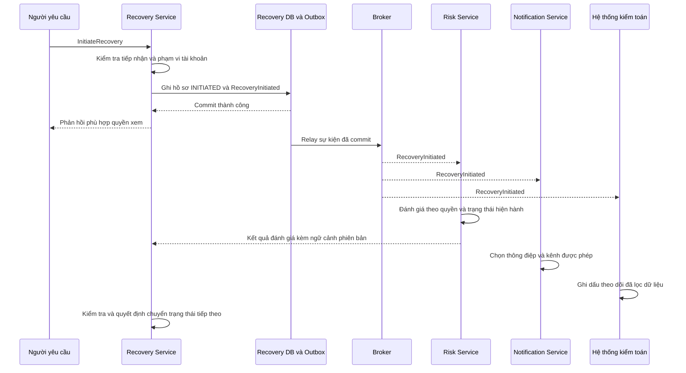

# Recovery initiated event

## 1. Sự kiện khởi tạo khôi phục biểu thị điều gì?

**Recovery initiated event** là sự kiện cho biết hệ thống đã ghi nhận bền vững một yêu cầu khôi phục tài khoản hợp lệ ở mức tiếp nhận nghiệp vụ. Trong bài học này, tên sự kiện được dùng là `RecoveryInitiated`.

Sự kiện mô tả một việc **đã xảy ra**: một hồ sơ khôi phục có định danh riêng đã được tạo và đưa vào trạng thái ban đầu. Nó không chứng minh người gửi là chủ tài khoản, không xác nhận bằng chứng danh tính đã đạt yêu cầu và không cấp quyền thay đổi mật khẩu, MFA, passkey hoặc thiết bị xác thực.

Ví dụ, một người khai báo mất điện thoại chứa ứng dụng MFA. Sau các kiểm tra tiếp nhận cần thiết, Recovery Service ghi yêu cầu ở trạng thái `INITIATED` và ghi sự kiện tương ứng. Risk Service có thể dùng sự kiện để bắt đầu đánh giá; Notification Service có thể gửi cảnh báo đến kênh được phép; hệ thống kiểm toán có thể liên kết diễn biến. Những bước đó vẫn phải tuân thủ quyền và trạng thái hiện tại của yêu cầu.

Ba ý nghĩa cần tách rõ:

| Khái niệm | Ý nghĩa | Có cho phép khôi phục ngay không? |
|---|---|---|
| Đã nhận HTTP request | Máy chủ nhận được một thông điệp từ bên ngoài | Không |
| `RecoveryInitiated` | Một yêu cầu đã được tiếp nhận theo hợp đồng và lưu bền vững | Không |
| `RecoveryApproved` hoặc một trạng thái cấp quyền tương đương | Các điều kiện nghiệp vụ cần thiết đã được đáp ứng theo chính sách | Chỉ cho phép các bước cụ thể được phê duyệt, không mặc nhiên tạo session đầy đủ |

Tên sự kiện không phải một chuẩn bắt buộc cho mọi hệ thống. Điều quan trọng là nhóm phát triển thống nhất chính xác điều kiện phát và điều kiện không phát. Nếu `RecoveryInitiated` ở một hệ thống có ý nghĩa khác, hợp đồng đó cần ghi rõ; không để consumer tự đoán từ tên.

## 2. Ranh giới giữa lệnh, phản hồi công khai và sự kiện nội bộ

### 2.1. Lệnh yêu cầu một hành động, sự kiện ghi nhận kết quả

Một lệnh như `InitiateRecovery` yêu cầu Recovery Service thử khởi tạo hồ sơ. Dịch vụ có quyền kiểm tra, từ chối, gộp với hồ sơ hiện có hoặc tạo hồ sơ mới. `RecoveryInitiated` chỉ được tạo khi việc khởi tạo thực sự được ghi nhận.

```text
InitiateRecovery
    → kiểm tra điều kiện tiếp nhận
    → tạo và lưu yêu cầu mới
    → ghi RecoveryInitiated
```

Không cho phía trình duyệt tự phát một thông điệp mang tên `RecoveryInitiated` vào topic nội bộ rồi coi đó là sự thật nghiệp vụ. Một thông điệp có đúng cấu trúc JSON vẫn có thể đến từ nguồn không có quyền xác lập sự kiện.

### 2.2. Phản hồi công khai không cần phản ánh mọi chi tiết nội bộ

Biểu mẫu khôi phục có thể trả một thông điệp chung như:

> Nếu thông tin phù hợp với tài khoản đủ điều kiện, hướng dẫn sẽ được gửi qua kênh đã đăng ký.

Đối với đầu vào không ánh xạ được đến tài khoản hoặc không đáp ứng điều kiện tiếp nhận, hệ thống có thể không tạo hồ sơ khôi phục thật. Khi đó không nên tạo một `RecoveryInitiated` giả chỉ để phản hồi công khai giống nhau.

Nếu cần theo dõi mọi lần gửi biểu mẫu, có thể dùng dữ liệu chống lạm dụng hoặc một sự kiện tiếp nhận khác với hợp đồng riêng, chẳng hạn `RecoverySubmissionObserved`. Nó không được consumer hiểu là có tài khoản thật hoặc có yêu cầu đã được chấp nhận.

Bảo vệ khỏi dò tài khoản phải xem xét đồng thời nội dung, mã HTTP, cấu trúc, thời gian phản hồi và giới hạn tần suất. Việc một sự kiện chỉ lưu nội bộ không tự loại bỏ rò rỉ ở API, log hỗ trợ hoặc trang kiểm tra trạng thái.

### 2.3. Khởi tạo không mặc nhiên làm thay đổi yếu tố xác thực

Khi một yêu cầu được tạo, hệ thống có thể bắt đầu đánh giá rủi ro hoặc quy trình xác minh. Không nên để một consumer suy ra rằng cần tự gỡ MFA, đổi email, tạo mật khẩu tạm hoặc thu hồi tất cả session chỉ từ sự kiện này.

Đặc biệt, người chưa đăng nhập thường có thể bắt đầu luồng quên mật khẩu. Nếu mọi lần khởi tạo đều tự khóa tài khoản hoặc thu hồi mọi session, kẻ biết địa chỉ email có thể gây gián đoạn cho người khác. Những hành động bảo vệ có ảnh hưởng đến truy cập phải dựa trên quyết định có thẩm quyền và điều kiện cụ thể.

## 3. Khi nào được phát `RecoveryInitiated`?

Trong hợp đồng minh họa của bài học, sự kiện chỉ tồn tại sau khi đáp ứng các điều kiện sau:

1. Yêu cầu đã qua kiểm tra cấu trúc và các kiểm soát tiếp nhận áp dụng cho luồng đó.
2. Tài khoản và phạm vi tổ chức đã được giải quyết bởi thành phần có thẩm quyền, không lấy nguyên một `accountId` tùy ý từ client để tin ngay.
3. Chính sách tiếp nhận đã quyết định tạo hồ sơ mới, thay vì từ chối hoặc trả lại hồ sơ đang tồn tại.
4. Hồ sơ có `requestId`, trạng thái `INITIATED`, thời điểm khởi tạo từ máy chủ và phiên bản đầu tiên.
5. Hồ sơ và bản ghi sự kiện cần phát đã commit trong cùng giao dịch lưu trữ, theo thiết kế outbox.

“Đủ điều kiện tiếp nhận” không có nghĩa mọi bước xác minh đã hoàn tất. Những đánh giá đắt hoặc bất đồng bộ có thể chạy sau đó, miễn là trạng thái ban đầu và consumer không diễn giải chúng thành kết quả phê duyệt.

### Bảng quyết định minh họa

| Tình huống | Có tạo sự kiện khởi tạo mới không? | Giải thích |
|---|---|---|
| Tạo thành công hồ sơ mới | Có | Sự kiện mô tả đúng hồ sơ vừa được lưu |
| Giao dịch tạo hồ sơ bị rollback | Không phát ra broker như sự kiện đã xảy ra | Không có trạng thái bền vững để consumer dựa vào |
| Client retry cùng thao tác đã tạo thành công | Không tạo sự kiện nghiệp vụ mới cho cùng kết quả | Trả kết quả idempotent hoặc tiếp tục xử lý hồ sơ cũ |
| Broker giao lại cùng sự kiện | Không phải lần khởi tạo mới | Consumer xử lý giao lặp |
| Người dùng bổ sung bằng chứng cho hồ sơ đang mở | Không dùng lại `RecoveryInitiated` | Đây là một diễn biến khác của cùng hồ sơ |
| Một hồ sơ cũ đã đóng và chính sách cho phép tạo hồ sơ mới | Có, với `requestId` mới | Hai yêu cầu có vòng đời và lịch sử khác nhau |
| Đầu vào không có tài khoản tương ứng | Không theo hợp đồng của bài học | Không biến dữ liệu quan sát biểu mẫu thành hồ sơ thật |

Không phát sự kiện trước khi commit rồi hy vọng giao dịch sẽ thành công. Consumer có thể chạy rất nhanh và gửi cảnh báo hoặc khởi động công việc cho một yêu cầu thực tế không tồn tại.

## 4. Các bất biến cần giữ

**Mỗi hồ sơ có một lần khởi tạo về mặt nghiệp vụ.** Sự kiện này có định danh ổn định. Việc chuyển outbox hoặc broker thử lại không được tạo một `eventId` khác cho cùng bản ghi chỉ vì đang giao lại.

**Một lần khởi tạo không xác nhận danh tính người gửi.** Nếu người yêu cầu mới khai báo mất passkey, giá trị khai báo là thông tin đầu vào chưa được xác minh. Nó không có ý nghĩa rằng passkey thực sự bị mất hoặc tài khoản đã bị chiếm quyền.

**Sự kiện không cấp quyền hành động.** Biết `requestId`, `eventId` hoặc nhận được sự kiện không cho phép đặt mật khẩu mới. Việc tiêu thụ một capability khôi phục hoặc thực hiện chuyển trạng thái phải qua kiểm tra riêng.

**Phiên bản trạng thái đi theo hồ sơ.** Với hợp đồng của bài học, `aggregateVersion = 1` là phiên bản khởi tạo. Các chuyển trạng thái tiếp theo tăng phiên bản theo quy tắc của aggregate; không tăng phiên bản chỉ vì broker giao lại.

**Dữ liệu thời gian có ý nghĩa cụ thể.** `initiatedAt` là thời điểm nghiệp vụ ghi nhận khởi tạo bằng đồng hồ máy chủ. Thời điểm relay thực sự gửi và thời điểm consumer nhận là các mốc khác; không thay `initiatedAt` bằng thời điểm retry.

**Consumer chỉ hành động trong quyền của mình.** Risk Service đánh giá rủi ro; Notification Service gửi cảnh báo; hệ thống kiểm toán lưu dấu. Không consumer nào được tự nhận thêm quyền đổi thông tin xác thực vì nó nghe được sự kiện.

Những bất biến này cần được thực thi bằng quyền truy cập, giao dịch, ràng buộc dữ liệu và quy tắc chuyển trạng thái. Viết chúng trong tài liệu mà không có cơ chế tương ứng chưa đủ để bảo vệ tài khoản.

## 5. Thiết kế hợp đồng dữ liệu

Một sự kiện khởi tạo nên đủ thông tin để consumer định tuyến và liên kết công việc, nhưng không mang toàn bộ hồ sơ danh tính.

```json
{
  "eventId": "a79c4c5f-0a58-4c09-8e56-f71bdf6ca721",
  "eventType": "RecoveryInitiated",
  "schemaVersion": 1,
  "producer": "recovery-service",
  "tenantRef": "2cf0b3fe-1c39-4431-8f5f-3494bc94d61e",
  "aggregateType": "RecoveryRequest",
  "aggregateId": "3ed83ec4-d1b5-4435-bb65-310e034cf5bf",
  "aggregateVersion": 1,
  "occurredAt": "2026-12-10T07:30:00Z",
  "correlationId": "47aa228e-f13c-4497-af2f-8d5c354696de",
  "causationId": "2b2d3ed7-4b45-49b5-aef1-bcbfbeb9bd37",
  "data": {
    "requestId": "3ed83ec4-d1b5-4435-bb65-310e034cf5bf",
    "accountRef": "60e8c724-6820-48dc-a271-37f5d1438b96",
    "declaredLoss": "MFA_DEVICE",
    "initiationChannel": "PUBLIC_WEB",
    "initiatedAt": "2026-12-10T07:30:00Z"
  }
}
```

### Ý nghĩa các nhóm field

| Field | Vai trò | Điều không nên suy ra |
|---|---|---|
| `eventId` | Định danh sự kiện ổn định cho theo dõi và chống trùng | Không phải token truy cập |
| `eventType`, `schemaVersion` | Xác định ý nghĩa và cấu trúc hợp đồng | Không thay thế xác thực nguồn phát |
| `producer` | Khai báo nguồn nghiệp vụ theo hợp đồng | Chuỗi trong JSON không tự chứng minh nguồn gốc |
| `tenantRef` | Giới hạn phạm vi tổ chức khi hệ thống có nhiều tenant | Không tin nếu chỉ do client nhập |
| `aggregateId`, `requestId` | Liên kết về đúng hồ sơ khôi phục | Không cấp quyền đọc hồ sơ |
| `aggregateVersion` | Phiên bản chuyển trạng thái mà sự kiện mô tả | Không phải số lần giao hoặc số lần retry |
| `occurredAt`, `initiatedAt` | Mốc nghiệp vụ từ máy chủ; trong ví dụ chúng trùng nhau | Không phải bằng chứng thời gian giao thành công |
| `correlationId` | Liên kết các công việc cùng một luồng | Không phải định danh phiên đăng nhập |
| `causationId` | Liên kết lệnh hoặc sự kiện gây ra diễn biến này | Không phải bằng chứng người dùng đã chấp thuận |
| `accountRef` | Tham chiếu nội bộ để định tuyến công việc có quyền | Không có nghĩa danh tính người yêu cầu đã được xác minh |
| `declaredLoss` | Loại mất mát do người yêu cầu khai báo, đã chuẩn hóa | Không xác nhận thiết bị hoặc yếu tố thực tế đã mất |
| `initiationChannel` | Ngữ cảnh tiếp nhận được máy chủ gán | Không thể hiện mức xác thực hay mức tin cậy bằng chính tên kênh |

`aggregateId` và `data.requestId` được lặp để minh họa envelope và payload. Nếu chọn cách này, phải kiểm tra chúng khớp nhau. Cũng có thể thiết kế chỉ giữ một nơi duy nhất; không tạo hai nguồn sự thật có thể mâu thuẫn.

Không phải mọi consumer đều cần `accountRef` hoặc `declaredLoss`. Có thể dùng hợp đồng tích hợp được lọc theo đối tượng nhận hoặc một resolver có quyền hẹp. Một topic chung cho mọi thành phần không phải lý do để nhét dữ liệu nhạy cảm vào payload.

### Những dữ liệu nên tránh đưa vào sự kiện chung

- Mật khẩu, OTP, mã khôi phục hoặc token đặt lại mật khẩu.
- Seed MFA, private key hoặc vật liệu bí mật của thông tin xác thực.
- Ảnh giấy tờ, bản ghi nhận dạng sinh trắc học hay câu trả lời xác minh đầy đủ.
- Toàn bộ cookie, bearer token, header xác thực hoặc fingerprint thiết bị chưa lọc.
- Văn bản khai báo tự do có thể chứa thông tin cá nhân hoặc nội dung không an toàn cho log.

`accountRef` vẫn có thể liên kết với một cá nhân, dù không phải email ở dạng rõ. Dữ liệu được thay bằng ID vẫn cần kiểm soát truy cập, thời gian lưu và mục đích sử dụng.

## 6. Phát hành bền vững bằng transactional outbox

Vấn đề thường gặp là ghi cơ sở dữ liệu và gửi broker là hai thao tác riêng:

```text
Cách dễ lỗi A:
  lưu yêu cầu → commit → gửi broker
  Nếu tiến trình dừng trước khi gửi, yêu cầu tồn tại nhưng sự kiện có thể bị mất.

Cách dễ lỗi B:
  gửi broker → lưu yêu cầu → commit
  Nếu giao dịch rollback, consumer đã thấy một sự kiện không có hồ sơ tương ứng.
```

Transactional outbox giải quyết khoảng trống giữa thay đổi nghiệp vụ và ý định phát sự kiện bằng cách ghi cả hai trong cùng một giao dịch cục bộ.

```text
BEGIN TRANSACTION
  Nhận hoặc tra cứu kết quả của cùng lệnh theo cơ chế idempotency.
  Nếu đã có kết quả: trả lại kết quả, không tạo thêm hồ sơ.
  Nếu là lệnh mới:
    - kiểm tra điều kiện nghiệp vụ cần nhất quán trong giao dịch;
    - tạo RecoveryRequest ở INITIATED, version = 1;
    - tạo RecoveryInitiated với eventId ổn định;
    - ghi sự kiện vào outbox;
    - lưu liên kết giữa lệnh và kết quả.
COMMIT
```

Relay đọc bản ghi đã commit và chuyển đến broker. Nếu relay gửi xong nhưng chưa kịp đánh dấu đã gửi, bản ghi có thể được chuyển lại. Vì vậy, outbox giúp lưu ý định phát một cách bền vững nhưng không tự bảo đảm chỉ giao đúng một lần ở mọi thành phần.

Nếu một giao dịch chỉ tạo một hồ sơ, không được phát hiện trùng lệnh bằng cách “SELECT không thấy rồi INSERT” mà thiếu ràng buộc xử lý đồng thời. Hai request chạy cùng lúc vẫn có thể cùng thấy chưa tồn tại. Cần ràng buộc duy nhất, cơ chế claim/lock hoặc giao thức tương đương và xử lý xung đột rõ ràng.

Khóa idempotency phải có phạm vi hợp lý, chẳng hạn theo tenant, loại thao tác và chủ thể hoặc ngữ cảnh tiếp nhận được phép. Không dùng một khóa toàn cục do client chọn để trả kết quả khôi phục của người khác. Idempotency không thay thế phân quyền và cũng không ngăn kẻ tấn công tạo nhiều lệnh mới bằng các khóa khác nhau.

## 7. Luồng phối hợp sau khi sự kiện được phát



Các consumer độc lập có thể chạy ở những thời điểm khác nhau và không nhất thiết hoàn tất theo một thứ tự chung. Gửi email không cần có nghĩa Risk Service đã hoàn tất; Risk Service có kết quả không có nghĩa người dùng đã nhận cảnh báo.

Nếu một bước phụ thuộc kết quả bước khác, cần thể hiện điều kiện đó bằng trạng thái, lệnh tiếp theo hoặc một bộ điều phối có thẩm quyền. Không dùng thời gian chờ tùy ý giữa các consumer để giả lập một thứ tự nghiệp vụ.

## 8. Consumer cần xử lý sự kiện như thế nào?

Một consumer nên đi qua các bước kiểm tra nguồn gốc, hợp đồng, trùng lặp, quyền và tính phù hợp hiện tại trước khi tạo tác dụng nghiệp vụ.

### 8.1. Xử lý bền vững trước khi xác nhận với broker

Với một tác dụng nằm trong cùng cơ sở dữ liệu consumer, có thể tổ chức giao dịch như sau:

```text
Nhận sự kiện.
Xác thực nguồn và kiểm tra hợp đồng.

BEGIN LOCAL TRANSACTION
  Claim event bằng ràng buộc duy nhất (consumerName, eventId).
  Nếu đã xử lý thành công: không tạo lại tác dụng.
  Nếu chưa xử lý:
    - kiểm tra điều kiện thuộc quyền consumer;
    - lưu kết quả cục bộ hoặc tác vụ cần thực hiện;
    - đánh dấu xử lý thành công cùng giao dịch.
COMMIT

ACK với broker sau khi xử lý bền vững thành công.
```

“Claim” ở đây là thao tác có tính nhất quán khi nhiều worker chạy đồng thời, không phải một lần kiểm tra trong bộ nhớ. Nếu giao dịch rollback thì việc đánh dấu đã xử lý cũng phải rollback. Nếu tiến trình dừng sau commit nhưng trước ACK, lần nhận lại được nhận diện nhờ trạng thái đã lưu.

Nếu consumer cần gọi một nhà cung cấp bên ngoài, không thể coi lời gọi đó là một phần nguyên tử của giao dịch cơ sở dữ liệu thông thường. Nên ghi tác vụ hoặc outbox cục bộ rồi xử lý riêng, với cơ chế chống trùng và xử lý kết quả không xác định ở ranh giới bên ngoài.

Một consumer gửi thông báo có thể chống trùng theo hai lớp:

- `(consumerName, eventId)` để nhận diện giao lại cùng sự kiện.
- `(requestId, notificationPurpose, recipientBinding, channel)` hoặc một khóa nghiệp vụ phù hợp để tránh tạo lặp cùng tác dụng khi nhiều nguồn hợp lệ cùng dẫn đến nó.

Khóa nghiệp vụ phải phân biệt được các cập nhật thực sự khác nhau. Không dùng chỉ `accountRef` để chống trùng vĩnh viễn, vì một tài khoản có thể có nhiều hồ sơ hợp lệ theo thời gian.

### 8.2. Sự kiện lỗi không được mặc định thành khôi phục hợp lệ

Nếu thiếu `requestId`, phiên bản schema chưa hỗ trợ hoặc loại khai báo không hợp lệ, consumer cần từ chối xử lý theo chính sách, ghi mã lỗi đã lọc dữ liệu và chuyển nơi xử lý lỗi thích hợp. Không đặt giá trị mặc định “đã xác minh” hoặc tự chọn phương thức khôi phục ít yêu cầu hơn.

Phân biệt lỗi dữ liệu không thể xử lý bằng retry với lỗi hạ tầng tạm thời. Một JSON sai schema không trở nên hợp lệ khi thử lại hàng nghìn lần; một lỗi kết nối tạm thời cũng không nên bị bỏ qua như dữ liệu không hợp lệ.

### 8.3. Nhận sự kiện không đồng nghĩa được đọc toàn bộ hồ sơ

Một consumer có thể cần dữ liệu bổ sung, nhưng API tra cứu vẫn phải kiểm tra danh tính dịch vụ, tenant, mục đích và phạm vi field. Quyền đọc topic không tự cấp quyền lấy bản chụp giấy tờ, token hoặc toàn bộ lịch sử session.

## 9. Sự kiện đến muộn, sai thứ tự và quyết định cũ

### 9.1. Thứ tự trong một hồ sơ

Partition theo `requestId` có thể hỗ trợ thứ tự cho các sự kiện của cùng hồ sơ khi broker và cách phát đáp ứng điều kiện tương ứng. Nó không tự bảo đảm thứ tự toàn hệ thống, giữa nhiều topic hoặc giữa hai hồ sơ cùng tài khoản.

Giả sử một consumer đã biết yêu cầu được hủy ở phiên bản 3 rồi mới nhận lại `RecoveryInitiated` phiên bản 1. Consumer không được đặt projection về `INITIATED` hoặc mở lại yêu cầu. Nó có thể ghi nhận sự kiện lịch sử nếu cần, nhưng phải giữ trạng thái hiện hành đúng theo giao thức cập nhật projection.

Một `aggregateVersion` tăng không mặc nhiên yêu cầu consumer nhận đủ mọi số nguyên liên tiếp. Nếu topic chỉ chứa một số loại sự kiện, các khoảng trống phiên bản có thể hợp lệ. Chỉ dùng cơ chế chờ phiên bản liên tiếp khi hợp đồng stream bảo đảm có sự kiện tương ứng cho mọi bước đó; nếu cần, định nghĩa sequence riêng cho stream mà consumer thực sự nhận.

### 9.2. Đánh giá rủi ro có thể trở nên lỗi thời

Một chuỗi tranh chấp thường gặp:

```text
T1: Hồ sơ được khởi tạo ở version 1.
T2: Risk Service bắt đầu đánh giá từ ngữ cảnh version 1.
T3: Chủ tài khoản phản đối; hồ sơ chuyển sang CANCELED.
T4: Kết quả đánh giá cũ quay về và đề xuất cho phép tiếp tục.
```

Recovery Service phải kiểm tra rằng kết quả còn áp dụng được trước khi thực hiện chuyển trạng thái. Có thể cần so sánh phiên bản hồ sơ, phiên bản dữ liệu bảo mật tài khoản, định danh lần đánh giá và trạng thái kết thúc hiện tại. Kết quả cũ không được ghi đè một yêu cầu đã hủy chỉ vì nó được nhận sau cùng.

Kiểm tra trạng thái tại consumer rồi hành động sau đó vẫn có khoảng tranh chấp. Quyết định cuối cùng cần được kiểm tra trong thao tác có tính nhất quán tại thành phần sở hữu thay đổi, bằng cơ chế khóa, cập nhật có điều kiện hoặc giao thức phù hợp.

### 9.3. Nhiều hồ sơ cho cùng tài khoản

Hai `requestId` khác nhau có thể cùng liên quan một `accountRef`. Thứ tự riêng từng hồ sơ không ngăn chúng đồng thời xin gỡ MFA hoặc thay mật khẩu. Quy tắc về hồ sơ đang hoạt động, việc thay thế yêu cầu và xung đột trên thông tin xác thực phải được thực thi ở phạm vi tài khoản khi cần.

`RecoveryInitiated` cung cấp dữ kiện để bắt đầu công việc, không giải quyết thay mọi ràng buộc trên tài khoản. Không chuyển quyền này sang một consumer chỉ vì nó tình cờ nhận sự kiện trước.

## 10. Ví dụ Java: hợp đồng sự kiện bất biến

Ví dụ dùng Java có hỗ trợ `record`, biểu diễn dữ liệu của một sự kiện đã được dịch vụ có thẩm quyền tạo. Nó không phải mã hoàn chỉnh để xác thực nguồn, ghi outbox hoặc phê duyệt khôi phục.

```java
import java.time.Instant;
import java.util.Objects;
import java.util.UUID;

public record RecoveryInitiated(
        UUID eventId,
        UUID requestId,
        UUID tenantRef,
        UUID accountRef,
        long aggregateVersion,
        Instant initiatedAt,
        UUID correlationId,
        UUID causationId,
        DeclaredLoss declaredLoss,
        InitiationChannel initiationChannel) {

    public enum DeclaredLoss {
        PASSWORD,
        MFA_DEVICE,
        PASSKEY,
        AUTHENTICATOR_DEVICE,
        UNSPECIFIED
    }

    public enum InitiationChannel {
        PUBLIC_WEB,
        MOBILE_APP,
        SUPPORT_WORKFLOW
    }

    public RecoveryInitiated {
        Objects.requireNonNull(eventId);
        Objects.requireNonNull(requestId);
        Objects.requireNonNull(tenantRef);
        Objects.requireNonNull(accountRef);
        Objects.requireNonNull(initiatedAt);
        Objects.requireNonNull(correlationId);
        Objects.requireNonNull(causationId);
        Objects.requireNonNull(declaredLoss);
        Objects.requireNonNull(initiationChannel);

        if (aggregateVersion != 1L) {
            throw new IllegalArgumentException(
                    "RecoveryInitiated requires initial version 1");
        }
    }

    public String eventType() {
        return "RecoveryInitiated";
    }

    public int schemaVersion() {
        return 1;
    }
}
```

Các điểm quan trọng khi dùng mô hình này:

- `declaredLoss` diễn tả lời khai đã chuẩn hóa. `MFA_DEVICE` không chứng minh người gửi đang sở hữu tài khoản hoặc thiết bị thật sự bị mất.
- `SUPPORT_WORKFLOW` không tự có nghĩa nhân viên hỗ trợ đã xác minh xong danh tính. Kênh và kết quả xác minh là các khái niệm riêng.
- Hợp đồng minh họa yêu cầu phiên bản đầu tiên là 1. Nếu hệ thống dùng quy tắc khác, phải thay hợp đồng nhất quán thay vì để producer và consumer hiểu khác nhau.
- `eventId`, `requestId` và thời điểm khởi tạo được tạo một lần trong luồng nghiệp vụ, lưu cùng hồ sơ/outbox, rồi được dùng lại nguyên vẹn khi phát lại.
- `record` giúp biểu diễn dữ liệu bất biến theo mô hình Java nhưng không chứng minh nguồn gốc hay tính đúng đắn của trạng thái nghiệp vụ.
- `eventType()` và `schemaVersion()` biểu diễn giá trị hợp đồng. Adapter serialization cần ánh xạ envelope rõ ràng; không giả định mọi thư viện JSON tự kết xuất các method này theo cùng một cách.

Điều kiện `aggregateVersion == 1` chỉ kiểm tra một bất biến của mô hình. Nó không chứng minh rằng hồ sơ đã commit, tenant hợp lệ hoặc bên tạo sự kiện có quyền. Những kiểm tra đó thuộc luồng nghiệp vụ, tầng tiếp nhận và cơ chế lưu trữ tương ứng.

## 11. Xác thực nguồn phát và giới hạn dữ liệu

### 11.1. Chuỗi `producer` không phải chứng cứ

Một kẻ gửi JSON có thể tự đặt `producer = recovery-service`. Cần xác thực nguồn qua cơ chế của hạ tầng, phân quyền topic/API và danh tính workload. Nếu dùng chữ ký thông điệp, cần kiểm tra khóa, phạm vi nguồn phát và nội dung đã được xác thực theo giao thức.

Chỉ Recovery Service hoặc thành phần được ủy quyền cụ thể mới được xác lập loại sự kiện này. Một công cụ hỗ trợ, dịch vụ phân tích hoặc client không được quyền phát sự kiện nghiệp vụ tùy ý chỉ vì có kết nối broker.

Xác thực nguồn sự kiện cũng không xác thực người dùng cuối. Nguồn hợp lệ có thể đang ghi nhận một yêu cầu từ người chưa chứng minh được danh tính; consumer phải giữ nguyên sự phân biệt đó.

### 11.2. Tenant và định danh tài khoản phải được ràng buộc

Trong hệ thống nhiều tenant, quyền phát và quyền xử lý cần phù hợp với `tenantRef`. Consumer không nên lấy tenant từ payload rồi bỏ qua phạm vi danh tính dịch vụ, cấu hình subscription hoặc quyền API tra cứu.

Khi dữ liệu tài khoản được giải quyết từ email, tên đăng nhập hoặc một tham chiếu client đưa lên, việc ánh xạ phải do thành phần có quyền thực hiện. Không cho phép một request khôi phục của tenant A tạo công việc trên tài khoản tenant B bằng cách thay field.

### 11.3. Broker và hàng đợi lỗi đều là nơi lưu dữ liệu

Payload có thể được giữ lại, sao chép sang môi trường khác, đưa vào dead-letter queue hoặc tải vào công cụ quan sát. Vì thế cần kiểm soát đọc, thời gian lưu và dữ liệu được xuất theo đúng mục đích.

Không log nguyên sự kiện nếu payload hoặc phần mở rộng có thể mang dữ liệu nhạy cảm. Với schema sai, ghi tên field lỗi hoặc mã lỗi phù hợp thay vì đưa toàn bộ body không kiểm soát vào log. Một tham chiếu bí mật có khả năng đổi thành token cũng cần được đánh giá theo quyền sử dụng thực tế, không chỉ theo hình thức “đó chỉ là ID”.

## 12. Tiến hóa schema và phát lại sự kiện

### 12.1. Thay đổi cấu trúc không được âm thầm đổi ý nghĩa

Có thể thêm một field tùy chọn theo quy tắc tương thích đã công bố. Việc đổi ý nghĩa từ “yêu cầu đã được tạo” sang “danh tính đã xác minh” là thay đổi nghiệp vụ lớn, không nên giấu dưới cùng tên và phiên bản cũ.

Consumer cần có chính sách với schema hoặc enum chưa hỗ trợ. Không tự ánh xạ một loại mất yếu tố mới sang phương thức có yêu cầu thấp hơn. Giá trị `UNSPECIFIED` trong ví dụ là một lựa chọn khai báo được định nghĩa, không phải chỗ đổ mọi dữ liệu sai vào để tiếp tục khôi phục.

Phân biệt ba loại phiên bản:

| Phiên bản | Mô tả |
|---|---|
| `schemaVersion` | Hình dạng và hợp đồng dữ liệu của sự kiện |
| `aggregateVersion` | Bước chuyển trạng thái mà sự kiện mô tả trong hồ sơ |
| Phiên bản chương trình consumer | Bản triển khai đang diễn giải và xử lý sự kiện |

Nâng phiên bản consumer không làm sự kiện cũ trở thành một lần khởi tạo mới.

### 12.2. Replay cần phân biệt dựng lại dữ liệu với tạo tác dụng bên ngoài

Đọc lại lịch sử để dựng projection không nên tự động gửi lại mọi cảnh báo, tạo token mới hoặc khởi động hàng loạt đánh giá có thể ảnh hưởng trạng thái tài khoản. Có thể dùng consumer riêng chỉ phục vụ dựng lại dữ liệu, hoặc một chế độ replay có giới hạn quyền và tác dụng rõ ràng.

Nếu mục tiêu là xử lý lại một tác vụ thất bại thật sự, vẫn cần kiểm tra trạng thái hiện tại và tính hợp lệ của hành động. Một yêu cầu đã bị hủy hoặc đã hoàn tất không được mở lại vì hệ thống đang phát lại sự kiện khởi tạo từ nhiều ngày trước.

Dữ liệu chống trùng cũng có thời hạn lưu và giới hạn vận hành. Khi inbox cũ bị xóa hoặc backup được khôi phục, một sự kiện cũ có thể xuất hiện như chưa từng xử lý. Vì vậy, các hành động nhạy cảm vẫn cần bất biến và kiểm tra trạng thái ở nơi sở hữu quyết định, không phụ thuộc hoàn toàn vào việc inbox còn giữ `eventId` mãi mãi.

### 12.3. Dùng sự kiện không đồng nghĩa dùng event sourcing

Hệ thống có thể lưu trạng thái hiện tại trong cơ sở dữ liệu và phát sự kiện tích hợp qua outbox. Khi đó broker hoặc một projection chậm không tự trở thành nguồn chuẩn của quyền khôi phục.

Nếu chọn event sourcing, cần thiết kế riêng quyền ghi stream, phiên bản, khôi phục aggregate và dữ liệu nhạy cảm trong lịch sử. Việc có một topic `RecoveryInitiated` không tự cung cấp đầy đủ những đặc tính đó.

## 13. Quan sát luồng khởi tạo mà không làm lộ tài khoản

Những chỉ số hữu ích gồm độ trễ outbox, tuổi sự kiện chưa xử lý, số giao lặp, tỷ lệ lỗi schema, tỷ lệ tác vụ bị bỏ qua do trạng thái đã kết thúc và độ trễ từng consumer. Chúng giúp phân biệt “yêu cầu đã được lưu” với “các công việc sau khởi tạo đã chạy”.

Nhật ký có thể liên kết bằng `eventId`, `requestId`, `correlationId`, phiên bản và mã kết quả. Quyền tra cứu các định danh đó vẫn cần kiểm soát; người chỉ biết một ID không được tự xem hồ sơ khôi phục.

Không dùng email, số điện thoại, token hoặc dữ liệu định danh đầy đủ làm nhãn metric. Không công khai dashboard nội bộ có số liệu theo từng tài khoản cho người dùng chưa đủ quyền. Công cụ hỗ trợ cần hiển thị đúng trạng thái, tránh nói “đã khôi phục” khi chỉ mới thấy sự kiện khởi tạo.

Nếu outbox tồn đọng, phản hồi “đã tiếp nhận” có thể vẫn đúng khi hồ sơ đã lưu, nhưng hệ thống cần phát hiện việc các bước tiếp theo chưa chạy. Cách xử lý quá hạn, thông báo cho người dùng và điều kiện cho phép tiếp tục thuộc chính sách nghiệp vụ; không giả định hàng đợi cuối cùng sẽ xử lý được nên mọi yêu cầu luôn có thể chờ vô hạn.

## 14. Các tình huống học tập để kiểm chứng thiết kế

| Tình huống | Hành vi mong đợi |
|---|---|
| Giao dịch tạo hồ sơ rollback | Không có sự kiện khởi tạo được phát như một sự thật đã commit |
| Hồ sơ và outbox đã commit, tiến trình ứng dụng dừng | Relay có thể phục hồi việc phát từ dữ liệu bền vững |
| Relay gửi thành công rồi dừng trước khi đánh dấu | Consumer chịu được việc nhận lại cùng `eventId` |
| Hai lần khởi tạo đồng thời dùng cùng khóa idempotency trong cùng phạm vi | Không tạo hai hồ sơ do kiểm tra trùng thiếu nhất quán |
| Cùng tài khoản có hai yêu cầu với khóa khác nhau | Áp dụng chính sách số hồ sơ và xung đột; idempotency không tự giải quyết trường hợp này |
| Người chưa đăng nhập khởi tạo luồng mất MFA | Không coi sự kiện là bằng chứng sở hữu tài khoản |
| Notification Service nhận sự kiện | Chỉ tạo thông báo theo quyền, không tự gỡ MFA hoặc phát token |
| Yêu cầu bị hủy trước khi kết quả risk quay về | Kết quả cũ không chuyển yêu cầu sang trạng thái được phép tiếp tục |
| Consumer đã thấy trạng thái kết thúc rồi nhận lại sự kiện khởi tạo | Không hạ trạng thái về `INITIATED` hoặc mở lại hồ sơ |
| Topic chỉ phát một số loại sự kiện nên có khoảng trống phiên bản | Không chờ vô hạn một phiên bản mà hợp đồng không bảo đảm sẽ xuất hiện |
| Client giả field `producer` hoặc `tenantRef` | Bị kiểm soát bởi xác thực nguồn và phân quyền phạm vi |
| Callback chuyển phát báo đã giao email | Không biến thành xác minh danh tính hoặc khôi phục thành công |
| Dựng lại projection từ lịch sử | Không gửi lại cảnh báo và không tạo lại tác dụng nhạy cảm ngoài ý định |
| Inbox hết thời hạn lưu rồi gặp lại sự kiện cũ | Bất biến nghiệp vụ vẫn ngăn khôi phục một hồ sơ đã đóng |
| Đầu vào không khớp tài khoản | API giữ hành vi phù hợp chống dò tài khoản, không tạo sự kiện hồ sơ giả |

## 15. Những lỗi thiết kế cần nhận ra

**Phát trước commit.** Consumer có thể tạo công việc cho một hồ sơ không bao giờ tồn tại. Cần liên kết trạng thái và ý định phát trong giao dịch bền vững.

**Dùng tên sự kiện như chứng cứ xác minh.** `RecoveryInitiated` chỉ chứng minh việc khởi tạo theo hợp đồng, không chứng minh ai đã gửi yêu cầu hoặc người đó có quyền đổi yếu tố xác thực.

**Tạo `eventId` mới mỗi lần retry.** Cùng một diễn biến nghiệp vụ bị biến thành nhiều sự kiện khác nhau, làm consumer khó chống trùng và khiến nhật ký hiểu sai số lần khởi tạo.

**Đưa token vào payload chung để mọi consumer dùng thuận tiện.** Quyền nhìn thấy một thông báo nghiệp vụ bị mở rộng thành quyền sử dụng capability khôi phục. Cần giảm dữ liệu và cấp quyền theo mục đích cụ thể.

**Cho sự kiện đến cuối cùng luôn thắng.** Một sự kiện khởi tạo đến muộn hoặc kết quả risk cũ có thể ghi đè trạng thái đã hủy. Cần kiểm tra phiên bản, điều kiện chuyển trạng thái và quyền tại nơi sở hữu thay đổi.

**Dùng retry hạ tầng để khởi tạo lại nghiệp vụ.** Giao lại sự kiện hoặc thử gọi broker không được tạo hồ sơ mới, đặt lại khoảng chờ hay phát hành lại token.

**Mặc định mọi consumer của sự kiện đều có quyền quản lý tài khoản.** Việc phân phối dữ liệu không phải cơ chế ủy quyền. Từng consumer chỉ được tạo những tác dụng nằm trong trách nhiệm và quyền của nó.

Một sự kiện khởi tạo được thiết kế rõ giúp các thành phần bắt đầu công việc từ cùng một sự thật bền vững: yêu cầu khôi phục đã được ghi nhận. Khả năng nhận lặp, đến muộn hoặc phát lại phải được tính đến từ đầu, trong khi quyền xác minh danh tính, thay đổi thông tin xác thực và cấp session tiếp tục được kiểm tra bởi thành phần có thẩm quyền.
