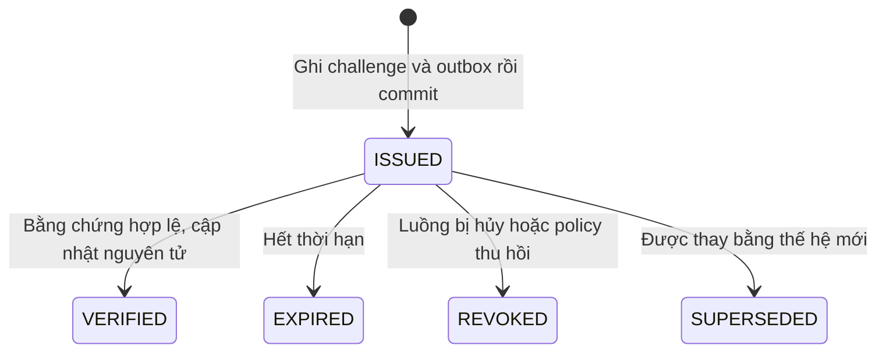

# Challenge issued event trong luồng khôi phục tài khoản

## 1. Sự kiện này xác nhận điều gì?

Trong một hệ thống khôi phục theo kiến trúc hướng sự kiện, **challenge issued event** ghi nhận rằng dịch vụ có thẩm quyền đã tạo và lưu bền vững một thử thách xác minh cho một luồng khôi phục cụ thể. Những thành phần khác có thể dùng sự kiện để cập nhật tiến độ, lập kế hoạch gửi hoặc ghi nhận hoạt động an ninh.

Trong module `SECURITY_AUTHENTICATION_ACCOUNT_RECOVERY`, người dùng có thể mất mật khẩu, MFA, passkey hoặc thiết bị xác thực. Phát hành challenge là một bước thu thập bằng chứng trong quá trình lấy lại quyền kiểm soát tài khoản. Nó chưa chứng minh danh tính người yêu cầu và chưa cho phép thay đổi phương thức xác thực.

Ví dụ, Linh yêu cầu đặt lại mật khẩu. Dịch vụ khôi phục chấp nhận phát hành một challenge qua địa chỉ khôi phục đã được ràng buộc với tài khoản. Sau khi giao dịch dữ liệu commit, sự kiện `recovery.challenge.issued` trở thành một sự thật đã xảy ra. Email có thể chưa được gửi tại thời điểm đó.

Contract của bài này dùng quy ước:

```text
ChallengeIssued = challenge đã được lưu bền vững ở trạng thái ISSUED,
                  gắn với đúng luồng, chủ thể và mục đích,
                  có thời hạn cùng điều kiện xác minh xác định.
```

Đây là quy ước thiết kế cho ví dụ, không phải một tên sự kiện được mọi sản phẩm định nghĩa giống nhau. Khi tích hợp, các bên phải thống nhất ý nghĩa của `issued` và thời điểm tạo sự kiện.

## 2. Phân biệt yêu cầu, sự kiện và kết quả giao nhận

Một lệnh thể hiện việc cần làm; sự kiện mô tả việc đã xảy ra. Nhầm lẫn hai loại này khiến một thông điệp thông thường trở thành quyền reset hoặc tạo thêm challenge ngoài ý muốn.

| Thông điệp hoặc trạng thái | Ý nghĩa trong ví dụ | Chưa thể kết luận |
| --- | --- | --- |
| `IssueRecoveryChallenge` | Yêu cầu dịch vụ xem xét phát hành challenge | Yêu cầu đã vượt qua policy |
| `recovery.challenge.issued` | Challenge đã được ghi nhận sau commit | Kênh gửi đã hoạt động hoặc người dùng đã nhận |
| `SendRecoveryChallenge` | Lệnh nội bộ gửi theo một kế hoạch đã được cấp quyền | Người nhận đã chứng minh quyền với tài khoản |
| `ChallengeDeliveryAccepted` | Nhà cung cấp đã nhận yêu cầu gửi theo contract của họ | Email đã vào hộp thư hoặc SMS đã tới người dùng |
| `ChallengeDelivered` | Có bằng chứng giao nhận theo contract của kênh | Người đang khôi phục là chủ tài khoản |
| `ChallengeVerified` | Dịch vụ xác minh chấp nhận bằng chứng cho challenge | Toàn bộ điều kiện khôi phục đã hoàn tất |
| `RecoveryCompleted` | Luồng đã hoàn thành hành động được phép | Mọi phiên cũ đã bị thu hồi nếu việc đó chưa được xác nhận riêng |

Một receipt giao nhận không được biến thành `ChallengeVerified`. Một consumer phân tích số liệu nhận `ChallengeIssued` cũng không được cấp quyền gỡ MFA hoặc đăng ký passkey thay người dùng.

Luồng khôi phục MFA hoặc passkey có thể yêu cầu nhiều loại bằng chứng, thời gian chờ và phê duyệt bổ sung. Không dùng tên sự kiện chung để ngầm hạ các yêu cầu đó xuống thành “đã gửi email là đủ”.

## 3. Điều kiện trước khi phát hành

Producer của sự kiện phải là dịch vụ sở hữu nghiệp vụ challenge hoặc một thành phần được ủy quyền rõ ràng. Một API gateway, ứng dụng di động hoặc nhân viên hỗ trợ không được tự công bố sự kiện như thể challenge đã được tạo hợp lệ.

Trước khi tạo challenge, dịch vụ cần xác định:

- Luồng khôi phục, chủ thể đích, tenant và nguồn có thẩm quyền quản lý thông tin xác thực.
- Mục đích cụ thể, chẳng hạn xác minh kênh cho `PASSWORD_RESET` hoặc một bước bằng chứng trong `MFA_RECOVERY`.
- Kênh đã được policy chấp nhận, nguồn ràng buộc người nhận và các thay đổi kênh gần đây có liên quan.
- Điều kiện rủi ro, giới hạn phát hành, thời gian chờ và ngân sách thử xác minh.
- Quy tắc với challenge đang tồn tại: dùng lại theo policy, chờ, từ chối hoặc phát hành thế hệ mới.

Không gửi challenge tới một địa chỉ mới chỉ vì người gọi điền nó trong trường `recoveryEmail`. Việc chấp nhận hoặc thay kênh khôi phục là một quyết định nghiệp vụ riêng, cần bằng chứng và quyền phù hợp.

Đối với danh tính liên kết, dịch vụ phải tôn trọng nguồn có thẩm quyền. Một challenge cục bộ xác minh một bước của sản phẩm không tự cấp cho sản phẩm quyền thay mật khẩu hoặc xóa MFA tại nhà cung cấp danh tính bên ngoài.

Phản hồi công khai cũng cần tách khỏi kết quả nội bộ. Cùng một thông báo “Nếu yêu cầu phù hợp, hướng dẫn sẽ được gửi qua kênh đã đăng ký” có thể dùng cho nhiều kết quả. Không xuất sự kiện nghiệp vụ giả cho tài khoản không tồn tại chỉ để làm giống đường xử lý thành công. Tính đồng nhất của phản hồi và chống lạm dụng cần được thiết kế trên bề mặt công khai. [OWASP Forgot Password Cheat Sheet](https://cheatsheetseries.owasp.org/cheatsheets/Forgot_Password_Cheat_Sheet.html) khuyến nghị tránh dò tìm tài khoản và hạn chế yêu cầu tự động quá mức.

## 4. Vòng đời challenge khác vòng đời gửi

Trong mô hình minh họa, challenge có các trạng thái nghiệp vụ sau:



Các nhánh trong sơ đồ không phải danh sách bắt buộc cho mọi ứng dụng. Một hệ thống có thể lưu thêm trạng thái khóa do vượt số lần thử hoặc trạng thái chờ bằng chứng. Contract phải nêu rõ trạng thái nào còn cho phép xác minh.

Trạng thái gửi nên được quản lý riêng, ví dụ `PENDING`, `SENDING`, `ACCEPTED`, `UNCERTAIN`, `FAILED` hoặc `SKIPPED_STALE`. Gửi lỗi không đồng nghĩa người dùng đã xác minh sai. Gửi thành công cũng không thay challenge từ `ISSUED` thành `VERIFIED`.

Khi gửi bị chậm, thời hạn không tự kéo dài. Nếu challenge được tạo lúc 10:00 và hết hạn lúc 10:10, việc consumer nhận sự kiện lúc 10:09 không tạo thêm mười phút hiệu lực. Có thể bỏ lần gửi khi thời gian còn lại không đủ cho trải nghiệm hợp lý, theo policy đã định.

Việc hết hạn có hiệu lực ở bước kiểm tra bằng chứng ngay cả khi tác vụ nền chưa cập nhật cột trạng thái sang `EXPIRED`. Không đợi một sự kiện hết hạn mới từ chối token đã quá hạn.

## 5. Contract sự kiện tối thiểu

Payload cần đủ để consumer hiểu và liên kết nghiệp vụ, nhưng không nên trở thành một gói chứa mọi dữ liệu của tài khoản. Ví dụ sau là contract nội bộ do bài học đề xuất; các ID đều là dữ liệu minh họa:

```json
{
  "eventId": "evt_7b23c90e",
  "eventType": "recovery.challenge.issued",
  "schemaVersion": 1,
  "producer": "account-recovery-service",
  "occurredAt": "2026-11-24T03:00:00Z",
  "correlationId": "corr_24c9d810",
  "causationId": "cmd_ef9107a2",
  "tenantId": "tenant_a",
  "aggregateId": "recovery_42a0",
  "aggregateVersion": 9,
  "data": {
    "challengeId": "challenge_580f",
    "generation": 3,
    "purpose": "PASSWORD_RESET",
    "channelType": "RECOVERY_EMAIL",
    "issuedAt": "2026-11-24T03:00:00Z",
    "expiresAt": "2026-11-24T03:10:00Z",
    "policyVersion": "recovery-policy-7"
  }
}
```

Thời hạn mười phút chỉ phục vụ ví dụ. Thời hạn thực tế phụ thuộc loại challenge, rủi ro, kênh, độ trễ và mức đảm bảo cần đạt.

| Trường | Vai trò | Điều cần tránh |
| --- | --- | --- |
| `eventId` | Nhận diện một sự kiện logic, giữ ổn định khi publish lại | Sinh ID mới cho mỗi retry của cùng sự kiện |
| `eventType`, `schemaVersion` | Chọn contract và cách diễn giải | Dùng cùng phiên bản nhưng đổi ý nghĩa `issued` |
| `producer` | Mô tả nguồn nghiệp vụ | Tin một chuỗi trong JSON thay cho xác thực nguồn phát |
| `correlationId` | Liên kết dấu vết của luồng | Dùng nó như token truy cập hoặc khóa chống trùng duy nhất |
| `causationId` | Chỉ ra lệnh hoặc thông điệp dẫn tới sự kiện | Coi ID có mặt là bằng chứng người gọi được cấp quyền |
| `tenantId`, `aggregateId` | Định vị phạm vi và luồng khôi phục | Tra cứu chỉ bằng ID do client tùy ý chọn |
| `aggregateVersion` | Biểu thị vị trí thay đổi trong aggregate | Dùng nó như thứ tự toàn cục của mọi tenant |
| `challengeId`, `generation` | Phân biệt challenge và lần thay thế | Để sự kiện cũ làm sống lại challenge đã bị thay |
| `purpose` | Ràng buộc loại bằng chứng đang thu thập | Dùng bằng chứng reset mật khẩu để cho phép gỡ MFA |
| `issuedAt`, `expiresAt` | Nêu thời điểm nghiệp vụ và hạn đã quyết định | Tính lại hạn từ lúc consumer bắt đầu xử lý |
| `policyVersion` | Hỗ trợ giải thích quyết định phát hành | Mặc định policy cũ vẫn đủ quyền cho mọi hành động sau này |

Không cần đưa account ID vào mọi sự kiện nếu `aggregateId` đã đủ cho consumer được cấp quyền tra cứu. Dù là ID mờ, các trường liên kết vẫn có thể tiết lộ hoạt động khôi phục và phải được phân loại dữ liệu, giới hạn truy cập và thời gian lưu.

## 6. Bí mật nằm ở đâu nếu không nằm trong event?

Không đưa OTP, token URL, backup code, khóa bí mật, cookie phiên hoặc giấy tờ xác minh vào sự kiện phát rộng. Một broker thường có nhiều bản sao, consumer, công cụ quan sát, kho lưu trữ và cơ chế replay. Quyền đọc sự kiện không nên đồng nghĩa quyền hoàn tất khôi phục.

Đối với challenge có token hoặc mã bí mật, dịch vụ vẫn phải có cách giao bí mật tới kênh đã được chấp nhận. Chỉ lưu hash rồi kỳ vọng consumer khôi phục token từ hash là thiết kế không khả thi.

Một phương án cụ thể cho bài này là lưu kế hoạch gửi riêng trong cùng cơ sở dữ liệu giao dịch:

```text
recovery_challenge
  tenant_id, recovery_id, challenge_id, generation, purpose
  verifier_digest, verifier_key_version
  state, issued_at, expires_at, attempt_budget
  channel_binding_version, policy_version

challenge_delivery_plan
  plan_id, tenant_id, recovery_id, challenge_id, generation
  authorized_channel_binding, encrypted_delivery_payload
  encryption_key_reference, expires_at, delivery_state
  provider_idempotency_key

recovery_outbox
  event_id, aggregate_id, aggregate_version
  event_type, schema_version, event_payload, publish_state
```

`encrypted_delivery_payload` chứa phần tối thiểu cần cho việc giao challenge và được bảo vệ bằng cơ chế mã hóa có quản lý khóa. Dữ liệu xác minh lưu ở `recovery_challenge` không phải bản rõ của token. Với mã ngắn, không coi hash thông thường là đủ để chống vét cạn offline; có thể cần cơ chế kiểm chứng có khóa bí mật được bảo vệ cùng giới hạn thử online.

Chỉ thành phần gửi chuyên trách được quyền lấy và giải mã kế hoạch. Quyền đó cần ràng buộc tenant, challenge, mục đích, kênh và thời hạn; biết `plan_id` hoặc đọc được event không đủ để truy cập. Mỗi bản mã cũng cần được ràng buộc với ngữ cảnh tương ứng, chẳng hạn bằng authenticated data trong cơ chế mã hóa phù hợp, để hạn chế tráo bản mã giữa các kế hoạch.

Event tổng quát không cần mang `plan_id`. Consumer gửi được cấp quyền có thể yêu cầu dịch vụ kế hoạch tra cứu bằng bộ định danh đã xác thực trong sự kiện; dịch vụ tra cứu kiểm tra lại phạm vi và kế hoạch được phép. Consumer phân tích chỉ đọc metadata và không có đường lấy token.

Bản mã và các bản sao của nó vẫn là dữ liệu nhạy cảm. Cần vòng đời lưu trữ, giới hạn backup, phân quyền giải mã và quy trình hủy phù hợp. Không giữ vật liệu gửi lâu chỉ vì event có thời hạn lưu dài hơn.

Khuyến nghị token ngẫu nhiên đủ mạnh, dùng một lần, có hạn và lưu an toàn được nêu trong [OWASP Forgot Password Cheat Sheet](https://cheatsheetseries.owasp.org/cheatsheets/Forgot_Password_Cheat_Sheet.html). Cách phân tách event, dữ liệu xác minh và kế hoạch gửi ở trên là phương án thiết kế minh họa của bài học.

## 7. Tạo challenge và sự kiện bằng transactional outbox

Nếu ghi challenge rồi gọi broker riêng, có hai kiểu lỗi rõ ràng: cơ sở dữ liệu đã commit nhưng sự kiện bị mất; hoặc sự kiện đã phát trong khi dữ liệu nghiệp vụ bị rollback. [AWS Prescriptive Guidance về transactional outbox](https://docs.aws.amazon.com/prescriptive-guidance/latest/cloud-design-patterns/transactional-outbox.html) mô tả việc ghi thay đổi nghiệp vụ và bản ghi outbox trong cùng giao dịch để xử lý bài toán ghi hai nơi.

Với mô hình lưu trữ của ví dụ, một lần phát hành đi theo trình tự:

```text
BEGIN DATABASE TRANSACTION

  Nạp và kiểm tra luồng khôi phục trong đúng tenant.
  Kiểm tra điều kiện phát hành và quyền với kênh đã chọn.
  Bảo vệ quy tắc generation bằng khóa hoặc cập nhật có điều kiện.
  Áp dụng quy tắc thay thế challenge cũ nếu có.
  Tạo challenge, thời hạn và vật liệu kiểm chứng.
  Tạo kế hoạch gửi với payload được mã hóa.
  Ghi một ChallengeIssued vào outbox với eventId ổn định.

COMMIT

Relay đọc bản ghi đã commit và publish tới broker.
```

Nếu cơ sở dữ liệu báo xung đột phiên bản hoặc một điều kiện bắt buộc thất bại, transaction không được để lại challenge hoặc event thành công một nửa. Relay chỉ nhìn thấy các bản ghi đã commit.

Khóa mã hóa, quota bên ngoài hoặc công cụ đánh giá rủi ro không tự tham gia giao dịch cơ sở dữ liệu. Thiết kế phải xác định điểm kiểm tra, cách xử lý lỗi và tính nhất quán thực tế. Không gắn nhãn `@Transactional` rồi cho rằng mọi lời gọi từ xa cũng rollback cùng dữ liệu.

Nếu kế hoạch gửi nằm ở một kho khác, phương án một transaction ở trên không còn áp dụng nguyên vẹn. Cần thêm giao thức chuẩn bị hoặc điều phối có thể phục hồi, xử lý vật liệu mồ côi và trạng thái chưa sẵn sàng. Đặc biệt, không phát event với nghĩa “đã phát hành và có thể gửi” khi vật liệu gửi chưa được tạo thành công theo contract.

Outbox giúp giữ quan hệ giữa dữ liệu và sự kiện; nó không làm email trở thành một phần của transaction và không tự bảo đảm side effect bên ngoài xảy ra đúng một lần.

## 8. Giao nhận lặp và tính idempotent

Relay có thể publish thành công rồi chết trước khi đánh dấu bản ghi đã gửi. Khi chạy lại, nó publish cùng `eventId`. Consumer cũng có thể xử lý xong rồi chết trước khi ACK. Vì vậy cần thiết kế để nhận lại cùng sự kiện mà không phát hành thêm challenge hoặc làm sai trạng thái.

Cần phân biệt các phạm vi chống trùng sau:

| Phạm vi | Khóa minh họa | Mục tiêu |
| --- | --- | --- |
| Lệnh phát hành | Tenant, luồng, loại lệnh, khóa yêu cầu đã ràng buộc | Retry HTTP không tự tạo nhiều challenge |
| Consumer nhận event | `consumer_name` và `event_id` | Cùng consumer không tạo nhiều việc nội bộ cho cùng event |
| Tác vụ gửi | `plan_id` và mục đích gửi | Nhiều đường xử lý không gửi lại cùng một kế hoạch ngoài policy |
| Yêu cầu tới nhà cung cấp | Khóa ổn định cho một tác dụng gửi logic | Tận dụng khả năng chống trùng của nhà cung cấp nếu có |

Khóa yêu cầu phải gắn với nội dung nghiệp vụ. Nếu cùng khóa được dùng cho tài khoản, mục đích hoặc kênh khác, cần phát hiện xung đột thay vì trả lại kết quả không liên quan.

Một consumer có thể ghi inbox và tác vụ gửi vào cùng transaction cục bộ:

```text
BEGIN CONSUMER TRANSACTION
  INSERT inbox(consumer_name, event_id) WITH UNIQUE CONSTRAINT
  INSERT delivery_job(plan_id, source_event_id) WITH UNIQUE CONSTRAINT
COMMIT
ACK BROKER MESSAGE
```

Nếu inbox đã tồn tại do một transaction trước đã commit, consumer có thể xác nhận thông điệp theo contract. Nếu transaction trước rollback, lần nhận lại vẫn phải được phép tạo công việc. Không đánh dấu đã xử lý trước khi lưu bền vững công việc cần làm.

Transaction này chỉ bảo vệ inbox và hàng đợi công việc trong cùng kho dữ liệu. Việc gọi nhà cung cấp gửi diễn ra sau đó và có cửa sổ lỗi riêng. Không giữ một transaction cơ sở dữ liệu dài trong lúc đợi mạng như một cách giả lập tính nguyên tử của email.

Nếu nhà cung cấp nhận yêu cầu nhưng phản hồi bị timeout, trạng thái là chưa chắc chắn. Worker cần đối soát bằng mã yêu cầu hoặc dùng cùng idempotency key trong thời hạn được nhà cung cấp hỗ trợ. Nếu nhà cung cấp không có khả năng đó, phải chấp nhận và kiểm soát nguy cơ gửi trùng; không tuyên bố bảo đảm đúng một lần.

Việc retry gửi không tự tạo token mới, không đặt lại thời hạn và không làm tăng thế hệ challenge. Một lần phát hành mới phải quay lại dịch vụ nghiệp vụ và trải qua policy của lần phát hành mới.

## 9. Sự kiện cũ, sai thứ tự và challenge đã thay thế

Giả sử challenge C1 thuộc generation 3 được phát hành, sau đó người dùng yêu cầu một challenge mới C2 thuộc generation 4. Do lỗi mạng, consumer nhận sự kiện của C2 trước C1.

Nếu consumer chỉ nhìn thấy `ChallengeIssued` rồi gửi, người dùng có thể nhận một mã cũ sau mã mới. Một consumer nguy hiểm hơn còn đặt trạng thái challenge về `ISSUED` khi đọc event cũ, khiến bằng chứng đã thu hồi có hiệu lực lại.

Consumer tạo side effect cần kiểm tra trạng thái hiện tại qua nguồn có thẩm quyền:

```text
Đúng nguồn event và schema được hỗ trợ?
Đúng tenant, recovery, challenge, generation và purpose?
Luồng còn cho phép tác vụ gửi này?
Challenge còn ISSUED và chưa bị thay thế hoặc thu hồi?
Chưa hết hạn và còn đủ thời gian để gửi theo policy?
Kế hoạch gửi còn hiệu lực, đúng kênh đã được phê duyệt?
Tác vụ chưa hoàn tất hoặc đang ở trạng thái có thể tiếp tục an toàn?
```

Một khóa phân vùng theo tenant và recovery có thể hỗ trợ giữ thứ tự trong phạm vi broker cho phép. Nó không thay thế kiểm tra trạng thái khi có nhiều publisher, nhiều consumer, replay hoặc side effect ngoài broker.

Không dùng `occurredAt` để quyết định sự kiện nào được phép ghi đè trạng thái an ninh. Đồng hồ giữa máy có thể lệch; timestamp cũng không biểu diễn đầy đủ quan hệ giữa các thay đổi. `aggregateVersion` có ý nghĩa trong aggregate đã định, còn `generation` phân biệt lần thay thế của challenge theo policy.

Không nhất thiết đòi `aggregateVersion` của event bằng phiên bản hiện tại của cả luồng: các thay đổi không làm mất hiệu lực challenge có thể đã tăng phiên bản. Điều cần kiểm tra là những ràng buộc hiện hành quyết định tác vụ còn được phép hay không.

Việc kiểm tra rồi gọi nhà cung cấp vẫn có một khoảng đua: challenge có thể bị thu hồi ngay sau kiểm tra. Có thể giảm khả năng gửi cũ bằng cổng điều phối và kiểm tra sát thời điểm gửi, nhưng không thể rút lại một email đã ra khỏi hệ thống. Cổng xác minh bắt buộc từ chối challenge cũ để sự cố giao nhận không biến thành quyền truy cập.

## 10. Ví dụ Java: biểu diễn event không mang bí mật

Ví dụ dùng `record` của Java để biểu diễn phần dữ liệu sự kiện. Đây là mô hình minh họa trong tài liệu; chưa bao gồm serializer, repository, transaction manager hoặc adapter broker.

```java
import java.time.Instant;
import java.util.Objects;
import java.util.UUID;

enum RecoveryPurpose {
    PASSWORD_RESET,
    MFA_RECOVERY,
    PASSKEY_RECOVERY
}

enum RecoveryChannel {
    RECOVERY_EMAIL,
    RECOVERY_SMS
}

record ChallengeIssued(
        UUID eventId,
        UUID tenantId,
        UUID recoveryId,
        UUID challengeId,
        long aggregateVersion,
        long generation,
        RecoveryPurpose purpose,
        RecoveryChannel channel,
        Instant issuedAt,
        Instant expiresAt,
        String policyVersion) {

    ChallengeIssued {
        Objects.requireNonNull(eventId, "eventId");
        Objects.requireNonNull(tenantId, "tenantId");
        Objects.requireNonNull(recoveryId, "recoveryId");
        Objects.requireNonNull(challengeId, "challengeId");
        Objects.requireNonNull(purpose, "purpose");
        Objects.requireNonNull(channel, "channel");
        Objects.requireNonNull(issuedAt, "issuedAt");
        Objects.requireNonNull(expiresAt, "expiresAt");
        Objects.requireNonNull(policyVersion, "policyVersion");

        if (aggregateVersion < 1 || generation < 1) {
            throw new IllegalArgumentException("Invalid version");
        }
        if (!expiresAt.isAfter(issuedAt)) {
            throw new IllegalArgumentException("Invalid lifetime");
        }
        if (policyVersion.isBlank()) {
            throw new IllegalArgumentException("Missing policy version");
        }
    }
}
```

Kiểu dữ liệu không có trường token, mã xác minh, email đầy đủ hoặc URL có bí mật. Việc các trường trong record hợp lệ chỉ kiểm tra cấu trúc cục bộ. Nó không xác nhận producer đáng tin, tenant được phép, policy được thỏa mãn hay transaction đã commit.

`eventId` cần được sinh và lưu một lần cho sự kiện logic; relay đọc lại giá trị đó từ outbox khi retry. Không đặt việc tạo ID vào serializer hoặc callback gửi vì chúng có thể chạy nhiều lần.

Các ID cũng không phải quyền truy cập. Dù không có token, tránh ghi toàn bộ `record.toString()` vào log mặc định; chỉ ghi các trường cần cho mục đích quan sát, theo quyền và chính sách dữ liệu.

## 11. Ranh giới tenant, producer và consumer

Chuỗi `producer` trong JSON không xác thực người phát. Cần kiểm soát danh tính dịch vụ, quyền publish, quyền subscribe và đường truyền phù hợp. Nếu dùng chữ ký thông điệp, việc kiểm tra phải bao gồm nội dung và ngữ cảnh cần ràng buộc; chữ ký vẫn không thay cho policy nghiệp vụ hiện tại.

Mỗi consumer chỉ nên có khả năng tương ứng với trách nhiệm:

| Consumer | Có thể cần | Không nên có mặc định |
| --- | --- | --- |
| Gửi challenge | Đọc event liên quan và lấy kế hoạch gửi được cấp quyền | Quyền xác minh challenge hoặc reset tài khoản |
| Cập nhật tiến độ | Đọc trạng thái nghiệp vụ tối thiểu | Quyền lấy token hoặc đổi địa chỉ khôi phục |
| Phát hiện lạm dụng | Metadata và tín hiệu đã được phép | Bản rõ bí mật hoặc tài liệu danh tính |
| Audit | Ghi dấu vết theo contract | Quyền thực thi lại hành động từ log |
| Phân tích | Dữ liệu tổng hợp hoặc được giảm định danh | Subscription rộng chứa mọi thông tin khôi phục |

Tenant trong event phải khớp dữ liệu challenge và kế hoạch gửi đã được máy chủ quản lý. Không chỉ dùng nó để chọn template hoặc khóa log rồi bỏ điều kiện tenant khi truy vấn kho dữ liệu.

Sự kiện dành cho tenant A không được gửi tới webhook của tenant B vì một trường cấu hình do client lựa chọn. Đích gửi tích hợp, nếu có, cần được đăng ký và cấp quyền riêng. Thông báo cho người dùng và event tích hợp đối tác cũng không nhất thiết dùng chung contract nội bộ.

## 12. Retry, hàng đợi lỗi và replay

Retry phải phân biệt lỗi có thể phục hồi với việc nghiệp vụ không còn cho phép:

| Tình huống | Hướng xử lý minh họa |
| --- | --- |
| Broker tạm không khả dụng sau commit | Relay retry cùng event ID |
| Kết nối tới dịch vụ kế hoạch tạm lỗi | Retry có giới hạn, backoff và jitter |
| Challenge đã hết hạn hoặc bị thay thế | Ghi nhận bỏ tác vụ cũ; không gia hạn bằng retry |
| Schema chưa hỗ trợ | Cách ly để xử lý contract; không đoán cấu trúc rồi thực thi |
| Tenant hoặc tài nguyên không khớp | Từ chối side effect và chuyển điều tra phù hợp |
| Nhà cung cấp trả lỗi vĩnh viễn | Kết thúc hoặc chuyển tuyến theo policy; không đổi người nhận tùy ý |
| Nhà cung cấp timeout sau khi có thể đã nhận | Đối soát hoặc retry có kiểm soát bằng cùng khóa |

Khoảng retry cần phù hợp `expiresAt`. Một tác vụ còn trong DLQ ba ngày không có quyền gửi mã đã hết hạn chỉ vì người vận hành nhấn replay.

DLQ cũng là một kho dữ liệu cần phân quyền và retention. Không bổ sung token hoặc nội dung email vào thông điệp lỗi để “dễ debug”. Chi tiết lỗi từ nhà cung cấp có thể chứa địa chỉ hoặc dữ liệu nhạy cảm, nên cần lọc trước khi lưu.

Replay phục vụ dựng lại báo cáo hoặc projection nên được tách khỏi consumer gửi thật. Một event lịch sử có thể vẫn hợp lệ để tính số lần phát hành, nhưng đã không còn hợp lệ để gây tác dụng gửi. Quyền replay dữ liệu không mặc nhiên là quyền tái thực hiện nghiệp vụ.

## 13. Quan sát mà không tạo thêm đường lộ dữ liệu

Các chỉ số hữu ích gồm thời gian từ commit tới publish, tuổi bản ghi outbox chưa gửi, độ trễ tới tác vụ gửi, tỷ lệ nhận trùng, số lần bỏ vì hết hạn, lỗi schema và kết quả gửi chưa chắc chắn.

Phân biệt số sự kiện nhận từ broker với số challenge logic đã phát hành. Nếu cộng một đơn vị cho mỗi lần nhận mà không xử lý trùng, một đợt relay retry có thể bị hiểu nhầm thành tăng đột biến yêu cầu khôi phục.

Không dùng challenge ID, event ID hoặc account ID làm nhãn metric không giới hạn. Dấu vết chi tiết có thể giữ những định danh cần thiết trong kho có quyền truy cập phù hợp; metric tổng hợp nên dùng các chiều có số lượng giá trị được kiểm soát.

Audit có thể ghi event ID, recovery ID, tenant, generation, purpose, policy version, loại consumer, kết quả và lý do từ chối. Không ghi token, payload đã giải mã hoặc URL chứa mã. Bảng audit và dashboard cũng cần ranh giới quyền; chúng có thể tiết lộ ai đang khôi phục tài khoản ngay cả khi không chứa bí mật.

Tăng số lần phát hành bất thường có thể là tín hiệu lạm dụng, nhưng không phải bằng chứng đủ để khóa tài khoản nạn nhân. Hành động chống lạm dụng phải xét ngữ cảnh và tránh biến endpoint khôi phục thành công cụ gây mất khả dụng.

## 14. Tình huống xuyên suốt

Linh mất mật khẩu và gửi yêu cầu khôi phục. Máy chủ xác định đúng tenant, chủ thể, mục đích và địa chỉ khôi phục đã được chấp nhận. Một transaction tạo challenge C1, kế hoạch gửi được mã hóa và event E1 trong outbox. API trả thông báo công khai theo contract của luồng.

Relay publish E1 rồi khởi động lại trước khi lưu kết quả publish. Nó gửi E1 lần nữa. Consumer gửi dùng inbox và tác vụ có ràng buộc duy nhất nên không tạo hai công việc logic cho cùng kế hoạch. Consumer audit và consumer phân tích tự xử lý chống trùng trong phạm vi của mỗi bên.

Trước khi email C1 được gửi, một lần phát hành mới được policy cho phép tạo C2 và thay thế C1. Khi công việc cũ được xử lý, cổng gửi đọc trạng thái hiện tại, phát hiện C1 không còn được phép và ghi nhận bỏ tác vụ. Nếu một email cũ đã ra khỏi hệ thống trong khoảng đua, cổng xác minh vẫn từ chối C1.

Nhà cung cấp nhận yêu cầu gửi C2 nhưng phản hồi bị timeout. Worker giữ trạng thái chưa chắc chắn và đối soát hoặc retry theo khả năng chống trùng của nhà cung cấp. Nó không tạo C3 chỉ để giải quyết một lỗi giao nhận.

Khi Linh đưa bằng chứng của C2, dịch vụ xác minh kiểm tra đúng challenge, mục đích, luồng, trạng thái, thời hạn và số lần thử; việc chấp nhận bằng chứng phải có kiểm soát cạnh tranh để không chấp nhận dùng lại. Chỉ sau đó mới có thể phát `ChallengeVerified`. Các cổng còn lại quyết định có được thay mật khẩu và xử lý session hay không.

Nếu Linh đang khôi phục MFA hoặc passkey, cùng một `ChallengeIssued` chỉ phản ánh bước challenge tương ứng. Nó không cho phép consumer gửi email tự gỡ phương thức xác thực, bỏ thời gian chờ hoặc tạo phiên đăng nhập đầy đủ.

## 15. Những nhầm lẫn làm sai contract

| Nhầm lẫn | Hệ quả | Cách diễn giải đúng trong bài |
| --- | --- | --- |
| Phát event trước commit để giảm độ trễ | Consumer thấy challenge chưa tồn tại hoặc đã rollback | Ghi outbox cùng thay đổi nghiệp vụ, publish sau commit |
| `issued` nghĩa là người dùng đã nhận | Giao diện báo sai và nghiệp vụ tiến quá sớm | Theo dõi phát hành, giao nhận và xác minh riêng |
| Token nằm trong event để mọi consumer dùng tiện | Mở rộng số người và hệ thống có thể chiếm luồng | Tách event metadata với vật liệu gửi có quyền riêng |
| Event ID là idempotency key cho mọi thứ | Retry HTTP hoặc lời gọi gửi vẫn tạo tác dụng trùng | Xác định khóa theo từng tác dụng logic |
| Replay nghĩa là gửi lại toàn bộ | Gửi challenge cũ và gây lạm dụng kênh | Tách dựng lại projection khỏi side effect hiện hành |
| Có timestamp là đủ giữ thứ tự | Quyết định sai khi lệch đồng hồ hoặc đảo thứ tự | Dùng phiên bản có phạm vi và trạng thái có thẩm quyền |
| Consumer gửi thành công thì được reset | Bỏ qua bằng chứng và cổng policy | Chỉ dịch vụ được cấp quyền thực hiện bước tiếp theo |
| Broker hứa chống trùng nên email đúng một lần | Bỏ qua cửa sổ timeout và side effect ngoài broker | Đánh giá bảo đảm thực tế trên toàn đường gửi |

Giá trị của challenge issued event nằm ở việc diễn đạt chính xác một sự thật đã được commit, với đủ ràng buộc để các thành phần phối hợp. Độ tin cậy giao nhận, quyền lấy bí mật và quyền khôi phục là các cơ chế riêng; thiết kế cần nối chúng bằng định danh và kiểm tra rõ ràng thay vì suy ra quyền từ tên sự kiện.
