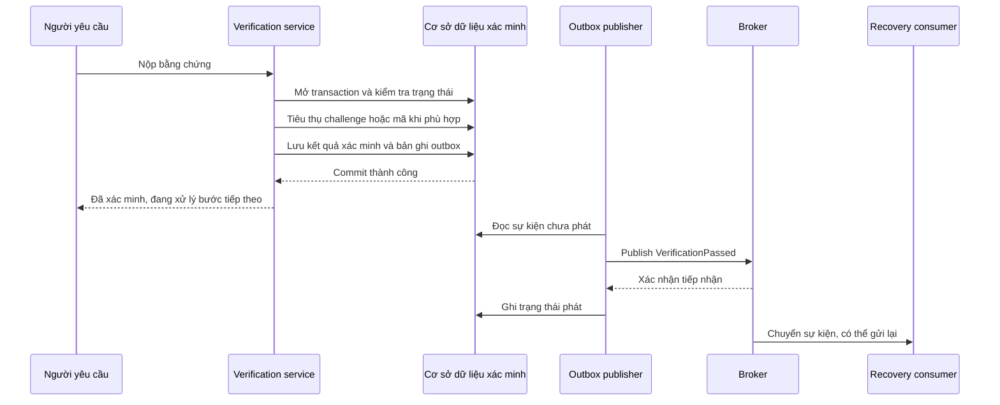
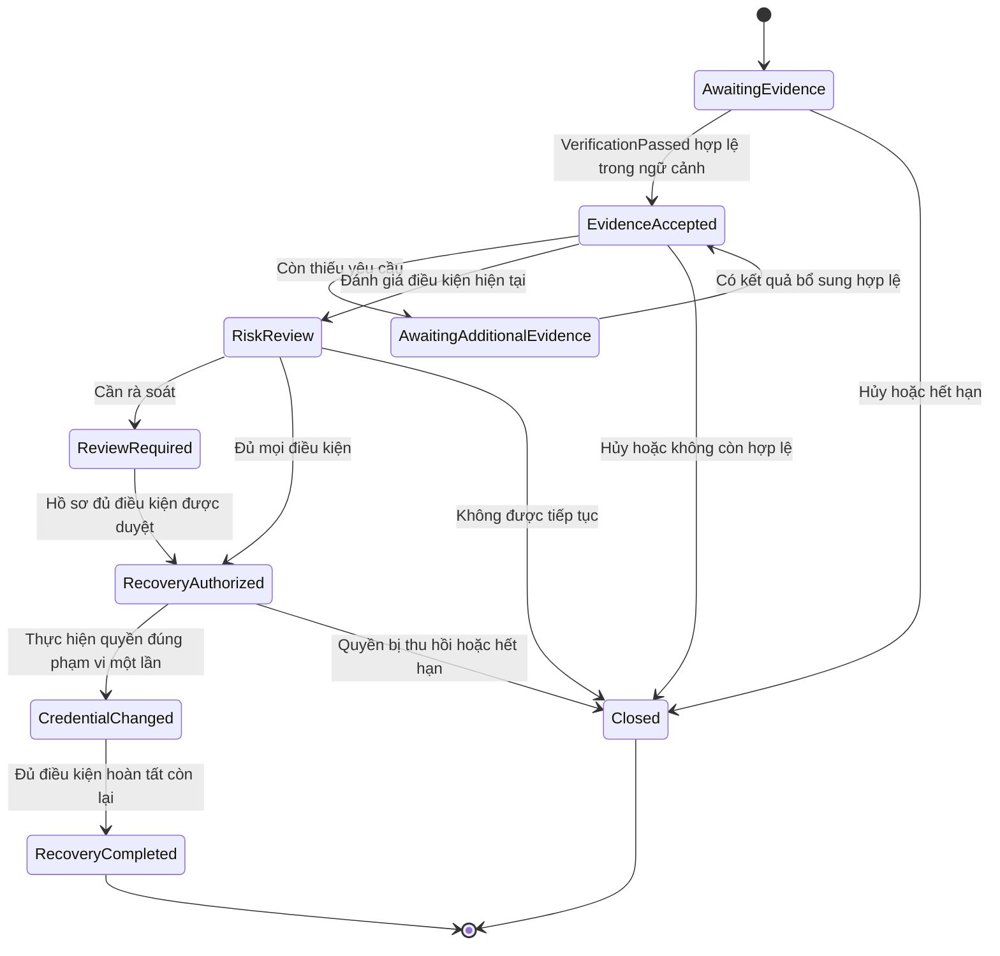

# Verification passed event — Sự kiện xác minh thành công

## 1. Sự kiện này khẳng định điều gì?

Trong module `SECURITY_AUTHENTICATION_ACCOUNT_RECOVERY`, một người có thể cần khôi phục tài khoản vì mất mật khẩu, MFA, passkey hoặc thiết bị xác thực. Luồng khôi phục thường gồm nhiều bước: nhận yêu cầu, kiểm tra bằng chứng, đánh giá rủi ro, xác định quyền được cấp, thay thông tin xác thực và xử lý các phiên liên quan.

`VerificationPassed` là sự kiện thông báo rằng **một bước xác minh cụ thể đã thành công theo các điều kiện được xác định tại thời điểm kiểm tra**. Ví dụ: mã khôi phục chưa dùng đã được kiểm tra và tiêu thụ; người yêu cầu đã chứng minh khả năng truy cập một hòm thư đã đăng ký; hoặc một authenticator đã đăng ký đã hoàn tất phép xác thực phù hợp.

Sự kiện không tự khẳng định rằng toàn bộ quy trình khôi phục đã hoàn tất. Nó cũng không mặc nhiên cho phép đăng nhập, thay mật khẩu, xóa MFA hoặc đổi email.

Một phát biểu nghiệp vụ rõ nghĩa có thể là:

> Lần xác minh `verification-615` của giao dịch `recovery-917` đã chứng minh quyền kiểm soát kênh email được chỉ định, theo chính sách kiểm tra `channel-check-v4`, lúc 03:00 UTC.

Phát biểu này khác với “người này là chủ tài khoản và được quyền làm mọi thứ”. Một hòm thư bị chiếm đoạt cũng có thể nhận được mã hợp lệ; vì vậy kết quả kiểm tra phải được đặt trong chính sách khôi phục và ngữ cảnh rủi ro của hành động.

Sau bài này, người học cần thiết kế được hợp đồng sự kiện có phạm vi rõ ràng, phát sự kiện đáng tin cậy, tiêu thụ sự kiện an toàn khi có gửi lặp hoặc sai thứ tự, và tách kết quả xác minh khỏi quyền thực hiện thay đổi tài khoản.

## 2. Phân biệt sự kiện, lệnh và quyền khôi phục

Ba khái niệm này có thể cùng xuất hiện trong một hệ thống hướng sự kiện nhưng có thẩm quyền khác nhau.

| Khái niệm | Ví dụ | Ý nghĩa |
| --- | --- | --- |
| Lệnh | `VerifyRecoveryCode` | Yêu cầu một thành phần có thẩm quyền kiểm tra mã; kết quả có thể thành công hoặc thất bại |
| Sự kiện | `VerificationPassed` | Một phép xác minh đã được thực hiện thành công và được ghi nhận |
| Quyền khôi phục | Quyền giới hạn để `RESET_PASSWORD` | Cho phép một hành động cụ thể nếu vẫn đáp ứng các điều kiện sử dụng |
| Sự kiện hoàn tất | `CredentialChanged` hoặc `RecoveryCompleted` theo mô hình của hệ thống | Một thay đổi hoặc một tập bước hoàn tất đã thực sự đạt điều kiện tương ứng |

Tên sự kiện nên mô tả một sự thật đã xảy ra. Không nên phát `VerificationPassed` khi mới tiếp nhận yêu cầu hoặc khi một tác vụ kiểm tra còn đang chờ.

Một consumer nhận sự kiện có thể cập nhật tiến trình, kích hoạt đánh giá rủi ro hoặc tạo yêu cầu tiếp theo. Nó không nên tự diễn giải sự kiện thành lệnh thay credential nếu thiếu các điều kiện có thẩm quyền.

Đặc biệt, `eventId` và `verificationId` là mã nhận diện, không phải bí mật mang quyền. Biết được một trong hai mã này không được đủ để gọi endpoint đặt lại tài khoản.

## 3. Ai được phát sự kiện?

Thành phần kiểm tra bằng chứng và sở hữu kết quả xác minh là nơi phù hợp để phát sự kiện. Nó có thể là một Verification service độc lập hoặc một thành phần nằm trong Recovery service. Ranh giới triển khai không quan trọng bằng việc quyền kết luận được xác định rõ.

Ví dụ, nếu Verification service sở hữu challenge và kiểm tra OTP, nó phải ghi lại kết quả thành công sau khi kiểm tra đúng tài khoản, giao dịch, loại challenge và các điều kiện có liên quan. Một API gateway chỉ chuyển tiếp yêu cầu không nên tự phát sự kiện dựa trên trường `verified=true` từ trình duyệt.

| Thành phần | Được thực hiện | Giới hạn |
| --- | --- | --- |
| Client | Nộp bằng chứng và nhận trạng thái của yêu cầu | Không tự phát kết luận xác minh có thẩm quyền |
| Verification service | Kiểm tra bằng chứng, tiêu thụ challenge khi phù hợp, lưu kết quả và phát sự kiện | Không mở rộng kết quả kiểm tra sang mọi hành động khôi phục |
| Recovery service | Gắn kết quả với giao dịch, kiểm tra yêu cầu còn thiếu, quyết định bước tiếp theo | Không bỏ qua chính sách hiện tại vì sự kiện có tên “passed” |
| Risk service | Dùng kết quả xác minh làm một đầu vào đánh giá | Không coi việc nhận sự kiện là căn cứ tự thay thông tin xác thực |
| Credential service | Thực hiện thay đổi theo quyền hợp lệ và trạng thái được kiểm tra | Không chấp nhận một event công khai như token đặt lại mật khẩu |
| Audit consumer | Ghi nhận dấu vết theo quyền truy cập | Không sao chép mã bí mật hoặc toàn bộ hồ sơ nhạy cảm vào log |

Danh tính producer phải được bảo vệ bằng cơ chế xác thực và phân quyền của hạ tầng hoặc cơ chế xác minh thông điệp phù hợp. Một trường JSON ghi `source: verification-service` không tự chứng minh nguồn gửi thật.

## 4. Điều kiện phát `VerificationPassed`

Producer cần kiểm tra các điều kiện nghiệp vụ tương ứng trước khi kết luận. Tập điều kiện phụ thuộc loại bằng chứng, nhưng thường bao gồm:

- Bằng chứng thuộc đúng tài khoản, tenant và giao dịch khôi phục.
- Challenge hoặc yêu cầu kiểm tra thuộc đúng vòng xác minh đang hoạt động.
- Bằng chứng phù hợp mục đích và hành động đã được ràng buộc.
- Thời điểm kiểm tra đáp ứng yêu cầu về hiệu lực.
- Hạn mức thử và trạng thái thu hồi vẫn cho phép kiểm tra.
- Bí mật hoặc assertion được kiểm tra bằng quy trình phù hợp loại bằng chứng.
- Việc dùng một lần được thực thi khi loại bằng chứng yêu cầu điều đó.

Một mã gửi đến email mới mà người nộp yêu cầu vừa nhập chỉ chứng minh quyền kiểm soát email mới. Nó không tự chứng minh quyền sở hữu tài khoản cũ. Nếu hệ thống cần liên kết email với tài khoản, mối liên kết đó phải được thiết lập bởi quy trình có thẩm quyền.

Tương tự, xác minh thành công một mã OTP không có nghĩa OTP là yếu tố chống lừa đảo, cũng không chứng minh rằng mọi yếu tố cũ đều an toàn. Sự kiện phải mô tả loại và phạm vi kết quả thực tế, tránh dùng các nhãn quá rộng như `FULLY_TRUSTED_USER`.

## 5. Thiết kế hợp đồng sự kiện

Một hợp đồng có thể chia thành phần định danh thông điệp và phần dữ kiện nghiệp vụ. Ví dụ sau là schema minh họa do hệ thống tự định nghĩa, không phải chuẩn bắt buộc của broker.

```json
{
  "eventId": "event-7a21",
  "eventType": "VerificationPassed",
  "schemaVersion": 1,
  "source": "verification-service",
  "occurredAt": "2026-11-24T03:00:00Z",
  "correlationId": "recovery-917",
  "causationId": "verify-request-221",
  "data": {
    "tenantId": "tenant-learning-a",
    "accountId": "account-482",
    "recoveryAttemptId": "recovery-917",
    "verificationId": "verification-615",
    "verificationGeneration": 3,
    "challengeId": "challenge-904",
    "evidenceResultId": "evidence-663",
    "evidenceType": "REGISTERED_EMAIL_CONTROL",
    "evidenceScope": "CONTROL_OF_REGISTERED_RECOVERY_CHANNEL",
    "boundAction": "REPLACE_MFA",
    "verificationPolicyVersion": "channel-check-v4",
    "verifiedAt": "2026-11-24T03:00:00Z",
    "evidenceValidUntil": "2026-11-24T03:05:00Z",
    "verificationRecordVersion": 2
  }
}
```

Trong ví dụ này, `boundAction` giới hạn bối cảnh mà kết quả được phép xét tới. Nó không khẳng định rằng kiểm soát email là đủ để thay MFA. Recovery service vẫn phải áp dụng yêu cầu nền, đánh giá rủi ro và các điều kiện còn thiếu.

Thời hạn năm phút chỉ minh họa cho việc chính sách quy định thời gian sử dụng kết quả. Không có một thời hạn duy nhất phù hợp mọi loại bằng chứng hoặc mọi mức nhạy cảm của tài khoản.

### 5.1. Vai trò của các mã định danh

| Trường | Dùng để làm gì? | Không thay thế được điều gì? |
| --- | --- | --- |
| `eventId` | Nhận diện lần ghi nhận sự kiện, hỗ trợ chống xử lý lặp | Quyền thực hiện thay đổi |
| `correlationId` | Liên kết các bước của một luồng để truy vết | Kiểm tra tài khoản, tenant và phạm vi nghiệp vụ |
| `causationId` | Cho biết yêu cầu hoặc thông điệp nào dẫn tới sự kiện | Xác thực danh tính producer |
| `recoveryAttemptId` | Gắn kết quả với đúng giao dịch khôi phục | Kết luận rằng giao dịch vẫn còn mở |
| `verificationId` | Nhận diện một lần kiểm tra có trạng thái riêng | Tính hợp lệ của mọi phép kiểm tra khác |
| `evidenceResultId` | Tham chiếu bản ghi bằng chứng đã được kiểm tra | Việc kết quả còn hiệu lực hoặc chưa bị thu hồi |

Đừng chỉ kiểm tra `correlationId` rồi bỏ qua các định danh trong payload. Một giá trị dùng để truy vết có thể được truyền qua nhiều thành phần; quyền tác động vẫn phải dựa trên dữ liệu đáng tin cậy và trạng thái sở hữu.

### 5.2. Vòng xác minh và phiên bản bản ghi

`verificationGeneration` biểu diễn vòng xác minh do quy trình khôi phục quản lý. Khi người dùng chuyển sang một vòng mới khiến các challenge cũ không còn được chấp nhận, thế hệ mới phải được tạo theo quy tắc rõ ràng.

Producer nhận thế hệ thông qua ngữ cảnh có thẩm quyền khi tạo yêu cầu xác minh. Nó không lấy thế hệ do trình duyệt tự khai để bỏ qua kiểm tra. Consumer so sánh với vòng mà giao dịch hiện tại còn chấp nhận.

`verificationRecordVersion` thuộc bản ghi xác minh do producer sở hữu. Nó không phải phiên bản toàn cục của mọi trạng thái khôi phục. Không được so sánh trực tiếp số `2` này với một `recoveryStateVersion=8` rồi kết luận sự kiện cũ; hai số thuộc hai phạm vi khác nhau.

### 5.3. Thời điểm xảy ra và thời điểm sử dụng

`verifiedAt` mô tả thời điểm kiểm tra thành công. `evidenceValidUntil` thể hiện giới hạn sử dụng kết quả theo chính sách. Thời điểm broker chuyển thông điệp tới consumer không làm bằng chứng mới hơn.

Thời hạn challenge là giới hạn để nộp và kiểm tra bằng chứng. Thời hạn sử dụng kết quả sau khi kiểm tra có thể được quy định riêng. Không tự kéo dài thời hạn kết quả bằng cách xử lý lại sự kiện hoặc lấy thời điểm nhận cộng thêm một khoảng mới.

Producer và consumer cần dùng thời gian phía máy chủ với quy ước thống nhất. Nếu cho phép sai lệch đồng hồ, phải giới hạn và định nghĩa rõ; không biến sai lệch thành cơ chế gia hạn không kiểm soát.

## 6. Dữ liệu không nên nằm trong sự kiện

Sự kiện có thể đi qua broker, kho lưu trữ, hệ thống giám sát, công cụ phát lại và nhiều consumer. Một bí mật bị đưa vào sự kiện rất dễ xuất hiện ở những nơi ngoài dự kiến.

Không đưa các dữ liệu sau vào `VerificationPassed` chỉ để consumer thuận tiện:

- OTP, mã dự phòng nguyên văn hoặc mật khẩu.
- Token khôi phục, liên kết đặt lại đầy đủ hoặc cookie phiên.
- Private key và các bí mật của authenticator.
- Ảnh giấy tờ, dữ liệu sinh trắc học hoặc toàn bộ hồ sơ xác minh danh tính.
- Email, số điện thoại hoặc thông tin cá nhân không cần thiết cho mục đích tiêu thụ.

Thay vào đó, dùng mã nội bộ và tham chiếu tới kết quả do dịch vụ sở hữu bảo vệ. Consumer cần thêm dữ liệu phải được cấp quyền đọc đúng phạm vi, không phải mọi consumer đều nhận toàn bộ hồ sơ.

Ngay cả mã tài khoản và lịch sử khôi phục cũng có thể nhạy cảm khi kết hợp với dữ liệu khác. Cần giới hạn quyền subscribe, thời gian lưu và khả năng tìm kiếm. Mã hóa đường truyền không thay thế kiểm soát quyền truy cập trong broker hoặc kho lưu sự kiện.

## 7. Phát sự kiện đáng tin cậy bằng transactional outbox

Một lỗi thường gặp là ghi kết quả thành công vào cơ sở dữ liệu rồi publish ngay sau đó. Nếu dịch vụ dừng giữa hai bước, kết quả đã tồn tại nhưng không có sự kiện. Nếu publish trước khi commit, consumer có thể thấy thành công dù transaction sau đó rollback.

Transactional outbox giải quyết khoảng trống giữa thay đổi dữ liệu và ý định phát sự kiện trong cùng một miền transaction.



Mã giả cho ranh giới transaction:

```text
verify(request):
    transaction:
        verification = lockVerification(request.verificationId)
        requireExpectedAccountTenantAttemptAndGeneration(request, verification)
        requireVerificationStillAcceptsEvidence(verification)
        requireLimitsAndChallengeLifetimeAllowChecking(verification)

        result = checkEvidenceUsingAuthoritativeVerifier(request, verification)
        requireResultPassed(result)

        consumeSingleUseMaterialWhenRequired(verification)
        evidence = persistImmutableEvidenceResult(result, verification)
        transitionVerificationToPassed(verification, evidence.id)
        insertOutboxEventWithStableId(verification, evidence)

    return verificationStatusWithoutSecrets()
```

Mã giả chỉ diễn tả logic thành công trong một miền dữ liệu phù hợp. Nếu việc kiểm tra cần gọi dịch vụ bên ngoài, không nên giữ khóa lâu trong lúc chờ mạng. Cần tổ chức bước kiểm tra ngoài và bước chốt có điều kiện sao cho trạng thái được kiểm tra lại, đồng thời quyền dùng một lần không bị áp dụng hai lần.

Một challenge hợp lệ không được tạo hai kết quả thành công khác nhau do hai yêu cầu cạnh tranh. Có thể dùng khóa, cập nhật có điều kiện và ràng buộc duy nhất thích hợp cho trạng thái cùng quan hệ bằng chứng.

Nếu cùng một yêu cầu được retry sau khi đã thành công, producer nên trả kết quả đã ghi hoặc xử lý theo hợp đồng idempotency. Không tạo thêm một sự kiện nghiệp vụ mới chỉ vì phản hồi HTTP trước đó bị mất. Nếu publish lại cùng bản ghi outbox, giữ nguyên `eventId`.

Outbox không tạo bảo đảm gửi đúng một lần. Publisher có thể đã gửi thành công rồi dừng trước khi ghi nhận trạng thái phát, khiến cùng sự kiện được gửi lại. Consumer vẫn phải chống xử lý lặp.

## 8. Consumer xử lý một sự kiện như thế nào?

Một pipeline tiêu thụ có thể gồm: xác thực nguồn, kiểm tra schema, định vị giao dịch, chống lặp, kiểm tra điều kiện nghiệp vụ, ghi tiến trình và tạo tác vụ tiếp theo. Chỉ nhận thông điệp thành công chưa đủ để thực hiện các bước này một cách an toàn.

### 8.1. Inbox và cập nhật trạng thái trong cùng transaction

```text
onVerificationPassed(event, authenticatedProducer):
    requireProducerAllowedForEventType(authenticatedProducer, event.eventType)
    requireSupportedSchemaAndRequiredFields(event)

    transaction:
        inboxEntry = insertInboxIfAbsent(consumerScope, event.eventId, payloadDigest)
        if inboxEntry.alreadyExists:
            requireSamePayloadAsPreviouslyRecorded(event, inboxEntry)
            keepPreviousOutcomeWithoutRepeatingEffects()
        else:
            attempt = lockRecoveryAttempt(event.data.recoveryAttemptId)
            requireMatchingTenantAccountAndBoundAction(event, attempt)

            if attempt.isTerminal:
                recordIgnoredOutcome("ATTEMPT_ALREADY_CLOSED")
            else if not attempt.acceptsGeneration(event.data.verificationGeneration):
                recordIgnoredOutcome("STALE_VERIFICATION_GENERATION")
            else if evidenceCannotBeUsedUnderCurrentConditions(event, attempt):
                recordNonProgressingOutcome("EVIDENCE_NOT_USABLE")
            else:
                attachEvidenceOnce(attempt, event.data.evidenceResultId)
                advanceOnlyThePermittedRecoveryStep(attempt)
                writeNextActionToLocalOutboxIfNeeded(attempt)
                recordAppliedOutcome()

    acknowledgeBrokerMessage()
```

Các hàm mang tên `require` đại diện cho kiểm tra bắt buộc. Sai tài khoản, sai nguồn hoặc cấu trúc không hợp lệ cần được xử lý theo chính sách lỗi hoặc cách ly; không được đổi thành “đã xác minh” để tránh thông điệp bị kẹt.

`consumerScope` phân biệt các consumer logic. Audit consumer và Recovery consumer đều có thể cần xử lý cùng một `eventId`; chống lặp của consumer này không nên vô tình chặn consumer kia.

Inbox và cập nhật tiến trình phải commit cùng nhau trong miền transaction mà consumer sở hữu. Nếu ghi “đã xử lý” trước, rồi dừng trước cập nhật giao dịch, lần gửi lại có thể bị bỏ qua dù tác động nghiệp vụ chưa tồn tại.

Nếu consumer commit xong nhưng dừng trước acknowledge, lần nhận lại sẽ thấy inbox và không lặp tác động. Đây là cách bảo vệ một tác động cục bộ trước việc broker gửi lặp, không phải bảo đảm toàn bộ hệ phân tán chạy đúng một lần.

### 8.2. Khi cần đọc dịch vụ có thẩm quyền

Một số consumer có thể dựa trên kết quả bất biến được bảo vệ trong sự kiện; consumer khác phải tra cứu `evidenceResultId` để kiểm tra trạng thái thu hồi hoặc dữ liệu không được đưa vào payload.

Nếu cần gọi mạng, tránh giữ transaction hoặc khóa giao dịch trong thời gian dài. Có thể đọc trước rồi chốt có điều kiện, hoặc đưa giao dịch sang trạng thái chờ kiểm tra. Cách nào cũng phải xử lý việc trạng thái thay đổi giữa lúc đọc và lúc ghi.

Đối với thay đổi thông tin xác thực cuối cùng, vẫn cần kiểm tra các điều kiện có hiệu lực tại nơi thực thi. Một kết quả đọc từ Verification service vài phút trước không tự ngăn được việc tài khoản vừa bị đặt cờ bảo vệ hoặc quyền khôi phục vừa bị thu hồi.

## 9. Xử lý gửi lặp, đến muộn và sai thứ tự

### 9.1. Cùng sự kiện được gửi nhiều lần

Chống lặp theo `eventId` bảo vệ việc redelivery của cùng thông điệp. Ngoài ra, cần ràng buộc nghiệp vụ như gắn một `evidenceResultId` vào giao dịch tối đa một lần, để một lỗi producer tạo hai mã sự kiện khác nhau cũng không làm một bằng chứng được tính thành hai bằng chứng độc lập.

Nếu cùng `eventId` nhưng payload khác, đó không phải một lần gửi lại bình thường. Cần ghi nhận xung đột và điều tra hoặc cách ly, thay vì im lặng coi bản mới là hợp lệ.

Thời gian lưu inbox phải được thiết kế cùng thời hạn phát lại và lưu trữ sự kiện. Khi bản ghi chống lặp đã hết hạn, các bất biến nghiệp vụ như trạng thái kết thúc, quan hệ bằng chứng duy nhất và quyền đã tiêu thụ vẫn phải bảo vệ hệ thống. Không dựa duy nhất vào một cache chống lặp ngắn hạn.

### 9.2. Sự kiện đến sau khi đã hết thời gian sử dụng

Một OTP có thể được kiểm tra đúng hạn tại producer, nhưng sự kiện bị chậm do broker hoặc consumer quá tải. Kết quả xác minh vẫn là sự thật lịch sử; khả năng dùng kết quả đó để tiến hành khôi phục là câu hỏi khác.

Consumer cần kiểm tra hiệu lực theo chính sách, có thể ghi nhận rằng sự kiện đã nhận nhưng không tiến triển giao dịch, rồi yêu cầu bước tiếp theo thích hợp. Không sửa `verifiedAt` thành thời điểm hiện tại hoặc tự gia hạn bằng chứng khi replay.

### 9.3. Sự kiện của vòng cũ đến sau vòng mới

Người dùng yêu cầu mã mới hoặc đổi phương thức. Nếu quy trình quy định vòng cũ hết hiệu lực, một `VerificationPassed` thuộc vòng cũ không được làm giao dịch tiến triển sau đó.

Không phải mọi lần gửi lại mã đều bắt buộc tạo vòng mới; đó là quyết định của mô hình challenge. Điều cần có là quy tắc rõ ràng về challenge và vòng nào còn được chấp nhận, thay vì đoán dựa trên thông điệp nào đến sau.

### 9.4. Sự kiện đến sau khi giao dịch hủy hoặc hoàn tất

Giao dịch đã bị chủ tài khoản hủy hoặc đã hoàn tất phải giữ trạng thái kết thúc. Consumer có thể ghi nhận sự kiện muộn cho truy vết, nhưng không mở lại giao dịch, không cấp lại quyền và không gửi thêm một liên kết đặt lại.

Nếu có cạnh tranh giữa hủy và xử lý thành công, hai thao tác phải tranh chấp trên cùng trạng thái có thẩm quyền hoặc qua cơ chế có điều kiện tương ứng. Việc “đã kiểm tra chưa hủy” ở đầu handler không đủ nếu sau đó vẫn ghi đè trạng thái hủy mà không kiểm tra lại.

### 9.5. Thứ tự của broker không thay thế kiểm tra nghiệp vụ

Định tuyến theo khóa giao dịch có thể giúp giữ thứ tự trong phạm vi mà hạ tầng hỗ trợ. Tuy nhiên, nhiều producer, nhiều loại sự kiện, retry và phát lại vẫn có thể tạo những quan hệ thời gian phức tạp.

Không dùng `occurredAt` như một khóa thứ tự tuyệt đối cho toàn hệ thống. Khi cần phiên bản hoặc thứ tự, phải nói rõ phạm vi sở hữu và cơ chế tạo ra chúng. Consumer vẫn kiểm tra vòng xác minh, hiệu lực và trạng thái kết thúc ngay cả khi thông điệp thường đến đúng thứ tự.

## 10. Từ xác minh thành công tới quyền khôi phục

Một mô hình tiến trình có thể tách các trạng thái sau:



Sơ đồ chỉ là mô hình minh họa. Điều quan trọng là không gộp `EvidenceAccepted`, `RecoveryAuthorized` và `RecoveryCompleted` thành một trạng thái duy nhất.

Khi đủ bằng chứng và điều kiện rủi ro, Recovery service mới có thể cấp quyền giới hạn cho đúng tài khoản, tenant, hành động và nội dung thay đổi. Quyền này cần có thời hạn, cơ chế thu hồi và dùng một lần theo chính sách.

Credential service kiểm tra quyền tại lúc thay đổi, phối hợp tiêu thụ quyền và cập nhật trạng thái bằng cơ chế phù hợp. Nó không chỉ kiểm tra rằng trước đây có một `VerificationPassed` trong lịch sử.

Sau thay đổi, các bước xử lý session, refresh token, thiết bị tin cậy và thông báo cũng cần kết quả thực tế. Nếu một bước thu hồi phiên bắt buộc đang lỗi, không nên công bố “đã thu hồi toàn bộ phiên” chỉ vì một thông điệp đã được đưa vào hàng đợi.

## 11. Retry, cách ly lỗi và phát lại

Không phải lỗi nào cũng được retry giống nhau.

| Tình huống | Cách xử lý có thể áp dụng | Điều cần bảo toàn |
| --- | --- | --- |
| Cơ sở dữ liệu tạm thời không khả dụng | Retry có giới hạn và khoảng chờ phù hợp | Không acknowledge như thể cập nhật đã commit |
| Dịch vụ kiểm tra bổ sung timeout | Chờ hoặc retry theo chính sách | Không đổi thiếu dữ liệu thành xác minh thành công |
| Schema không hỗ trợ hoặc thiếu trường bắt buộc | Cách ly, cảnh báo và xử lý khả năng tương thích | Không tự bỏ trường ràng buộc để tiếp tục |
| Sai tài khoản, tenant hoặc producer | Từ chối và ghi nhận dấu hiệu cần điều tra | Không cập nhật giao dịch đích |
| Giao dịch đã hủy hoặc bằng chứng hết hiệu lực | Ghi nhận kết quả không tiến triển theo chính sách | Không retry vô hạn nhằm chờ sự kiện tự hợp lệ trở lại |
| Cùng sự kiện đã áp dụng | Trả kết quả đã ghi và acknowledge | Không tạo thêm tác động |

Một dead-letter queue là nơi giữ thông điệp chưa xử lý được, không phải chứng nhận an toàn để phát lại bất cứ lúc nào. Công cụ redrive phải giữ dữ kiện lịch sử, ghi dấu thao tác và đi qua lại các điều kiện về hiệu lực cùng trạng thái hiện tại.

Nếu cần dựng lại một read model để phân tích, nên tách consumer dựng lại khỏi consumer có tác động như gửi thông báo, cấp quyền hay thay credential. Phát lại lịch sử để thống kê không được tạo một đợt khôi phục tài khoản mới.

Khi cùng sự kiện cũ được đưa lại vào đường xử lý nghiệp vụ, cơ chế chống lặp và bất biến trạng thái vẫn phải hoạt động. Không xóa inbox chỉ để “cho chạy lại” mà chưa xác định tác động và điều kiện an ninh.

## 12. Tiến hóa schema và chính sách

Schema sự kiện và chính sách xác minh là hai trục thay đổi khác nhau. `schemaVersion` cho biết cách diễn giải cấu trúc; `verificationPolicyVersion` cho biết quy tắc đã được dùng khi kiểm tra bằng chứng.

Thêm một trường tùy chọn không nhất thiết thay đổi kết luận nghiệp vụ. Ngược lại, đổi nghĩa của `evidenceScope` hoặc làm một loại bằng chứng đủ cho nhiều hành động hơn là thay đổi ngữ nghĩa quan trọng, dù JSON vẫn parse được.

Consumer cần xử lý các enum hoặc phạm vi chưa hiểu một cách có kiểm soát. Không ánh xạ loại bằng chứng mới về “mạnh nhất” để giữ tương thích. Nếu chưa thể hiểu các trường ràng buộc, không được tiến hành hành động nhạy cảm.

Chính sách hiện tại có thể khác chính sách lúc xác minh. Không nên mặc định mọi bằng chứng cũ đều vô hiệu, cũng không nên mặc định chúng luôn đủ. Cần quy tắc tương thích rõ ràng để xác định kết quả trước đây còn đáp ứng yêu cầu nào, có cần bổ sung hoặc làm lại không.

Ví dụ, xác minh quyền kiểm soát email theo phiên bản cũ vẫn có thể là một dữ kiện lịch sử hợp lệ, nhưng chính sách mới không còn cho phép chỉ dùng dữ kiện đó để thay MFA. Consumer ghi nhận sự thật cũ và áp dụng điều kiện thực thi hiện tại theo quy tắc chuyển đổi đã định nghĩa.

## 13. Tình huống xuyên suốt: mất điện thoại và thay MFA

Lan mất điện thoại chứa ứng dụng OTP. Cô còn truy cập được email khôi phục đã đăng ký trên máy tính. Luồng bắt đầu một giao dịch nhằm thay MFA, với vòng xác minh hiện tại là `3`.

1. Verification service tạo challenge gắn với Lan, tenant, giao dịch và vòng `3`.
2. Lan nộp mã email. Dịch vụ kiểm tra hợp lệ, tiêu thụ challenge và ghi kết quả cùng bản ghi outbox trong transaction.
3. `VerificationPassed` được phát với phạm vi `CONTROL_OF_REGISTERED_RECOVERY_CHANNEL` và hành động ràng buộc `REPLACE_MFA`.
4. Recovery consumer kiểm tra nguồn, chống lặp và gắn kết quả vào giao dịch còn mở. Nó chưa xóa MFA cũ.
5. Chính sách yêu cầu thêm bằng chứng vì email khôi phục vừa thay đổi gần đây. Risk service hoặc thành phần chính sách trả điều kiện tương ứng.
6. Nếu Lan có mã dự phòng phù hợp hoặc hoàn tất quy trình rà soát được chấp nhận, giao dịch có thể tiến tới trạng thái được phép thay MFA.
7. Hệ thống hoàn tất đăng ký yếu tố mới, thực thi thay đổi đúng quyền dùng một lần, xử lý các phiên cần thiết và gửi thông báo theo chính sách.

Giả sử broker gửi lại sự kiện ở bước 3 sau khi bước 7 đã hoàn tất. Inbox và trạng thái kết thúc khiến consumer không cấp thêm quyền. Nếu sự kiện mới chỉ tới sau khi Lan đã hủy giao dịch, consumer không mở lại giao dịch.

Giả sử kẻ tấn công tự gửi một JSON giống sự kiện với `source` đúng tên dịch vụ. Hạ tầng xác thực producer và consumer phải ngăn việc dùng thông điệp đó làm bằng chứng. Kiểm tra tên trường trong payload không đủ cho mục tiêu này.

## 14. Quan sát và kiểm thử

Nhật ký nên giúp trả lời: ai phát kết quả, thuộc giao dịch nào, được consumer áp dụng hay bỏ qua vì lý do gì, và tác vụ tiếp theo có hoàn tất không. Có thể ghi `eventId`, mã giao dịch, loại bằng chứng và outcome xử lý; không ghi bí mật gốc.

Một số chỉ số hữu ích là độ trễ từ `verifiedAt` tới lúc áp dụng, tuổi bản ghi outbox chưa phát, số lần gửi lặp, tỷ lệ bằng chứng tới sau thời hạn, số sự kiện bị cách ly và số giao dịch chờ bước tiếp theo quá lâu.

Số sự kiện `VerificationPassed` không phải số tài khoản đã khôi phục. Một giao dịch có thể cần nhiều bằng chứng, và có thể không hoàn tất dù từng bước riêng đã thành công.

| Kiểm thử | Kết quả cần quan sát |
| --- | --- |
| Transaction xác minh rollback | Không có kết quả thành công hoặc sự kiện outbox đã commit |
| Commit xong nhưng publisher dừng | Sự kiện còn trong outbox để được phát sau |
| Publish xong nhưng chưa đánh dấu đã phát | Có thể gửi lặp, consumer không lặp tác động |
| Hai yêu cầu cùng dùng một mã một lần | Chỉ tạo một kết quả thành công theo quy tắc của mã |
| Consumer dừng sau commit trước acknowledge | Redelivery không tạo thêm tiến triển hoặc quyền |
| Hai event ID trỏ cùng bằng chứng | Bằng chứng không được tính hai lần |
| Cùng event ID có payload khác | Phát hiện xung đột và không áp dụng nội dung mới tùy tiện |
| Sai tenant, tài khoản hoặc hành động | Không sửa giao dịch hoặc credential |
| Sự kiện vòng cũ, hết hạn hoặc giao dịch đã hủy | Có dấu vết nhận nhưng không tiến triển trái điều kiện |
| Chủ tài khoản hủy trong lúc consumer xử lý | Cập nhật có điều kiện bảo toàn quy tắc tranh chấp đã định nghĩa |
| Bằng chứng hợp lệ nhưng còn thiếu yêu cầu rủi ro | Không cấp quyền thay credential sớm |
| Replay để dựng báo cáo | Không phát sinh quyền, thông báo hoặc thay đổi credential ngoài dự kiến |

Các kiểm thử cần tập trung vào tính nguyên tử cục bộ, ràng buộc nghiệp vụ và tác động thực tế. Việc broker đã nhận thông điệp hoặc handler trả thành công không tự chứng minh toàn bộ luồng khôi phục an toàn.

## 15. Bài tập vận dụng

Thiết kế một `VerificationPassed` cho trường hợp sử dụng mã dự phòng để khôi phục tài khoản mất MFA. Hãy nêu producer, dữ liệu được phép đưa vào event, phạm vi bằng chứng, hành động ràng buộc, thời hạn và kết quả nào được lưu bất biến.

Tiếp theo, mô tả transaction producer và transaction consumer. Chỉ rõ cách hệ thống ứng xử khi dừng ở từng điểm: trước commit, sau commit trước publish, sau publish trước đánh dấu, và sau consumer commit trước acknowledge.

Cuối cùng, đưa sự kiện đó vào ba trạng thái khác nhau: giao dịch đang chờ đúng vòng xác minh, giao dịch đã chuyển sang vòng mới và giao dịch đã bị hủy. Thiết kế đạt mục tiêu phải ghi nhận đúng sự thật lịch sử mà không biến một kết quả xác minh cũ thành quyền khôi phục mới.
