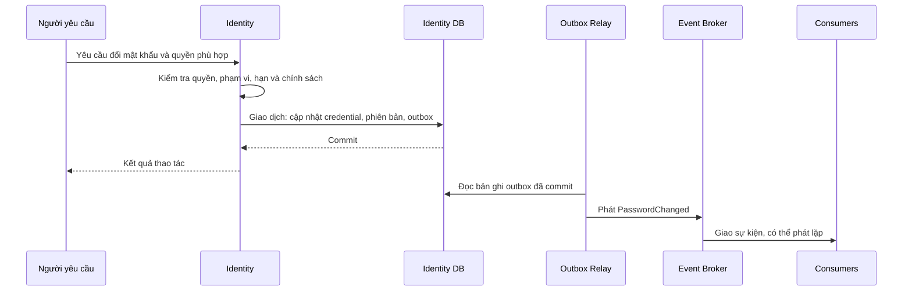

# Password changed event — Sự kiện mật khẩu đã thay đổi

## 1. Ý nghĩa trong luồng khôi phục tài khoản

Trong module `SECURITY_AUTHENTICATION_ACCOUNT_RECOVERY`, người dùng có thể cần khôi phục quyền truy cập khi mất mật khẩu, MFA, passkey hoặc thiết bị xác thực. Khi một luồng khôi phục thực sự đặt mật khẩu mới, các thành phần khác cần biết thay đổi đó để áp dụng chính sách session, gửi cảnh báo, cập nhật hồ sơ và ghi nhận kiểm toán.

**Password changed event** là thông báo về một thay đổi mật khẩu đã được miền quản lý credential xác nhận. Nó mô tả một sự kiện đã xảy ra, không phải yêu cầu đổi mật khẩu hoặc bằng chứng rằng toàn bộ quá trình khôi phục đã hoàn tất.

Một hợp đồng đủ rõ cần trả lời:

- Thay đổi nào khiến sự kiện được tạo?
- Ai có thẩm quyền phát sự kiện?
- Khi nào thay đổi được coi là đã xảy ra?
- Consumer cần dữ liệu nào và không được nhận secret nào?
- Khi sự kiện bị lặp, đến muộn hoặc đến sai thứ tự, hệ thống bảo vệ tài khoản ra sao?

Sự kiện này đặc biệt quan trọng sau recovery: kẻ tấn công có thể vẫn giữ session hoặc đã thay đổi phương thức liên lạc. Đổi mật khẩu và phát một message không tự giải quyết toàn bộ những khả năng đó.

## 2. Phân biệt yêu cầu, quyết định và kết quả

| Tên thông điệp minh họa | Ý nghĩa | Có chứng minh mật khẩu đã đổi không? |
|---|---|---|
| `PasswordChangeRequested` | Có yêu cầu đổi mật khẩu cần xử lý | Không |
| `RecoveryEvidenceVerified` | Một bước xác minh có kết quả hợp lệ theo hợp đồng | Không |
| `RecoveryAuthorized` | Cho phép thao tác khôi phục cụ thể | Không |
| `PasswordChanged` | Credential mật khẩu mới đã được ghi nhận có thẩm quyền | Có, trong phạm vi hợp đồng |
| `SessionsRevoked` | Tác động thu hồi được xác nhận theo phạm vi đã định | Không phải bằng chứng riêng về đổi mật khẩu |
| `RecoveryCompleted` | Các điều kiện hoàn tất của hồ sơ đã được đáp ứng | Chỉ biết có đổi mật khẩu nếu luồng đó yêu cầu và đã xác nhận |

Không nên để giao diện phát `PasswordChanged` sau khi người dùng bấm nút “Lưu”. Kết quả kiểm tra độ mạnh, HTTP request đã được gửi hoặc token reset đã được xác minh cũng chưa phải thời điểm đủ điều kiện.

Nguồn phát hợp lý là miền Identity/Credential sở hữu bản ghi mật khẩu. Trong hệ thống dùng nhà cung cấp danh tính bên ngoài, adapter chỉ được chuyển đổi callback hoặc kết quả có thẩm quyền theo đúng ngữ nghĩa nhà cung cấp bảo đảm; không suy đoán thành công từ việc request đã được tiếp nhận.

### Những thay đổi không tự động là PasswordChanged

- Đặt cờ yêu cầu đổi mật khẩu ở lần đăng nhập sau.
- Tạo challenge reset hoặc gửi email khôi phục.
- Thay thuật toán lưu trữ bằng cách rehash sau một lần đăng nhập thành công, trong khi mật khẩu thực tế không đổi.
- Đăng ký hoặc gỡ passkey mà không thay credential mật khẩu.
- Hoàn tất xác minh danh tính nhưng chưa cập nhật credential.

Nếu sản phẩm cần sự kiện cho những việc này, hãy đặt tên theo đúng sự kiện. Tài khoản thuần passkey không cần được gán một `PasswordChanged` giả để phù hợp với pipeline recovery dùng chung.

## 3. Thời điểm phát: sau thay đổi được commit

Một trình tự minh họa:



Việc tạo bản ghi outbox có thể nằm trong giao dịch cập nhật mật khẩu. Việc công bố message ra broker diễn ra sau đó. Nếu giao dịch rollback, không được có một sự kiện thành công đã được công bố như thể thay đổi đã tồn tại.

Ngược lại, nếu database đã commit nhưng relay đang lỗi, mật khẩu vẫn đã thay đổi. API hoặc workflow cần phản ánh kết quả thực tế; không yêu cầu người dùng đổi lần nữa chỉ vì consumer chưa nhận sự kiện.

Transactional outbox là cách ghi dữ liệu nghiệp vụ và bản ghi cần phát trong cùng giao dịch, rồi công bố sau commit. Cơ chế này vẫn có thể tạo giao nhận trùng, nên không thay thế xử lý idempotency. Xem [Transactional Outbox Pattern](https://docs.aws.amazon.com/prescriptive-guidance/latest/cloud-design-patterns/transactional-outbox.html).

### Một giao dịch minh họa cần chứa gì?

Trong một thiết kế mà Identity sở hữu các dữ liệu liên quan, giao dịch có thể:

1. Kiểm tra lại quyền đổi mật khẩu và điều kiện cạnh tranh tại thời điểm ghi.
2. Cập nhật credential đã được xử lý theo chính sách lưu mật khẩu.
3. Tăng `passwordVersion`.
4. Cập nhật trạng thái bảo mật như `securityEpoch` nếu chính sách yêu cầu.
5. Tiêu thụ quyền reset một lần và vô hiệu hóa quyền cũ cần bị chặn trong cùng ranh giới dữ liệu.
6. Ghi kết quả thao tác để có thể tra cứu hoặc retry an toàn.
7. Ghi một bản ghi outbox không chứa secret.

Nếu token reset, credential và cơ chế thu hồi nằm ở các dịch vụ khác nhau, không được mặc định tất cả các bước trên là một giao dịch nguyên tử. Kiến trúc phải có protocol và điều kiện hoàn tất tương ứng.

## 4. Hợp đồng sự kiện tối thiểu

Có thể sử dụng một envelope thống nhất, chẳng hạn CloudEvents. Ví dụ sau dùng định danh và dữ liệu giả:

```json
{
  "specversion": "1.0",
  "id": "evt-password-example-104",
  "source": "urn:service:identity",
  "type": "com.example.identity.password.changed.v1",
  "subject": "tenants/tenant-example/subjects/subject-example-28",
  "time": "2026-11-24T03:10:00Z",
  "datacontenttype": "application/json",
  "correlationid": "correlation-example-73",
  "data": {
    "tenantId": "tenant-example",
    "subjectRef": "subject-example-28",
    "operationId": "password-operation-example-61",
    "passwordVersion": 12,
    "securityEpoch": 42,
    "changeReason": "ACCOUNT_RECOVERY",
    "recoveryCaseRef": "recovery-example-19"
  }
}
```

Trong ví dụ, `specversion` là phiên bản envelope, còn hậu tố `v1` trong `type` là phiên bản hợp đồng nghiệp vụ. Chúng phục vụ hai mục đích khác nhau.

CloudEvents quy định cặp `source` và `id` định danh duy nhất cho một sự kiện khác biệt; consumer có thể coi các event có cùng cặp này là bản trùng. Trường `source` vẫn chỉ là dữ liệu nếu thiếu cơ chế xác thực nguồn phát. Xem [CloudEvents Specification 1.0.2](https://github.com/cloudevents/spec/blob/v1.0.2/cloudevents/spec.md).

### Ý nghĩa các trường nghiệp vụ

| Trường | Ý nghĩa trong hợp đồng minh họa |
|---|---|
| `tenantId` | Ranh giới tenant cần áp dụng ở mọi thao tác downstream |
| `subjectRef` | Định danh nội bộ của tài khoản; không phải bằng chứng xác thực |
| `operationId` | Định danh một thao tác đổi mật khẩu, giữ ổn định khi retry thao tác đó |
| `passwordVersion` | Phiên bản tăng theo các thay đổi mật khẩu của chủ thể |
| `securityEpoch` | Thế hệ bảo mật hiện hành được công bố để áp dụng chính sách hiệu lực |
| `changeReason` | Ngữ cảnh thay đổi, do miền có thẩm quyền xác định |
| `recoveryCaseRef` | Liên kết hồ sơ nếu thay đổi xuất phát từ recovery |

Các trường bắt buộc và tùy chọn phải được ghi rõ trong schema. Ví dụ, `recoveryCaseRef` có thể vắng mặt ở luồng tự đổi mật khẩu sau đăng nhập.

Không để client tự đặt `changeReason=SELF_SERVICE` nhằm làm consumer bỏ qua chính sách bảo vệ của recovery. Không suy ra mức độ an toàn chỉ từ chuỗi reason; consumer cần hợp đồng và chính sách đã được định nghĩa.

`time` diễn đạt thời gian sự kiện theo quy ước của producer. Nếu hệ thống không lấy được chính xác thời điểm commit, cần mô tả ý nghĩa thời gian được ghi, chẳng hạn thời điểm nghiệp vụ trong giao dịch. Không dùng timestamp đó làm số thứ tự thay cho phiên bản có thẩm quyền.

## 5. Dữ liệu không được đưa vào sự kiện

Một sự kiện mật khẩu đã đổi không cần mang theo mật khẩu.

Các dữ liệu cần loại khỏi payload phổ biến, header, trace và log tự động gồm:

- Mật khẩu cũ, mật khẩu mới hoặc các phần ký tự của mật khẩu.
- Password hash và dữ liệu xác thực lưu trữ không cần thiết cho consumer.
- Token reset, mã OTP, recovery code hoặc URL chứa token còn sử dụng được.
- Access token, refresh token hoặc session cookie.
- Seed MFA, private key hoặc tài liệu xác minh danh tính.
- Request body gốc nếu trong đó có credential.

Password hash vẫn là dữ liệu nhạy cảm: việc có hash không cho consumer hợp lệ thêm khả năng xử lý sự kiện, nhưng có thể tạo nguy cơ kiểm tra mật khẩu ngoại tuyến nếu bị lộ. Không truyền hash để consumer “đối chiếu cho chắc”.

OWASP khuyến nghị loại trừ hoặc bảo vệ các dữ liệu như mật khẩu, access token và định danh session khỏi log trực tiếp. Với kiến trúc sự kiện, cần áp dụng nguyên tắc tương tự cho broker, outbox, DLQ và các công cụ xem message. Xem [Logging Cheat Sheet](https://cheatsheetseries.owasp.org/cheatsheets/Logging_Cheat_Sheet.html).

Định danh giả danh như `subjectRef` giúp tránh đưa email vào mọi message, nhưng không làm dữ liệu trở thành vô danh. Nếu consumer có thể liên kết nó với một người, vẫn cần quyền truy cập và thời hạn lưu phù hợp.

Nếu một consumer cần thông tin nhạy cảm bổ sung, nên đánh giá API có phân quyền và dữ liệu tối thiểu thay vì mở rộng event chung cho mọi subscriber. Không đính kèm toàn bộ hồ sơ chỉ vì một dịch vụ cần một trường.

## 6. Consumer được phép làm gì?

### 6.1. Recovery workflow

Workflow dùng sự kiện để đối chiếu thao tác đã chờ:

- Đúng tenant và chủ thể.
- Đúng `operationId` và hồ sơ liên quan.
- Đúng loại thay đổi.
- Có nguồn phát đáng tin.
- Phù hợp trạng thái hiện hành.

Nếu workflow đang chờ thay MFA mà nhận một sự kiện đổi mật khẩu, nó không được tự coi hai việc là tương đương. Nếu hồ sơ yêu cầu cả đổi mật khẩu lẫn đăng ký yếu tố mới, `PasswordChanged` chỉ xác nhận một phần.

### 6.2. Session và refresh token

Consumer có thể cập nhật mốc thu hồi hoặc thực hiện tác động theo chính sách đã định. Phạm vi cần rõ: tất cả phiên cũ, một loại phiên, refresh token family hay một tập khác.

Không dùng lệnh xóa tất cả session của người dùng một cách mù quáng cho mọi event đến muộn. Một lần đăng nhập mới hợp lệ sau đổi mật khẩu có thể đã tạo session cần được giữ theo chính sách.

### 6.3. Notification

Consumer tạo cảnh báo rằng mật khẩu đã thay đổi. Không gửi mật khẩu mới, không gửi lại token reset và không coi delivery email là chứng minh chủ tài khoản đã xem.

Đích nhận cảnh báo phải được phân giải từ dữ liệu liên lạc có thẩm quyền theo chính sách. Trong sự cố chiếm tài khoản, có thể cần kênh liên lạc trước đó; không tự lấy email mới do người yêu cầu vừa nhập làm đích cảnh báo duy nhất.

### 6.4. Audit và giám sát rủi ro

Audit lưu sự kiện và liên kết thao tác. Hệ thống rủi ro có thể dùng nó để phát hiện chuỗi hành vi bất thường, chẳng hạn đổi mật khẩu gần thời điểm thay đổi thông tin khôi phục.

Sự kiện không tự chứng minh người thực hiện là chủ tài khoản hợp pháp. Kẻ đã chiếm một session đủ quyền cũng có thể gây ra một thay đổi thật. Producer phải mô tả sự kiện đúng, còn kết luận rủi ro cần bằng chứng riêng.

### 6.5. Những quyền không được tự sinh từ sự kiện

Nhận `PasswordChanged` không được trở thành lý do để:

- Cấp session đăng nhập đầy đủ cho người giữ correlation ID.
- Bỏ qua MFA hoặc đăng ký passkey chưa được chứng minh.
- Đổi email khôi phục.
- Mở lại grant đã tiêu thụ.
- Coi tài khoản đã hết rủi ro chiếm đoạt.
- Đặt lại mật khẩu một lần nữa như một phản ứng mặc định.

Đây là một fact trong hệ thống, không phải capability tự cho phép thay đổi khác.

## 7. Producer Java: ghi kết quả và outbox cùng giao dịch

Đoạn sau là Java giả mã về ranh giới giao dịch. Repository, lớp command và encoder là giao diện minh họa, chưa phải mã triển khai hoàn chỉnh.

```java
PasswordChangeResult changePassword(
        ChangePasswordCommand command,
        AuthenticatedContext context) {

    access.requirePasswordChangeCaller(context, command.tenantId());

    return identityTransaction.execute(() -> {
        AccountSecurity account =
                accounts.lock(command.tenantId(), command.subjectRef());

        PasswordChangeResult previous =
                results.find(command.tenantId(), command.operationId());

        if (previous != null) {
            previous.requireSameAuthorizedOperation(command, context);
            return previous;
        }

        ResetAuthorization authorization =
                authorizations.lock(command.authorizationRef());

        authorization.requireValidFor(account, command, context, databaseClock.now());
        account.requirePasswordVersion(command.expectedPasswordVersion());

        // Xử lý credential theo chính sách; không đưa secret vào event.
        account.installPassword(command.preparedPasswordCredential());
        account.advancePasswordVersion();
        account.applyRecoverySecurityPolicy();
        authorization.consume(command.operationId());

        PasswordChangeResult result = results.insertUnique(
                PasswordChangeResult.from(account, command.operationId()));

        outbox.append(PasswordChangedEnvelope.from(
                result, authorization.recoveryCaseRef()));

        return result;
    });
}
```

Mục đích của ví dụ là thể hiện:

- Quyền và phiên bản được kiểm tra tại miền sở hữu credential.
- Bản ghi kết quả giúp retry không đổi mật khẩu lần thứ hai.
- Secret không đi vào `PasswordChangedEnvelope`.
- Outbox không được commit độc lập với thay đổi credential.
- Giao dịch này chỉ bao phủ dữ liệu thuộc ranh giới Identity.

Mọi đường cập nhật, hủy grant và reset cần quy tắc khóa hoặc kiểm soát cạnh tranh nhất quán. Ràng buộc duy nhất ở database cần hỗ trợ định danh thao tác; chỉ gọi `find` rồi `insert` mà không xử lý cạnh tranh là chưa đủ.

`preparedPasswordCredential` ở đây chỉ biểu diễn dữ liệu credential đã được chuẩn bị an toàn trong miền phù hợp. Không để client gửi một password hash bất kỳ rồi coi là giá trị lưu trữ được tin cậy.

Việc kiểm tra cùng thao tác khi retry phải có thiết kế riêng cho đầu vào chứa secret. Không lưu request fingerprint bằng hash nhanh của mật khẩu để tiện dedupe, vì nó có thể trở thành một bộ kiểm tra mật khẩu ngoại tuyến khác. Có thể dùng tham chiếu chuẩn bị do server quản lý, ràng buộc authorization và chính sách idempotency phù hợp; đừng lưu lại request body.

## 8. Consumer idempotent: giao lặp không tạo tác động lặp

Có hai loại trùng cần phân biệt:

| Loại trùng | Ví dụ | Cơ chế thường dùng |
|---|---|---|
| Trùng giao nhận | Cùng event được broker giao hai lần | Inbox theo consumer và cặp `source + id` |
| Trùng tác động nghiệp vụ | Hai envelope phiên bản khác nhau mô tả cùng lần đổi mật khẩu | Khóa tác động theo định danh thao tác nghiệp vụ |

Một consumer gửi cảnh báo có thể có khóa như `tenant + operationId + notificationPurpose`, với giả định hợp đồng quy định một operation tương ứng một lần đổi mật khẩu. Nếu chính sách có nhiều đích hoặc loại cảnh báo, khóa phải phân biệt các tác động cần thiết đó.

Chỉ lưu event ID trong bộ nhớ tiến trình sẽ mất tác dụng khi consumer restart. Chỉ đánh dấu processed trước khi tác động được lưu lại cũng có thể khiến event mất tác động vĩnh viễn.

Một mẫu xử lý phù hợp:

1. Kiểm tra envelope, schema, nguồn được phép và tenant.
2. Bắt đầu giao dịch dữ liệu của consumer.
3. Ghi inbox theo khóa duy nhất; nếu đã có, bỏ qua bản trùng.
4. Cập nhật projection hoặc tạo bản ghi công việc có định danh ổn định.
5. Commit giao dịch.
6. Xác nhận message theo cơ chế broker.
7. Worker thực hiện công việc đã lưu và xử lý retry riêng.

Nếu bước 4 cần gọi một dịch vụ bên ngoài, transaction của consumer không thể tự làm lời gọi đó nguyên tử. Có thể tạo outbox công việc trong cùng database rồi gọi sau commit.

Ví dụ, email provider có thể đã nhận email nhưng phản hồi bị mất. Worker cần dùng cơ chế idempotency của provider nếu có và một ledger giao nhận phù hợp. Inbox đơn thuần không bảo đảm một email chỉ được nhận đúng một lần.

Không tuyên bố “exactly once cho toàn bộ recovery” chỉ vì broker hỗ trợ một chế độ giao nhận hoặc transaction nào đó. Phải xem cả database, consumer và tác động bên ngoài.

## 9. Sự kiện sai thứ tự và phiên bản bảo mật

Giả sử người dùng đổi mật khẩu hai lần:

| Lần thay đổi | Password version | Security epoch |
|---|---:|---:|
| A | 12 | 42 |
| B | 13 | 43 |

Do chậm xử lý, consumer có thể nhận B trước A. Nó không được hạ phiên bản hiện hành từ 13 về 12 hoặc epoch từ 43 về 42.

Cần phân biệt:

- `passwordVersion` mô tả thứ tự thay đổi mật khẩu theo chủ thể.
- `securityEpoch` có thể tăng bởi nhiều loại thay đổi bảo mật, không riêng mật khẩu.
- `time` phục vụ thời gian nghiệp vụ, không thay thế thứ tự có thẩm quyền.
- Offset của broker chỉ có nghĩa trong phạm vi mà broker định nghĩa, không phải thứ tự toàn hệ thống.

Một projection về epoch có thể dùng cập nhật đơn điệu:

```text
storedEpoch = max(storedEpoch, incomingEpoch)
```

Đây chỉ phù hợp với dữ liệu có ngữ nghĩa “mốc hiệu lực cao nhất”. Audit không được bỏ một thay đổi thật chỉ vì có sự kiện mới hơn. Notification cũng cần chính sách riêng về gộp hoặc gửi cảnh báo cũ, thay vì áp dụng quy tắc max cho mọi tác động.

### Java giả mã cho projection epoch

```java
void onPasswordChanged(PasswordChanged event, VerifiedSource source) {
    trustedPublishers.requireIdentityPasswordEvent(source, event);

    consumerTransaction.execute(() -> {
        boolean firstDelivery = inbox.tryInsertUnique(
                CONSUMER_NAME, event.source(), event.id());

        if (!firstDelivery) {
            return;
        }

        SecurityProjection projection =
                projections.lockOrCreate(event.tenantId(), event.subjectRef());

        boolean advanced = projection.advanceEpochToAtLeast(
                event.securityEpoch());

        if (advanced) {
            tasks.insertUnique(SecurityEpochTask.from(
                    event.tenantId(), event.subjectRef(),
                    projection.securityEpoch()));
        }
    });
}
```

Projection, inbox và bản ghi task trong ví dụ thuộc cùng giao dịch consumer. Worker thực hiện task cũng phải giữ tính đơn điệu và phạm vi đúng. Hai worker xử lý task epoch 43 rồi 42 không được làm hệ thống quay về 42.

Khóa phân vùng theo tenant và chủ thể có thể hỗ trợ giữ thứ tự ở một số broker, nhưng không thay thế kiểm tra consumer. Repartition, retry queue, nhiều nguồn hoặc replay có thể làm giả định thứ tự không còn đúng.

Nếu consumer cần đọc mọi thay đổi liên tiếp và phát hiện thiếu version, hợp đồng phải nói rõ loại sự kiện nào có mặt trong stream. Khoảng nhảy của security epoch không nhất thiết là thiếu một `PasswordChanged`, vì epoch có thể tăng do thay MFA hoặc thay quyền.

## 10. Thu hồi session mà không làm sai với sự kiện đến muộn

Đây là một tác động quan trọng nhất của `PasswordChanged` trong recovery.

Giả sử:

1. Mật khẩu được đổi, Identity tăng epoch từ 41 lên 42.
2. Người dùng đăng nhập hợp lệ bằng credential mới và nhận session epoch 42.
3. Consumer nhận sự kiện đổi mật khẩu bị chậm.
4. Consumer thu hồi những phiên thuộc thế hệ trước 42 theo chính sách.

Nếu consumer chỉ gọi `deleteAllSessions(subject)` ở bước 4, nó có thể xóa cả session mới ở bước 2. Một hợp đồng theo epoch cho phép diễn đạt rõ “chặn session có epoch nhỏ hơn mốc được yêu cầu”, nếu đó là chính sách của sản phẩm.

Đường đăng nhập cũng phải tránh cuộc đua: xác minh mật khẩu cũ trước commit rồi phát session gắn epoch mới sau commit. Thành phần cấp session cần kiểm tra trạng thái credential đã xác minh còn phù hợp tại lúc cấp, bằng giao dịch hoặc protocol thích hợp.

### Phát sự kiện không đồng nghĩa đã chặn mọi token

Nếu resource server chỉ xác minh chữ ký JWT mà không kiểm tra trạng thái hiệu lực, access token cũ có thể tiếp tục được chấp nhận đến khi hết hạn. Cập nhật epoch ở database hoặc projection không tự thay đổi điều đó.

Thiết kế cần chỉ rõ:

- Resource server kiểm tra epoch, introspection, session store hoặc cơ chế nào.
- Cache được phép cũ trong bao lâu.
- Refresh token có bị chặn độc lập với access token hay không.
- Hành vi khi không đọc được trạng thái thu hồi.
- Thời điểm recovery được coi là đạt yêu cầu bảo mật.

Nếu yêu cầu là chặn ngay, phải có cơ chế cưỡng chế đáp ứng yêu cầu đó ở mọi đường truy cập liên quan. Hàng đợi bất đồng bộ đơn thuần có thể để lại khoảng trễ.

OWASP đề cập việc xác thực lại sau các sự kiện rủi ro như đổi mật khẩu và recovery, cùng việc quản lý hiệu lực session. Áp dụng vào hệ thống cụ thể vẫn cần xác định chính sách và thành phần cưỡng chế. Xem [Session Management Cheat Sheet](https://cheatsheetseries.owasp.org/cheatsheets/Session_Management_Cheat_Sheet.html).

Đổi mật khẩu sau recovery cũng không tự thu hồi passkey hoặc MFA bị kẻ tấn công thêm trước đó. Các loại credential đó cần quyết định và sự kiện riêng theo chính sách của hồ sơ.

## 11. Notification, cảnh báo và replay

Một cảnh báo phù hợp có thể nói:

> Mật khẩu tài khoản của bạn đã được thay đổi vào thời điểm được hiển thị. Nếu bạn không thực hiện thao tác này, hãy mở ứng dụng hoặc trang hỗ trợ chính thức để kiểm tra bảo mật.

Nội dung, thời gian hiển thị và đích nhận cần được xác định theo sản phẩm. Không gửi mật khẩu hoặc một liên kết “hoàn tác” mang quyền dài hạn chỉ vì dễ triển khai.

Nếu có liên kết hành động, nó cần thiết kế authorization, hạn và chống phát lại riêng. Việc replay một `PasswordChanged` cũ không được tự cấp lại token reset hoặc khởi tạo một quyền recovery mới.

Đối với email gửi chậm:

- Không đổi thời điểm xảy ra sự kiện thành thời điểm consumer xử lý.
- Có thể giải thích độ trễ theo chính sách giao tiếp.
- Tránh gửi lặp không giới hạn khi vận hành replay.
- Nếu gộp thông báo của nhiều thay đổi, giữ khả năng kiểm toán từng sự kiện.
- Không để tối ưu chống gửi lặp loại bỏ các cảnh báo bảo mật khác mục đích.

Sự kiện có thể đến sau khi địa chỉ email đã thay đổi. Đích nhận không nên được chọn tùy ý bằng cách lấy “email hiện tại” mà không xem mục tiêu cảnh báo. Có thể cần một kế hoạch thông báo hoặc tham chiếu đích được tạo từ dữ liệu có thẩm quyền tại thời điểm phù hợp.

## 12. Lỗi xử lý, DLQ và đối soát

Không phải mọi lỗi đều nên retry giống nhau:

| Lỗi | Hướng xử lý |
|---|---|
| Database consumer tạm không sẵn sàng | Retry có backoff và giới hạn |
| Schema không được hỗ trợ | Cách ly, báo đội sở hữu hợp đồng |
| Nguồn phát không có quyền | Từ chối hoặc cách ly như sự kiện bảo mật |
| Event giao lặp | Kết thúc idempotent |
| Event cũ cho projection đơn điệu | Không hạ trạng thái; xử lý các tác động khác theo hợp đồng |
| Dịch vụ gửi cảnh báo timeout | Đối chiếu trạng thái giao nhận rồi retry theo khả năng provider |
| Tenant hoặc subject không khớp | Không sửa dữ liệu tenant khác; điều tra lỗi liên kết |
| Outbox tồn đọng | Theo dõi và khôi phục relay, không tạo lần đổi mật khẩu mới |

DLQ là nơi cách ly để điều tra và phục hồi, không phải hoàn thành nghiệp vụ. Cần có người hoặc cơ chế vận hành chịu trách nhiệm xử lý, tuổi message và ảnh hưởng đến các tác động bảo mật bắt buộc.

Khi replay:

1. Giữ nguồn gốc và định danh sự kiện theo chiến lược replay đã định.
2. Không thay `operationId` để vượt qua dedupe.
3. Biết consumer nào sẽ tạo tác động bên ngoài.
4. Không sửa ngầm payload lịch sử để làm nó giống schema mới.
5. Nếu cần chuyển đổi schema, giữ provenance và kiểm soát tác động trùng.
6. Đối chiếu kết quả với miền có thẩm quyền khi trạng thái còn mâu thuẫn.

Thời hạn giữ inbox phải phù hợp cửa sổ có thể giao lại hoặc replay. Nếu xóa inbox sớm hơn dữ liệu lịch sử, một event cũ có thể lại tạo tác động. Dedupe nghiệp vụ hoặc tác động đơn điệu vẫn cần được thiết kế, thay vì cho rằng event đã từng được đọc là đủ.

Đối soát có thể so sánh kết quả thay đổi tại Identity với outbox và trạng thái xử lý bắt buộc. Không được tái dựng một sự kiện đổi mật khẩu chỉ từ việc thấy request reset trong log, vì request chưa chứng minh thay đổi đã commit.

## 13. Phiên bản schema và quyền truy cập

Khi thêm một trường tùy chọn, cần bảo đảm consumer cũ có thể xử lý theo hợp đồng. Khi thay đổi ý nghĩa hoặc cấu trúc bắt buộc, nên có phiên bản hợp đồng rõ ràng và kế hoạch chuyển đổi.

Một số lỗi khó phát hiện:

- Đổi `passwordVersion` thành phiên bản của mọi credential nhưng giữ tên và type cũ.
- Đổi `changeReason` từ thông tin ngữ cảnh thành chỉ thị bỏ qua thu hồi session.
- Dùng timestamp dưới tên `securityEpoch` mà consumer vẫn so sánh như số thế hệ.
- Phát đồng thời v1 và v2 rồi để Notification gửi hai cảnh báo cho cùng một thay đổi.
- Cho consumer mới đọc toàn bộ dữ liệu cũ mà chưa xét thời hạn lưu và quyền truy cập.

Khi một lần thay đổi tạo nhiều envelope trong đợt chuyển phiên bản, mỗi envelope khác biệt có định danh riêng theo hợp đồng, còn định danh thao tác nghiệp vụ được giữ để tránh lặp tác động. Consumer cần chủ động xử lý giai đoạn này.

Broker cần giới hạn ai được publish loại sự kiện, ai được đọc topic và ai được replay. Mã hóa kết nối không thay thế ACL. Tên `source=identity` trong payload không thay thế workload identity hoặc cơ chế kiểm tra nguồn.

Outbox, broker, DLQ, bản sao lưu và công cụ hỗ trợ đều là nơi chứa dữ liệu sự kiện. Đặt chính sách bảo vệ cho cả chuỗi, không chỉ API đầu vào.

## 14. Tình huống hoàn chỉnh và tiêu chí kiểm tra

Người dùng quên mật khẩu, hoàn thành quyền reset một lần và đặt mật khẩu mới. Identity commit:

- Credential mật khẩu mới.
- `passwordVersion=12`.
- `securityEpoch=42` theo chính sách recovery của ví dụ.
- Quyền reset đã tiêu thụ.
- Kết quả `operationId=password-operation-example-61`.
- Outbox chứa `PasswordChanged`.

Phản hồi HTTP bị mất. Client thử lại cùng thao tác trong ngữ cảnh được phép. Identity trả kết quả cũ, không đổi mật khẩu lần nữa và không tạo một sự kiện nghiệp vụ mới cho retry đó.

Relay phát sự kiện; broker giao hai lần. Session consumer chỉ cập nhật mốc thu hồi một cách đơn điệu. Notification ghi một tác vụ theo khóa nghiệp vụ. Audit ghi nhận sự kiện và xử lý bản trùng theo mô hình của nó.

Sau đó người dùng đổi mật khẩu lần nữa, tạo version 13 và epoch 43. Nếu consumer nhận event version 12 lần nữa, nó không hạ epoch, không tạo grant mới và không đánh dấu hồ sơ mới hơn là đã được hoàn tất bởi thao tác cũ.

Các tình huống kiểm tra một triển khai:

| Kịch bản | Kết quả cần đạt |
|---|---|
| Cập nhật mật khẩu rollback | Không công bố sự kiện thành công cho thay đổi đó |
| Commit xong, relay dừng | Kết quả vẫn đúng và outbox có thể được gửi tiếp |
| Mất phản hồi, retry cùng operation | Trả kết quả cũ theo quyền, không đổi lần hai |
| Cùng operation nhưng yêu cầu nghiệp vụ khác | Từ chối theo hợp đồng idempotency |
| Broker giao trùng đồng thời | Không tạo hai tác động chỉ vì hai bản giao |
| Version 13 đến trước 12 | Projection không lùi; audit không mất sự kiện thật |
| Event đến sau session đăng nhập mới | Áp dụng đúng phạm vi thu hồi, không xóa mù phiên mới |
| Publisher giả mạo type hoặc source | Không tin sự kiện chỉ từ nội dung JSON |
| Replay DLQ | Không cấp lại token hoặc phát cảnh báo trùng ngoài chính sách |
| Đổi mật khẩu nhưng MFA còn bị mất | Không tự tuyên bố đã giải quyết toàn bộ recovery |
| Consumer của tenant A nhận dữ liệu tenant B | Không cập nhật chéo tenant |
| Kiểm tra broker, trace và DLQ | Không thấy password, hash, OTP hoặc token reset |

## 15. Bài tập áp dụng

Thiết kế hợp đồng `PasswordChanged` cho hệ thống có Identity, Recovery, Session, Notification và Audit.

Hãy mô tả:

1. Chính xác thay đổi nào tạo sự kiện và điều kiện commit.
2. Schema tối thiểu, các trường bị cấm và nguồn phát được phép.
3. Khóa idempotency cho producer, inbox consumer và tác vụ cảnh báo.
4. Xử lý hai lần đổi mật khẩu khi event đến sai thứ tự.
5. Phạm vi thu hồi session và cửa sổ trễ có thể chấp nhận.
6. Cách retry sau mất phản hồi mà không phát sinh thay đổi mới.
7. Cách replay dữ liệu lịch sử mà không khởi tạo lại quyền recovery.

Một lời giải có cơ sở cần cho thấy sự kiện mô tả đúng thay đổi đã xảy ra, dữ liệu không làm lộ credential và mỗi consumer thực hiện đúng tác động của mình ngay cả khi message bị lặp hoặc đến muộn.
