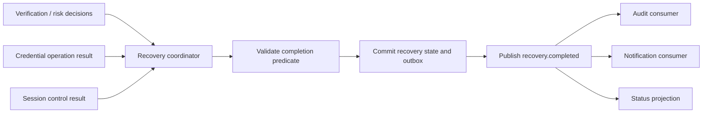

# Recovery completed event

## 1. Sự kiện hoàn tất khôi phục khẳng định điều gì?

Trong module `SECURITY_AUTHENTICATION_ACCOUNT_RECOVERY`, khôi phục tài khoản có thể bao gồm đặt lại mật khẩu, thay MFA, đăng ký passkey mới hoặc thay thiết bị xác thực. Một luồng thường đi qua nhiều thành phần: xác minh danh tính, đánh giá rủi ro, tiêu thụ quyền khôi phục dùng một lần, thay credential, kiểm soát session và gửi thông báo bảo mật.

`recovery.completed` là sự kiện công bố rằng một lần khôi phục cụ thể đã đạt điều kiện hoàn tất mà hệ thống cam kết. Nó mô tả một kết quả đã xảy ra và được ghi nhận bền tại nguồn. Consumer dùng sự kiện để cập nhật giao diện, lập audit, gửi thông báo hoặc tiếp tục các xử lý hậu kỳ được cho phép.

Tên sự kiện mang một lời hứa đáng kể. Nếu producer phát nó khi mới nhận request, mới kiểm tra token hoặc mới gửi lệnh thu hồi session, các consumer có thể tin nhầm rằng tài khoản đã được bảo vệ xong. Với khôi phục tài khoản, sự nhầm lẫn này có thể che giấu session của kẻ tấn công hoặc tạo đường cấp quyền không đúng lúc.

Bài học giải thích cách định nghĩa lời hứa đó, chọn nguồn có thẩm quyền phát sự kiện, thiết kế payload và bảo vệ đường xử lý trước lỗi phân tán. Những ví dụ là hợp đồng và mô hình triển khai minh họa, không phải mô tả hệ thống hiện tại của dự án đã có sẵn các service hay broker tương ứng.

## 2. Phân biệt command, tiến trình và kết quả hoàn tất

Một thông điệp yêu cầu hệ thống làm việc khác với một sự kiện thông báo công việc đã hoàn thành.

| Thông điệp hoặc trạng thái | Ý nghĩa | Có thể coi là đã khôi phục xong? |
| --- | --- | --- |
| `CompleteRecovery` | Command yêu cầu thử hoàn tất theo điều kiện hiện hành | Chưa; command có thể bị từ chối |
| `RecoveryProofAccepted` | Một bằng chứng đã được chấp nhận trong phạm vi xác định | Chưa; còn cần áp dụng tác động bắt buộc |
| `CredentialChangeRequested` | Đã yêu cầu credential service thay đổi | Chưa; chưa có kết quả áp dụng |
| `CredentialChangeApplied` | Credential service xác nhận thay đổi đã commit | Còn phụ thuộc các điều kiện hoàn tất khác |
| `SessionControlRequested` | Đã yêu cầu xử lý session | Chưa chứng minh session cũ mất hiệu lực |
| `SessionControlEffective` | Cơ chế session đã đạt bảo đảm được định nghĩa | Là một điều kiện hoàn tất nếu policy yêu cầu |
| `recovery.completed` | Mọi điều kiện bắt buộc của lần khôi phục đã được xác nhận | Có, theo đúng phạm vi và policy được công bố |

Nếu sản phẩm chỉ muốn thông báo “credential đã đổi nhưng thu hồi session còn chờ”, hãy dùng sự kiện có ý nghĩa tương ứng và thể hiện trạng thái pending. Không dùng một tên `completed` chung rồi để từng consumer tự suy đoán các việc còn thiếu.

Sự kiện hoàn tất cũng không phải bearer token. Biết `event_id`, đọc được message hay biết `completion_id` không được tạo quyền đăng nhập, bỏ qua MFA hoặc mở một lần khôi phục mới. Những hành động này cần cơ chế cấp quyền riêng.

## 3. Định nghĩa điều kiện hoàn tất bằng chính sách rõ ràng

### 3.1. Một completion predicate minh họa

Với một luồng đặt lại mật khẩu có yêu cầu vô hiệu hóa session cũ, có thể định nghĩa:

```text
canFinalize(recovery) =
    recovery belongs to the expected tenant and account
    AND the requested purpose is PASSWORD_RESET
    AND the authorization decision permitted the applied action
    AND the one-time recovery authority was consumed correctly
    AND the credential operation is confirmed APPLIED
    AND required session control is confirmed EFFECTIVE
    AND no blocking cancellation or unresolved mandatory step remains
    AND the recovery generation and state still allow finalization
```

Đây là ví dụ chính sách, không phải công thức chung cho mọi loại khôi phục. Với MFA hoặc passkey, credential operation phải phản ánh đúng loại credential và phạm vi được phép thay. Khôi phục passkey thường là đăng ký credential mới sau xác minh phù hợp, không phải khôi phục private key đã mất từ server.

Các điều kiện cấp quyền phải được kiểm tra tại thời điểm hành động nhạy cảm được cho phép và thực hiện. Nếu bằng chứng có hạn dùng hoặc có thể bị thu hồi, dịch vụ thực thi phải kiểm tra hiệu lực theo hợp đồng. Việc một bằng chứng hết hạn sau khi đã được sử dụng hợp lệ không tự động làm hành động đã commit trở thành chưa xảy ra; cần phân biệt kiểm tra quyền thực hiện với ghi nhận kết quả lịch sử.

### 3.2. “Session control effective” cần có nghĩa vận hành

Một cờ `revocation_requested = true` chỉ biểu diễn ý định. Để công bố kiểm soát session có hiệu lực, cần biết cơ chế nào đang thực thi bảo đảm đó. Ví dụ một mô hình yêu cầu các request xác thực so phiên bản session với authentication epoch hiện tại có thể vô hiệu hóa session cũ về mặt logic, nếu mọi đường truy cập liên quan thực sự tuân thủ kiểm tra này.

Nếu hệ thống chỉ kiểm tra chữ ký và hạn của JWT, tăng epoch trong database không tự vô hiệu hóa JWT. Nếu có cache, đường truy cập ngoại lệ hoặc replica chậm, phải định nghĩa độ trễ và giới hạn của bảo đảm. Không dùng nhãn `ALL_PREEXISTING_SESSIONS_INVALIDATED` cho một cơ chế còn cho phép session cũ truy cập ngoài cam kết.

Policy cần chỉ rõ session nào phải bị tác động: toàn bộ session trước đó, một nhóm thiết bị hay phạm vi khác. Consumer không được suy từ chữ “recovery” rằng tất cả session và mọi loại token đã bị thu hồi.

### 3.3. Công việc nào chặn completion?

| Công việc | Có thể là điều kiện bắt buộc? | Cách biểu diễn hợp lý |
| --- | --- | --- |
| Thay credential đúng mục đích | Có | Chỉ chấp nhận kết quả đã commit từ nguồn sở hữu |
| Tiêu thụ quyền khôi phục dùng một lần | Có | Có receipt hoặc trạng thái bền chống dùng lại |
| Kiểm soát session theo policy | Có | Chờ kết quả đạt bảo đảm đã định nghĩa |
| Ghi trạng thái nguồn và sự kiện outbox | Có với thiết kế trong bài | Cùng transaction finalization |
| Gửi email thông báo bảo mật | Thường là hậu kỳ, nhưng tùy policy | Intent gửi bền, trạng thái delivery riêng |
| Cập nhật dashboard hoặc chỉ mục tìm kiếm | Thường là hậu kỳ | Projection có thể trễ, không quyết định quyền |
| Chuyển audit tới kho trung tâm | Tùy yêu cầu độ bền | Phân biệt event bền local với ingest cuối đường |

Nếu một policy coi việc gửi thông báo là điều kiện bắt buộc, phải định nghĩa “gửi” là provider đã nhận, đã chấp nhận hay đã có bằng chứng khác. Không biến việc email đến hộp thư thành một bảo đảm mà hệ thống không quan sát được.

## 4. Chọn chủ sở hữu phát sự kiện

Recovery service hoặc một coordinator được xác định rõ nên sở hữu việc chuyển lần khôi phục sang trạng thái kết thúc và phát sự kiện hoàn tất toàn luồng. Nó tổng hợp các xác nhận có thẩm quyền, nhưng không tự bịa kết quả thay cho service khác.

Credential service xác nhận credential operation; session service xác nhận phạm vi kiểm soát session; verification và risk service xác nhận quyết định trong phạm vi nghiệp vụ của mình. Một message broker chỉ vận chuyển thông điệp, không phải nơi kết luận tài khoản đã khôi phục an toàn.



Các xác nhận đầu vào cần được xác thực nguồn, chống trùng và binding tới đúng tenant, account, request, purpose, operation và thế hệ khôi phục. Một `CredentialChangeApplied` của request trước không được dùng để hoàn tất request mới chỉ vì cùng tài khoản.

Không phát cùng một sự kiện hoàn tất toàn luồng từ cả credential service và recovery coordinator. Việc có nhiều nguồn tự kết luận làm consumer khó xác định đâu là bản ghi chuẩn. Các service tham gia vẫn có thể phát sự kiện kết quả riêng với tên và phạm vi rõ ràng.

## 5. Thiết kế payload tự chứa nhưng không mang bí mật

Ví dụ dưới đây thể hiện một lần đặt lại mật khẩu đã hoàn tất, với policy yêu cầu kiểm soát mọi session tồn tại trước thay đổi. Các giá trị chỉ dùng minh họa hợp đồng:

```json
{
  "event_id": "9e47d9a3-cb8e-40ab-9d28-f449e9d6497b",
  "event_type": "recovery.completed",
  "schema_version": 1,
  "producer_id": "account-recovery",
  "tenant_ref": "tenant_40a",
  "recovery_request_ref": "recovery_70b",
  "recovery_generation": 1,
  "completion_id": "completion_63d",
  "subject_ref": "subject_98c",
  "aggregate_version": 24,
  "occurred_at": "2026-11-24T10:20:30.125Z",
  "correlation_id": "correlation_11f",
  "causation_id": "finalization_command_29e",
  "data": {
    "purpose": "PASSWORD_RESET",
    "outcome": "SUCCEEDED",
    "completion_policy_version": "password-recovery-8",
    "credential_operation_ref": "credential_operation_17a",
    "authorization_decision_ref": "decision_32e",
    "actor": {
      "kind": "END_USER",
      "actor_ref": "actor_55d"
    },
    "session_control": {
      "policy": "ALL_PREEXISTING_SESSIONS",
      "status": "EFFECTIVE",
      "operation_ref": "session_operation_81b",
      "authentication_epoch_after": 42
    }
  }
}
```

### 5.1. Phân biệt các định danh

| Trường | Vai trò | Không nên dùng để làm gì |
| --- | --- | --- |
| `event_id` | Định danh một sự kiện bất biến; giữ nguyên khi gửi lại | Không cấp ID mới cho mỗi lần retry |
| `completion_id` | Định danh lần hoàn tất nghiệp vụ | Không dùng làm bí mật cho đăng nhập |
| `recovery_request_ref` | Liên kết tới vòng khôi phục nguồn | Không tự coi việc biết ID là có quyền xem request |
| `recovery_generation` | Phân biệt thế hệ nếu mô hình nguồn có khái niệm này | Không dùng để mở lại request đã kết thúc tùy ý |
| `aggregate_version` | Phiên bản trạng thái của đúng recovery aggregate | Không so trực tiếp hai request khác nhau để xếp thứ tự tài khoản |
| `correlation_id` | Liên kết các hoạt động cùng luồng để quan sát | Không thay cho dedup key hoặc kiểm tra quyền |
| `causation_id` | Chỉ ra thao tác hoặc thông điệp trực tiếp gây ra sự kiện | Không giả định đây luôn là ID của một domain event |

Mô hình đơn giản có thể tạo một request ID mới cho mỗi vòng khôi phục và không cần tái sử dụng generation. Nếu dùng generation, tất cả service liên quan phải thực thi binding và chống tác động từ thế hệ cũ. Một trường số trong JSON không tự tạo ra cơ chế fencing.

`occurred_at` phải có định nghĩa rõ, chẳng hạn thời điểm nguồn ghi nhận chuyển trạng thái hoàn tất trong transaction. Nếu timestamp được tạo trước commit, không mô tả nó như thời điểm commit chính xác khi nguồn chưa đo được. Consumer có thể lưu thêm thời điểm nhận để phân tích độ trễ.

### 5.2. Tự chứa để xử lý không phụ thuộc thứ tự đến

Consumer nhận `recovery.completed` nên biết được request nào đã hoàn tất, mục đích gì, theo policy nào và kết quả bắt buộc nào đã đạt. Nó không nên phải chờ đầy đủ mọi sự kiện trước đó chỉ để hiểu ý nghĩa cơ bản của sự kiện cuối.

Điều này không yêu cầu nhúng toàn bộ lịch sử xác minh. Dùng reference tới quyết định và operation khi cần điều tra sâu. Việc truy vấn ngược về service nguồn có thể hữu ích để đối soát hoặc lấy trạng thái hiện tại, nhưng không nên là cách duy nhất để giải mã một sự kiện lịch sử.

### 5.3. Những dữ liệu phải loại khỏi sự kiện

Không đưa raw recovery token, mật khẩu, OTP, recovery code, session cookie, private key, ảnh giấy tờ hoặc câu trả lời xác minh đầy đủ vào payload. Không sao chép toàn bộ request body vào event rồi hy vọng consumer sẽ tự che dữ liệu nhạy cảm.

Credential operation reference đủ để đối chiếu một thay đổi; consumer audit không cần password hash hoặc chi tiết vật liệu credential. Các ID opaque vẫn có thể liên kết tới một người, nên vẫn cần kiểm soát quyền đọc, retention và đường export.

Nếu notification service cần gửi thông báo, nên phân giải kênh nhận qua nguồn có thẩm quyền và policy liên quan. Không tin một email mới trong payload do client cung cấp để gửi xác nhận rằng tài khoản đã được khôi phục. Đối với khôi phục có thay đổi kênh liên hệ, chính sách thông báo tới kênh đã tin cậy trước đó cần được định nghĩa riêng.

## 6. Ghi trạng thái hoàn tất và outbox trong cùng transaction

### 6.1. Vì sao publish trực tiếp dễ tạo lỗ hổng?

Nếu commit trạng thái `COMPLETED` rồi mới publish, process có thể crash sau commit và trước publish. Nếu publish trước rồi mới commit, consumer có thể thấy “đã hoàn tất” trong khi nguồn rollback. Hai thao tác độc lập không tự có tính nguyên tử.

Transactional outbox giải quyết ranh giới local: chuyển trạng thái nguồn và ghi sự kiện ra outbox trong cùng transaction. Relay chỉ đọc dữ liệu đã commit và chuyển tiếp sự kiện sau đó.

```text
finalizeRecovery(requestRef, expectedVersion):
    begin local transaction
        recovery = lockRequestWithinAuthorizedTenant(requestRef)

        if recovery is already COMPLETED:
            return persisted completion result
            // Do not create another completion or event ID.

        require recovery.version == expectedVersion
        require recovery state permits finalization
        require current generation matches effect receipts
        require completion predicate is satisfied

        completionId = allocateAndPersistCompletionIdentity()
        recovery.transitionToCompleted(completionId)
        event = serializeAllowlistedCompletionEvent(recovery)

        save recovery with a conditional version check
        insert outbox event with stable eventId and completionId
        require both writes succeeded
    commit local transaction
```

Các kiểm tra phải dựa trên trạng thái hoặc receipt đáng tin cậy, không dựa vào các cờ `credentialChanged=true` hay `sessionsRevoked=true` do client gửi. `expectedVersion` giúp phát hiện cạnh tranh, nhưng nguồn vẫn phải kiểm tra tenant, mục đích và trạng thái hiện hành.

Có thể đặt unique constraint cho một sự kiện hoàn tất theo `(tenant_id, completion_id, event_type)`, bên cạnh định danh duy nhất của event. Nó giúp ngăn lỗi lập trình tạo nhiều event hoàn tất cho cùng lần chuyển trạng thái. Constraint không thay thế completion predicate và không chứng minh dữ liệu receipt đúng sự thật.

### 6.2. Nhiều service không tham gia cùng transaction local

Trong mô hình credential và session có database riêng, finalization transaction chỉ bao phủ recovery state, receipt đã lưu tại coordinator và outbox của coordinator. Nó không quay lại commit nguyên tử với mọi thao tác từ xa đã xảy ra trước đó.

Mỗi service cần ghi kết quả phần việc của mình và sự kiện xác nhận một cách bền. Coordinator tiếp nhận xác nhận, lưu receipt có binding và cập nhật tiến trình. Khi mọi điều kiện hoàn tất đạt yêu cầu, nó thực hiện transaction finalization.

Nếu credential đã thay nhưng session control thất bại, trạng thái phải thể hiện còn bước bắt buộc chưa xong. Không phát completed để “giải phóng workflow”, rồi âm thầm retry phần session như công việc không còn liên quan tới an toàn.

### 6.3. Không dùng vòng đời event thay cho vòng đời quyền khôi phục

Quyền khôi phục dùng một lần phải được tiêu thụ tại đường thực hiện hành động nhạy cảm theo giao thức đã thiết kế. Không đợi consumer đọc `recovery.completed` rồi mới đánh dấu token đã dùng; trong khoảng trễ đó token có thể bị dùng lại.

Tương tự, notification consumer không được tự sinh token khôi phục mới khi nhận completed. Sự kiện kết thúc một quyền đã được thực hiện, không mở một quyền thay credential mới cho bất kỳ subscriber nào.

## 7. Delivery ít nhất một lần và consumer idempotent

### 7.1. Một event có thể được gửi nhiều lần

Relay có thể publish thành công rồi crash trước khi đánh dấu outbox đã gửi. Broker cũng có thể redeliver khi consumer mất kết nối hoặc không acknowledge kịp. Thiết kế phải chịu được việc nhận lại cùng message.

Relay giữ nguyên `event_id` và payload của sự kiện qua mọi lần thử. Không tạo một `event_id` mới để giải quyết timeout, bởi consumer sẽ không còn nhận ra đó là cùng sự kiện. Trường về lần gửi hoặc đường vận chuyển nên được quản lý như metadata delivery, tách khỏi nội dung nghiệp vụ bất biến.

Nếu relay nhận xác nhận từ broker, đó là xác nhận theo hợp đồng độ bền của broker. Nó chưa chứng minh mọi consumer đã xử lý xong. Chính sách xóa outbox, retention broker và phục hồi phải phản ánh đúng bảo đảm này.

### 7.2. Inbox và kết quả local cần commit cùng nhau

Pseudocode sau minh họa một consumer chỉ cập nhật projection và tạo notification intent bền:

```text
onRecoveryCompleted(message, authenticatedSource):
    event = parseAndValidateSupportedSchema(message)
    verifyProducerAuthority(authenticatedSource, event)
    verifyTenantScopeAndAllowedEventType(authenticatedSource, event)

    begin consumer local transaction
        result = inbox.insertOrCompare(
            consumerName,
            authenticatedSource.producerId,
            event.eventId,
            canonicalPayloadFingerprint(event)
        )

        if result is SAME_EVENT_ALREADY_COMMITTED:
            commit local transaction
            acknowledge message
            return

        if result is SAME_ID_DIFFERENT_CONTENT:
            abort and route to controlled conflict handling

        updateRecoveryProjectionWithoutStateRegression(event)
        insertNotificationIntentIfBusinessEffectIsNew(
            tenant = event.tenantRef,
            completion = event.completionId,
            purpose = SECURITY_RECOVERY_COMPLETED
        )
    commit consumer local transaction

    acknowledge message
```

Inbox phải nằm trong cùng transaction với các thay đổi local cần bảo vệ. Nếu đánh dấu đã nhận trước rồi crash trước khi tạo intent, lần gửi lại có thể bị bỏ qua và mất công việc. Nếu cập nhật xong rồi mới ghi inbox trong transaction khác, redelivery có thể thực hiện tác động hai lần.

Khóa inbox thường có phạm vi theo consumer hoặc subscription, danh tính producer đã xác thực và event ID. Hai consumer có nhiệm vụ khác nhau cần được xử lý cùng event độc lập. Không dùng một dedup flag toàn cục khiến audit nhận xong thì notification bị bỏ qua.

### 7.3. Event dedup khác với business idempotency

Dedup theo `event_id` xử lý việc cùng event được vận chuyển lặp. Một ràng buộc nghiệp vụ theo `(tenant, completion_id, notification_purpose)` có thể ngăn tạo hai intent cùng mục đích nếu producer có lỗi phát hai ID khác nhau cho cùng lần hoàn tất.

Nếu cùng completion nhưng nội dung mâu thuẫn, cần đối chiếu và báo lỗi. Không coi mọi xung đột unique là bằng chứng xử lý thành công rồi tiếp tục gửi thông báo bằng payload mới.

Việc gửi email nằm ngoài transaction database của consumer. Worker gửi intent cần retry có kiểm soát và tận dụng idempotency của provider nếu có hợp đồng phù hợp. Ngay cả khi chỉ có một intent, lỗi mạng giữa lúc provider nhận và lúc worker ghi kết quả vẫn có thể gây gửi lặp. Không hứa email được giao “exactly once” chỉ vì inbox có unique constraint.

Thời gian giữ inbox hoặc receipt phải phù hợp cửa sổ redelivery và replay. Nếu xóa dedup state sau một ngày nhưng có thể replay message của một tháng trước, cần cơ chế chống lặp nghiệp vụ còn hiệu lực hoặc chế độ replay chỉ làm các tác động đã được giới hạn rõ ràng.

## 8. Thứ tự sự kiện, phiên bản và trạng thái hiện tại

### 8.1. Partition key giúp trong một phạm vi xác định

Có thể dùng khóa định tuyến gồm tenant và recovery request để tăng khả năng các event của cùng request đi cùng partition. Tuy nhiên, bảo đảm thứ tự còn phụ thuộc producer, broker, cấu hình xử lý và retry. Việc chọn cùng key không tự tạo thứ tự toàn cục giữa nhiều service hoặc mọi request của một tài khoản.

Vì vậy consumer vẫn cần xử lý trường hợp `recovery.completed` đến trước một sự kiện tiến trình. Payload sự kiện cuối phải đủ để hiểu kết quả cơ bản; projection có thể áp dụng trạng thái hoàn tất và giữ thông tin rằng một số mốc trước đó chưa quan sát được.

### 8.2. Không cho sự kiện cũ kéo trạng thái lùi

Đối với cùng một recovery aggregate, projection có thể lưu `last_applied_version`. Khi một sự kiện tiến trình có phiên bản cũ hơn tới sau completed, nó không được đổi trạng thái giao diện về “đang xác minh”. Audit vẫn có thể lưu sự kiện lịch sử đó với thời điểm nhận thực tế.

Không áp dụng quy tắc bỏ mọi phiên bản nhỏ hơn một cách máy móc cho mọi consumer. Một consumer xây projection cần tránh lùi trạng thái; một consumer audit có thể cần giữ tất cả sự kiện hợp lệ; một consumer tạo tác động nghiệp vụ phải kiểm tra riêng loại tác động và idempotency. Nhận event cũ không đồng nghĩa được xóa mọi dấu vết của nó.

`aggregate_version` của request A và request B không cùng một trục thứ tự. Request A phiên bản 30 không nhất thiết mới hơn request B phiên bản 2. Nếu cần bảo vệ trạng thái theo tài khoản, dùng phiên bản bảo mật theo tài khoản do nguồn có thẩm quyền cấp, hoặc truy vấn nguồn đúng hợp đồng; không so sánh các số phiên bản không cùng phạm vi.

### 8.3. Sự kiện lịch sử không phải trạng thái hiện hành

Một tài khoản có thể khôi phục thành công lúc 10 giờ rồi bị khóa vì phát hiện tấn công lúc 11 giờ. Event completed lúc 10 giờ vẫn đúng về lịch sử; nó không được dùng lúc 12 giờ để xóa trạng thái khóa.

Tương tự, `authentication_epoch_after = 42` mô tả kết quả của lần hoàn tất đó. Nếu tài khoản hiện đã ở epoch 45, consumer không được đặt epoch trở lại 42. Nguồn quản lý session vẫn sở hữu trạng thái có hiệu lực hiện tại.

Consumer không nên dùng timestamp của hai máy để tự giải quyết tranh chấp quyền truy cập. Đồng hồ có thể lệch và event có thể đến trễ. Quyền truy cập hiện tại phải được quyết định bởi cơ chế xác thực có thẩm quyền, không bởi thứ tự hiển thị trên timeline.

## 9. Cancellation, expiry và finalization cạnh tranh

Một yêu cầu hủy có thể tới cùng lúc với xác nhận thay credential hoặc finalization command. Để tránh hai trạng thái kết thúc mâu thuẫn, việc chuyển trạng thái cần được tuần tự hóa tại nguồn bằng khóa hoặc cập nhật có điều kiện theo version và trạng thái.

| Tình huống cạnh tranh | Nguyên tắc xử lý |
| --- | --- |
| Hủy đã commit trước khi finalizer kiểm tra | Finalizer không chuyển request đã hủy sang completed |
| Finalization đã commit trước yêu cầu hủy | Yêu cầu hủy không sửa lịch sử thành chưa có tác động |
| Xác nhận của thế hệ cũ tới sau khi có thế hệ mới | Không dùng nó làm receipt cho thế hệ mới |
| Token hết hạn trước khi hành động được cấp quyền | Không thực hiện hành động chỉ vì command đã vào queue |
| Token hết hạn sau khi đã được tiêu thụ hợp lệ và credential đã đổi | Ghi nhận đúng tác động; không tự giả định mọi thay đổi đã được hoàn tác |
| Có trạng thái tác động từ xa chưa rõ sau timeout | Đối soát operation ID; không đoán thành công hoặc thất bại |

Nếu cancellation thắng khi chưa có tác động, nó có thể chặn bước tiếp theo. Nếu credential đã thay ở service khác, hủy workflow không tự hoàn tác credential. Trạng thái cần thể hiện tác động đã áp dụng, bước nào còn chờ và có cần xử lý an toàn bổ sung hay không.

Không khôi phục mật khẩu cũ để giả lập rollback một password reset. Hệ thống không nên giữ mật khẩu cũ ở dạng có thể khôi phục. Phản ứng sau sự cố có thể là khóa tài khoản, vô hiệu hóa credential hoặc yêu cầu xác minh lại, nhưng đó là hành động riêng có phân quyền và audit, không phải sửa event completed đã phát.

Nếu dùng fencing theo generation hoặc account security version, credential/session service cũng phải kiểm tra điều kiện chống lệnh cũ trước khi áp dụng. Coordinator từ chối một confirmation cũ sau khi tác động đã xảy ra chỉ bảo vệ workflow của nó; không thể ngăn hồi tố thay đổi đã được service khác thực hiện.

## 10. Bảo mật đường phát và nhận sự kiện

### 10.1. Xác thực nguồn thay vì tin metadata tự khai

Consumer không tin `producer_id` trong JSON chỉ vì nó ghi tên recovery service. Cần có danh tính workload được xác thực, quyền publish theo topic hoặc loại sự kiện, và cơ chế đối chiếu nguồn thực tế với envelope. Nếu broker không tự cung cấp danh tính producer cho consumer, kiến trúc cần một cách bảo đảm provenance, chẳng hạn ingress tin cậy gắn metadata được bảo vệ hoặc envelope được xác thực phù hợp.

Danh tính producer hợp lệ vẫn cần quyền phát đúng loại sự kiện và phạm vi tenant. Một notification worker không nên được phép giả mạo completed; một producer phục vụ một tenant không được tự ghi sự kiện cho tenant khác.

Giới hạn quyền subscribe cũng quan trọng. Topic chứa lịch sử khôi phục có thể tiết lộ thời điểm người dùng mất MFA hoặc thay thiết bị. Không coi message bus là mạng nội bộ nên mọi workload đều được đọc.

### 10.2. Kiểm tra cấu trúc và ngữ nghĩa tối thiểu

Consumer cần kiểm tra schema version hỗ trợ, trường bắt buộc, kiểu dữ liệu, giới hạn kích thước, enum và quan hệ logic cơ bản. Ví dụ completed của policy bắt buộc session control không được có `status = REQUESTED` trong hợp đồng đã chọn ở bài học.

Schema hợp lệ không chứng minh hành động thực sự đã được thực hiện. Niềm tin vào sự kiện còn dựa trên nguồn có thẩm quyền, đường ghi bền và cơ chế bảo vệ producer. Khi có xung đột với nguồn authoritative hoặc dấu hiệu bị giả mạo, cần xử lý như bất thường có thể điều tra thay vì âm thầm sửa dữ liệu nhạy cảm theo event.

### 10.3. Không tự động cấp quyền từ sự kiện hoàn tất

Các consumer thông thường không được làm những việc sau chỉ vì nhận completed:

- Phát hành session đăng nhập mới hoặc access token cho subject.
- Bỏ qua MFA của một thao tác hiện tại.
- Thay địa chỉ nhận khôi phục theo trường do người gửi tùy ý điền.
- Xóa credential hiện tại để đồng bộ với một event lịch sử.
- Khởi tạo một lần khôi phục mới hoặc tạo recovery token có thể dùng lại.

Nếu có nhu cầu tự động đăng nhập sau khôi phục, đó phải là một giao thức cấp session riêng với binding tới client, assurance và chính sách session phù hợp. Broadcast một event tới nhiều subscriber không phải cách phân phối quyền đăng nhập an toàn.

## 11. Retry, sự kiện lỗi và replay

### 11.1. Phân loại lỗi trước khi retry

| Nhóm lỗi | Ví dụ | Hướng xử lý |
| --- | --- | --- |
| Tạm thời | Consumer database timeout, broker gián đoạn | Retry có giới hạn, backoff và quan sát backlog |
| Không tương thích hợp đồng | Schema version chưa hỗ trợ | Cách ly hoặc dừng có kiểm soát, phối hợp triển khai consumer |
| Dữ liệu bất hợp lệ | Thiếu completion ID hoặc enum sai | Không thực hiện tác động; báo lỗi có định danh điều tra |
| Vi phạm nguồn hoặc tenant | Producer không có quyền phát completed | Từ chối, cảnh báo bảo mật và giữ dấu vết phù hợp |
| Xung đột bất biến | Cùng event ID nhưng payload khác | Không ghi đè; cách ly và đối soát nguồn |
| Tác động chưa rõ | Provider nhận thông báo nhưng response timeout | Đối chiếu operation hoặc idempotency trước khi gửi lại |

Không retry vô hạn một poison message ở đầu partition đến mức các sự kiện hợp lệ phía sau không được xử lý. Cũng không acknowledge rồi bỏ message lỗi vào application log không có quy trình phục hồi.

Nếu chuyển message vào nơi cách ly rồi acknowledge nguồn, cần bảo đảm nơi cách ly đã lưu bền và trách nhiệm xử lý tiếp được xác định. Bản ghi cách ly phải thể hiện “chưa xử lý nghiệp vụ”, không được tính như consumer đã hoàn tất tác động.

### 11.2. Replay để phục hồi không được tạo lại quyền

Replay có thể cần khi xây lại projection hoặc phục hồi consumer. Với dữ liệu thuần hiển thị, có thể dùng consumer hoặc đích riêng chỉ xây projection, có kiểm soát version và provenance. Với notification hay workflow có tác động, cần business receipt hoặc chế độ replay được giới hạn để tránh gửi lại hàng loạt hoặc kích hoạt bước nhạy cảm.

Không cho replay completed gọi lại đường thay mật khẩu hoặc đăng ký credential. Những hành động đó đã xảy ra và event chỉ ghi nhận kết quả. Nếu muốn lặp một tác động nghiệp vụ vì lý do sửa lỗi, phải tạo thao tác mới được phân quyền, có định danh và căn cứ riêng.

Khi replay, giữ nguyên định danh sự kiện gốc và phân biệt metadata của đợt replay. Không đổi `occurred_at` thành thời điểm hiện tại để biến một lần khôi phục cũ thành hoạt động mới. Consumer cần biết mình đang đọc lịch sử, đặc biệt khi dedup state cũ đã hết retention.

## 12. Ví dụ đầu cuối: credential đã đổi nhưng session còn pending

Giả sử policy của một luồng password reset yêu cầu credential mới đã áp dụng và session cũ đã bị vô hiệu hóa theo cơ chế được cam kết. Các bước dưới đây cho thấy vì sao cần tách kết quả của từng service khỏi completed toàn luồng.

| Mốc | Trạng thái quan sát được | Hành vi đúng |
| --- | --- | --- |
| T1 | Người dùng đủ điều kiện sử dụng quyền khôi phục | Cấp phép thao tác đúng purpose, ràng buộc tenant/account/request |
| T2 | Quyền dùng một lần đã tiêu thụ; credential operation đã commit | Lưu receipt, chuyển sang chờ bước bắt buộc còn lại |
| T3 | Session service nhận command nhưng chưa áp dụng xong | Hiển thị session control pending; chưa phát completed |
| T4 | Command session timeout ở phía coordinator | Đối soát operation ID; không kết luận chưa thực hiện |
| T5 | Session service xác nhận bảo đảm thu hồi đã có hiệu lực | Lưu xác nhận đúng request, generation và phạm vi session |
| T6 | Coordinator đánh giá completion predicate đạt | Commit trạng thái completed, completion ID và outbox cùng transaction |
| T7 | Relay publish rồi crash trước khi đánh dấu đã gửi | Sự kiện có thể được gửi lại với nguyên event ID |
| T8 | Audit, notification và projection nhận lại message | Mỗi consumer dedup độc lập, không tạo lại tác động đã có |

Nếu session service không phục hồi, hệ thống vẫn biết credential đã đổi. Nó cần một trạng thái chưa hoàn tất có thể xử lý tiếp, giám sát và chính sách giới hạn tài khoản phù hợp. Phát completed tại T2 chỉ để luồng trông thành công sẽ làm mất tín hiệu rằng session của người khác có thể còn hiệu lực.

Nếu người dùng gửi lại command hoàn tất sau T6, producer trả kết quả bền của cùng thao tác khi binding và hợp đồng idempotency khớp. Nó không cấp completion ID mới. Một command dùng cùng idempotency key nhưng yêu cầu purpose hoặc nội dung tác động khác phải bị phát hiện, không được báo rằng thay đổi mới đã được thực hiện chỉ vì request cũ từng thành công.

Ở T8, notification service có thể mới lưu intent gửi thông báo trong database của nó. Điều đó không làm event nguồn sai: policy đã xác định thông báo là hậu kỳ. Giao diện nên phân biệt “khôi phục đã hoàn tất” và “thông báo đang được gửi” thay vì gộp mọi trạng thái thành một cờ không rõ ý nghĩa.

## 13. Phiên bản hợp đồng và vận hành đường sự kiện

### 13.1. Thay đổi payload và thay đổi ý nghĩa

Thêm một trường tùy chọn có thể tương thích với consumer cũ nếu parser và hợp đồng cho phép. Thay ý nghĩa của completed từ “session đã có hiệu lực” thành “mới yêu cầu session” là thay đổi ngữ nghĩa lớn dù JSON vẫn parse được.

`schema_version` mô tả hợp đồng biểu diễn; `completion_policy_version` xác định điều kiện nghiệp vụ được áp dụng. Chúng không thay thế nhau. Consumer cần biết loại policy nào nó hỗ trợ hoặc tối thiểu không được suy diễn bảo đảm vượt quá thông tin policy cung cấp.

Không tái phát một sự kiện completed mới chỉ để chuyển payload lịch sử sang schema mới. Khi upcast phục vụ đọc, giữ nguồn gốc, định danh nghiệp vụ và ý nghĩa gốc; khi sửa một sai sót thực sự, dùng cơ chế hiệu chỉnh có tham chiếu và thẩm quyền rõ ràng. Nếu một producer lỗi từng phát completed quá sớm, cần xử lý sự cố và tác động đã phát sinh, không chỉ đổi tên event trong kho lịch sử.

### 13.2. Những chỉ số cần quan sát

Theo dõi tuổi hàng outbox cũ nhất, backlog relay, thời gian từ finalization tới broker, độ trễ của từng consumer, số duplicate hợp lệ, số xung đột ID, lỗi schema và sự kiện cách ly chưa xử lý. Ngoài độ trễ vận chuyển, cần đo thời gian request ở trạng thái chờ credential hoặc session control.

Không dùng email, raw token hoặc request ID làm nhãn metric có số lượng giá trị không giới hạn. Dùng nhóm sự kiện, producer, consumer và loại lỗi làm nhãn hữu hạn; chi tiết đối soát lưu trong kênh được kiểm soát bằng correlation reference.

Một dashboard báo broker hoạt động không chứng minh không có event bị thiếu. Cần đối soát trạng thái completed ở nguồn với outbox hoặc receipt công bố, và theo yêu cầu với ingest của audit hoặc consumer quan trọng. Sự kiện đã vào broker nhưng consumer nằm trong dead-letter queue vẫn cần được theo dõi riêng.

### 13.3. Completion của nghiệp vụ khác với completion của delivery

Nên phân biệt các mốc sau trong vận hành:

```text
Business completion committed
    -> Event stored in source outbox
    -> Broker accepted event durably under its contract
    -> Consumer committed its local processing
    -> External side effect confirmed where applicable
```

Hai mốc đầu cùng thuộc transaction nguồn trong thiết kế của bài học. Các mốc sau có thể trễ hoặc thất bại độc lập. Không dùng một cột `published = true` để suy ra email đã gửi, audit đã tìm kiếm được và mọi projection đều mới nhất.

Khi query trạng thái khôi phục sau khi API đã xác nhận thành công, projection có thể chưa cập nhật. Giao diện hoặc API cần biết mốc dữ liệu của projection, hoặc đọc kết quả bền từ nguồn theo hợp đồng phù hợp, để không khiến người dùng khởi tạo thêm một luồng chỉ vì màn hình còn hiển thị pending.

## 14. Các tình huống cần kiểm chứng khi triển khai

Bảng dưới đây là các tình huống thiết kế và kiểm chứng cho ứng dụng thực tế. Chúng không có nghĩa các ví dụ trong bài đã được triển khai hoặc chạy trên hệ thống hiện tại.

| Tình huống | Kết quả mong đợi |
| --- | --- |
| Credential đã áp dụng nhưng session control còn pending theo policy bắt buộc | Chưa phát completed; trạng thái phản ánh phần việc còn thiếu |
| Ghi outbox lỗi trong transaction finalization | Không commit trạng thái completed của transaction đó |
| Process crash sau commit nguồn, trước publish | Event vẫn còn bền để relay chuyển tiếp |
| Relay publish hai lần do mất xác nhận | Cùng event ID và payload; consumer chịu được duplicate |
| Consumer crash trước commit inbox và intent | Redelivery có thể xử lý lại mà không bỏ mất intent |
| Consumer crash sau commit nhưng trước acknowledge | Redelivery nhận ra đã xử lý; không tạo tác động local thứ hai |
| Hai event ID khác nhau mang cùng completion ID và nội dung tương ứng | Business idempotency ngăn tạo lại cùng tác động; producer lỗi được quan sát |
| Cùng event ID nhưng nội dung khác | Không upsert thay bản gốc; tạo xung đột có thể điều tra |
| Event tiến trình cũ đến sau completed | Projection không lùi; audit vẫn có thể giữ lịch sử |
| Event của request cũ đến sau một lần khóa tài khoản mới | Không mở khóa hoặc hạ epoch theo event lịch sử |
| Confirmation không khớp tenant, purpose hoặc generation | Không dùng làm điều kiện finalization |
| Cancellation cạnh tranh với finalization | Chỉ có chuyển trạng thái nguồn phù hợp được commit; tác động đã có vẫn được ghi đúng |
| Producer giả tự ghi tên recovery service trong JSON | Không được tin nếu danh tính và quyền nguồn không khớp |
| Replay nhiều tháng dữ liệu để dựng projection | Không thực hiện lại thay credential hoặc phát session |
| Cùng idempotency key nhưng yêu cầu tác động khác | Phát hiện không khớp, không báo tác động mới đã thành công |
| Payload bị từ chối có trường bí mật | Không sao chép bí mật sang log hoặc nơi cách ly thiếu bảo vệ |

Kiểm chứng cạnh tranh cần nhiều connection hoặc worker thực sự cùng đi qua ranh giới finalization. Kiểm chứng delivery cần gây lỗi ở cả trước và sau commit/acknowledge. Một happy path nhận đúng một message chưa chứng minh được tính idempotent hoặc bảo đảm không mất sự kiện.

## 15. Những lỗi thường gặp khi dùng completed event

| Lỗi | Rủi ro | Hướng điều chỉnh |
| --- | --- | --- |
| Phát completed ngay khi token hợp lệ | Consumer tưởng credential và session đã được xử lý | Định nghĩa và kiểm tra completion predicate |
| Coi message đã gửi là tác động từ xa đã áp dụng | Che trạng thái pending hoặc thất bại | Chờ xác nhận từ nguồn sở hữu và đối soát operation |
| Commit trạng thái rồi publish trực tiếp | Crash có thể làm mất event | Ghi outbox cùng transaction nguồn |
| Cấp event ID mới mỗi lần retry | Consumer không nhận ra cùng sự kiện | Giữ ID bền từ lúc ghi outbox |
| Inbox và tác động local ở hai transaction | Có thể mất việc hoặc thực hiện hai lần | Gộp thay đổi local và inbox trong một transaction |
| Dùng event completed như lệnh reset credential | Replay có thể thay đổi tài khoản lần nữa | Tách command được cấp quyền khỏi fact lịch sử |
| Dùng request version để so mọi luồng của tài khoản | Xếp thứ tự sai và ghi đè trạng thái mới | Dùng version đúng aggregate hoặc account version có thẩm quyền |
| Đưa raw token và credential vào payload | Subscriber hoặc kho lưu có thể trở thành nguồn chiếm tài khoản | Payload allowlist, reference tối thiểu, quyền đọc hạn chế |
| Bỏ qua message lỗi để làm backlog giảm | Mất dấu vết và công việc hậu kỳ | Cách ly bền, cảnh báo và quy trình phục hồi |
| Đổi completed thành cancelled sau khi tác động đã commit | Lịch sử không còn phản ánh thực tế | Ghi trạng thái và hành động xử lý tiếp có nguồn gốc rõ ràng |

Một `recovery.completed` đáng tin cần có lời hứa nghiệp vụ rõ, một nguồn được quyền đưa ra lời hứa đó và đường ghi bền gắn với trạng thái hoàn tất. Consumer phải hiểu đây là kết quả lịch sử có phạm vi xác định, xử lý được gửi lặp và đến trễ, đồng thời giữ quyết định cấp quyền truy cập ở đúng nguồn xác thực có thẩm quyền.
