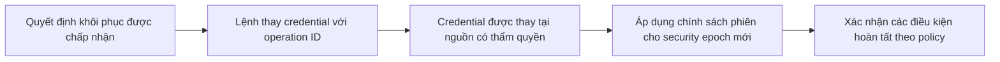

# Recovery event ordering: bảo toàn thứ tự trong luồng khôi phục tài khoản

## 1. Vì sao thứ tự sự kiện là vấn đề an ninh?

Một luồng khôi phục có thể đi qua nhiều thành phần: tiếp nhận yêu cầu, phát hành challenge, gửi thông điệp, xác minh bằng chứng, phê duyệt, thay đổi thông tin xác thực và kiểm soát session. Các thành phần thường trao đổi bằng sự kiện để giảm phụ thuộc và xử lý bất đồng bộ.

Tuy nhiên, sự kiện có thể đến trễ, được giao lại, được xử lý đồng thời hoặc xuất hiện ở consumer theo thứ tự khác với thay đổi nghiệp vụ. Nếu consumer coi “thông điệp vừa nhận” là “trạng thái mới nhất”, một bằng chứng cũ có thể được dùng sau khi luồng đã bị hủy.

Trong module `SECURITY_AUTHENTICATION_ACCOUNT_RECOVERY`, người dùng có thể mất mật khẩu, MFA, passkey hoặc thiết bị xác thực. **Recovery event ordering** là việc xác định và bảo toàn những quan hệ trước sau cần thiết để các thành phần diễn giải đúng quá trình khôi phục, đồng thời ngăn tác vụ cũ vượt qua quyết định an ninh hiện tại.

Ví dụ, challenge C1 bị thay bằng C2. Một sự kiện xác minh C1 đến muộn không được làm C1 có hiệu lực trở lại. Tương tự, một sự kiện phê duyệt đến sau khi luồng đã bị hủy không tự cho phép gỡ MFA.

Hai yêu cầu cần được phân biệt:

```text
Đọc đúng lịch sử:
  Hiểu các thay đổi đã xảy ra theo contract của nguồn nghiệp vụ.

Thực hiện đúng hành động hiện tại:
  Chỉ gây tác dụng khi quyền, bằng chứng và trạng thái hiện hành còn cho phép.
```

Một consumer dựng lịch sử đúng vẫn có thể gây hại nếu cứ xử lý mỗi sự kiện lịch sử bằng cách gửi lại email hoặc thực hiện lại reset.

## 2. Những loại thứ tự khác nhau

| Loại thứ tự | Câu hỏi nó trả lời | Giới hạn |
| --- | --- | --- |
| Thứ tự nghiệp vụ | Thay đổi nào đã được chấp nhận trước trong cùng đối tượng? | Phụ thuộc cổng ghi có thẩm quyền |
| Thứ tự commit | Giao dịch nào đã được lưu bền vững trước trong phạm vi xác định? | Không tự tạo thứ tự chung giữa các cơ sở dữ liệu |
| Thứ tự publish | Producer hoặc relay đã gửi bản ghi nào trước? | Có thể khác commit nếu có nhiều publisher |
| Thứ tự trên broker | Bản ghi nào đứng trước trong cùng partition hoặc nhóm có bảo đảm? | Không nhất thiết bao trùm mọi partition, topic và vùng |
| Thứ tự nhận | Consumer đọc được thông điệp nào trước? | Không bảo đảm tác vụ xử lý xong trước |
| Thứ tự hoàn tất | Tác vụ hoặc lời gọi bên ngoài nào kết thúc trước? | Dễ bị đảo khi có thread pool, retry hoặc timeout |
| Quan hệ nhân quả | Sự kiện hoặc quyết định nào là điều kiện của hành động sau? | Không thể suy ra đầy đủ chỉ bằng timestamp |

Một consumer đọc E1 rồi E2 nhưng giao chúng cho hai thread độc lập có thể hoàn tất E2 trước E1. Giữ thứ tự đọc chưa đủ nếu những cập nhật vào cùng trạng thái không được tuần tự hóa hoặc kiểm tra phiên bản.

`occurredAt`, `publishedAt` và `receivedAt` phục vụ giải thích độ trễ, nhưng không thay thế số thứ tự nghiệp vụ. Đồng hồ có thể lệch, hai sự kiện có thể cùng độ phân giải thời gian và việc giao lại có thể xảy ra rất lâu sau lúc phát sinh.

Event ID duy nhất cũng không mặc nhiên là thứ tự. Một UUID hoặc ID có thành phần thời gian có thể giúp tra cứu, nhưng chỉ được dùng để sắp xếp nghiệp vụ nếu contract thực sự bảo đảm điều đó trong phạm vi cần thiết.

## 3. Chọn phạm vi sắp thứ tự theo điều kiện cần bảo vệ

Không phải mọi sự kiện của nền tảng đều cần một thứ tự toàn cục. Cần chọn đơn vị tuần tự hóa theo điều kiện bất biến của nghiệp vụ.

| Điều kiện cần bảo vệ | Phạm vi có thể cần |
| --- | --- |
| Một luồng không quay từ đã hủy về chờ xác minh | Tenant và recovery ID |
| Challenge cũ không thay thế challenge mới | Luồng, challenge ID và generation |
| Hai luồng cùng tài khoản không cùng dùng một quyền reset | Chủ thể xác thực và cơ chế cạnh tranh tại cổng thay đổi credential |
| Phiên cũ không có hiệu lực lại sau thu hồi | Chủ thể hoặc phạm vi phiên cùng security epoch |
| Nhân viên tenant A không thao tác danh tính của B | Phạm vi tenant, authority và tài nguyên được cấp quyền |

Ví dụ, có thể dùng khóa stream:

```text
streamId = (tenantId, recoveryId)
```

Khóa này giúp sắp thứ tự các thay đổi trong một luồng. Nó không tự giải quyết việc cùng một principal có hai luồng khôi phục đồng thời. Cổng thay đổi thông tin xác thực vẫn cần kiểm tra phiên bản credential, operation ID hoặc một quy tắc cạnh tranh phù hợp với chính chủ thể đó.

Một principal toàn nền tảng có thể thuộc nhiều tenant. Số thứ tự của luồng thuộc tenant A không cấp cho A quyền thay mật khẩu toàn cục và không thể so trực tiếp với số thứ tự của một luồng ở B để chọn “bên thắng”. Nguồn quản lý xác thực phải quyết định các ràng buộc toàn cục.

## 4. Contract cho một stream có phiên bản

Ví dụ trong bài dùng một stream nghiệp vụ cho mỗi luồng khôi phục. Quy ước minh họa là **mỗi chuyển trạng thái được chấp nhận phát đúng một event của stream**, và `streamVersion` tăng liên tiếp từ phiên bản trước đó.

```json
{
  "eventId": "event_71cd",
  "eventType": "recovery.challenge.verified",
  "schemaVersion": 1,
  "producer": "recovery-service",
  "tenantId": "tenant_a",
  "streamId": "recovery_284b",
  "streamVersion": 33,
  "occurredAt": "2026-11-24T04:00:00Z",
  "correlationId": "correlation_781e",
  "causationId": "command_verify_19ac",
  "data": {
    "challengeId": "challenge_c2",
    "challengeGeneration": 2,
    "purpose": "MFA_RECOVERY",
    "decisionReference": "decision_417c"
  }
}
```

Đây là contract tự đề xuất để giải thích cơ chế, không phải schema chuẩn bắt buộc của mọi sản phẩm. Payload không có token, OTP, backup code, cookie hoặc tài liệu xác minh thô.

| Trường | Tác dụng | Không được suy diễn |
| --- | --- | --- |
| `eventId` | Nhận diện cùng một event logic khi giao lại | ID mới hơn luôn có quyền cao hơn |
| `streamId` và `tenantId` | Xác định phạm vi thứ tự | Stream ID là quyền đọc hoặc quyền reset |
| `streamVersion` | Thứ tự liên tiếp theo contract của stream này | So lớn nhỏ với version của stream khác |
| `schemaVersion` | Phiên bản cách biểu diễn thông điệp | Thứ tự xảy ra của nghiệp vụ |
| `challengeGeneration` | Phân biệt thế hệ challenge | Luôn bằng `streamVersion` |
| `causationId` | Liên kết tới nguyên nhân được ghi nhận | Tự chứng minh đã đủ mọi điều kiện nhân quả |
| `decisionReference` | Tham chiếu một quyết định nghiệp vụ | Quyết định đó còn hiệu lực mãi mãi |
| `occurredAt` | Ghi nhận thời gian nghiệp vụ | Là căn cứ duy nhất để ghi đè trạng thái |

Nếu một lần chuyển trạng thái phát nhiều event, không được gán tùy tiện cùng một version rồi vẫn yêu cầu consumer nhận đúng một event cho mỗi version. Có thể dùng một sequence riêng cho event hoặc cặp `(aggregateVersion, eventIndex)` với contract đầy đủ. Consumer phải biết có bao nhiêu bản ghi và khi nào một chuyển trạng thái được coi là đã nhận đủ.

Một stream bị lọc theo loại sự kiện cũng có thể không còn liên tiếp. Consumer chỉ subscribe `ChallengeVerified` không thể đòi mọi số version đều xuất hiện. Thuật toán chờ phiên bản kế tiếp chỉ áp dụng khi consumer được bảo đảm nhận đầy đủ stream hoặc có giao thức baseline và lấp khoảng trống tương ứng.

## 5. Cấp số thứ tự tại nguồn ghi có thẩm quyền

Version cần được cấp đồng bộ với thay đổi nghiệp vụ. Không lấy `MAX(version) + 1` ngoài transaction hoặc để mỗi instance tự tăng một biến đếm trong bộ nhớ.

Một transaction khái niệm có thể thực hiện:

```text
BEGIN
  Nạp recovery trong đúng tenant tại version V.
  Kiểm tra lệnh, bằng chứng, trạng thái, mục đích và quyền hiện tại.
  Cập nhật trạng thái với điều kiện version vẫn là V.
  Gán version mới V + 1.
  Ghi event có streamVersion V + 1 vào outbox.
COMMIT
```

Nếu hai lệnh cạnh tranh cùng đọc V, cơ chế khóa hoặc optimistic concurrency phải bảo đảm không cùng chấp nhận hai chuyển trạng thái trái nhau. Lệnh thua phải nạp lại trạng thái và đánh giá lại, không chỉ lấy số kế tiếp rồi tiếp tục hành động đã dự tính.

Ràng buộc duy nhất trên `(tenant_id, stream_id, stream_version)` giúp phát hiện hai event tranh cùng vị trí. Nó bổ trợ cho việc tuần tự hóa cập nhật; chỉ có unique constraint mà không kiểm tra nghiệp vụ vẫn có thể chấp nhận một hành động sai ở phiên bản khác.

[AWS Prescriptive Guidance về transactional outbox](https://docs.aws.amazon.com/prescriptive-guidance/latest/cloud-design-patterns/transactional-outbox.html) mô tả cách ghi thay đổi nghiệp vụ cùng bản ghi outbox trong một transaction và lưu ý vấn đề thứ tự cùng giao nhận trùng. Áp dụng vào ví dụ, rollback phải làm cả thay đổi recovery lẫn event của nó không xuất hiện như một kết quả thành công.

Outbox không tự làm mọi relay publish theo version. Nếu worker A đang gửi V=33 nhưng worker B gửi V=34 nhanh hơn, broker vẫn có thể nhận 34 trước 33. Có thể tuần tự hóa relay theo stream hoặc để consumer phát hiện khoảng trống; cần nêu rõ lựa chọn và giới hạn thay vì chỉ nói “đã dùng outbox”.

## 6. Broker hỗ trợ thứ tự trong phạm vi nào?

Ví dụ với Kafka, có thể dùng khóa bản ghi dựa trên tenant và recovery để các event của cùng luồng đi vào cùng partition theo chiến lược phân vùng đã thống nhất. Tài liệu [Apache Kafka: Introduction](https://kafka.apache.org/41/getting-started/introduction/) mô tả thứ tự đọc trong cùng topic-partition theo thứ tự ghi vào partition đó.

Điều này không tạo ra thứ tự nghiệp vụ nếu relay đã gửi sai trước khi broker nhận. Nó cũng không tạo thứ tự chung giữa hai topic, hai partition hoặc một lời gọi tới dịch vụ session bên ngoài.

Những điểm cần quyết định trong thiết kế gồm:

- Producer nào có quyền ghi stream và dùng cùng quy tắc chọn partition.
- Cách các relay phối hợp khi cùng đọc outbox.
- Cách consumer duy trì thứ tự hoàn tất cho cùng khóa khi chạy song song.
- Cách xử lý rebalance, retry và tác vụ còn chạy sau khi quyền sở hữu partition thay đổi.
- Cách giữ ràng buộc khi thay số partition, thay chiến lược hash hoặc chuyển topic.

Thay cách ánh xạ khóa có thể khiến event cũ và mới của cùng luồng nằm ở hai partition trong giai đoạn chuyển tiếp. Cần kế hoạch drain, barrier hoặc cơ chế version ở consumer đủ để xử lý; không giả định một khóa luôn nằm cùng vị trí qua mọi thay đổi hạ tầng.

Giữ thứ tự cho từng luồng cho phép nhiều luồng khác nhau chạy song song. Không nhất thiết dừng toàn bộ khôi phục của mọi tenant chỉ vì một stream đang thiếu một sự kiện.

## 7. Ví dụ sự kiện đến sai thứ tự

Giả sử consumer đã có baseline hợp lệ tới version 30. Nguồn nghiệp vụ chấp nhận chuỗi sau:

| Version | Sự kiện | Ý nghĩa trong ví dụ |
| --- | --- | --- |
| 31 | `ChallengeIssued(C1, generation=1)` | C1 đang chờ bằng chứng |
| 32 | `ChallengeReplaced(C1, C2, generation=2)` | Thay C1 và phát hành C2 trong cùng chuyển trạng thái |
| 33 | `ChallengeVerified(C2)` | Bằng chứng của C2 được chấp nhận |
| 34 | `RecoveryCancelled` | Luồng bị hủy trước bước thay đổi credential |

Policy của ví dụ cho phép hủy sau bước xác minh nếu chưa bắt đầu bước thay credential không thể hủy theo contract. Event 32 chứa đủ thông tin để mô tả chuyển trạng thái thay challenge; không có một khoảng giữa “bỏ C1” và “chưa tạo C2” bị che giấu bởi cùng một version.

Consumer nhận theo thứ tự:

```text
34 -> 32 -> 33 -> 31 -> 33 (giao lại)
```

Nếu dùng cách “event đến sau ghi đè trước”, trạng thái cuối có thể trở thành `CHALLENGE_VERIFIED`, dù nguồn nghiệp vụ đã hủy luồng. Nếu đặt con trỏ lên 34 ngay khi vừa thấy nó rồi bỏ mọi event nhỏ hơn, consumer dựng lịch sử tăng dần cũng mất những chuyển trạng thái cần thiết.

Đối với một projection cần đầy đủ lịch sử, consumer có thể giữ 34, 32 và 33 ở trạng thái chờ. Khi nhận 31, nó áp dụng lần lượt 31, 32, 33, 34, rồi nhận ra bản giao lại của 33 không cần áp dụng thêm.

Trong lúc projection còn chờ, cổng reset vẫn phải đọc hoặc kiểm tra nguồn quyền có thẩm quyền và thấy luồng đã bị hủy. Không để độ trễ dựng lịch sử trì hoãn hiệu lực thu hồi quyền.

## 8. Consumer: phân biệt nhận, chờ và áp dụng

Một consumer cần stream liên tiếp có thể lưu riêng:

```text
projection_cursor
  consumer_name, tenant_id, stream_id, last_applied_version

consumer_event
  consumer_name, tenant_id, stream_id, event_id, stream_version
  payload_identity, processing_state
  processing_state = PENDING | APPLIED | QUARANTINED

recovery_projection
  tenant_id, stream_id, projected_state, projected_version
```

`payload_identity` là thông tin để đối chiếu event theo một quy tắc ổn định, có xét schema. Nếu dùng digest, phải định nghĩa cách chuẩn hóa dữ liệu; không so tùy tiện chuỗi JSON có thứ tự thuộc tính khác nhau.

Thuật toán khái niệm cho consumer dựng projection:

```text
1. Kiểm tra nguồn phát, quyền đọc, tenant, schema và cấu trúc event.

2. Trong transaction cục bộ, khóa cursor của đúng consumer và stream.

3. Nếu đã có cùng event ID:
     Đối chiếu danh tính và nội dung theo contract.
     Nếu APPLIED: không áp dụng lại.
     Nếu PENDING: vẫn giữ khả năng áp dụng khi hết khoảng trống.
     Nếu có mâu thuẫn: cách ly và báo lỗi toàn vẹn.

4. Nếu version > lastApplied + 1:
     Lưu PENDING bền vững với ràng buộc duy nhất phù hợp.
     Không nâng cursor vượt phần còn thiếu.

5. Nếu version = lastApplied + 1:
     Kiểm tra chuyển trạng thái theo contract của projection.
     Cập nhật projection, đánh dấu APPLIED và nâng cursor cùng transaction.
     Tiếp tục với các event PENDING liên tiếp đã có, trong giới hạn xử lý.

6. Nếu version <= lastApplied:
     Không ghi đè projection bằng trạng thái cũ.
     Xác định đây là bản cũ, bản trùng hoặc xung đột theo lịch sử còn lưu
     và baseline đã được xác minh.

7. Commit dữ liệu cần giữ trước khi ACK hoặc commit offset tương ứng.
```

Một event đã lưu `PENDING` chưa phải là đã thực hiện nghiệp vụ. Không dùng một bảng `processed_event` chỉ có cờ true rồi bỏ qua vĩnh viễn event đang đợi phiên bản trước nó.

Nếu ACK sau khi lưu pending, kho pending và cursor phải có độ bền cùng cơ chế phục hồi phù hợp; chúng không còn là cache có thể tùy ý xóa. Nếu dùng checkpoint theo offset chung của partition, chỉ commit qua vùng bản ghi đã được lưu hoặc xử lý an toàn theo chiến lược của consumer, tránh bỏ mất một tác vụ còn dang dở.

Quyền khóa cursor cũng phải bao gồm việc khởi tạo cursor lần đầu. Hai worker không được cùng tạo trạng thái ban đầu không nhất quán. Consumer mới cần baseline được xác định rõ; không mặc định version 0 nếu nguồn chỉ giữ lịch sử từ version 100.

## 9. Ví dụ Java: phân loại vị trí của event

Đoạn mã dưới đây chỉ minh họa cách phân biệt phiên bản cũ, phiên bản kế tiếp và khoảng trống trong cùng stream. Nó không phải toàn bộ consumer và không thay cho transaction hoặc phân quyền.

```java
import java.util.Objects;
import java.util.UUID;

record RecoveryStream(UUID tenantId, UUID recoveryId) {
    RecoveryStream {
        Objects.requireNonNull(tenantId, "tenantId");
        Objects.requireNonNull(recoveryId, "recoveryId");
    }
}

enum EventPosition {
    BEHIND_OR_DUPLICATE,
    NEXT,
    GAP
}

final class RecoveryEventOrder {
    static EventPosition classify(
            RecoveryStream expectedStream,
            RecoveryStream eventStream,
            long lastAppliedVersion,
            long eventVersion) {

        Objects.requireNonNull(expectedStream, "expectedStream");
        Objects.requireNonNull(eventStream, "eventStream");

        if (!expectedStream.equals(eventStream)) {
            throw new IllegalArgumentException("Different recovery stream");
        }
        if (lastAppliedVersion < 0 || eventVersion < 1) {
            throw new IllegalArgumentException("Invalid stream version");
        }
        if (eventVersion <= lastAppliedVersion) {
            return EventPosition.BEHIND_OR_DUPLICATE;
        }
        if (eventVersion == lastAppliedVersion + 1) {
            return EventPosition.NEXT;
        }
        return EventPosition.GAP;
    }
}
```

Với `lastAppliedVersion=30`, version 31 là `NEXT`, version 34 là `GAP`. Sau khi đã áp dụng tới 34, version 33 thuộc `BEHIND_OR_DUPLICATE`.

Tên kết quả cuối cùng cố ý không nói chắc “duplicate”. Hai event khác nhau có cùng version có thể là lỗi nguồn hoặc dấu hiệu giả mạo. Consumer cần đối chiếu event ID, nguồn và nội dung đã lưu; so số version chỉ đủ để biết không nên ghi đè trạng thái hiện tại bằng bản đó.

Kiểm tra tenant ở đây là đối chiếu giá trị giữa hai đối tượng. `expectedStream` vẫn phải đến từ phạm vi đã được máy chủ cấp quyền; nếu cả hai đều do client tự khai thì phép so sánh không chứng minh quyền truy cập.

## 10. Xử lý khoảng trống và thông điệp độc hại

Một khoảng trống không nhất thiết chứng minh event đã mất. Nguyên nhân có thể là relay chậm, retry bị chuyển sang topic khác, consumer subscribe thiếu loại sự kiện, schema không đọc được hoặc lịch sử đã hết retention.

Không giữ pending trong bộ nhớ vô hạn. Cần giới hạn số event, kích thước dữ liệu, độ xa version và thời gian chờ theo stream cùng tổng tài nguyên. Một nguồn không đáng tin gửi `streamVersion` cực lớn không được khiến hệ thống cấp bộ nhớ để tạo mọi vị trí còn thiếu.

Các hướng phục hồi có thể gồm:

- Đọc lại phạm vi event còn thiếu từ nguồn lịch sử được cấp quyền.
- Yêu cầu relay kiểm tra bản ghi chưa publish hoặc kết quả gửi chưa chắc chắn.
- Sửa schema hoặc cấu hình subscription, rồi đưa lại event theo quy trình.
- Lấy snapshot có thẩm quyền nếu mục tiêu chỉ là projection trạng thái hiện tại.
- Cách ly stream lỗi trong khi cho các stream độc lập tiếp tục xử lý.

Không tự bỏ version 32 chỉ để làm 33 chạy được nếu projection cần đầy đủ mọi chuyển trạng thái. Nếu event 32 chứa việc thay challenge hoặc thu hồi quyền, bỏ nó có thể làm sai diễn giải những event sau.

Một consumer chỉ giữ trạng thái hiện tại có thể có chiến lược khác: dùng snapshot thay vì replay từng event. Snapshot phải chứa trạng thái và version của cùng một lần đọc nhất quán, thuộc đúng tenant và nguồn có thẩm quyền. Việc cài snapshot cũng cần bảo vệ cạnh tranh để một snapshot cũ không ghi đè trạng thái đã tiến xa hơn.

Cài snapshot tới version 34 không đồng nghĩa các side effect của 31 đến 34 đã được thực hiện. Tiến độ gửi email, thay credential hoặc thu hồi phiên phải có sổ theo dõi operation và kết quả riêng.

## 11. Thứ tự giữa recovery, credential và session

Các dịch vụ có thể sở hữu stream riêng. `recoveryVersion=34`, `credentialVersion=12` và `sessionEpoch=18` không phải ba số trong một dãy chung. Không thể lấy số lớn nhất để kết luận tác vụ nào đã hoàn tất trước.

Một chuỗi phụ thuộc minh họa:



Mỗi mũi tên là điều kiện nghiệp vụ cần được xác nhận, không chỉ là thứ tự mong muốn trên một dashboard. Quyết định có thể kèm recovery ID, challenge generation, phạm vi hành động, phiên bản hoặc digest của kế hoạch được phê duyệt và thời hạn thực thi.

Dịch vụ credential phải kiểm tra operation còn được phép và xử lý chống trùng tại chính nơi thay đổi credential. Một event phê duyệt được phát đúng thứ tự vẫn có thể tới sau khi quyền đã hết hạn hoặc bị thu hồi.

Kiểm tra quyền ở dịch vụ recovery rồi gọi credential từ xa tạo ra khoảng đua nếu thu hồi và thực thi nằm ở hai transaction độc lập. Với tác vụ nhạy cảm, cần điểm quyết định có khả năng tuần tự hóa quyền thực thi với việc thu hồi, hoặc giao thức claim/commit có trạng thái và kết quả rõ ràng. Chỉ “đọc lại trước khi gọi” không tự loại bỏ cuộc đua phân tán.

Nếu một operation đã bắt đầu bước không thể hủy theo contract, yêu cầu hủy có thể phải chuyển sang chờ kết quả hoặc quy trình xử lý hậu quả. Không trả `CANCELLED` với ý nghĩa “chắc chắn không có credential nào thay đổi” khi một dịch vụ khác vẫn có thể commit tác vụ đã nhận.

Đối với session, một epoch thu hồi chỉ có tác dụng khi nơi xác thực phiên thực sự thực thi nó. Nếu gateway dùng cache cũ, việc phát event `SessionsRevocationRequested` không chứng minh mọi phiên cũ đã bị từ chối. Contract cần nêu cách kiểm tra epoch, giới hạn độ trễ và điều kiện cho phép báo hoàn tất.

Các dịch vụ có thể phối hợp bằng operation ID cùng receipt thể hiện kết quả đã được lưu bền vững. `correlationId` giúp truy vết, nhưng việc nhiều log cùng correlation ID không thay cho receipt nghiệp vụ hoặc bằng chứng quyền hiện hành.

## 12. Quy tắc đơn điệu và ranh giới của nó

Một số dữ liệu an ninh có thể được thiết kế để chỉ tiến theo một chiều, nhờ vậy xử lý event cũ đơn giản hơn. Ví dụ, một security epoch của đúng chủ thể và đúng authority không được giảm khi nhận lại thông báo cũ.

```text
localRevocationEpoch = max(localRevocationEpoch, incomingEpoch)
```

Công thức này chỉ phù hợp nếu epoch cùng thuộc một miền số có thẩm quyền, nguồn event đã được xác thực và semantics thực sự là mốc thu hồi tăng dần. Nó không thay việc kiểm tra phiên và không thích hợp để hợp nhất hai miền epoch độc lập.

Không áp dụng cùng công thức cho mọi trạng thái recovery. `CANCELLED`, `VERIFIED` và `COMPLETED` là các trạng thái nghiệp vụ, không phải số có thể gán thứ hạng rồi lấy max. Quan hệ chuyển trạng thái phải do state machine và quyền hiện hành quyết định.

Những ràng buộc hữu ích khác gồm:

| Ràng buộc | Ý nghĩa |
| --- | --- |
| Challenge đã bị thay không được có hiệu lực lại do event cũ | Thế hệ challenge phải khớp dữ liệu hiện hành khi xác minh |
| Quyền dùng một lần đã tiêu thụ không được cấp lại do replay | Consumption được lưu và bảo vệ cạnh tranh tại cổng thực thi |
| Policy đã thu hồi không được khôi phục chỉ vì nhận lại phê duyệt | Event mô tả lịch sử không thay quyết định hiện tại |
| Projection không lùi version khi nhận bản cũ | Cập nhật trạng thái và cursor có điều kiện, nhất quán |

Các ràng buộc này cần được thực thi ở dịch vụ sở hữu nghiệp vụ. Một bảng read model có thể hỗ trợ giao diện nhưng không nên là nguồn duy nhất cấp quyền reset nếu nó có độ trễ không được kiểm soát.

## 13. Nhiều vùng, failover và quyền ghi cũ

Khi có nhiều vùng hoặc nhiều writer, một counter trong từng vùng có thể tạo hai event cùng version nhưng nội dung khác nhau. Dùng timestamp để chọn một bản thắng không giải quyết được trường hợp cả hai đã gây side effect.

Cần quyết định ai có quyền ghi stream tại một thời điểm và điều kiện nào cho phép chuyển quyền. Có thể dùng một cơ chế lưu trữ có bảo đảm nhất quán phù hợp hoặc một giao thức sở hữu có fencing được thực thi ở nơi nhận ghi.

Một `writerTerm` có thể giúp nhận diện thế hệ writer, nhưng chỉ có giá trị khi cơ sở dữ liệu hoặc cổng thực thi từ chối writer đã mất quyền. Gắn `writerTerm` vào JSON mà vẫn cho writer cũ commit không tạo ra fencing.

Khi failover, không đặt lại stream version về 1 rồi coi các sự kiện cũ là thuộc luồng khác một cách ngầm định. Nếu mô hình có stream incarnation hoặc epoch ghi mới, contract và consumer phải xác định rõ quan hệ với lịch sử trước đó.

Trong lúc không thể xác lập quyền ghi hoặc trạng thái hiện hành cho một tác vụ cấp quyền nhạy cảm, cần giữ chờ hoặc từ chối tác vụ theo policy. Không tăng khả dụng bằng cách cho một vùng tự chấp nhận reset từ dữ liệu phê duyệt có thể đã bị thu hồi ở vùng còn lại.

## 14. Replay và vận hành không được làm sống lại quyền cũ

Replay để dựng lại projection là việc đọc lại sự thật lịch sử. Replay để thực hiện lại hành động là một quyết định nghiệp vụ khác.

Consumer dựng lịch sử có thể cần áp dụng `ChallengeIssued` cũ để hiển thị dòng thời gian. Consumer gửi phải kiểm tra challenge hiện hành và thời hạn; nó không được gửi lại token đã hết hạn chỉ vì event đang được đọc trong một đợt dựng dữ liệu.

Nên tách quyền và đường xử lý replay của projection khỏi consumer tạo side effect. Tác vụ vận hành cần xác định mục tiêu, phạm vi tenant, stream, phiên bản baseline và cách đối soát kết quả. Không có một nút “replay all” được mặc định cấp quyền reset lại mọi tài khoản.

DLQ có thể làm thứ tự bị đứt: event 32 bị cách ly trong khi 33 tiếp tục tới consumer. Việc đưa 32 trở lại cần phối hợp với pending và cursor; không chỉ đẩy một bản sao tùy ý vào topic rồi coi stream đã lành.

Các chỉ số có ích gồm tuổi khoảng trống, số stream đang chờ, số phiên bản đã nhận nhưng chưa áp dụng, lỗi xung đột version và độ trễ thực thi chính sách phiên. Không chỉ nhìn consumer lag rồi kết luận trạng thái an ninh đã đồng bộ.

Audit có thể giữ event ID, tenant, recovery ID, version, generation, loại consumer và lý do bỏ hoặc cách ly. Không thêm token, OTP hoặc payload bí mật vào log khi điều tra sai thứ tự. Các định danh này cũng cần phân quyền, retention và cách tra cứu phù hợp.

## 15. Tình huống xuyên suốt và kết quả cần đạt

Linh mất thiết bị MFA. Hệ thống mở một luồng khôi phục và phát hành C1. Sau khi điều kiện phát hành lại được chấp nhận, C2 thay C1. Linh chứng minh được quyền với C2 nhưng phát hiện yêu cầu ban đầu có dấu hiệu bất thường nên hủy luồng trước bước thay credential.

Nguồn nghiệp vụ lưu các thay đổi thành version 31 đến 34. Relay và consumer gặp lỗi mạng nên read model nhận 34 trước, rồi 32, 33 và cuối cùng là 31. Read model giữ những event còn thiếu tiền nhiệm, sau đó dựng lại đúng lịch sử và kết thúc ở `CANCELLED`.

Trong suốt thời gian read model chậm, dịch vụ credential không dùng dòng hiển thị “đã xác minh” để gỡ MFA. Cổng thực thi kiểm tra quyền có thẩm quyền và từ chối operation của luồng đã hủy theo giao thức thực thi đang áp dụng.

Một tác vụ gửi C1 chạy muộn cũng không làm C1 hoạt động lại. Dịch vụ xác minh đối chiếu challenge generation, trạng thái, thời hạn, mục đích và giới hạn thử. Việc email tới muộn chỉ là vấn đề giao nhận; nó không tạo lại bằng chứng hợp lệ.

Nếu có một luồng khôi phục khác cho cùng principal, cổng credential giải quyết cạnh tranh ở phạm vi chủ thể xác thực. Nó không lấy version cao hơn của một recovery stream bất kỳ làm quyền thắng cuộc.

| Thiết kế dễ sai | Hệ quả | Nguyên tắc xử lý |
| --- | --- | --- |
| Event đến sau luôn ghi đè | Luồng đã hủy quay về đã xác minh | Áp dụng theo contract version và trạng thái có thẩm quyền |
| Timestamp lớn hơn là quyết định mới hơn | Lệch đồng hồ làm đảo quyết định | Dùng thứ tự có phạm vi cùng quan hệ nhân quả rõ ràng |
| Nhận version lớn thì nâng cursor ngay | Bỏ mất thay đổi ở giữa | Giữ pending hoặc dùng snapshot đúng mục tiêu |
| Đánh dấu PENDING là đã xử lý | Event không bao giờ được áp dụng khi khoảng trống được lấp | Tách nhận, chờ, áp dụng và cách ly |
| Broker đúng thứ tự thì thread pool tự đúng | Tác vụ sau hoàn tất trước tác vụ trước | Tuần tự hóa cùng khóa hoặc kiểm tra cạnh tranh tại nơi ghi |
| Hai stream có version so sánh được | Chọn sai quyền giữa các dịch vụ hoặc tenant | Dùng operation, dependency và authority đúng phạm vi |
| Snapshot chứng minh mọi side effect đã xong | Báo hoàn tất khi credential hoặc session chưa được xử lý | Đối soát operation và receipt riêng |
| Replay lịch sử được phép gây lại mọi tác dụng | Gửi mã cũ hoặc thực hiện lại reset | Tách projection với thực thi nghiệp vụ hiện tại |

Thứ tự tốt giúp các thành phần kể cùng một lịch sử. An toàn khôi phục còn đòi hỏi mỗi hành động nhạy cảm phải kiểm tra được quyền hiện tại, đúng thế hệ bằng chứng và đúng phạm vi tài khoản tại nơi thực sự thay đổi dữ liệu hoặc chấp nhận phiên.
