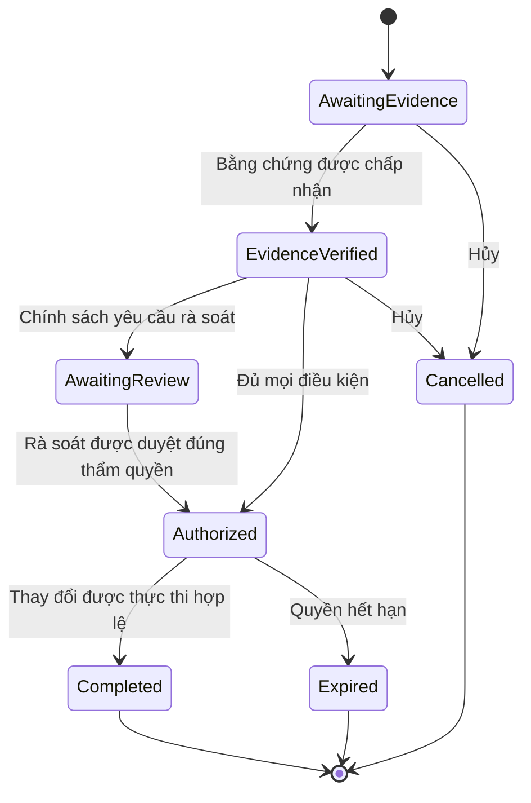

# Recovery unit tests — Kiểm thử đơn vị cho khôi phục tài khoản

## 1. Unit test cần bảo vệ điều gì trong luồng khôi phục?

Trong module `SECURITY_AUTHENTICATION_ACCOUNT_RECOVERY`, khôi phục tài khoản giúp người dùng lấy lại quyền truy cập khi mất mật khẩu, MFA, passkey hoặc thiết bị xác thực. Đây cũng là đường mà kẻ tấn công có thể tìm cách dùng để thay thông tin xác thực mà không biết bí mật đăng nhập hiện tại.

Unit test kiểm tra một đơn vị hành vi trong điều kiện đầu vào và các phụ thuộc được kiểm soát. Đơn vị đó có thể là chính sách thời hạn token, bộ quyết định quyền khôi phục, máy trạng thái hoặc một application service sử dụng các cổng phụ thuộc giả lập. Nó không nhất thiết tương ứng với đúng một phương thức Java.

Một unit test tốt phải trả lời được một câu hỏi nghiệp vụ rõ ràng, chẳng hạn:

> Khi quyền khôi phục đã hết hạn đúng tại thời điểm yêu cầu, hệ thống có từ chối thay mật khẩu và giữ nguyên trạng thái tài khoản không?

Câu hỏi này mạnh hơn việc chỉ kiểm tra rằng `repository.findById()` được gọi một lần. Một triển khai vẫn có thể gọi đủ các phương thức mong đợi nhưng thay nhầm tài khoản, chấp nhận token hết hạn hoặc đánh dấu hoàn tất quá sớm.

Mục tiêu là bảo vệ các bất biến an ninh: điều kiện phải luôn đúng bất kể người dùng đi theo nhánh nào. Unit test cho phản hồi nhanh về logic; các bảo đảm liên quan cơ sở dữ liệu, mạng, broker và hệ thống phiên thật cần được kiểm chứng ở tầng phù hợp khác.

## 2. Chọn ranh giới kiểm thử

| Đơn vị | Ví dụ hành vi cần kiểm thử | Phụ thuộc nên kiểm soát |
| --- | --- | --- |
| Chính sách thời hạn | Quyền hết hạn tại hoặc sau mốc quy định | Đồng hồ phía máy chủ |
| Chính sách ràng buộc | Token của tài khoản A không được dùng cho B | Fixture tài khoản, tenant, hành động |
| Chính sách bằng chứng | Kiểm soát email chưa đủ để thay MFA theo chính sách đang xét | Kết quả xác minh và yêu cầu nền |
| Máy trạng thái | Giao dịch đã hủy không được trở lại trạng thái được phép | Trạng thái, phiên bản, loại sự kiện |
| Bộ điều phối khôi phục | Risk timeout dẫn tới chờ hoặc từ chối theo hợp đồng | Cổng Risk, kho trạng thái, cổng cấp quyền |
| Bộ xử lý sự kiện | Sự kiện cũ không cấp thêm quyền | Kho inbox giả lập, bằng chứng, trạng thái giao dịch |
| Chính sách session | Chọn đúng phạm vi yêu cầu thu hồi sau loại khôi phục tương ứng | Loại sự cố và kết quả thay đổi credential |

Tách logic quyết định khỏi lời gọi hạ tầng giúp unit test tập trung vào quy tắc. Ví dụ, một `RecoveryAuthorizationPolicy` có thể nhận trạng thái đã tải và trả quyết định; application service chịu trách nhiệm lấy dữ liệu, gọi chính sách rồi thực hiện thao tác có điều kiện.

Tuy nhiên, không nên tách nhỏ đến mức mỗi test chỉ kiểm tra một phép gán. Ranh giới hữu ích là nơi có một hành vi có thể mô tả độc lập và có hậu quả rõ khi sai.

## 3. Viết bất biến trước khi viết test case

Giả sử hệ thống có một quyền khôi phục ngắn hạn cho phép đặt lại mật khẩu hoặc thay MFA. Những bất biến dưới đây là điểm khởi đầu, không phải một chính sách bắt buộc cho mọi sản phẩm.

| Bất biến | Ví dụ yêu cầu trái điều kiện | Kết quả cần quan sát |
| --- | --- | --- |
| Đúng chủ thể | Dùng quyền của tài khoản A cho B | Từ chối, cả A và B không bị thay đổi |
| Đúng tenant | Trùng mã tài khoản nhưng khác tenant | Từ chối, không tác động xuyên tenant |
| Đúng mục đích | Dùng quyền đặt lại mật khẩu để thay MFA | Từ chối hành động ngoài phạm vi |
| Còn hiệu lực | Thời điểm sử dụng bằng thời điểm hết hạn | Từ chối theo quy ước biên đã chọn |
| Chưa tiêu thụ | Dùng lại quyền đã dùng | Không tạo thêm thay đổi có hiệu lực |
| Đủ bằng chứng | Risk đánh giá thuận lợi nhưng thiếu bằng chứng nền | Không cấp quyền hoặc không thay credential |
| Đúng trạng thái | Hoàn tất giao dịch đã hủy | Giữ nguyên trạng thái kết thúc |
| Đúng phiên bản | Tài khoản đã có thay đổi an ninh sau đánh giá | Không sử dụng kết quả cũ để thực thi |
| Từ chối không gây thay đổi trái phép | Mã sai hoặc bằng chứng không phù hợp | Credential và quyền của tài khoản không bị mở rộng |

Một yêu cầu bị từ chối vẫn có thể làm tăng bộ đếm thử, ghi audit hoặc phát cảnh báo theo chính sách. Vì vậy “không có tác động” cần được diễn đạt chính xác: không thay credential hoặc cấp quyền ngoài ý muốn, nhưng vẫn cho phép những tác động bảo vệ đã được quy định.

Từ mỗi bất biến, tạo ít nhất một trường hợp hợp lệ, một trường hợp vi phạm và các điểm biên có ý nghĩa. Trường hợp hợp lệ bảo đảm hệ thống vẫn giúp chủ tài khoản; các trường hợp còn lại bảo đảm nó từ chối đúng điều kiện.

## 4. Mô hình trạng thái làm cơ sở thiết kế test

Một luồng minh họa có thể gồm các trạng thái sau:



Không dùng sơ đồ như một danh sách tên để tăng coverage. Hãy dùng nó để xác định chuyển trạng thái nào được phép và chuyển trạng thái nào phải bị chặn.

Ví dụ, có thể kiểm thử rằng `VerificationPassed` hợp lệ đưa giao dịch từ `AwaitingEvidence` tới `EvidenceVerified`, nhưng không đưa thẳng tới `Completed`. Một sự kiện tương tự tới sau `Cancelled` phải giữ nguyên trạng thái hủy.

Đặc biệt, cần phân biệt ba kết quả:

- Bằng chứng được kiểm tra thành công.
- Giao dịch được cấp quyền thực hiện một thay đổi.
- Thay đổi và những bước bắt buộc còn lại đã hoàn tất.

Gộp cả ba thành một cờ `success` khiến test khó phát hiện việc cấp quyền hoặc thông báo hoàn tất quá sớm.

## 5. Thiết kế dữ liệu kiểm thử dễ hiểu và ổn định

### 5.1. Fixture hợp lệ trước, thay đổi một điều kiện có chủ đích

Một fixture nền có thể mô tả tài khoản `account-a`, tenant `tenant-1`, giao dịch đang mở, quyền đặt lại mật khẩu còn hạn và chưa dùng. Test “sai tenant” chỉ đổi tenant của yêu cầu, giữ các điều kiện còn lại hợp lệ.

Nếu một test vừa dùng sai token, sai tenant và sai hành động, nó chỉ chứng minh một trong các điều kiện khiến hệ thống từ chối. Nó không chứng minh cả ba kiểm tra đều tồn tại.

Đặt tên fixture theo vai trò nghiệp vụ như `validPasswordResetGrant` hoặc `cancelledRecoveryAttempt`. Tránh các tên như `data1` và `setup2` khiến người đọc phải mở nhiều hàm mới hiểu vì sao test thất bại.

Builder cũng cần có mặc định rõ ràng. Không đặt mọi quyền là quản trị hoặc tự động tạo bằng chứng mạnh nhất để làm test chạy qua; những mặc định đó dễ che khuất thiếu sót trong kiểm tra yêu cầu nền.

### 5.2. Không dùng dữ liệu thật

Mã tài khoản, email, số điện thoại và hồ sơ xác minh trong test nên là dữ liệu tổng hợp. Không sao chép token production, ảnh giấy tờ, cookie hoặc thông tin người dùng thật vào fixture hay thông báo assertion.

Một chuỗi token dùng riêng trong test có thể cố định để dễ kiểm soát. Điều đó không cho phép cấu hình bộ sinh token production thành xác định được. Test cần giữ ranh giới rõ giữa dữ liệu giả và cấu hình chạy thật.

### 5.3. Điều khiển phụ thuộc có biến động

Các phụ thuộc như thời gian, kết quả Risk, bộ sinh mã và trạng thái repository nên được đưa vào qua interface hoặc đối tượng phù hợp. Nhờ vậy, test có thể đặt chính xác hoàn cảnh “còn một giây”, “đã dùng” hoặc “nguồn Risk timeout”.

Không dùng `Thread.sleep()` để chờ token hết hạn trong unit test. Cách đó vừa chậm vừa phụ thuộc lịch chạy máy. Tương tự, tránh dùng mạng, email thật hoặc một cơ sở dữ liệu dùng chung cho những test đang được coi là unit test cô lập.

## 6. Kiểm thử thời hạn bằng đồng hồ kiểm soát được

Giả sử hợp đồng quy định quyền được sử dụng khi `now < expiresAt`; tại đúng `expiresAt` thì hết hạn. Các điểm cần kiểm tra là trước mốc, đúng mốc và sau mốc.

Ví dụ Java sau chỉ minh họa một chính sách thời hạn rút gọn và các kiểm thử bằng thư viện chuẩn. Có thể lưu toàn bộ ví dụ trong một file tên `GrantLifetimePolicyUnitTest.java` khi thực hành. Nó không phải triển khai hoàn chỉnh của hệ thống khôi phục và không cần framework kiểm thử để diễn tả các assertion.

```java
import java.time.Clock;
import java.time.Instant;
import java.time.ZoneOffset;

public final class GrantLifetimePolicyUnitTest {
    enum Decision {
        ACTIVE, EXPIRED, ALREADY_USED
    }

    static final class GrantLifetimePolicy {
        private final Clock clock;

        GrantLifetimePolicy(Clock clock) {
            this.clock = clock;
        }

        Decision evaluate(Instant expiresAt, boolean consumed) {
            if (consumed) {
                return Decision.ALREADY_USED;
            }
            if (!clock.instant().isBefore(expiresAt)) {
                return Decision.EXPIRED;
            }
            return Decision.ACTIVE;
        }
    }

    private static final Instant DEADLINE =
            Instant.parse("2026-11-24T03:05:00Z");

    public static void main(String[] args) {
        remainsActiveImmediatelyBeforeDeadline();
        expiresExactlyAtDeadline();
        remainsExpiredAfterDeadline();
        rejectsConsumedGrantEvenBeforeDeadline();
    }

    static void remainsActiveImmediatelyBeforeDeadline() {
        expect(Decision.ACTIVE, evaluateAt(DEADLINE.minusSeconds(1), false),
                "Unused grant should remain active before its deadline");
    }

    static void expiresExactlyAtDeadline() {
        expect(Decision.EXPIRED, evaluateAt(DEADLINE, false),
                "Grant should expire exactly at its deadline");
    }

    static void remainsExpiredAfterDeadline() {
        expect(Decision.EXPIRED, evaluateAt(DEADLINE.plusSeconds(1), false),
                "Grant should remain expired after its deadline");
    }

    static void rejectsConsumedGrantEvenBeforeDeadline() {
        expect(Decision.ALREADY_USED,
                evaluateAt(DEADLINE.minusSeconds(1), true),
                "Consumed grant must not become usable again");
    }

    private static Decision evaluateAt(Instant now, boolean consumed) {
        Clock clock = Clock.fixed(now, ZoneOffset.UTC);
        GrantLifetimePolicy policy = new GrantLifetimePolicy(clock);
        return policy.evaluate(DEADLINE, consumed);
    }

    private static void expect(Decision expected, Decision actual,
                               String message) {
        if (expected != actual) {
            throw new AssertionError(message + ": expected=" + expected
                    + ", actual=" + actual);
        }
    }
}
```

Các expected value trong test được chọn từ hợp đồng thời gian, không tính lại bằng cùng biểu thức `isBefore()` với mã được kiểm tra. Nếu expected cũng sao chép logic triển khai, cả hai có thể cùng sai mà test vẫn xanh.

Ví dụ dùng khoảng một giây để dễ đọc. Trong hệ thống thật, thêm biên theo độ chính xác thực tế của dữ liệu, chẳng hạn mili giây nếu nơi lưu trữ chỉ giữ tới mili giây. Unit test dùng nanosecond không chứng minh cơ sở dữ liệu vẫn giữ nguyên độ chính xác đó.

Nếu sản phẩm cho phép một khoảng dung sai, hãy đưa nó thành quy tắc rõ và kiểm thử cả hai phía của khoảng dung sai. Không âm thầm cộng thêm thời gian trong test để né lỗi biên.

## 7. Kiểm thử token, mã dùng một lần và ràng buộc quyền

### 7.1. Token không chỉ có thuộc tính “đúng” hoặc “sai”

Một ma trận đầu vào cho quyền khôi phục có thể như sau:

| Tình huống | Kỳ vọng nghiệp vụ |
| --- | --- |
| Quyền đúng tài khoản, tenant, hành động, còn hạn, chưa dùng | Được tiếp tục nếu những điều kiện còn lại cũng đạt |
| Token không tìm thấy hoặc không khớp giá trị kiểm tra | Không cấp quyền và không thay credential |
| Token của tài khoản khác | Từ chối, không cập nhật nhầm tài khoản |
| Token của tenant khác | Từ chối xuyên tenant |
| Quyền `RESET_PASSWORD` gọi thao tác `REPLACE_MFA` | Từ chối hành động sai phạm vi |
| Quyền đã dùng hoặc bị thu hồi | Không thực hiện thêm thay đổi |
| Phiên bản an ninh tài khoản đã tăng | Không thực thi dựa trên trạng thái cũ |
| Nội dung thay đổi khác với nội dung được ràng buộc | Không mở rộng quyền sang yêu cầu mới |

Không chỉ assertion mã lỗi. Với các nhánh từ chối, kiểm tra trạng thái credential, số quyền có hiệu lực và các thay đổi nhạy cảm đều giữ đúng bất biến.

### 7.2. Dùng một lần theo trình tự và dùng một lần khi cạnh tranh

Unit test có thể kiểm tra chuỗi: lần đầu hợp lệ, quyền được đánh dấu đã tiêu thụ trong mô hình, lần thứ hai bị từ chối. Test này hữu ích cho logic và không đòi hỏi chạy nhiều luồng.

Nhưng nó không chứng minh hai yêu cầu cạnh tranh qua hai instance chỉ có một yêu cầu thành công. Một repository giả với một đối tượng trong bộ nhớ có thể vô tình tuần tự hóa mọi thao tác, che đi lỗi transaction hoặc cập nhật có điều kiện của cơ sở dữ liệu thật.

Ở tầng unit, kiểm tra hợp đồng mà application service yêu cầu, ví dụ `consumeIfActive(expectedVersion)` trả `CONSUMED` hoặc `CONFLICT`. Khi trả `CONFLICT`, hệ thống không được thay credential. Ở tầng tích hợp, kiểm chứng thao tác tiêu thụ và thay credential có ranh giới nguyên tử phù hợp trên hạ tầng thật.

Nếu tiêu thụ quyền và thay credential nằm ở hai dịch vụ, không thể coi fake repository là bằng chứng cho transaction xuyên dịch vụ. Cần mô hình idempotency, trạng thái trung gian và phục hồi tương ứng, rồi kiểm thử ở các tầng thích hợp.

### 7.3. Chuẩn hóa đầu vào có giới hạn

Cho phép dán mã và bỏ dấu phân cách đã định nghĩa có thể giúp người dùng thao tác thuận tiện. Unit test cần kiểm tra đúng phạm vi chuẩn hóa: khoảng trắng nào được phép, mã có phân biệt hoa thường không, ký tự lạ bị từ chối thế nào.

Không viết test khuyến khích việc xóa mọi ký tự không phải số để “cứu” đầu vào. Cách đó có thể biến một chuỗi sai thành một bằng chứng khác. Hợp đồng định dạng phải quyết định phép chuẩn hóa, không phải sự tiện tay của hàm xử lý chuỗi.

## 8. Kiểm thử bằng chứng và đánh giá rủi ro

### 8.1. Một kiểm tra thành công chưa đủ cho mọi hành động

Unit test của bộ quyết định quyền nên nhận kết quả xác minh có loại, phạm vi, thời điểm và nguồn đáng tin cậy theo mô hình nội bộ. Tạo các trường hợp rõ ràng:

- Kiểm soát email đã đăng ký đủ cho bước được phép nhưng chưa đủ để thay MFA theo chính sách đang xét.
- Mã dự phòng hợp lệ thuộc đúng giao dịch nhưng không được tính hai lần thành hai bằng chứng độc lập.
- Bằng chứng đã kiểm tra thành công nhưng quá thời hạn sử dụng tại lúc xét quyền.
- Email mới do người nộp yêu cầu khai báo chưa có liên kết có thẩm quyền với tài khoản cũ.
- Máy khách tự gửi cờ `verified=true` nhưng không có kết quả từ nguồn được chấp nhận.

Khi unit test của application service giả lập một verifier trả `PASSED`, test chỉ kiểm tra cách service dùng kết quả đó. Nó không chứng minh verifier thực sự kiểm tra chữ ký, OTP hoặc authenticator đúng cách. Các thuật toán và adapter xác minh cần có kiểm thử riêng với dữ liệu hợp lệ, dữ liệu sai và thư viện mật mã phù hợp.

### 8.2. Risk thấp không thay thế bằng chứng nền

| Kết quả Risk giả lập | Bằng chứng nền | Kỳ vọng |
| --- | --- | --- |
| Không yêu cầu điều kiện bổ sung | Đủ | Có thể tiếp tục kiểm tra các điều kiện thực thi còn lại |
| Không yêu cầu điều kiện bổ sung | Thiếu | Không cấp quyền khôi phục |
| Yêu cầu bằng chứng bổ sung | Chỉ đủ yêu cầu nền | Giữ trạng thái chờ, không thay credential |
| Cần rà soát | Đủ bước tự phục vụ | Chờ quy trình rà soát có thẩm quyền |
| Từ chối giao dịch | Bất kỳ | Không tiếp tục giao dịch theo chính sách |
| Timeout hoặc chưa thể kết luận | Bất kỳ | Đi vào chính sách suy giảm của đúng hành động |

Test timeout nên mô phỏng lỗi ở cổng Risk hoặc một kết quả chưa thể kết luận rõ ràng. Không để fake mặc định trả `LOW` khi thiếu cấu hình, vì điều đó có thể làm mọi test bỏ qua đường lỗi.

Ngoài outcome, kiểm tra tính mới và phạm vi của đánh giá: cùng tài khoản nhưng khác hành động, đúng hành động nhưng khác giao dịch, hoặc kết quả còn hạn nhưng phiên bản an ninh đã đổi đều cần được xử lý theo hợp đồng.

## 9. Kiểm thử điều phối, tác động và lỗi từng bước

Một application service thường phải ghi trạng thái, thay credential, yêu cầu thu hồi phiên, tạo sự kiện và thông báo. Unit test cần nhìn vào tác động nghiệp vụ của những bước đó.

### 9.1. Chọn test double phù hợp

| Test double | Cách dùng | Điều cần tránh |
| --- | --- | --- |
| Stub | Trả kết quả Risk, thời gian hoặc trạng thái đã định | Mặc định cho phép mọi yêu cầu khi chưa cấu hình |
| Fake | Kho trong bộ nhớ có trạng thái, mô phỏng thao tác có điều kiện | Cho rằng fake chứng minh transaction, khóa hoặc tính nhất quán của dữ liệu thật |
| Mock hoặc spy | Quan sát tương tác có ý nghĩa như không gọi thay credential khi quyền sai | Assertion mọi chi tiết gọi hàm, khiến refactor nội bộ làm vỡ test không vì đổi hành vi |

Không cần chọn duy nhất một loại cho cả dự án. Một test có thể dùng fake để quan sát trạng thái cuối và spy để xác nhận cổng gửi thông báo không nhận bí mật.

### 9.2. Mẫu kiểm thử theo Given–When–Then

```text
Given:
    giao dịch đang chờ hoàn tất đặt lại mật khẩu
    quyền hợp lệ và bằng chứng đủ
    kho trạng thái trả CONFLICT khi chốt phiên bản được kỳ vọng

When:
    application service xử lý yêu cầu hoàn tất

Then:
    yêu cầu không được báo là hoàn tất
    không có thay đổi credential trái với hợp đồng chốt trạng thái
    không phát sự kiện RecoveryCompleted
    thông tin cần thiết để xử lý xung đột được ghi theo chính sách
```

Test phải phù hợp kiến trúc thực tế. Nếu credential được cập nhật trong một transaction cục bộ rồi rollback, unit test với fake không chứng minh rollback. Khi đó cần kiểm tra hành vi điều phối ở unit và kiểm tra rollback bằng integration test.

### 9.3. Ma trận lỗi có chủ đích

| Điểm lỗi được mô phỏng | Điều cần kiểm tra ở unit |
| --- | --- |
| Không tải được trạng thái đáng tin cậy | Không tiếp tục bằng dữ liệu giả định là hợp lệ |
| Verifier từ chối bằng chứng | Không cấp quyền; bộ đếm và audit đi theo chính sách |
| Quyền đã bị tiêu thụ bởi yêu cầu trước | Không tạo thêm thay đổi hoặc quyền mới |
| Thay credential thất bại trước khi có hiệu lực theo hợp đồng | Không báo thành công hoặc phát sự kiện hoàn tất sai |
| Yêu cầu xử lý phiên thất bại sau thay credential | Đi vào trạng thái phục hồi phù hợp, không tuyên bố đã thu hồi phiên |
| Ghi ý định thông báo thất bại trong miền transaction bắt buộc | Không coi thông báo đã được bảo đảm nếu chưa có bản ghi tương ứng |
| Phản hồi tới client bị mất sau một thay đổi đã commit | Retry được xử lý theo idempotency, không lặp thay đổi |

Không mô phỏng một lỗi sau tác động đã commit như thể chưa từng có tác động. Ví dụ, timeout khi gọi Credential service có thể có nghĩa kết quả chưa biết, chứ không chắc rằng credential chưa thay. Hợp đồng trả kết quả và cơ chế truy vấn hoặc retry phải thể hiện sự khác biệt này.

## 10. Kiểm thử session và sự kiện mà không nhầm phạm vi bảo đảm

### 10.1. Chính sách phiên sau khôi phục

Unit test có thể kiểm tra rằng loại sự cố yêu cầu thu hồi các phiên hoặc refresh token thích hợp, rằng yêu cầu chứa đúng tài khoản và rằng luồng chưa công bố hoàn tất khi bước bắt buộc còn chờ.

Nhưng assertion “đã gọi `revokeSessions()`” không chứng minh access token cũ bị từ chối ở mọi dịch vụ. Điều đó cần kiểm thử hệ thống với thành phần thực thi phiên thực tế.

Nếu dùng phiên bản an ninh của tài khoản, unit test nên kiểm tra cách chọn phiên bản kỳ vọng và xử lý xung đột. Kiểm thử adapter và hệ thống mới xác nhận các nơi chấp nhận phiên có đọc hoặc thực thi phiên bản đúng cách.

### 10.2. Sự kiện xác minh thành công

Với một handler nhận `VerificationPassed`, các trường hợp unit có giá trị gồm:

- Đúng chủ thể, giao dịch và vòng xác minh thì gắn kết quả một lần.
- Cùng sự kiện được nhận lại không tạo thêm tiến triển.
- Hai event ID khác nhau cùng trỏ một bằng chứng không được tính thành hai bằng chứng.
- Sự kiện vòng cũ, bằng chứng hết hạn hoặc giao dịch đã hủy không mở lại luồng.
- Kết quả xác minh không tự đưa giao dịch tới trạng thái thay credential hoàn tất.
- Sự kiện có phạm vi hoặc loại chưa được hiểu không được xem là bằng chứng mạnh nhất.

Unit test dùng fake inbox chỉ kiểm tra logic chống lặp. Khả năng ghi inbox và cập nhật trạng thái cùng transaction, xử lý redelivery thực tế và hành vi broker cần được kiểm tra với hạ tầng thích hợp.

## 11. Các trường hợp chống lạm dụng và rò thông tin

### 11.1. Giới hạn thử không được biến mất khi đổi đường

Kiểm thử các trường hợp người yêu cầu đổi phương thức, tạo yêu cầu gửi lại hoặc đổi IP sau khi đã thử sai. Theo chính sách, những thao tác này không được tự xóa ngân sách thử có liên quan.

Mô hình bộ đếm cần nói rõ phạm vi: tài khoản, tenant, giao dịch, nguồn truy cập hoặc loại hành động. Không dùng mã tài khoản đơn lẻ nếu cùng mã có thể xuất hiện ở nhiều tenant.

Ở unit, đồng hồ kiểm soát được giúp kiểm tra thời điểm mở lại cửa sổ thử và các điểm biên. Tính nguyên tử của bộ đếm phân tán và hiệu lực khi có nhiều instance thuộc kiểm thử tích hợp hoặc hệ thống.

Test cũng cần xét khả năng người ngoài lạm dụng yêu cầu khôi phục để khóa chủ tài khoản. Không mặc định rằng mọi lần thử sai phải khóa vĩnh viễn tài khoản; hành vi phải dựa trên chính sách đã định nghĩa.

### 11.2. Thông báo trung tính và lỗi có kiểm soát

Unit test có thể kiểm tra rằng định danh tồn tại và không tồn tại được ánh xạ về cấu trúc phản hồi công khai theo chính sách, không vô tình trả email đầy đủ, số điện thoại, tên yếu tố đã đăng ký hoặc lý do nội bộ nhạy cảm.

Điều đó chưa chứng minh hệ thống chống được dò tài khoản bằng thời gian, mã HTTP, redirect hoặc khác biệt hạ tầng. Không assertion rằng hai phép gọi unit phải có cùng thời gian đo bằng đồng hồ thực; phép đo đó vừa nhiễu vừa không đại diện cho đường mạng thật.

### 11.3. Bí mật không xuất hiện trong tác động phụ

Với các cổng audit, event hoặc telemetry được kiểm soát, kiểm tra rằng payload không chứa token nguyên văn, OTP, mật khẩu hay tài liệu danh tính không cần thiết. Tập trung vào dữ liệu cấu trúc thực sự đi qua ranh giới, không chỉ tìm một chuỗi trong một thông báo log.

Unit test chỉ quan sát được các cổng đã đưa vào mô hình. Cấu hình access log, proxy, APM và đường rò URL cần đánh giá ở tầng triển khai tương ứng.

## 12. Chất lượng assertion, coverage và khả năng phát hiện lỗi

Một test nên thất bại khi quy tắc nghiệp vụ bị phá vỡ, không chỉ khi chi tiết cài đặt thay đổi. Những assertion có giá trị gồm quyết định, trạng thái cuối, quyền đã cấp, chủ thể được tác động và các tác động nhạy cảm bị cấm.

Tránh tính expected bằng cách gọi lại chính hàm được test hoặc sao chép thuật toán ra helper của test. Với chuỗi chuyển trạng thái, có thể lập một mô hình nhỏ độc lập từ đặc tả rồi so sánh các bất biến sau từng bước.

Coverage dòng và nhánh giúp tìm phần chưa chạy, nhưng không chứng minh các assertion đủ mạnh. Một test chạy qua nhánh từ chối mà không kiểm tra credential vẫn có thể bỏ sót thay đổi trái phép xảy ra trước khi trả lỗi.

Có thể đánh giá sức mạnh của test bằng các thay đổi lỗi nhỏ có chủ đích trong môi trường kiểm thử, chẳng hạn:

- Đổi điều kiện hết hạn từ `now >= expiresAt` thành `now > expiresAt`.
- Bỏ kiểm tra tenant hoặc hành động.
- Chấp nhận quyền đã tiêu thụ.
- Ánh xạ Risk timeout thành cho phép.
- Cho sự kiện thành công mở lại giao dịch đã hủy.

Nếu test vẫn xanh sau một thay đổi như vậy, cần xem lại test có kiểm tra bất biến tương ứng không. Việc tạo lỗi để đánh giá test phải ở phạm vi kiểm thử có kiểm soát; không sửa hành vi production chỉ để làm một bộ test hiện có đi qua.

Đối với bộ sinh token, kiểm tra độ dài, bảng ký tự hoặc vài mẫu không trùng có thể phát hiện lỗi định dạng thô. Chúng không chứng minh entropy hoặc độ an toàn mật mã. Cần dựa vào nguồn ngẫu nhiên mật mã và thiết kế được xem xét, cùng kiểm thử adapter phù hợp.

## 13. Phân chia với các tầng kiểm thử khác

| Điều cần chứng minh | Unit test đóng góp gì? | Cần kiểm chứng thêm ở đâu? |
| --- | --- | --- |
| Token hết hạn đúng biên | Logic thời gian với đồng hồ cố định | Độ chính xác lưu trữ và chuyển đổi dữ liệu |
| Một quyền chỉ tạo một thay đổi | Logic dùng một lần và xử lý xung đột | Transaction, khóa hoặc cập nhật có điều kiện thật |
| Credential đổi và outbox nhất quán | Ý định ghi dữ liệu theo hợp đồng | Commit, rollback, ràng buộc và lỗi dữ liệu thật |
| Hai dịch vụ hiểu cùng payload | Quy tắc mapping cục bộ | Contract test và tương thích schema |
| Phiên cũ bị thu hồi | Chọn đúng chính sách, xử lý kết quả lỗi | Integration hoặc end-to-end với thành phần xác thực phiên |
| Không dò được tài khoản | Thông điệp và mapping phản hồi | API, timing và hành vi toàn đường xử lý |
| Người dùng hoàn tất được luồng | Quyết định và trạng thái cho đúng đường | Trình duyệt, công nghệ hỗ trợ, email và thiết bị liên quan |

Phân chia này giúp đọc đúng ý nghĩa của một bộ unit test xanh. Khi test unit đạt, kết luận hợp lý là logic đã được kiểm tra trong các hoàn cảnh mô hình hóa; không phải toàn bộ luồng phân tán đã được chứng minh an toàn.

## 14. Tổ chức bộ test theo hành vi

Có thể nhóm test theo chính sách, chuyển trạng thái và điều phối. Tên test nên nói rõ điều kiện cùng kết quả, ví dụ `rejectsMfaReplacementUsingPasswordResetGrant`, `doesNotAuthorizeWhenRiskIsLowButEvidenceIsMissing` hoặc `doesNotReopenCancelledAttemptOnLateVerification`.

Các bảng test tham số hóa phù hợp với nhiều giá trị biên hoặc cùng một quy tắc ràng buộc. Mỗi hàng vẫn cần chỉ ra ý nghĩa nghiệp vụ; tránh một bảng rất lớn trộn nhiều quy tắc khiến lỗi khó giải thích.

Giữ mỗi test tự thiết lập trạng thái của mình. Không yêu cầu test B chạy sau test A để có token đã dùng. Không dùng một đồng hồ có thể thay đổi hoặc một fake repository dùng chung mà không reset rõ ràng giữa các test.

Khi một test không ổn định, tìm nguồn ngẫu nhiên, thời gian, trạng thái chung hoặc phụ thuộc môi trường. Tăng số lần retry không sửa được một test đang kiểm tra bằng điều kiện không xác định.

Với mật khẩu mới, tránh assertion vào một chuỗi hash cố định nếu cơ chế băm có salt ngẫu nhiên. Ở unit điều phối có thể dùng cổng băm được kiểm soát; ở kiểm thử thành phần mật mã, xác nhận mật khẩu đúng được chấp nhận và mật khẩu sai bị từ chối bằng cơ chế xác minh phù hợp. Không thay cấu hình bảo mật chạy thật để ép hash cố định cho test.

## 15. Bài tập vận dụng

Thiết kế bộ unit test cho thao tác thay MFA khi mất điện thoại. Giả sử người dùng đã có một kết quả xác minh, nhưng vẫn cần xét yêu cầu bằng chứng nền, Risk, thời hạn quyền, trạng thái giao dịch và phiên bản an ninh tài khoản.

Hãy lập ma trận với một trường hợp hợp lệ và các trường hợp sai tài khoản, sai tenant, sai hành động, đúng mốc hết hạn, đã tiêu thụ, Risk timeout, giao dịch đã hủy và trạng thái tài khoản đã đổi. Với mỗi hàng, nêu quyết định mong đợi, trạng thái cuối và tác động nhạy cảm không được xảy ra.

Sau đó bổ sung hai tình huống retry: phản hồi mất sau khi thay đổi đã commit và sự kiện xác minh đến lại sau khi giao dịch hoàn tất. Chỉ rõ phần nào được chứng minh bằng unit test, phần nào cần contract, integration hoặc end-to-end để kiểm tra trên hạ tầng thực tế.
