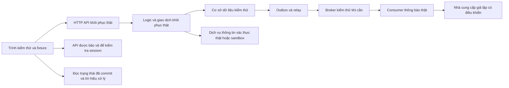

# Recovery integration tests

## 1. Kiểm thử tích hợp luồng khôi phục cần chứng minh điều gì?

**Recovery integration tests** kiểm chứng rằng các thành phần của luồng khôi phục phối hợp đúng tại những ranh giới có ảnh hưởng đến bảo mật: HTTP, cơ sở dữ liệu, quản lý thông tin xác thực, token, hàng đợi, thông báo và session.

Trong module khôi phục tài khoản, một hàm kiểm tra token trả về `true` chưa chứng minh hệ thống an toàn. Cần biết token có bị tiêu thụ đúng một lần trong giao dịch thật không, thông tin xác thực có được thay đổi đúng tài khoản không, kết quả có còn đúng khi hai yêu cầu chạy đồng thời không và phiên sau khôi phục có đúng quyền không.

Ví dụ, hai request cùng dùng một token đặt lại mật khẩu. Unit test của bộ xác minh có thể chấp nhận cả hai vì mỗi lần đọc đều thấy token chưa dùng. Chỉ khi đi qua cơ sở dữ liệu và cơ chế cập nhật thật mới quan sát được liệu hệ thống có chặn lần thay đổi thứ hai hay không.

Một kiểm thử tích hợp tốt mô tả được:

1. **Điều kiện ban đầu:** tài khoản, bằng chứng, token, trạng thái yêu cầu và session đang tồn tại.
2. **Kích thích:** một request hoặc một tình huống lỗi tại ranh giới cụ thể.
3. **Kết quả công khai:** phản hồi phù hợp với quyền của người gọi.
4. **Trạng thái bền vững:** hồ sơ, token và thông tin xác thực sau khi giao dịch hoàn tất.
5. **Tác dụng phụ:** sự kiện, thông báo, nhật ký quyết định và quyền session.
6. **Điều không được xảy ra:** thay đổi ngoài phạm vi, cấp quyền sớm, lộ dữ liệu hoặc lặp tác dụng nhạy cảm.

Bài học trình bày chiến lược và ví dụ kiểm thử. Tên endpoint, trạng thái và fixture dưới đây là hợp đồng minh họa, cần ánh xạ sang thiết kế thực tế của hệ thống; chúng không khẳng định repository đã có những API hoặc tiện ích đó.

## 2. Chọn đúng ranh giới tích hợp

Không phải kiểm thử nào gọi nhiều lớp cũng kiểm chứng được rủi ro tại ranh giới cần quan tâm.

| Loại kiểm thử | Thành phần thật thường được sử dụng | Mục tiêu chính |
|---|---|---|
| Unit test | Một thành phần nhỏ, phụ thuộc được thay bằng test double | Quy tắc cục bộ, ánh xạ và nhánh xử lý |
| Integration test | Một nhóm thành phần cùng giao thức, lưu trữ hoặc giao dịch thật | Hành vi tại ranh giới như HTTP–DB, consumer–DB, token–credential |
| Contract test | Hai phía hoặc mô hình hợp đồng của API/sự kiện | Cấu trúc, ngữ nghĩa và khả năng tương thích dữ liệu |
| End-to-end test | Một luồng rộng qua ứng dụng và nhiều dịch vụ | Hành trình hoàn chỉnh và cấu hình triển khai liên quan |

Để kiểm tra race condition khi dùng token, cần cơ sở dữ liệu và cơ chế đồng thời gần với môi trường triển khai. Một repository chỉ lưu trong `Map` hoặc cơ sở dữ liệu có ngữ nghĩa khóa khác có thể bỏ qua đúng lỗi cần tìm.

Để kiểm tra timeout của nhà cung cấp email, có thể dùng máy chủ giả lập ở ranh giới HTTP/SMTP với hành vi điều khiển được. Không cần gửi đến hộp thư thật và không nên sử dụng thông tin tài khoản của người dùng thật.

Nếu mục tiêu là kiểm tra phối hợp qua broker, cần kiểm thử đường đi qua broker hoặc một môi trường hỗ trợ đúng đặc tính cần kiểm chứng. Gọi thẳng method consumer có thể hữu ích nhưng không chứng minh serialization, cấu hình subscription, xác nhận nhận tin hay giao lại hoạt động đúng.

## 3. Xác định các bất biến trước khi viết test

Danh sách endpoint không đủ làm kế hoạch kiểm thử. Trước hết cần xác định điều kiện an toàn phải giữ dù các thành phần thành công, thất bại hoặc chạy đồng thời.

### 3.1. Bất biến về danh tính và quyền

- Token hoặc bằng chứng cho tài khoản A không cho phép thay đổi tài khoản B.
- Yêu cầu thuộc tenant A không tác động dữ liệu tenant B.
- Bằng chứng cho mục đích đặt lại mật khẩu không tự cho phép gỡ MFA hoặc đăng ký passkey.
- Biết `requestId` không đủ để đọc hồ sơ hoặc hoàn tất khôi phục.
- Hết thời gian chờ không thay thế bằng chứng danh tính còn thiếu.
- Phiên giới hạn dùng cho khôi phục không có toàn bộ quyền của phiên đăng nhập thông thường.

### 3.2. Bất biến về vòng đời

- Một capability dùng một lần không tạo thêm lần thay đổi nhạy cảm sau khi đã bị tiêu thụ.
- Token hết hạn hoặc bị thu hồi không được dùng để tạo một thay đổi mới.
- Yêu cầu đã hủy, bị từ chối hoặc hết hạn không tự mở lại vì nhận sự kiện cũ.
- Gửi lại thông báo không tự gia hạn token hoặc đặt lại khoảng chờ.
- Kết quả đánh giá cũ không ghi đè trạng thái bảo mật mới hơn.

### 3.3. Bất biến về tác dụng phụ

- Không phát một sự kiện thành công cho thay đổi đã rollback.
- Retry hạ tầng không tạo thêm lần thay đổi thông tin xác thực.
- Lỗi gửi thông báo không được biến thành việc bỏ qua xác minh.
- Không đưa mật khẩu, OTP, token rõ hoặc URL có bí mật vào log và payload không cần thiết.
- Chính sách session sau khôi phục được thực thi ở nơi kiểm tra quyền truy cập, không chỉ trong một bảng dữ liệu.

Các bất biến phải gắn với chính sách cụ thể. Ví dụ, hệ thống có thể cho phép trả lại cùng kết quả cho một request idempotent đã hoàn tất. Khi đó “token chỉ dùng một lần” cần được kiểm chứng bằng số tác dụng được áp dụng và quyền được cấp, thay vì mặc định mọi phản hồi HTTP thành công sau lần đầu đều là lỗ hổng.

## 4. Thiết kế môi trường kiểm thử

Một bộ kiểm thử tích hợp có ích thường cần các thành phần sau:



Không nhất thiết mọi test đều khởi động toàn bộ sơ đồ. Có thể chia bộ HTTP–DB, consumer–DB và recovery–identity riêng, rồi giữ một số luồng rộng kiểm tra sự phối hợp. Điều quan trọng là không thay đúng thành phần đang chứa rủi ro bằng một mock luôn trả về thành công.

### Thành phần thật và test double

| Ranh giới cần chứng minh | Lựa chọn phù hợp | Cách thiết lập dễ tạo cảm giác an toàn sai |
|---|---|---|
| Tiêu thụ token nguyên tử | DB cùng loại và cơ chế transaction tương ứng | Mock repository trả lần lượt một kết quả đã định sẵn |
| Kiểm tra credential mới có hiệu lực | Adapter và kho credential thật trong môi trường thử, hoặc sandbox đại diện | Chỉ verify một method đổi mật khẩu đã được gọi |
| Lỗi giao thức nhà cung cấp | Máy chủ giả lập có thể nhận request, trì hoãn và ngắt kết nối | Mock trả exception mà không mô phỏng việc phía xa có thể đã xử lý |
| Giao lại sự kiện | Đường đi qua broker/consumer có cơ chế ACK thật khi mục tiêu yêu cầu | Gọi method consumer một lần rồi kết luận chống trùng hoạt động |
| Quyền session sau khôi phục | Request đến API được bảo vệ qua lớp xác thực thật | Chỉ kiểm tra một cờ `revoked` trong DB |
| Kiểm soát truy cập hồ sơ | HTTP filter, authentication và authorization thật | Gọi trực tiếp service bằng một account ID tin cậy |

Mọi môi trường thử phải tách dữ liệu, khóa, credential nhà cung cấp và đích gửi khỏi production. Mỗi test nên có định danh riêng để truy vấn đúng tác dụng do nó tạo ra, thay vì đếm tổng mọi email hoặc mọi bản ghi trong một môi trường dùng chung.

## 5. Ma trận kiểm thử theo rủi ro

| Nhóm | Tình huống tích hợp | Kết quả cần quan sát |
|---|---|---|
| Khởi tạo | Tạo yêu cầu hợp lệ qua HTTP | Hồ sơ và outbox cùng commit, phản hồi không cấp quyền sớm |
| Chống dò tài khoản | Đầu vào có và không có tài khoản | Phản hồi công khai phù hợp hợp đồng, không lộ trạng thái nội bộ |
| Token | Đúng, sai, hết hạn, đã dùng, bị thu hồi | Chỉ trường hợp đủ điều kiện tạo tác dụng nhạy cảm |
| Ràng buộc mục đích | Dùng token đặt lại mật khẩu để gỡ MFA | Bị từ chối, không đổi yếu tố xác thực |
| Ràng buộc danh tính | Token tài khoản A với request hoặc tài khoản B | Không tác động B và không tiết lộ dữ liệu của A |
| Đồng thời | Hai lần hoàn tất dùng cùng token | Chỉ một tác dụng mới được áp dụng theo hợp đồng |
| Trạng thái | Hủy yêu cầu trong lúc xử lý kết quả xác minh | Quyết định cũ không hoàn tất yêu cầu đã hủy |
| Khoảng chờ | Trước, tại và sau mốc xét tiếp | Không bỏ điều kiện khác khi đồng hồ vượt mốc |
| Thông báo | Timeout, giao lặp, sai binding hoặc hết hạn gửi | Không gửi sai đích, không thay vòng đời token để retry |
| Credential | Thay đổi yếu tố xác thực qua luồng được cấp quyền | Đúng tài khoản, đúng loại thay đổi và đúng số lần |
| Session | Phiên cũ và phiên giới hạn sau khôi phục | Quyền thực tế khớp chính sách thu hồi và nâng quyền |
| Kiểm toán | Thành công, thất bại và retry | Liên kết đúng quyết định, không lộ bí mật |

Mỗi dòng có thể cần nhiều test nhỏ. Nên ưu tiên những trường hợp có khả năng dẫn đến chiếm đoạt tài khoản hoặc khó phát hiện bằng unit test, thay vì chỉ tăng số lượng test bằng các biến thể phản hồi tương tự nhau.

## 6. Kiểm thử token qua HTTP và dữ liệu đã commit

Một kịch bản hoàn tất khôi phục cần xác minh cả đầu vào, thay đổi bền vững và quyền truy cập sau đó.

```text
Given:
  - tài khoản A có credential và session kiểm thử;
  - hồ sơ R đã đạt các điều kiện cần thiết cho thao tác đang thử;
  - capability T đúng mục đích, chưa dùng và chưa hết hạn.

When:
  - gửi request hoàn tất qua HTTP bằng T và dữ liệu thay đổi hợp lệ.

Then:
  - phản hồi phù hợp hợp đồng;
  - đúng thay đổi được áp dụng cho A;
  - capability không còn cho phép tạo thêm tác dụng mới;
  - trạng thái hồ sơ và sự kiện tương ứng nhất quán;
  - session chịu đúng chính sách sau khôi phục;
  - tài khoản B và các yếu tố ngoài phạm vi không thay đổi.
```

Với đặt lại mật khẩu, không chỉ kiểm tra password hash đã khác, vì hash có thể thay đổi mà credential không dùng được. Nên kiểm tra hành vi qua đường xác thực phù hợp: mật khẩu cũ không còn đáp ứng bước xác thực bằng mật khẩu, mật khẩu mới đáp ứng bước đó, trong khi các yêu cầu MFA còn lại vẫn được giữ theo chính sách.

Với khôi phục MFA hoặc passkey, cần xác minh đúng yếu tố được thêm, thay thế hoặc vô hiệu hóa. Không coi việc cập nhật một nhãn hiển thị là đủ. Việc mất một passkey không mặc nhiên yêu cầu xóa mọi passkey còn lại; kết quả test phải theo quyết định nghiệp vụ đã xác định.

Các biến thể tối thiểu gồm token bị sửa, token của yêu cầu khác, sai mục đích, sai tenant, đã bị tiêu thụ, hết hạn và đã bị thu hồi. Với mỗi trường hợp thất bại, cần xác minh không xuất hiện credential mới hoặc một session có quyền cao hơn ngoài ý muốn.

### Không lấy token bằng một cửa hậu production

Fixture có thể thu email tại nhà cung cấp giả lập hoặc tạo dữ liệu kiểm thử qua một adapter chỉ tồn tại trong môi trường thử. Không thêm endpoint công khai trả token chỉ để test dễ hơn.

Nếu test tạo trực tiếp trạng thái “đã đủ bằng chứng”, nó chỉ kiểm tra đoạn sau của luồng. Cần một test khác kiểm chứng đường đi thực tế tạo ra trạng thái đó. Không dùng fixture để bỏ qua toàn bộ xác minh rồi kết luận đã kiểm tra khôi phục từ đầu đến cuối.

## 7. Thời gian, khoảng chờ và thời hạn token

Kiểm thử thời gian nên dùng nguồn thời gian điều khiển được, chẳng hạn một `Clock` được truyền vào thành phần quyết định, thay vì đợi nhiều phút hoặc sửa đồng hồ hệ điều hành.

Cần xác định thời gian được lấy ở đâu: ứng dụng, cơ sở dữ liệu, dịch vụ token hay dịch vụ xác minh. Nếu ứng dụng dùng clock giả nhưng SQL vẫn so sánh với thời gian thật, test có thể không kiểm tra đúng điều kiện dự kiến. Không thay đồng hồ toàn cục của môi trường dùng chung để xử lý sự khác biệt này.

### Ví dụ hợp đồng thời gian

Giả sử hệ thống quy định token chỉ hợp lệ khi:

```text
now < expiresAt
```

Khi đó cần thử các điểm:

| Thời điểm quyết định | Mong đợi |
|---|---|
| Ngay trước `expiresAt` theo độ chính xác lưu trữ | Có thể hợp lệ nếu mọi điều kiện khác đạt |
| Đúng `expiresAt` | Không còn hợp lệ |
| Sau `expiresAt` | Không hợp lệ |

Độ chính xác cần khớp lưu trữ. Nếu cơ sở dữ liệu chỉ giữ đến mili giây, dùng chênh lệch một nano giây mà không kiểm tra cách làm tròn có thể khiến test hiểu sai ranh giới.

Cũng cần thử request bắt đầu trước hạn nhưng bị trì hoãn trước bước thay đổi nhạy cảm. Hợp đồng phải quy định thời điểm kiểm tra có hiệu lực là lúc nào, thay vì tình cờ dựa vào thời điểm controller đọc đồng hồ. Với giao dịch dài, cần hiểu cách cơ sở dữ liệu định nghĩa thời gian trong giao dịch và thực thi đúng quy tắc đã chọn.

Với khoảng chờ, kiểm tra trước mốc xét tiếp, đúng mốc và sau mốc. Sau mốc, một yêu cầu còn thiếu bằng chứng hoặc đã bị hủy vẫn không được phép hoàn tất. Việc chuyển clock không được biến thành cách bỏ qua các điều kiện đó.

## 8. Kiểm thử đồng thời: hai request dùng cùng token

Đây là một tình huống tích hợp quan trọng vì cả hai request có thể cùng vượt qua bước kiểm tra trước khi một bên ghi nhận token đã dùng.

Một kịch bản nên:

1. Tạo tài khoản và hồ sơ riêng cho test, bảo đảm token có quyền thực hiện thao tác đang thử.
2. Gửi hai request qua cùng đường HTTP thật, dùng cùng token nhưng hai định danh thao tác khác nhau.
3. Cho hai request bắt đầu gần nhau bằng một điểm đồng bộ của trình kiểm thử.
4. Chờ cả hai hoàn tất với timeout hữu hạn.
5. Kiểm tra tác dụng đã commit, trạng thái token và phản hồi theo hợp đồng API.
6. Thử lại token bằng một thao tác mới và xác minh không phát sinh thay đổi tiếp theo.

Hai định danh thao tác khác nhau giúp phân biệt lạm dụng cùng token với việc trả lại kết quả cho chính một request idempotent đã thành công. Nếu cả hai request dùng cùng idempotency key, test có thể chỉ chứng minh cơ chế gộp request hoạt động.

### Ví dụ Java với JUnit và fixture tích hợp

Ví dụ dưới đây là một lớp test cơ sở. Dự án cần cung cấp lớp con và triển khai `RecoveryFixture`; các method fixture phải gọi HTTP và đọc dữ liệu đã commit trong môi trường thật đang kiểm thử, không thay service bằng mock.

Hợp đồng minh họa quy định hai thao tác khác nhau tranh chấp cùng token sẽ có một kết quả `APPLIED` và một `TOKEN_REJECTED`. Mỗi thay đổi credential thành công tăng `credentialRevision` đúng một lần. Nếu API thực tế có hợp đồng idempotency khác, cần ánh xạ kết quả phù hợp và vẫn kiểm tra bất biến về tác dụng.

```java
import org.junit.jupiter.api.Test;

import java.util.List;
import java.util.UUID;
import java.util.concurrent.Callable;
import java.util.concurrent.CountDownLatch;
import java.util.concurrent.Executors;
import java.util.concurrent.TimeUnit;

import static org.junit.jupiter.api.Assertions.*;

abstract class RecoveryTokenConcurrencyIT {
    protected abstract RecoveryFixture fixture();

    @Test
    void sameTokenCannotApplyTwoCredentialChanges() throws Exception {
        RecoveryFixture fx = fixture();
        Scenario scenario = fx.createReadyScenario();
        Snapshot before = fx.committedSnapshot(scenario);

        var ready = new CountDownLatch(2);
        var start = new CountDownLatch(1);
        var pool = Executors.newFixedThreadPool(2);

        Callable<Outcome> attempt = () -> {
            UUID operationKey = UUID.randomUUID();
            ready.countDown();
            if (!start.await(5, TimeUnit.SECONDS)) {
                throw new IllegalStateException("Start barrier timed out");
            }
            return fx.completeOverHttp(scenario, operationKey);
        };

        try {
            var first = pool.submit(attempt);
            var second = pool.submit(attempt);
            assertTrue(ready.await(5, TimeUnit.SECONDS));
            start.countDown();

            List<Outcome> outcomes = List.of(
                    first.get(10, TimeUnit.SECONDS),
                    second.get(10, TimeUnit.SECONDS));

            assertEquals(1L, outcomes.stream()
                    .filter(o -> o == Outcome.APPLIED).count());
            assertEquals(1L, outcomes.stream()
                    .filter(o -> o == Outcome.TOKEN_REJECTED).count());

            Snapshot after = fx.committedSnapshot(scenario);
            assertTrue(after.tokenConsumed());
            assertEquals(before.credentialRevision() + 1,
                    after.credentialRevision());

            assertEquals(Outcome.TOKEN_REJECTED,
                    fx.completeOverHttp(scenario, UUID.randomUUID()));
            assertEquals(after.credentialRevision(),
                    fx.committedSnapshot(scenario).credentialRevision());
        } finally {
            start.countDown();
            pool.shutdownNow();
            assertTrue(pool.awaitTermination(5, TimeUnit.SECONDS));
        }
    }

    enum Outcome { APPLIED, TOKEN_REJECTED }

    record Scenario(UUID requestId) {}

    record Snapshot(long credentialRevision, boolean tokenConsumed) {}

    interface RecoveryFixture {
        Scenario createReadyScenario();
        Outcome completeOverHttp(Scenario scenario, UUID operationKey)
                throws Exception;
        Snapshot committedSnapshot(Scenario scenario);
    }
}
```

Fixture giữ token và dữ liệu nhạy cảm bên trong theo từng scenario, tránh để chúng xuất hiện tự động trong `toString()` của record hoặc thông báo assertion. Fixture cũng phải an toàn khi hai luồng truy cập đồng thời; không dùng chung một connection hoặc đối tượng HTTP request có trạng thái không phù hợp.

Timeout trong ví dụ là giới hạn vận hành minh họa, không phải ngưỡng hiệu năng chuẩn. Cần chọn theo môi trường CI và bảo đảm timeout không làm các tác vụ còn treo tiếp tục ghi dữ liệu sau khi test đã kết thúc.

Một điểm đồng bộ ở client chỉ giúp tăng khả năng request chồng lấn. Nó không chứng minh hai giao dịch đã gặp nhau tại đúng điểm tranh chấp trong DB. Khi cần kiểm chứng một lịch thực thi cụ thể, có thể dùng công cụ điều phối giao dịch hoặc một test seam nội bộ để tạm dừng tại ranh giới quan trọng, rồi quan sát khóa và kết quả. Test seam không được trở thành một endpoint điều khiển giao dịch có thể truy cập trong production.

Không kết luận “không có race condition” chỉ vì chạy vòng lặp vài trăm lần đều xanh. Cần kết hợp kịch bản được điều phối với cơ chế bảo đảm như cập nhật có điều kiện, ràng buộc duy nhất hoặc khóa giao dịch phù hợp.

## 9. Kiểm thử giao dịch và lỗi giữa các bước

### 9.1. Khi token và credential nằm trong cùng giao dịch cục bộ

Cần chèn lỗi có kiểm soát ở các điểm như sau:

| Điểm lỗi | Kết quả mong đợi theo mô hình nguyên tử |
|---|---|
| Sau khi kiểm tra token, trước khi thay credential | Không có thay đổi credential đã commit |
| Sau khi ghi credential nhưng trước commit | Credential, trạng thái token và trạng thái hồ sơ cùng rollback |
| Sau khi ghi sự kiện outbox nhưng giao dịch rollback | Không có sự kiện thành công được relay như sự thật đã commit |
| Sau commit nhưng trước khi trả HTTP response | Retry không tạo thêm tác dụng và có thể tra cứu kết quả bền vững theo hợp đồng |

Điều kiện cuối rất quan trọng: timeout phía client không chứng minh thay đổi chưa được áp dụng. Test cần mô phỏng việc phản hồi bị mất sau commit và kiểm tra hành vi khi client gửi lại.

Không nên kiểm tra rollback chỉ bằng cách ném exception trước khi giao dịch bắt đầu. Cần lỗi tại một điểm đủ muộn để xác minh đúng tập dữ liệu có cùng ranh giới commit.

### 9.2. Khi Recovery Service và Identity Service có cơ sở dữ liệu riêng

Không được mặc định một transaction ở Recovery Service bao trùm việc đổi credential ở dịch vụ khác. Cần kiểm thử các trạng thái trung gian và cơ chế phục hồi của giao thức thực tế.

Ví dụ Identity Service đã đổi mật khẩu nhưng phản hồi bị mất. Recovery Service phải đối soát hoặc thử lại theo định danh thao tác ổn định, thay vì đổi mật khẩu lần nữa không kiểm soát hoặc mở lại token như chưa từng có tác dụng.

Các kết quả cần quan sát gồm:

- Credential chỉ được thay đổi theo một quyết định hợp lệ và một thao tác nghiệp vụ được nhận diện.
- Yêu cầu ở trạng thái hoàn tất hoặc trạng thái trung gian có cơ chế phục hồi rõ, không báo thành công trước điều kiện mà hợp đồng yêu cầu.
- Token không được phục hồi thành một quyền mới tùy ý sau khi credential đã thay đổi.
- Session không được cấp vượt mức trong lúc trạng thái giữa các dịch vụ còn chưa nhất quán.
- Retry và đối soát đi đến kết quả ổn định trong giới hạn vận hành đã định.

Không coi việc “khôi phục mật khẩu cũ” là phương án bù mặc định. Với thay đổi thông tin xác thực, thao tác bù có thể không khả thi hoặc làm tăng rủi ro; cần kiểm thử giao thức phục hồi mà hệ thống thực sự thiết kế.

## 10. Kiểm thử hàng đợi, outbox và thông báo

### 10.1. Bảo đảm ý định gửi đi cùng trạng thái nghiệp vụ

Một test có thể tạo yêu cầu qua HTTP, đọc hồ sơ đã commit và kiểm tra bản ghi outbox tương ứng. Một test khác làm giao dịch thất bại và xác minh không có sự kiện khởi tạo hoặc hoàn tất sai được phát.

Với relay, cần thử trường hợp tiến trình gửi được sự kiện nhưng chưa đánh dấu thành công. Khi cùng sự kiện xuất hiện lại, consumer không được tạo lại tác dụng nghiệp vụ. Nếu bên ngoài có thể nhận bản sao, hệ thống phải chịu được bản sao đó; một bản ghi inbox không tự bảo đảm mọi nhà cung cấp gửi đúng một lần.

### 10.2. Điều khiển hành vi nhà cung cấp giả lập

Nhà cung cấp kiểm thử nên có thể mô phỏng:

- Từ chối trước khi nhận nội dung.
- Nhận và lưu yêu cầu, sau đó đóng kết nối để phía gọi không biết kết quả.
- Trì hoãn phản hồi hoặc áp dụng giới hạn tốc độ.
- Gửi callback lặp, đến muộn, sai thứ tự hoặc có chữ ký không hợp lệ.
- Báo đích không hợp lệ hoặc không còn được phép dùng.

Từ các tình huống này, kiểm tra retry có giới hạn, khóa chống trùng ổn định và cách ghi kết quả không xác định. Không chỉ assert adapter đã được gọi một lần, vì chính yêu cầu thử lại có thể là hành vi đúng.

### 10.3. Kiểm tra nội dung và đích nhận

Thông báo phải đến kênh được chính sách cho phép, không tự chuyển sang email mới do người gửi yêu cầu nhập. Nếu binding liên hệ đổi khi tác vụ đang chờ, kết quả phải theo quy tắc của loại cảnh báo, không chỉ lấy email mới nhất một cách máy móc.

Kiểm tra token và URL chứa bí mật không bị đưa vào log, trace hoặc sự kiện phân phối rộng. Với liên kết hành động, việc GET bởi bộ quét email không được tự đổi mật khẩu, gỡ MFA hoặc tiêu thụ quyền khôi phục theo cách trái hợp đồng.

Không gửi thông báo cũ khẳng định “đã được phép tiếp tục” khi yêu cầu hiện đã hủy. Kiểm thử cả lúc sự kiện còn trong hàng đợi và lúc thư đã rời hệ thống; trường hợp sau cần trang trạng thái và nội dung hướng dẫn chịu được thông báo đã lỗi thời, vì không thể giả định thu hồi được email đã giao.

## 11. Kiểm thử quyền session sau khôi phục

Một kiểm thử session cần gọi API được bảo vệ bằng credential phiên thật. Cập nhật cột `revoked = true` chưa chứng minh các node xác thực hoặc access token đang phát hành đã chịu tác động.

Các đối tượng cần phân biệt:

| Đối tượng | Điều cần kiểm tra |
|---|---|
| Phiên cũ của tài khoản | Có tiếp tục được truy cập theo chính sách sau thay đổi hay không |
| Refresh token cũ | Có bị từ chối, xoay vòng hoặc giới hạn theo thiết kế |
| Access token đã phát hành | Hiệu lực thực tế phù hợp cơ chế thu hồi, introspection, version hoặc TTL được công bố |
| Phiên giới hạn dùng cho khôi phục | Chỉ truy cập được các bước và tài nguyên cần thiết |
| Phiên mới sau hoàn tất | Mức xác thực và quyền không bị nâng cao hơn bằng chứng đã đạt |
| Phiên của tài khoản khác | Không bị thu hồi hoặc thay đổi ngoài ý muốn |

Nếu thiết kế yêu cầu thu hồi access token ngay, cần kiểm tra cả đường xác thực thực tế và sự lan truyền đến các node liên quan. Nếu hệ thống dùng token tự chứa còn hiệu lực đến hết một TTL có giới hạn, test phải phản ánh đúng cam kết đó; không suy ra thu hồi tức thì từ việc refresh token đã bị vô hiệu hóa.

Một phiên khôi phục mật khẩu có thể được phép đặt mật khẩu mới nhưng vẫn không được đọc dữ liệu nhạy cảm, thêm phương thức thanh toán hoặc đổi email. Test cần thử truy cập các tài nguyên ngoài phạm vi trước và sau từng bước nâng quyền.

Nếu browser dùng cookie, bổ sung kiểm tra CSRF cho thao tác thay đổi trạng thái và cách xoay vòng hoặc chấm dứt phiên theo chính sách. Biết token khôi phục không nên vô tình biến một cookie phiên chưa đủ tin cậy thành phiên toàn quyền.

## 12. Kiểm thử chống lạm dụng, quyền truy cập và dữ liệu nhạy cảm

### 12.1. Chống dò tài khoản

So sánh các đường đi có tài khoản, không có tài khoản, không đủ điều kiện và bị giới hạn tần suất theo hợp đồng công khai. Kiểm tra body, mã trạng thái, header và việc lộ ID nội bộ, không chỉ một câu thông báo chung.

Không viết test yêu cầu thời gian xử lý hai nhánh bằng nhau tuyệt đối. Độ trễ môi trường gây nhiễu, còn một lần đo nhanh không chứng minh không có kênh suy luận theo thời gian. Có thể dùng phép đo lặp và ngưỡng đã định trong môi trường được kiểm soát để phát hiện sai lệch rõ, kết hợp xem xét kiến trúc; không xem đó là chứng minh tuyệt đối về chống timing attack.

### 12.2. Giới hạn tốc độ đúng phạm vi

Kiểm tra giới hạn theo tài khoản hoặc định danh liên quan, nguồn gửi và phạm vi tổ chức theo chính sách. Nhiều IP không nên tự làm mất kiểm soát theo tài khoản; nhiều người chung một IP cũng không nên bị ảnh hưởng ngoài quy tắc đã thiết kế.

Đảm bảo retry nội bộ không bị tính thành một loạt yêu cầu mới của người dùng, và tạo nhiều idempotency key không giúp né giới hạn nghiệp vụ. Test không cần tạo lưu lượng lớn không kiểm soát; có thể cấu hình ngưỡng thấp riêng cho môi trường thử.

### 12.3. Truy cập chéo tài khoản và tenant

Thử lấy trạng thái, bổ sung bằng chứng, hủy hoặc hoàn tất hồ sơ B bằng phiên hoặc capability của A. Xác minh cả phản hồi và việc không đổi dữ liệu B. Không chỉ kiểm tra `403` nếu service vẫn ghi một thay đổi trước khi trả lỗi.

### 12.4. Bí mật không xuất hiện ở đầu ra phụ

Dùng dữ liệu tổng hợp có dấu nhận diện riêng để kiểm tra các đầu ra được phép thu thập trong môi trường thử: HTTP response, log, trace, payload outbox và thông báo. Không in token thật vào báo cáo test khi assertion thất bại.

Cần xác định nơi bí mật được phép xuất hiện, chẳng hạn phần nội dung gửi đến nhà cung cấp giả lập cho đúng người nhận. Không viết một assertion cấm token ở mọi nơi nếu chính kênh email được thiết kế để mang liên kết đó. Mục tiêu là ngăn lan sang bề mặt ngoài mục đích và quyền được cấp.

## 13. Giữ bộ kiểm thử ổn định và có khả năng chẩn đoán

### Dữ liệu nhìn thấy phải là dữ liệu đã commit

Nếu test gửi HTTP đến ứng dụng trên luồng khác, một transaction bao quanh method test không tự bao quanh transaction của request. Dữ liệu fixture chưa commit có thể không thấy từ ứng dụng, còn rollback cuối test có thể không xóa dữ liệu request đã commit.

Thiết lập fixture và cách dọn dữ liệu phải phù hợp ranh giới thật. Dùng tenant, tài khoản hoặc ID riêng theo test và chỉ dọn đúng tài nguyên do test tạo. Tránh xóa toàn bộ bảng trong môi trường có test khác đang chạy song song.

### Chờ điều kiện có giới hạn

Với xử lý bất đồng bộ, chờ một điều kiện quan sát được bằng polling có giới hạn hoặc tín hiệu đồng bộ thích hợp. Không dùng một lần ngủ cố định rồi giả định hàng đợi đã xử lý xong.

Điều kiện chờ cần đủ chặt: đúng `requestId`, đúng loại kết quả và đúng phiên bản. Việc thấy “có bất kỳ email nào” không chứng minh email của test này đã được gửi.

Một số khẳng định phủ định cũng cần chờ đến điểm kết thúc phù hợp. Không thể chứng minh “sẽ không gửi thêm” chỉ bằng cách đếm ngay sau khi gửi lệnh trong khi hàng đợi còn đang xử lý. Có thể kiểm tra tác vụ đã về trạng thái cuối, hàng công việc liên quan đã được xử lý hoặc hết cửa sổ được hợp đồng cho phép, rồi đánh giá tác dụng.

### Timeout và dấu vết lỗi có ý nghĩa

Khi test timeout, báo lại định danh không nhạy cảm, trạng thái hồ sơ, trạng thái outbox và bước đang chờ. Tránh dump toàn bộ cơ sở dữ liệu hoặc nội dung email chứa bí mật.

Không tự động chạy lại mọi test thất bại để che flakiness. Cần phân biệt lỗi do giả định đồng bộ sai, dữ liệu dùng chung, cleanup chưa xong, khác biệt clock và lỗi thật của sản phẩm. Các test đồng thời và sự cố phải có cách giải phóng latch, dừng worker và kết thúc transaction ngay cả khi assertion thất bại.

## 14. Chọn bộ kiểm thử và tiêu chí hoàn thành

Có thể tổ chức các nhóm theo chi phí và rủi ro:

- Nhóm HTTP–DB chạy thường xuyên để kiểm tra quyền truy cập, token, giao dịch và trạng thái.
- Nhóm đồng thời và fault injection kiểm tra các bất biến khó quan sát trong luồng thông thường.
- Nhóm qua broker, nhà cung cấp giả lập và session kiểm tra phối hợp giữa các ranh giới.
- Một số hành trình rộng xác nhận các thành phần được cấu hình để làm việc cùng nhau.

Với mỗi thay đổi, chọn nhóm bị ảnh hưởng dựa trên ranh giới thực tế. Sửa thuật toán tiêu thụ token cần kiểm tra giao dịch và đồng thời; sửa adapter email cần kiểm tra lỗi giao thức, retry và bảo vệ dữ liệu; sửa chính sách session cần kiểm tra truy cập bằng phiên thật.

Một luồng khôi phục đạt yêu cầu tích hợp khi các trường hợp hợp lệ đi đến kết quả đã định, các trường hợp không hợp lệ không tạo quyền hoặc thay đổi ngoài phạm vi, và lỗi giữa các thành phần không phá vỡ bất biến bảo mật. Báo cáo test cần nêu được ranh giới nào đã dùng thành phần thật và ranh giới nào vẫn là giả lập, để kết quả được hiểu đúng mức độ kiểm chứng.
