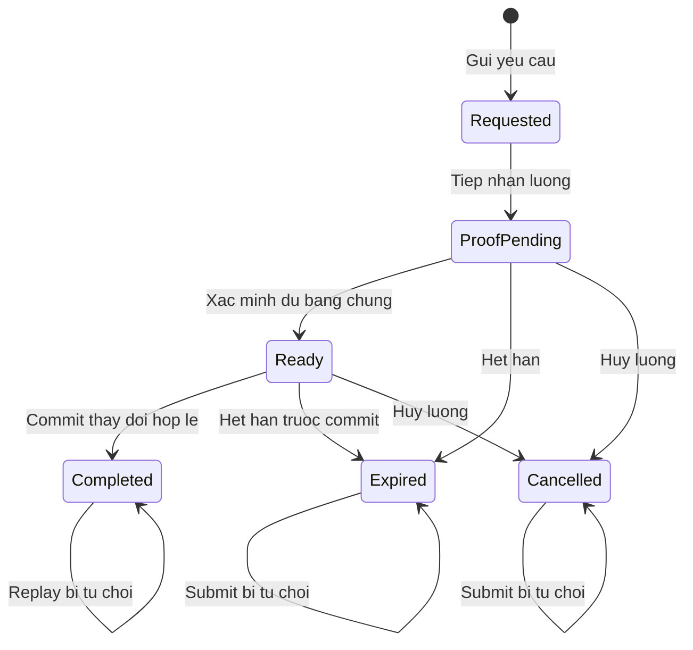

# Recovery browser tests — Kiểm thử luồng khôi phục tài khoản trên trình duyệt

## 1. Mục tiêu của kiểm thử trình duyệt trong account recovery

Một luồng khôi phục tài khoản có thể vượt qua kiểm thử API nhưng vẫn thất bại khi người dùng mở thư trên thiết bị khác, quay lại tab cũ hoặc tiếp tục sau khi mạng gián đoạn. Trình duyệt giữ cookie, lịch sử điều hướng, bộ nhớ ứng dụng và trạng thái biểu mẫu; các thành phần này quyết định người dùng thực sự đi qua ranh giới xác thực như thế nào.

Trong module `SECURITY_AUTHENTICATION_ACCOUNT_RECOVERY`, recovery browser tests kiểm tra hành trình khôi phục khi mất mật khẩu, MFA, passkey hoặc thiết bị xác thực. Đích kiểm tra là khả năng lấy lại quyền truy cập theo chính sách, đồng thời ngăn một bằng chứng khôi phục bị sử dụng để chiếm đoạt tài khoản.

Bài học tập trung vào cách xây dựng kịch bản, cô lập trình duyệt, chuẩn bị dữ liệu, thiết kế assertion và vận hành bộ kiểm thử. Ví dụ Java dùng Playwright để minh họa; đường dẫn, test ID và giao diện fixture là hợp đồng của ứng dụng mẫu, cần được ánh xạ sang ứng dụng đang kiểm thử.

Sau bài học, người học có thể:

- Chuyển chính sách recovery thành những hành trình trình duyệt có kết quả quan sát được.
- Phân biệt bằng chứng từ giao diện với bằng chứng từ máy chủ.
- Kiểm tra token hết hạn, dùng lại liên kết, nhiều tab, nhiều thiết bị và session cũ.
- Chọn điểm giả lập phù hợp mà vẫn giữ được giá trị của kiểm thử đầu cuối.
- Thu thập bằng chứng lỗi mà không làm lộ token, cookie hoặc mật khẩu trong hệ thống CI.

Một mốc tham chiếu cho nhánh quên mật khẩu là thông báo yêu cầu nhất quán, token có thời hạn và chỉ dùng một lần, cùng bước đăng nhập thông thường sau khi đổi mật khẩu. Các nguyên tắc này được trình bày trong [OWASP Forgot Password Cheat Sheet](https://cheatsheetseries.owasp.org/cheatsheets/Forgot_Password_Cheat_Sheet.html). Các kịch bản bên dưới chuyển chúng thành hợp đồng kiểm thử cụ thể và bổ sung các tình huống riêng của trình duyệt.

## 2. Chọn đúng ranh giới kiểm thử

### 2.1. Trình duyệt chứng minh được điều gì?

Một browser test có thể xác nhận rằng người dùng đi qua màn hình đúng, trình duyệt gửi yêu cầu phù hợp, server trả kết quả theo hợp đồng và tài nguyên được bảo vệ chỉ truy cập được trong trạng thái cho phép. Nó cũng phát hiện các lỗi mà API client đơn giản khó biểu diễn: cookie không được gửi sau chuyển hướng từ thư, tab cũ giữ giao diện đã hết hiệu lực, nút submit bị kích hoạt hai lần hoặc trang được khôi phục từ lịch sử.

Tuy vậy, một lần chạy thành công không chứng minh token có đủ entropy, phép cập nhật trong database là nguyên tử, hay mọi session ở mọi vùng triển khai đều đã bị vô hiệu hóa. Những thuộc tính này cần kiểm thử chuyên biệt ở lớp tương ứng. Browser suite nên gọi đúng tên bằng chứng mà nó thu được.

| Lớp kiểm thử | Câu hỏi phù hợp | Điều browser test bổ sung |
| --- | --- | --- |
| Unit/domain | Token nào được phép dùng, trạng thái nào cho phép chuyển tiếp? | Người dùng gặp đúng màn hình và hành động được ánh xạ đúng |
| API/integration | Server kiểm tra purpose, account, tenant, thời hạn và quyền hạn ra sao? | Cookie, điều hướng và form thực tế có đưa người dùng qua đúng nhánh? |
| Concurrency | Hai yêu cầu đồng thời có thể cùng hoàn tất một recovery không? | Hai tab hoặc hai context hiển thị kết quả sau cạnh tranh như thế nào? |
| Delivery integration | Nội dung thông điệp, nơi nhận và trạng thái gửi có đúng không? | Liên kết người dùng nhận có mở được hành trình hoàn chỉnh? |
| Browser end-to-end | Người dùng thực hiện các bước thật với backend thật có thành công đúng chính sách không? | Toàn bộ trải nghiệm và các ranh giới xác thực ở phía trình duyệt |

Ví dụ, thấy nút “Hoàn tất” bị disable chỉ chứng minh một trạng thái UI. Để kết luận máy chủ từ chối token hết hạn, test phải quan sát một yêu cầu đến backend với token đã hết hạn và kiểm tra không có thay đổi credential. Nếu UI chặn hoàn toàn yêu cầu đó, phần khẳng định về server phải nằm trong API/integration test bổ sung.

### 2.2. Giữ lõi bảo mật thật, kiểm soát các phụ thuộc ngoài

Đối với nhóm end-to-end bảo mật, nên sử dụng backend thực cho phát hành, xác minh và tiêu thụ token; việc đổi credential và kiểm tra session cũng đi qua logic thật. Các dịch vụ gửi thư, SMS hoặc xác minh danh tính bên ngoài có thể dùng sandbox hay adapter kiểm thử được kiểm soát.

Một test dùng `route.fulfill()` để giả lập “recovery thành công” chỉ có thể kiểm tra cách frontend hiển thị phản hồi đó. Nó không xác nhận backend đã cập nhật mật khẩu. Tách rõ ca kiểm tra UI khi mất mạng với ca kiểm tra recovery thật để tên test phản ánh đúng phạm vi.

Không cần mọi lần chạy đều đi qua nhà cung cấp thật. Có thể duy trì một nhóm nhỏ kiểm thử tích hợp nhà cung cấp trong môi trường được phép, trong khi bộ hồi quy thường xuyên sử dụng hộp thư hoặc SMS sink chuyên dụng cho test.

## 3. Viết hợp đồng hành vi trước khi viết thao tác click

Trước mỗi kịch bản, ghi rõ trạng thái ban đầu, hành động, kết quả công khai và tác động được phép. Tránh các mô tả như “trang chạy bình thường” vì chúng không xác định được lỗi nào phải làm test thất bại.

Ví dụ hợp đồng cho một ứng dụng mẫu:

```text
Nhánh: Khôi phục mật khẩu cho tài khoản chỉ dùng mật khẩu
Trạng thái đầu: tài khoản hoạt động; chưa có recovery đang hoàn tất
Yêu cầu: gửi email khôi phục qua giao diện công khai
Phản hồi công khai: thông báo tiếp nhận chung
Mở liên kết: hiển thị form; chưa thay credential
Hoàn tất hợp lệ: đổi mật khẩu đúng một lần
Quyền sau hoàn tất: yêu cầu đăng nhập bình thường
Liên kết đã hoàn tất: không thể đổi mật khẩu thêm lần nữa
Session cũ: xử lý theo chính sách đã khai báo cho nhánh này
```

Đây là một chính sách ví dụ, không phải cấu hình suy đoán của một hệ thống có sẵn. Ứng dụng khác có thể cho người dùng chọn thu hồi session trong nhánh rủi ro thấp, trong khi nhánh nghi bị chiếm đoạt áp dụng thu hồi bắt buộc. Test phải thể hiện lựa chọn đó ngay trong tên hoặc dữ liệu đầu vào.

### 3.1. Mô hình trạng thái cho một recovery attempt



Sơ đồ mô tả trạng thái nghiệp vụ phía server. Frontend có thể gộp nhiều trạng thái thành cùng thông báo công khai để giảm lộ thông tin. Test vẫn phân biệt trạng thái bên trong bằng một kênh quan sát kiểm thử chỉ đọc đã được cho phép.

Nếu có thời gian chờ, thêm trạng thái `DelayPending` trước `Ready`. Nếu cần duyệt thủ công, thêm trạng thái tương ứng và fixture tạo quyết định phê duyệt. Không bỏ qua trạng thái chờ chỉ vì đó là bước làm test chạy lâu.

### 3.2. Quyền của recovery session phải được mô tả riêng

Một cookie dùng để tiếp tục recovery không mặc nhiên là session đăng nhập đầy đủ. Hợp đồng cần chỉ rõ nó được đọc trạng thái nào, được gửi hành động nào và hết hiệu lực khi nào.

Test một tài nguyên chỉ dành cho người dùng đã đăng nhập bằng chính cookie jar của context recovery. Kết quả mong đợi có thể là `401`, hoặc mã từ chối khác được đặc tả cho ứng dụng. Chỉ kiểm tra URL đang ở trang login sẽ bỏ sót trường hợp API vẫn trả dữ liệu riêng tư.

## 4. Thiết kế môi trường kiểm thử có thể lặp lại

### 4.1. Cô lập trình duyệt và dữ liệu server là hai việc khác nhau

Một browser context sạch giúp tách cookie và storage giữa các vai trò. Playwright hỗ trợ tạo nhiều context trong cùng một browser; khi tích hợp một test runner Java tùy chỉnh, cần chủ động tạo và đóng context theo vòng đời test. Xem [Playwright Java: Isolation](https://playwright.dev/java/docs/browser-contexts).

Context mới không tạo tài khoản mới, không xóa token trên server và không đặt lại bộ đếm rate limit. Vì vậy, mỗi test cần namespace dữ liệu riêng, gồm tài khoản, tenant, thư nhận, recovery attempt và các bộ đếm liên quan.

| Thành phần | Đơn vị cô lập đề xuất | Lỗi thường gặp nếu dùng chung |
| --- | --- | --- |
| Browser context | Một vai trò hoặc một thiết bị trong một test | Session từ test trước làm bỏ qua bước đăng nhập |
| Tài khoản | Một test, trừ ca cố ý dùng chung | Mật khẩu bị test khác đổi giữa chừng |
| Recovery attempt | Một hành trình cụ thể | Lấy nhầm liên kết đã bị dùng |
| Hộp thư/SMS sink | Run ID và địa chỉ nhận riêng | Đọc thông điệp của worker khác |
| Đồng hồ backend | Test instance hoặc namespace được hỗ trợ | Ca hết hạn làm hỏng tất cả ca đang chạy |
| Rate-limit state | Đúng khóa và phạm vi của ca kiểm thử | Các worker vô tình khóa nhau |

Đối với test “hai thiết bị”, tạo hai context. Hai tab trong cùng context phù hợp cho kịch bản chia sẻ cookie; chúng không mô phỏng hai thiết bị độc lập. Nếu kiểm tra chính sách theo IP, hai context trong cùng máy chạy thường vẫn có cùng IP, nên cần hạ tầng mạng kiểm thử tương ứng.

### 4.2. Fixture là đường chuẩn bị dữ liệu, không phải lối tắt qua kiểm soát

Fixture có thể tạo tài khoản kiểm thử, đọc thông điệp trong mail sink, đặt thời gian kiểm thử hoặc lấy snapshot chỉ đọc. Hành động cần được chứng minh — chẳng hạn gửi yêu cầu và hoàn tất recovery — vẫn đi qua UI cùng backend thật.

Không xây endpoint công khai nhận `skipVerification=true`. Một test control plane hợp lệ cần tách quyền truy cập, giới hạn môi trường, ràng buộc namespace và không có khả năng thao tác tài khoản thật ngoài phạm vi được cấp.

Cleanup phải chạy cả khi test thất bại. Dọn đúng tài khoản và thông điệp thuộc namespace của test; không reset toàn bộ database hoặc rate limiter của môi trường dùng chung. Nếu cleanup lỗi, báo lỗi riêng để người vận hành thấy dữ liệu tồn dư.

### 4.3. Lấy đúng thông điệp cho đúng yêu cầu

Không chọn “email mới nhất trong toàn hộp thư”. Dùng bộ lọc kết hợp run ID, recipient, purpose và thời điểm phát sinh yêu cầu; nếu hệ thống có correlation ID nội bộ, fixture có thể dùng nó để đối chiếu. Không vì tiện kiểm thử mà đưa account ID hoặc token vào response công khai.

Mail sink nên hỗ trợ chờ có giới hạn theo điều kiện. Khi hết thời gian, thông báo “không nhận được thông điệp cho attempt X” với mã đã làm sạch; không in toàn bộ nội dung email ra log.

Trước khi điều hướng, kiểm tra scheme, origin và path của liên kết theo allowlist kiểm thử. Đây vừa là assertion cho template email, vừa tránh để runner đi theo một liên kết sai môi trường. Không chỉ so sánh chuỗi bằng `startsWith`, vì chuỗi có tiền tố giống hostname hợp lệ chưa bảo đảm cùng origin.

## 5. Ma trận kịch bản ưu tiên

Mỗi dòng trong ma trận cần có cả kết quả trình duyệt và điều kiện về server. Mã dưới đây là tên ca gợi ý để truy vết, không phải ID bài học hay metadata cần thêm vào YAML.

| Mã | Kịch bản | Bằng chứng từ trình duyệt | Bằng chứng hoặc giới hạn phía server |
| --- | --- | --- | --- |
| RB-01 | Yêu cầu cho email tồn tại và không tồn tại | Thông báo, cấu trúc phản hồi công khai nhất quán | Không thay credential khi mới yêu cầu |
| RB-02 | Liên kết hợp lệ, hoàn tất một lần | Form mở được; hiển thị kết quả; đăng nhập mới thành công | Credential đúng account thay đổi đúng một lần |
| RB-03 | Token hết hạn trước submit | Nhận kết quả hết hạn; có đường bắt đầu lại | Từ chối commit, credential giữ nguyên |
| RB-04 | Mở lại liên kết đã dùng trong context mới | Thông báo không thể tiếp tục | Không có lần đổi credential thứ hai |
| RB-05 | Hai tab cùng mở một attempt | Tab còn lại xử lý trạng thái cũ hợp lý | Chỉ một commit theo hợp đồng |
| RB-06 | Chỉ mở link, chưa xác nhận | Không xuất hiện kết quả hoàn tất | Chưa đổi credential, chưa hoàn tất nghiệp vụ |
| RB-07 | Refresh, Back, Forward sau hoàn tất | Không thực hiện lại thay đổi từ trang cũ | Yêu cầu lặp không tạo tác động mới |
| RB-08 | Ngắt mạng hoặc mất response khi submit | Có cách xác định kết quả và tiếp tục an toàn | Không tự suy ra request chưa được xử lý |
| RB-09 | Liên kết sai account, purpose hoặc tenant | Bị từ chối theo thông báo an toàn | Không cập nhật tài khoản ngoài phạm vi |
| RB-10 | Context recovery gọi tài nguyên riêng tư | UI không mở quyền đầy đủ | API được bảo vệ vẫn từ chối |
| RB-11 | Session cũ sau recovery rủi ro cao | Tab cũ bị yêu cầu xác thực khi gọi server | Session/refresh token cũ bị xử lý đúng chính sách |
| RB-12 | Mất MFA hoặc passkey | Đi qua nhánh bằng chứng và đăng ký lại phù hợp | Không hạ yêu cầu xác minh vì chọn fallback |
| RB-13 | Cooldown hoặc giới hạn yêu cầu | Nút và thông báo phản ánh trạng thái thật | Mở context mới không vượt kiểm soát theo account |
| RB-14 | Điều hướng từ email trên thiết bị khác | Không lặp chuyển hướng hoặc mất tiến trình vô cớ | Bằng chứng được ràng buộc theo thiết kế đã công bố |
| RB-15 | Recovery bị hủy khi tab đang mở | Tab cũ nhận trạng thái không thể tiếp tục | Không commit sau khi cancellation có hiệu lực |

Không cần nhân toàn bộ ma trận với mọi browser ngay từ đầu. Ưu tiên nhóm cốt lõi trên các engine được hỗ trợ, rồi bổ sung các ca liên quan điều hướng, cookie, lịch sử và thiết bị theo rủi ro thực tế.

## 6. Assertion cần có kết quả độc lập

Một test mạnh thường có ba điểm kiểm tra: người dùng thấy gì, server chấp nhận hay từ chối gì, và trạng thái nghiệp vụ thay đổi ra sao. Các điểm này phải đủ độc lập để tránh tình huống UI và response cùng báo thành công dù dữ liệu không được cập nhật.

### 6.1. Kết quả tích cực

Sau khi đổi mật khẩu thành công, dùng context sạch đăng nhập bằng mật khẩu mới. Với tài khoản chỉ có mật khẩu trong ứng dụng mẫu, mật khẩu cũ phải bị từ chối. Nếu tài khoản còn MFA, đăng nhập bằng mật khẩu mới có thể dừng ở challenge tiếp theo; lúc đó cần xác nhận challenge đúng thay vì đòi dashboard xuất hiện.

Snapshot kiểm thử có thể trả `credentialRevision` hoặc số lần chuyển trạng thái, nhưng không nên trả password hash, token plaintext hay dữ liệu nhận dạng không cần thiết. Đối chiếu revision cho biết có cập nhật; đăng nhập qua đường công khai cho biết credential mới thực sự dùng được.

### 6.2. Kết quả phủ định

Với token không hợp lệ, kiểm tra kết quả từ chối và credential revision không đổi. Không kết luận “an toàn” chỉ vì hộp thoại lỗi xuất hiện: backend có thể đã đổi mật khẩu nhưng frontend xử lý lỗi parse response.

Với tác động bất đồng bộ, snapshot phải là phép đọc có tính nhất quán phù hợp hoặc một phép chờ điều kiện có deadline. Đọc ngay một replica chậm và thấy dữ liệu cũ không chứng minh không có thay đổi. Khi đặc tả có thời gian lan truyền, ghi rõ thời hạn mà test phải quan sát được trạng thái cuối.

### 6.3. Đồng bộ bằng điều kiện có ý nghĩa

Chờ một response cụ thể quanh thao tác submit, rồi chờ trạng thái UI mong đợi. Lọc response bằng method và endpoint; trong trang có nhiều request, đừng dùng điều kiện chung như “response bất kỳ có mã 200”. API chờ sự kiện được mô tả trong [Playwright Java: Network](https://playwright.dev/java/docs/network).

Assertion cho phần tử nên dùng locator ổn định và cơ chế chờ tự động. [Playwright Java: Assertions](https://playwright.dev/java/docs/test-assertions) mô tả các assertion thử lại điều kiện trong thời gian giới hạn. Điều này không thay thế việc xác định đúng điều kiện hoàn tất nghiệp vụ.

Tránh `Thread.sleep(5000)` để đợi thư hoặc đổi trang. Một độ trễ cố định làm ca nhanh chạy chậm, nhưng vẫn có thể quá ngắn khi CI quá tải. Cũng không nên chờ “network idle” như bằng chứng duy nhất nếu ứng dụng có telemetry hoặc kết nối nền.

## 7. Ví dụ Java: kiểm thử đổi mật khẩu và token hết hạn

### 7.1. Hợp đồng của ứng dụng mẫu

Ví dụ dùng JUnit Jupiter và Playwright Java. Bộ kiểm thử là một lớp abstract để dự án cung cấp adapter fixture cùng base URL. Nó không giả định repository đã có endpoint hoặc lớp triển khai tương ứng.

Hợp đồng UI của ví dụ:

- `/account-recovery` có các test ID `recovery-email`, `recovery-request-submit`, `recovery-request-status`.
- Liên kết từ mail sink mở form có `new-password`, `confirm-password`, `recovery-complete-submit`.
- Submit form gửi `POST /api/account-recovery/complete`; thành công trả `200`, hết hạn trả `410`.
- Kết quả lần lượt hiển thị `recovery-complete` hoặc `recovery-unavailable`.
- `/login` có `login-email`, `login-password`, `login-submit`, `login-success`, `login-error`.
- `GET /api/private-marker` trả `401` cho context chưa có session đăng nhập đầy đủ.

Mã `410`, tên test ID và revision tăng một là lựa chọn của ứng dụng mẫu. Với hệ thống trả cùng một mã cho nhiều loại token không hợp lệ, adapter và assertion cần theo hợp đồng đó; không thêm chi tiết lỗi công khai chỉ để test dễ phân biệt.

### 7.2. Lớp kiểm thử và ranh giới fixture

```java
import com.microsoft.playwright.Browser;
import com.microsoft.playwright.BrowserContext;
import com.microsoft.playwright.Page;
import com.microsoft.playwright.Playwright;
import com.microsoft.playwright.Response;
import org.junit.jupiter.api.AfterEach;
import org.junit.jupiter.api.BeforeEach;
import org.junit.jupiter.api.Test;

import java.net.URI;
import java.time.Duration;

import static com.microsoft.playwright.assertions.PlaywrightAssertions.assertThat;
import static org.junit.jupiter.api.Assertions.assertEquals;
import static org.junit.jupiter.api.Assertions.assertTrue;

abstract class RecoveryBrowserContractTest {
    interface TestAccount {
        String id();
        String email();
        String initialPassword();
    }

    interface RecoveryTicket {
        String url();
    }

    interface RecoveryFixture extends AutoCloseable {
        TestAccount createPasswordOnlyAccount();

        RecoveryTicket awaitMessageFor(
                TestAccount account, Duration timeout);

        long credentialRevision(TestAccount account);

        String newPassword();

        void advanceServerClockPastExpiry(RecoveryTicket ticket);

        @Override
        void close();
    }

    // URL không có dấu / ở cuối, dùng HTTPS trong môi trường kiểm thử.
    protected abstract String baseUrl();

    // Mỗi lần gọi tạo namespace riêng; không trả fixture singleton dùng chung.
    protected abstract RecoveryFixture openFixture();

    private Playwright playwright;
    private Browser browser;
    private RecoveryFixture fixture;

    @BeforeEach
    void start() {
        fixture = openFixture();
        playwright = Playwright.create();
        browser = playwright.chromium().launch();
    }

    @AfterEach
    void stop() {
        try {
            if (browser != null) browser.close();
        } finally {
            try {
                if (playwright != null) playwright.close();
            } finally {
                if (fixture != null) fixture.close();
            }
        }
    }

    private Page freshPage() {
        BrowserContext context = browser.newContext();
        return context.newPage();
    }

    private RecoveryTicket requestRecovery(TestAccount account) {
        Page page = freshPage();
        page.navigate(baseUrl() + "/account-recovery");
        page.getByTestId("recovery-email").fill(account.email());
        page.getByTestId("recovery-request-submit").click();
        assertThat(page.getByTestId("recovery-request-status"))
                .hasText("Nếu thông tin phù hợp, hướng dẫn sẽ được gửi.");

        return fixture.awaitMessageFor(account, Duration.ofSeconds(10));
    }

    private void openRecovery(Page page, RecoveryTicket ticket) {
        URI allowed = URI.create(baseUrl());
        URI received = URI.create(ticket.url());
        assertTrue("https".equals(received.getScheme()),
                "Recovery URL must use HTTPS");
        assertTrue(allowed.getHost() != null
                        && allowed.getHost().equalsIgnoreCase(received.getHost())
                        && effectivePort(allowed) == effectivePort(received)
                        && received.getUserInfo() == null
                        && "/account-recovery/complete".equals(received.getPath()),
                "Recovery URL is outside the test allowlist");
        page.navigate(ticket.url());
    }

    private int effectivePort(URI uri) {
        return uri.getPort() == -1 ? 443 : uri.getPort();
    }

    private Response complete(Page page, String password) {
        page.getByTestId("new-password").fill(password);
        page.getByTestId("confirm-password").fill(password);
        return page.waitForResponse(
                response -> response.url().equals(
                        baseUrl() + "/api/account-recovery/complete")
                        && "POST".equals(response.request().method()),
                () -> page.getByTestId("recovery-complete-submit").click());
    }

    private Page login(TestAccount account, String password) {
        Page page = freshPage();
        page.navigate(baseUrl() + "/login");
        page.getByTestId("login-email").fill(account.email());
        page.getByTestId("login-password").fill(password);
        page.getByTestId("login-submit").click();
        return page;
    }

    @Test
    void completingRecoveryChangesPasswordAndRequiresNormalLogin() {
        TestAccount account = fixture.createPasswordOnlyAccount();
        long before = fixture.credentialRevision(account);
        RecoveryTicket ticket = requestRecovery(account);
        Page recoveryPage = freshPage();

        openRecovery(recoveryPage, ticket);
        assertThat(recoveryPage.getByTestId("new-password")).isVisible();
        assertEquals(before, fixture.credentialRevision(account),
                "Opening a recovery link must not change credentials");

        String replacement = fixture.newPassword();
        Response result = complete(recoveryPage, replacement);
        assertEquals(200, result.status(), "Unexpected completion result");
        assertThat(recoveryPage.getByTestId("recovery-complete")).isVisible();
        assertEquals(before + 1, fixture.credentialRevision(account),
                "Expected one credential update");

        // APIRequestContext này dùng cookie jar của context recovery.
        var privateResponse = recoveryPage.context().request()
                .get(baseUrl() + "/api/private-marker");
        try {
            assertEquals(401, privateResponse.status(),
                    "Recovery must not grant a full login session");
        } finally {
            privateResponse.dispose();
        }

        Page newPasswordLogin = login(account, replacement);
        assertThat(newPasswordLogin.getByTestId("login-success")).isVisible();

        Page oldPasswordLogin = login(account, account.initialPassword());
        assertThat(oldPasswordLogin.getByTestId("login-error")).isVisible();

        Page replay = freshPage();
        openRecovery(replay, ticket);
        assertThat(replay.getByTestId("recovery-unavailable")).isVisible();
        assertEquals(before + 1, fixture.credentialRevision(account),
                "Reopening a used link must not update credentials");
    }

    @Test
    void serverRejectsExpiryBetweenOpeningFormAndSubmitting() {
        TestAccount account = fixture.createPasswordOnlyAccount();
        long before = fixture.credentialRevision(account);
        RecoveryTicket ticket = requestRecovery(account);
        Page recoveryPage = freshPage();

        openRecovery(recoveryPage, ticket);
        assertThat(recoveryPage.getByTestId("new-password")).isVisible();

        // Điều khiển clock của backend thuộc riêng test này.
        // Không chỉnh đồng hồ hệ điều hành hoặc đồng hồ mọi worker.
        fixture.advanceServerClockPastExpiry(ticket);

        Response result = complete(recoveryPage, fixture.newPassword());
        assertEquals(410, result.status(), "Expired recovery was not rejected");
        assertThat(recoveryPage.getByTestId("recovery-unavailable")).isVisible();
        assertEquals(before, fixture.credentialRevision(account),
                "Expired recovery must not change credentials");

        Page unchangedLogin = login(account, account.initialPassword());
        assertThat(unchangedLogin.getByTestId("login-success")).isVisible();
    }
}
```

Để dùng lớp này, dự án cần một subclass cụ thể cung cấp `baseUrl()` và `openFixture()`, các dependency JUnit/Playwright, browser runtime và ứng dụng mẫu đúng hợp đồng. Đoạn mã không tự cài môi trường, không triển khai fixture và chưa đại diện cho một bộ test có thể chạy nguyên trạng trên mọi repository.

Adapter fixture phải bảo đảm `newPassword()` tạo giá trị hợp lệ và khác mật khẩu ban đầu; `credentialRevision()` đọc trạng thái đã commit theo hợp đồng nhất quán; `awaitMessageFor()` chọn đúng thông điệp trong namespace hiện tại. Không in đối tượng chứa secret trong `toString()` hoặc thông báo assertion.

Ca replay ở đây kiểm tra mở lại link sau hoàn tất. Nó chưa chứng minh request commit cũ, nếu được gửi lại trực tiếp, luôn bị từ chối. Bổ sung API test phát lại request theo đúng cơ chế proof/grant của hệ thống, hoặc ca browser có hai form đã mở trước commit nếu muốn kiểm tra hành vi giao diện đó.

Ca hết hạn cố ý mở form trước khi chuyển clock backend. Nó giả định trang mẫu không tự đóng form ngay khi server clock thay đổi. Nếu ứng dụng chủ động cập nhật trạng thái và ngăn submit, hãy giữ assertion UI tương ứng, rồi kiểm tra server bằng ca API riêng; không sửa production UI để ép browser test gửi request.

## 8. Hết hạn, cooldown và thời gian chờ

Trong recovery có ít nhất ba nguồn thời gian: clock backend để quyết định hiệu lực, clock JavaScript để hiển thị countdown, và thời gian của hệ thống gửi thông điệp. Dịch một nguồn không có nghĩa hai nguồn còn lại cũng thay đổi.

Playwright cung cấp clock cho môi trường trang, tác động đến các API thời gian phía trình duyệt; tài liệu mô tả phạm vi này tại [Playwright Java: Clock](https://playwright.dev/java/docs/clock). Nó không tự dịch `java.time.Clock` trong service đang chạy trên server.

Chia các phép thử thời gian thành các mục đích rõ ràng:

1. **Backend expiry:** phát hành token, dịch clock backend trong phạm vi test qua hạn, gửi yêu cầu và xác nhận server từ chối.
2. **Countdown UI:** kiểm soát clock trang và xác nhận thông báo hoặc nút đổi trạng thái theo dữ liệu thời hạn.
3. **Sai lệch client/server:** giữ countdown client còn hiệu lực nhưng làm backend hết hạn; UI phải xử lý phản hồi mới đúng.
4. **Cooldown:** xác nhận khi client mở lại trang hoặc tạo context mới, server vẫn áp dụng giới hạn thuộc đúng account/attempt.
5. **Delay có quyền hủy:** trong lúc chờ, người dùng hủy qua kênh được phép; form cũ không thể hoàn tất sau đó.

Chọn các điểm biên theo độ chính xác mà hệ thống hỗ trợ. Ví dụ, nếu đặc tả là `now < expiresAt` thì test integration kiểm tra trước hạn, đúng hạn và sau hạn. Browser test có thể lấy thời điểm đủ cách xa biên để kiểm tra hành trình ổn định, thay vì phụ thuộc độ trễ mạng vài mili giây.

Nếu dùng Redis TTL thực nhưng clock Java được giả lập, token store vẫn có thể hết hạn theo đồng hồ khác. Thiết kế fixture phải nêu rõ thành phần nào được điều khiển; dùng instance riêng hoặc cơ chế expiry test tương ứng để tránh một ca có hai khái niệm “hết hạn” mâu thuẫn.

## 9. Nhiều tab, nhiều thiết bị và liên kết mở sớm

### 9.1. Hai form hợp lệ cùng tồn tại

Mở cùng một attempt vào hai tab trước khi hoàn tất. Tab thứ nhất đổi credential thành công; tab thứ hai vẫn có thể giữ form trong DOM. Khi người dùng submit ở tab thứ hai, server phải đưa ra kết quả theo quy tắc dùng một lần, và UI phải hướng dẫn bắt đầu lại hoặc kiểm tra trạng thái.

Tạo biến thể hai context nếu muốn tách cookie. Một số hệ thống đổi bearer token thành recovery grant ràng buộc context ngay khi mở link. Khi đó lần mở thứ hai có thể bị từ chối từ đầu. Đây là hành vi cần được đặc tả, không nên mặc định mọi thiết kế đều cho phép hai form mở cùng lúc.

Nếu mục tiêu là kiểm tra race, hai lần `click()` tuần tự không tạo bằng chứng cạnh tranh thực sự. Sử dụng kiểm thử concurrency ở backend với điểm đồng bộ rõ ràng; browser test chỉ bổ sung trải nghiệm của hai bên sau khi một bên thắng. Với Playwright Java, tránh dùng nhiều thread thao tác chung các đối tượng Playwright không có cơ chế điều phối phù hợp; tách runner khi cần song song.

### 9.2. Mở lại trên thiết bị khác

Luồng thực tế thường là gửi yêu cầu trên máy tính nhưng mở thư trên điện thoại. Test cần ghi nhận thiết kế có cho chuyển thiết bị hay yêu cầu một bước liên kết bổ sung. Nếu có browser binding, thông báo phải giải thích cách tiếp tục thay vì tạo vòng lặp không có lối ra.

Không dùng storage state của thiết bị đầu cho context thứ hai trừ khi kịch bản cố ý kiểm tra cùng session. Làm vậy sẽ vô tình xóa ranh giới mà test đang muốn kiểm tra.

### 9.3. Link scanner, refresh và lịch sử

Đối với hành động thay credential, việc một công cụ quét liên kết mở URL bằng GET chưa nên tự hoàn tất nghiệp vụ. Test có thể mô phỏng một lần mở link trước người dùng, rồi quan sát xem người dùng còn cách hợp lệ để tiếp tục hay nhận liên kết mới không.

Phân biệt việc hoàn tất recovery với việc đổi token thành grant giới hạn. Hệ thống có thể thực hiện trao đổi token khi điều hướng để giảm việc lưu secret trên URL; test phải kiểm tra rõ tác động và khả năng phục hồi khi scanner hoặc sai thiết bị là bên mở trước.

Sau thành công, thực hiện refresh, Back và Forward. Trang cũ có thể được khôi phục từ bộ nhớ trình duyệt và còn hiển thị dữ liệu trước đó. Kết quả quan trọng là không xảy ra commit mới và mọi yêu cầu tiếp theo vẫn được kiểm tra quyền hiện tại. Một lần back-navigation không bảo đảm browser engine đã sử dụng back-forward cache; chỉ kết luận về cơ chế cache cụ thể khi test có bằng chứng nó đã được dùng.

## 10. Session sau recovery

Để kiểm tra thu hồi session, tạo ít nhất hai context trước sự kiện recovery: context A giữ session đã đăng nhập, context B thực hiện khôi phục. Sau khi B hoàn tất, A phải thực hiện một hành động có gọi tài nguyên riêng tư thật. Không chỉ xem dashboard cũ còn trên màn hình hay không.

Đối với nhánh chính sách thu hồi bắt buộc, có thể dùng chuỗi kiểm tra sau:

```text
Given A đã đăng nhập và đọc được một marker riêng tư của tài khoản test
And B mở recovery của chính tài khoản đó bằng context độc lập
When B hoàn tất recovery thuộc nhánh phải thu hồi session
Then A gọi lại tài nguyên riêng tư và bị từ chối trong thời hạn quy định
And refresh credential cũ, nếu có, không tạo session mới trái chính sách
And B chỉ nhận quyền tiếp theo đúng trạng thái xác minh hiện tại
```

Đổi cookie ở context B không tự chứng minh context A đã mất quyền. Ngược lại, cookie của A còn tồn tại cũng không chứng minh session còn hiệu lực: server có thể đã thu hồi nó. Phải quan sát kết quả xác thực từ server.

Nếu ứng dụng dùng access token tự chứa có cửa sổ hiệu lực còn lại, viết rõ thời hạn thu hồi và cơ chế kiểm tra tài nguyên nhạy cảm. Không áp một assertion “mọi request lập tức 401” cho kiến trúc không có cam kết đó; nếu rủi ro của recovery yêu cầu thu hồi nhanh hơn, đây là vấn đề thiết kế cần được phát hiện, không phải lý do tăng timeout tùy ý. Những cơ chế hết hạn và vô hiệu hóa session được phân tích trong [OWASP Session Management Cheat Sheet](https://cheatsheetseries.owasp.org/cheatsheets/Session_Management_Cheat_Sheet.html).

## 11. Mở rộng sang MFA, passkey và mất thiết bị

Đổi mật khẩu không đồng nghĩa đã khôi phục MFA hay passkey. Browser suite cần có fixture mô tả phương thức xác thực ban đầu và nhánh recovery được phép. Không tạo tài khoản chỉ có mật khẩu rồi dùng kết quả đó để kết luận nhánh mất MFA cũng an toàn.

| Tình trạng | Điều cần mô phỏng | Điều cần xác nhận |
| --- | --- | --- |
| Quên mật khẩu, còn MFA | Có yếu tố MFA đang hoạt động | Mật khẩu mới không tự bỏ qua challenge bắt buộc |
| Mất TOTP, còn recovery code | Mã dự phòng còn hiệu lực | Một mã chỉ dùng theo quy tắc đã định; đăng ký yếu tố mới đúng quyền |
| Mất passkey duy nhất | Không có credential phù hợp trên authenticator test | Có hướng recovery được phê duyệt; hủy thao tác không tạo đăng nhập |
| Mất một thiết bị, còn thiết bị khác | Hai context và bằng chứng của thiết bị còn lại | Xác nhận đúng giao dịch, không mở quyền cho attempt khác |
| Nghi bị chiếm đoạt | Session cũ và phương thức bị đánh dấu compromise | Phương thức nguy hiểm cùng session cũ bị xử lý theo chính sách |

Việc đặt lại MFA là một nhánh nhạy cảm riêng. [OWASP Multifactor Authentication Cheat Sheet](https://cheatsheetseries.owasp.org/cheatsheets/Multifactor_Authentication_Cheat_Sheet.html) nêu các lựa chọn recovery và lưu ý đối với việc thay yếu tố xác thực. Browser tests cần xác nhận luồng triển khai thực tế yêu cầu đúng bằng chứng cho nhánh đã chọn.

Với WebAuthn/passkey, virtual authenticator có ích để kiểm tra đường tích hợp mà công cụ hỗ trợ. Tuy nhiên, nó không thay thế mọi hành vi của hệ điều hành, đồng bộ passkey, thiết bị vật lý hay xác nhận người dùng. Chỉ chạy ma trận đó trên engine và cơ chế automation thực sự hỗ trợ; bổ sung kiểm tra thiết bị thật cho trải nghiệm không thể mô phỏng đáng tin cậy.

Không giả lập WebAuthn thành công rồi gọi ca đó là kiểm thử mật mã đầu cuối. Có thể dùng mock để kiểm tra màn hình khi người dùng hủy hoặc khi trình duyệt không hỗ trợ, nhưng phải đặt tên đúng phạm vi của ca kiểm tra.

## 12. Chống lạm dụng và tránh lộ tài khoản

Với yêu cầu recovery công khai, so sánh email tồn tại và không tồn tại về thông báo, status code, cấu trúc JSON, redirect và các chi tiết mà trình duyệt có thể quan sát. Một trang hiển thị cùng câu chữ nhưng response trả `userExists: true` vẫn làm lộ thông tin.

Các phản hồi được so sánh phải có cùng điều kiện đầu vào, như trạng thái rate limit và locale. Không so một tài khoản vừa bị giới hạn với một địa chỉ mới rồi kết luận khác biệt đó luôn là account enumeration.

Đo thời gian một cặp request trên CI không chứng minh chống suy đoán theo timing. Giữ browser test để phát hiện phân nhánh rõ ràng; nếu cần đánh giá timing, dùng kế hoạch đo chuyên biệt với nhiều mẫu, kiểm soát môi trường và tiêu chí phân tích phù hợp.

Đối với rate limit, tạo một cấu hình kiểm thử có ngưỡng nhỏ nhưng giữ cùng logic xử lý. Gửi số yêu cầu có giới hạn, xác nhận trạng thái cooldown và thử lại bằng context sạch. Tài khoản và bộ đếm test phải tách biệt; không dùng lưu lượng lớn hay tài khoản thật để chứng minh kiểm soát này.

Ca CAPTCHA cần dùng chế độ sandbox của nhà cung cấp hoặc adapter kiểm thử được phép. Việc xử lý thử thách thật bằng thủ thuật tự động không phải mục tiêu của hồi quy recovery; giá trị cần kiểm tra là ứng dụng yêu cầu bằng chứng đúng lúc và backend từ chối khi thiếu hoặc sai bằng chứng.

## 13. Gián đoạn mạng và kết quả không xác định

Cần phân biệt hai tình huống thường cùng hiện thành “Lỗi kết nối”:

- Yêu cầu chưa tới server: chưa có cơ sở cho rằng credential đã thay đổi.
- Server đã commit nhưng response không tới trình duyệt: credential có thể đã đổi, token có thể đã hết quyền sử dụng.

Chỉ chặn request ở browser trước khi gửi sẽ mô phỏng tình huống đầu. Để mô phỏng tình huống thứ hai đáng tin cậy, cần proxy hoặc fault hook trong môi trường kiểm thử có điểm dừng sau commit và trước response. Không lấy một timeout bất kỳ làm bằng chứng rằng request đã commit.

Hành vi UI khi chưa biết kết quả nên đưa người dùng đến bước xác định trạng thái hợp lệ, chẳng hạn thử đăng nhập thông thường hoặc tiếp tục qua cơ chế kiểm tra được thiết kế. Tránh tự động cấp lại toàn bộ quyền hay lặp tác động nhạy cảm vì frontend đoán thao tác trước chưa thành công.

Nếu hệ thống dùng idempotency key, test cần giữ key cho lần gửi lại cùng hành động và kiểm tra cùng kết quả nghiệp vụ. Idempotency không biến token thành dùng nhiều lần, và không cho phép thay payload để đổi sang mật khẩu khác trong cùng giao dịch. Với thiết kế không có key, kiểm tra quy tắc dùng một lần và hướng dẫn phục hồi kết quả theo hợp đồng hiện có.

## 14. URL, điều hướng và dữ liệu nhạy cảm

Recovery token có thể xuất hiện trong địa chỉ điều hướng ban đầu, form, response hoặc recovery grant. Browser test cần kiểm tra điểm mà ứng dụng dự kiến loại bỏ secret khỏi URL, cùng cách trang xử lý liên kết ra ngoài và các request tài nguyên bên thứ ba.

Không kiểm tra `Referrer-Policy` chỉ bằng việc nhìn tên header. Nếu muốn xác nhận secret không đi đến bên nhận khác, dùng một receiver thuộc môi trường kiểm thử và quan sát request nó nhận. Phân biệt kết quả của cùng origin, khác origin và các loại điều hướng theo chính sách ứng dụng.

`HttpOnly` ngăn JavaScript của trang đọc cookie, nhưng công cụ automation hoặc trace vẫn có thể thấy dữ liệu liên quan. Browser suite nên kiểm tra cookie bảo mật qua API của context mà không đưa giá trị vào log. Chỉ khẳng định về `Secure` và HTTPS khi môi trường thực sự dùng HTTPS; cấu hình localhost phục vụ phát triển có thể không phản ánh chính sách triển khai.

Các trang recovery còn có thể đưa dữ liệu vào analytics, error reporting hoặc session replay. Khi quan sát network, chỉ giữ endpoint, loại sự kiện và kết quả đã làm sạch. Chặn hoặc sandbox dịch vụ ngoài trong CI theo cấu hình môi trường để tránh gửi dữ liệu kiểm thử ra ngoài ngoài ý muốn; không giả lập các endpoint lõi mà test đang cần chứng minh.

## 15. Khả năng sử dụng và khác biệt trình duyệt

Recovery diễn ra khi người dùng đã mất một phương thức truy cập, nên một UI khó thao tác có thể đẩy họ vào hỗ trợ thủ công hoặc lặp yêu cầu nhiều lần. Các ca trình duyệt nên kiểm tra nhập và xác nhận mật khẩu bằng bàn phím, focus sau validation, nhãn trường, thông báo lỗi và cách bắt đầu lại khi token không còn dùng được.

Kiểm tra cả trường hợp password manager điền dữ liệu, mở liên kết qua ứng dụng email, viewport nhỏ và locale được hỗ trợ. Không vô tình tắt paste trong bài test rồi coi đó là chính sách bắt buộc; hành vi nhập liệu cần theo thiết kế sản phẩm và hỗ trợ công cụ trợ giúp.

Accessibility automation phát hiện được một phần lỗi cấu trúc. Nó không thay thế đánh giá bằng bàn phím hoặc screen reader cho các thông báo thay đổi động và các bước xác minh quan trọng.

Chọn ma trận browser từ phạm vi hỗ trợ của sản phẩm. Một nhóm hợp lý có thể là các hành trình cốt lõi trên Chromium, Firefox và WebKit, sau đó kiểm tra thiết bị thật cho hành vi đặc thù. Engine WebKit chạy bằng automation không đồng nghĩa đã bao phủ toàn bộ hành vi của Safari trên mọi phiên bản iOS.

## 16. Vận hành trong CI và đọc kết quả

### 16.1. Chia bộ kiểm thử theo mục đích

Nhóm chạy khi có thay đổi nên nhỏ, xác định và nhắm vào các ranh giới quan trọng: recovery hợp lệ, token không còn hiệu lực, context recovery không có quyền đăng nhập và session theo chính sách của nhánh. Nhóm mở rộng có thể bao gồm nhiều browser, thiết bị, lỗi nhà cung cấp, lịch sử điều hướng và fault injection.

Ghi lại build ứng dụng, cấu hình chính sách, browser engine, locale, loại fixture và seed không nhạy cảm nếu có dùng. Những thông tin này giúp tái hiện lỗi mà không cần lưu token hoặc nội dung thông điệp.

Khi chạy song song, mỗi worker phải có dữ liệu cùng vùng clock độc lập. Nếu một tài nguyên thật buộc phải dùng chung, áp dụng cơ chế điều phối rõ ràng hoặc tách nhóm test tuần tự, thay vì tăng retry để che va chạm dữ liệu.

### 16.2. Bằng chứng lỗi phải được kiểm soát trước khi ghi

Screenshot, video, trace, HAR, console và URL trong lỗi assertion có thể chứa secret. Chọn chính sách thu thập trước khi chạy: tắt một số artifact trên bước nhạy cảm, thu chỉ dữ liệu đã làm sạch hoặc giới hạn quyền truy cập và thời gian giữ khi cần artifact thô để điều tra.

Che một ô mật khẩu trong ảnh không làm sạch token trên thanh địa chỉ, request body, cookie hoặc snapshot DOM. Cũng không nên chỉ thay token sau khi file đã được gửi lên dịch vụ lưu artifact. Việc giảm dữ liệu phải xảy ra trước hoặc tại điểm thu thập phù hợp.

Một bản ghi kết quả an toàn có thể mang dạng:

```text
scenario=RB-03
stage=complete
browser=chromium
expected=expired_rejected
observed=expired_rejected
credentialRevisionChanged=false
correlation=sanitized-test-reference
```

Không đưa recovery URL, mật khẩu, OTP, authorization header hoặc cookie value vào bản ghi này. Nếu test không chứng minh được server đã xử lý yêu cầu, `observed` phải phản ánh tình trạng thiếu bằng chứng, không ghi một kết luận bảo mật suy đoán.

### 16.3. Đọc lỗi theo ranh giới đã hỏng

| Dấu hiệu | Hướng kiểm tra đầu tiên |
| --- | --- |
| Không có thông điệp trong sink | Hàng đợi, adapter gửi, bộ lọc recipient/attempt, deadline |
| Link không đúng origin | Template, cấu hình public URL, môi trường sinh thông điệp |
| Form mở nhưng commit bị từ chối | Purpose, expiry, binding, token đã bị dùng, CSRF |
| UI báo thành công nhưng đăng nhập mới thất bại | Credential commit, chính sách tiếp theo, frontend xử lý response |
| Chỉ lỗi khi chạy song song | Tài khoản, mailbox, clock hoặc rate-limit state dùng chung |
| Tab cũ vẫn gọi được API riêng tư trái hợp đồng | Cơ chế thu hồi và thời gian lan truyền session |
| Test chỉ thành công sau retry | Race, chờ sai điều kiện, dữ liệu không cô lập hoặc lỗi thật |

Retry có thể giúp nhận diện tính không ổn định của hạ tầng, nhưng một lần retry thành công không xóa bằng chứng lần trước đã có hai commit hoặc một session truy cập trái chính sách. Giữ và phân loại lần thất bại đầu; không cho nhóm ca kiểm tra ranh giới bảo mật được thông qua chỉ nhờ thử lại.

## 17. Bài tập áp dụng

Chọn một ứng dụng thử nghiệm có nhánh quên mật khẩu và nhánh mất MFA. Viết hợp đồng hành vi riêng cho mỗi nhánh, trong đó ghi rõ bằng chứng cần có, quyền của recovery session và chính sách session sau hoàn tất.

Từ hợp đồng đó, xây dựng các ca sau:

1. Recovery mật khẩu hợp lệ và đăng nhập lại qua context sạch.
2. Token hết hạn khi form vẫn đang mở, đối chiếu UI với kết quả server.
3. Hai tab mở trước khi một tab hoàn tất, kiểm tra lần submit còn lại.
4. Session cũ gọi tài nguyên riêng tư sau recovery thuộc nhánh thu hồi bắt buộc.
5. Nhánh mất MFA không đi vào đăng nhập đầy đủ khi mới hoàn thành bằng chứng của nhánh mật khẩu.
6. Server đã commit nhưng response bị mất; người dùng có cách xác định kết quả theo thiết kế.

Với mỗi ca, ghi rõ phần nào dùng backend thật, phần nào dùng sandbox, điều kiện chờ nào được sử dụng và artifact nào được phép lưu. Đánh dấu riêng những thuộc tính phải được bổ sung bằng API, concurrency hoặc kiểm tra thiết bị thật.

Tiêu chí hoàn thành là mỗi ca có trạng thái đầu xác định, namespace riêng, hành động qua trình duyệt, kết quả quan sát được và cleanup đúng phạm vi. Khi một assertion thất bại, người đọc phải xác định được ranh giới nào chưa đạt và bằng chứng nào đang thiếu, thay vì chỉ nhận được thông báo “khôi phục tài khoản thất bại”.
