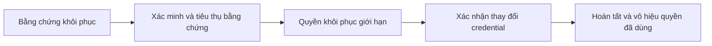

# Replay security test trong khôi phục tài khoản

## 1. Mục tiêu của kiểm thử replay

**Replay** là việc gửi lại một thông điệp hoặc bằng chứng đã được hệ thống xử lý, với mục tiêu làm hệ thống chấp nhận lại quyền đã dùng. Trong khôi phục tài khoản, thông điệp đó có thể chứa link đặt lại mật khẩu, OTP, recovery code, recovery grant hoặc challenge của bước đăng ký lại thiết bị xác thực.

Ví dụ: người dùng đã đổi mật khẩu bằng token `T`. Một request sau vẫn dùng `T` nhưng đặt một mật khẩu khác. Nếu request sau tiếp tục thay đổi tài khoản, token chưa thực sự có tính chất dùng một lần, dù nó được tạo ngẫu nhiên và chỉ có thời hạn vài phút.

Trong module `SECURITY_AUTHENTICATION_ACCOUNT_RECOVERY`, kiểm thử cần bao phủ luồng mất mật khẩu, MFA, passkey và thiết bị xác thực. Điều cần bảo vệ là quyền thay đổi trạng thái tài khoản: bằng chứng cũ không được tiếp tục đặt mật khẩu, gỡ MFA, thêm passkey hay tạo phiên khôi phục mới ngoài contract đã được cấp.

[OWASP Forgot Password Cheat Sheet](https://cheatsheetseries.owasp.org/cheatsheets/Forgot_Password_Cheat_Sheet.html) khuyến nghị token hoặc mã reset có thời hạn và chỉ sử dụng một lần. Hai đặc tính này cần kiểm tra riêng: hết hạn ngăn sử dụng quá muộn, còn single-use ngăn sử dụng lại ngay trong thời gian còn hiệu lực.

[NIST SP 800-63B-4, mục Replay Resistance](https://pages.nist.gov/800-63-4/sp800-63b.html#replay) giải thích chống replay ở giao thức xác thực vượt ra ngoài sự bảo vệ của kênh truyền. HTTPS vẫn cần thiết, nhưng không tự ngăn ứng dụng chấp nhận lại thông điệp đã thu được ở đầu cuối.

Các ma trận, endpoint, mã kiểm thử và mô hình giao dịch bên dưới là ví dụ của bài học. Chúng cần được ánh xạ vào contract của sản phẩm, không phải schema do OWASP hoặc NIST quy định.

### Replay không đồng nghĩa mọi lần gửi lại đều là tấn công

Trình duyệt có thể gửi lại request khi mất mạng; người dùng có thể bấm hai lần; proxy có thể retry; queue có thể giao một event nhiều lần. Hệ thống có thể trả lại biên nhận của thao tác cũ mà vẫn bảo đảm chỉ một thay đổi được commit.

Ngược lại, việc bên chiếm được token dùng nó **trước** chủ tài khoản là vấn đề chiếm dụng bằng chứng còn hiệu lực. Một test chặn lần sử dụng thứ hai không chứng minh rằng lần sử dụng đầu tiên luôn thuộc người chính đáng. Cần hiểu giới hạn này để không kết luận quá rộng.

## 2. Xác định chính xác đối tượng phải dùng một lần

Một luồng có thể trao đổi bằng chứng qua nhiều bước. Đừng chỉ kiểm tra token trong email rồi bỏ qua quyền mà token đó sinh ra.



Sơ đồ minh họa một thiết kế có bước đổi bằng chứng lấy recovery grant. Một thiết kế khác có thể dùng token trực tiếp ở thao tác cuối. Cần ghi rõ mô hình thực tế trước khi lập kỳ vọng.

| Đối tượng | Đơn vị cần theo dõi | Câu hỏi kiểm thử |
| --- | --- | --- |
| Token reset qua email | Một token thuộc một yêu cầu và tài khoản | Sau lần redeem thành công, token có đổi mật khẩu thêm được không? |
| OTP gửi qua kênh khôi phục | Challenge, tài khoản, mục đích và thế hệ mã | OTP cũ có mở thêm grant hoặc xác minh lại challenge đã hoàn tất không? |
| Recovery code lưu sẵn | Một code trong một bộ code của tài khoản | Code đã dùng có khởi động một lần khôi phục khác không? |
| Recovery grant | Một quyền cho tập hành động và flow cụ thể | Sau khi hoàn tất, grant có tiếp tục thêm credential hoặc tạo grant con không? |
| Challenge đăng ký passkey | Một ceremony, tài khoản và ngữ cảnh xác minh | Có nhận lại phản hồi của ceremony cũ cho lần đăng ký mới không? |
| Recovery session | Phiên giới hạn quyền và vòng đời của flow | Phiên đã hoàn tất có còn gọi được endpoint đặc quyền không? |
| Lệnh trong queue | Một operation đã được chấp nhận | Event giao lại có gây thêm một thay đổi nghiệp vụ không? |

Ở bước nhập mật khẩu mới, lỗi policy hoặc lỗi nhập lại không khớp có thể được phép sửa và gửi lại trước khi quyền bị tiêu thụ. Đây là một lựa chọn contract. Cần phân biệt request chưa đạt điều kiện với request đã hoàn tất thay đổi credential.

Nếu sản phẩm chỉ cho phép một grant từ một lần xác minh OTP, việc tạo hai grant sau hai lần gửi cùng OTP là lỗi ngay cả khi mỗi grant sau đó chỉ dùng một lần. Quyền đã bị nhân đôi ở bước trao đổi.

## 3. Định nghĩa oracle bằng trạng thái nghiệp vụ

**Oracle** là cách xác định kết quả kiểm thử đúng hay sai. Với replay, HTTP status đơn lẻ thường không đủ.

Cho một bằng chứng `P` đã đủ điều kiện thực hiện một thay đổi cuối cùng, đặt:

```text
U(P) = số lần quyền từ P được chấp nhận cho thao tác cuối
M(P) = số thay đổi credential được commit từ quyền đó
G(P) = số quyền khôi phục mới được cấp từ lần trao đổi P
```

Một contract minh họa yêu cầu `U(P) <= 1` và `M(P) <= 1`. Nếu `P` dùng để đổi lấy đúng một grant thì `G(P) <= 1`. Từng đại lượng phải đo ở đúng tầng, không suy từ số dòng access log.

| Tín hiệu quan sát | Có thể kết luận | Chưa thể kết luận |
| --- | --- | --- |
| Request thứ hai nhận 400 | Có phản hồi lỗi công khai | Credential không bị thay đổi trước khi trả lỗi |
| Hai request cùng nhận 200 | Contract công khai trả thành công hai lần | Có hai mutation; một response có thể là biên nhận cũ |
| Chỉ một password hash hiện tại | Có một giá trị cuối cùng | Có thể đã bị ghi đè nhiều lần trước khi lấy snapshot |
| Credential version tăng một lần, một operation commit | Có bằng chứng một mutation trong fixture | Mọi đường API khác đều chống replay |
| Có nhiều event audit | Có nhiều quan sát hoặc lần thử | Có nhiều lần thay đổi credential |
| Queue giao event hai lần | Có duplicate delivery | Consumer đã áp dụng hai tác động nghiệp vụ |

Ở fixture không có hoạt động cạnh tranh khác, có thể dùng tổ hợp credential version, operation ID, grant state và số mutation đã commit. Với môi trường dùng chung, cần lọc theo account và operation của test; bộ đếm toàn hệ thống không có giá trị chứng minh.

Audit nên phân biệt `recovery_attempted`, `recovery_committed` và `recovery_replay_rejected`. Nhiều lần thử bị từ chối có thể tạo nhiều audit event hợp lệ. Tiêu chí single-use nằm ở quyền và tác động nghiệp vụ.

## 4. Chuẩn bị fixture và bằng chứng kiểm thử

Mỗi kịch bản dùng tài khoản tổng hợp riêng hoặc được reset rõ ràng. Cần biết trước credential đang có, flow đang mở, thời hạn bằng chứng và epoch bảo mật của tài khoản.

Một fixture tối thiểu gồm:

- Tài khoản `account-A` ở tenant A, cùng một tài khoản đối chiếu ở tenant B.
- Mail sink hoặc SMS sandbox để lấy đúng bằng chứng do test tạo.
- Hai credential mới hợp lệ, gọi bằng alias `candidate-A` và `candidate-B` trong báo cáo.
- Một cách đọc trạng thái đã commit qua giao diện quan sát nội bộ được phân quyền.
- Đồng hồ có thể điều khiển trong test thời gian, cùng khả năng định tuyến tới nhiều instance trong test phân tán.

Không ghi token thô, OTP, recovery code, mật khẩu hoặc cookie vào báo cáo. Dùng grant ID nội bộ, operation ID hoặc nhãn fixture để liên kết bằng chứng. Nếu cần fingerprint cho bearer token ngẫu nhiên đủ entropy, có thể dùng HMAC dành cho quan sát; tránh fingerprint công khai từ mã ngắn dễ vét cạn. Secret dùng khi chạy test nằm trong kho tạm được kiểm soát.

Snapshot trước và sau nên có cấu trúc như sau:

```text
account_ref: fixture-account-A
credential_version: 17
security_epoch: 6
grant_state: ACTIVE
committed_recovery_operations: 0
new_authenticator_count: 0
operation_ref: fixture-operation-42
```

Các số là dữ liệu minh họa. Không mặc định mọi sản phẩm có field này; test adapter có thể lấy bằng chứng tương đương từ bảng nghiệp vụ hoặc API kiểm thử. Endpoint quan sát chỉ phục vụ môi trường kiểm thử, không được tạo thành API công khai tiết lộ trạng thái tài khoản.

## 5. Ma trận kiểm thử replay

| ID | Kịch bản | Điều cần chứng minh |
| --- | --- | --- |
| R01 | Redeem hợp lệ rồi gửi lại nguyên request | Không có mutation hoặc quyền mới lần hai |
| R02 | Dùng lại token với credential đích khác | Credential từ lần đầu không bị ghi đè |
| R03 | Hai request đồng thời dùng một grant | Tối đa một thay đổi commit |
| R04 | Redeem trên instance A, replay qua instance B | Trạng thái tiêu thụ có hiệu lực liên instance |
| R05 | Restart instance rồi replay bằng chứng đã dùng | Quyền đã tiêu thụ không sống lại do mất cache |
| R06 | Dùng OTP đã xác minh để đổi thêm grant | Không nhân đôi quyền từ cùng challenge |
| R07 | Dùng recovery code đã dùng trong flow khác | Code không mở thêm lần khôi phục |
| R08 | Dùng grant của account hoặc tenant khác | Không có thay đổi ngoài principal và tenant đã ràng buộc |
| R09 | Dùng bằng chứng ở endpoint có mục đích khác | Quyền reset mật khẩu không biến thành quyền gỡ MFA |
| R10 | Resend hoặc phát hành thế hệ bằng chứng mới | Bằng chứng cũ xử lý đúng policy được công bố |
| R11 | Replay sau cancel, revoke hoặc thay đổi epoch | Quyền cũ không được tái chấp nhận |
| R12 | Timeout sau commit, client retry | Có thể trả biên nhận cũ, không commit lần hai |
| R13 | Cùng idempotency key nhưng payload khác | Không áp dụng payload mới dưới operation cũ |
| R14 | Hết hạn trước thời điểm chấp nhận quyền | Không thay đổi credential bằng bằng chứng quá hạn |
| R15 | Lỗi và rollback giữa consume với mutation | Không xuất hiện trạng thái commit nửa chừng |
| R16 | Duplicate event hoặc callback sau hoàn tất | Không mở lại flow hay lặp tác động nghiệp vụ |

Thời hạn, resend và revoke là những điều kiện liên quan tới freshness. Không gọi chúng là một bài test duy nhất: một token chưa hết hạn nhưng đã dùng cần bị chặn vì single-use; một token chưa dùng nhưng hết hạn cần bị chặn vì thời gian.

## 6. Kiểm thử tuần tự với payload thay đổi

Giả sử contract minh họa hoàn tất khôi phục bằng `POST /api/recovery/complete` và không hỗ trợ trả biên nhận qua idempotency key.

```http
POST /api/recovery/complete HTTP/1.1
Host: recovery.staging.example.test
Content-Type: application/json

{"grant":"<fresh-fixture-grant>","newPassword":"<candidate-A-from-secret-store>"}
```

Sau lần gọi đầu, chờ tới khi thao tác thực sự được commit. Ghi nhận operation ID, credential version và trạng thái grant. Nếu API trả 202, cần theo dõi operation tới trạng thái cuối bằng cơ chế quan sát của test; việc được tiếp nhận chưa đồng nghĩa đã hoàn thành.

Gửi lại request đầu, sau đó gửi một request dùng **cùng grant** nhưng thay mật khẩu bằng `candidate-B`.

```http
POST /api/recovery/complete HTTP/1.1
Host: recovery.staging.example.test
Content-Type: application/json

{"grant":"<same-fixture-grant>","newPassword":"<candidate-B-from-secret-store>"}
```

Kỳ vọng của contract này là hai lần sau đều không làm thay đổi credential. Chúng có thể nhận mã lỗi công khai chung, không cần tiết lộ chính xác grant đã dùng hay chưa tồn tại. Mã HTTP cụ thể do sản phẩm chọn.

Đối chiếu version và mutation journal. Nếu được phép trong fixture, kiểm tra qua verifier kiểm thử rằng credential hiện tại vẫn là `candidate-A`; thực hiện riêng kiểm tra `candidate-B` không được chấp nhận. Các thao tác thử đăng nhập có thể làm tăng bộ đếm thất bại hoặc kích hoạt lockout, nên phải kiểm soát chúng để không gây nhiễu.

Một lỗi quan trọng là server đổi mật khẩu trước, rồi mới phát hiện token đã dùng và trả 400. Test chỉ assert 400 sẽ bỏ lọt việc chiếm lại tài khoản. Vì vậy, snapshot sau replay là một phần bắt buộc của oracle.

## 7. Replay qua bước trao đổi và ranh giới quyền

### OTP đổi lấy recovery grant

Chuỗi kiểm thử minh họa:

1. Tạo challenge `C1` cho tài khoản A và lấy OTP từ sandbox.
2. Xác minh OTP để nhận grant `G1`.
3. Gửi lại OTP cùng `C1` để thử nhận `G2`.
4. Lặp lại ở một flow khác, một instance khác và một recovery session khác theo contract.
5. Đếm số grant mới thực sự được cấp, không chỉ so response body.

Nếu contract cho retry bằng biên nhận, lần sau có thể trả cùng tham chiếu kết quả đã có theo quyền truy xuất phù hợp. Nó không được biến một bằng chứng đã tiêu thụ thành một nguồn cấp grant mới không giới hạn.

Với mã ngắn, cùng chuỗi số có thể xuất hiện ở hai challenge độc lập. Không thiết kế oracle theo quy tắc toàn hệ thống rằng “chuỗi 123456 chỉ được dùng một lần mãi mãi”. Đơn vị theo dõi cần phản ánh tài khoản, challenge hoặc phạm vi verifier và loại bằng chứng. Với TOTP được dùng như một yếu tố trong recovery, việc chặn lặp trong thời gian còn hiệu lực phải theo phạm vi authenticator phù hợp; không reset dấu đã dùng chỉ vì client tạo một flow mới.

### Account, tenant, purpose và ceremony

Thử thay account ID hoặc tenant ID trong request mà giữ nguyên grant. Server phải lấy hoặc đối chiếu principal với quyền đã cấp; field account do client gửi không thể mở rộng quyền của grant.

Tương tự, một grant chỉ cho đặt lại mật khẩu không được tự dùng ở endpoint xóa MFA, thay recovery address hoặc thêm passkey. Nếu sản phẩm có grant bao phủ nhiều hành động, cần định nghĩa rõ hành động nào, số lần nào và thời điểm kết thúc; không mặc định tất cả grant có cùng phạm vi.

Với passkey, phát lại phản hồi đăng ký cũ vào ceremony mới phải được kiểm tra theo challenge và tài khoản của ceremony, cùng các điều kiện xác minh WebAuthn tương ứng. Không dùng riêng sự thay đổi của signature counter làm oracle cho tính mới của ceremony. Kiểm thử phải phân biệt replay phản hồi giao thức với việc người dùng chủ ý thực hiện một lần đăng ký mới có challenge mới và đủ quyền.

[WebAuthn Level 2, Registering a New Credential](https://www.w3.org/TR/webauthn-2/#sctn-registering-a-new-credential) mô tả việc đối chiếu challenge trong client data với challenge của lần đăng ký. Khi áp dụng vào recovery, test cần kiểm tra cả việc hoàn tất ceremony cũ lẫn việc cố đưa phản hồi đó sang ceremony khác.

## 8. Hai request đồng thời: kiểm tra điểm quyết định quyền

Một lỗi thường gặp xuất hiện khi server đọc trạng thái trước rồi cập nhật ở một bước độc lập:

```text
Instance A: đọc grant ACTIVE
Instance B: đọc grant ACTIVE
Instance A: đổi credential thành candidate-A
Instance B: đổi credential thành candidate-B
Instance A: đánh dấu grant USED
Instance B: đánh dấu grant USED
```

Trạng thái cuối vẫn là `USED`, nhưng có hai thay đổi. Gắn annotation transaction lên một method chưa tự chứng minh rằng chuỗi trên bị ngăn; cần biết điều kiện cập nhật, khóa, mức cô lập và các thao tác có thực sự nằm trong cùng transaction hay không.

Kiểm thử cạnh tranh nên tạo hai request dùng cùng grant và hai credential đích khác nhau. Cho chúng chờ tại barrier rồi thả gần đồng thời. Dùng hai kết nối độc lập; nếu client hoặc gateway tuần tự hóa toàn bộ request thì test chưa tạo được điều kiện cần kiểm tra.

Một barrier ở phía client chỉ làm request xuất phát gần nhau, không bảo đảm hai transaction chồng lấn ở điểm quyết định. Trong test tích hợp có kiểm soát, có thể thêm hook để tạm dừng cả hai tại bước phù hợp, quan sát transaction hoặc dùng công cụ điều phối độ trễ. Hook phải thuộc hạ tầng kiểm thử, không tạo đường bỏ qua xác minh trong sản phẩm.

Kỳ vọng là một mutation commit và các request khác không tạo quyền mới. Nếu một request nhận lỗi transport hoặc bị rate limit trước khi tới điểm quyết định, chưa được tính đó là bằng chứng rằng cơ chế consume chịu được race. Cần ghi rõ request nào thực sự tới backend và kiểm tra trạng thái cuối sau khi mọi thao tác đã kết thúc.

### Mô hình giao dịch để định hướng oracle

Ví dụ sau mô tả một thiết kế mà grant và credential nằm trong cùng cơ sở dữ liệu. Nó dùng account lock để phối hợp các thay đổi epoch và consume có điều kiện để quyết định quyền. Đây là SQL khái niệm, cần triển khai theo database thực tế.

```sql
BEGIN;

-- Principal được resolve từ grant ở phía server, không tin account từ client.
SELECT security_epoch
FROM account
WHERE tenant_id = :resolved_tenant
  AND account_id = :resolved_account
FOR UPDATE;

-- Sau khi lấy khóa, đọc thời gian từ nguồn thời gian có thẩm quyền.
-- :locked_epoch là epoch vừa đọc; :authorization_time không do client gửi.
UPDATE recovery_grant
SET state = 'USED',
    used_at = :authorization_time,
    operation_id = :operation_id
WHERE tenant_id = :resolved_tenant
  AND account_id = :resolved_account
  AND token_digest = :verified_digest
  AND purpose = 'PASSWORD_RESET'
  AND issued_epoch = :locked_epoch
  AND state = 'ACTIVE'
  AND expires_at > :authorization_time;

-- Chỉ tiếp tục nếu affected rows = 1; nếu khác, rollback và không mutation.
UPDATE account
SET password_hash = :prepared_password_hash,
    credential_version = credential_version + 1,
    security_epoch = security_epoch + 1
WHERE tenant_id = :resolved_tenant
  AND account_id = :resolved_account
  AND security_epoch = :locked_epoch;

-- Cũng yêu cầu affected rows = 1.
INSERT INTO recovery_operation(operation_id, tenant_id, account_id, state)
VALUES (:operation_id, :resolved_tenant, :resolved_account, 'COMMITTED');

INSERT INTO outbox(operation_id, event_kind, state)
VALUES (:operation_id, 'RECOVERY_COMPLETED', 'PENDING');

COMMIT;
```

Mô hình giả định token digest định danh duy nhất grant trong phạm vi thích hợp, operation ID có ràng buộc duy nhất và outbox có ràng buộc duy nhất cho cặp operation/event kind. Password policy và việc chuẩn bị password hash thực hiện qua đường xử lý phù hợp trước đoạn khóa ngắn; không lưu mật khẩu thô vào operation hoặc outbox.

Thiết kế ví dụ tăng security epoch khi reset thành công, vì contract của nó vô hiệu các grant cũ cùng tài khoản. Các đường phát hành grant và thay đổi epoch phải phối hợp theo cùng quy tắc khóa hoặc kiểm tra tương đương. Nếu một đường bỏ qua quy tắc đó, chỉ kiểm tra endpoint complete không đủ.

Thời hạn trong mô hình được đánh giá tại thời điểm chấp nhận quyền có điều kiện sau khi lấy khóa. Nó không tuyên bố transaction phải commit trước `expires_at`. Nếu sản phẩm yêu cầu hạn tại thời điểm commit, cần cơ chế và test khác tương ứng. Đặc biệt, không lấy timestamp quá sớm rồi dùng lại sau một thời gian chờ khóa dài; một số database có hàm thời gian cố định theo đầu transaction, nên phải chọn nguồn thời gian đúng semantics.

Khi hai transaction tranh cùng grant, một transaction thắng và commit. Transaction còn lại phải thấy quyền không còn đủ điều kiện hoặc gặp xung đột được xử lý thành không có mutation. Nếu transaction thắng rollback toàn bộ, một lần thử sau có thể được chấp nhận tùy policy. Thuộc tính cần giữ là không có hai lần **commit** bằng cùng quyền, không phải request nào tới sớm hơn chắc chắn luôn thắng.

Giao dịch database không bao trùm tự động mail provider, session store ngoài hoặc dịch vụ credential khác. Với kiến trúc đó, cần operation bền vững, cơ chế khôi phục và consumer có xử lý duplicate; không coi một transaction cục bộ là cam kết exactly-once xuyên mọi hệ thống.

## 9. Harness Java minh họa kiểm tra tuần tự và cạnh tranh

Mã Java dưới đây dùng các API từ Java 17 để diễn đạt oracle. `Port` là adapter do bộ kiểm thử tích hợp cung cấp; đoạn mã chưa kết nối hay kiểm chứng một hệ thống khôi phục cụ thể. Alias credential được adapter đổi thành secret của fixture, tránh đưa secret vào mã ví dụ.

```java
import java.util.List;
import java.util.concurrent.CountDownLatch;
import java.util.concurrent.ExecutorService;
import java.util.concurrent.Executors;
import java.util.concurrent.Future;
import java.util.concurrent.TimeUnit;

final class RecoveryReplayChecks {
    record Fixture(String accountRef, String grant) {}
    record Reply(String operationRef) {}
    record Snapshot(long credentialVersion, long committedRecoveries,
                    String currentCredentialAlias, String grantState) {}

    interface Port {
        Fixture freshFixture() throws Exception;
        Reply redeem(Fixture fixture, String credentialAlias) throws Exception;
        void awaitSettled(List<Reply> replies) throws Exception;
        Snapshot snapshot(Fixture fixture) throws Exception;
    }

    static void sequentialReplay(Port port) throws Exception {
        Fixture fixture = port.freshFixture();
        Snapshot before = port.snapshot(fixture);

        Reply first = port.redeem(fixture, "candidate-A");
        port.awaitSettled(List.of(first));
        Snapshot afterFirst = port.snapshot(fixture);
        require(afterFirst.credentialVersion() == before.credentialVersion() + 1,
                "Baseline did not commit exactly one credential update");
        require(afterFirst.committedRecoveries() == before.committedRecoveries() + 1,
                "Baseline recovery operation missing or duplicated");
        require("candidate-A".equals(afterFirst.currentCredentialAlias()),
                "Baseline credential differs");
        require("USED".equals(afterFirst.grantState()), "Grant not consumed");

        Reply samePayload = port.redeem(fixture, "candidate-A");
        Reply changedPayload = port.redeem(fixture, "candidate-B");
        port.awaitSettled(List.of(samePayload, changedPayload));
        Snapshot afterReplay = port.snapshot(fixture);
        require(afterFirst.equals(afterReplay), "Replay changed protected state");
    }

    static void concurrentReplay(Port port) throws Exception {
        Fixture fixture = port.freshFixture();
        Snapshot before = port.snapshot(fixture);
        ExecutorService pool = Executors.newFixedThreadPool(2);
        CountDownLatch ready = new CountDownLatch(2);
        CountDownLatch release = new CountDownLatch(1);

        try {
            Future<Reply> first = pool.submit(() -> {
                ready.countDown();
                require(release.await(5, TimeUnit.SECONDS), "Barrier timeout");
                return port.redeem(fixture, "candidate-A");
            });
            Future<Reply> second = pool.submit(() -> {
                ready.countDown();
                require(release.await(5, TimeUnit.SECONDS), "Barrier timeout");
                return port.redeem(fixture, "candidate-B");
            });
            require(ready.await(5, TimeUnit.SECONDS), "Workers not ready");
            release.countDown();
            List<Reply> replies = List.of(
                    first.get(10, TimeUnit.SECONDS),
                    second.get(10, TimeUnit.SECONDS));
            port.awaitSettled(replies);

            Snapshot after = port.snapshot(fixture);
            require(after.credentialVersion() == before.credentialVersion() + 1,
                    "Expected one credential update");
            require(after.committedRecoveries() == before.committedRecoveries() + 1,
                    "Expected one committed recovery");
            require("USED".equals(after.grantState()), "Grant not consumed");
            require(List.of("candidate-A", "candidate-B")
                    .contains(after.currentCredentialAlias()),
                    "Unexpected final credential");
        } finally {
            release.countDown();
            pool.shutdownNow();
            if (!pool.awaitTermination(5, TimeUnit.SECONDS)) {
                throw new IllegalStateException("Test workers did not stop");
            }
        }
    }

    private static void require(boolean condition, String message) {
        if (!condition) {
            throw new AssertionError(message);
        }
    }
}
```

Contract của adapter cho phép `redeem` trả `Reply` với cả kết quả chấp nhận lẫn bị từ chối; lỗi transport ném exception, không tự coi là replay bị chặn. `awaitSettled` có timeout hữu hạn, biết response nào không tạo operation và chỉ trả khi các operation được tạo đã có kết quả cuối. Nó không được chỉ chờ HTTP response hoặc ngủ một khoảng cố định rồi đoán công việc đã xong.

`snapshot` phải đọc trạng thái đã commit từ nguồn có thẩm quyền, cho cùng fixture và đúng grant. Việc xác định alias credential dựa trên verifier kiểm thử hoặc cách kiểm tra được kiểm soát, không so password hash ngẫu nhiên theo byte và không cần lưu mật khẩu thô trong bảng quan sát.

Hai phương thức minh họa contract password reset hoàn tất trực tiếp và không hỗ trợ idempotency receipt. Chúng chưa kiểm tra số grant mới, MFA, passkey, cookie, queue consumer hay mạng nhiều instance. Cần bổ sung oracle tương ứng cho từng loại tài sản. Một lần harness thành công cũng không chứng minh mọi lịch xen kẽ transaction đều an toàn; bằng chứng kiểm thử cần đi cùng cơ chế cập nhật nguyên tử và kiểm tra đúng đường triển khai.

## 10. Retry hợp lệ và idempotency sau khi mất response

Xét trường hợp server đã commit nhưng response bị đứt trước khi tới client. Nếu client gửi lại một thao tác y hệt, có hai contract thường gặp:

| Contract | Hành vi khi gửi lại | Yêu cầu trạng thái |
| --- | --- | --- |
| Redeem chỉ một lần, không có biên nhận retry | Trả kết quả từ chối hoặc hướng dẫn kiểm tra kết quả | Không có mutation lần hai |
| Operation có idempotency | Trả cùng tham chiếu kết quả trong phạm vi được phép | Không tạo operation hoặc quyền mới |

Không chốt FAIL chỉ vì nhận hai response thành công khi contract thứ hai được triển khai đúng. Cần xác minh operation ID giống nhau và số mutation không tăng.

Một idempotency key phải được ràng buộc với ngữ cảnh đủ chặt: tenant, principal được phép, mục đích, grant hoặc flow, cùng fingerprint của nội dung nghiệp vụ. Key do client gửi không phải bằng chứng xác minh danh tính. Không cho một người gọi bất kỳ lấy kết quả hoặc bí mật của người khác chỉ vì biết key.

Ma trận bổ sung cho endpoint hỗ trợ idempotency:

| Thử lại | Kỳ vọng minh họa |
| --- | --- |
| Cùng key, cùng grant và cùng payload sau commit | Cùng operation hoặc receipt, không mutation thêm |
| Cùng key, đổi credential đích | Báo xung đột theo contract, không thay credential |
| Cùng key, đổi tenant hoặc principal | Không tái dùng quyền hoặc lộ receipt chéo phạm vi |
| Key mới, grant đã dùng | Grant vẫn bị chặn; đổi key không khôi phục quyền |
| Không có key, grant đã dùng | Không phát sinh quyền mới |
| Cache receipt bị hết hạn | Grant vẫn đã dùng, không thực thi lại operation |
| Cùng key được gửi đồng thời trước commit | Một operation được quyết định bền vững, request còn lại chờ hoặc nhận trạng thái đang xử lý |

Fingerprint phải phản ánh các field có tác động nghiệp vụ sau khi chuẩn hóa theo contract. Khi nội dung liên quan tới secret, không lưu request body có mật khẩu thô để làm cache idempotency; chọn cách ràng buộc an toàn, chẳng hạn HMAC có quản lý khóa và thời gian lưu phù hợp. Việc trả receipt cũng không được vô tình tạo một full session mới sau mỗi lần retry.

Để kiểm thử mất response, đặt fault sau commit và trước khi trả kết quả trong môi trường test. Sau đó gửi lại cùng key, đồng thời thử key mới và payload khác. Nếu fault thực ra xảy ra trước commit, đó là test rollback, chưa bao phủ tình huống kết quả đã commit nhưng client không biết.

## 11. Hết hạn, phát hành lại và vô hiệu bằng chứng cũ

### Kiểm tra ranh giới thời gian

Giả sử contract cho phép consume khi `authorizationTime < expiresAt`. Với đồng hồ kiểm thử, tạo các fixture độc lập cho từng trường hợp:

| Thời điểm consume | Kỳ vọng theo contract minh họa |
| --- | --- |
| Trước hạn một đơn vị chính xác mà hệ thống hỗ trợ | Có thể chấp nhận nếu mọi điều kiện khác hợp lệ |
| Bằng đúng thời điểm hết hạn | Bị từ chối |
| Sau hạn | Bị từ chối |
| Request tới sớm nhưng chờ khóa tới sau hạn | Bị từ chối nếu consume mới là thời điểm quyết định |
| Đã consume và commit, retry khi token vẫn chưa hết hạn | Không có quyền thực thi mới |
| Đã consume, xóa cache receipt rồi replay | Không có quyền thực thi mới |

Không dùng cùng một grant cho cả test trước hạn và đúng hạn rồi kết luận nhánh đúng hạn hoạt động: grant đã bị tiêu thụ trước đó, nên việc bị từ chối có thể chỉ chứng minh single-use. Cũng không dùng thời gian phía client làm oracle cho đồng hồ server.

Ưu tiên clock có thể điều khiển hoặc adapter thời gian trong test tích hợp. Khi phải chạy qua môi trường nhiều service, ghi rõ nguồn thời gian và độ chính xác lưu trữ. Việc ngủ đúng một số mili giây ở client dễ làm test chập chờn, nhất là khi request còn chờ queue hoặc transaction lock.

### Resend không có một policy duy nhất

Một hệ thống có thể quy định phát hành token mới lập tức vô hiệu token cũ; hệ thống khác cho nhiều yêu cầu cùng tồn tại trước khi có một lần recovery thành công. Kiểm thử cần ghi policy nào đang áp dụng.

Nếu chỉ thế hệ mới nhất hợp lệ, tạo `T1`, phát hành `T2`, rồi thử `T1` trước và sau khi dùng `T2`. Nếu cho nhiều token cùng tồn tại, cần kiểm tra token nào còn hợp lệ và trạng thái nào làm kết thúc tất cả quyền đang chờ theo contract. Không tự coi việc phát hành hai token độc lập là replay của cùng một token.

Trong mô hình epoch của bài, một lần khôi phục hoàn tất làm các grant phát hành ở epoch cũ không còn được chấp nhận. Test nên giữ một token chưa dùng cùng epoch, hoàn tất bằng token khác, rồi thử token giữ lại. Đây là cách phát hiện đường xác minh vẫn chỉ kiểm chữ ký hoặc TTL mà bỏ qua trạng thái tài khoản hiện tại.

Tương tự, cancel flow, thu hồi recovery session, thay đổi yếu tố bảo mật hoặc xử lý nghi ngờ chiếm đoạt có thể làm quyền cũ mất hiệu lực. Chỉ đưa từng sự kiện vào kỳ vọng khi policy của sản phẩm xác định rõ tác động. Việc đổi recovery address không được ngầm chuyển token cũ sang địa chỉ hoặc principal mới.

## 12. Replay trên nhiều instance và sau restart

Một cấu trúc `Set` hoặc map trong bộ nhớ có thể chặn replay ở một process nhưng không giữ được quyết định giữa các process hay sau restart. Test triển khai cần kiểm tra đường phục vụ thật thay vì chỉ unit test một object.

| Tình huống | Cách tạo điều kiện trong môi trường test | Bằng chứng cần lấy |
| --- | --- | --- |
| A thành công, B nhận replay | Định tuyến có kiểm soát tới hai instance | Một grant consume, một mutation toàn cụm |
| Hai instance tranh cùng lúc | Hai kết nối tới A và B, phối hợp điểm chờ | Không có hai operation commit |
| Restart sau thành công | Restart instance kiểm thử, dùng lại token cũ | Trạng thái bền vững vẫn chặn quyền cũ |
| Cache bị evict hoặc TTL cache hết | Làm mất riêng cache kiểm thử | Cache miss không được hiểu thành token chưa dùng |
| Replica đọc chậm | Mô phỏng lag, giữ đường quyết định cập nhật thật | Quyết định cuối không dựa riêng vào bản ACTIVE cũ |
| Chuyển vai trò kho dữ liệu | Chạy kịch bản failover cô lập nếu hệ thống hỗ trợ | Quyết định consume đã được xác nhận không sống lại ngoài cam kết lưu bền |
| JWT recovery còn chữ ký hợp lệ | Replay sau khi grant hoặc flow đã kết thúc | Chữ ký và `exp` không thay thế kiểm tra trạng thái single-use |

Nếu dùng JWT làm recovery grant, test cần biết nguồn lưu việc đã tiêu thụ hoặc cơ chế tương đương. Một claim `jti` chỉ là định danh nếu verifier không thực sự dùng nó để kiểm tra và cập nhật trạng thái. Nonce được gửi trong request cũng không tự có tính chất single-use nếu server không ràng buộc và tiêu thụ nó đúng cách.

Khi mô hình lưu trữ có khả năng mất một quyết định consume đã được client xem là thành công trong tình huống failover, cần đánh giá cam kết nhất quán và lưu bền của hệ thống. Không thể khắc phục khoảng trống đó chỉ bằng retry ở controller. Test phải ghi topology, nguồn đọc và kết quả của operation trước sự cố để người đọc hiểu giới hạn bằng chứng.

Không đặt tiêu chí rằng đổi IP, user-agent hoặc xóa cookie luôn phải bị từ chối: một số recovery link được thiết kế dùng trên trình duyệt khác. Phạm vi binding cần bám contract. Dù client đổi thông tin đó, bằng chứng **đã tiêu thụ** vẫn không được tự trở thành quyền mới.

## 13. Fault injection và duplicate event

Kiểm thử lỗi cần đặt fault ở vị trí có tên rõ ràng; một timeout chung ở client không cho biết database đã commit hay chưa.

| Vị trí fault | Điều cần kiểm tra |
| --- | --- |
| Sau validate, trước khi giành quyền consume | Không có credential mutation âm thầm |
| Sau consume trong transaction, trước cập nhật credential | Nếu rollback toàn giao dịch, không lưu nửa trạng thái |
| Sau cập nhật credential, trước commit | Không coi thay đổi chưa commit là thành công cuối |
| Sau commit, trước response | Retry không gây mutation lần hai |
| Sau commit, trước publish outbox | Operation đã hoàn tất; outbox có thể được phát lại theo cơ chế phục hồi |
| Sau consumer xử lý, trước ack | Event giao lại không tạo thêm credential hoặc grant |
| Sau gọi mail provider, trước ghi nhận kết quả gửi | Phân biệt khả năng gửi trùng notification với việc lặp quyền khôi phục |

Trong thiết kế cùng database, rollback toàn bộ consume và mutation giúp trạng thái nhất quán. Một thiết kế khác có thể cố ý tiêu thụ quyền trước và yêu cầu bắt đầu lại khi lỗi để fail closed. Đó có thể là vấn đề khả dụng nếu không có đường phục hồi; không tự gọi nó là vượt quyền. Cần đối chiếu contract thay vì bắt mọi kiến trúc có cùng hành vi retry.

Đối với queue, tái giao đúng event ID hoặc operation ID của fixture. Quan sát consumer không áp dụng lại lệnh đổi mật khẩu, không tăng thêm epoch cho cùng operation và không tạo thêm quyền đăng nhập. Một bảng dedup độc lập với mutation cũng có thể gặp race hoặc crash giữa hai bước; kiểm tra cách chúng được phối hợp.

Một event hoàn tất khôi phục thường có notification và session invalidation. Việc giao event theo cơ chế at-least-once không bảo đảm chỉ có một request tới nhà cung cấp email. Nếu external provider không có giao thức idempotency phù hợp, một thông báo có thể được gửi trùng sau lỗi mất response. Báo cáo riêng điều đó; không lấy số email làm bộ đếm số lần password reset đã commit.

Không khôi phục token đã dùng về `ACTIVE` chỉ vì gửi notification thất bại. Có thể retry tác vụ thông báo theo operation đã commit, còn quyền khôi phục vẫn đã kết thúc.

## 14. Session và quyền sau khi khôi phục

Một token có thể bị chặn ở endpoint password reset nhưng recovery session nó sinh ra vẫn còn quyền đặc biệt. Cần theo dõi cả hai.

Sau khi hoàn tất, thử lại các thao tác được cấp bởi recovery session: complete flow, đổi credential thêm lần nữa, mở phiên recovery khác và gọi endpoint quản lý yếu tố xác thực. Đánh giá từng thao tác theo scope và vòng đời đã công bố. Nếu session chỉ được phép xem trang xác nhận cuối, việc nó vẫn tồn tại dưới dạng cookie không tự là lỗi; việc nó còn quyền thay đổi tài khoản mới là vấn đề cần chứng minh.

Với recovery do nghi ngờ chiếm đoạt, policy có thể yêu cầu thu hồi các session cũ, refresh token và bằng chứng recovery đang chờ. Kiểm thử bằng một session cũ của fixture sau thời điểm hoàn tất. Nếu thu hồi diễn ra bất đồng bộ, đo khoảng thời gian thực tế và so với cửa sổ được chấp nhận trong thiết kế; không đánh dấu PASS chỉ vì cuối cùng nó cũng hết hạn theo TTL thông thường.

Một thao tác replay bị từ chối có thể được ghi audit hoặc làm tăng bộ đếm chống lạm dụng theo policy. Tuy nhiên, cần kiểm tra nó không có tác động ngoài dự kiến như vô hiệu credential mới của chủ tài khoản, thêm một thiết bị hoặc tăng quyền của recovery session. Assertion nên bao gồm các tác động đó khi endpoint thực tế có khả năng gây ra chúng.

Đặc biệt, test password reset không tự chứng minh an toàn của MFA reset. Một recovery grant cho MFA có thể làm thay đổi yếu tố bảo mật khác với password grant; cần có fixture và oracle đếm authenticator bị gỡ hoặc thêm. Với passkey, kiểm tra số credential đã đăng ký cùng ownership sau từng lần replay.

## 15. Báo cáo kết quả có thể tái hiện

Một báo cáo replay hữu ích cần nêu điều kiện ban đầu, đơn vị bằng chứng, thứ tự request, trạng thái đã commit và giới hạn quan sát. Không chỉ ghi “token dùng lại bị lỗi”.

Mẫu dưới là **dữ liệu giả định để minh họa cách báo cáo**, không phải kết quả đã chạy trên một hệ thống:

```yaml
exampleOnly: true
caseId: R03
contract: PASSWORD_RESET_SINGLE_USE_NO_RECEIPT
fixtureRef: fixture-account-A
grantRef: fixture-grant-42
topology: two-instances-shared-authoritative-store
requests:
  - label: request-A
    target: instance-A
    credentialAlias: candidate-A
    outcome: committed
    operationRef: fixture-operation-42
  - label: request-B
    target: instance-B
    credentialAlias: candidate-B
    outcome: rejected-without-mutation
before:
  credentialVersion: 17
  committedRecoveries: 0
after:
  credentialVersion: 18
  committedRecoveries: 1
  grantState: USED
  currentCredentialAlias: candidate-A
evidence:
  - sanitized-response-pair
  - authoritative-state-snapshot
  - committed-operation-record
result: PASS_FOR_THIS_SCENARIO
```

Ngoài cấu hình phiên bản ứng dụng và database, báo cáo nên ghi cách ép định tuyến, cách đồng bộ request và cách chờ công việc bất đồng bộ hoàn tất. Nếu test chưa tạo được overlap, không có quyền đọc trạng thái có thẩm quyền hoặc bị rate limit trước điểm consume, kết quả phù hợp là `INCONCLUSIVE` kèm lý do.

Khi một future hoặc request bị timeout, việc dừng thread kiểm thử không bảo đảm server đã dừng công việc. Trước khi reset fixture, cần xác định operation còn chạy hay đã kết thúc; giữ nguyên bằng chứng cần thiết nếu không xác định được. Không sử dụng lại một account đang có operation chưa rõ kết quả cho test tiếp theo.

Nếu phát hiện lỗi, mô tả tác động cụ thể: grant cũ đổi được mật khẩu lần hai, một OTP tạo được hai grant, hay event lặp đăng ký thêm authenticator. Dùng ảnh chụp trạng thái hoặc log đã che secret để chứng minh. Mức độ rủi ro phụ thuộc phạm vi quyền bị lặp và điều kiện lấy được bằng chứng, không suy chỉ từ tên HTTP status.

## 16. Các kết luận sai thường gặp

| Kết luận dễ nhầm | Vì sao thiếu bằng chứng | Cách kiểm tra thích hợp |
| --- | --- | --- |
| Token có TTL nên chống replay | Có thể dùng nhiều lần trong TTL | Redeem thành công rồi dùng lại ngay |
| HTTPS đã xử lý replay | Ứng dụng vẫn có thể nhận request lặp từ endpoint | Kiểm tra vòng đời quyền tại server |
| JWT có chữ ký nên chỉ dùng một lần | Chữ ký không tự lưu dấu đã tiêu thụ | Kiểm tra trạng thái consume hoặc cơ chế tương đương |
| Request sau trả lỗi nên an toàn | Mutation có thể xảy ra trước lỗi | Đọc trạng thái đã commit và operation |
| Có hai response 200 nên chắc chắn lỗi | Có thể là cùng receipt idempotent | Đếm mutation, đối chiếu operation và phạm vi receipt |
| Redis hoặc database đã được dùng nên hết race | Cách phối hợp consume và mutation có thể vẫn sai | Tạo lịch xen kẽ và fault tại đúng ranh giới |
| Một process vượt qua test nên cả cụm an toàn | State có thể chỉ ở bộ nhớ hoặc đọc replica cũ | Test qua nhiều instance, restart và đường lưu trữ thật |
| Nhiều audit event chứng minh nhiều reset | Audit có thể ghi mọi lần thử bị chặn | Phân biệt attempt với committed operation |
| Trình duyệt bị disable nút nên không replay được | Client khác có thể gửi request độc lập | Gọi endpoint bằng adapter kiểm thử có kiểm soát |

## 17. Tự kiểm tra hiểu biết

**Tình huống 1:** Hai request đồng thời đều nhận 200, cùng operation ID, credential version chỉ tăng một và payload của chúng giống nhau. Có thể chốt lỗi replay không?

Chưa đủ. Nếu contract có idempotency và quyền lấy receipt được kiểm tra đúng, đó có thể là kết quả hợp lệ. Cần thử payload khác, key mới với grant đã dùng và kiểm tra không có session hoặc quyền mới được cấp.

**Tình huống 2:** Request replay trả 409, nhưng credential version tăng thêm một lần và credential đích thay đổi. Kết quả là gì?

Đó là lỗi của thuộc tính chống replay đối với thao tác đã đo. Mã lỗi công khai không xóa được mutation đã commit. Báo cáo cần chỉ rõ thay đổi credential và operation gây ra nó.

**Tình huống 3:** Token cũ bị chặn sau khi dùng, nhưng hoạt động lại khi restart một instance. Cần tìm điều gì?

Kiểm tra trạng thái consume có chỉ nằm trong bộ nhớ hoặc cache dễ mất không, verifier có thực sự kiểm tra nguồn bền vững không và có đường xử lý cache miss thành hợp lệ không. Sau khi xác định cơ chế, tái hiện qua instance khác để làm rõ phạm vi.

**Tình huống 4:** Sau khi dùng một OTP để tạo grant, OTP đó tạo thêm một grant khác; mỗi grant riêng lẻ vẫn chỉ complete được một lần. Có đạt mục tiêu single-use không?

Không đạt contract một OTP chỉ trao đổi được một grant. Việc kiểm tra cần đặt ở cả bước trao đổi bằng chứng lẫn bước sử dụng quyền cuối cùng. Chặn lặp ở bước cuối không bù được quyền đã bị nhân đôi ở bước trước.

Một bộ kiểm thử replay đáng tin cậy nối được ba lớp bằng chứng: thông điệp đã gửi lại, quyết định chấp nhận quyền ở server và tác động đã commit lên tài khoản. Khi cả ba lớp được quan sát theo đúng contract, kết quả mới phân biệt được retry hợp lệ với việc bằng chứng cũ tiếp tục tạo quyền thay đổi credential.
