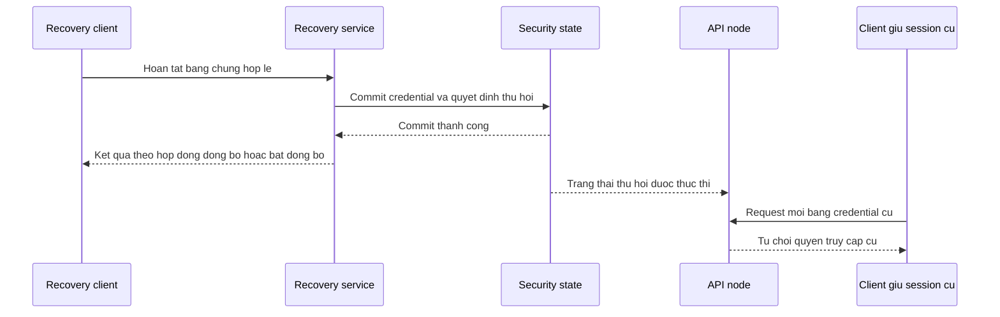

# Session invalidation test — Kiểm thử vô hiệu hóa phiên sau khôi phục tài khoản

## 1. Vấn đề cần chứng minh

Một người dùng đổi lại mật khẩu sau khi mất tài khoản, đăng nhập được bằng mật khẩu mới và nhìn thấy thông báo khôi phục thành công. Trong khi đó, phiên đăng nhập đã bị chiếm đoạt trên một thiết bị khác vẫn đọc được dữ liệu riêng tư. Luồng recovery đã thay credential nhưng chưa khôi phục đầy đủ quyền kiểm soát tài khoản.

Trong module `SECURITY_AUTHENTICATION_ACCOUNT_RECOVERY`, kiểm thử vô hiệu hóa phiên xác nhận các quyền truy cập cũ bị xử lý đúng chính sách sau khi người dùng khôi phục mật khẩu, MFA, passkey hoặc thiết bị xác thực. Kết quả cần quan sát là quyết định của máy chủ khi nhận lại bằng chứng phiên cũ, không chỉ trạng thái giao diện ở trình duyệt vừa thực hiện recovery.

Bài học này xây dựng một phương pháp kiểm thử từ hợp đồng thu hồi đến dữ liệu chuẩn bị, điểm quan sát, trường hợp cạnh tranh và báo cáo kết quả. Ví dụ mã Java là khung minh họa để tích hợp với hệ thống thử nghiệm, không giả định repository có sẵn endpoint hay adapter tương ứng.

Sau bài học, người học có thể:

- Xác định những loại session và token thuộc phạm vi thu hồi của một sự kiện recovery.
- Phân biệt việc xóa dữ liệu ở client với việc server từ chối bằng chứng cũ.
- Kiểm tra cả thu hồi thiếu và thu hồi quá rộng.
- Phát hiện phiên bị tạo lại bởi refresh, remember-me hoặc thao tác lưu session đang chạy.
- Kiểm tra giới hạn thời gian thực thi trên nhiều node và các tài nguyên dùng cơ chế xác thực khác nhau.

[OWASP Session Management Cheat Sheet](https://cheatsheetseries.owasp.org/cheatsheets/Session_Management_Cheat_Sheet.html) nhấn mạnh vai trò của vô hiệu hóa phía server trong quản lý phiên. Từ nguyên tắc đó, câu hỏi kiểm thử của bài học là: sau mốc thu hồi đã cam kết, hệ thống có còn chấp nhận một bằng chứng cũ thuộc phạm vi bị thu hồi hay không?

## 2. Phân biệt các đối tượng trước khi đặt assertion

Trong một ứng dụng, từ “session” có thể được dùng cho nhiều đối tượng khác nhau. Nếu kiểm thử chỉ biết một cookie đăng nhập, nó có thể bỏ sót quyền truy cập đến từ refresh token hoặc một phiên tại dịch vụ khác.

| Đối tượng | Vai trò | Câu hỏi sau recovery |
| --- | --- | --- |
| Cookie chứa session ID | Tham chiếu phiên server-side | Server còn chấp nhận ID đã cấp trước sự kiện không? |
| Access token | Truy cập API trong một thời hạn | Resource server có biết sự kiện thu hồi và từ chối token theo cam kết không? |
| Refresh token | Xin access token hoặc cặp token tiếp theo | Token cũ hoặc hậu duệ của nó có tiếp tục tạo quyền mới không? |
| Remember-me credential | Khôi phục đăng nhập lâu dài | Có thể tạo session mới từ cookie lâu dài đã cấp trước recovery không? |
| Recovery session/grant | Quyền giới hạn để tiếp tục luồng khôi phục | Có hết hiệu lực hoặc chuyển trạng thái đúng, có bị dùng như full session không? |
| Phiên tại identity provider | Duy trì đăng nhập với bên cung cấp danh tính | Chính sách có yêu cầu kết thúc phiên này hay chỉ phiên ứng dụng? |
| Phiên tại ứng dụng liên kết | Quyền truy cập của một relying party | Có nhận và thực thi sự kiện cần thiết hay vẫn giữ phiên độc lập? |
| WebSocket hoặc stream | Kênh kết nối đã được xác thực | Kết nối cũ còn đọc hoặc gửi thao tác sau mốc thu hồi không? |

Password, TOTP seed và passkey credential là phương thức hoặc dữ liệu xác thực, không phải session. Vô hiệu hóa một passkey bị mất có thể ngăn lần đăng nhập tiếp theo bằng passkey đó nhưng không tự chứng minh các session đã được cấp trước đó đều bị thu hồi.

Tương tự, access token hết hạn không đồng nghĩa refresh token đã mất hiệu lực. Một session bị xóa không đồng nghĩa remember-me credential không thể tạo lại nó. Bộ kiểm thử phải đi qua các đường tạo và duy trì quyền thực tế của hệ thống.

API key, personal access token hoặc quyền của tài khoản dịch vụ cần được đưa vào một chính sách riêng nếu sản phẩm có các đối tượng này. Không mặc định chúng luôn bị thu hồi khi người dùng đổi mật khẩu, cũng không bỏ qua chúng nếu hợp đồng recovery đã yêu cầu xử lý.

## 3. Viết hợp đồng vô hiệu hóa phiên theo từng sự kiện

### 3.1. Không suy đoán chính sách từ tên màn hình

Một màn hình mang tên “Đặt lại mật khẩu” có thể thuộc nhánh quên mật khẩu thông thường hoặc nhánh nghi bị chiếm đoạt. Hai nhánh có thể có phạm vi thu hồi khác nhau. Đặt hợp đồng theo sự kiện nghiệp vụ, mức rủi ro và bằng chứng đã được xác minh.

Ví dụ chính sách của một ứng dụng thử nghiệm:

```text
Sự kiện: COMPLETE_COMPROMISED_ACCOUNT_RECOVERY
Chủ thể: đúng account trong đúng tenant
Phạm vi: mọi session đăng nhập của chủ thể đã cấp trước commit
Gia hạn: mọi refresh family và remember-me credential thuộc phạm vi
Thực thi: ngay sau khi endpoint hoàn tất trả kết quả thành công
Đăng nhập mới: được phép bằng credential mới và các yếu tố còn bắt buộc
Recovery grant: không trở thành full session chỉ vì recovery đã hoàn tất
Ngoài phạm vi: session của account khác không bị thay đổi
```

Đây là một hợp đồng mẫu có yêu cầu đồng bộ. Một hệ thống có lan truyền bất đồng bộ cần đặc tả rõ giới hạn thời gian và hành vi trong cửa sổ đó. Không thay yêu cầu của sản phẩm bằng chính sách thuận tiện nhất cho test.

Trong OAuth, [RFC 9700, mục 4.14.2](https://www.rfc-editor.org/rfc/rfc9700.html#section-4.14.2) nêu việc authorization server có thể tự thu hồi refresh token khi xảy ra sự kiện bảo mật như đổi mật khẩu. Điều này không có nghĩa mọi authorization server mặc định thực hiện cùng một chính sách; kiểm thử cần xác nhận cấu hình và hợp đồng triển khai cụ thể.

### 3.2. Các bất biến nên diễn đạt được

Gọi `R` là tập bằng chứng phiên cần thu hồi và `T_effective` là mốc chính sách bắt buộc có hiệu lực. Những bất biến cốt lõi có thể viết như sau:

```text
Với credential c thuộc R:
    request được kiểm tra xác thực sau T_effective
        => không được cấp quyền từ c

Với refresh/remember-me credential r thuộc R:
    r không được tạo session hoặc token mới vượt qua chính sách thu hồi

Với session s ngoài phạm vi sự kiện:
    không bị vô hiệu hóa chỉ vì định danh chủ thể hoặc tenant bị đối chiếu sai

Với session mới n được cấp sau khi xác thực hợp lệ lại:
    được đánh giá theo trạng thái bảo mật mới, không mang trạng thái cũ bị thu hồi
```

Các bất biến này nói về điểm quyết định xác thực hoặc cấp quyền. Một request đã được cho phép trước mốc thu hồi không tự động bị đảo ngược kết quả sau đó. Các thao tác đặc biệt nhạy cảm có thể cần kiểm tra lại tại thời điểm commit; đó là một hợp đồng bổ sung phải được thử riêng.

### 3.3. Ma trận sự kiện và phạm vi

| Sự kiện | Điều cần xác định trước khi test | Assertion không nên tự suy ra |
| --- | --- | --- |
| Quên mật khẩu, rủi ro thông thường | Thu hồi tự động, tùy chọn hay chỉ một số phiên | Luôn giữ hoặc luôn xóa mọi phiên |
| Recovery sau nghi bị chiếm đoạt | Phạm vi session, token và thiết bị bị ảnh hưởng | Đổi mật khẩu tự xử lý hết mọi quyền truy cập |
| Mất MFA | Yếu tố bị mất, bằng chứng thay thế, phiên cần thu hồi | Có mật khẩu mới là đủ để bỏ qua MFA |
| Mất passkey | Credential cần vô hiệu hóa và các session liên quan | Xóa credential đồng nghĩa xóa mọi session |
| Hủy recovery | Trạng thái nào đã thay đổi trước khi hủy | Hủy luôn phải thu hồi hoặc luôn phải giữ phiên |
| Recovery chưa hợp lệ | Có được phép tạo tác động bảo mật hay không | Yêu cầu công khai đủ để khóa mọi session của nạn nhân |
| Logout một thiết bị | Cùng logical session hay toàn tài khoản | Logout cục bộ đồng nghĩa global logout |

## 4. Đặt đúng mốc thời gian

Một test chỉ ghi “sau recovery” sẽ khó phân tích khi hệ thống phân tán. Cần phân biệt các mốc:

- `T_request`: server nhận yêu cầu hoàn tất recovery.
- `T_commit`: trạng thái credential và quyết định thu hồi được commit bền vững theo thiết kế.
- `T_response`: client nhận phản hồi hoàn tất.
- `T_effective`: thời điểm mọi điểm thực thi trong phạm vi phải áp dụng chính sách.
- `T_observed`: test quan sát một request cụ thể đã bị từ chối.



Sơ đồ không quy định thứ tự lan truyền cụ thể. Nếu response thành công có nghĩa mọi quyền cũ đã mất hiệu lực, các điểm thực thi phải đạt điều kiện đó trước response hoặc có cơ chế kiểm tra tương đương. Nếu response chỉ có nghĩa yêu cầu đã được tiếp nhận, UI và test phải phân biệt trạng thái đang xử lý với trạng thái recovery hoàn tất.

Khi đo thời gian chờ ở test runner, dùng đồng hồ đơn điệu cho deadline. Để đối chiếu với mốc commit của server, cần correlation và cách đo đã thống nhất; không trừ hai timestamp từ hai máy có sai lệch clock rồi coi kết quả là độ trễ chính xác.

Một lần quan sát thấy từ chối chưa chứng minh quyền cũ sẽ không quay lại sau cache refresh hoặc node restart. Với các rủi ro đó, cần thêm những điểm quan sát sau sự kiện tương ứng, thay vì kéo dài một lệnh chờ không có mục tiêu.

## 5. Chuẩn bị dữ liệu và thiết bị kiểm thử

### 5.1. Bộ dữ liệu tối thiểu có khả năng phát hiện lỗi

Tạo một namespace riêng cho mỗi test và ít nhất các đối tượng sau:

| Đối tượng | Mục đích |
| --- | --- |
| Account A trong tenant T1 | Chủ thể thực hiện recovery |
| Session A1 | Phiên trình duyệt đã được cấp trước recovery |
| Session A2 | Phiên của thiết bị độc lập, cũng có trước recovery |
| Refresh/remember-me của A nếu có | Kiểm tra khả năng duy trì hoặc tái tạo quyền |
| Account B với session B1 | Kiểm tra không thu hồi nhầm account |
| Chủ thể tương tự trong tenant T2 khi mô hình hỗ trợ | Kiểm tra phạm vi tenant |
| Recovery client độc lập | Thực hiện luồng xác minh theo thiết kế |

Hai tab dùng chung cookie có thể chỉ đại diện cho một session. Để kiểm tra nhiều session, đăng nhập độc lập bằng các cookie jar hoặc context khác nhau. Để kiểm tra cùng session có nhiều ID do rotation, cố ý lưu các ID thuộc cùng dòng đời đó.

### 5.2. Chứng minh baseline trước sự kiện

Trước recovery, dùng từng session cũ gọi một tài nguyên riêng tư thật và xác nhận đúng subject/tenant. Nếu session vốn đã hết hạn hoặc thiếu quyền, việc nó bị từ chối sau recovery không chứng minh cơ chế thu hồi hoạt động.

Giữ thời hạn tự hết hạn đủ xa so với thời gian thực thi test hoặc sử dụng clock kiểm thử được kiểm soát. Ghi rõ access token còn hiệu lực tự nhiên tại thời điểm kiểm tra, để tránh nhầm kết quả hết hạn với kết quả thu hồi.

Với refresh token có rotation, phép refresh dùng làm baseline có thể tiêu thụ chính token đó. Nếu cần baseline refresh, phải giữ token hiện hành sau rotation rồi mới chụp bộ bằng chứng dùng cho recovery test. Không phát lại một refresh token đã dùng từ trước và kết luận recovery đã thu hồi nó.

### 5.3. Giữ nguyên bằng chứng cũ khi kiểm tra

Client thường có interceptor tự refresh hoặc tự đăng nhập lại. Sau recovery, một request dùng SDK có thể thất bại với token cũ rồi thành công với token mới mà test không nhìn thấy. Ngược lại, SDK có thể tự xóa cookie trước khi request được gửi, khiến test không hề thử lại credential cũ.

Dùng client kiểm thử không tự refresh, không tự retry theo nhánh xác thực và không tự chuyển sang credential khác. Lưu bằng chứng cũ dưới dạng handle bí mật trong bộ nhớ, rồi phát lại đúng giá trị đó qua đường xác thực được hỗ trợ. Không in cookie hoặc token vào báo cáo.

Chỉ thu thập credential của tài khoản kiểm thử trong môi trường được phép. Fixture quản lý việc giải phóng bộ nhớ và cleanup dữ liệu thuộc namespace, kể cả khi test thất bại.

## 6. Thiết kế oracle: điều gì được coi là mất quyền?

### 6.1. Một endpoint riêng tư có giá trị hơn một redirect

Chọn endpoint yêu cầu đăng nhập thật và trả marker chỉ tài khoản test đó đọc được. Endpoint phải đi qua cùng chuỗi xác thực, gateway và chính sách cần kiểm tra. Một endpoint test bỏ qua middleware sẽ không đại diện cho tài nguyên thực.

Kết quả baseline gồm đúng subject, tenant và marker. Kết quả sau thu hồi phải thể hiện thất bại xác thực theo hợp đồng và không trả nội dung riêng tư. Trong ứng dụng mẫu, `401` được dùng để diễn đạt credential cũ không còn hợp lệ.

Không coi mọi `403` là bằng chứng session đã mất hiệu lực: đó có thể là phiên hợp lệ nhưng thiếu quyền nghiệp vụ. Một lỗi `500`, timeout hoặc lỗi TLS cũng không phải bằng chứng thu hồi thành công. Nếu ứng dụng dùng mã khác, adapter cần phân loại nguyên nhân dựa trên hợp đồng response và bằng chứng server phù hợp.

Tắt tự theo redirect khi kiểm tra HTTP. Nếu client theo `302` đến trang login rồi nhận `200`, assertion chỉ nhìn mã cuối có thể báo sai. Kiểm tra cả nội dung trả về để tránh nhầm HTML login với marker riêng tư.

### 6.2. Kết hợp bằng chứng độc lập

Một kiểm thử có thể dùng ba nguồn:

1. Snapshot chỉ đọc cho biết quyết định thu hồi hoặc security epoch mới đã được commit.
2. Request qua đường thật chứng minh điểm thực thi đang từ chối credential cũ.
3. Đăng nhập hợp lệ lại chứng minh tài khoản vẫn có thể nhận quyền mới theo chính sách.

Database ghi `revoked=true` nhưng API vẫn trả dữ liệu là lỗi thực thi. API từ chối vì database mất kết nối cũng chưa chứng minh sự kiện recovery đã được xử lý bền vững. Các bằng chứng cần hỗ trợ nhau, không thay thế nhau.

Không dùng response đã được cache để kết luận server còn hoặc mất quyền. Tài nguyên thử nghiệm nên có chính sách cache thích hợp; test kiểm soát cache phía client và xác nhận request đã đi đến điểm cần quan sát. Một nonce chỉ hữu ích khi server thực sự xử lý và phản hồi nó theo hợp đồng, không phải khi client tự thêm vào log.

## 7. Kịch bản tích hợp cơ sở

Với hợp đồng thu hồi mọi session cũ sau recovery rủi ro cao, một ca tích hợp có thể thực hiện theo trình tự:

1. Tạo A và B, đăng nhập độc lập để có A1, A2 và B1.
2. Lưu bộ credential hiện hành của từng session; xác nhận baseline trên các điểm thực thi trong phạm vi.
3. Từ recovery client, hoàn tất đầy đủ bằng chứng cho A qua luồng ứng dụng thật.
4. Xác nhận response và trạng thái commit phù hợp với hợp đồng thời gian.
5. Gửi request mới bằng A1 và A2 đã lưu; cả hai mất quyền theo deadline.
6. Dùng refresh/remember-me cũ để thử cấp quyền mới; bị từ chối theo đúng nguyên nhân.
7. Kiểm tra B1 vẫn truy cập đúng tài nguyên của B.
8. Đăng nhập A bằng credential mới và mọi yếu tố còn bắt buộc; session mới hoạt động.
9. Kiểm tra recovery grant không bị dùng để có quyền vượt phạm vi.

Nếu hệ thống không có refresh token, đánh dấu nhánh đó là không áp dụng theo kiến trúc. Không giả lập một kết quả “đã thu hồi refresh” cho đối tượng không tồn tại.

## 8. Ví dụ Java: khung kiểm thử hợp đồng thu hồi đồng bộ

Ví dụ sau dùng JUnit Jupiter và các interface do bài học định nghĩa. `Scenario` là adapter tới ứng dụng thử nghiệm, không phải một mock trả kết quả định sẵn. Các kiểu `FrozenSession` giữ bí mật trong bộ nhớ và không cung cấp `toString()` chứa token.

Hợp đồng mẫu yêu cầu session và refresh credential cũ bị từ chối ngay sau khi recovery thành công. Không dùng nguyên assertion thời gian này cho hệ thống có hợp đồng bất đồng bộ khác.

```java
import org.junit.jupiter.api.Test;

import java.util.List;

import static org.junit.jupiter.api.Assertions.assertEquals;
import static org.junit.jupiter.api.Assertions.assertFalse;
import static org.junit.jupiter.api.Assertions.assertTrue;

abstract class RecoverySessionInvalidationContractTest {
    enum AccessDecision {
        AUTHENTICATED,
        INVALID_AUTHENTICATION,
        OTHER_DENIAL,
        TRANSPORT_OR_SERVER_ERROR
    }

    enum RefreshDecision {
        TOKEN_ISSUED,
        INVALID_GRANT,
        UNEXPECTED_ERROR
    }

    interface TestAccount {
        String subjectTag();
        String tenantTag();
    }

    interface FrozenSession {
        // Opaque handle: giữ bộ credential cũ, không tự rotation/refresh.
    }

    record Target(String name) {}

    record Probe(
            AccessDecision decision,
            String subjectTag,
            String tenantTag) {}

    record RecoveryCommit(boolean completed, long securityEpoch) {}

    interface Scenario extends AutoCloseable {
        TestAccount createPasswordOnlyAccount();

        FrozenSession loginAndFreeze(TestAccount account);

        List<Target> enforcementTargets();

        Probe probePrivateResource(FrozenSession credential, Target target);

        RecoveryCommit completeHighRiskRecovery(TestAccount account);

        RefreshDecision refreshUsingFrozenCredential(FrozenSession credential);

        FrozenSession loginUsingRecoveredCredential(TestAccount account);

        @Override
        void close();
    }

    protected abstract Scenario openIsolatedScenario();

    private void expectAllowed(Probe probe, TestAccount account) {
        assertEquals(AccessDecision.AUTHENTICATED, probe.decision());
        assertEquals(account.subjectTag(), probe.subjectTag());
        assertEquals(account.tenantTag(), probe.tenantTag());
    }

    private void expectInvalidAuthentication(Probe probe) {
        assertEquals(AccessDecision.INVALID_AUTHENTICATION, probe.decision());
    }

    @Test
    void highRiskRecoveryRevokesOldSessionsWithoutRevokingOtherAccount() {
        try (Scenario scenario = openIsolatedScenario()) {
            TestAccount owner = scenario.createPasswordOnlyAccount();
            TestAccount unrelated = scenario.createPasswordOnlyAccount();

            FrozenSession oldBrowser = scenario.loginAndFreeze(owner);
            FrozenSession oldMobile = scenario.loginAndFreeze(owner);
            FrozenSession otherAccount = scenario.loginAndFreeze(unrelated);

            List<Target> targets = scenario.enforcementTargets();
            assertFalse(targets.isEmpty(), "No enforcement target was tested");

            for (Target target : targets) {
                expectAllowed(scenario.probePrivateResource(oldBrowser, target), owner);
                expectAllowed(scenario.probePrivateResource(oldMobile, target), owner);
                expectAllowed(scenario.probePrivateResource(otherAccount, target), unrelated);
            }

            RecoveryCommit commit = scenario.completeHighRiskRecovery(owner);
            assertTrue(commit.completed(), "Recovery did not complete");

            for (Target target : targets) {
                expectInvalidAuthentication(
                        scenario.probePrivateResource(oldBrowser, target));
                expectInvalidAuthentication(
                        scenario.probePrivateResource(oldMobile, target));
                expectAllowed(
                        scenario.probePrivateResource(otherAccount, target), unrelated);
            }

            assertEquals(RefreshDecision.INVALID_GRANT,
                    scenario.refreshUsingFrozenCredential(oldBrowser));
            assertEquals(RefreshDecision.INVALID_GRANT,
                    scenario.refreshUsingFrozenCredential(oldMobile));

            FrozenSession renewed = scenario.loginUsingRecoveredCredential(owner);
            for (Target target : targets) {
                expectAllowed(scenario.probePrivateResource(renewed, target), owner);
            }
        }
    }
}
```

Để chạy khung này, dự án cần một subclass triển khai `openIsolatedScenario()`, dependency JUnit phù hợp và môi trường ứng dụng thật. Adapter phải hoàn tất recovery qua API công khai cùng bằng chứng hợp lệ của tài khoản test; không được trực tiếp xóa session trong fixture rồi báo như thể logic recovery đã thực hiện việc đó.

`loginAndFreeze()` phải tạo phiên độc lập cùng refresh credential hiện hành. `probePrivateResource()` không tự refresh, không theo redirect và không gộp lỗi mạng thành lỗi xác thực. `enforcementTargets()` phải là danh sách điểm được phép kiểm tra đã xác minh, không phải các nhãn tự đặt cho nhiều request thực ra đều đi vào cùng node.

Ví dụ dùng tài khoản chỉ có mật khẩu để giới hạn điều kiện đăng nhập lại. Nhánh mất MFA hoặc passkey cần fixture và chuỗi xác minh riêng. `securityEpoch` là metadata phục vụ đối chiếu khi kiến trúc có hỗ trợ; trường đó không thay cho các probe trên đường thật.

Khung trên chưa kiểm tra mọi tenant, mọi loại credential, kết nối dài hoặc tất cả thứ tự cạnh tranh. Các phần tiếp theo mô tả những ca cần bổ sung theo phạm vi triển khai.

## 9. Những khác biệt kiến trúc làm thay đổi phép thử

### 9.1. Session server-side và ứng dụng Java

Với `HttpSession`, việc vô hiệu hóa session đang gắn vào request recovery chỉ tác động đến đối tượng phiên tương ứng. Nếu chính sách là toàn tài khoản, cần kiểm thử rằng những session khác của chủ thể cũng không còn được chấp nhận qua cơ chế quản lý session của hệ thống.

Trong ứng dụng dùng Spring Security, clearing `SecurityContext` của luồng hiện tại không tự chứng minh mọi phiên trong session store đã mất hiệu lực. Test phải gửi request mới từ client A1/A2 còn giữ ID cũ, qua cùng filter chain và repository đang dùng thực tế.

Với session lưu trong Redis hoặc database, không chỉ đếm số bản ghi đã xóa. Một node có thể giữ bản sao trong bộ nhớ, một tác vụ đang chạy có thể ghi lại session, hoặc một chỉ mục account-to-session có thể thiếu bản ghi. Quan sát khả năng xác thực bằng credential đã lưu trước sự kiện.

### 9.2. JWT tự chứa và security epoch

JWT còn chữ ký hợp lệ và chưa đến `exp` không tự mất hiệu lực khi password hash thay đổi. Nếu resource server chỉ kiểm tra các thuộc tính đó, recovery cần một cơ chế bổ sung để đạt hợp đồng thu hồi sớm, hoặc sản phẩm phải công bố cửa sổ còn hiệu lực phù hợp với rủi ro.

Các cơ chế có thể gồm kiểm tra trạng thái phiên, denylist, security epoch của account hoặc introspection. Mỗi cơ chế tạo một ma trận kiểm thử khác nhau về cache, đồng bộ và khả năng hoạt động khi dependency lỗi.

Một mô hình epoch đơn giản:

```text
Account A trước recovery: securityEpoch = 7
Session cũ A1/A2: issuedEpoch = 7
Recovery commit: securityEpoch = 8
Request bằng A1/A2: epoch không khớp => không cấp quyền
Đăng nhập lại hợp lệ: session mới mang issuedEpoch = 8
```

Mô hình chỉ đúng nếu mọi điểm cấp quyền liên quan thực sự kiểm tra epoch đủ mới và session mới không nhận giá trị cũ do race. Token có claim `epoch=7` nhưng không có thành phần nào đối chiếu với trạng thái hiện tại sẽ không giúp thu hồi.

Nếu hệ thống dùng `issuedAt` so với `revokedBefore`, kiểm tra độ phân giải timestamp, toán tử so sánh ở đúng biên và sai lệch clock giữa nơi phát hành với nơi xác minh. Hai session được cấp cùng một giây có thể không được phân biệt như thiết kế mong muốn. Epoch hoặc revision cần được đánh giá theo kiến trúc cụ thể, không coi nó tự giải quyết mọi race.

### 9.3. Introspection và cache

[RFC 7662, mục 4](https://www.rfc-editor.org/rfc/rfc7662.html#section-4) mô tả đánh đổi khi resource server cache kết quả introspection: thông tin đã cache có thể tiếp tục báo token đang active trong lúc token đã bị thu hồi. Vì vậy, kiểm tra `active=false` tại authorization server chưa đủ nếu API đang dùng kết quả cache cũ.

Tạo baseline để làm nóng cache trước recovery, rồi gửi lại token cũ đến cùng điểm thực thi sau sự kiện. Thử cả đường cache hit và cache miss, đồng thời đối chiếu deadline của chính sách. Chỉ kiểm tra cache lạnh có thể bỏ sót cửa sổ mà hệ thống thường gặp nhất trong vận hành.

### 9.4. Endpoint thu hồi OAuth

[RFC 7009, mục 2.2](https://www.rfc-editor.org/rfc/rfc7009.html#section-2.2) quy định endpoint thu hồi có thể trả `200` cả khi token đã được thu hồi lẫn khi token gửi lên không hợp lệ. Vì vậy, assertion “revocation endpoint trả 200” không chứng minh rằng test đã chọn đúng token hoặc resource server đã từ chối nó.

Cần baseline token đang dùng được trước sự kiện và probe resource sau sự kiện. Phạm vi thu hồi các token liên quan phải theo chính sách server; không mặc định thu hồi một access token luôn thu hồi refresh token, hay thu hồi refresh token luôn có cùng tác động tức thời ở mọi resource server.

## 10. Kiểm thử refresh token, rotation và phiên sống lại

Thu hồi session có thể thất bại theo hai cách: credential cũ vẫn đọc được tài nguyên, hoặc credential cũ không đọc được nhưng lại tạo được credential mới có quyền. Phải kiểm tra cả hai đường.

### 10.1. Refresh sau recovery

Lưu refresh token hiện hành của A trước recovery, hoàn tất luồng rồi gọi token endpoint đúng client binding. Kỳ vọng trong ứng dụng OAuth mẫu là lỗi `invalid_grant`, không có access token/refresh token mới và không có dữ liệu riêng tư trong response.

Một lỗi `invalid_client` do cấu hình test sai không chứng minh refresh token đã bị thu hồi. Tương tự, token đã bị dùng ở baseline rồi bị từ chối do rotation không chứng minh recovery là nguyên nhân.

### 10.2. Refresh cạnh tranh với commit

Một kịch bản đáng chú ý là refresh đang chạy đúng lúc recovery commit:

```text
Refresh R đọc trạng thái account cũ
Recovery C commit quyết định thu hồi
Refresh R hoàn tất và trả token mới
Client dùng token mới để gọi tài nguyên
```

Tiêu chí phụ thuộc điểm tuần tự hóa của thiết kế. Nếu R được coi là xảy ra trước C, token R cấp phải nằm trong phạm vi thu hồi của C và không được tạo quyền sau mốc hiệu lực. Nếu R được coi là xảy ra sau C, R phải kiểm tra trạng thái mới và xử lý theo chính sách. Không được có nhánh “lọt giữa” tạo quyền ngoài cả hai quy tắc.

Sử dụng latch, barrier hoặc fault hook của môi trường test để đặt thứ tự chính xác. Hai request gửi ngẫu nhiên cùng lúc mà chỉ chạy một lần khó chứng minh race đã được thực thi. Hook chỉ điều phối thời điểm; logic refresh và recovery vẫn là logic thật.

### 10.3. Rotation của cùng logical session

Một logical session có thể có ID trước rotation, ID hiện hành và ID còn được chấp nhận trong grace period. Lưu đúng tập ID thuộc vòng đời test, rồi vô hiệu hóa logical session. Sau mốc hiệu lực, không ID nào trong phạm vi đó được tái lập quyền trái chính sách.

Thêm ca một request đang lưu hoặc gia hạn session trong lúc recovery commit. Sau khi request đó kết thúc, thử lại ID mà nó trả về và kiểm tra trạng thái trong store. Lỗi thường gặp là bản ghi phiên bị ghi lại từ snapshot cũ sau thao tác xóa.

### 10.4. Remember-me không được tái tạo quyền cũ

Tạo remember-me credential trước recovery. Sau khi recovery thành công, xóa cookie phiên ngắn hạn trong client kiểm thử nhưng giữ remember-me cũ và gửi request mới. Hành động này kiểm tra khả năng tự đăng nhập lại, khác với thử session ID cũ.

Nếu remember-me thuộc phạm vi thu hồi, kết quả phải yêu cầu xác thực lại và không phát hành full session mới từ credential đó. Nếu sản phẩm giữ nó trong một nhánh nhất định, cần đặc tả rõ nhánh và rủi ro, rồi kiểm tra đúng điều kiện giữ quyền.

## 11. Kiểm thử nhiều node, cache và lỗi dependency

### 11.1. Không nhầm load balancing với bao phủ node

Gửi mười request qua load balancer không bảo đảm đã kiểm tra mười node. Sticky session có thể đưa mọi request đến một node, còn cơ chế định tuyến có thể tránh một vùng lỗi.

Trong môi trường thử nghiệm, dùng cách định tuyến hoặc quan sát serving-node được phép, giữ nguyên security middleware và issuer/audience. Không gắn một header tùy ý trong production để bỏ qua định tuyến hoặc chính sách bảo mật.

Ghi lại những node, region, gateway và service đã được quan sát. Nếu test chỉ đi qua hai trong số ba điểm yêu cầu, báo thiếu bao phủ thay vì khẳng định thu hồi toàn hệ thống đã đạt.

### 11.2. Cache cũ, event trễ và restart

Các ca cần cân nhắc gồm cache session đã được làm nóng; sự kiện bị giao trễ, giao lặp hoặc đổi thứ tự; node tạm ngắt kết nối rồi quay lại; process restart sau khi recovery đã commit.

Sau restart, credential cũ không được sống lại vì quyết định thu hồi chỉ được giữ trong RAM. Sau event lặp, session mới hợp lệ không nên bị thu hồi nhầm bởi sự kiện cũ thiếu version. Khi kiểm thử đổi thứ tự, ghi rõ version của trạng thái được commit và cách hệ thống xử lý sự kiện đến muộn.

### 11.3. Dependency lỗi không phải thành công kiểm thử

Nếu nơi kiểm tra epoch hoặc introspection không truy cập được, endpoint có thể từ chối hoặc tiếp tục theo chính sách dự phòng của hệ thống. Kiểm thử cần xác định quyết định được phép cho từng loại tài nguyên.

Một request bị `503` chứng minh dịch vụ chưa đáp ứng được yêu cầu, không chứng minh credential đã bị thu hồi bền vững. Sau khi dependency phục hồi, gửi lại chính credential cũ để kiểm tra trạng thái bảo mật vẫn đúng.

Không mặc định cho phép quyền cũ chỉ vì muốn duy trì availability. Nếu thiết kế có cửa sổ dự phòng, ghi rõ giới hạn, loại hành động được phép và tác động tới hợp đồng recovery; test đo theo giới hạn đã được chấp thuận.

## 12. Phạm vi account, tenant và các trường hợp không được thu hồi nhầm

Một bộ test chỉ kiểm tra A1 bị từ chối có thể bỏ sót lỗi xóa mọi session trong hệ thống. Luôn có phép kiểm tra session ngoài phạm vi vẫn hoạt động.

Với hệ thống multi-tenant, dùng định danh chủ thể đúng mô hình: account dùng chung toàn hệ thống, membership theo tenant hay account độc lập trong từng tenant. Việc recovery ở T1 có ảnh hưởng T2 hay không phụ thuộc thiết kế danh tính, không thể suy ra chỉ từ email giống nhau.

Nếu account độc lập theo tenant, tạo dữ liệu có khả năng phát hiện khóa tra cứu thiếu tenant, chẳng hạn cùng định danh cục bộ khi fixture hỗ trợ. Nếu danh tính dùng chung, viết hợp đồng phạm vi toàn danh tính và kiểm tra các ứng dụng/tenant liên quan theo phạm vi đó.

Các ca phủ định khác cần có:

- Yêu cầu recovery chưa được xác minh không tự thu hồi session của nạn nhân, trừ sự kiện bảo vệ riêng đã được đặc tả.
- Token recovery sai hoặc hết hạn không tạo quyết định thu hồi như một ca hoàn tất hợp lệ.
- Recovery bị hủy không hoàn tất thay đổi bằng request còn giữ ở tab cũ.
- Sự kiện thu hồi của A không được ánh xạ sang B do dùng sai subject hoặc issuer.
- Session mới được cấp theo trạng thái mới không bị thu hồi lại bởi tác vụ cleanup dùng snapshot cũ.

Mỗi ca cần có baseline để phân biệt lỗi của cơ chế thu hồi với tình trạng phiên vốn không hợp lệ.

## 13. Recovery grant, session fixation và đăng nhập lại

Một recovery grant chỉ cho phép các hành động thuộc luồng khôi phục. Trước và sau hoàn tất, thử dùng grant đó gọi tài nguyên đầy đủ của account để xác nhận nó không được diễn giải nhầm như session đăng nhập thông thường.

Nếu sản phẩm có bước chuyển sang session mới sau đủ bằng chứng, kiểm tra thời điểm cấp quyền, session ID mới và mức xác thực tương ứng. Không mặc định mọi thiết kế đều tự đăng nhập sau recovery; bài test phải theo hợp đồng ứng dụng.

Với hệ thống có session trước xác thực, lưu ID ban đầu rồi đi qua recovery và đăng nhập lại hợp lệ. Kiểm tra ID cũ không trở thành đường truy cập account sau khi mức quyền thay đổi. Việc chỉ quan sát một giá trị cookie đổi tên hoặc đổi nội dung chưa đủ; phải thử lại bằng chứng cũ qua server.

Nhánh mất MFA cần xác nhận rằng việc đặt lại mật khẩu không âm thầm cấp mức xác thực tương đương đã hoàn thành MFA. Nhánh đăng ký passkey mới cần xác nhận đúng account, origin và trạng thái cấp quyền của bước đăng ký, rồi kiểm tra các session cũ theo chính sách đã xác định.

Đăng nhập mới bằng credential đã khôi phục là một phép kiểm tra tích cực quan trọng. Nếu mọi request đều bị từ chối vì account bị khóa vĩnh viễn hoặc hệ thống lỗi, bộ test không nên báo recovery thành công chỉ dựa trên việc session cũ mất quyền.

## 14. WebSocket, stream và request đang chạy

Với API HTTP ngắn, mỗi request thường tạo một điểm kiểm tra mới. WebSocket hoặc stream có thể xác thực một lần khi kết nối và tiếp tục truyền dữ liệu lâu sau đó.

Nếu hợp đồng yêu cầu ngừng quyền sau recovery, tạo kết nối hợp lệ trước sự kiện, chứng minh nó đang nhận được marker riêng tư, rồi hoàn tất recovery. Sau mốc hiệu lực, thử gửi một thông điệp có quyền và phát sinh một sự kiện riêng tư mới. Kiểm tra kết nối bị đóng hoặc quyền trên thông điệp bị từ chối theo thiết kế.

Việc một socket mới không mở được chưa chứng minh socket cũ đã mất quyền. Việc socket cũ còn TCP connection cũng chưa chứng minh vẫn được cấp quyền: có hệ thống giữ kết nối nhưng chặn thông điệp nghiệp vụ. Oracle phải dựa trên dữ liệu và hành động được phép.

Với request đang chạy, chia trường hợp theo điểm xác thực và điểm commit. Một thao tác đọc đã được cấp quyền trước thu hồi có thể đã tạo response hoặc buffer dữ liệu. Không thể dùng việc client nhận byte sau recovery để tự kết luận request được cấp quyền sau recovery.

Đối với thay đổi nhạy cảm cần chống thực thi bằng quyền cũ, đặt barrier trước điểm commit và hoàn tất recovery ở giữa. Test xác nhận có kiểm tra lại trạng thái bảo mật theo hợp đồng. Đây là phép thử nghiệp vụ riêng, không phải hệ quả tự động của việc xóa session.

## 15. Ma trận kiểm thử để triển khai dần

| Mã | Kịch bản | Tiêu chí chính |
| --- | --- | --- |
| SI-01 | Recovery rủi ro cao với hai session cũ | Cả hai mất quyền theo mốc đã cam kết |
| SI-02 | Session ngoài phạm vi | Account/tenant ngoài phạm vi vẫn hoạt động |
| SI-03 | Refresh token hiện hành | Không tạo quyền mới sau thu hồi |
| SI-04 | Remember-me cũ | Không tự tạo full session trái chính sách |
| SI-05 | Access token còn thời hạn tự nhiên | Bị xử lý theo cơ chế thu hồi và deadline |
| SI-06 | Cache đã làm nóng | Điểm thực thi không dùng trạng thái cũ quá giới hạn |
| SI-07 | Rotation có grace period | Mọi ID thuộc logical session bị xử lý đúng |
| SI-08 | Refresh/save chạy đồng thời recovery | Không xuất hiện quyền lọt ngoài thứ tự thu hồi |
| SI-09 | Node restart hoặc event giao lặp | Quyết định thu hồi bền vững, không phá phiên mới hợp lệ |
| SI-10 | Recovery chưa hợp lệ | Không tạo tác động thu hồi ngoài chính sách |
| SI-11 | Recovery grant | Không trở thành đường truy cập full account |
| SI-12 | Đăng nhập lại hợp lệ | Có session mới đúng mức xác thực |
| SI-13 | WebSocket/stream cũ | Không tiếp tục nhận quyền sau mốc quy định |
| SI-14 | Dependency lỗi rồi phục hồi | Không nhầm lỗi hạ tầng với thu hồi thành công |
| SI-15 | Session tại ứng dụng liên kết | Đạt đúng phạm vi local/global logout đã công bố |

Ưu tiên SI-01, SI-02, SI-03 nếu hệ thống có refresh, SI-11 và SI-12 cho bộ hồi quy cốt lõi. Thêm các ca phân tán, race và kết nối dài theo kiến trúc đang triển khai. Không ghi các ca không áp dụng là đã PASS; ghi rõ lý do chúng không nằm trong phạm vi.

## 16. Chờ có giới hạn và tránh kết luận quá mức

Với hợp đồng đồng bộ, probe bằng credential cũ ngay sau response hoàn tất phải bị từ chối. Không tự thêm một vòng chờ dài để biến vi phạm thành đạt.

Với hợp đồng bất đồng bộ, đặt deadline từ mốc được đặc tả, ví dụ sau khi recovery được commit. Đánh giá từng điểm thực thi trong phạm vi. Các phép probe cần timeout riêng và tổng thời gian vẫn nằm trong ngân sách của test; không để mỗi node nhận thêm toàn bộ một cửa sổ mới khiến giới hạn tổng bị nới rộng.

Đừng chỉ chờ “có một lần bị 401”. Trong thời gian kiểm tra có thể xảy ra chuỗi `200 → 401 → 200` do cache hoặc node không nhất quán. Nếu hợp đồng không cho phép phục hồi quyền cũ, việc quay lại trạng thái được phép là thất bại dù trước đó đã thấy một response từ chối.

Một trace quan sát hữu ích có dạng:

```text
eventRef=recovery-test-event-17
credentialRef=opaque-session-A1
target=api-node-2
phase=after-effective-deadline
decision=invalid-authentication
privatePayloadReturned=false
```

Các giá trị tham chiếu ở đây là nhãn kiểm thử đã làm sạch. Không dùng token, cookie value, recovery URL hoặc password làm mã tham chiếu. Nếu cần liên kết log giữa thành phần, sử dụng correlation ID không mang quyền truy cập.

Một bộ test hữu hạn không chứng minh mọi request tương lai đều bị từ chối. Báo cáo nên nêu các điểm thực thi, loại bằng chứng và các thứ tự cạnh tranh đã quan sát, để phạm vi kết luận tương xứng với dữ liệu.

## 17. Báo cáo kết quả và xử lý lỗi

Một kết quả tốt cần trả lời được: sự kiện nào kích hoạt thu hồi, những loại credential nào đã được giữ lại trước sự kiện, nơi nào đã được probe, và điều kiện nào khiến một request được xếp vào mất quyền.

| Dấu hiệu thất bại | Hướng điều tra đầu tiên |
| --- | --- |
| A1 mất quyền nhưng A2 vẫn hoạt động | Chỉ thu hồi current session hoặc chỉ mục session thiếu |
| API từ chối nhưng refresh vẫn cấp token | Thu hồi thiếu grant/family hoặc race khi cấp token |
| Token cũ chỉ dùng được trên một node | Cache, replica, event propagation hoặc định tuyến |
| Quyền cũ quay lại sau restart | Quyết định thu hồi không bền vững |
| B1 cũng mất quyền | Phạm vi subject/tenant quá rộng hoặc lookup sai |
| Session mới hợp lệ bị thu hồi sau đó | Event cũ hoặc cleanup thiếu version/cutoff chính xác |
| Chỉ thấy lỗi server khi probe | Thiếu bằng chứng về trạng thái xác thực thực tế |
| Browser về login nhưng API còn trả marker | Chỉ xử lý trạng thái frontend hoặc có đường xác thực khác |

Không tăng retry để bỏ qua lần quan sát thấy session cũ còn quyền quá deadline. Lưu lần thất bại đầu và phân loại lỗi hạ tầng riêng với lỗi chính sách. Việc một lần chạy sau thành công không làm mất giá trị của bằng chứng trước đó.

Artifact của test có thể chứa cookie, authorization header hoặc dữ liệu riêng tư nếu ghi network dump đầy đủ. Chọn cơ chế làm sạch và quyền truy cập trước khi thu thập; một báo cáo chỉ cần nhãn session, loại credential, quyết định cấp quyền và mốc quan sát, không cần secret để người đọc hiểu lỗi.

## 18. Bài tập áp dụng

Xây dựng một kế hoạch kiểm thử cho ứng dụng thử nghiệm có hai session đăng nhập độc lập, access token còn thời hạn và refresh token rotation. Chọn nhánh recovery sau nghi bị chiếm đoạt và viết rõ hợp đồng thời gian cùng phạm vi thu hồi.

Thực hiện các phần sau:

1. Tạo baseline A1, A2 và B1; xác nhận subject/tenant cùng tài nguyên riêng tư trước sự kiện.
2. Hoàn tất recovery thật của A bằng bằng chứng kiểm thử hợp lệ.
3. Gửi lại credential A1/A2 đã đóng băng, đồng thời kiểm tra B1 còn quyền.
4. Thử refresh bằng credential hiện hành đã lưu trước recovery.
5. Đăng nhập A qua đường thông thường bằng credential đã khôi phục và các yếu tố bắt buộc.
6. Làm nóng cache rồi lặp lại phép thử tại các điểm thực thi được chỉ định.
7. Dùng barrier để đặt một refresh vào hai thứ tự trước và sau recovery commit.
8. Restart thành phần giữ cache, rồi kiểm tra quyền cũ không quay lại.

Với mỗi phần, ghi điều kiện đầu, mốc thực thi, nguồn bằng chứng và giới hạn kết luận. Nếu thiếu cách định tuyến đến một node hoặc thiếu hook đặt race, báo thiếu bao phủ cụ thể; không ghi nhận ca đó đã đạt chỉ vì những request khác bị từ chối.

Tiêu chí hoàn thành là bộ kiểm thử chứng minh được cả ba mặt: credential cũ mất quyền đúng phạm vi và thời hạn, chủ thể ngoài phạm vi vẫn hoạt động, và người dùng đã khôi phục có thể thiết lập quyền mới bằng đường xác thực hợp lệ.
