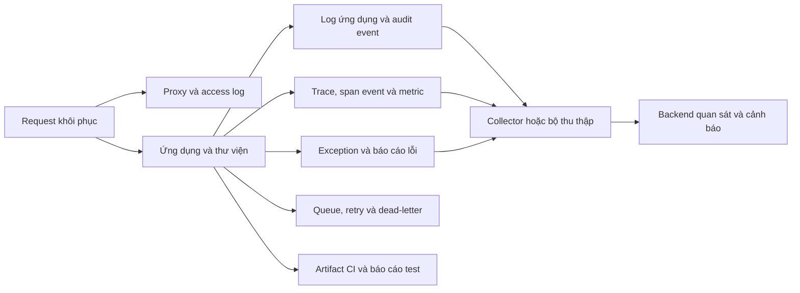

# Sensitive logging test — Kiểm thử dữ liệu nhạy cảm trong log khôi phục tài khoản

## 1. Mục tiêu của bài kiểm thử

Trong luồng khôi phục tài khoản, log có thể vô tình trở thành một kênh lấy bằng chứng xác thực. Một reset token còn hạn, mã khôi phục chưa dùng hoặc recovery grant bị ghi vào hệ thống quan sát có thể cho người đọc log thực hiện hành động thay cho chủ tài khoản.

Sensitive logging test kiểm tra **những dữ liệu nào được phát ra, qua đường nào và vào nơi lưu trữ nào** khi người dùng khôi phục mật khẩu, MFA, passkey hoặc thiết bị xác thực. Nó đồng thời kiểm tra rằng hệ thống vẫn ghi đủ sự kiện để phát hiện lạm dụng và điều tra sự cố.

Có hai điều kiện phải chứng minh cùng lúc:

1. Bí mật và dữ liệu cá nhân bị cấm không xuất hiện trong các đầu ra quan sát thuộc phạm vi kiểm thử.
2. Sự kiện cần thiết vẫn tồn tại với đúng loại, kết quả và tham chiếu an toàn để đối chiếu.

Một bộ test chỉ khẳng định “không tìm thấy token” có thể pass vì logger bị tắt, appender không được gắn hoặc tác vụ bất đồng bộ chưa chạy. Ngược lại, ghi đầy đủ request để dễ điều tra sẽ làm mất ranh giới giữa dữ liệu nghiệp vụ và dữ liệu quan sát.

Bài này xây dựng một hợp đồng logging minh họa cho module khôi phục tài khoản. Các tên event, field, mức log và cách tham chiếu cần được điều chỉnh theo thiết kế thực tế; không có yêu cầu phải dùng một thư viện logging cụ thể.

## 2. Xác định dữ liệu nào phải bị loại khỏi log

Trước khi viết assertion, phân loại dữ liệu theo khả năng gây hại nếu người có quyền đọc hệ thống quan sát nhìn thấy nó.

| Nhóm dữ liệu | Ví dụ trong khôi phục tài khoản | Hợp đồng minh họa |
|---|---|---|
| Bí mật cho phép xác thực hoặc khôi phục | Reset token, OTP, recovery code, recovery grant, cookie phiên, bearer token | Không ghi giá trị thô, đoạn giá trị hoặc dạng mã hóa có thể khôi phục |
| Bí mật credential | Mật khẩu cũ/mới, TOTP seed, private key, credential của provider | Không đưa vào sự kiện hoặc exception xuất ra log |
| Dữ liệu xác minh danh tính | Ảnh giấy tờ, số định danh, ngày sinh đầy đủ, hồ sơ xác minh | Không ghi payload; chỉ ghi kết quả và reference đã được phê duyệt |
| Dữ liệu liên hệ | Email, số điện thoại, địa chỉ khôi phục | Chỉ sử dụng biểu diễn đã được policy cho phép |
| Dữ liệu ngữ cảnh rủi ro | IP, dấu vết thiết bị, vị trí, lịch sử phục hồi | Giới hạn mục đích, độ chi tiết, quyền đọc và thời gian giữ |
| Tham chiếu nghiệp vụ | Attempt reference, mã sự kiện, phiên bản policy | Được ghi khi đã đánh giá khả năng liên kết và không mang quyền |
| Dữ liệu kỹ thuật có kiểm soát | Route template, loại lỗi, thời lượng, tên provider nội bộ | Được ghi theo schema và tập giá trị cho phép |

Private key của passkey thường nằm ở authenticator; backend không nên nhận nó trong luồng đăng ký/xác thực thông thường. Nếu fixture hoặc một đường xử lý backend lại có field private key, cần xác minh thiết kế trước khi nghĩ đến che log. Credential ID, user handle hoặc attestation payload không đồng nghĩa với private key, nhưng vẫn có thể chứa thông tin liên kết hoặc nhận diện không nên phát tán tùy tiện.

Token đã dùng hoặc đã hết hạn không tự trở thành dữ liệu được phép ghi. Một exception có thể được tạo khi token còn hạn rồi mới flush ra log sau đó; dữ liệu lịch sử cũng có thể hỗ trợ liên kết hoặc phân tích hoạt động người dùng.

OWASP liệt kê mật khẩu, access token, định danh session và dữ liệu cá nhân nhạy cảm trong nhóm không nên được ghi trực tiếp; đồng thời yêu cầu kiểm thử cơ chế logging. Đây là điểm xuất phát cho việc phân loại, không thay thế policy cụ thể của ứng dụng. Tham khảo [OWASP Logging Cheat Sheet](https://cheatsheetseries.owasp.org/cheatsheets/Logging_Cheat_Sheet.html).

### Không coi mọi phép biến đổi là ẩn danh

Base64, URL encoding và JSON escaping chỉ là các cách biểu diễn dữ liệu. Người đọc log thường có thể khôi phục giá trị ban đầu.

Hash OTP sáu chữ số hoặc một email dễ đoán cũng không bảo đảm che giấu danh tính. Không dùng hash của reset token làm correlation ID mặc định chỉ vì nó khác token thô. Một reference ngẫu nhiên riêng cho mục đích quan sát thường tạo ranh giới dễ kiểm soát hơn.

Nếu sản phẩm cần tham chiếu có khóa hoặc biểu diễn đã được giả danh hóa, kiểm thử phải bao gồm phạm vi khóa, tenant, khả năng liên kết, rotation và việc không lộ giá trị đầu vào. Biểu diễn ấy vẫn có thể là dữ liệu nhạy cảm theo ngữ cảnh.

## 3. Viết hợp đồng sự kiện trước khi viết test

Một schema có danh sách field được phép giúp hạn chế việc “thêm toàn bộ request cho tiện”. Ví dụ một event từ chối bằng chứng khôi phục:

```json
{
  "event": "account_recovery.evidence_rejected",
  "attempt_ref": "obs-attempt-7",
  "purpose": "MFA_REBIND",
  "outcome": "REJECTED",
  "reason": "EVIDENCE_EXPIRED",
  "correlation_ref": "obs-request-21"
}
```

Các reference ở đây là giá trị tổng hợp phục vụ bài học. Trong hệ thống thật, reference phải không chứa token hoặc dữ liệu liên hệ được nối vào chuỗi.

Một hợp đồng đủ rõ nên trả lời:

- Event nào bắt buộc khi khởi tạo, xác minh, từ chối, hủy hoặc hoàn tất khôi phục?
- Field nào được phép; kiểu, độ dài và tập giá trị là gì?
- Nơi nào được nhận event; ai được đọc và trong bao lâu?
- Những field nào được coi là dữ liệu cá nhân dù không mang quyền xác thực?
- Có cho phép một biểu diễn masked của email hoặc số điện thoại không?
- Khi logger hoặc bộ xử lý che dữ liệu gặp lỗi, hành vi dự phòng là gì?

Một vocabulary lỗi có kiểm soát như `TOKEN_EXPIRED`, `RATE_LIMITED` hoặc `PROVIDER_UNAVAILABLE` dễ kiểm thử hơn `reason=exception.getMessage()`. Thông điệp exception có thể chứa URL, request body hoặc nội dung mà provider trả về.

Tham chiếu tài khoản và tenant cũng không được miễn kiểm soát chỉ vì là ID nội bộ. Chúng có thể giúp liên kết hành vi xuyên thời gian; test về quyền đọc và phạm vi truy vấn cần phản ánh điều đó.

### Đường dẫn API nên được biểu diễn bằng route

Nếu API có dạng:

```text
POST /account-recovery/{attempt}/complete
```

metric label hoặc span name có thể dùng route template đã phê duyệt. Dùng toàn bộ URL thực, query string hoặc path mang token có thể làm rò bí mật và tạo số lượng giá trị metric rất lớn.

Không giải quyết vấn đề chỉ bằng cách chuyển token từ query sang body: middleware ghi request body hoặc exception của HTTP client vẫn có thể làm lộ cùng dữ liệu.

## 4. Lập bản đồ các nơi dữ liệu có thể đi tới

Trong bài này, **sink** là một nơi nhận hoặc lưu đầu ra quan sát. Sink có thể nằm ngoài tiến trình ứng dụng.



Cần có inventory ít nhất cho những thành phần đang được sử dụng:

| Bề mặt | Dữ liệu dễ bị ghi ngoài ý muốn | Cách thu bằng chứng test |
|---|---|---|
| Logger ứng dụng | Tham số log, object, structured fields | Capture event và bản render thực |
| HTTP access log | Path, query, header, client address | Đầu ra proxy/server cấu hình như triển khai |
| Exception | Message, cause, suppressed exception | Bản exception đã serialize hoặc render |
| HTTP client/SDK | URL provider, request/response body | Đầu ra interceptor và error handler |
| Trace | URL, span attributes, events, exception data | Exporter test hoặc collector cô lập |
| Metric | Label lấy từ input, exemplar | Dữ liệu export đã chuẩn hóa |
| Context truyền tải | MDC, baggage, custom header | Capture qua ranh giới thread và dịch vụ |
| Queue và dead-letter | Payload gốc, stack trace, retry metadata | Bản ghi của pipeline test |
| CI và công cụ phát triển | Assertion diff, snapshot, screenshot, stdout | Artifact sau khi test kết thúc |

Nếu hệ thống chỉ dùng một số sink, ghi rõ những sink đã kiểm thử. Không tuyên bố “toàn bộ logging an toàn” từ một appender của service.

OpenTelemetry lưu ý rằng việc xác định dữ liệu nhạy cảm phụ thuộc ngữ cảnh ứng dụng và cần xem xét cả telemetry do thư viện instrumentation phát ra. Bộ xử lý ở Collector có thể hỗ trợ xử lý thuộc tính, nhưng ứng dụng vẫn phải giới hạn dữ liệu thu thập. Tham khảo [OpenTelemetry: Handling sensitive data](https://opentelemetry.io/docs/security/handling-sensitive-data/).

Dữ liệu đã đi vào queue của exporter, stdout hoặc file cục bộ trước khi được Collector che vẫn đã vượt qua một ranh giới. Kiểm thử phải quan sát cả trước và sau điểm che nếu muốn chứng minh tính bảo mật của toàn đường đi.

## 5. Chuẩn bị fixture và cơ chế capture đáng tin cậy

### 5.1. Dùng dữ liệu tổng hợp có thể theo dấu

Một **canary** trong bài này là giá trị tổng hợp được biết trước, đưa vào đúng vị trí nhạy cảm để phát hiện nó có thoát ra đầu ra quan sát không. Canary không phải bí mật production và không được gửi tới tài khoản hoặc provider thật.

Ví dụ registry cho một scenario:

```text
RESET_TOKEN       = token do fixture của hệ thống test cấp
RECOVERY_CODE     = mã hợp lệ chỉ trong kho dữ liệu test
NEW_PASSWORD      = mật khẩu tổng hợp đáp ứng validation
PROVIDER_SECRET   = credential giả cho HTTP stub
EMAIL             = recovery-case-17@example.test
PHONE             = giá trị tổng hợp được kênh giả chấp nhận
```

Không thêm tiền tố tùy ý vào OTP nếu endpoint chỉ chấp nhận sáu chữ số. Một input bị chặn ở validation đầu tiên sẽ không kiểm tra được nhánh xác minh OTP, provider hoặc transaction phía sau.

Tương tự, để kiểm thử token hết hạn, fixture cần tạo token đúng cấu trúc và có trạng thái hết hạn trong kho test. Gửi một chuỗi ngẫu nhiên không parse được sẽ chỉ bao phủ nhánh malformed token.

Canary có thể được tạo theo seed của scenario để tái hiện, nhưng báo cáo không cần in giá trị. Với giá trị ngắn như OTP, scanner có thể gặp trùng ngẫu nhiên; kết hợp kiểm tra schema, vị trí field và dữ liệu capture thay vì dựa hoàn toàn vào một chuỗi ngắn.

### 5.2. Xác minh capture đã hoạt động

Trước assertion âm tính, cần xác minh có event dự kiến:

```text
Given:
  capture đã được gắn trước request
  fixture tạo một attempt có reference an toàn

When:
  thực hiện nhánh token hết hạn
  chờ tác vụ logging/export có tín hiệu hoàn tất trong timeout hữu hạn

Then:
  có đúng loại event evidence_rejected cho attempt
  reason bằng TOKEN_EXPIRED theo schema
  mọi sink thuộc phạm vi đã được thu và đối chiếu
  không có canary trong các đầu ra ấy
```

Có thể dùng flush/force-flush của thành phần đang kiểm thử, completion signal của worker hoặc barrier do test điều khiển. Cần chờ theo điều kiện cụ thể; không coi `sleep` một khoảng ngắn là bằng chứng queue đã rỗng.

Nếu trace được sampling, bật capture xác định được trong profile test. Không tìm thấy secret trong một trace chưa được lấy mẫu không có ý nghĩa.

### 5.3. Tách dữ liệu giữa các lần chạy

Mỗi scenario cần correlation reference do test tạo và được ứng dụng chấp nhận theo hợp đồng. Capture phải đủ rộng để không bỏ sót các record mất correlation, sau đó mới phân loại nguồn.

Khi dùng thread pool hoặc context bất đồng bộ, kiểm tra dữ liệu của attempt A không bám sang log của attempt B. Gắn canary vào context rồi chạy hai tác vụ liên tiếp là cách phát hiện MDC hoặc thread-local không được dọn.

Không xóa event chứa bí mật trước khi scanner chạy. Nếu fixture cleanup xóa file log hoặc dead-letter sớm, test có thể mất chính bằng chứng cần phát hiện.

## 6. Ma trận scenario theo vòng đời khôi phục

Không chỉ kiểm tra happy path. Các nhánh thất bại thường ghi thêm nhiều thông tin chẩn đoán.

| Scenario | Dữ liệu nhạy cảm được đưa vào | Event hoặc kết quả an toàn cần có |
|---|---|---|
| Khởi tạo yêu cầu khôi phục | Email hoặc số điện thoại tổng hợp | Request được nhận; không ghi payload định danh bị cấm |
| Token sai định dạng | Chuỗi nhạy cảm trong input không hợp lệ | Lỗi validation chuẩn hóa, không echo input |
| Token đúng cấu trúc nhưng không tồn tại | Token canary | Lý do bị từ chối phù hợp policy |
| Token hết hạn hoặc đã dùng | Token fixture đúng nhánh | Audit từ chối, không có grant mới |
| Recovery code hợp lệ/sai/đã dùng | Mã khôi phục tổng hợp | Quyết định được ghi; giá trị mã không xuất hiện |
| Hoàn tất đổi mật khẩu | Mật khẩu mới và grant test | Event hoàn tất; không ghi request DTO |
| Reset MFA | OTP, recovery code, dữ liệu enrollment | Ghi purpose và kết quả, không ghi seed hay mã |
| Đăng ký passkey thay thế | Registration payload tổng hợp | Ghi kết quả và reference được phép |
| Xác minh danh tính qua hỗ trợ | Hồ sơ tổng hợp | Ghi quyết định; không dump tài liệu |
| Provider timeout/5xx | Provider body có canary | Lỗi được chuẩn hóa, không in body hoặc URL có bí mật |
| Callback chữ ký sai | Signature/header/body tổng hợp | Sự kiện bị từ chối, không ghi payload đầy đủ |
| Rate limit và chống lạm dụng | Nhiều input tổng hợp | Có event/metric phù hợp, không biến input thành label |
| Thu hồi session sau khôi phục | Cookie hoặc bearer token test | Kết quả kiểm soát session, không ghi token |

Với mỗi hàng, chọn những tầng thật sự có thể làm lộ dữ liệu. Test validation có thể cần HTTP server và exception mapper thật. Test retry cần chạy cả worker và nhánh dead-letter. Test access log phải đi qua proxy hoặc server có cấu hình tương ứng.

Kiểm tra cả tài khoản tồn tại và không tồn tại. Public response có thể được thiết kế giống nhau để chống dò tài khoản, nhưng log nội bộ vẫn cần có quyền truy cập phù hợp; không đưa sự khác biệt nhạy cảm ra client thông qua error ID chứa thông tin hoặc link công khai tới báo cáo.

### Trạng thái bảo mật vẫn phải đúng

Assertion logging không thay thế assertion nghiệp vụ. Một request dùng token sai phải bị từ chối, không thay credential và không tạo session có quyền. Một test làm rò token rồi tuyên bố pass chỉ vì thao tác khôi phục đã thất bại vẫn bỏ sót lỗi.

Ngược lại, bỏ toàn bộ xử lý khôi phục để không có log cũng không đáp ứng mục tiêu. Fixture cần chứng minh scenario đã đi qua nhánh nghiệp vụ mong muốn.

## 7. Các nhánh exception thường bị bỏ sót

### 7.1. Exception message và chuỗi cause

Ví dụ không an toàn:

```java
logger.warn("Recovery verification failed: {}", exception.getMessage());
logger.debug("Recovery request: {}", recoveryRequest);
```

Log có tham số giúp định dạng thông điệp; nó không tự phân loại hoặc che dữ liệu nhạy cảm. `toString()` của request, record hoặc object lồng nhau có thể in mọi field.

Một exception gốc không chứa token vẫn có thể bọc một cause chứa URL đầy đủ. Một số hệ thống báo lỗi còn serialize suppressed exception, custom attributes hoặc dữ liệu request đi kèm.

Test nên cố tình tạo:

- Provider exception chứa URL có reset token.
- Validation exception chứa giá trị rejected.
- Serialization exception chứa một phần body.
- Exception cause chứa header Authorization hoặc Cookie.
- Suppressed exception chứa credential của provider.
- Error handler bị lỗi khi cố che dữ liệu.
- Response body của provider echo lại dữ liệu đầu vào.

Kết quả mong đợi là event có mã lỗi an toàn, reference đối chiếu và thông tin kỹ thuật được policy cho phép. Không yêu cầu xóa mọi stack trace một cách máy móc; kiểm tra phần nào có thể xuất ra và liệu quá trình render có đưa thông điệp nhạy cảm trở lại hay không.

### 7.2. Logging khi rollback và retry

Một transaction rollback có thể log object chứa mật khẩu mới hoặc recovery grant. Worker retry có thể ghi payload nguyên vẹn trước khi gọi provider. Khi hết số lần thử, dead-letter handler thường ghi toàn bộ exception.

Vì vậy chạy scenario đến trạng thái kết thúc thật:

```text
request -> lỗi provider -> retry -> lỗi cuối -> dead-letter
```

Không dừng capture ngay khi HTTP API trả response “đã tiếp nhận”. Tác vụ gây rò rỉ có thể chạy sau response hoặc ở một tiến trình khác.

### 7.3. Mức log và cấu hình chẩn đoán

Chạy bộ tình huống theo cấu hình có thể được triển khai: production profile, các mức DEBUG được phép bật khi hỗ trợ và cấu hình HTTP client cụ thể. Nếu TRACE không được phép bật trong production, kiểm tra rào cấu hình đó thay vì mặc định nó không bao giờ xảy ra.

Không đưa dữ liệu thật vào profile kiểm thử để thử xem chế độ debug có che đúng không. Chỉ dùng giá trị tổng hợp và capture cô lập.

## 8. Thiết kế scanner: tìm giá trị và kiểm tra cấu trúc

Scanner dựa trên canary và schema assertion bổ sung cho nhau.

**Canary scan** phát hiện một giá trị đã biết thoát ra qua field hoặc thông điệp không dự kiến. **Schema assertion** phát hiện việc xuất thêm field bị cấm hoặc một kiểu dữ liệu sai ngay cả khi giá trị không nằm trong registry.

Các biểu diễn đáng kiểm tra theo đường xử lý thực tế:

- Chuỗi gốc.
- URL-encoded và cách biểu diễn percent encoding liên quan.
- JSON-escaped hoặc Unicode-escaped.
- Base64 khi thành phần đã được xác định có sử dụng.
- URL đầy đủ chứa secret trong path/query.
- Một phần secret bị giữ lại nếu policy cấm giữ prefix hoặc suffix.

Không thể kết luận không có rò rỉ chỉ vì danh sách biến thể hữu hạn không tìm thấy gì. Ví dụ secret bị cắt đôi sang hai event, được nén hoặc nằm trong một attachment sẽ không được phát hiện bởi tìm kiếm chuỗi đơn giản.

Đối với dữ liệu structured, parse định dạng thật rồi kiểm tra field và giá trị lồng nhau. Đối với bản nén hoặc bundle artifact, giải mã/giải nén trong môi trường test với giới hạn kích thước, độ sâu và thời gian. Đó là xử lý bằng chứng test, không phải lý do để tải hoặc mở mọi file không tin cậy.

### Đừng giải mã vô hạn

Một scanner cố Base64-decode mọi chuỗi rồi lặp đệ quy có thể tiêu tốn tài nguyên và tạo false positive. Giới hạn thuật toán theo các phép biến đổi mà hệ thống thực sự dùng, đồng thời dùng allowlist schema để chặn việc xuất raw payload.

Khi kiểm tra masked value, assertion phải khớp hợp đồng cụ thể. `contains("****")` không chứng minh địa chỉ hoặc token gốc đã biến mất; một thông điệp có thể đồng thời chứa cả giá trị masked lẫn giá trị thô.

### Kiểm tra chính bộ phát hiện

Cần có positive control: đưa một canary tổng hợp vào bản ghi trong bộ nhớ và xác minh scanner phát hiện nó. Positive control chỉ tồn tại trong dữ liệu test cô lập; không gửi sự kiện cố tình rò rỉ tới backend quan sát dùng chung.

Assertion thất bại không nên in nguyên log bị phát hiện. Chỉ báo loại canary, sink và scenario có mã an toàn. Nếu framework tự hiển thị diff của actual payload, chính báo cáo test có thể trở thành sink mới.

## 9. Ví dụ Java: exception chứa bí mật nhưng event chỉ có dữ liệu được phép

Ví dụ sau dùng Java 17 và JUnit 5 để minh họa ranh giới logging của một nhánh lỗi. `Verifier` là thành phần giả được inject; không có HTTP call, token production hoặc thay đổi credential thật.

Bộ test chủ động đặt reset token, mật khẩu mới và provider key vào exception. Nó yêu cầu adapter logging chỉ phát một projection gồm các field được phép. Đây là unit test của ranh giới ấy, chưa chứng minh encoder, HTTP access log hoặc exporter thực tế an toàn.

```java
import org.junit.jupiter.api.Test;

import java.net.URLEncoder;
import java.nio.charset.StandardCharsets;
import java.util.ArrayList;
import java.util.Base64;
import java.util.List;
import java.util.Map;
import java.util.Set;
import java.util.UUID;
import java.util.function.Consumer;

import static org.junit.jupiter.api.Assertions.assertThrows;
import static org.junit.jupiter.api.Assertions.assertTrue;

class SensitiveRecoveryLoggingTest {
    enum SecretKind { RESET_TOKEN, NEW_PASSWORD, PROVIDER_KEY }
    enum Outcome { VERIFIED, REJECTED }

    record Canary(SecretKind kind, String value) {}

    record RecoveryCommand(
            UUID attemptRef,
            String resetToken,
            String newPassword) {}

    static final class ProviderFailure extends RuntimeException {
        ProviderFailure(String message, Throwable cause) {
            super(message, cause);
        }
    }

    @FunctionalInterface
    interface Verifier {
        void check(RecoveryCommand command);
    }

    static Outcome verifyAtBoundary(
            RecoveryCommand command,
            Verifier verifier,
            Consumer<Map<String, String>> audit) {
        try {
            verifier.check(command);
            return Outcome.VERIFIED;
        } catch (ProviderFailure failure) {
            audit.accept(Map.of(
                    "event", "account_recovery.evidence_rejected",
                    "attempt_ref", command.attemptRef().toString(),
                    "purpose", "PASSWORD_RESET",
                    "outcome", "REJECTED",
                    "reason", "PROVIDER_UNAVAILABLE"));
            return Outcome.REJECTED;
        }
    }

    static List<String> representations(String value) {
        return List.of(
                value,
                URLEncoder.encode(value, StandardCharsets.UTF_8),
                Base64.getEncoder().encodeToString(
                        value.getBytes(StandardCharsets.UTF_8)));
    }

    static void assertNoCanaries(
            List<Canary> canaries,
            List<String> renderedRecords) {
        for (Canary canary : canaries) {
            for (String representation :
                    representations(canary.value())) {
                for (String record : renderedRecords) {
                    if (record.contains(representation)) {
                        throw new AssertionError(
                                "Sensitive logging detected; kind="
                                        + canary.kind());
                    }
                }
            }
        }
    }

    @Test
    void providerFailureEmitsSafeEventWithoutExceptionPayload() {
        String resetToken = "TestResetCanary9076172046";
        String password = "TestPasswordCanary!A9076";
        String providerKey = "TestProviderKeyCanary9082";
        UUID attempt = UUID.fromString(
                "00000000-0000-0000-0000-000000000017");

        var command =
                new RecoveryCommand(attempt, resetToken, password);
        var canaries = List.of(
                new Canary(SecretKind.RESET_TOKEN, resetToken),
                new Canary(SecretKind.NEW_PASSWORD, password),
                new Canary(SecretKind.PROVIDER_KEY, providerKey));

        Verifier failingProvider = input -> {
            throw new ProviderFailure(
                    "token=" + input.resetToken()
                            + "; password=" + input.newPassword(),
                    new IllegalStateException(
                            "provider_key=" + providerKey));
        };

        List<Map<String, String>> captured = new ArrayList<>();
        Outcome outcome = verifyAtBoundary(
                command, failingProvider, captured::add);

        assertTrue(
                outcome == Outcome.REJECTED,
                "Expected the provider failure branch");
        assertTrue(
                captured.size() == 1,
                "Expected exactly one captured audit event");

        Map<String, String> event = captured.get(0);
        assertTrue(
                event.keySet().equals(Set.of(
                        "event", "attempt_ref", "purpose",
                        "outcome", "reason")),
                "Unexpected audit schema");
        assertTrue(
                "account_recovery.evidence_rejected"
                        .equals(event.get("event")),
                "Missing expected event type");
        assertTrue(
                attempt.toString().equals(event.get("attempt_ref")),
                "Missing safe attempt reference");
        assertTrue(
                "PROVIDER_UNAVAILABLE".equals(event.get("reason")),
                "Expected a controlled reason code");

        List<String> rendered = captured.stream()
                .map(Map::toString)
                .toList();
        assertNoCanaries(canaries, rendered);
    }

    @Test
    void detectorRecognizesAnEncodedCanaryInMemory() {
        var canary = new Canary(
                SecretKind.RESET_TOKEN,
                "TestDetectorCanary9076");
        String encoded = Base64.getEncoder().encodeToString(
                canary.value().getBytes(StandardCharsets.UTF_8));

        assertThrows(
                AssertionError.class,
                () -> assertNoCanaries(
                        List.of(canary),
                        List.of("fixture_field=" + encoded)));
    }
}
```

Có ba giới hạn cần hiểu khi dùng ví dụ:

- `Outcome.VERIFIED` chỉ là kết quả của thao tác verifier minh họa; nó không phải recovery grant và chưa thể cho phép đổi mật khẩu.
- `Map::toString` chỉ giúp kiểm tra projection trong bộ nhớ. Test tích hợp phải dùng encoder/appender thật của ứng dụng.
- Hàm scanner chỉ tìm ba biểu diễn đã liệt kê. Nó không phải một bộ che dữ liệu production hay bộ phát hiện mọi dạng rò rỉ.

Trong triển khai thực, xây dựng event từ các giá trị có kiểu và nguồn tin cậy. Không cho `reason` nhận bất kỳ string nào từ request hoặc provider chỉ vì key của nó đã nằm trong allowlist.

Ví dụ cũng cố ý không log `failure` hoặc `failure.getMessage()`. Nếu cần stack trace để điều tra, dùng một cơ chế đã xác định rõ dữ liệu được phép xuất và kiểm thử cả cause chain cùng đầu ra của công cụ báo lỗi; không giả định việc chỉ đổi cách gọi logger đã xử lý được vấn đề.

## 10. Kiểm thử integration với đầu ra render và pipeline export

Để kiểm tra một hệ thống Java thực tế, gắn capture vào các vị trí tương ứng với cấu hình triển khai. Phân biệt hai loại đầu ra:

**Event trước render.** Có thể chứa argument array, structured attributes, MDC và object exception mà appender sẽ đọc sau. Không chỉ kiểm tra `formattedMessage` nếu encoder có thể xuất thêm những trường khác.

**Record sau render.** Là JSON, text, dữ liệu OTLP hoặc định dạng xuất thật. Nó cho thấy encoder, layout, serializer và exporter đã phát gì.

Một quy trình integration có thể thực hiện như sau:

```text
Arrange:
  khởi tạo ứng dụng với cấu hình logging gần triển khai
  gắn capture trước và sau các ranh giới quan trọng
  khởi tạo database, queue, provider stub và collector cô lập
  tạo fixture đúng trạng thái và registry canary riêng scenario

Act:
  gọi API thật trong môi trường test
  thả provider response hoặc callback theo lịch đã định
  chạy worker/retry cần thiết
  chờ completion và flush hữu hạn

Assert:
  scenario đã đi qua nhánh mong muốn
  có event bắt buộc với reference an toàn
  schema và giá trị enum khớp hợp đồng
  không có canary hoặc field bị cấm ở sink đã khai báo
  hành vi credential, grant và session vẫn đúng

Cleanup:
  gỡ appender/exporter và context đã gắn
  hủy fixture và dữ liệu test theo phạm vi
  bảo đảm báo cáo không đính kèm payload chưa làm sạch
```

Capture không nên tự làm redaction mà hệ thống được kiểm thử chưa làm. Nếu test appender tự xóa token rồi assertion chỉ đọc phần đã xóa, test đang chứng minh sự an toàn của appender test.

Đối với pipeline có Collector, kiểm tra cấu hình hoạt động thực sự. Một processor đã khai báo nhưng không được gắn vào pipeline thích hợp sẽ không xử lý dữ liệu. Cần kiểm tra cả log, trace và metric được dùng, thay vì cho rằng một rule trên span áp dụng tự động cho mọi signal.

### Dữ liệu bị biến đổi sau khi ra khỏi ứng dụng

Backend có thể bổ sung enrichment, tạo cảnh báo hoặc đưa field vào notification. Một event an toàn ở appender chưa chắc đã có chính sách quyền đọc đúng ở dashboard.

Nếu thuộc phạm vi triển khai, kiểm tra thêm:

- Notification hoặc cảnh báo không đính kèm raw request.
- Dashboard không tạo liên kết URL chứa token.
- Export CSV hoặc tính năng tải log giữ đúng quyền truy cập.
- Lưu trữ phụ, retry buffer và dữ liệu lỗi cũng áp dụng chính sách.
- Chế độ chẩn đoán của exporter không in batch chưa che khi gửi thất bại.

Không đưa bí mật vào span attribute rồi trông chờ sampling làm biến mất. Sampling quyết định giữ dữ liệu nào; nó không phải cơ chế phân loại dữ liệu nhạy cảm.

## 11. HTTP, proxy, frontend và session: những đường dễ rò gián tiếp

### 11.1. Access log nằm trước ứng dụng

Giả sử ứng dụng đã loại bỏ `token` khỏi structured event nhưng reverse proxy vẫn ghi toàn bộ request target:

```text
GET /recover?token=<synthetic-secret>
```

Một unit test của service không nhìn thấy access log này. Integration test phải gửi request qua thành phần thực sự tạo access log hoặc kiểm chứng riêng cấu hình ấy bằng fixture tương đương.

Kiểm tra token trong query, path và redirect `Location` nếu kiến trúc có sử dụng. Chỉ che field có tên `token` trong JSON không xử lý được URL string.

Đối với URL fragment, trình duyệt không gửi phần fragment trong HTTP request thông thường. Tuy vậy, JavaScript, analytics, error reporting, screenshot hoặc báo cáo trình duyệt vẫn có thể thu nó. Vì thế xác định đúng nơi cần quan sát, không mong server access log chứng minh frontend an toàn.

### 11.2. Header và cookie

Kiểm thử các header nhạy cảm theo thực tế sử dụng: Authorization, Cookie, Set-Cookie, API key của provider hoặc header chứa recovery grant.

Tên header HTTP không phân biệt chữ hoa/chữ thường. Nếu rule che chỉ nhận `Authorization` nhưng bỏ sót `authorization`, test phải phát hiện. Cũng cần thử các dạng serializer tạo danh sách nhiều giá trị thay vì một string.

Không chụp toàn bộ header để rồi xóa một vài key đã biết. Với endpoint nhạy cảm, tập field được phép thường giúp hạn chế việc header mới được thêm sau này bị ghi tự động.

### 11.3. Kiểm soát session sau khôi phục

Để kiểm thử thu hồi session, fixture cần sử dụng cookie hoặc access token của môi trường test. Việc gửi chúng là dữ liệu nghiệp vụ cần thiết của scenario, nhưng việc in chúng vào log, trace hoặc assertion report lại là đầu ra không được phép.

Cần phân biệt nguồn dữ liệu có chủ đích và sink quan sát:

```text
Được dùng trong scenario:
  cookie test gửi tới endpoint có bảo vệ
  reset token gửi tới verifier
  token nằm trong email tổng hợp được gửi vào hộp thư giả

Không được tự động xuất:
  HTTP debug dump
  access log nguyên header
  trace chứa toàn bộ URL
  snapshot hoặc assertion diff chứa request đầy đủ
```

Một scanner quét cả kho fixture và hộp thư giả rồi báo mọi token là lỗi sẽ tạo false positive. Ngược lại, loại trừ toàn bộ thư mục artifact vì “có fixture” sẽ che mất rò rỉ. Phạm vi quét cần dựa trên nguồn gốc, mục đích và schema cụ thể.

### 11.4. Hỗ trợ người dùng và xác minh danh tính

Khi nhân viên hỗ trợ xem hồ sơ khôi phục, test cần kiểm tra giao diện và báo cáo hỗ trợ có hiển thị quá nhiều dữ liệu không. Nội dung người dùng tự nhập, ảnh giấy tờ hoặc ghi chú có thể bị đưa vào browser error report, ảnh chụp màn hình hoặc ticket attachment.

Trong phạm vi logging, chỉ ghi reference và quyết định đã được phê duyệt. Nếu dữ liệu gốc cần được giữ ở kho nghiệp vụ chuyên biệt, đó là một nơi có chính sách truy cập riêng; không sao chép nó sang hệ thống quan sát để tiện tìm kiếm.

## 12. Log injection và giả mạo sự kiện

Bảo vệ bí mật không đồng nghĩa bảo vệ tính toàn vẹn của log. Một người gửi input có xuống dòng hoặc delimiter có thể làm record trông như một event khác nếu đầu ra text không được encode đúng.

Ví dụ input tổng hợp cho field người dùng có thể điều khiển:

```text
device_label = "device-test<CR><LF>outcome=SUCCESS"
request_id   = "request-test<separator>event=recovery_completed"
```

Các ký hiệu `<CR>`, `<LF>` và `<separator>` ở trên chỉ mô tả dữ liệu thử; fixture sẽ tạo byte tương ứng khi kiểm thử encoder.

Bộ test cần xác minh:

- Số event thực không bị tăng bởi một giá trị chứa xuống dòng.
- JSON vẫn parse được và input chỉ là dữ liệu trong field cho phép.
- Người gọi không thể ghi đè `event`, `outcome`, `reason` hoặc tenant của event.
- Request/correlation reference được kiểm tra độ dài và định dạng.
- Không có raw payload được dùng làm message template hoặc cấu hình logger.
- Giá trị quá dài được xử lý theo hợp đồng mà không làm mất thông tin an toàn cần thiết.

Với text log, chặn hoặc encode ký tự điều khiển theo định dạng xuất. Với structured log, cần kiểm tra serializer và việc flatten field; chỉ “dùng JSON” không chứng minh field do người gọi cung cấp không ghi đè metadata của hệ thống.

Đồng thời kiểm thử ký tự Unicode, ký tự điều khiển và delimiter có trong đường xử lý thực. Không cần tự sáng tạo mọi phép biến đổi có thể tồn tại; tập trung vào điểm encode, parse và render mà pipeline sử dụng.

## 13. Khi redaction, logger hoặc backend gặp lỗi

Một bộ che dữ liệu có thể lỗi vì input không parse được, object bất thường, timeout hoặc cấu hình thiếu. Hành vi dự phòng không được là “ghi nguyên bản để dễ debug”.

Các scenario cần fault injection:

| Lỗi được chèn | Điều cần chứng minh |
|---|---|
| Redaction ném exception | Record không an toàn không được phát ra ở nhánh dự phòng |
| Structured encoder không serialize được | Không chuyển sang dump toàn bộ object/exception |
| Collector mất kết nối | Buffer được quản lý trong giới hạn và không xuất raw batch ra stdout |
| Hết dung lượng hoặc mất quyền ghi | Ứng dụng có hành vi theo policy đã xác định |
| Queue logging đầy | Không dùng bộ nhớ vô hạn hoặc bỏ qua kiểm soát xác thực |
| Cấu hình che không được nạp | Có phát hiện cấu hình sai; endpoint không âm thầm ghi payload |
| Provider trả body cực lớn | Không làm log/phân tích chiếm tài nguyên không giới hạn |

Phân biệt log chẩn đoán thông thường với audit event bắt buộc để thực hiện hành động nhạy cảm. Với log chẩn đoán, thiết kế có thể cho phép suy giảm khả năng quan sát. Với audit bắt buộc, sản phẩm có thể cần lưu ý định audit bền vững cùng transaction hoặc trì hoãn hành động theo policy.

Bài test phải theo chính sách đã chọn; không mặc định mọi lỗi logger đều phải chặn dịch vụ, cũng không mặc định mọi hành động bảo mật đều được tiếp tục khi mất audit.

Một bất biến vẫn giữ: lỗi hệ thống quan sát không được biến kết quả xác minh thất bại thành thành công. Nó cũng không được tạo recovery grant, nới scope hoặc bỏ qua bước kiểm soát session.

Có thể phát một counter hoặc event lỗi logging an toàn với mã nguyên nhân có kiểm soát. Không gắn secret gây lỗi, payload gốc hoặc exception message chưa kiểm soát vào counter label.

## 14. Quyền đọc, tenant, retention và bản sao

Dữ liệu đã được giảm thiểu vẫn có thể nhạy cảm khi tập hợp theo thời gian. Attempt reference, số lần thất bại và loại khôi phục có thể tiết lộ hành vi bảo mật của tài khoản.

Nếu module triển khai nhiều tenant, cần các kiểm tra ở hệ thống quan sát có liên quan:

- Người có quyền xem tenant A không truy vấn được event của tenant B qua dashboard, API hoặc export.
- Correlation reference không trở thành quyền truy cập vào chi tiết hồ sơ chỉ bằng cách biết ID.
- Event nội bộ chi tiết không xuất hiện trong thông báo hoặc trang theo dõi công khai.
- Các nhóm hỗ trợ chỉ thấy dữ liệu cần thiết theo vai trò.
- Quy tắc retention thực sự áp dụng cho nơi lưu chính và các bản sao nằm trong phạm vi kiểm soát.

Retention test cần định nghĩa mốc nào dùng để tính tuổi dữ liệu, cách kích hoạt chu kỳ dọn trong môi trường test và độ trễ được chấp nhận. Không chờ nhiều ngày thực chỉ để kiểm tra một policy thời hạn; dùng cơ chế thời gian hoặc vòng đời của kho test khi hệ thống hỗ trợ.

Nếu có backup, cold storage hoặc archive riêng, báo cáo tách phạm vi đã xác minh. Xóa record khỏi giao diện tìm kiếm chưa chứng minh mọi bản sao đã được xử lý.

Khi phát hiện rò rỉ trong môi trường thật, việc sửa logger và việc xử lý dữ liệu đã lộ là hai công việc khác nhau. Với token hoặc credential còn hiệu lực, quy trình ứng phó cần đánh giá khả năng thu hồi theo thiết kế; không coi deployment bản vá là bằng chứng bí mật cũ đã an toàn. Bài kiểm thử sử dụng canary tổng hợp để xác minh đường rò mà không tạo thêm rủi ro ấy.

## 15. Một scenario xuyên suốt có thể tái hiện

Xét luồng khôi phục khi người dùng mất MFA và được policy cho phép dùng một phương thức bằng chứng thay thế.

```text
T0: Fixture tạo account, attempt và các mã tổng hợp.
T1: Client gửi yêu cầu khôi phục qua proxy test.
T2: Provider stub nhận request, sau đó trả lỗi có echo dữ liệu nhạy cảm.
T3: Worker retry và cuối cùng chuyển tác vụ tới dead-letter.
T4: Policy giữ attempt ở trạng thái không đủ bằng chứng.
T5: Pipeline logging/export được flush có xác nhận.
T6: Test phân tích các sink đã khai báo và báo cáo kết quả an toàn.
```

Điều khiển thứ tự bằng stub và scheduler test để lỗi luôn xuất hiện ở cùng vị trí. Không phụ thuộc provider sandbox thất bại ngẫu nhiên.

Assertions cho scenario gồm:

1. Client nhận phản hồi theo hợp đồng và không nhận nội dung provider thô.
2. Không phát sinh grant, thay MFA, đăng ký passkey hoặc session có quyền do provider lỗi.
3. Có event request, provider failure và kết thúc retry cần thiết, với reference an toàn.
4. Mỗi event có schema đúng; reason không lấy từ thông điệp provider.
5. Không có canary trong access log, event ứng dụng, exception report, trace hoặc dead-letter metadata bị cấm.
6. Artifact test không chứa request/response nguyên vẹn hoặc exception chưa làm sạch.
7. Completion signal xác nhận worker và exporter đã xử lý đủ; việc không có canary không dựa trên dữ liệu còn chưa được flush.

Chạy thêm biến thể thành công để kiểm tra nhánh thay credential và thu hồi session. Một bộ test chỉ kiểm tra lỗi có thể bỏ sót event “recovery completed” đang log toàn bộ recovery grant.

Với passkey, sử dụng credential tổng hợp và thư viện/fixture phù hợp cho môi trường test. Kiểm tra metadata ghi ra theo hợp đồng; không tự tạo private key ở backend rồi xem việc che nó khỏi log là mục tiêu thiết kế.

## 16. Tiêu chí đánh giá và cách báo cáo

Một sensitive logging test đáng tin cậy cần trình bày được rủi ro, đường thực thi và bằng chứng ở đầu ra.

| Câu hỏi đánh giá | Bằng chứng mong đợi |
|---|---|
| Đã chạy đúng nhánh khôi phục chưa? | Trạng thái nghiệp vụ và event bắt buộc đúng |
| Capture có hoạt động không? | Event an toàn đã biết được thu trước assertion âm tính |
| Có kiểm tra nơi render thật không? | Record sau encoder/export và access log phù hợp phạm vi |
| Có bao phủ lỗi và bất đồng bộ không? | Exception chain, retry, dead-letter và completion được điều khiển |
| Scanner có phát hiện được canary không? | Positive control cô lập thất bại đúng như dự kiến |
| Có kiểm tra schema không? | Field và value vocabulary đúng allowlist |
| Báo cáo có tự làm lộ dữ liệu không? | Chỉ có scenario ID, sink ID và loại vi phạm |
| Còn giới hạn nào? | Liệt kê sink, cấu hình và phép biến đổi chưa được kiểm tra |

Một báo cáo thất bại an toàn có thể chứa:

```text
SCENARIO=MFA_RECOVERY_PROVIDER_FAILURE
SINK=APPLICATION_RENDERED_LOG
RULE=NO_RECOVERY_SECRET
SECRET_KIND=RECOVERY_CODE
EVENT_REFERENCE=obs-event-42
CAPTURE_COMPLETE=YES
RESULT=FAIL
```

Không đính kèm giá trị mã hoặc toàn bộ record vi phạm vào thông báo CI dùng chung. Nếu cần giữ bằng chứng chi tiết để sửa lỗi, sử dụng kho test cô lập và quyền truy cập phù hợp, theo quy trình đã được thiết kế.

Có thể đánh giá độ mạnh của bộ test bằng cách cố tình đưa lỗi vào nhánh được kiểm soát: log request DTO, dùng exception message làm reason, bật HTTP body dump hoặc thêm raw URL vào span. Bộ test phải thất bại đúng rule và không phát tán canary qua thông báo thất bại.

Mục tiêu cuối cùng là quan sát được chuyện gì đã xảy ra với một yêu cầu khôi phục mà không biến hệ thống quan sát thành nơi chứa bằng chứng có thể dùng để chiếm tài khoản. Điều đó cần được chứng minh ở cả dữ liệu phát ra lẫn khả năng điều tra còn giữ lại.
