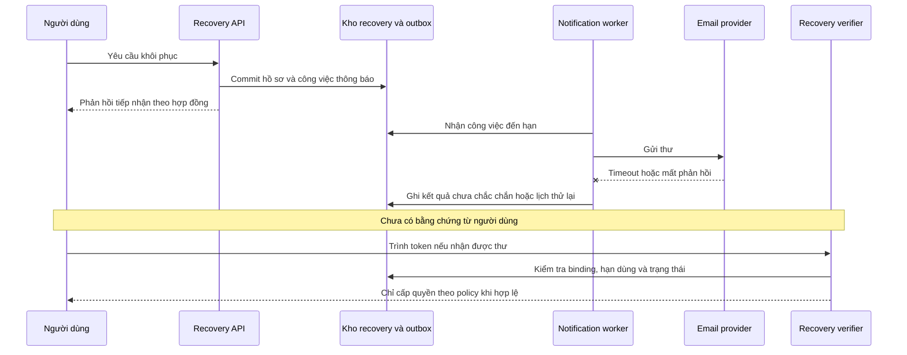

# Email provider outage test

## 1. Mục tiêu: email gián đoạn nhưng quyền khôi phục vẫn được kiểm soát

Email có thể mang link đặt lại mật khẩu, mã xác minh hoặc thông báo về một yêu cầu khôi phục tài khoản. Khi nhà cung cấp email không hoạt động, người dùng có thể không nhận được thư dù API của hệ thống vẫn xử lý được request.

**Email provider outage test** chủ động tạo lỗi ở ranh giới gửi email để kiểm tra ba điều: hệ thống giữ đúng trạng thái bảo mật, quản lý công việc gửi thư có thể phục hồi và cung cấp phản hồi phù hợp với những gì thực sự đã xảy ra.

Một lỗi nguy hiểm là coi “không gửi được mã” thành lý do để bỏ bước xác minh. Lỗi khác là ghi nhận đã gửi, xóa công việc khỏi hàng chờ rồi làm mất hoàn toàn khả năng thông báo. Ngược lại, retry không giới hạn có thể làm hệ thống gửi thư hàng loạt ngay khi nhà cung cấp phục hồi.

Trong module khôi phục tài khoản, mục tiêu sử dụng được phải đi cùng mục tiêu chống chiếm đoạt. Người mất mật khẩu, MFA, passkey hoặc thiết bị xác thực không được cấp thêm quyền chỉ vì hạ tầng thông báo đang lỗi. Nếu có đường khôi phục thay thế, đường đó vẫn cần bằng chứng và chính sách riêng.

Bài học sử dụng kiến trúc và tên trạng thái minh họa. Các đoạn Java là khung kiểm thử cần được tích hợp với implementation thực tế; sự hiện diện của chúng trong tài liệu không có nghĩa hệ thống đã chạy các phép thử này.

## 2. Xác định chính xác ranh giới đang bị lỗi

Một hành trình recovery qua email có nhiều bước độc lập:



Điểm tạo lỗi có thể nằm trước kết nối, trong TLS handshake, sau khi provider đã nhận payload hoặc ở luồng callback sau đó. Các vị trí này không tương đương về điều có thể kết luận.

Ví dụ, từ chối kết nối trước khi gửi payload cho biết lần gọi đó chưa chuyển nội dung tới provider. Một timeout sau khi gửi đủ request không cho biết provider đã nhận và đưa thư vào hàng đợi hay chưa.

Cần tách outage của email provider khỏi outage của DB, message broker hoặc dịch vụ xác minh token. Có thể kiểm tra các tổ hợp lỗi sau, nhưng thử nghiệm đầu tiên nên làm rõ một giả thuyết và một ranh giới để giải thích kết quả được.

### Provider nhận thư không đồng nghĩa thư đã tới người dùng

Một message ID thường là dấu hiệu provider đã nhận yêu cầu theo hợp đồng của họ. Nó không chứng minh người dùng đã nhận, đọc hoặc chấp thuận khôi phục. Amazon SES cũng phân biệt việc nhận yêu cầu gửi với các kết quả chuyển phát sau đó. [Amazon SES: How email sending works](https://docs.aws.amazon.com/ses/latest/dg/send-email-concepts-process.html).

Thiết kế kiểm thử phải giữ sự phân biệt này ở cả tên metric, trạng thái DB và thông điệp trên giao diện. Không dùng một cột `success=true` để đại diện đồng thời cho tiếp nhận request, gửi tới provider, giao thư và xác minh danh tính.

## 3. Tách trạng thái thông báo khỏi trạng thái bảo mật

Một hồ sơ recovery có thể đang chờ người dùng cung cấp bằng chứng trong khi công việc email đang retry. Hai trục trạng thái liên quan nhưng không thay thế nhau.

| Trục | Ví dụ trạng thái | Ai có quyền thay đổi? |
|---|---|---|
| Hồ sơ recovery | `EVIDENCE_PENDING`, `AUTHORIZED_FOR_STEP`, `CLOSED` | Dịch vụ recovery theo policy |
| Token | `ACTIVE`, `CONSUMED`, `EXPIRED`, `REVOKED` | Issuer và verifier có thẩm quyền |
| Công việc thông báo | `QUEUED`, `IN_FLIGHT`, `RETRY_WAIT`, `ACCEPTED` | Dispatcher và bộ xử lý kết quả gửi |
| Bằng chứng chuyển phát | Accepted, delivery, bounce hoặc complaint của từng attempt | Callback được xác thực hoặc cơ chế đối soát |
| Credential và session | Phiên bản mật khẩu, tập MFA, tập passkey, session epoch | Thao tác bảo mật đã được cấp quyền |

Trong ví dụ, `ACCEPTED` chỉ có nghĩa provider đã xác nhận nhận yêu cầu. Nếu provider đã nhận thư nhưng acknowledgment bị mất, trạng thái cục bộ có thể là `UNKNOWN`. Đây là thông tin cần được lưu, không nên tự chuyển thành “chắc chắn chưa gửi”.

Công việc hết hạn có thể mang trạng thái `EXPIRED` hoặc `SUPPRESSED` tùy schema. Điều quan trọng là dispatcher không tiếp tục coi công việc đó còn có thể gửi cùng một token hợp lệ.

Những chuyển trạng thái cần bị cấm gồm:

- Gửi email lỗi rồi tự chuyển hồ sơ sang `AUTHORIZED_FOR_STEP`.
- Nhận callback delivery rồi tự coi chủ tài khoản đã xác minh.
- Retry công việc cũ rồi kích hoạt lại token đã bị thu hồi.
- Gửi lại thư rồi tự đặt lại bộ đếm đoán OTP.
- Provider phục hồi rồi tự cấp session đăng nhập cho hồ sơ tồn đọng.

Token có thể được tạo trước khi thư được gửi, hoặc được tạo trong một bước issuance riêng theo thiết kế. Bài kiểm thử phải chọn đúng mô hình và xác nhận thời điểm bắt đầu hạn dùng; không để việc cập nhật trạng thái email âm thầm đổi quy tắc của token.

## 4. Viết bất biến trước khi tạo outage

Một test có giá trị cần mô tả điều phải giữ đúng suốt thời gian lỗi và điều phải xảy ra sau khi phục hồi.

### 4.1. Bất biến bảo mật

1. Không có recovery grant khi chưa có bằng chứng hợp lệ theo policy.
2. Mật khẩu, MFA, passkey và session không thay đổi chỉ vì gửi email thất bại.
3. Token vẫn gắn đúng tenant, tài khoản, hồ sơ và mục đích.
4. Hạn dùng và trạng thái thu hồi được verifier thực thi độc lập với chuyển phát email.
5. Người gọi chưa xác minh không được đổi địa chỉ nhận sang một địa chỉ tùy ý để vượt outage.
6. Callback hoặc response của provider không thay thế bằng chứng của người dùng.
7. Token và dữ liệu nhận thư không bị lộ thêm qua log lỗi, trace hoặc dead-letter queue.

### 4.2. Điều kiện phục hồi

Một công việc đã được lưu bền vững và còn đủ điều kiện phải được xử lý tiếp theo ngân sách retry. Một công việc đã hết hạn hoặc bị thay thế phải kết thúc theo chính sách, có thể quan sát được nguyên nhân.

Không thể bảo đảm “mọi email cuối cùng đều tới inbox” khi phần còn lại của đường chuyển phát nằm ngoài kiểm soát của ứng dụng. Có thể kiểm tra các cam kết cụ thể hơn: không mất công việc trước thời điểm bàn giao đã xác định, retry hữu hạn, không gửi mới token đã hết hạn và không tạo thêm quyền vì lỗi.

### 4.3. Giới hạn tài nguyên

Đặt giới hạn cho số lần gọi provider, số request đồng thời, tuổi hàng chờ và thời gian xử lý API. Nếu không có giới hạn, một test ngắn có thể trông ổn nhưng hệ thống thật sẽ cạn connection hoặc thread khi outage kéo dài.

Các giới hạn phải có ý nghĩa theo implementation. “Bốn lần gửi” cần nêu rõ bao gồm lần đầu hay chỉ bốn lần retry; retry của SDK cũng phải được tính vào tổng số lần gọi mạng.

## 5. Chuẩn bị fixture và giả thuyết thử nghiệm

Một cấu hình minh họa:

```yaml
scenario: email-provider-unavailable-before-acceptance
syntheticAccounts: 2
tokenLifetimeSeconds: 600
injectedOutageSeconds: 45
maxSubmissionAttemptsIncludingFirst: 4
retryBaseSeconds: 2
retryCapSeconds: 30
maxParallelProviderCalls: 2
recipientMode: test-mailbox-only
```

Đây là dữ liệu ví dụ cho test, không phải cấu hình production được khuyến nghị chung. Thời hạn token phải phù hợp thời gian nhận thư và mô hình rủi ro của sản phẩm.

Giả thuyết có thể viết:

> Khi email provider không nhận kết nối trong 45 giây, yêu cầu recovery đã được commit vẫn được theo dõi bền vững; API không chờ từng lần retry; không phát sinh quyền khôi phục. Khi transport phục hồi trước hạn dùng, công việc còn hợp lệ được gửi theo lịch và ngân sách.

Để kiểm chứng giả thuyết, fixture cần có:

- Tài khoản và tenant tổng hợp với kênh recovery đã được xác minh trước đó.
- Token hoặc bằng chứng thuộc riêng từng hồ sơ.
- Kho recovery, outbox và cơ chế claim công việc thực.
- Provider thử nghiệm có thể xác nhận chính xác đã nhận payload hay chưa.
- Clock và scheduler điều khiển được cho test logic thời gian.
- Snapshot trạng thái bảo mật từ nguồn có thẩm quyền.
- Cơ chế dọn fixture, gỡ fault và khôi phục cấu hình thử nghiệm.

Không dùng tài khoản hoặc mailbox thật để tạo hàng trăm thư. Bộ thu nhận thư thử nghiệm phải cho phép kiểm tra người nhận, phiên bản thông báo và nội dung cần thiết mà không phát tán token sang hệ thống báo cáo.

## 6. Ma trận lỗi cần phân biệt

| Lỗi được tạo | Điều hệ thống biết | Điều cần kiểm tra |
|---|---|---|
| DNS không phân giải hoặc kết nối bị từ chối trước gửi | Chưa gửi payload trong attempt đó | Timeout hữu hạn, giữ công việc, không cấp quyền |
| DNS hoặc kết nối treo | Chưa có kết quả trong deadline | Không giữ tài nguyên vô hạn |
| TLS certificate không hợp lệ | Không xác lập được kênh tin cậy | Không chuyển sang HTTP hoặc bỏ kiểm tra TLS |
| Provider trả lỗi cấu hình/xác thực | Request không đáp ứng điều kiện provider | Phân loại và cảnh báo; không retry dồn dập cùng cấu hình |
| Provider giới hạn tốc độ | Chưa thể tiếp nhận theo mức hiện tại | Tôn trọng hướng dẫn chờ theo hợp đồng và deadline |
| Provider lỗi tạm thời | Kết quả phụ thuộc loại lỗi và thời điểm | Không mặc định mọi lỗi đều chứng minh chưa nhận |
| Provider nhận thư rồi mất acknowledgment | Có khả năng thư đã được nhận | Theo dõi trạng thái chưa chắc chắn, xử lý trùng theo policy |
| Worker chết sau khi gửi nhưng trước khi lưu kết quả | Local store chưa phản ánh side effect | Claim lại an toàn, không hứa gửi đúng một lần nếu thiếu cơ chế |
| Callback bị chậm, lặp hoặc đảo thứ tự | Bằng chứng chuyển phát đến không theo thứ tự mong đợi | Không hồi sinh token hoặc cấp quyền |
| Hàng chờ tồn tại lâu hơn hạn token | Công việc còn nhưng bí mật đã hết hạn | Không gửi mới nội dung cũ như thể còn dùng được |

Mã lỗi cụ thể và tính chất có thể retry phải được ánh xạ theo hợp đồng của provider đang dùng. Không sao chép bảng HTTP chung rồi mặc định mọi nhà cung cấp đều có cùng ý nghĩa.

Một lỗi chứng chỉ cần được phân biệt với lỗi mất mạng. Cả hai đều làm gửi thư thất bại, nhưng “sửa” bằng cách tắt xác minh TLS sẽ mở ra một đường lộ token trong chính luồng khôi phục.

### Trường hợp acknowledgment bị mất

Tài liệu SES nêu rằng trong một số trường hợp, provider có thể đã nhận thư dù bên gọi nhận lỗi; retry có thể tạo thư thứ hai với message ID khác. Đây là ví dụ thực tế cho việc phải kiểm tra kết quả chưa chắc chắn thay vì giả định timeout có nghĩa không có side effect. [Amazon SES: Failed sending request](https://docs.aws.amazon.com/ses/latest/dg/send-email-concepts-process.html).

Khi xây provider fake, cần hỗ trợ riêng thao tác “ghi nhận thư, sau đó làm mất response”. Fake chỉ ném exception trước mọi side effect sẽ bỏ sót tình huống này.

## 7. Chọn tầng tạo lỗi phù hợp với câu hỏi

Có thể bắt đầu bằng test deterministic ở adapter gửi thư. Provider thử nghiệm cho phép điều khiển lỗi trước hoặc sau acceptance, thời điểm response và các callback liên quan.

Tầng này giúp kiểm tra state machine và retry policy nhưng không tự kiểm tra DNS, TLS hoặc connection pool của HTTP client thật. Với câu hỏi về timeout mạng, cần proxy hoặc endpoint thử nghiệm tạo điều kiện lỗi tương ứng.

| Tầng thử | Phù hợp để kiểm tra | Giới hạn bằng chứng |
|---|---|---|
| Fake provider tại boundary | Quyết định retry, trạng thái và bất biến | Không bao phủ hành vi mạng thật |
| Server thử nghiệm qua HTTP client thật | Timeout, mapping response, serialization | Không phản ánh mọi lỗi hạ tầng provider |
| Proxy hoặc fault injector trong môi trường thử | Reset kết nối, độ trễ, mất response theo điểm | Cần xác minh fault thật sự chạm đúng luồng |
| Môi trường staging có giới hạn rõ | Pool, scheduler, cấu hình và nhiều worker | Vẫn không bảo đảm mọi điều kiện production |

Một thử nghiệm tạo lỗi không được tính là đạt nếu request chưa bao giờ đi tới adapter hoặc fault không được áp dụng. Thu thập số lần gọi, điểm cắt kết nối và thời gian quan sát để chứng minh điều kiện lỗi đã xảy ra.

Clock ảo giúp tiến scheduler và TTL mà không cần chờ nhiều phút. Tuy nhiên, tiến clock nghiệp vụ không tự làm timeout socket thật hết hạn. Test mạng cần deadline thực có giới hạn; test logic cần bảo đảm các thành phần đọc cùng nguồn thời gian được thiết kế.

Chỉ thay thành phần đang được tạo lỗi. Nếu đồng thời thay outbox, verifier và scheduler bằng mock trả đáp án mong đợi, test không kiểm chứng được khả năng phục hồi của implementation.

## 8. Outbox giữ công việc, không tạo phép màu gửi đúng một lần

Nếu API ghi hồ sơ rồi gọi provider trực tiếp, có hai thao tác độc lập. Gửi thư thành công nhưng ghi DB thất bại có thể tạo link không có trạng thái hợp lệ; ghi DB thành công nhưng process chết trước khi gọi provider có thể làm mất thông báo.

Một thiết kế minh họa ghi hồ sơ và công việc thông báo trong cùng transaction local. Dispatcher chỉ đọc công việc đã commit, sau đó gửi ra ngoài và lưu kết quả. Pattern outbox xử lý bài toán ghi dữ liệu cùng thông báo, nhưng việc chuyển tiếp vẫn có thể tạo trùng và cần xử lý idempotency. [AWS Prescriptive Guidance: Transactional outbox pattern](https://docs.aws.amazon.com/prescriptive-guidance/latest/cloud-design-patterns/transactional-outbox.html).

Đối với test outage, kiểm tra các điểm cắt:

```text
A. Trước commit:
   Không có hồ sơ đã commit hoặc công việc có thể gửi ra ngoài.

B. Sau commit, trước dispatch:
   Công việc còn trong kho bền vững sau khi worker restart.

C. Sau provider acceptance, trước lưu acknowledgment:
   Có trạng thái chưa chắc chắn và khả năng gửi lặp.

D. Sau cập nhật trạng thái terminal:
   Worker khác không được xử lý lại như công việc mới.
```

Không giữ transaction DB hoặc khóa hồ sơ trong suốt thời gian chờ provider. Nếu làm như vậy, một outage email có thể lan sang đăng nhập, kiểm tra token hoặc các thao tác tài khoản khác dùng chung DB.

### Khóa công việc và phiên bản issuance

Một định danh logical notification nên gắn với tenant, hồ sơ, loại thông báo và phiên bản issuance. Các attempt gửi là những lần thực hiện của cùng công việc, không phải lý do tự tạo vô hạn token mới.

Dispatcher có thể claim công việc bằng lease và cập nhật có điều kiện theo version. Cơ chế đó giúp tránh worker cũ ghi đè trạng thái mới. Nó không thu hồi được một email mà worker cũ đã gửi ra provider trước khi mất lease.

Nếu người dùng gửi lại yêu cầu và policy thay token cũ bằng token mới, worker cần kiểm tra phiên bản hiện hành trước khi submit. Vì vẫn có race giữa kiểm tra và gửi ra ngoài, verifier phải tiếp tục từ chối token đã bị thay thế; không thể chỉ dựa vào việc “không gửi thư cũ”.

### Dữ liệu nhạy cảm trong outbox

Verifier có thể chỉ cần lưu dạng kiểm chứng của token, nhưng worker gửi thư cần nội dung có thể trình cho người dùng. Chỉ lưu hash của token không đủ để dựng lại link.

Một thiết kế có thể lưu payload thông báo được mã hóa hoặc tham chiếu tới kho bí mật có quyền truy cập và thời hạn phù hợp. Test cần kiểm tra quyền đọc, thời hạn lưu và redaction khi payload đi vào log hoặc dead-letter queue. Không đánh đổi khả năng retry bằng việc lưu token rõ trong mọi bảng và trace.

## 9. Retry phải có ngân sách và xét kết quả chưa chắc chắn

Timeout giúp giới hạn thời gian giữ tài nguyên; retry giúp vượt lỗi tạm; backoff và jitter phân tán việc gọi lại. Với thao tác có side effect, timeout không bảo đảm thao tác chưa xảy ra. Các nguyên tắc này được trình bày trong tài liệu về retry của Amazon. [Timeouts, retries, and backoff with jitter](https://aws.amazon.com/builders-library/timeouts-retries-and-backoff-with-jitter/).

Một lịch thử minh họa cho retry thứ `i`, bắt đầu từ `i = 1`:

```text
upper_i = min(cap, base * 2^(i - 1))
delay_i được chọn trong [0, upper_i]
```

Test nên kiểm tra khoảng chờ, số attempt tối đa và deadline, thay vì đòi một con số jitter chính xác trong mọi lần chạy. Có thể dùng nguồn ngẫu nhiên điều khiển được riêng cho scheduler test; không dùng seed đó cho token recovery.

Nếu provider yêu cầu chờ tối thiểu một khoảng thời gian, retry không được sớm hơn khoảng đó. Khi thời điểm thử tiếp vượt hạn công việc hoặc không còn cửa sổ hữu ích, chuyển sang trạng thái phù hợp thay vì ép gọi theo retry cap.

### Tính cả retry ở các tầng

Giả sử dispatcher cho tối đa bốn attempt nhưng mỗi lần gọi SDK tự thử ba lần. Provider có thể nhận tới mười hai lần gọi mạng. Test cần đọc số lần gọi thực tại boundary, không chỉ trường `attemptCount` của dispatcher.

Một retry budget cần bao gồm cả số lần và tổng thời gian. Nếu công việc đã quá hạn token, còn một slot retry không có nghĩa được tiếp tục gửi link hết hạn.

### Khi provider có hoặc không có idempotency

Nếu provider hỗ trợ idempotency cho thao tác gửi, dùng key ổn định của logical notification trong đúng phạm vi và thời hạn provider cam kết. Cần test payload tương ứng và thời điểm hết cửa sổ deduplication.

Nếu provider không có cơ chế này hoặc không cho đối soát kết quả, hệ thống có thể phải chấp nhận khả năng email trùng khi retry sau kết quả chưa chắc chắn. Khi đó, cần bảo đảm:

- Thư trùng không tạo thêm quyền hoặc thêm ngân sách đoán token.
- Token trong các retry của cùng issuance tuân thủ chính sách đã chọn.
- Mở lại cùng link không vượt qua tính dùng một lần.
- Có giới hạn số thư và số attempt.
- Một email cũ không làm token đã thu hồi trở lại hợp lệ.

Không gọi hành vi gửi thư ra một dịch vụ ngoài là “exactly once” chỉ vì đã dùng outbox hoặc queue có deduplication nội bộ.

## 10. Trình tự một thử nghiệm outage hoàn chỉnh

### Bước 1: Chạy positive control

Dùng một fixture riêng để chứng minh luồng bình thường có thể submit email tới mailbox thử nghiệm và token hợp lệ cấp đúng quyền cho bước tiếp theo. Không tái sử dụng hồ sơ đã tiêu thụ token để làm negative control.

Positive control giúp phát hiện cấu hình sai: mọi lần gửi đều lỗi vì địa chỉ thử không được phép, nhưng hệ thống lại được báo là đã chịu được outage.

### Bước 2: Ghi baseline

Lưu snapshot có thẩm quyền của credential, MFA, passkey, session và số grant. Ghi số công việc outbox, số lần gọi provider và trạng thái hạn dùng ban đầu.

Snapshot không nên chứa chính token, mật khẩu hoặc session bearer. Sự kiện audit và trạng thái hàng chờ được phép thay đổi, nên không so toàn bộ DB theo tiêu chí “không được thay bất kỳ dòng nào”.

### Bước 3: Tạo fault và gửi yêu cầu

Kích hoạt lỗi tại điểm đã chọn rồi gửi một số request tổng hợp có giới hạn. Chứng minh fault thật sự xảy ra trước khi kết luận về retry hoặc timeout.

Đối với kiến trúc nhận request bất đồng bộ, API chỉ được đưa ra cam kết tiếp nhận khi trạng thái cần thiết đã được lưu bền vững. Nếu DB hoặc cơ chế nhận việc thất bại, không giả vờ công việc đã được bảo đảm tồn tại.

### Bước 4: Quan sát trong thời gian lỗi

Kiểm tra trạng thái retry, số attempt, tài nguyên giữ lại, thông điệp công khai và các bất biến bảo mật. Thử mở endpoint hoàn tất recovery mà không có token hợp lệ để chứng minh outage không mở ra nhánh bypass.

Đối chiếu cả tài khoản tổng hợp tồn tại và identifier không tồn tại. Tránh để nhánh có tài khoản mới gọi provider đồng bộ rồi trả một loại lỗi riêng, làm lộ sự tồn tại tài khoản.

### Bước 5: Khôi phục provider

Gỡ fault, cho scheduler xử lý các công việc đến hạn và kiểm tra tốc độ drain. Công việc còn hiệu lực phải được tiến triển theo policy; công việc quá hạn phải được kết thúc phù hợp.

### Bước 6: Kiểm tra sau phục hồi và cleanup

Xác minh không còn lease treo, retry chạy mãi hoặc cấu hình fault còn sót. Kiểm tra thư trùng, token cũ và callback đến muộn. Dọn dữ liệu của run, giữ báo cáo đã loại bí mật và các kết quả quan sát cần thiết.

Việc dọn fixture phải diễn ra cả khi assertion thất bại. Một test outage để lại proxy chặn mạng hoặc hàng chờ retry vô hạn sẽ làm sai kết quả của các test chạy sau.

## 11. Ví dụ Java: công việc tồn tại qua outage và restart

Đây là lớp JUnit trừu tượng cho kiến trúc outbox minh họa. Adapter `Harness` phải đi qua API, store và dispatcher thật của môi trường thử. Transport email có thể được tạo lỗi có kiểm soát tại boundary.

```java
import org.junit.jupiter.api.Test;

import static org.junit.jupiter.api.Assertions.*;

abstract class EmailProviderOutageTest {

    protected abstract Harness isolatedFixture();

    @Test
    void outageDefersNotificationWithoutChangingSecurityState() {
        try (Harness fx = isolatedFixture()) {
            SecuritySnapshot before = fx.securitySnapshot();

            fx.failTransportBeforeAcceptance();
            assertEquals(PublicReceipt.ACCEPTED,
                    fx.requestRecoveryForSyntheticAccount());

            fx.dispatchOneDueJob();

            DeliverySnapshot failed = fx.deliverySnapshot();
            assertEquals(1, failed.logicalJobCount());
            assertEquals(1L, failed.submissionAttempts());
            assertEquals(0L, failed.providerAcceptedCount());
            assertEquals(DeliveryPhase.RETRY_WAIT, failed.phase());
            assertEquals(before, fx.securitySnapshot());

            fx.restoreEmailTransport();
            fx.moveToNextScheduledAttempt();
            fx.dispatchOneDueJob();

            DeliverySnapshot recovered = fx.deliverySnapshot();
            assertEquals(1, recovered.logicalJobCount());
            assertEquals(2L, recovered.submissionAttempts());
            assertEquals(1L, recovered.providerAcceptedCount());
            assertEquals(DeliveryPhase.ACCEPTED, recovered.phase());
            assertEquals(before, fx.securitySnapshot());

            // The fixture permits only a scoped recovery grant here.
            assertEquals(VerificationDecision.SCOPED_GRANT_ISSUED,
                    fx.verifyTokenFromTestMailbox());

            SecuritySnapshot afterVerification = fx.securitySnapshot();
            assertEquals(before.recoveryGrantCount() + 1,
                    afterVerification.recoveryGrantCount());
            assertEquals(before.passwordVersion(),
                    afterVerification.passwordVersion());
            assertEquals(before.mfaVersion(),
                    afterVerification.mfaVersion());
            assertEquals(before.passkeyVersion(),
                    afterVerification.passkeyVersion());
            assertEquals(before.sessionEpoch(),
                    afterVerification.sessionEpoch());
        }
    }

    @Test
    void restartDoesNotLoseCommittedNotification() {
        try (Harness fx = isolatedFixture()) {
            SecuritySnapshot before = fx.securitySnapshot();

            fx.failTransportBeforeAcceptance();
            assertEquals(PublicReceipt.ACCEPTED,
                    fx.requestRecoveryForSyntheticAccount());
            fx.dispatchOneDueJob();

            assertEquals(DeliveryPhase.RETRY_WAIT,
                    fx.deliverySnapshot().phase());

            fx.restartDispatcherUsingSameStore();
            fx.restoreEmailTransport();
            fx.moveToNextScheduledAttempt();
            fx.dispatchOneDueJob();

            DeliverySnapshot recovered = fx.deliverySnapshot();
            assertEquals(1, recovered.logicalJobCount());
            assertEquals(1L, recovered.providerAcceptedCount());
            assertEquals(DeliveryPhase.ACCEPTED, recovered.phase());
            assertEquals(before, fx.securitySnapshot());
        }
    }

    @Test
    void expiredNotificationIsNotSubmittedAfterOutage() {
        try (Harness fx = isolatedFixture()) {
            SecuritySnapshot before = fx.securitySnapshot();

            fx.failTransportBeforeAcceptance();
            assertEquals(PublicReceipt.ACCEPTED,
                    fx.requestRecoveryForSyntheticAccount());
            fx.dispatchOneDueJob();

            fx.advanceBeyondOriginalTokenExpiry();
            fx.restoreEmailTransport();
            fx.dispatchOneDueJob();

            DeliverySnapshot expired = fx.deliverySnapshot();
            assertEquals(DeliveryPhase.EXPIRED, expired.phase());
            assertEquals(1L, expired.submissionAttempts());
            assertEquals(0L, expired.providerAcceptedCount());

            assertEquals(VerificationDecision.REJECTED,
                    fx.verifyOriginalFixtureToken());
            assertEquals(before, fx.securitySnapshot());
        }
    }

    enum PublicReceipt {
        ACCEPTED
    }

    enum DeliveryPhase {
        RETRY_WAIT,
        ACCEPTED,
        EXPIRED
    }

    enum VerificationDecision {
        REJECTED,
        SCOPED_GRANT_ISSUED
    }

    record DeliverySnapshot(
            int logicalJobCount,
            long submissionAttempts,
            long providerAcceptedCount,
            DeliveryPhase phase) {}

    record SecuritySnapshot(
            long recoveryGrantCount,
            long passwordVersion,
            long mfaVersion,
            long passkeyVersion,
            long sessionEpoch) {}

    interface Harness extends AutoCloseable {
        SecuritySnapshot securitySnapshot();
        void failTransportBeforeAcceptance();
        PublicReceipt requestRecoveryForSyntheticAccount();
        void dispatchOneDueJob();
        DeliverySnapshot deliverySnapshot();
        void restoreEmailTransport();
        void moveToNextScheduledAttempt();
        void restartDispatcherUsingSameStore();
        void advanceBeyondOriginalTokenExpiry();
        VerificationDecision verifyTokenFromTestMailbox();
        VerificationDecision verifyOriginalFixtureToken();

        @Override
        void close();
    }
}
```

### Giả định và giới hạn của ví dụ

`dispatchOneDueJob()` thực hiện một lượt dispatch có giới hạn, không tự chạy vòng retry vô hạn. Fixture tắt retry ẩn của transport hoặc đưa chúng vào đúng metric mà assertion kiểm tra.

`providerAcceptedCount` do provider thử nghiệm ghi khi thực sự nhận thư. Nó không được lấy từ một flag mà dispatcher tự gán sau khi gọi hàm gửi.

`moveToNextScheduledAttempt()` tiến clock điều khiển được tới lượt retry kế tiếp khi token vẫn còn hạn. `advanceBeyondOriginalTokenExpiry()` tiến quá thời điểm hết hạn gốc; nó không cập nhật expiry theo thời gian gửi mới.

`restartDispatcherUsingSameStore()` khởi tạo lại process hoặc thành phần dispatcher với cùng kho bền vững. Nếu chỉ dựng lại một mock còn giữ state trong test object, chưa kiểm tra được sự tồn tại của công việc qua restart thực.

`verifyTokenFromTestMailbox()` dùng token đã được thu nhận trong mailbox test, không làm giả kết quả xác minh. Fixture của ví dụ cho phép cấp một grant giới hạn tại bước đó; các yếu tố khác vẫn áp dụng theo policy sản phẩm.

`verifyOriginalFixtureToken()` đưa bí mật do fixture nắm giữ tới verifier thật để kiểm tra hết hạn. Không in bí mật vào assertion, record hoặc log của request.

Ba test trên không bao phủ trường hợp provider đã nhận rồi mất acknowledgment. Đó là scenario riêng vì số thư provider nhận có thể lớn hơn một tùy cơ chế idempotency.

## 12. Kịch bản quan trọng: đã nhận thư nhưng không có acknowledgment

Một timeline minh họa:

| Thời điểm | Provider | Trạng thái cục bộ | Điều cần bảo toàn |
|---|---|---|---|
| T0 | Chưa nhận | Công việc đã commit | Có thể phục hồi sau restart |
| T1 | Đã nhận thư A | Worker đang chờ response | Chưa có bằng chứng người dùng |
| T2 | Response bị mất | `UNKNOWN` hoặc trạng thái tương đương | Không kết luận chắc chắn chưa gửi |
| T3 | Có thể nhận retry B | Đang đối soát hoặc thử lại theo policy | Không tạo issuance mới ngoài ý muốn |
| T4 | Callback của A hoặc B đến | Ghi bằng chứng cho đúng attempt | Không nâng quyền recovery |
| T5 | Người dùng trình token | Verifier kiểm tra trạng thái hiện hành | Chỉ cấp quyền nếu token còn hợp lệ |

Nếu provider có hỗ trợ deduplication phù hợp, test phải chứng minh retry dùng đúng key và payload. Nếu không có hỗ trợ, assertion “provider chỉ nhận một thư” có thể không thực hiện được.

Vẫn có thể yêu cầu đúng một logical notification, số attempt hữu hạn và không có nhiều recovery grant từ cùng một lần tiêu thụ token. Thư trùng là vấn đề trải nghiệm và vận hành; nó không được biến thành việc token được dùng nhiều lần.

Khi acknowledgment không chứa message ID do bị mất, cơ chế liên kết callback cần dựa trên dữ liệu correlation mà provider thực sự hỗ trợ. Không tự giả định luôn truy vấn được kết quả theo một request ID bất kỳ.

### Callback chậm hoặc đảo thứ tự

Lưu bằng chứng theo attempt, provider và logical notification. Một callback delivery cũ không được ghi đè trạng thái issuance hiện hành, bỏ trạng thái thu hồi hoặc kéo dài token expiry.

Không ép mọi sự kiện chuyển phát thành một chuỗi trạng thái tổng quát đơn giản. Nhiều attempt có thể có kết quả khác nhau; bản ghi sự kiện theo từng attempt và quy tắc tổng hợp rõ ràng giúp tránh việc callback đến sau làm sai trạng thái.

Callback phải được xác thực theo cơ chế provider và kiểm tra đúng phạm vi tenant. Một JSON có trường `delivered=true` không đủ làm bằng chứng tin cậy, càng không đủ để xác minh chủ tài khoản.

## 13. Token hết hạn trong hàng chờ và giới hạn khả năng thu hồi thư

Giả sử token có hạn 10 phút nhưng outage kéo dài 15 phút. Khi provider phục hồi, dispatcher không nên submit mới link đó như một hành động recovery còn hữu dụng.

Một policy có thể kết thúc công việc cũ và cho phép người dùng tạo yêu cầu mới theo giới hạn issuance. Nếu sản phẩm có cơ chế tự phát hành lại, cơ chế đó phải được thiết kế và kiểm tra riêng: binding, số lần cấp, hạn dùng, thu hồi bản cũ và kiểm soát lạm dụng đều cần rõ ràng.

Không kéo dài expiry gốc chỉ vì `lastAttemptAt` hoặc `acceptedAt` vừa được cập nhật. Thời điểm phát hành, thời điểm gửi và thời điểm chuyển phát là các dữ liệu khác nhau.

### Trường hợp không thể ngăn thư cũ xuất hiện

Nếu provider đã nhận thư trước khi outage xảy ra, ứng dụng không thể mặc định thu hồi được thư đó khỏi toàn bộ đường chuyển phát. Email có thể tới sau khi token đã hết hạn hoặc bị thay thế.

Do đó, cần hai lớp bảo vệ:

1. Trước submission mới, dispatcher kiểm tra còn đủ điều kiện gửi.
2. Khi người dùng trình token, verifier kiểm tra lại trạng thái có thẩm quyền.

Lớp thứ hai bảo vệ cả các race mà dispatcher không kiểm soát được. Trang xử lý link cũ nên giải thích phù hợp và cho phép bắt đầu lại theo policy, thay vì coi nội dung trong email là nguồn quyết định hiệu lực.

Không nhầm việc “không gửi mới token hết hạn” với một cam kết không thể bảo đảm như “không bao giờ có email hết hạn tới mailbox”.

## 14. Phục hồi có kiểm soát, không xả toàn bộ backlog cùng lúc

Khi provider hoạt động trở lại, nhiều công việc retry có thể cùng đến hạn. Nếu tất cả worker submit ngay, hệ thống có thể chạm quota, bị giới hạn lần nữa và tiếp tục tích lũy lỗi.

Đánh giá các tín hiệu:

- Số công việc còn có thể gửi và tuổi công việc lâu nhất.
- Tỷ lệ công việc đã hết hạn hoặc bị thay thế.
- Số lời gọi provider đang đồng thời.
- Số attempt thực tế trên mỗi logical notification.
- Tốc độ provider acceptance và tỷ lệ lỗi theo loại.
- Thời gian giải phóng lease và xử lý trạng thái `UNKNOWN`.
- Ảnh hưởng tới thread pool, DB pool và các API tài khoản khác.

Giới hạn concurrency, lịch retry phân tán và admission cho công việc mới cần phối hợp. Đừng để một tenant tạo nhiều recovery request chiếm toàn bộ năng lực gửi sau outage.

Nếu dùng circuit breaker, kiểm tra cả lúc mở, các probe khi thử phục hồi và lúc đóng lại. Công việc phải giữ trạng thái có thể tiếp tục; việc breaker chặn lời gọi không có nghĩa thông báo đã gửi hoặc token đã được xác minh.

Khi backlog vượt khả năng tiếp nhận, API có thể cần phản hồi tạm thời theo hợp đồng hoặc áp dụng giới hạn chung. Quyết định công khai phải tránh trở thành oracle: không trả “đang lỗi email của tài khoản này” chỉ cho identifier tồn tại trong khi identifier khác luôn nhận thành công.

## 15. Thông điệp cho người dùng và đường khôi phục thay thế

Một thông điệp tiếp nhận có thể nói: “Nếu thông tin phù hợp, hướng dẫn sẽ được gửi qua kênh đã đăng ký.” Nó không được cam kết thư đã tới hoặc tài khoản chắc chắn tồn tại.

Trong một sự cố diện rộng, thông báo trạng thái dịch vụ có thể giải thích thư đang chậm nếu thông tin đó áp dụng chung và không tiết lộ dữ liệu riêng của tài khoản. Người dùng đã có quyền xem hồ sơ có thể nhận thông tin chi tiết hơn theo hợp đồng của API theo dõi.

Nếu cho phép dùng kênh thay thế, kiểm tra rằng kênh đó đã được xác minh hoặc được thiết lập thông qua một quy trình có thẩm quyền phù hợp. Không cho người gọi chưa xác minh nhập email mới rồi chuyển recovery token tới đó chỉ vì provider ban đầu đang lỗi.

Đối với mất MFA hoặc passkey, đường hỗ trợ thủ công cũng phải giữ yêu cầu đánh giá rủi ro, bằng chứng danh tính, giới hạn quyền nhân viên và audit. Email outage không tự làm giảm yêu cầu bảo đảm của một thay đổi credential.

Một phép thử hữu ích là tạo outage rồi gửi request yêu cầu bỏ qua OTP, đổi recipient hoặc chuyển trực tiếp sang màn hình đăng ký yếu tố mới. Kỳ vọng là không có quyền vượt policy; không chỉ kiểm tra giao diện có ẩn nút hay không.

## 16. Báo cáo kết quả và tiêu chí nghiệm thu

Một báo cáo cần ghi rõ scenario và bằng chứng, ví dụ:

```text
SCENARIO=provider-rejects-connection-before-acceptance
BUILD=<phiên bản được kiểm tra>
POLICY=<profile retry và expiry>
FAULT_CONFIRMED=<điểm lỗi và số lần quan sát>
LOGICAL_NOTIFICATIONS=<số công việc>
NETWORK_SUBMISSIONS=<số lần gọi thực>
PROVIDER_ACCEPTED=<số lần provider thử nghiệm đã nhận>
SECURITY_STATE_BEFORE=<snapshot không chứa bí mật>
SECURITY_STATE_AFTER=<snapshot không chứa bí mật>
EXPIRED_JOBS=<số công việc kết thúc do hết hạn>
RECOVERY_AFTER_FAULT=<kết quả theo deadline đã định>
CLEANUP=<kết quả gỡ fault và dọn fixture>
LIMITATIONS=<các trường hợp chưa được kiểm tra>
```

Không điền `PASS` chỉ vì API trả `202`. Cũng không kết luận không mất thư chỉ từ việc hàng chờ trống: một job có thể đã bị xóa nhầm trước acceptance.

Các câu hỏi nghiệm thu cần có bằng chứng trả lời:

| Câu hỏi | Nguồn bằng chứng phù hợp |
|---|---|
| Lỗi có thực sự được tạo đúng điểm không? | Provider thử nghiệm, proxy hoặc log fault có correlation |
| Công việc đã commit có tồn tại qua restart không? | Readback kho bền vững trước và sau restart |
| Có thay đổi quyền ngoài ý muốn không? | Grant store, credential version và session state có thẩm quyền |
| Có retry vượt ngân sách không? | Số gọi mạng, attempt journal và lịch scheduler |
| Có gửi mới token đã hết hạn không? | Expiry gốc, thời điểm submission và payload version |
| Provider nhận rồi mất response được xử lý ra sao? | Nhật ký acceptance và trạng thái `UNKNOWN`/đối soát |
| Callback cũ có ảnh hưởng token hiện hành không? | Event theo attempt, version issuance và kết quả verifier |
| Test có để lại ảnh hưởng không? | Trạng thái fault, lease, queue và fixture sau cleanup |

Một kết quả đạt chỉ áp dụng cho phiên bản, cấu hình, loại lỗi và phạm vi đã thử. Test deterministic về state machine, test mạng thật và test drain nhiều worker bổ sung bằng chứng cho nhau; không nên dùng một bài test đơn lẻ để tuyên bố bao phủ toàn bộ khả năng chuyển phát email.

## 17. Tình huống thực hành: outage dài hơn hạn token

Một hệ thống tạo link khôi phục có hạn 10 phút và ghi outbox cùng transaction với hồ sơ. Provider gián đoạn 15 phút. Dispatcher ban đầu chỉ kiểm tra `status=QUEUED` nên khi mạng phục hồi đã gửi toàn bộ link cũ.

Verifier vẫn từ chối token hết hạn, vì vậy chưa có bằng chứng về bypass xác minh. Tuy nhiên, người dùng nhận thư không còn dùng được, gửi lại yêu cầu liên tục và làm backlog tăng thêm. Lỗi này cần được báo đúng là lỗi điều kiện dispatch và trải nghiệm recovery, không bỏ qua chỉ vì verifier còn an toàn.

Một hướng sửa và kiểm chứng:

1. Bổ sung điều kiện eligibility theo expiry và issuance version trước submission mới.
2. Đưa công việc cũ sang trạng thái kết thúc có lý do quan sát được.
3. Giữ kiểm tra hạn dùng và thu hồi tại verifier để bảo vệ thư đã ra ngoài hệ thống.
4. Kiểm tra yêu cầu mới theo giới hạn issuance, không tự tăng vô hạn thời hạn token.
5. Giới hạn tốc độ drain và phân phối năng lực giữa tenant.
6. Kiểm tra acknowledgment bị mất để không biến retry thành nhiều issuance.
7. Kiểm tra thông điệp công khai và đường bắt đầu lại không lộ tài khoản.
8. Chạy lại positive control để xác nhận người dùng hợp lệ vẫn hoàn thành đúng bước khi provider hoạt động.

Tình huống này cho thấy sự phục hồi của hệ thống không chỉ là kết nối email hoạt động trở lại. Công việc, token, quyền được cấp và trải nghiệm người dùng cần tiếp tục nhất quán sau thời gian gián đoạn.
