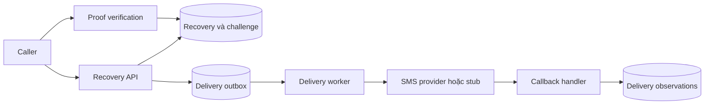

# SMS provider outage test

## 1. Mục tiêu của phép thử

Trong module `SECURITY_AUTHENTICATION_ACCOUNT_RECOVERY`, SMS có thể là kênh chuyển mã hoặc thông báo khi người dùng mất mật khẩu, MFA, passkey hoặc thiết bị xác thực. Khi nhà cung cấp SMS ngừng hoạt động, hệ thống cần hạn chế tác động đến khả dụng mà vẫn giữ nguyên điều kiện chứng minh quyền khôi phục.

Một SMS provider outage test không chỉ xác nhận service bắt được exception. Bài test phải chứng minh request không bị treo vô hạn, retry không gây bão gửi tin, trạng thái không tuyên bố thành công giả và sự cố delivery không biến thành quyền đổi credential.

Ví dụ nguy hiểm: provider đã nhận tin nhưng ứng dụng timeout; worker gửi lại và sinh một OTP mới; SMS cũ đến muộn, callback báo delivered làm hệ thống đánh dấu tài khoản đã xác minh. Trong chuỗi này, cả xử lý kết quả chưa rõ, vòng đời challenge và ranh giới giữa delivery với xác minh đều có thể sai.

Các state, API và tham số trong bài là mô hình minh họa cho test harness. Chúng không khẳng định dự án đang dùng một provider hay một implementation cụ thể. Khi áp dụng, cần ánh xạ sang hợp đồng thực tế của recovery, kho dữ liệu, hàng đợi và adapter SMS.

## 2. Tách trạng thái recovery khỏi trạng thái gửi tin

Một recovery request và một lần gửi SMS có vòng đời khác nhau. Trạng thái của chúng không nên được gộp thành một cờ `success`.

| Đối tượng | Ví dụ trạng thái | Điều trạng thái đó thể hiện |
| --- | --- | --- |
| Recovery request | PENDING_PROOF, PROOF_VERIFIED, COMPLETED, CANCELLED, EXPIRED | Tiến trình cấp quyền khôi phục |
| Challenge | ACTIVE, EXHAUSTED, CONSUMED, REVOKED, EXPIRED | Hiệu lực của bằng chứng được yêu cầu |
| Delivery intent | READY, WAITING_RETRY, STOPPED, EXPIRED | Ý định gửi trong hệ thống |
| Submit attempt | STARTED, ACCEPTED, REJECTED, UNKNOWN | Kết quả quan sát của một lần gọi provider |
| Delivery observation | QUEUED, SENT, DELIVERED, FAILED, UNKNOWN | Tín hiệu vận chuyển nhận được từ provider |

Đây là các chiều trạng thái minh họa, không phải enum bắt buộc. Đặc biệt, `UNKNOWN` không được tự đổi thành “chưa từng gửi”, vì provider có thể đã nhận hoặc chuyển tin trước khi phản hồi bị mất.

Ở ví dụ Twilio Messaging, `queued` cho biết yêu cầu gửi đã được chấp nhận vào hàng đợi; `sent` cho biết carrier phía trên đã nhận; `delivered` phản ánh xác nhận delivery mà provider nhận được. Không nên diễn giải mọi trạng thái này thành cùng một kết quả. [Twilio Message resource — Message Status values](https://www.twilio.com/docs/messaging/api/message-resource).

Ngay cả delivery được xác nhận cũng không phải bằng chứng người đang gửi HTTP request đã chứng minh quyền sở hữu tài khoản. Trong mô hình ứng dụng tự quản lý OTP, chỉ phép xác minh mã hợp lệ, đúng binding, còn hạn và còn ngân sách thử mới có thể chuyển sang trạng thái chứng minh tương ứng.

Nếu dùng dịch vụ managed verification thay vì API gửi SMS thuần túy, kết quả kiểm tra mã từ dịch vụ đó là một hợp đồng khác. Không dùng callback vận chuyển để giả lập kết quả kiểm tra mã, và không trộn hai loại API trong oracle.

### 2.1. Sơ đồ ranh giới cần quan sát



Mũi tên từ callback đi vào dữ liệu delivery. Việc chuyển recovery sang đã xác minh phải đi qua đường proof verification đúng thiết kế, không tự xuất hiện vì callback báo tin đã tới.

Nếu hệ thống gửi đồng bộ và không có outbox, test vẫn cần xác định điểm ghi ý định, điểm gọi provider và điểm xác nhận kết quả. Sơ đồ không phải yêu cầu thêm một kiến trúc mới trước khi kiểm thử.

## 3. Đặt giả thuyết và bất biến

Một giả thuyết chaos cụ thể có thể là:

> Khi đường gửi SMS bị gián đoạn trong một khoảng thời gian đã định, hệ thống giới hạn công việc chờ và retry, giữ nguyên điều kiện xác minh, đồng thời xử lý lại công việc còn hợp lệ sau khi dependency phục hồi.

Để kết luận, cần chuyển giả thuyết thành các bất biến có thể quan sát.

| Bất biến | Bằng chứng cần thu thập |
| --- | --- |
| Chưa xác minh thì chưa có quyền nhạy cảm | Không đổi password/MFA/passkey, không cấp session đầy đủ chỉ vì gửi tin |
| Chỉ challenge hợp lệ được sử dụng | Kiểm tra expiry, generation, purpose, subject và tenant |
| Retry không tự sinh thêm quyền đoán | Ngân sách thử và trạng thái challenge trước/sau retry |
| Gửi lại không vượt policy | Số intent, submit attempt, SMS được provider stub nhận |
| Kết quả không rõ được giữ rõ | Có trạng thái hoặc journal phân biệt UNKNOWN với REJECTED |
| Công việc cũ không được hồi sinh | Request đã hủy/hết hạn/hoàn tất không bị callback hoặc retry mở lại |
| Lỗi SMS không chiếm hết tài nguyên | Connection, thread, queue và độ trễ của luồng liên quan |
| Phục hồi không tạo đợt gửi không kiểm soát | Tốc độ thoát backlog, quota và số duplicate quan sát được |
| Có cách thông báo đúng trạng thái | Public response không hứa đã gửi khi chưa có căn cứ |
| Dữ liệu tenant không lẫn nhau | Recipient, template, provider account và callback binding |

Không phải mọi lần SMS gửi lỗi đều làm request recovery thất bại vĩnh viễn. Có thể request vẫn chờ bằng chứng trong khi delivery đang retry. Ngược lại, delivery thành công không có nghĩa recovery đã hoàn thành.

### 3.1. Giả thuyết cần kèm phạm vi

Ghi rõ provider nào, loại lỗi nào, bao nhiêu tenant test, thời gian chèn lỗi, tải tối đa và chỉ số nào quyết định dừng thí nghiệm. Những giá trị này là thuộc tính của môi trường và phép thử, không lấy một con số bất kỳ làm SLO production.

Một phép thử ở adapter stub chứng minh logic xử lý kết quả mô phỏng. Nó chưa chứng minh hành vi thật của mạng carrier hoặc provider. Một phép thử qua mạng proxy kiểm tra transport tốt hơn nhưng vẫn có thể không mô phỏng được provider nhận tin rồi mất phản hồi; cần một stub có khả năng ghi nhận việc nhận tin trước khi chủ động cắt kết nối.

## 4. Chuẩn bị dữ liệu và môi trường

Tạo một tài khoản tổng hợp có kênh SMS đã đăng ký theo policy, một request recovery đúng purpose và các session dùng để quan sát. Chuẩn bị thêm tài khoản của tenant khác để phát hiện việc dùng sai cấu hình provider hoặc nhận nhầm callback.

Dùng provider stub, test sink hoặc sandbox được cấu hình cho kiểm thử. Số điện thoại nhìn giống dữ liệu giả vẫn có thể thuộc người thật; không chọn ngẫu nhiên rồi gửi ra ngoài. Những bài test chỉ cần mô hình recipient có thể dùng một recipient reference do stub hiểu, không cần số thực.

Fixture nên có các thành phần sau:

| Thành phần | Khả năng cần có |
| --- | --- |
| Recovery fixture | Tạo account/request/challenge hợp lệ, đúng tenant/purpose |
| Provider stub | Ghi submit, từ chối, trì hoãn, nhận rồi làm mất phản hồi |
| Fault controller | Bật/tắt lỗi ở điểm xác định, có scope và deadline |
| Scheduler test | Chạy retry đến một mốc biết trước, không phụ thuộc sleep dài |
| Callback emitter | Phát callback hợp lệ, sai chữ ký, lặp và đảo thứ tự |
| Probe | Đọc intent, attempt, generation và tác động credential/session |
| Test clock | Điều khiển đúng thành phần dùng clock đó |
| Cleanup | Hủy fault và dọn dữ liệu đúng namespace của phép thử |

Clock Java không tự thay clock của database, message broker hoặc provider. Nếu expiry được quyết định bằng thời gian database, oracle phải dùng thời gian và độ phân giải thực của database hoặc một cơ chế test tương ứng.

Không đưa OTP vào assertion message, trace hay bản báo cáo. Nếu test cần lấy mã để gọi bước verify, giữ mã trong vùng dữ liệu test có kiểm soát và chỉ in challenge reference hoặc case ID khi thất bại.

## 5. Ma trận lỗi cần mô phỏng

“Provider down” gồm nhiều loại lỗi với cách xử lý khác nhau.

| Lỗi | Provider có thể đã nhận SMS? | Điều cần kiểm tra |
| --- | --- | --- |
| DNS không phân giải được | Chưa tới endpoint trong lần gọi đó | Timeout có hạn, phân loại lỗi, không treo worker |
| Kết nối bị từ chối trước khi gửi | Thường chưa, theo điểm chèn lỗi được xác nhận | Retry có ngân sách, không tạo challenge mới vô ý |
| TLS/hostname không hợp lệ | Không được tiếp tục bằng kết nối bỏ xác thực | Không tự tắt kiểm tra TLS để “khôi phục” |
| Timeout trước khi provider xử lý | Stub xác nhận chưa nhận | Retry theo policy, không mất intent |
| Timeout sau khi provider nhận | Có | UNKNOWN, idempotency hoặc reconcile phù hợp |
| HTTP 5xx | Phụ thuộc hợp đồng và điểm lỗi | Không mặc định side effect chưa xảy ra |
| Provider throttle | Phụ thuộc API | Backoff, quota, không retry dồn dập |
| Lỗi cấu hình hoặc credentials | Thường cần can thiệp cấu hình | Không retry nóng vô hạn |
| Sai recipient hoặc không thể delivery | Có thể đã nhận yêu cầu gửi | Phân loại lỗi cuối theo hợp đồng provider |
| Provider nhận nhưng carrier chậm | Có | UI, hạn challenge và callback muộn |
| Callback không tới | Submit vẫn có thể đã thành công | Không coi thiếu callback là bằng chứng thất bại chắc chắn |
| Callback đến nhưng handler lỗi | Có | Xử lý phát lại và idempotency nội bộ |

Các cách phân loại “thường” không thay thế hợp đồng của provider. Đối với 5xx hoặc timeout, stub phải cho biết lỗi được tạo trước hay sau việc nhận tin, để bài test có oracle rõ.

Không gán mọi mã 4xx thành lỗi vĩnh viễn hoặc mọi 5xx thành an toàn để retry. Adapter cần ánh xạ theo tài liệu endpoint đang dùng, kể cả những trường hợp response body mang trạng thái riêng.

## 6. Kịch bản nền: lỗi trước khi provider nhận

Đây là ca đầu tiên để xác nhận luồng recovery không phụ thuộc vào một lời gọi SMS thành công ngay lập tức.

1. Tạo tài khoản và snapshot trạng thái credential/session.
2. Chèn lỗi connection refused tại endpoint stub trước khi nhận request gửi.
3. Gọi khởi tạo recovery bằng API ứng dụng.
4. Chờ có bằng chứng worker đã gặp lỗi và xử lý theo policy.
5. Đọc request, challenge, intent và submit attempts.
6. Gỡ lỗi, cho scheduler xử lý một lượt retry hợp lệ.
7. Xác nhận delivery được tiếp tục mà không bỏ qua bước proof verification.

Kết quả mong đợi không nhất thiết là một HTTP status cố định. API bất đồng bộ có thể chấp nhận request và trả thông điệp chung; API khác có thể báo tạm thời chưa xử lý được. Điều kiện cần là hợp đồng public chính xác, có timeout và không tạo quyền truy cập sai.

Ở thời điểm chưa nhập mã, cần chứng minh password version chưa đổi, MFA/passkey chưa bị thay thế, không có recovery grant hoặc session có quyền nhạy cảm ngoài thiết kế. Audit về việc khởi tạo vẫn có thể tồn tại.

Sau khi provider phục hồi, chỉ công việc vẫn còn hiệu lực mới được gửi tiếp. Một intent đã quá hạn không nên được hồi sinh chỉ vì worker có thể kết nối lại.

### 6.1. Phát hiện thành công giả

Tạo probe riêng cho trạng thái hiển thị và trạng thái có tác động. Một response “yêu cầu đã được tiếp nhận” có thể đúng dù chưa gửi SMS; response “mã đã được xác minh” thì sai nếu chỉ thực hiện bước gửi.

Nếu UI hiển thị “đã gửi”, xác định nguồn dữ liệu của nhãn đó: commit intent, provider accepted hay delivery receipt. Test phải đối chiếu với ý nghĩa mà sản phẩm thực sự công bố, tránh dùng một từ cho ba thời điểm khác nhau.

## 7. Kịch bản trọng tâm: đã nhận SMS nhưng mất phản hồi

AWS mô tả timeout là kết quả quan sát không đủ để kết luận side effect chưa xảy ra. Đây là lý do retry một thao tác có tác động cần được thiết kế cẩn thận. [AWS Builders’ Library — Timeouts, retries, and backoff with jitter](https://aws.amazon.com/builders-library/timeouts-retries-and-backoff-with-jitter/).

Đối với SMS, chuỗi lỗi có thể là:

```text
t0: ứng dụng lưu delivery intent D1, gắn challenge C1 generation G1
t1: worker submit D1 tới provider
t2: provider ghi nhận message M1 và có thể bắt đầu delivery
t3: stub cắt phản hồi trước khi worker đọc được kết quả
t4: worker thấy timeout; chưa biết M1 đã được tạo
t5: scheduler cân nhắc retry hoặc reconcile
```

Bài test cần kiểm tra trạng thái sau t4 trước khi cho retry chạy. Nếu chỉ quan sát sau khi mọi thứ ổn định, có thể bỏ sót việc hệ thống từng đánh dấu thất bại chắc chắn hoặc đã cấp một challenge mới không cần thiết.

### 7.1. Provider có cơ chế idempotency phù hợp

Nếu API provider hỗ trợ idempotency cho operation đang dùng, test cần dùng đúng cơ chế đó với cùng một ý định logic. Kiểm tra phạm vi khóa, thời hạn lưu, điều kiện payload phải giống nhau và hành vi khi retry sau thời hạn deduplication.

Không mặc định một HTTP header do ứng dụng tự đặt được provider hiểu. Một idempotency key lưu ở ứng dụng chỉ khử trùng lặp ở phạm vi ứng dụng; nó không ngăn provider tạo hai message nếu hai lệnh submit đã tới ngoài ranh giới được khử trùng lặp.

Oracle có thể yêu cầu số submit attempt lớn hơn một nhưng số message provider tạo cho D1 bằng một, nếu đó là điều provider và adapter thực sự cam kết. Chưa có hợp đồng này thì không viết “exactly once” vào tiêu chí đạt.

### 7.2. Provider không có bảo đảm khử trùng lặp tương ứng

Có thể cần reconcile bằng provider message reference, cơ chế tra cứu được hỗ trợ hoặc một chính sách retry có giới hạn chấp nhận khả năng gửi trùng. Nếu mất phản hồi trước khi lấy message ID, không được giả định luôn có cách tìm lại message theo client reference.

Trong cấu hình có thể gửi trùng, bài test phải đo số message và giới hạn mà policy cho phép, đồng thời xác nhận duplicate delivery không tạo duplicate quyền khôi phục. Ví dụ nhiều bản tin có thể cùng tham chiếu một challenge hiện hành theo policy; nhiều lần nhập lại cùng bằng chứng vẫn không được tạo nhiều lần thay credential.

Việc gửi lại cùng mã có thể đòi hỏi hệ thống giữ khả năng tạo payload lại theo cách bảo vệ bí mật phù hợp. Không tự suy ra rằng cần lưu OTP plaintext lâu dài. Một managed verification API và một hệ thống tự quản lý OTP có cách thiết kế khác nhau.

### 7.3. Retry và phát mã mới là hai operation khác nhau

Retry của delivery attempt không nên vô tình gọi lại cả luồng tạo recovery như một request mới. Nếu resend chủ ý phát generation mới, phải áp dụng quy tắc thay thế, vô hiệu hóa và ngân sách thử đã được định nghĩa.

Một test có ích là cho SMS G1 đến muộn sau khi G2 đã được cấp. Xác minh mã của G1 không được chấp nhận nếu policy đã thay thế G1; callback của G1 cũng không được làm G1 hoặc recovery đã đóng quay lại hoạt động.

## 8. Outbox, worker crash và điểm commit

Không có transaction database thông thường nào tự bao trùm cả provider SMS bên ngoài. Vì vậy cần kiểm tra các khoảng trống giữa lưu trạng thái nội bộ, gọi provider và ghi kết quả.

| Điểm dừng worker | Rủi ro | Oracle cần kiểm tra |
| --- | --- | --- |
| Sau lưu challenge, trước lưu intent | Có challenge nhưng không có đường delivery | Atomicity hoặc cơ chế sửa trạng thái theo thiết kế |
| Sau commit intent, trước submit | Mất công việc nếu intent không được đọc lại | Worker khác có thể tiếp tục intent hợp lệ |
| Sau nhận lease, trước gọi provider | Intent bị kẹt vì lease không thu hồi | Hết lease/recovery theo policy |
| Sau provider nhận, trước lưu kết quả | Gửi trùng khi worker khác retry | UNKNOWN, idempotency hoặc reconcile |
| Sau lưu accepted, trước ack queue | Phát lại công việc | Không submit lặp ngoài hợp đồng |
| Sau request bị hủy nhưng worker chưa biết | Gửi nội dung cho request không còn hiệu lực | Kiểm tra quyền gửi và hiệu lực khi thực thi |

Nếu dùng outbox, test xem challenge và intent có được ghi theo bảo đảm transaction đã công bố không. Nếu không dùng outbox, cần mô tả cơ chế khác xử lý việc mất công việc; không giả định retry HTTP từ caller là đủ.

Một lease hết hạn chỉ là điều kiện cho worker khác nhận việc, không chứng minh worker cũ đã dừng. Hãy tạo tình huống worker cũ trả về muộn sau khi worker mới đã tiếp quản; kiểm tra version, fencing hoặc điều kiện cập nhật giúp ngăn ghi đè sai.

Việc chặn submit cho request đã hủy có thể gặp race với provider đã nhận tin. Không hứa rằng mọi SMS đều có thể bị thu hồi. Bất biến quan trọng là tin tới muộn không còn cấp quyền nếu challenge đã bị thu hồi, hết hạn hoặc bị thay thế.

## 9. Retry, backoff và circuit breaker

Mỗi lớp có thể tự retry: SDK HTTP, adapter, worker và caller. Nếu không kiểm soát chung, một yêu cầu logic có thể tạo nhiều submit hơn người thiết kế nghĩ.

Ví dụ minh họa: ba lớp, mỗi lớp tối đa ba attempt cho mỗi lần được gọi. Trong trường hợp mọi nhánh đều đi tới giới hạn, số lời gọi ở lớp dưới cùng có thể lên tới `3 × 3 × 3 = 27` cho một thao tác ở lớp trên. Đây là phép tính của cấu hình ví dụ, không phải hành vi bắt buộc của một SDK cụ thể.

Test nên thống kê cả số thao tác logic và số submit vật lý. Cần một giới hạn tổng cho intent, thời hạn xử lý và quota bảo vệ chi phí. Không chỉ kiểm tra rằng mỗi vòng lặp riêng có biến `maxRetries`.

### 9.1. Phân loại và lịch retry

Một cấu hình test minh họa có thể dùng:

```yaml
# Hợp đồng giả định của test harness; không phải cấu hình production.
deliveryPolicy:
  maxSubmitAttemptsPerIntent: 3
  maxIntentAgeSeconds: 120
  retryDelay:
    kind: exponential_with_jitter
    initialMillis: 200
    maximumMillis: 2000
  stopWhenChallengeInactive: true
  retryAuthenticationFailure: false
```

Khi đưa cấu hình vào test suite, dùng schema của harness và chọn tham số phù hợp với deadline của bằng chứng; các số trong ví dụ chỉ phục vụ kiểm thử.

Đối với test thời gian, cố định seed của bộ sinh jitter hoặc kiểm tra một khoảng giá trị hợp lệ, không đòi một delay ngẫu nhiên chính xác. Đồng thời cần có một bài kiểm tra nhiều intent để xác nhận lịch gửi lại không đồng loạt dồn vào cùng một thời điểm.

AWS nêu backoff và jitter như các cách giảm việc retry làm tăng tải lên dependency đang lỗi. Trong bài test, cần quan sát lịch submit và tải thật thay vì chỉ xác nhận cấu hình có chữ “jitter”. [AWS Builders’ Library — Timeouts, retries, and backoff with jitter](https://aws.amazon.com/builders-library/timeouts-retries-and-backoff-with-jitter/).

Nếu provider trả gợi ý thời điểm thử lại, adapter chỉ dùng theo hợp đồng endpoint và vẫn giữ deadline của intent/challenge. Không vì một thời gian chờ dài mà tự kéo dài hiệu lực bằng chứng.

### 9.2. Circuit breaker và giới hạn tài nguyên

Khi breaker mở, test cần xác nhận số submit mới giảm đúng thiết kế, request không giữ connection vô hạn và ý định gửi được chuyển sang chờ hoặc dừng có kiểm soát.

Ở trạng thái half-open, giới hạn số probe đồng thời. Mở lỗi, đóng lỗi rồi mở lại để xem breaker có dao động và tạo các đợt tải lớn không. Một request probe thành công không chứng minh mọi tuyến carrier đã phục hồi.

Kiểm tra cả lỗi một phần: chỉ một tenant, một provider account hoặc một tuyến gửi gặp sự cố. Nếu circuit breaker dùng chung quá rộng, một lỗi cục bộ có thể làm dừng SMS của mọi tenant; nếu chia quá nhỏ, tổng số probe có thể vẫn quá lớn.

Các luồng không cần SMS, như kiểm tra token đã có bằng chứng hợp lệ hoặc đăng nhập bằng credential còn dùng được, cần giữ mức khả dụng theo thiết kế. Không để pool gọi SMS chiếm hết tài nguyên chung.

## 10. Callback đến muộn, lặp và sai thứ tự

Twilio lưu ý callback trạng thái có thể đến không theo thứ tự đã gửi do độ trễ mạng. Vì vậy không thể cập nhật trạng thái theo giả định “request tới sau luôn mới hơn”. [Twilio — Track outbound message status](https://www.twilio.com/docs/messaging/guides/track-outbound-message-status).

Tạo các chuỗi sự kiện có chủ đích:

```text
Chuỗi A: delivered(M1), sau đó sent(M1)
Chuỗi B: delivered(M1), delivered(M1) lặp lại
Chuỗi C: callback M1 đến trước khi worker lưu mapping message ID
Chuỗi D: delivered(M1) sau khi challenge G1 đã bị G2 thay thế
Chuỗi E: callback của provider account B tham chiếu ID giống dữ liệu account A
Chuỗi F: callback hợp lệ cho request đã CANCELLED hoặc COMPLETED
```

Oracle cần phân biệt lưu lịch sử sự kiện với trạng thái hiện tại. Có thể ghi lại cả callback đến muộn nhưng không làm delivery bị lùi vô lý hoặc mở lại quyền recovery. Không xây một bảng thứ hạng trạng thái chung cho mọi provider rồi mặc định `failed` luôn “cao hơn” `delivered`; ánh xạ theo hợp đồng và cách xử lý mâu thuẫn đã định.

Callback đến trước mapping là một ca quan trọng. Tùy thiết kế có thể lưu sự kiện chờ reconcile hoặc phản hồi lỗi để provider phát lại theo hợp đồng. Không bỏ mất callback rồi đánh dấu delivery thất bại chắc chắn chỉ vì thứ tự đến khác dự đoán.

### 10.1. Xác thực callback và giới hạn quyền

Với tích hợp Twilio tương ứng, tài liệu hướng dẫn xác minh chữ ký request, bao gồm URL và các tham số liên quan, và khuyến nghị dùng phương thức xác minh trong SDK. Test nên đi qua cấu hình proxy thực tế vì URL nội bộ có thể khác URL được ký. [Twilio — Secure webhooks](https://www.twilio.com/docs/usage/webhooks/webhooks-security).

Tạo callback sai chữ ký, đúng chữ ký nhưng sai provider account, sai message binding hoặc tham chiếu một tenant khác. Không cho một callback giả ghi trạng thái delivery hợp lệ, càng không được chuyển challenge sang đã xác minh.

Một chữ ký đúng không tự ngăn mọi replay. Handler cần xử lý lặp theo event/message identity và các quy tắc vòng đời tương ứng. Không áp đặt yêu cầu timestamp hoặc trường event ID mà provider không có; dùng đúng dữ liệu được hợp đồng hỗ trợ.

Ngay cả callback hợp lệ báo `delivered` cũng chỉ được có quyền cập nhật phần delivery thích hợp. Để chứng minh ranh giới, đọc trạng thái proof, credential và session ngay sau callback mà chưa gửi mã vào bước verify.

## 11. Hiệu lực OTP, resend và queue backlog

Outage có thể làm SMS đến sau khi mã đã hết hạn. Test phải kiểm tra expiry tại điểm sử dụng bằng chứng, không chỉ lúc tạo SMS.

Một timeline minh họa:

```text
t0: challenge G1 được cấp, hết hạn tại tE
t1: provider outage; intent G1 đang chờ
t2: dependency phục hồi nhưng t2 >= tE
t3: worker xét lại intent
t4: một SMS cũ vẫn đến từ provider
t5: caller nhập mã G1
```

Theo policy không gia hạn bằng chứng vì outage, tại t3 không tiếp tục submit intent đã hết hiệu lực; tại t5 mã G1 phải bị từ chối. Nếu provider đã giữ tin từ trước, ứng dụng có thể không ngăn được việc tin tới ở t4, nhưng vẫn phải thực thi expiry.

Không lấy thời điểm nhận callback `delivered` làm thời điểm bắt đầu lại toàn bộ TTL nếu challenge được thiết kế hết hạn từ lúc cấp. Một thiết kế khác cần định nghĩa rõ mốc hiệu lực, binding và deadline, rồi được test theo đúng mốc đó.

### 11.1. Không làm mới ngân sách đoán khi delivery lỗi

Tạo một challenge đã dùng một phần ngân sách thử sai, gây lỗi SMS rồi gửi lại. Sau outage và retry, số lượt đã dùng phải được bảo toàn theo vòng đời challenge.

Đối với resend cấp generation mới, bổ sung ngân sách ở cấp subject hoặc một cơ chế chống lạm dụng tương ứng để việc tạo generation không vô tình cho phép đoán không giới hạn. Không tự quy định mọi challenge mới đều kế thừa cùng một số đếm; cần kiểm tra điều kiện cấp lại quyền trong policy.

### 11.2. Phục hồi backlog có chọn lọc

Khi provider hoạt động lại, worker cần phân loại intent còn hợp lệ, đã hết hạn, đã hủy, đã bị thay thế và chưa rõ kết quả. Test tạo đủ các nhóm rồi quan sát từng nhóm.

Không phát lại toàn bộ hàng đợi theo thứ tự cũ mà không xét thời hạn. Điều đó có thể vừa làm quá tải provider vừa gửi hàng loạt mã không dùng được, khiến người dùng nhập nhầm.

Đo độ tuổi công việc cũ nhất, tốc độ thoát backlog, số intent bị loại đúng lý do và quota giữa các tenant. Kiểm tra người dùng vừa tạo request mới có bị kẹt sau một lượng lớn công việc cũ đã mất giá trị hay không, theo chính sách ưu tiên thực tế.

Một dead-letter queue không phải cơ chế tự động gia hạn. Khi vận hành replay công việc từ đó, phải kiểm tra lại request, challenge, purpose, tenant và deadline; không chỉ đổi cờ “cho gửi lại”.

## 12. Failover provider và phương án khôi phục thay thế

### 12.1. Chuyển từ provider A sang provider B

Failover không xóa được sự không chắc chắn ở A. Sau timeout, A có thể tiếp tục gửi trong khi B cũng đã nhận cùng ý định. Test cần mô phỏng cả hai cùng delivery, không chỉ trường hợp A tuyệt đối không nhận gì.

Xác định provider B hỗ trợ recipient, sender, template và vùng đích cần dùng. Chứng minh mapping tenant, credentials và callback secret đúng; không lấy cấu hình của tenant khác để tiếp tục gửi.

Nếu thiết kế giữ cùng challenge khi đổi provider, kiểm tra các bản tin không tạo nhiều grant hoặc nhiều lượt tiêu thụ. Nếu thiết kế phát generation mới, kiểm tra generation cũ hết hiệu lực đúng thời điểm và tin tới muộn không mở lại nó.

Circuit breaker và rate limit cần bao phủ tổng chi phí qua cả hai provider theo policy. Chuyển provider không mặc định là quyền tạo một ngân sách gửi hoàn toàn mới cho subject.

### 12.2. Đổi kênh xác minh

SMS outage không phải bằng chứng caller là chủ tài khoản. Không tự giảm mức bảo đảm, bỏ qua MFA, cấp session đầy đủ hoặc cho caller đổi số điện thoại chỉ vì kênh SMS đang lỗi.

Nếu sản phẩm có recovery code, passkey còn dùng được, kênh đã đăng ký khác hoặc hỗ trợ thủ công, test điều kiện lựa chọn và mức quyền của từng đường theo policy. Kênh do caller vừa nhập không được tự coi là kênh đã xác minh.

Trường hợp mất MFA hoặc passkey cần đi qua bằng chứng thay thế mà hệ thống cho phép. Không dùng lời khai “tôi không nhận được SMS” như bằng chứng đủ để thay thiết bị xác thực.

Với luồng hỗ trợ, kiểm tra actor support, subject, tenant, yêu cầu phê duyệt và audit. Sự cố provider không tự trao cho mọi nhân viên quyền override.

### 12.3. Nội dung phản hồi

Caller cần biết thao tác nào có thể làm tiếp theo, nhưng phản hồi không được tiết lộ account tồn tại hay kênh bí mật ngoài policy.

Ví dụ thông điệp công khai cho bước khởi tạo:

```text
Nếu thông tin phù hợp, hướng dẫn sẽ được gửi qua kênh đã đăng ký.
Nếu chưa nhận được, hãy chờ trước khi thử lại hoặc chọn phương án
khôi phục khác mà hệ thống cung cấp.
```

Không công bố số điện thoại đầy đủ hoặc nội dung OTP. Nếu hiển thị tình trạng sự cố chung của SMS, kiểm tra hành vi nhất quán với subject tồn tại và không tồn tại. Một thông điệp chung vẫn cần được hỗ trợ bởi xử lý nội bộ đúng; nó không sửa được lỗi gửi trùng hay cấp quyền sai.

## 13. Mẫu hợp đồng kiểm thử Java

Đoạn sau minh họa JUnit 5 cho mô hình ứng dụng tự quản lý challenge. Các interface thuộc test harness giả định và cần adapter tới hệ thống thật; đoạn này chưa phải một test chạy độc lập.

Snapshot tập trung vào tác động nhạy cảm. Số session được tính trong phạm vi tài khoản test đã cô lập; tránh dùng tổng session toàn môi trường.

```java
import java.time.Duration;
import org.junit.jupiter.api.Test;

import static org.junit.jupiter.api.Assertions.*;

abstract class SmsOutageContract {
    record Subject(String tenant, String accountRef) {}
    record RecoveryRef(String value) {}
    record SensitiveState(long passwordVersion,
                          long factorVersion,
                          long authorizationVersion,
                          int fullPrivilegeSessions) {}

    interface Harness extends AutoCloseable {
        Subject isolatedSubject();
        SensitiveState sensitiveState(Subject subject);

        // Stub chấp nhận submit trước, rồi cắt phản hồi.
        void acceptNextSmsThenLoseResponse();
        RecoveryRef startRecovery(Subject subject);

        // Chờ journal xác nhận hệ thống đã quan sát kết quả chưa rõ.
        void awaitUnknownSubmit(RecoveryRef ref, Duration deadline);

        int deliveryIntents(RecoveryRef ref);
        int activeChallenges(RecoveryRef ref);
        int proofVerifiedTransitions(RecoveryRef ref);

        // Callback có binding và chữ ký hợp lệ của provider test.
        void emitDeliveredForAcceptedSms(RecoveryRef ref);
        void awaitCallbackProcessed(RecoveryRef ref, Duration deadline);

        @Override
        void close();
    }

    protected abstract Harness newHarness();

    @Test
    void unknownSubmitAndDeliveryCallbackDoNotVerifyIdentity() {
        try (Harness h = newHarness()) {
            Subject subject = h.isolatedSubject();
            SensitiveState before = h.sensitiveState(subject);

            h.acceptNextSmsThenLoseResponse();
            RecoveryRef ref = h.startRecovery(subject);
            h.awaitUnknownSubmit(ref, Duration.ofSeconds(5));

            assertEquals(1, h.deliveryIntents(ref));
            assertEquals(1, h.activeChallenges(ref));
            assertEquals(0, h.proofVerifiedTransitions(ref));
            assertEquals(before, h.sensitiveState(subject));

            h.emitDeliveredForAcceptedSms(ref);
            h.awaitCallbackProcessed(ref, Duration.ofSeconds(5));

            assertEquals(0, h.proofVerifiedTransitions(ref));
            assertEquals(before, h.sensitiveState(subject));
        }
    }
}
```

Kỳ vọng một intent và một challenge trong ví dụ thuộc mô hình fixture đã chọn. Nếu hệ thống có nhiều challenge được phép tồn tại song song, thay oracle bằng điều kiện cụ thể của policy; không sửa số kỳ vọng chỉ để che một lỗi nhân bản ngoài ý muốn.

`awaitUnknownSubmit` phải chờ một quan sát có thật trong journal, không tự đặt trạng thái thành UNKNOWN. Tương tự, callback emitter cần đi qua handler đang được đánh giá, không ghi trực tiếp database rồi kết luận signature validation đã hoạt động.

Đây mới là ca kiểm tra ranh giới giữa delivery với quyền xác minh. Cần những ca riêng để đo submit vật lý, retry budget, expiry, failover và hành vi nhập mã. Không dùng snapshot của test này để tuyên bố toàn bộ outage test suite đã đạt.

## 14. Ma trận thực hành toàn luồng

| ID | Fault và thao tác | Điều kiện cần chứng minh |
| --- | --- | --- |
| SMS-01 | Từ chối kết nối trước submit | Thời gian chờ có hạn, intent được xử lý đúng |
| SMS-02 | Provider nhận rồi mất phản hồi | UNKNOWN không bị coi là chưa gửi chắc chắn |
| SMS-03 | HTTP 5xx trước/sau nhận | Phân loại và retry đúng từng điểm lỗi |
| SMS-04 | Provider throttle kéo dài | Tổng attempt, chi phí và backoff trong policy |
| SMS-05 | Sai credentials hoặc TLS | Không retry nóng, không tắt kiểm tra bảo mật |
| SMS-06 | Worker chết sau commit outbox | Công việc còn hợp lệ được tiếp tục |
| SMS-07 | Worker chết sau provider nhận | Gửi trùng và reconcile trong hợp đồng |
| SMS-08 | Callback đến trước mapping | Không mất thông tin hoặc cấp quyền sai |
| SMS-09 | Callback lặp, đảo thứ tự | Handler idempotent theo hợp đồng, trạng thái không hồi sinh |
| SMS-10 | Callback sai chữ ký/tenant | Không ghi nhận delivery hoặc proof trái quyền |
| SMS-11 | SMS tới sau expiry | Mã bị từ chối tại điểm sử dụng |
| SMS-12 | Resend G2, SMS G1 tới muộn | Generation hiện hành và ngân sách thử đúng |
| SMS-13 | Hủy/hoàn tất recovery trong outage | Retry/callback không mở lại request |
| SMS-14 | Failover A sang B, A phục hồi muộn | Không nhân bản quyền hoặc vượt quota tổng |
| SMS-15 | Chỉ một tenant/tuyến lỗi | Cô lập lỗi và tài nguyên đúng phạm vi |
| SMS-16 | Provider phục hồi, backlog lớn có kiểm soát | Chỉ gửi công việc hợp lệ, tốc độ thoát được giới hạn |
| SMS-17 | Chọn phương án recovery thay thế | Không hạ điều kiện chứng minh vì lỗi delivery |
| SMS-18 | Outage trong khi verify mã hợp lệ đã nhận | Hành vi verify theo dependency thật và policy |
| SMS-19 | Request spam trong thời gian lỗi | Giữ quota, chống enumeration, không khóa account ngoài policy |
| SMS-20 | Gỡ fault và cleanup | Không còn fault/worker thử nghiệm tác động môi trường |

Ở SMS-18, không mặc định verify phải luôn hoạt động độc lập với provider. Nếu mã do ứng dụng kiểm tra và không cần gọi SMS API, outage gửi không nên gây phụ thuộc giả. Nếu managed verification yêu cầu gọi provider, test cần xử lý dependency thật, chưa rõ kết quả và quyền retry theo hợp đồng đó.

## 15. Quan sát phục hồi và kết luận thí nghiệm

Một hệ thống “phục hồi” không chỉ là HTTP health check của provider trở lại 200. Cần quan sát submit có tiến triển, backlog hợp lệ giảm, không tăng lỗi quá mức, không có các thay đổi quyền trái phép và hệ thống quay về lịch xử lý ổn định.

Các chỉ số hữu ích gồm số intent theo trạng thái, độ tuổi intent đang chờ, submit attempt trên mỗi intent, timeout, kết quả chưa rõ, callback bị từ chối, duplicate bị khử và chi phí theo phạm vi được phép.

Metric cần tránh label có cardinality không giới hạn như số điện thoại, OTP hoặc một request ID mới cho mỗi mẫu. Dữ liệu chi tiết có thể nằm trong journal truy cập hạn chế và được đối chiếu bằng reference an toàn.

Một report minh họa có thể có cấu trúc:

```text
CASE: SMS-02
MODEL: application-managed challenge
FAULT: provider stub accepts submit, response is dropped
SCOPE: one isolated tenant/account and one delivery intent
OBSERVATION:
  provider accepted a message
  application recorded unknown submit outcome
  delivery callback did not create a proof-verification transition
  credential and full-privilege session state remained unchanged
RETRY_CHECK: assessed separately under the configured provider contract
RESULT: report PASS/FAIL only after collecting actual observations
```

Không điền kết quả giả vào report khi mới viết bài hoặc mới chuẩn bị harness. Một ca PASS phải kèm policy version, điểm chèn lỗi, topology, thời gian, oracle và những phần chưa được kiểm tra.

Sau khi gỡ fault, xác nhận endpoint/adapter đã trở về cấu hình ban đầu, scheduler thử nghiệm đã dừng và không còn callback giả trong hàng chờ ngoài phạm vi ca test. Cleanup dữ liệu phải theo namespace; không xóa queue hoặc database dùng chung để làm sạch kết quả.

### 15.1. Diễn giải lỗi cụ thể

Thay vì ghi “retry không an toàn”, ghi điều kiện và tác động: “Sau timeout tại điểm provider đã nhận D1, hai worker tạo hai challenge mới, bộ đếm thử sai bị reset và SMS generation cũ vẫn được verify thành công.”

Thay vì ghi “outage recovery thất bại”, chỉ rõ: “Sau khi provider phục hồi, worker gửi 30 intent đã hết hạn trong fixture, không xét trạng thái CANCELLED; API nhập mã vẫn từ chối nên bất biến cấp quyền giữ được, nhưng delivery và xử lý backlog vi phạm policy.”

Cách diễn giải này giúp phân biệt lỗi khả dụng, chi phí, thông điệp và quyền truy cập; mỗi lỗi có oracle và mức ảnh hưởng khác nhau.

## 16. Bài tập thiết kế

**Bài tập 1 — Callback không phải xác minh.** Tạo một recovery chưa có proof, gửi callback delivered hợp lệ rồi đọc credential/session. Nêu những thay đổi delivery được phép và những thay đổi quyền phải bị cấm.

**Bài tập 2 — Timeout không rõ kết quả.** So sánh hai fault: cắt kết nối trước khi provider nhận và cắt phản hồi sau khi provider nhận. Thiết kế journal và probe để hai trường hợp không bị gộp vào cùng một kết luận “chưa gửi”.

**Bài tập 3 — Failover tới muộn.** Cho provider A nhận tin rồi timeout, chuyển B và sau đó phát callback của A. Chốt chính sách generation, quota và điều kiện nhập mã trước khi đưa ra kỳ vọng PASS.

**Bài tập 4 — Backlog vượt thời hạn.** Chuẩn bị intent còn hạn, hết hạn, đã hủy và đã bị thay thế. Khôi phục provider rồi đo nhóm nào được submit, nhóm nào bị loại và lý do của từng quyết định.

**Bài tập 5 — Mất MFA cùng outage SMS.** Người dùng không còn thiết bị MFA và không nhận được SMS. Mô tả những bằng chứng thay thế đã được policy cho phép, cách kiểm tra quyền của hỗ trợ và cách tránh dùng sự cố delivery làm bằng chứng danh tính.

Phép thử có giá trị khi chứng minh cả việc dịch vụ tiếp tục xử lý trong giới hạn đã định lẫn việc sự cố vận chuyển không làm thay đổi điều kiện cấp quyền khôi phục tài khoản.
