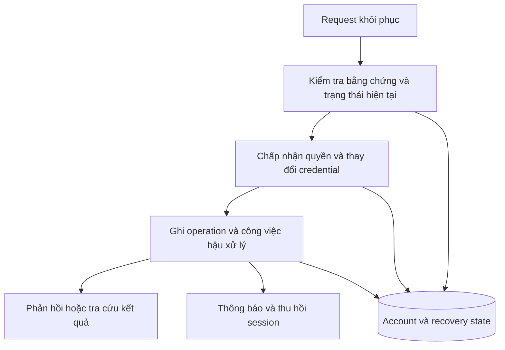
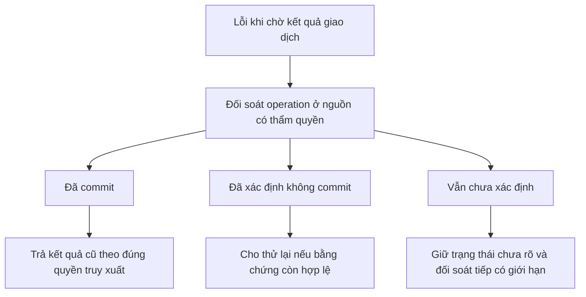

# Database outage test cho luồng khôi phục tài khoản

## 1. Mục tiêu: mất database không làm mất điều kiện bảo mật

**Database outage test** kiểm tra hành vi của hệ thống khi ứng dụng không thể đọc hoặc ghi cơ sở dữ liệu, chỉ truy cập được một phần, hoặc không biết giao dịch cuối đã commit hay chưa. Với khôi phục tài khoản, mục tiêu không chỉ là trả lỗi nhanh: hệ thống phải giữ đúng quyền xác minh, không đổi credential bằng bằng chứng chưa được chấp nhận và không làm sống lại quyền đã tiêu thụ khi phục hồi.

Trong module `SECURITY_AUTHENTICATION_ACCOUNT_RECOVERY`, người dùng có thể mất mật khẩu, MFA, passkey hoặc thiết bị xác thực. Luồng khôi phục cần dữ liệu tài khoản, trạng thái bằng chứng, giới hạn sử dụng, session và các thay đổi bảo mật. Khi database lỗi, không được dùng sự thiếu dữ liệu như một lý do để bỏ qua các điều kiện đó.

Ví dụ, một reset token có chữ ký còn hợp lệ nhưng hệ thống không kiểm tra được nó đã dùng hay bị thu hồi chưa. Nếu contract của token yêu cầu tra cứu trạng thái hiện tại, chữ ký không đủ để cho phép đổi mật khẩu trong lúc kho trạng thái bị lỗi. Ngược lại, một token có thể được xác minh độc lập theo một thiết kế khác; test phải xác định rõ những điều kiện nào thực sự cần nguồn dữ liệu trực tuyến.

[OWASP Forgot Password Cheat Sheet](https://cheatsheetseries.owasp.org/cheatsheets/Forgot_Password_Cheat_Sheet.html) khuyến nghị bằng chứng reset có thời hạn, dùng một lần và không thay đổi tài khoản trước khi có token hợp lệ. Bài học này dùng những mục tiêu đó làm điểm xuất phát để thiết kế các kịch bản lỗi database, đồng thời mở rộng oracle cho MFA, passkey và session theo contract của từng luồng.

Ba kết quả cần tách biệt:

| Nhóm kết quả | Câu hỏi cần trả lời |
| --- | --- |
| Bảo mật | Database lỗi có làm bỏ qua xác minh, consume token hoặc giới hạn quyền không? |
| Tính nhất quán | Grant, credential, operation và tác vụ hậu xử lý có trạng thái phù hợp với nhau không? |
| Khả dụng và phục hồi | Request có kết thúc trong ngân sách, tài nguyên có được giải phóng và dịch vụ có hoạt động lại sau khi gỡ lỗi không? |

Một response 503 có thể phù hợp khi không đủ điều kiện quyết định quyền. Tuy nhiên, 503 không tự chứng minh rằng password chưa bị thay đổi. Cần đọc trạng thái đã commit và biết giao dịch đang ở giai đoạn nào.

Các tên bảng, endpoint, giá trị timeout và mã Java trong bài là minh họa. Chúng không khẳng định module đang sử dụng một database, connection pool hay topology cụ thể.

## 2. Vẽ đúng ranh giới phụ thuộc dữ liệu

Một ứng dụng có thể dùng cùng database cho nhiều mục đích, hoặc tách account, grant, audit, queue và session sang các kho khác nhau. Cần lập bản đồ theo quyết định nghiệp vụ trước khi chọn fault.



Sơ đồ mô tả một thiết kế mà operation và outbox cùng nằm trong kho dữ liệu chính. Nếu kiến trúc thực tế khác, phải vẽ lại phần đó; không giả định một transaction bao trùm mọi dịch vụ.

| Dữ liệu hoặc thành phần | Quyết định liên quan | Điều cần kiểm tra khi không truy cập được |
| --- | --- | --- |
| Account và tenant membership | Principal nào được thay đổi | Không suy quyền từ account ID do client gửi |
| Recovery token hoặc challenge | Còn hiệu lực, đã dùng, bị thu hồi hay không | Không hiểu lỗi đọc thành chưa dùng hoặc chưa tồn tại |
| Credential và authenticator | Password hash, MFA, passkey mới | Không ghi một phần rồi báo toàn bộ đã hoàn tất |
| Operation và idempotency record | Thao tác nào đã được commit | Không thực hiện lại chỉ vì mất response |
| Giới hạn thử và tín hiệu rủi ro | Có được tiếp tục xác minh không | Không ngầm chuyển sang không giới hạn thử |
| Security epoch và session state | Quyền cũ còn hợp lệ hay không | Không làm session cũ sống lại do dùng snapshot lỗi thời |
| Audit hoặc outbox | Theo dõi và thực hiện tác vụ sau commit | Không lặng lẽ mất công việc bắt buộc theo contract |

Không phải mọi lỗi audit đều có cùng hậu quả. Nếu thiết kế yêu cầu ghi audit bền vững cùng thao tác nhạy cảm, lỗi ghi audit phải ngăn transaction đó hoàn tất. Nếu audit được đệm qua một cơ chế bền vững đã được chấp nhận, cần kiểm tra giới hạn và đường phục hồi của cơ chế ấy. Một câu log ở bộ nhớ không tự thay thế được yêu cầu lưu bền.

### Database không sẵn sàng khác với không tìm thấy account

Những tình huống sau có ý nghĩa khác nhau:

```text
SELECT trả về 0 hàng       -> truy vấn hoàn tất, không có hàng phù hợp
Không mượn được connection -> chưa có kết quả truy vấn
Read timeout              -> chưa biết truy vấn đã xử lý tới đâu
Lỗi khi nhận COMMIT       -> có thể chưa biết transaction đã commit hay chưa
```

Một implementation bắt mọi exception rồi trả `Optional.empty()` sẽ xóa mất sự khác biệt này. Test cần bắt được các đường như “account không có MFA” khi thực tế truy vấn MFA thất bại, hoặc “token chưa dùng” khi bảng consume không đọc được.

## 3. Viết giả thuyết và bất biến trước khi gây lỗi

Giả thuyết minh họa cho endpoint hoàn tất password reset:

> Khi database cần cho việc quyết định quyền không thể truy cập trước khi transaction bắt đầu, endpoint kết thúc trong ngân sách đã chọn, không cấp thêm quyền và không tạo thay đổi credential; sau khi kết nối được phục hồi, một fixture hợp lệ vẫn có thể đi qua luồng bình thường.

Đây là một giả thuyết hẹp, dễ đo. Không dùng nó cho tình huống lỗi sau commit vì khi đó một thay đổi đã xảy ra có thể hoàn toàn hợp lệ.

Những bất biến bảo mật thường cần ánh xạ vào contract:

| Bất biến | Oracle gợi ý |
| --- | --- |
| Không cấp quyền nếu chưa xác minh được điều kiện bắt buộc | Số grant hoặc session đặc quyền mới bằng 0 trong kịch bản chưa được chấp nhận |
| Một quyền single-use không tạo hai thay đổi | Số operation commit và credential version theo từng grant |
| Không có trạng thái nhạy cảm nửa chừng | Token consume và credential mutation cùng kết quả theo mô hình giao dịch |
| Không bỏ ràng buộc account, tenant, purpose | Không có dữ liệu ngoài fixture bị thay đổi |
| Lỗi dependency không trở thành bằng chứng danh tính | Response và hành vi không mở bước tiếp theo bằng dữ liệu giả |
| Kết quả chưa rõ không bị coi là rollback chắc chắn | Operation được đối soát trước khi cho phép thực thi lại |
| Sau phục hồi, quyền đã dùng vẫn đã dùng | Replay token cũ không tạo mutation mới |

“Không có mutation” chỉ đúng cho kịch bản mà fault được chứng minh xảy ra trước quyết định chấp nhận. Với request mất phản hồi trong hoặc sau commit, oracle đúng có thể là **không commit** hoặc **commit đúng một lần**, rồi xác định được kết quả cuối mà không thực thi trùng.

Nếu sản phẩm cho tiếp nhận yêu cầu bất đồng bộ khi database chính lỗi, cần chỉ rõ điểm lưu bền khác đang hoạt động, khả năng chống lạm dụng, thời gian lưu, điều kiện xác minh lại và cách người gọi theo dõi yêu cầu. Một response 202 chỉ phù hợp khi contract tiếp nhận đó thực sự được đáp ứng. Hàng đợi chỉ nằm trong RAM có thể mất khi process dừng; cơ chế đó không đủ để hứa đã lưu yêu cầu.

## 4. Phân loại lỗi và đặt điểm tiêm lỗi

Tắt toàn bộ database chỉ là một kịch bản. Lỗi nhanh và lỗi khiến socket treo có thể tạo hành vi rất khác ở ứng dụng.

| ID | Fault được mô phỏng | Khác biệt cần quan sát |
| --- | --- | --- |
| D01 | Từ chối connection mới | Thời gian tạo connection và lỗi trước khi chạy SQL |
| D02 | Blackhole lưu lượng ứng dụng tới database | Socket hoặc request có bị chờ vô hạn không |
| D03 | Mất connection đang được mượn từ pool | Driver, pool và transaction xử lý connection hỏng |
| D04 | Truy vấn đọc chậm hoặc hết hạn | Lỗi đọc có bị biến thành dữ liệu trống không |
| D05 | Ghi bị từ chối, đường đọc vẫn còn | Xác minh thành công có bị coi nhầm là recovery hoàn tất không |
| D06 | Lỗi sau khi đánh dấu consume, trước cập nhật credential | Có rollback toàn bộ hoặc policy phục hồi rõ ràng không |
| D07 | Lỗi sau cập nhật credential, trước commit | Có dữ liệu chưa commit bị coi là kết quả cuối không |
| D08 | Database commit nhưng phản hồi commit bị mất | Ứng dụng có đối soát operation, tránh thực thi trùng không |
| D09 | Mất primary, đường đọc cũ còn hoạt động | Dữ liệu stale có cấp lại quyền đã dùng không |
| D10 | Lỗi ngắn lặp đi lặp lại | Retry, circuit breaker và pool có dao động mất kiểm soát không |
| D11 | Database trở lại sau khoảng gián đoạn | Connection được tái lập, backlog được xử lý có giới hạn |
| D12 | Thao tác recovery và outage xảy ra đồng thời ở nhiều instance | Quyết định quyền có nhất quán giữa các instance không |

Không gộp timeout do chờ lock với mất kết nối mà không ghi rõ. Chúng có thể cùng làm request chậm nhưng có nguyên nhân, SQL state và trạng thái transaction khác nhau. Lỗi ứng dụng tự ném trước repository cũng hữu ích, nhưng không thay thế được bài test qua driver, socket và connection pool thật.

Một fault phải có selector xác định phạm vi: instance hoặc nhóm workload kiểm thử, endpoint database, hướng lưu lượng và cửa sổ thời gian. Chặn connection mới không bảo đảm những connection đang mở đã bị ảnh hưởng. Nếu muốn kiểm tra outage hoàn toàn với một instance, cần chứng minh cả kết nối đang dùng lẫn kết nối mới đều nằm trong phạm vi.

## 5. Fixture, baseline và khả năng quan sát

Mỗi lần chạy cần có một fixture không bị các bài test khác thay đổi. Có thể chuẩn bị tài khoản thường ở tenant A, tài khoản đối chiếu ở tenant B, một token mới, một token đã dùng và một token đã hết hạn. Với MFA hoặc passkey, thêm bộ authenticator có thể đếm và đối chiếu ownership.

Trước khi tiêm lỗi, xác minh baseline:

1. Yêu cầu hợp lệ hoàn tất qua đúng đường triển khai cần kiểm tra.
2. Bằng chứng sai, hết hạn hoặc đã dùng bị xử lý theo contract.
3. Quan sát được credential version, grant state, operation và các quyền mới được cấp.
4. Không có operation hoặc backlog cũ chưa kết thúc trên fixture.

Snapshot minh họa:

```yaml
fixtureRef: fixture-account-A
credentialVersion: 12
securityEpoch: 4
grantState: ACTIVE
committedRecoveryCount: 0
issuedPrivilegedSessionCount: 0
authenticatorCount: 2
```

Snapshot không chứa password hash, token thô, OTP, recovery code hoặc cookie. Grant ID nội bộ và operation ID giúp nối bằng chứng mà không cần in secret. Không tạo metric label bằng email, token, query chứa secret hoặc idempotency key do người gọi tự đặt.

Trong lúc database lỗi, chính đường quan sát có thể cũng mất. Một truy vấn quan sát thất bại không chứng minh rằng số mutation bằng 0. Cần thu thập dấu vết từ ứng dụng và fault controller, rồi đối soát lại trạng thái từ nguồn có thẩm quyền khi database phục hồi. Nếu vẫn không quan sát được kết quả cuối, ghi `INCONCLUSIVE` thay vì suy đoán PASS.

Nên có cả workload đối chiếu ngoài selector của fault để nhận biết lỗi đã lan khỏi phạm vi. Điều đó không có nghĩa phải gây tải lớn; một tín hiệu chức năng tối thiểu có thể đủ cho mục tiêu thử nghiệm.

## 6. Một kế hoạch thử nghiệm có thể kiểm chứng

Kế hoạch sau chỉ minh họa cấu trúc và các con số do người viết chọn, không phải cấu hình bắt buộc cho mọi hệ thống:

```yaml
experiment: recovery-database-before-transaction
environment: isolated-staging
target:
  workload: recovery-fixture-instance
  dependency: recovery-authority-database
fault:
  type: reject-connections-before-transaction
  confirmedActiveBeforeTraffic: true
  maximumDurationSeconds: 20
traffic:
  syntheticAccountsOnly: true
  concurrentRequests: 2
expectation:
  completionResponseBudgetMilliseconds: 2500
  newCredentialMutationsBeforeAcceptance: 0
  newRecoveryAuthorities: 0
  recoveryProbeAfterRestore: success
stopWhen:
  - selector-affects-control-workload
  - unsafe-state-transition-observed
  - cleanup-cannot-be-confirmed
```

Fault controller cần xác nhận lỗi đã tác động đúng đường dữ liệu trước khi gửi traffic. Tiếp theo, chạy request với correlation ID riêng, ghi thời điểm bắt đầu/kết thúc và bằng chứng về giai đoạn transaction đã tới. Sau đó gỡ fault, xác minh rule hoặc proxy đã trở lại trạng thái ban đầu, chờ các operation đang chạy có kết quả rồi mới đọc snapshot.

Đừng reset fixture trong khi backend còn xử lý request đã timeout. Client ngừng chờ không đồng nghĩa transaction hoặc worker đã ngừng chạy. Nếu kết quả còn mơ hồ, giữ operation để đối soát và không đưa cùng account sang bài test kế tiếp.

Với nhiều fault liên tiếp, hoàn tất cleanup và xác nhận baseline giữa các lượt. Nếu fault chưa được gỡ hoặc pool chưa phục hồi, lượt sau không còn kiểm tra cùng điều kiện đã định.

## 7. Kiểm tra tính nguyên tử của thay đổi credential

Giả sử thiết kế lưu recovery grant, credential, operation và outbox trong cùng một database có transaction. Một lần hoàn tất có thể được tổ chức như sau:

```text
BEGIN
  Khóa hoặc kiểm tra phiên bản account theo cơ chế đã chọn
  Consume grant có điều kiện: đúng account, tenant, purpose, epoch và thời hạn
  Yêu cầu đúng một grant được chuyển trạng thái
  Ghi credential mới và cập nhật phiên bản bảo mật
  Ghi operation hoàn tất
  Ghi outbox cho thông báo và hậu xử lý
COMMIT
```

Đây là mô hình để đặt oracle, không phải mã SQL thực thi. Mọi điều kiện ghi phải được kiểm tra; một cập nhật có 0 hàng ảnh hưởng không thể được coi là hoàn tất bình thường.

[Tài liệu PostgreSQL về transaction](https://www.postgresql.org/docs/current/tutorial-transactions.html) giải thích việc nhóm nhiều cập nhật thành một thao tác nguyên tử. Áp dụng vào mô hình trên, bài test cần kiểm tra rằng thay đổi bảo mật không xuất hiện thành các phần commit độc lập khi fault xảy ra giữa chúng.

| Kết quả đã xác định | Grant | Credential | Operation và outbox |
| --- | --- | --- | --- |
| Transaction rollback hoàn toàn | Chưa bị consume bởi transaction này | Không đổi bởi transaction này | Không có record commit từ transaction này |
| Transaction commit | Đã consume | Đổi đúng một lần | Có các record bắt buộc cùng transaction |
| Client chưa biết kết quả | Chưa được suy đoán | Chưa được suy đoán | Cần đối soát trạng thái cuối |

Lỗi sau consume nhưng trước đổi password phải được đặt đúng **bên trong** transaction nếu mục tiêu là kiểm tra rollback. Nếu consume thực tế chạy qua một connection khác với auto-commit, test có thể phát hiện token đã dùng nhưng password chưa đổi. Khi đó cần xác định đây là lỗi implementation hay một thiết kế fail closed có đường tiếp tục rõ ràng; không tự phục hồi token về `ACTIVE` mà chưa biết thao tác trước đã commit hay chưa.

Theo [JDBC `Connection`](https://docs.oracle.com/en/java/javase/17/docs/api/java.sql/java/sql/Connection.html), connection mặc định có auto-commit, còn việc quản lý transaction tường minh yêu cầu cấu hình phù hợp. Trong một framework quản lý transaction, cần kiểm tra connection và ranh giới giao dịch thật; sự có mặt của annotation hoặc một khối `try` chưa là bằng chứng mọi cập nhật dùng cùng transaction.

Một lệnh rollback trên connection đã hỏng cũng không phải bằng chứng độc lập rằng server đã rollback. Nếu rollback thất bại hoặc ứng dụng không biết COMMIT đã tới server hay chưa, phải chuyển sang xử lý kết quả chưa rõ.

Đối với MFA reset hoặc passkey replacement, nguyên tắc quan sát tương tự nhưng trường thay đổi khác: trạng thái yếu tố cũ, số yếu tố mới, ownership của credential và epoch bảo mật. Không dùng việc password hash không đổi để kết luận toàn bộ recovery không có mutation.

## 8. Mất phản hồi commit: không biến kết quả chưa rõ thành retry mù

Một tình huống cần kiểm tra riêng:

```text
t0  Ứng dụng gửi COMMIT
t1  Database commit transaction
t2  Phản hồi COMMIT bị chặn hoặc connection bị đứt
t3  Driver báo lỗi cho ứng dụng
t4  Người dùng thử lại vì chưa nhận được xác nhận
```

Database có thể đã đổi credential dù ứng dụng nhận exception. Nếu ứng dụng coi mọi exception là “chưa làm gì” rồi tạo operation mới, quyền khôi phục có thể bị thực thi lại hoặc người dùng bị đưa vào trạng thái khó hiểu.

[PostgreSQL Message Flow, phần Termination](https://www.postgresql.org/docs/current/protocol-flow.html#PROTOCOL-FLOW-TERMINATION) phân biệt transaction còn mở với công việc có thể đã hoàn tất trước khi phát hiện mất kết nối. Từ ranh giới giữa xử lý ở server và nhận phản hồi ở client, bài học suy ra yêu cầu đối soát kết quả; không suy rằng cứ mất connection là mọi thay đổi trước đó đã được hủy.

Mô hình xử lý kết quả ở tầng ứng dụng có thể có ba nhánh:



### Operation ID phải đi cùng thay đổi nghiệp vụ

Một thiết kế minh họa ghi operation có định danh ổn định trong cùng transaction với consume và credential mutation. Request thử lại mang cùng idempotency key theo contract, được ràng buộc với tenant, principal, grant, purpose và nội dung nghiệp vụ.

Ràng buộc duy nhất của operation và cơ chế phối hợp transaction phải ngăn hai request cùng thực thi quyền. Một phép `SELECT` kiểm tra operation rồi `INSERT` không có ràng buộc hay đồng bộ phù hợp vẫn có race. Một record idempotency ở cache khác cũng không tự nguyên tử với transaction đổi credential.

Khi đối soát:

- Operation đã commit và khớp binding: trả receipt hoặc hướng dẫn tiếp theo theo contract, không đổi credential lần hai.
- Operation không thấy nhưng transaction cũ có thể còn chạy: tiếp tục coi kết quả chưa rõ; không thực thi mới chỉ dựa vào một lần đọc rỗng.
- Operation được xác định không commit, transaction cũ đã kết thúc và quyền vẫn hợp lệ: có thể cho thử lại theo thiết kế.
- Nguồn có thẩm quyền chưa đọc được: giữ trạng thái chưa xác định, không lấy replica stale làm bằng chứng âm.

Một cách đồng bộ có thể dựa vào thao tác nhận operation có unique constraint trong cùng hệ thống lưu trữ, hoặc một giao thức khác chứng minh được transaction cũ đã kết thúc. Cần kiểm tra timeout, xung đột và failover của chính giao thức đó. Không hứa giải quyết được kết quả chưa rõ chỉ bằng cách truy vấn nhiều lần.

Không coi idempotency key là thông tin xác thực. Endpoint tra cứu operation không được tiết lộ tài khoản hoặc kết quả cho một người gọi chỉ biết key. Nếu cần fingerprint payload có secret, không lưu mật khẩu thô vào record idempotency; dùng cách ràng buộc phù hợp, được kiểm soát về khóa và thời gian lưu.

### Kịch bản D08 cần oracle đặc biệt

Để chứng minh nhánh commit rồi mất phản hồi, fault phải được đặt sau khi transaction đã commit tại server và trước khi ứng dụng nhận kết quả, bằng hook hoặc cơ chế quan sát đủ chính xác. Chỉ ngắt socket vào một thời điểm ngẫu nhiên có thể tạo kết quả chưa rõ thật, nhưng chưa chứng minh chắc chắn nó trúng nhánh đã commit.

Sau khi phục hồi, đối soát operation rồi gửi lại cùng key và payload. Thử thêm cùng key nhưng payload khác, và key mới với grant đã dùng. Kỳ vọng là không có mutation thứ hai, không cấp grant hoặc session mới và không tái hoạt hóa token cũ. Nếu receipt bị hết hạn lưu, dấu consume của quyền vẫn phải ngăn thực thi lại.

## 9. Timeout, connection pool và giới hạn retry

Database lỗi có thể biến recovery service thành một hàng đợi chứa đầy request đang chờ. Một bài test chỉ thấy request trả lỗi sau vài phút chưa đạt mục tiêu kết thúc có giới hạn.

| Giới hạn | Kiểm soát điều gì | Điều không được mặc định |
| --- | --- | --- |
| Deadline HTTP hoặc RPC | Thời gian người gọi chờ một request | Backend đã dừng công việc khi client hết hạn |
| Timeout mượn connection | Thời gian chờ pool cấp connection | Truy vấn dùng connection đó sẽ kết thúc cùng hạn |
| Connect timeout | Thời gian thiết lập kết nối | Bao phủ mọi giai đoạn DNS, TLS và xác thực ở mọi driver |
| Query hoặc statement timeout | Thời gian thực thi câu lệnh theo khả năng hỗ trợ | Lệnh COMMIT và mọi thao tác mạng đều có cùng giới hạn |
| Network timeout | Thời gian chờ giao tiếp theo driver | Có thể suy trạng thái commit chỉ từ timeout |
| Lock timeout | Thời gian chờ khóa | Hệ thống đang mất mạng database |
| Deadline đối soát operation | Thời gian cố xác định kết quả | Hết hạn đối soát nghĩa là transaction không commit |

[JDBC `setNetworkTimeout`](https://docs.oracle.com/en/java/javase/17/docs/api/java.sql/java/sql/Connection.html#setNetworkTimeout(java.util.concurrent.Executor,int)) mô tả giới hạn mạng và việc connection trở nên không dùng được khi timeout đó xảy ra. API này có thể không được driver hỗ trợ; cần kiểm tra driver thực tế và phân biệt nó với query timeout.

Ngân sách phải được tính trên toàn request, không cấp lại nguyên ngân sách cho mỗi lần retry. Có thể tư duy theo thời gian còn lại:

```text
remaining = requestDeadline - elapsedTime
nextAttemptBudget <= remaining
```

Không cộng cơ học các timeout lồng nhau để kết luận một giới hạn chắc chắn. Thời gian tạo connection có thể đã nằm trong chờ pool; một API driver có thể có nhiều lần truyền thông nội bộ. Cần đo đường xử lý thực tế dưới blackhole, lỗi nhanh và pool đầy.

Đối với retry, cần trả lời ba câu hỏi: lỗi thuộc loại nào, transaction trước đã chắc chắn không commit chưa, và thao tác có cơ chế chống thực thi trùng không. Một lỗi serialization được database xác định đã hủy transaction khác với mất phản hồi commit. Cùng là `SQLException` không có nghĩa cùng một chính sách retry.

Giới hạn số lần thử, deadline tổng và tốc độ thử lại. Nếu có backoff và jitter, kiểm tra chúng không kéo request vượt ngân sách và không khiến nhiều instance cùng mở lại hàng loạt connection khi database phục hồi. Circuit breaker có thể giảm áp lực dependency, nhưng không phải nguồn xác minh account hoặc token; mở breaker không được biến thành chấp nhận recovery bằng dữ liệu mặc định.

Quan sát số connection đang dùng, số request chờ pool, số thread hoặc task đang chờ I/O và tốc độ reconnect. Một connection hỏng không được quay lại pool như connection khỏe. Ngược lại, readiness phục hồi không nên dựa vào một cờ lỗi còn giữ mãi sau khi database đã hoạt động.

## 10. Harness Java cho fault trước transaction

Ví dụ sau dùng Java 17 để diễn đạt contract của một bài test hẹp. `Port` là adapter do hạ tầng kiểm thử cung cấp; mã không tự gây outage, không có implementation database và chưa chứng minh hành vi của một ứng dụng cụ thể.

Contract minh họa chọn 503 khi lỗi xảy ra trước transaction và 204 khi recovery hợp lệ hoàn tất; endpoint không tự cấp full session. Các giá trị này phải được thay theo contract sản phẩm. Fixture dùng tham chiếu nội bộ; secret nằm ở adapter, không in vào báo cáo.

```java
import java.time.Duration;

final class DatabaseOutageChecks {
    record Fixture(String accountRef, String grantRef) {}
    record Reply(int status, boolean containsPrivilegedMaterial) {}
    record Snapshot(long credentialVersion, long committedRecoveries,
                    long privilegedSessions, boolean grantConsumed) {}

    interface FaultLease extends AutoCloseable {
        @Override
        void close() throws Exception;
    }

    interface Port {
        Fixture freshFixture() throws Exception;
        Snapshot snapshot(Fixture fixture) throws Exception;
        FaultLease rejectBeforeDatabaseTransaction(Fixture fixture)
                throws Exception;
        Reply complete(Fixture fixture) throws Exception;
        void assertFaultCleared() throws Exception;
        void awaitNoInFlight(Fixture fixture, Duration budget) throws Exception;
    }

    static void earlyOutageThenRecovery(Port port, Duration responseBudget)
            throws Exception {
        require(!responseBudget.isNegative() && !responseBudget.isZero(),
                "Response budget must be positive");
        Fixture fixture = port.freshFixture();
        Snapshot before = port.snapshot(fixture);
        require(!before.grantConsumed(), "Fixture grant already consumed");

        try {
            try (FaultLease ignored =
                         port.rejectBeforeDatabaseTransaction(fixture)) {
                long started = System.nanoTime();
                Reply failed = port.complete(fixture);
                long elapsed = System.nanoTime() - started;

                require(failed.status() == 503, "Unexpected failure response");
                require(!failed.containsPrivilegedMaterial(),
                        "Failure response exposed new recovery authority");
                require(elapsed <= responseBudget.toNanos(),
                        "Failure response exceeded budget");
            }
        } finally {
            port.assertFaultCleared();
            port.awaitNoInFlight(fixture, Duration.ofSeconds(10));
        }

        Snapshot afterFailure = port.snapshot(fixture);
        require(before.equals(afterFailure),
                "Protected state changed before transaction acceptance");

        Reply recovered = port.complete(fixture);
        port.awaitNoInFlight(fixture, Duration.ofSeconds(10));
        Snapshot afterRecovery = port.snapshot(fixture);
        require(recovered.status() == 204, "Recovery probe did not succeed");
        require(afterRecovery.credentialVersion() == before.credentialVersion() + 1,
                "Expected one credential change after restoration");
        require(afterRecovery.committedRecoveries() == before.committedRecoveries() + 1,
                "Expected one committed recovery after restoration");
        require(afterRecovery.grantConsumed(), "Grant was not consumed");
        require(afterRecovery.privilegedSessions() == before.privilegedSessions(),
                "Unexpected full session issuance");
    }

    private static void require(boolean condition, String message) {
        if (!condition) {
            throw new AssertionError(message);
        }
    }
}
```

Adapter `rejectBeforeDatabaseTransaction` chỉ trả về khi fault đã được xác nhận và không có câu lệnh nghiệp vụ của request được chạy trước điểm từ chối. Nếu dùng proxy hoặc pool thật, adapter phải bao phủ các connection phù hợp và chứng minh vị trí fault; nếu chỉ ném exception tại repository, báo cáo phải ghi đúng mức mô phỏng đó.

`complete` có timeout vận hành hữu hạn. Việc đo `elapsed` sau lời gọi không tự dừng được một lời gọi treo vô hạn; giới hạn ở HTTP client, driver và hạ tầng chạy test vẫn phải có. Transport exception không được adapter tự đổi thành 503 để làm assertion thành công.

`snapshot` đọc trạng thái đã commit từ nguồn có thẩm quyền sau khi phục hồi. `awaitNoInFlight` cần biết request và công việc liên quan đã thực sự kết thúc, có giới hạn chờ và báo lỗi nếu không xác định được. Một khoảng sleep cố định không đáp ứng hợp đồng này.

Các field trong `Snapshot` cố ý chỉ đo trạng thái cần bảo vệ ở kịch bản trước transaction. Audit về lần thử thất bại hoặc metric tăng là tác động có thể hợp lệ và không nằm trong phép so sánh đó. Với endpoint có thêm mutation MFA hoặc passkey, phải bổ sung oracle tương ứng.

`FaultLease.close()` và kiểm tra cleanup phải thất bại rõ ràng nếu không gỡ được fault. Không báo PASS chỉ vì các assertion trước đó đúng. Harness này chưa bao phủ mất phản hồi commit, failover, nhiều instance hoặc queue; cần các bài test riêng cho những tình huống đó.

## 11. Database lỗi một phần và tác vụ ngoài transaction

### Đọc được không có nghĩa ghi được

Khi primary mất nhưng replica vẫn trả kết quả, ứng dụng có thể xác minh được một bản ghi cũ mà không thể consume quyền hoặc cập nhật credential. Test phải kiểm tra đường hoàn tất có dừng ở ranh giới đó không, thay vì chỉ kiểm endpoint đọc trạng thái.

Tương tự, một endpoint health trả thành công từ `SELECT 1` chưa chứng minh tài khoản, token, quyền ghi, constraint và transaction của recovery đều hoạt động. Probe phục hồi cần thực hiện một thao tác chức năng trên fixture theo cùng đường triển khai cần kiểm chứng.

Ở topology có failover, kiểm tra các instance không tiếp tục ghi vào một writer cũ đã mất quyền làm primary. Cơ chế fencing, phát hiện vai trò và cam kết nhất quán thuộc thiết kế lưu trữ; fault test cần xác nhận kết quả thực tế chứ không mặc định việc cập nhật DNS đã giải quyết mọi connection đang mở.

### Credential đã commit, thu hồi session chưa hoàn tất

Nếu session store ở ngoài transaction database, có thể xảy ra chuỗi:

```text
Password mới đã commit
Outbox đã có yêu cầu thu hồi session
Session store hoặc consumer đang lỗi
Session cũ vẫn tồn tại tại một số verifier
```

Kỳ vọng cần bám policy. Với recovery nghi ngờ chiếm đoạt yêu cầu thu hồi ngay, một full session cũ tiếp tục dùng được sau giới hạn cho phép là lỗi dù password reset đã commit. Với một mô hình có cửa sổ truyền trạng thái được công bố, đo cửa sổ đó bằng request chức năng thực sự và kiểm tra nó không vượt giới hạn đã chấp nhận.

Không cấp lại session cũ chỉ vì database không đọc được epoch. Đồng thời, không tự kết luận mọi session của toàn ứng dụng phải bị logout khi một database bất kỳ lỗi: các verifier có thể có mô hình độc lập. Điều cần kiểm là quyền nào cần trạng thái mới và hành vi của chúng khi không xác nhận được trạng thái đó.

### Outbox và queue trong thời gian outage

Nếu outbox nằm cùng transaction với credential, worker có thể xử lý sau khi database phục hồi. Test cần quan sát công việc không bị mất, không được đánh dấu hoàn tất trước khi xử lý theo contract và không tạo thêm operation reset khi được giao lại.

Một callback hoặc message có thể đến nhiều lần. Consumer phải xử lý duplicate theo operation và phạm vi nghiệp vụ; chỉ có một cờ ở bộ nhớ process không đủ để giữ quyết định sau restart. Với email provider bên ngoài, có thể còn khả năng thông báo gửi trùng sau lỗi mất phản hồi; điều đó cần báo riêng với việc credential hoặc grant bị tạo trùng.

Nếu hệ thống tiếp nhận recovery request vào một kho khác khi database chính lỗi, các worker không được thực thi bằng policy, epoch hoặc thời hạn được chụp từ lúc tiếp nhận mà không xét điều kiện cần thiết tại thời điểm chấp nhận quyền. Một token có thể đã hết hạn hoặc bị thu hồi trong thời gian nằm chờ.

## 12. Đo phục hồi bằng hành vi nghiệp vụ

Gỡ rule mạng mới là bước đầu. Phải xác nhận đường xử lý trở về trạng thái hoạt động được và giữ nguyên các quyết định bảo mật đã có.

Một trình tự phục hồi có thể gồm:

1. Xác minh fault selector và đường mạng đã trở lại trạng thái ban đầu.
2. Xác minh connection hỏng đã bị loại, connection mới hoạt động và pool không giữ hàng đợi vô hạn.
3. Chờ hoặc đối soát các operation chưa rõ kết quả; không tự thực thi lại bằng ID mới.
4. Đọc snapshot trên nguồn có thẩm quyền cho từng fixture.
5. Chạy recovery hợp lệ trên fixture mới hoặc fixture được chứng minh chưa bị consume.
6. Thử token đã dùng, hết hạn hoặc bị thu hồi; chúng vẫn phải bị chặn đúng contract.
7. Kiểm tra backlog bắt buộc, session và notification theo trạng thái của operation đã commit.

Một token hết hạn trong lúc outage không được gia hạn ngầm vì người dùng đã chờ lâu. Nếu sản phẩm hỗ trợ phát hành bằng chứng mới, đó là một hành động theo policy riêng, có kiểm soát và không làm sống lại token cũ.

Các khoảng thời gian phục hồi cần được đo riêng:

| Chỉ số | Điểm bắt đầu và kết thúc minh họa |
| --- | --- |
| Phục hồi đường database | Từ khi gỡ fault tới khi ứng dụng thực hiện được thao tác database cần thiết |
| Phục hồi chức năng recovery | Từ khi gỡ fault tới khi một recovery hợp lệ hoàn tất theo contract |
| Giải quyết operation chưa rõ | Từ lúc phát hiện mất kết quả tới khi xác định được commit hoặc không commit |
| Giải quyết hậu xử lý | Từ lúc operation commit tới khi các tác vụ bắt buộc đạt kết quả cuối |

Không ghi một con số “recovery time” mà không nói nó đo điều gì. Một hệ thống có thể kết nối database lại trong một giây nhưng backlog thu hồi session kéo dài nhiều phút.

Liveness của process và readiness để phục vụ recovery cũng cần phân biệt. Database lỗi không tự chứng minh process đã chết; việc restart liên tục có thể làm mất thêm khả năng phục hồi và tăng reconnect. Bài test cần kiểm tra probe nào điều khiển việc nhận traffic, không dùng probe để bỏ qua điều kiện xác minh ở endpoint.

## 13. Quan sát phản hồi, tài nguyên và ranh giới thông tin

Theo dõi ít nhất các nhóm bằng chứng phù hợp với kịch bản:

| Nhóm | Ví dụ tín hiệu | Cách diễn giải |
| --- | --- | --- |
| Request | Số request, latency, mã kết quả | Phân loại theo giai đoạn, không chỉ gộp mọi 5xx |
| Connection pool | Active, idle, pending, timeout | Phát hiện rò connection và chờ không giới hạn |
| Driver và database | Connect/read/write/commit error, lock wait | Xác định lỗi xảy ra trước hay sau quyết định quyền |
| Nghiệp vụ | Grant consume, credential version, operation | Chứng minh trạng thái đã commit |
| Quyền truy cập | Grant mới, authenticator mới, session | Phát hiện việc cấp quyền trong nhánh fallback |
| Phục hồi | Reconnect, backlog age, operation chưa rõ | Đo khả năng kết thúc công việc sau outage |
| Fault controller | Selector, thời điểm active và cleared | Chứng minh phạm vi và cleanup |

Correlation ID có thể nằm trong trace hoặc log đã lọc để nối request với operation. Tránh đưa từng ID riêng lẻ vào metric label làm tăng cardinality. Phân biệt audit attempt với operation commit: nhiều audit về lỗi không có nghĩa có nhiều lần password reset.

Ở endpoint bắt đầu recovery chưa xác thực, lỗi database cũng có thể làm lộ account. Ví dụ, account có thật đi tới bước ghi token rồi trả 503, trong khi định danh không tồn tại thoát sớm và trả một response khác ổn định. So sánh các fixture tồn tại và không tồn tại có cùng ngữ cảnh công khai, đồng thời giữ đúng policy chống enumeration của sản phẩm.

Response lỗi không nên chứa database host, JDBC URL, SQL, stack trace hoặc trạng thái MFA của account. Thông báo có thể hướng dẫn thử lại hoặc kiểm tra kết quả mà không hứa mật khẩu chắc chắn chưa đổi khi trạng thái transaction còn chưa rõ.

Các trường hợp đó có thể đòi hỏi thông báo khác nhau ở mức đã được cấp quyền. Một người dùng có quyền xem operation của chính mình cần đủ thông tin để xử lý kết quả; việc bảo vệ thông tin không có nghĩa che luôn trạng thái nghiệp vụ cần thiết khỏi người đã được phép biết.

Kết quả bảo mật và khả dụng nên được ghi riêng. Hệ thống có thể giữ nguyên điều kiện xác minh nhưng trả lỗi chậm hơn ngân sách; khi đó thuộc tính bảo mật đang đo có thể đạt, còn mục tiêu thời gian thất bại. Ngược lại, response rất nhanh mà cấp grant từ dữ liệu mặc định là thất bại bảo mật.

## 14. Mẫu báo cáo và tiêu chí kết luận

Mẫu dưới là **dữ liệu giả định**, dùng để minh họa báo cáo của một fault trước transaction; không phải kết quả đã chạy trên một hệ thống:

```yaml
exampleOnly: true
caseId: D01
fixtureRef: fixture-account-A
fault:
  scope: recovery-fixture-instance
  point: before-database-transaction
  activeConfirmed: true
  clearedConfirmed: true
  operationPhaseEvidence: no-business-statement-started
duringFault:
  responseStatus: 503
  responseLatencyMilliseconds: 820
  newPrivilegedMaterialInResponse: false
afterFaultAndSettlement:
  credentialVersionBefore: 12
  credentialVersionAfter: 12
  committedRecoveryDelta: 0
  privilegedSessionDelta: 0
  grantState: ACTIVE
functionalProbeAfterRestore:
  responseStatus: 204
  credentialVersion: 13
  committedRecoveryDelta: 1
  grantState: USED
result:
  authorizationInvariant: PASS_FOR_THIS_SCENARIO
  responseBudget: PASS_FOR_THIS_SCENARIO
  functionalRecovery: PASS_FOR_THIS_SCENARIO
  cleanup: CONFIRMED
```

Một báo cáo thực tế cần thêm phiên bản ứng dụng, driver, database, pool, topology và cách triển khai fault. Những dữ kiện này giúp hiểu vì sao một môi trường timeout ở connect còn môi trường khác chờ trên connection cũ. Không cần chép secret, thông tin đăng nhập database hoặc cấu hình nhạy cảm vào báo cáo.

Chỉ chốt PASS cho kịch bản khi fault đúng điểm đã được xác nhận, có bằng chứng về trạng thái cuối, các assertion liên quan đạt và cleanup được xác minh. Nếu không truy cập được nguồn đối soát, không biết transaction đã kết thúc hay fault không tác động đường mong muốn, dùng `INCONCLUSIVE` kèm nguyên nhân.

Những dấu hiệu FAIL có thể gồm cấp grant khi không xác minh được điều kiện bắt buộc, đổi credential hai lần sau retry, token đã dùng sống lại sau failover, request vượt ngân sách đã đặt, pool không hồi phục hoặc mất tác vụ thu hồi session bắt buộc. Báo rõ thuộc tính nào thất bại, bằng chứng nào chứng minh và phạm vi fixture bị ảnh hưởng.

Không báo cleanup hoàn tất chỉ dựa vào việc lời gọi gỡ fault không ném exception. Cần đọc lại trạng thái điều khiển fault và kiểm tra đường dữ liệu tương ứng. Nếu cleanup không xác nhận được, ghi trạng thái đó rõ ràng để không coi môi trường đã sẵn sàng cho lượt chạy khác.

## 15. Các tình huống tự kiểm tra

**Tình huống 1:** Database mất kết nối, repository trả danh sách MFA rỗng và recovery service cho phép chỉ xác minh email. Có thể xem đây là chế độ giảm cấp để tăng khả dụng không?

Không thể tự chấp nhận cách diễn giải đó. Lỗi đọc chưa chứng minh account không có MFA. Nếu policy yêu cầu điều kiện liên quan tới MFA, nhánh lỗi đã làm mất điều kiện xác minh. Test cần chứng minh dữ liệu lỗi không bị biến thành dữ liệu nghiệp vụ thuận tiện cho việc cấp quyền.

**Tình huống 2:** Driver báo lỗi khi chờ commit, người dùng gửi lại và nhận “token đã dùng”. Có thể kết luận database xử lý sai không?

Chưa đủ. Transaction đầu có thể đã commit và token đã được tiêu thụ đúng. Cần đối soát operation, credential version và quyền truy xuất kết quả. Vấn đề có thể nằm ở cách ứng dụng thể hiện kết quả chưa rõ hoặc hỗ trợ retry, không phải ở tính nguyên tử của database.

**Tình huống 3:** Khi chặn connection mới, mọi request vẫn thành công. Điều đó chứng minh ứng dụng chịu được mất database không?

Không. Pool có thể đang dùng connection đã mở, hoặc traffic chưa đi qua selector được chọn. Cần xác nhận fault tác động đúng dependency và phạm vi kết nối. Kết quả hiện tại chỉ cho biết ứng dụng còn phục vụ được dưới fault thực sự đã tạo.

**Tình huống 4:** Sau khi gỡ outage, endpoint recovery trả 204 nhưng các session cũ vẫn dùng được quá cửa sổ thu hồi bắt buộc. Bài test có đạt không?

Không đạt mục tiêu bảo mật liên quan tới session của contract đó. Hoàn tất password mutation và hoàn tất toàn bộ tác vụ bảo mật là hai điều cần đo riêng khi chúng nằm ở các kho hoặc worker khác nhau.

**Tình huống 5:** Trong lúc outage, snapshot không đọc được nên báo cáo ghi credential mutation bằng 0. Cách ghi này có hợp lệ không?

Không. Không quan sát được khác với không xảy ra. Cần đọc lại trạng thái đã commit sau phục hồi và giải quyết các operation còn đang chạy; nếu vẫn không xác định được thì ghi kết quả chưa đủ bằng chứng.

Một database outage test có giá trị khi xác định được lỗi xảy ra ở đâu, quyền đã được chấp nhận chưa và trạng thái cuối của tài khoản là gì. Những câu trả lời đó cho phép kiểm tra cả việc kết thúc request có giới hạn lẫn việc giữ đúng điều kiện xác minh trong suốt thời gian gián đoạn và phục hồi.
