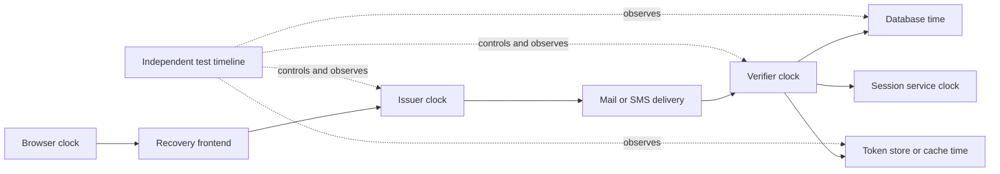

# Clock skew failure test — Kiểm thử lỗi lệch đồng hồ trong khôi phục tài khoản

## 1. Vì sao recovery phải được thử khi đồng hồ không đồng nhất?

Một dịch vụ phát hành liên kết khôi phục có thời hạn năm phút. Node xác minh chạy chậm hơn node phát hành hai phút, nên liên kết có thể được chấp nhận lâu hơn người thiết kế dự kiến. Ở chiều ngược lại, node xác minh chạy nhanh có thể từ chối liên kết ngay khi người dùng vừa nhận email. Nếu hệ thống chỉ thử trên một máy dùng chung đồng hồ, cả hai lỗi đều dễ bị bỏ sót.

Trong module `SECURITY_AUTHENTICATION_ACCOUNT_RECOVERY`, clock skew failure test kiểm tra ảnh hưởng của sai lệch thời gian đến token dùng một lần, xác minh danh tính, cooldown, thời gian chờ bảo vệ, session và các bước lấy lại phương thức xác thực. Mục tiêu là duy trì ranh giới bảo mật và một cách tiếp tục có kiểm soát khi thời gian không còn đáng tin cậy.

Bài học này trình bày mô hình đồng hồ, cách xây dựng phép thử có thể lặp lại, ví dụ Java dùng `Clock`, cách đọc kết quả và cách xác nhận hệ thống phục hồi sau khi bỏ lỗi. Những cấu hình thời hạn và dung sai trong ví dụ là giả định học tập, cần thay bằng chính sách của hệ thống đang kiểm thử.

Sau bài học, người học có thể:

- Phân biệt lệch thời gian giữa node, bước nhảy đồng hồ, trôi đồng hồ và lỗi múi giờ.
- Tính cửa sổ hiệu lực thực tế của token khi nơi phát hành và nơi xác minh dùng đồng hồ khác nhau.
- Kiểm thử các biên `exp`, `nbf`, cooldown và thời gian chờ mà không dùng thời gian chờ thực kéo dài.
- Kiểm tra token đã dùng, recovery đã hủy và session đã thu hồi không được phục hồi quyền do đồng hồ quay lùi.
- Thu thập bằng chứng từ đúng thành phần bị tác động, rồi xác nhận trạng thái sau khi khôi phục đồng bộ.

## 2. Phân biệt các dạng lỗi thời gian

### 2.1. Offset, drift và clock step

Trong bài học, dùng các khái niệm sau để mô tả fault rõ ràng:

| Dạng lỗi | Mô tả | Ví dụ trong recovery |
| --- | --- | --- |
| Offset cố định | Một đồng hồ luôn sớm hoặc muộn hơn mốc tham chiếu một lượng cố định | Verifier chậm 60 giây so với issuer |
| Drift | Độ lệch tăng hoặc giảm dần theo thời gian | Node mất đồng bộ và mỗi phút lệch thêm một lượng nhỏ |
| Step forward | Đồng hồ nhảy tức thời về tương lai | Token, cooldown hoặc session hết hạn đột ngột |
| Step backward | Đồng hồ nhảy tức thời về quá khứ | Countdown tăng trở lại; một cửa sổ đã qua có thể xuất hiện lại |
| Slew | Tốc độ đồng hồ được điều chỉnh để dần sửa sai lệch | Thời gian tiến chậm hoặc nhanh hơn trong lúc tái đồng bộ |
| Sai đơn vị hoặc chuyển đổi | Giá trị thời gian bị diễn giải sai | Epoch milliseconds được đọc như epoch seconds |
| Lỗi múi giờ | Sai cách chuyển thời điểm sang ngày giờ địa phương | Dùng `LocalDateTime` không có zone để quyết định expiry |

Một số tài liệu dùng từ clock skew cho độ khác nhau về tốc độ đồng hồ. Trong bài học này, tên phép thử bao quát các lỗi không đồng nhất thời gian, còn cấu hình thí nghiệm luôn ghi rõ offset, step hay drift để tránh hiểu nhầm.

Đổi múi giờ hiển thị không tự làm một `Instant` chạy sớm hoặc chậm. Một ca thay timezone có thể tìm được lỗi biểu diễn thời gian, nhưng không thay thế ca issuer và verifier thật sự nhìn thấy hai thời điểm khác nhau.

### 2.2. Wall clock và đồng hồ đo thời lượng

Wall clock trả lời “hiện tại là thời điểm nào” và được dùng để đối chiếu những mốc tuyệt đối như `expiresAt`. Đồng hồ đo thời lượng trả lời “đã trôi qua bao lâu” và phù hợp để giới hạn timeout trong cùng tiến trình.

Trong Java, tài liệu [`System.nanoTime()`](https://docs.oracle.com/en/java/javase/21/docs/api/java.base/java/lang/System.html#nanoTime()) xác định giá trị này phục vụ đo elapsed time và chỉ có ý nghĩa khi lấy chênh lệch trong cùng JVM. Không lưu nó làm timestamp chia sẻ giữa node hoặc khôi phục nguyên giá trị sau restart.

Nếu test runner dùng wall clock đang bị kéo lùi để tính deadline, chính lệnh chờ kiểm thử có thể chạy lâu bất thường. Đồng hồ điều phối thí nghiệm cần tách khỏi đồng hồ bị tiêm lỗi, và deadline nên dựa vào nguồn thời lượng phù hợp.

## 3. Lập bản đồ mọi nguồn thời gian trong luồng recovery

Không mặc định “server time” là một nguồn duy nhất. Một hành trình có thể đi qua nhiều thành phần với cách lấy thời gian khác nhau.



Mỗi cạnh trong sơ đồ là một nơi cần hỏi: timestamp do ai tạo, ai kiểm tra và có chuyển đổi đơn vị hay độ chính xác không?

| Thành phần | Mục đích dùng thời gian | Câu hỏi kiểm thử |
| --- | --- | --- |
| Browser | Countdown, hiển thị cooldown, cảnh báo session | Thay giờ client có làm thay đổi quyết định bảo mật không? |
| Issuer | Tạo `issuedAt`, `notBefore`, `expiresAt` | Issuer sai giờ có cấp cửa sổ ngoài giới hạn cho phép không? |
| Verifier | Chấp nhận hoặc từ chối token | Sai lệch hai phía được xử lý đúng chính sách dung sai không? |
| Database | Điều kiện cập nhật, timestamp giao dịch | Ứng dụng và câu lệnh cập nhật có dùng cùng quy tắc thời gian không? |
| Cache/token store | TTL, lockout, token đã dùng | Bản ghi hết sớm, giữ quá lâu hoặc mất marker có gây vượt quyền không? |
| Scheduler/queue consumer | Delay, retry, cleanup | Đồng hồ nhảy có làm hành động nhạy cảm chạy sớm hoặc chạy lặp không? |
| Session service | Expiry, refresh, cutoff thu hồi | Credential cũ có được chấp nhận trở lại không? |
| Authenticator TOTP | Sinh mã theo bước thời gian | Cửa sổ chấp nhận và chống dùng lại có đúng khi thời gian thay đổi không? |

Tiêm `Clock` vào service Java chỉ điều khiển những đoạn mã thực sự gọi đối tượng đó. Nó không tự thay thời gian của database, Redis, JVM khác, trình duyệt hoặc nhà cung cấp bên ngoài. Đó là giới hạn cần ghi trong báo cáo, không phải lý do để suy ra mọi thành phần đã được bao phủ.

## 4. Mô hình hóa cửa sổ hiệu lực của token

### 4.1. Hiệu lực tuyệt đối khác với thời lượng người dùng cảm nhận

Gọi `t` là thời gian tham chiếu của thí nghiệm, `δi` là offset issuer và `δv` là offset verifier. Trong mô hình offset cố định:

```text
Ci(t) = t + δi
Cv(t) = t + δv

Token được phát hành tại thời gian tham chiếu t0:
expiresAt = Ci(t0) + TTL

Verifier chấp nhận phần điều kiện hết hạn khi:
Cv(t) < expiresAt + L
```

`L` là dung sai phía expiry được chính sách cho phép. Từ các giả định trên, biên hết hiệu lực theo thời gian tham chiếu là:

```text
t_expiry = t0 + TTL + δi - δv + L
```

Công thức là suy luận của mô hình, chưa tính các giới hạn khác như `nbf`, trạng thái đã dùng, expiry trong token store, maximum age hoặc kiểm tra clock health. Token có thể bị từ chối sớm hơn vì các điều kiện đó.

Ví dụ `TTL = 300s`, issuer nhanh `40s`, verifier chậm `20s`, dung sai `15s`. Điều kiện expiry một mình cho phép tới biên `t0 + 375s`, dài hơn TTL danh nghĩa 75 giây. Nếu cấu hình trên không được chính sách chấp nhận, test phải phát hiện vấn đề thiết kế hoặc cơ chế giới hạn clock health; không được chỉ tăng dung sai để làm kết quả xanh.

Nếu mỗi node được phép lệch tối đa `D` so với một nguồn tham chiếu, chênh lệch hai node có thể lên đến `2D`. Cần phân biệt giới hạn offset của từng node với giới hạn chênh lệch issuer–verifier trong hợp đồng.

### 4.2. Biên `exp`, `nbf` và ý nghĩa của `iat`

[RFC 7519, mục 4.1.4–4.1.6](https://www.rfc-editor.org/rfc/rfc7519.html#section-4.1.4) phân biệt thời điểm hết hạn, thời điểm chưa được dùng và thời điểm phát hành. RFC cho phép dung sai nhỏ đối với `exp` và `nbf`; giá trị dung sai cụ thể phải do ứng dụng xác định. `iat` tự nó không mang cùng quy tắc từ chối như `nbf`.

Với chính sách mẫu trong bài:

```text
Điều kiện thời gian:
    now >= notBefore - L
    now < expiresAt + L

Nếu có maximum age hoặc kiểm tra iat ở tương lai:
    đó là điều kiện bổ sung được đặc tả riêng
```

Kiểm tra đúng trước biên, đúng tại biên và ngay sau biên theo độ phân giải mà hệ thống sử dụng. Với NumericDate biểu diễn theo giây, một bài test lệch một nano giây có thể không kiểm tra điều mà tác giả tưởng vì giá trị đã bị làm tròn khi serialize.

Không mặc định recovery token là JWT. Token opaque thường có `expiresAt` trong store và có thể dùng chính sách không dung sai. Bộ test cần theo hợp đồng thực tế, không gắn leeway của JWT vào mọi OTP hoặc mọi thời gian chờ nghiệp vụ.

### 4.3. Dung sai không phải quyền bỏ qua thời hạn

Leeway là phần của chính sách xác minh, không phải thời gian được cộng mới ở mỗi hop. Một gateway chấp nhận trong dung sai không được tự đổi `expiresAt` thành “hiện tại cộng TTL” khi chuyển tiếp. Ca kiểm thử cần quan sát mốc gốc hoặc giới hạn tương đương mà service sau thực thi.

Một token bị từ chối trên node nhanh nhưng được chấp nhận trên node chậm có thể phù hợp với một mô hình dung sai chưa đủ chặt, hoặc vi phạm chính sách đã cam kết. Chỉ gọi đó là lỗi sau khi đối chiếu đúng giới hạn, trạng thái token và điểm quyết định cần kiểm tra.

## 5. Định nghĩa bất biến cho thí nghiệm

Tách yêu cầu bảo mật khỏi mục tiêu khả dụng để thấy rõ loại lỗi.

| Nhóm | Bất biến cần xác định |
| --- | --- |
| Hiệu lực thời gian | Không chấp nhận token ngoài cửa sổ được đặc tả với các offset còn được hỗ trợ |
| Dùng một lần | Token đã commit thành công không được đổi credential thêm lần nữa, kể cả khi clock quay lùi |
| Hủy hoặc thu hồi | Quyết định hủy/thu hồi đã có hiệu lực không bị đảo ngược vì kiểm tra thời gian cũ |
| Ràng buộc danh tính | Sai lệch giờ không làm bỏ qua account, tenant, purpose hay bằng chứng còn bắt buộc |
| Mutation | Lỗi thời gian không tạo cập nhật credential hoặc session từng phần trái hợp đồng |
| Khả dụng | Khi clock nằm trong giới hạn được hỗ trợ, người dùng có thể tiếp tục đúng hành trình |
| Phục hồi | Sau khi bỏ fault, yêu cầu mới hoạt động và quyết định đã commit vẫn bền vững |
| Vận hành | Phát hiện clock vượt ngưỡng và thực hiện chính sách suy giảm đã quy định |

Với clock vượt giới hạn, không thể đòi một verifier chỉ biết giờ sai của mình luôn xác định chính xác thời gian thật. Muốn có cam kết mạnh hơn, hệ thống cần nguồn thời gian tin cậy, cơ chế giám sát/quarantine hoặc thiết kế tương đương. Test phải nêu cơ chế nào đang được đánh giá.

Không coi mọi `5xx` là kết quả “từ chối an toàn”. Cần biết credential có bị thay đổi không, attempt có bị tiêu thụ không và người dùng có cách tiếp tục không. Một lỗi hạ tầng có thể giữ ranh giới quyền ở thời điểm đó nhưng vẫn làm hỏng tính nhất quán của recovery.

## 6. Thiết kế thí nghiệm có thể lặp lại

### 6.1. Tăng dần phạm vi tác động

Có thể tổ chức ba tầng:

1. **Kiểm thử logic thời gian:** dùng clock cố định hoặc điều khiển được để kiểm tra phép so sánh, biên và đơn vị.
2. **Kiểm thử tích hợp:** gắn clock riêng vào issuer/verifier, dùng backend và token store thật của môi trường test.
3. **Thí nghiệm hạ tầng cô lập:** tác động đến nguồn thời gian của thành phần được chỉ định để kiểm tra thêm database TTL, TLS, scheduler hoặc process restart.

Tầng thứ nhất không bao phủ thành phần không nhận clock test. Tầng thứ ba có phạm vi ảnh hưởng lớn hơn và cần môi trường, cơ chế rollback, quyền thao tác đã được xác định. Việc viết tài liệu kiểm thử không đồng nghĩa được phép thay đồng hồ máy đang dùng hoặc môi trường vận hành thật.

### 6.2. Đặc tả một fault trước khi chạy

```yaml
experiment: verifier-backward-step-after-consume
scope: isolated-recovery-test-instance
target: recovery-verifier
injection: application-clock
initialOffsetSeconds: 0
fault:
  type: step
  deltaSeconds: -120
trigger:
  after: successful-recovery-commit
observations:
  - same-token-replay-decision
  - credential-revision
  - recovery-terminal-state
restore:
  action: restore-original-clock-provider
```

Đây là cấu trúc mô tả thí nghiệm trong bài học, không phải cấu hình cho một công cụ đã tồn tại. Điểm `successful-recovery-commit` phải được xác minh bằng trạng thái thật hoặc một barrier kiểm thử có ngữ nghĩa rõ ràng.

Ghi cả offset muốn áp dụng và offset đã quan sát. Một lệnh điều khiển trả thành công chưa chứng minh request thực tế đã đi qua verifier dùng clock đó. Dùng route/instance mapping và snapshot clock trong môi trường test để xác nhận phạm vi.

### 6.3. Giữ độc lập dữ liệu, clock và điều phối

Mỗi worker cần namespace dữ liệu và clock riêng hoặc instance riêng. Thay clock singleton dùng chung cho cả bộ test có thể làm ca khác hết hạn và tạo lỗi khó tái hiện.

Runner giữ timeline tham chiếu không bị fault. Token, account, mail sink và session được tạo riêng. Thí nghiệm có deadline và cleanup trong `finally` hoặc cơ chế tương đương, kể cả khi phép kiểm tra thất bại.

Nếu thay giờ của một thành phần ở mức hạ tầng, xác minh công cụ thật sự tác động loại clock cần thử. Các cơ chế cô lập thời gian không mặc nhiên cho phép thay mọi wall clock hoặc mọi nguồn thời gian trong container.

## 7. Ví dụ Java: điều khiển thời gian mà không thay giờ hệ điều hành

### 7.1. Clock test có thể tiến và lùi

[`java.time.Clock`](https://docs.oracle.com/en/java/javase/21/docs/api/java.base/java/time/Clock.html) cho phép ứng dụng nhận nguồn thời gian thay thế, bao gồm clock cố định hoặc có offset. Ví dụ sau dùng clock test có trạng thái dùng chung giữa các biểu diễn zone, nhưng tách nguồn cho từng thí nghiệm.

```java
import java.time.Clock;
import java.time.Instant;
import java.time.ZoneId;
import java.util.Objects;
import java.util.concurrent.atomic.AtomicReference;

final class TestTimelineClock extends Clock {
    private final AtomicReference<Instant> instant;
    private final ZoneId zone;

    TestTimelineClock(Instant initial, ZoneId zone) {
        this(new AtomicReference<>(Objects.requireNonNull(initial)), zone);
    }

    private TestTimelineClock(
            AtomicReference<Instant> instant, ZoneId zone) {
        this.instant = instant;
        this.zone = Objects.requireNonNull(zone);
    }

    void moveTo(Instant value) {
        instant.set(Objects.requireNonNull(value));
    }

    @Override
    public ZoneId getZone() {
        return zone;
    }

    @Override
    public Clock withZone(ZoneId newZone) {
        return new TestTimelineClock(instant, newZone);
    }

    @Override
    public Instant instant() {
        return instant.get();
    }
}
```

Đây là lớp hỗ trợ test, không phải một nguồn thời gian production. `AtomicReference` giúp thao tác đọc/ghi một thời điểm an toàn giữa các thread; nó không bảo đảm chuỗi nhiều bước nghiệp vụ trở thành nguyên tử. Khi muốn kiểm tra race, vẫn cần barrier xác định lúc đổi clock.

### 7.2. Kiểm tra mô hình biên và tác động của hai offset

Mã dưới đây dùng JUnit Jupiter và kiểu `record`, phù hợp với Java hỗ trợ record. Hàm `timeDecision()` chỉ là oracle minh họa cửa sổ thời gian, không xác minh chữ ký, purpose, trạng thái token hoặc quyền cập nhật credential.

```java
import org.junit.jupiter.api.Test;

import java.time.Clock;
import java.time.Duration;
import java.time.Instant;
import java.time.ZoneOffset;

import static org.junit.jupiter.api.Assertions.assertEquals;

class RecoveryClockWindowExampleTest {
    enum TimeDecision {
        TOO_EARLY, INSIDE_TIME_WINDOW, EXPIRED
    }

    record Window(Instant notBefore, Instant expiresAt) {}

    private TimeDecision timeDecision(
            Window window, Clock verifier, Duration leeway) {
        if (leeway.isNegative()) {
            throw new IllegalArgumentException("Negative leeway");
        }

        Instant now = verifier.instant();
        if (now.isBefore(window.notBefore().minus(leeway))) {
            return TimeDecision.TOO_EARLY;
        }
        if (!now.isBefore(window.expiresAt().plus(leeway))) {
            return TimeDecision.EXPIRED;
        }
        return TimeDecision.INSIDE_TIME_WINDOW;
    }

    @Test
    void oppositeOffsetsExtendTheReferenceTimeWindow() {
        Instant t0 = Instant.parse("2030-01-01T00:00:00Z");
        TestTimelineClock timeline = new TestTimelineClock(t0, ZoneOffset.UTC);
        Clock issuer = Clock.offset(timeline, Duration.ofSeconds(40));
        Clock verifier = Clock.offset(timeline, Duration.ofSeconds(-20));
        Duration ttl = Duration.ofSeconds(300);
        Duration leeway = Duration.ofSeconds(15);

        Instant issuedAt = issuer.instant();
        Window window = new Window(issuedAt, issuedAt.plus(ttl));

        // Verifier đang trước nbf quá mức leeway tại thời điểm phát hành.
        assertEquals(TimeDecision.TOO_EARLY,
                timeDecision(window, verifier, leeway));

        // Biên expiry theo timeline: 300 + 40 - (-20) + 15 = 375 giây.
        timeline.moveTo(t0.plusSeconds(374));
        assertEquals(TimeDecision.INSIDE_TIME_WINDOW,
                timeDecision(window, verifier, leeway));

        timeline.moveTo(t0.plusSeconds(375));
        assertEquals(TimeDecision.EXPIRED,
                timeDecision(window, verifier, leeway));
    }

    @Test
    void boundaryAtExpiryHasNoExtraImplicitSecond() {
        Instant t0 = Instant.parse("2030-01-01T00:00:00Z");
        TestTimelineClock timeline = new TestTimelineClock(t0, ZoneOffset.UTC);
        Window window = new Window(t0, t0.plusSeconds(300));

        timeline.moveTo(t0.plusSeconds(299));
        assertEquals(TimeDecision.INSIDE_TIME_WINDOW,
                timeDecision(window, timeline, Duration.ZERO));

        timeline.moveTo(t0.plusSeconds(300));
        assertEquals(TimeDecision.EXPIRED,
                timeDecision(window, timeline, Duration.ZERO));
    }
}
```

Mốc năm 2030 là thời điểm cố định của ví dụ, không phải thời gian hiện tại. Hai lớp có thể đặt trong mã kiểm thử với dependency JUnit tương ứng; chúng không cần thay đồng hồ hệ điều hành hay chờ năm phút thật.

Ví dụ cố ý cho thấy một cấu hình thời gian có thể làm TTL danh nghĩa khác cửa sổ theo timeline tham chiếu. Nó chưa chứng minh ứng dụng đang triển khai có hoặc không có lỗi. Test tích hợp phải cấp token thật bằng issuer, đi qua verifier thật và kiểm tra tác động nghiệp vụ theo chính sách.

Không sao chép oracle này làm toàn bộ validator production: còn thiếu ràng buộc miền giá trị timestamp, xử lý tràn số, kiểm tra các claim cần thiết, xác thực mật mã và tiêu thụ token nguyên tử. Bài test cũng không được dùng chính hàm validator production để tính toàn bộ kết quả mong đợi rồi so với chính nó.

## 8. Ma trận fault cho issuer và verifier

Giữ một baseline đồng bộ, sau đó chỉ thay một chiều tại một thời điểm trước khi thử tổ hợp. Với mỗi dòng, lưu cấu hình TTL, leeway, độ phân giải và nơi đưa ra quyết định.

| Mã | Fault | Rủi ro chính | Bằng chứng cần thu |
| --- | --- | --- | --- |
| CS-01 | Issuer và verifier cùng mốc | Sai biên hoặc đơn vị ngay cả khi không có skew | Kết quả trước, tại và sau expiry |
| CS-02 | Verifier nhanh | Token bị từ chối sớm | Offset thực, quyết định expiry, không có mutation sai |
| CS-03 | Verifier chậm | Token được chấp nhận lâu hơn theo thời gian tham chiếu | Cửa sổ thực so với hợp đồng |
| CS-04 | Issuer nhanh | `nbf` có thể ở tương lai; expiry dài hơn | Hai điều kiện được phân biệt rõ |
| CS-05 | Issuer chậm | Token có vẻ cũ hoặc gần hết hạn khi vừa cấp | Tuổi token và khả năng tiếp tục của người dùng |
| CS-06 | Hai phía lệch ngược dấu | Chênh lệch cặp lớn hơn offset từng node | Giới hạn chênh lệch và clock-health policy |
| CS-07 | Step forward lúc form đang mở | Token hoặc delay đổi trạng thái trước submit | Request thật đến server và trạng thái nghiệp vụ |
| CS-08 | Step backward sau token đã dùng | Dùng lại bằng chứng do cửa sổ thời gian mở lại | Chỉ một lần commit, trạng thái terminal bền vững |
| CS-09 | Drift qua ngưỡng cho phép | Lỗi tích lũy mà offset tĩnh không thể hiện | Cảnh báo và hành vi khi vượt ngưỡng |
| CS-10 | Khôi phục đồng bộ sau fault | Trạng thái cũ sống lại hoặc yêu cầu mới vẫn bị kẹt | Replay vẫn bị từ chối; attempt mới hoạt động |

Để kiểm tra các biên bằng một token dùng một lần, tránh vô tình tiêu thụ token ở bước đầu rồi coi những bước sau là kết quả expiry. Có thể dùng token độc lập cho từng điểm hoặc một bước quan sát không tiêu thụ được hệ thống hỗ trợ. Không thêm endpoint bỏ qua kiểm tra bảo mật chỉ để test thuận tiện.

Tương tự, không phát cùng token đến ba node và kỳ vọng cả ba đều đổi credential thành công. Sau lần commit đầu, các lần còn lại phải được đánh giá như replay. Để so sánh riêng việc đọc thời gian giữa node, tách dữ liệu hoặc tách giai đoạn xác minh phù hợp với thiết kế.

## 9. Clock rollback và trạng thái không được phục hồi quyền

### 9.1. Token đã dùng phải tiếp tục là đã dùng

Một phép thử quan trọng:

```text
Given recovery token R còn hạn và chưa dùng
When hoàn tất recovery bằng R thành công
And verifier clock bị kéo về trước thời điểm tiêu thụ
Then phát lại R không đổi credential thêm lần nữa
And credential revision vẫn chỉ tăng theo một commit hợp lệ
```

Nếu validator chỉ kiểm tra chữ ký và thời hạn, token có thể vẫn ở trong cửa sổ thời gian. Tính dùng một lần phải đến từ cơ chế trạng thái hoặc thiết kế tương đương, không tự xuất hiện từ claim `exp`.

Kiểm tra cả khi marker “đã dùng” trong store được cleanup, node restart hoặc cache miss. Thời gian giữ marker cần được thiết kế cùng mọi cửa sổ token còn có thể được chấp nhận, bao gồm dung sai và chính sách clock health. Nếu marker biến mất nhưng token có chữ ký vẫn được xem là chưa dùng, clock rollback có thể làm lộ lỗi replay.

Với token opaque chỉ được chấp nhận khi có bản ghi hợp lệ trong store, bản ghi không tồn tại thường dẫn đến từ chối theo thiết kế. Không dùng kết luận đó cho JWT tự chứa nếu đường xác minh của JWT không yêu cầu cùng trạng thái server-side.

### 9.2. Đã hủy và đã thu hồi là trạng thái nghiệp vụ

Hủy recovery, thu hồi session hoặc vô hiệu hóa phương thức bị mất cần có phép thử tương tự. Sau quyết định có hiệu lực, lùi clock rồi thử lại request cũ, refresh token cũ và grant recovery đang mở ở tab khác.

Nếu thu hồi dựa trên so sánh `issuedAt` với một cutoff theo thời gian, thử các giá trị cùng một giây và trường hợp issuer sớm hơn hoặc chậm hơn nơi tạo cutoff. Một epoch hoặc revision có thể tránh một số mơ hồ về thứ tự, nhưng vẫn cần kiểm thử mọi điểm thực thi thực sự đối chiếu trạng thái mới.

### 9.3. Token từng hết hạn có luôn phải hết hạn mãi không?

Với phép kiểm tra thuần thời gian, `now >= expiresAt` có thể chuyển trở lại thành `now < expiresAt` nếu wall clock quay lùi. Điều này khác với trạng thái “đã dùng” đã được commit.

Nếu chính sách yêu cầu một token sau khi đã được ghi nhận hết hạn không bao giờ được chấp nhận lại, hệ thống cần cơ chế terminal state, time source hoặc giới hạn rollback tương ứng. Test phải nêu chính sách đó và cách trạng thái được lưu bền vững. Không giả định mọi JWT tự chứa đều có tính chất không hồi sinh sau một lần kiểm tra expiry.

## 10. Cooldown, thời gian chờ bảo vệ và delivery delay

### 10.1. Cooldown không được do trình duyệt quyết định

Thay clock browser về tương lai, reload và thử yêu cầu recovery trước khi cooldown server cho phép. Sau đó thay clock browser về quá khứ và kiểm tra người dùng không bị UI giữ chờ vô hạn khi server đã cho tiếp tục.

Ca thứ nhất kiểm tra ranh giới chống lạm dụng; ca thứ hai kiểm tra khả năng sử dụng. Cả hai đều cần quan sát quyết định server thay vì chỉ trạng thái nút submit.

Nếu rate limit dùng các time bucket, thử step forward rồi backward qua biên bucket với số lượng yêu cầu nhỏ trong namespace riêng. Xác nhận ngân sách yêu cầu không được làm mới ngoài chính sách và request không rơi vào bucket sai chỉ vì node dùng thời gian khác nhau.

### 10.2. Delay bảo vệ là điều kiện nghiệp vụ riêng

Giả sử recovery rủi ro cao có `readyAt` sau một thời gian chờ để chủ sở hữu có thể phản đối. Không mặc định dùng cùng leeway với token hết hạn, vì dung sai ở `nbf` có thể làm một điều kiện chờ được coi là đã tới sớm hơn.

Đặc tả rõ nguồn thời gian của delay, độ sớm tối đa được phép và hành vi khi clock không đáng tin cậy. Tiêm clock nhanh vào scheduler và verifier riêng rẽ; xác nhận không hoàn tất recovery chỉ vì một thành phần phát sự kiện sớm.

Tiêm clock chậm để kiểm tra trạng thái chờ có được phục hồi sau tái đồng bộ hay bị kẹt vì job đã đánh dấu sai. Hủy attempt trong lúc chờ rồi dịch thời gian qua `readyAt`; cancellation vẫn phải được tôn trọng.

### 10.3. Email đến chậm không phải clock skew

Thông điệp đến sau nhiều phút có thể khiến token hết hạn dù mọi đồng hồ đều đúng. Tách ca trì hoãn delivery khỏi ca lệch đồng hồ, sau đó mới thử tổ hợp để biết nguyên nhân.

Ghi mốc phát hành và mốc nhận theo timeline phù hợp. Không tự kéo dài TTL khi gửi lại thư hoặc khi frontend mở form, trừ khi hệ thống thật sự tạo attempt/token mới theo chính sách. Nếu retry delivery phát lại cùng token, thời hạn gốc cần giữ đúng hợp đồng.

## 11. Database, token store và cleanup

### 11.1. Đồng hồ ứng dụng không thay đồng hồ của store

Một service có thể tính `expiresAt` bằng Java Clock nhưng câu lệnh cập nhật lại dùng hàm thời gian của database. Hoặc service quyết định token còn hạn trong khi key trong token store đã biến mất theo TTL của store.

Kiểm thử từng nguồn riêng, quan sát cả quyết định và tồn tại bản ghi. Không kết luận sai TTL chỉ từ việc dữ liệu chưa bị xóa vật lý; một số hệ thống có thể giữ bản ghi đã hết hạn nhưng không còn cho xác thực. Điều quan trọng là đường chấp nhận token có thực thi deadline không.

Với TTL tương đối hoặc timestamp tuyệt đối trong store, đọc đúng ngữ nghĩa của engine và phiên bản triển khai trước khi đặt assertion. Không giả định thay application clock sẽ làm thời hạn ở Redis hay database tự dịch chuyển theo.

### 11.2. Xác minh và tiêu thụ phải theo cùng hợp đồng

Tạo một ca token được kiểm tra còn hạn, sau đó thời gian tiến qua expiry trước khi cập nhật credential. Đặt barrier ở giữa để kiểm tra rõ ứng dụng cho phép khoảng chuyển tiếp nào.

Có thiết kế yêu cầu token còn hạn tại commit; có thiết kế đổi nó thành grant giao dịch giới hạn sau bước xác minh. Hai thiết kế cần assertion khác nhau. Không yêu cầu commit bị từ chối bằng một mốc expiry đã không còn là mốc hiệu lực của grant mới, cũng không cho một bước verify sớm mở quyền vô hạn.

Nếu database là nơi so sánh expiry và tiêu thụ nguyên tử, ca tích hợp phải chạm tới chính đường cập nhật đó. Một unit test dùng Clock của service không chứng minh điều kiện thời gian trong SQL đúng.

### 11.3. Cleanup không được tạo quyền mới

Step forward có thể làm tác vụ cleanup chạy sớm, xóa marker hoặc đóng attempt. Sau đó step backward và replay token cũ. Kỳ vọng về bảo mật là cleanup không biến dữ liệu thiếu thành một mặc định cho phép.

Đồng thời kiểm tra khả dụng: attempt bị đóng theo chính sách có đường bắt đầu lại rõ ràng, không để người dùng mắc kẹt trong form mà server đã không còn nhận. Sau rollback thí nghiệm, cleanup phải tiếp tục hoạt động và không dọn nhầm dữ liệu của attempt mới.

## 12. MFA, TOTP và passkey

Với TOTP, thời gian là moving factor nên cần một nhóm ca riêng. [RFC 6238, mục 5.2 và 6](https://www.rfc-editor.org/rfc/rfc6238.html#section-5.2) thảo luận kích thước bước, cửa sổ độ trễ, lệch clock và việc không chấp nhận lại OTP sau khi đã xác minh thành công. Không áp dụng cửa sổ của JWT một cách máy móc cho TOTP.

Tạo clock riêng cho authenticator test và verifier, rồi kiểm tra:

1. Mã của bước hiện tại được xử lý theo chính sách cấu hình.
2. Mã ở những bước trước/sau được chấp nhận hoặc từ chối đúng cửa sổ đã công bố.
3. Mã đã dùng không được chấp nhận lại khi clock lùi về bước cũ.
4. Clock lệch vượt giới hạn đưa người dùng đến cách tiếp tục phù hợp, không tự bỏ qua yếu tố.
5. Resynchronization, nếu có, không tự mở rộng cửa sổ vô hạn từ một bằng chứng yếu.

Dùng test vectors hoặc fixture mã xác định, không kết luận rằng hai bước thời gian luôn tạo chuỗi số khác nhau. TOTP bị rút gọn thành không gian mã hữu hạn nên có thể xảy ra trùng giá trị; oracle chống dùng lại cần hiểu bước và trạng thái mà hệ thống thực sự quản lý.

Mã recovery dự phòng thường không sinh từ đồng hồ như TOTP. Kiểm tra thời gian vẫn có thể cần cho trạng thái attempt hoặc policy expiry, nhưng tính dùng một lần của mã dự phòng phải được xác nhận qua cơ chế tiêu thụ của nó.

Passkey/WebAuthn cũng không biến thành TOTP khi client sai giờ. Các challenge, recovery grant hoặc session bao quanh thao tác có thể có thời hạn riêng. Tách lỗi expiry của challenge với việc xác minh chữ ký và với luồng phục hồi khi thiết bị không còn dùng được.

## 13. Timeout, retry và nguồn thời lượng độc lập

Một cách triển khai deadline dễ hỏng là tính `deadline = currentTimeMillis() + timeout`, rồi so sánh liên tục khi wall clock có thể nhảy. Lùi giờ có thể kéo dài thời gian chờ; tiến giờ có thể làm request hết hạn ngay.

Trong cùng JVM, ví dụ kiểm tra ngân sách thời lượng có thể dùng:

```java
long started = System.nanoTime();
long budget = java.time.Duration.ofSeconds(2).toNanos();

// Sau từng bước xử lý có giới hạn riêng:
boolean budgetExceeded = System.nanoTime() - started >= budget;
```

Đây là phép đo thời lượng cục bộ, không phải đồng hồ để xác minh JWT hoặc ghi `expiresAt` dùng chung. Không so sánh trực tiếp `nanoTime()` của hai JVM và không lưu một deadline dạng đó để dùng nguyên sau restart.

Kiểm tra clock step trong lúc chờ nhà cung cấp email, xác minh danh tính hoặc token store. Request phải kết thúc theo ngân sách xử lý đã đặc tả, không lặp retry vô hạn hoặc kéo dài một quyền recovery quá thời hạn nghiệp vụ.

Phân biệt ba thời hạn: timeout của một lần gọi, ngân sách retry toàn thao tác và expiry của token/grant. Retry còn ngân sách không có nghĩa token vẫn còn quyền sử dụng. Lỗi không xác định sau commit cũng không được tự suy ra rằng có thể thực hiện mutation lần nữa.

## 14. Clock health, suy giảm có kiểm soát và khôi phục

Hệ thống có thể được thiết kế để ngừng phát hành hoặc ngừng hoàn tất các thao tác nhạy cảm khi độ lệch vượt ngưỡng, trong khi vẫn cung cấp trạng thái hay hướng dẫn không cấp quyền. Một thiết kế khác dùng dịch vụ thời gian đáng tin cậy hoặc một điểm quyết định tập trung. Test theo cơ chế đã chọn, không tự đặt một chính sách chung cho mọi ứng dụng.

Thí nghiệm cần xác nhận cả tín hiệu lẫn hành vi: ngưỡng đã vượt, thành phần nào phát hiện, hành động nào bị chặn và người dùng nhận được hướng dẫn gì. Một cảnh báo trên dashboard chưa chứng minh node sai giờ đã ngừng xử lý token.

Khi clock trở lại bình thường, kiểm tra:

- Request mới có thể được phát hành và xác minh theo chính sách.
- Token đã dùng hoặc recovery đã hủy vẫn không có quyền.
- Session cũ thuộc phạm vi thu hồi không sống lại.
- Dữ liệu và marker không bị mất do cleanup chạy trong giai đoạn fault.
- Node từng bị cách ly chỉ được đưa lại vào đường phục vụ sau điều kiện health phù hợp.

Nếu việc thay wall clock ở tầng hạ tầng làm TLS không xác minh được chứng thư, lỗi kết nối đó là một kết quả hạ tầng có liên quan, nhưng chưa kiểm tra được validator recovery. Dùng fault ở application clock để tách logic token, và thí nghiệm hạ tầng riêng nếu muốn kiểm tra toàn chuỗi.

## 15. Quan sát kết quả mà không làm sai nguyên nhân

Log theo wall clock có thể xuất hiện đảo thứ tự khi clock quay lùi. Đối chiếu bằng attempt ID, correlation ID, sequence/version, node xử lý và mốc trong timeline điều phối. Không lấy thứ tự timestamp đơn thuần làm bằng chứng hai hành động đã commit theo thứ tự đó.

Một bản ghi kiểm thử có thể có dạng:

```text
experiment=CS-08
phase=after-consume-clock-rollback
issuerOffsetMs=0
verifierOffsetMs=-120000
clockSource=application-test-provider
decision=replay-rejected
credentialRevisionDelta=0
terminalState=completed
target=verifier-test-instance-2
```

Không ghi token, OTP, mật khẩu, TOTP seed hoặc recovery URL vào bản ghi. Tham chiếu token chỉ là nhãn test không mang quyền truy cập. Nếu thu trace hoặc snapshot, chọn cơ chế làm sạch trước khi đưa artifact vào hệ thống lưu trữ.

Một số kết quả dễ bị đọc sai:

| Quan sát | Chưa đủ để kết luận | Bằng chứng cần thêm |
| --- | --- | --- |
| Browser hiển thị đã hết hạn | Server từ chối token | Request thật và trạng thái mutation |
| Token bị từ chối sau fault | Chính expiry gây từ chối | Reason nội bộ an toàn; baseline đúng account/purpose và trạng thái chưa dùng |
| Không còn key trong store | Logic verifier không thể chấp nhận token | Probe đường xác minh thật và cách xử lý key thiếu |
| Response là `500` | Không có thay đổi credential | Trạng thái commit, attempt và session sau lỗi |
| Node báo offset đúng | Request đã đi qua node đó | Serving-instance mapping và correlation |
| Recovery mới thành công sau rollback | Token cũ không sống lại | Replay token đã dùng/hủy và thử credential session cũ |

Mỗi kết luận cần giới hạn theo thành phần đã tác động. Một bài test chỉ thay Clock ở issuer không được báo rằng đã kiểm tra Redis clock, scheduler clock hoặc TLS clock.

## 16. Bài tập xây dựng thí nghiệm

Chọn một ứng dụng thử nghiệm có recovery token dùng một lần, cooldown và ít nhất hai node xác minh. Viết chính sách thời gian gồm TTL, dung sai nếu có, nguồn thời gian của delay và điều kiện xử lý khi clock lệch quá ngưỡng.

Thực hiện lần lượt:

1. Kiểm tra baseline trước, tại và sau expiry với dữ liệu độc lập cho từng điểm.
2. Cho verifier nhanh rồi chậm so với issuer; đối chiếu cửa sổ quan sát với mô hình đã viết.
3. Cho issuer và verifier lệch ngược dấu để kiểm tra giới hạn chênh lệch hai phía.
4. Mở form trước, step forward trước submit và xác nhận tác động server.
5. Hoàn tất recovery, step backward rồi replay token đã dùng.
6. Hủy attempt đang chờ, dịch thời gian qua `readyAt` và thử tiếp tục bằng grant cũ.
7. Làm cleanup chạy trong giai đoạn fault rồi kiểm tra marker, replay và trạng thái sau khi khôi phục.
8. Xác nhận yêu cầu mới hoạt động sau rollback, trong khi các quyền cũ đã mất hiệu lực vẫn bị từ chối.

Với mỗi ca, ghi rõ đồng hồ nào được thay, đồng hồ nào vẫn chạy độc lập, bước nào đã được thực thi thật và dữ liệu nào dùng để phân biệt expiry với replay. Nếu một dependency không được điều khiển, nêu giới hạn bao phủ thay vì giả định nó cùng lệch với service Java.

Tiêu chí hoàn thành là thí nghiệm tái hiện được lỗi thời gian theo cấu hình xác định, kiểm tra được ranh giới quyền cùng tác động nghiệp vụ, và chứng minh hệ thống phục hồi theo chính sách mà không tạo lại quyền đã bị tiêu thụ, hủy hoặc thu hồi.
