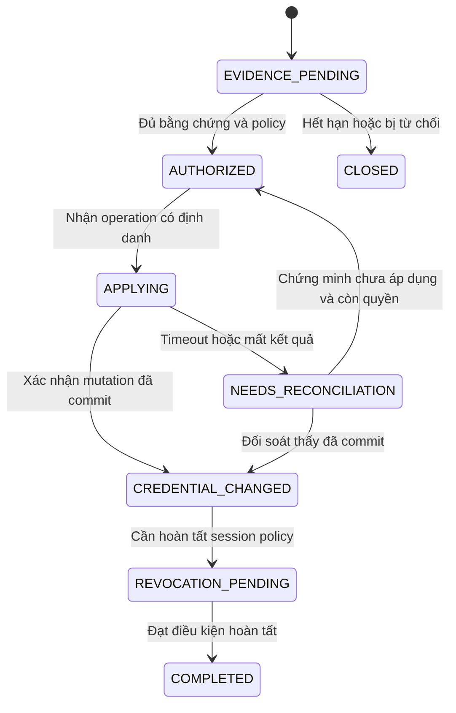

# Network timeout failure test

## 1. Timeout là thiếu thông tin về kết quả, không phải bằng chứng rollback

Trong luồng khôi phục tài khoản, một request có thể đi qua dịch vụ đánh giá rủi ro, xác minh danh tính, kho token, dịch vụ credential, registry session và hệ thống thông báo. Mạng bị chậm hoặc mất phản hồi ở bất kỳ ranh giới nào đều có thể làm bên gọi hết thời gian chờ.

**Network timeout failure test** kiểm tra hệ thống xử lý đúng khi không nhận được kết quả trong deadline: không cấp quyền thiếu bằng chứng, không thực hiện lặp thao tác nhạy cảm, không giữ tài nguyên vô hạn và có cách xác định kết quả của những thao tác có thể đã hoàn tất.

Một timeout có ít nhất hai cách diễn ra rất khác nhau:

```text
Trường hợp A:
  Request chưa tới dịch vụ đích.
  Bên gọi hết thời gian chờ.
  Chưa có side effect từ attempt đó.

Trường hợp B:
  Dịch vụ đích đã cập nhật credential.
  Phản hồi bị mất trên đường về.
  Bên gọi hết thời gian chờ.
  Side effect đã xảy ra.
```

Một handler dùng chung cho cả hai trường hợp rồi kết luận “thất bại, hãy làm lại từ đầu” có thể gây thay đổi credential hai lần, tiêu thụ token không nhất quán hoặc để session cũ tồn tại ngoài chính sách.

Tài liệu Amazon về timeout và retry nhấn mạnh rằng lỗi hoặc timeout không chứng minh side effect chưa xảy ra. Bài học áp dụng nguyên tắc đó vào các thao tác recovery có quyền và trạng thái riêng. [Timeouts, retries, and backoff with jitter](https://aws.amazon.com/builders-library/timeouts-retries-and-backoff-with-jitter/).

Phạm vi bài này là lỗi timeout trên đường mạng và việc xử lý kết quả chưa chắc chắn trong module khôi phục tài khoản. Nó không giả định rằng mọi thao tác recovery đều dùng HTTP hoặc mọi dịch vụ cùng nằm trong một transaction DB.

## 2. Chọn ranh giới và tác động cần kiểm tra

Không nên tạo cùng lúc nhiều lỗi rồi chỉ quan sát API trả mã lỗi. Trước mỗi scenario, xác định bên gọi, dịch vụ đích, điểm tạo timeout và thao tác có thể thay đổi trạng thái.

| Ranh giới | Tác động có thể xảy ra | Câu hỏi bảo mật |
|---|---|---|
| Recovery → Risk service | Đánh giá theo một phiên bản policy | Timeout có bị biến thành quyết định cho phép không? |
| Recovery → Identity proofing | Xác minh hoặc đánh giá bằng chứng | Kết quả chưa nhận có bị coi là đã xác minh không? |
| Recovery → Token store | Kiểm tra, giữ chỗ hoặc tiêu thụ token | Có thể tiêu thụ token nhưng không gắn được với operation không? |
| Recovery → Credential service | Đổi mật khẩu hoặc cập nhật yếu tố xác thực | Retry có tạo thao tác thứ hai không? |
| Recovery → Session service | Thu hồi session hoặc tăng security epoch | Có tuyên bố hoàn tất khi thu hồi chưa được xác nhận không? |
| Recovery → Notification service | Ghi nhận hoặc gửi cảnh báo | Timeout có làm rollback sai credential đã đổi không? |
| Client → Recovery API | Gửi yêu cầu hoặc hoàn tất bước | Client có biết cách theo dõi operation đã được nhận không? |

Trong khôi phục MFA hoặc passkey, cần nêu rõ credential nào đang thay đổi. Cho phép đăng ký passkey mới không phải khôi phục private key đã mất; timeout không được làm hệ thống bỏ bước kiểm tra quyền đăng ký.

Một test có thể chỉ xét thay mật khẩu, trong khi test khác xét thu hồi MFA. Không gọi một test thay mật khẩu thành bằng chứng đã bao phủ mọi kiểu recovery.

### Tách timeout khỏi các lỗi khác

Kết nối bị từ chối ngay, lỗi chứng chỉ, HTTP `403` và timeout đều là lỗi của lời gọi, nhưng mang thông tin khác nhau. Lỗi chứng chỉ không được “khắc phục” bằng cách bỏ xác minh TLS; lỗi quyền không nên bị retry mù như một lỗi tạm.

Kết nối bị reset cũng không tự cho biết dịch vụ đích chưa xử lý. Cần dựa vào điểm tạo lỗi và bằng chứng ở phía nhận, không dựa duy nhất vào tên exception của client.

## 3. Phân biệt các loại thời hạn

Một cấu hình có tên `timeout=1000` chưa đủ mô tả hệ thống thực sự được giới hạn ở đâu.

| Khái niệm | Điều được giới hạn | Điều không nên tự suy ra |
|---|---|---|
| Thời gian chờ lấy connection | Chờ tài nguyên từ pool | Đã giới hạn thời gian xử lý ở dịch vụ đích |
| Connect timeout | Thiết lập connection theo client | Mọi request trên connection tái sử dụng đều chịu cùng timer |
| Request/response timeout | Phạm vi request mà thư viện định nghĩa | Đã bao phủ DNS, TLS, toàn bộ body và mọi adapter khác |
| Read/idle timeout | Khoảng không nhận dữ liệu hoặc một lần đọc | Tổng thời gian của response luôn hữu hạn |
| Deadline toàn request | Ngân sách của hành trình xử lý hiện tại | Mọi side effect sẽ được rollback khi hết ngân sách |
| Hạn dùng token/grant | Khoảng được phép dùng bằng chứng hoặc quyền | Tương đương thời gian chờ socket |
| Hạn xử lý operation bền vững | Thời gian tiếp tục workflow đã được nhận | Có thể giữ quyền cũ mãi mà không kiểm tra policy |

Một response gửi từng phần rất chậm có thể giữ kết nối sống nếu chỉ có idle timeout. Test cần cả trường hợp không có dữ liệu và trường hợp dữ liệu đến đều nhưng tổng thời gian vượt ngân sách.

Deadline của request đồng bộ cũng khác hạn xử lý operation bất đồng bộ. API có thể hết thời gian chờ trong khi một operation đã được nhận bền vững vẫn tiếp tục theo chính sách. Điều đó cần được ghi nhận và có thể theo dõi, không trở thành tác vụ chạy ngầm không rõ ownership.

### Ví dụ ngân sách

Giả sử tổng ngân sách xử lý đồng bộ là 2.000 ms, đã dùng 200 ms và cần giữ 150 ms để ghi trạng thái cùng tạo phản hồi. Một lời gọi phụ có cap 700 ms được phép dùng:

```text
remaining = totalBudget - elapsed
allowedCallBudget = min(dependencyCap, remaining - responseReserve)

remaining = 2000 - 200 = 1800 ms
allowedCallBudget = min(700, 1800 - 150) = 700 ms
```

Trước mỗi retry phải tính lại ngân sách, bao gồm thời gian backoff và thời gian đã chờ. Không khởi động lại 2.000 ms cho từng dịch vụ hoặc từng attempt rồi gọi đó là deadline toàn luồng.

Các con số chỉ là fixture minh họa. Ngân sách thực tế cần dựa trên mục tiêu độ trễ, hành vi dependency và khả năng hoàn tất bước recovery của người dùng.

## 4. Bất biến phải giữ khi mạng chậm hoặc không trả lời

### 4.1. Khi chưa đủ bằng chứng hoặc quyền

- Timeout của một bước bắt buộc không được biến thành kết quả cho phép.
- Không cấp grant, thay credential hoặc tạo session đăng nhập khi điều kiện chưa được xác nhận.
- Phản hồi đến muộn không được tự áp vào một hồ sơ khác hoặc phiên bản authorization khác.
- Không chuyển token dùng một lần thành token dùng lại vô hạn chỉ để hỗ trợ retry.
- Không cho phép đổi kênh recovery sang địa chỉ do người gọi chưa xác minh cung cấp.

“Không cho phép” có thể được thể hiện bằng trạng thái chờ hoặc yêu cầu thử lại theo policy. Không cần biến mọi lỗi hạ tầng thành một kết luận rằng bằng chứng danh tính là sai.

### 4.2. Khi thao tác có thể đã commit

- Không kết luận chắc chắn chưa thay đổi credential chỉ vì client timeout.
- Không tạo thao tác thay đổi mới khi đang cần xác định kết quả của operation cũ.
- Có cách đối soát bằng định danh và quyền truy cập phù hợp.
- Kết quả đối soát không được dựa vào một cache hoặc log thiếu độ tin cậy.
- Các bước tiếp theo, như thu hồi session, tiếp tục đúng workflow đã được cấp quyền.
- Không tự rollback credential bằng cách khôi phục bí mật cũ mà chưa có thiết kế an toàn tương ứng.

### 4.3. Đối với tài nguyên

Lời gọi phải có deadline thực tế, queue có giới hạn và retry có ngân sách. Khi mạng phục hồi, connection hoặc permit đang bị chiếm phải được giải phóng theo cơ chế của client; không yêu cầu đóng mọi connection nhàn rỗi vốn được pool giữ để tái sử dụng.

Nếu dùng HTTP/2, nhiều stream có thể dùng cùng connection. Việc hủy một request cần được kiểm tra trong ngữ cảnh đó; không mặc định đóng toàn bộ connection là cách duy nhất đúng.

## 5. Thiết kế fixture có thể phân biệt trước và sau side effect

Một provider fake chỉ `sleep` rồi ném exception không kiểm tra được việc downstream đã commit. Fixture cần các điểm dừng có ý nghĩa nghiệp vụ.

Ví dụ tại dịch vụ credential:

```text
P0: Trước khi request tới handler.
P1: Handler đã nhận request nhưng chưa ghi trạng thái.
P2: Credential và bản ghi idempotency đã commit.
P3: Response đã được tạo nhưng chưa được gửi.
P4: Response header đã gửi nhưng body chưa hoàn tất.
```

Tạo timeout tại P0 và P2 phải dẫn đến hai nhóm assertion khác nhau. Chỉ đo việc client nhận `HttpTimeoutException` không phân biệt được chúng.

Fixture nên có:

1. Tài khoản tổng hợp và operation recovery riêng cho mỗi test.
2. Dịch vụ hoặc adapter được gọi theo đường xử lý thật.
3. Store của token, grant và credential có thể đọc bằng quyền kiểm thử.
4. Barrier/latch hoặc proxy giúp xác nhận request đã tới đúng checkpoint.
5. Clock nghiệp vụ điều khiển được cho expiry và workflow.
6. Giới hạn wall time thực cho test mạng.
7. Bộ đếm request ở phía nhận, số mutation và số retry thực.
8. Cleanup gỡ lỗi mạng, giải phóng tác vụ và xóa dữ liệu của run.

Định danh operation dùng cho quan sát không nên chứa token hoặc email thật. Nếu test giữ token đúng trong bộ nhớ để dùng làm bằng chứng, tránh đưa nó vào `toString()`, assertion message hoặc output CI.

### Clock đơn điệu và thời gian nghiệp vụ

Đo thời lượng trong cùng process bằng nguồn đơn điệu, ví dụ `System.nanoTime()`. Hạn dùng token được lưu và so sánh theo mô hình thời gian nghiệp vụ của hệ thống.

Không truyền giá trị tuyệt đối của `System.nanoTime()` sang node khác rồi coi đó là deadline chung; các process không có cùng gốc thời gian được bảo đảm cho cách dùng này.

Nếu truyền ngân sách còn lại hoặc deadline theo thời gian lịch qua mạng, dịch vụ nhận phải kiểm tra giá trị, giới hạn mức tối đa và xử lý sai lệch clock theo thiết kế. Header do client tự khai không được kéo dài hạn token hoặc authorization.

## 6. Ma trận tạo timeout ở các pha mạng

| Scenario | Cách tạo lỗi trong môi trường thử | Bằng chứng cần có |
|---|---|---|
| Kết nối mới không hoàn tất | Endpoint/proxy không hoàn tất thiết lập theo điều kiện đã chọn | Client hết ngân sách, request chưa tới handler |
| Kết nối tái sử dụng bị treo | Giữ connection đã dùng rồi chặn response | Không chỉ dựa vào connect timeout |
| Request tới nhưng chưa xử lý | Barrier trước bước nghiệp vụ | Không mutation trước khi được phép tiến |
| Downstream commit rồi mất reply | Commit có kiểm chứng, sau đó chặn response | Một mutation, kết quả phía gọi chưa chắc chắn |
| Header tới nhưng body treo | Server gửi header rồi giữ body | Chính sách deadline và giải phóng body có hiệu lực |
| Body được gửi nhỏ giọt | Gửi các phần trong khoảng dưới idle timeout | Deadline toàn response vẫn được kiểm tra theo thiết kế |
| Client disconnect sau submission | Đóng kết nối phía client ở checkpoint | Workflow không tạo quyền ngoài policy |
| Kết quả allow đến sau expiry | Giữ response đánh giá rồi tiến clock nghiệp vụ | Không cấp grant mới bằng bằng chứng hết hạn |
| Session revocation commit nhưng mất reply | Tăng epoch hoặc thu hồi ở phía nhận rồi chặn reply | Đối soát không lặp sai và không báo sai trạng thái |
| Timeout đồng thời trên nhiều request | Số request nhỏ, có giới hạn concurrency | Không cạn pool hoặc mở đường fail-open |

Timeout giả ở tầng application giúp kiểm tra state machine nhưng không chứng minh DNS, TLS hoặc body subscriber thật được giới hạn. Khi câu hỏi nằm ở network client, dùng client thật cùng server/proxy thử nghiệm.

Ngược lại, một test mạng chỉ làm trễ response của endpoint trả hằng số không chứng minh cách recovery xử lý credential đã commit. Hai tầng thử cần được đặt câu hỏi và báo cáo riêng.

Không dùng một địa chỉ Internet ngẫu nhiên “có lẽ không trả lời” làm nền tảng test. Routing, firewall và proxy có thể làm nó lỗi ngay thay vì timeout, hoặc thay đổi giữa các lần chạy.

## 7. Ví dụ cấu hình Java và điều cần xác minh thêm

Ví dụ sau dùng API HTTP của Java để cho thấy connect timeout và timeout trên request là hai cấu hình khác nhau. `testDependencyUri` và `syntheticJson` do fixture cung cấp.

```java
import java.net.http.HttpClient;
import java.net.http.HttpRequest;
import java.time.Duration;

HttpClient client = HttpClient.newBuilder()
        .connectTimeout(Duration.ofMillis(250))
        .followRedirects(HttpClient.Redirect.NEVER)
        .build();

HttpRequest request = HttpRequest.newBuilder(testDependencyUri)
        .timeout(Duration.ofMillis(700))
        .header("Content-Type", "application/json")
        .POST(HttpRequest.BodyPublishers.ofString(syntheticJson))
        .build();
```

Theo tài liệu Java 21, `connectTimeout` áp dụng khi cần tạo connection mới; nó không có tác dụng khi không cần tạo connection, chẳng hạn tái sử dụng connection cũ. Vì vậy, cần chạy case cả connection mới và connection tái sử dụng. [Java 21: HttpClient.Builder.connectTimeout](https://docs.oracle.com/en/java/javase/21/docs/api/java.net.http/java/net/http/HttpClient.Builder.html#connectTimeout(java.time.Duration)).

`HttpRequest.Builder.timeout` đặt timeout của request theo hợp đồng API và gây `HttpTimeoutException` khi không nhận được response đúng hạn. Tài liệu cũng nêu không đặt timeout tương đương thời hạn vô hạn ở cấu hình đó. [Java 21: HttpRequest.Builder.timeout](https://docs.oracle.com/en/java/javase/21/docs/api/java.net.http/java/net/http/HttpRequest.Builder.html#timeout(java.time.Duration)).

Không chỉ nhìn hai dòng cấu hình rồi kết luận mọi phần của luồng đã bị giới hạn. Cần kiểm tra phiên bản runtime, body handler, cách sử dụng response streaming, deadline tổng và các client khác như DB driver hoặc SDK.

Một body stream mà caller không đóng hoặc một tác vụ parse response riêng vẫn cần ownership và giới hạn phù hợp. Case “header đã tới, body chưa xong” giúp phát hiện khác biệt giữa điều người viết code mong đợi và hành vi của đường xử lý thật.

### Future hết hạn không đồng nghĩa công việc dừng

`CompletableFuture.orTimeout(...)` có thể hoàn tất future bằng lỗi timeout. Nó không tự chứng minh phép tính, socket hoặc request ở phía remote đã dừng. `CompletableFuture` cũng không trực tiếp kiểm soát mọi phép tính làm nó hoàn tất; cancellation được mô tả như một dạng exceptional completion. [Java 21: CompletableFuture](https://docs.oracle.com/en/java/javase/21/docs/api/java.base/java/util/concurrent/CompletableFuture.html).

Nếu thư viện HTTP có cơ chế hủy riêng, kiểm tra cơ chế đó và tác động thực tế. Ngay cả khi request cục bộ được hủy, một mutation đã commit ở server không tự biến mất.

Test cần quan sát hai thứ riêng: caller ngừng chờ trong thời gian cho phép và tác vụ còn lại được dừng hoặc tiếp tục có kiểm soát theo thiết kế.

## 8. Trạng thái chưa chắc chắn phải có đường đối soát

Một state machine minh họa cho thay credential:



Tên trạng thái là ví dụ. Ý nghĩa quan trọng là không dùng `FAILED` vừa để chỉ “chưa thay gì” vừa để chỉ “chưa biết đã thay hay chưa”.

Đường từ `NEEDS_RECONCILIATION` về trạng thái có thể thử tiếp chỉ hợp lệ khi có bằng chứng đủ mạnh rằng thao tác chưa áp dụng và authorization vẫn phù hợp. “Không tìm thấy trong cache ngay lúc này” thường không phải bằng chứng đó.

Nếu dịch vụ credential cung cấp lookup theo operation ID, test cần kiểm tra độ tin cậy của lookup, trạng thái đang xử lý và quyền của người tra cứu. Một response `404` từ replica trễ không được làm phát sinh một mutation mới ngoài ý muốn.

### Quyền xem operation không đến từ operation ID

Định danh operation không thay thế xác thực hoặc capability của chủ thể recovery. Endpoint status cần ràng buộc người gọi với tài khoản, tenant, hồ sơ và thao tác được phép.

Điều này đặc biệt quan trọng khi token dùng một lần đã được tiêu thụ nhưng người dùng cần theo dõi kết quả. Thiết kế có thể cấp một capability theo dõi riêng hoặc dùng phiên recovery giới hạn đã được thiết lập trước đó. Không giải quyết bằng cách làm status endpoint công khai toàn bộ dữ liệu.

Một HTTP `202` chỉ phù hợp nếu operation đã được nhận theo hợp đồng và có trạng thái bền vững cần thiết. Nếu hệ thống chưa lưu được gì, phản hồi “đang xử lý” có thể tạo lời hứa không thể thực hiện.

## 9. Idempotency tại đúng nơi thay đổi credential

Idempotency cần ngăn cùng một thao tác đã được cấp quyền tạo nhiều side effect khi request hoặc response bị lặp.

Một khóa minh họa có thể gắn với:

```text
tenant + recoveryCase + operationId + action
```

Khóa đó phải được ràng buộc với nội dung yêu cầu theo cách phù hợp. Dùng cùng key nhưng thay tài khoản đích, loại credential hoặc payload không được coi là cùng một thao tác hợp lệ.

Không đưa mật khẩu mới hoặc token rõ vào key hay log. Nếu dùng fingerprint payload, cách tính và lưu fingerprint phải xét dữ liệu nhạy cảm; không mặc định một hash công khai của bí mật ngắn đã đủ an toàn.

### Transaction local và workflow phân tán

Nếu token consumption, grant và operation record nằm trong cùng DB, có thể thiết kế transaction local để gắn chúng nhất quán. Nếu credential được cập nhật trong một dịch vụ khác, transaction đó không tự bao phủ mutation ở remote.

Dịch vụ sở hữu credential cần giữ kết quả idempotency cùng mutation theo cơ chế có tính nguyên tử phù hợp. Orchestrator gọi một API hai lần với cùng key nhưng remote không có bảo đảm tương ứng thì chưa đạt idempotency end-to-end.

Các điểm cắt cần thử:

| Điểm cắt | Kết quả cần làm rõ |
|---|---|
| Trước khi nhận operation | Không được báo đã nhận bền vững |
| Sau nhận operation, trước mutation | Retry gắn vào operation cũ |
| Sau mutation, trước lưu kết quả idempotency | Không có cửa sổ tạo mutation thứ hai do thiết kế ghi tách |
| Sau commit, trước gửi response | Đối soát hoặc retry trả kết quả của operation cũ |
| Hai request cùng key đến đồng thời | Một logical mutation theo contract |
| Cùng key nhưng payload khác | Bị từ chối xung đột, không trả nhầm quyền hoặc kết quả |

Một lần gửi lại token đã tiêu thụ có thể được xử lý như tiếp tục operation cũ nếu policy và binding đã cho phép. Điều đó không đồng nghĩa token lại có quyền bắt đầu một operation mới.

Việc authorization có thể hết hạn trong khi một operation đã được nhận tiếp tục chạy cần được quy định riêng. Không tự dùng token hết hạn để bắt đầu thay đổi mới; cũng không mặc định mọi workflow đã commit một phần đều có thể bị xóa khi timer của request hết hạn.

## 10. Session revocation và trạng thái hoàn tất

Một hệ thống có thể đã đổi mật khẩu nhưng chưa biết service session có thu hồi thành công hay không. Nếu API trả “đã hoàn tất mọi bước” trước khi đạt yêu cầu session policy, người dùng có thể hiểu sai mức bảo vệ hiện tại.

Cần tách các câu hỏi:

1. Credential mới đã được commit chưa?
2. Những session nào cần bị ảnh hưởng theo policy?
3. Thao tác thu hồi hoặc tăng epoch đã commit chưa?
4. Các node kiểm tra session có áp dụng kết quả trong giới hạn cho phép chưa?
5. Có được cấp session mới trong trạng thái hiện tại không?

Một epoch hoặc credential version có thể hỗ trợ kiểm tra session, nhưng cache và replica vẫn cần được xét. Test phải thử truy cập tài nguyên bằng session cũ tại các node thuộc phạm vi, thay vì chỉ kiểm tra một field trong DB đã tăng.

Nếu timeout xảy ra sau khi epoch đã tăng nhưng response mất, retry thao tác thu hồi phải có ý nghĩa rõ ràng. Tăng epoch lặp lại hoặc thu hồi thêm phạm vi có thể gây tác động ngoài operation ban đầu nếu không kiểm soát.

### Không dùng rollback ngây thơ

Đổi lại mật khẩu cũ để “khôi phục trạng thái trước timeout” có thể làm sống lại bí mật đã bị nghi lộ và tạo thêm một thay đổi không được người dùng mong đợi.

Một workflow cần ưu tiên xác định sự thật đã commit rồi hoàn tất các bước còn thiếu theo policy. Nếu cần xử lý thủ công hoặc bù trừ, đó phải là một thao tác được thiết kế và cấp quyền, không phải một lệnh rollback suy đoán.

Cũng không thu hồi mọi session ngay từ một yêu cầu recovery chưa xác minh chỉ vì dependency đang timeout. Kẻ khác có thể lợi dụng nhánh đó để gây gián đoạn tài khoản nạn nhân.

## 11. Ví dụ JUnit: timeout của bước bắt buộc không mở quyền

Khung dưới minh họa hai scenario có oracle khác nhau. `Harness` cần được triển khai bằng đường xử lý thực và các điểm tạo fault có thể kiểm chứng.

Fixture đầu đặt policy rằng Risk service phải đưa ra quyết định hợp lệ trước khi cấp grant hoặc gọi Credential service. Fixture thứ hai đã có authorization cho đúng một thao tác thay mật khẩu, và không tự cấp session đăng nhập mới.

```java
import org.junit.jupiter.api.Test;

import java.time.Duration;

import static org.junit.jupiter.api.Assertions.*;

abstract class RecoveryNetworkTimeoutTest {

    protected abstract Harness isolatedFixture();

    @Test
    void mandatoryRiskTimeoutDoesNotAuthorizeRecovery() {
        try (Harness fx = isolatedFixture()) {
            fx.prepareProofPendingRecovery();
            SecuritySnapshot before = fx.securitySnapshot();

            fx.stallRiskReply();
            long started = System.nanoTime();

            AttemptResult result = fx.submitCurrentRecoveryStep();

            Duration elapsed = Duration.ofNanos(
                    System.nanoTime() - started);

            assertTrue(fx.configuredFaultWasObserved());
            assertEquals(Decision.DEFERRED, result.decision());
            assertTrue(elapsed.compareTo(fx.responseUpperBound()) <= 0,
                    "Caller exceeded the configured response bound");

            assertEquals(0L, fx.credentialMutationCount());
            assertEquals(0L, fx.credentialSubmissionCount());
            assertEquals(before, fx.securitySnapshot());

            // No late result may be applied after this closure.
            fx.closePendingCaseByPolicy();
            fx.releaseHeldRiskAllowReply();
            fx.awaitOutstandingWorkWithinBound();

            assertEquals(0L, fx.credentialMutationCount());
            assertEquals(before, fx.securitySnapshot());
        }
    }

    @Test
    void lostReplyAfterCommitDoesNotCreateSecondMutation() {
        try (Harness fx = isolatedFixture()) {
            fx.prepareAuthorizedPasswordRecovery();
            SecuritySnapshot before = fx.securitySnapshot();

            fx.loseCredentialReplyAfterCommit();

            AttemptResult first = fx.submitCurrentRecoveryStep();

            assertTrue(fx.configuredFaultWasObserved());
            assertEquals(Decision.PENDING_RECONCILIATION,
                    first.decision());
            assertEquals(1L, fx.credentialMutationCount());

            fx.restoreNetwork();
            AttemptResult reconciled =
                    fx.reconcileAsAuthorizedRecoveryOwner();

            assertEquals(Decision.COMPLETED, reconciled.decision());

            AttemptResult replay = fx.replaySameBoundOperation();
            assertEquals(Decision.COMPLETED, replay.decision());
            assertEquals(1L, fx.credentialMutationCount());

            SecuritySnapshot after = fx.securitySnapshot();
            assertEquals(before.passwordVersion() + 1,
                    after.passwordVersion());
            assertEquals(before.mfaVersion(), after.mfaVersion());
            assertEquals(before.passkeyVersion(),
                    after.passkeyVersion());

            assertTrue(fx.requiredSessionRevocationIsEffective());
            assertEquals(0L, fx.newLoginSessionCount());
        }
    }

    enum Decision {
        DEFERRED,
        PENDING_RECONCILIATION,
        COMPLETED
    }

    record AttemptResult(Decision decision) {}

    record SecuritySnapshot(
            long recoveryGrantCount,
            long passwordVersion,
            long mfaVersion,
            long passkeyVersion,
            long sessionEpoch) {}

    interface Harness extends AutoCloseable {
        void prepareProofPendingRecovery();
        void prepareAuthorizedPasswordRecovery();
        SecuritySnapshot securitySnapshot();

        void stallRiskReply();
        void loseCredentialReplyAfterCommit();
        boolean configuredFaultWasObserved();

        AttemptResult submitCurrentRecoveryStep();
        Duration responseUpperBound();
        long credentialSubmissionCount();
        long credentialMutationCount();

        void closePendingCaseByPolicy();
        void releaseHeldRiskAllowReply();
        void awaitOutstandingWorkWithinBound();

        void restoreNetwork();
        AttemptResult reconcileAsAuthorizedRecoveryOwner();
        AttemptResult replaySameBoundOperation();

        boolean requiredSessionRevocationIsEffective();
        long newLoginSessionCount();

        @Override
        void close();
    }
}
```

### Các giả định cần giữ đúng

`configuredFaultWasObserved()` dựa trên checkpoint hoặc nhật ký ở phía tạo lỗi. Không trả `true` chỉ vì test đã gọi một hàm tên `stallRiskReply`.

`credentialMutationCount()` lấy từ nguồn có thẩm quyền tại service sở hữu credential và giới hạn theo operation của fixture. Đếm log “đã gọi đổi mật khẩu” không thay thế đếm mutation đã commit.

`replaySameBoundOperation()` giữ nguyên operation ID, hành động, đối tượng và payload. Nếu nó tạo key mới, test không kiểm tra idempotency của cùng operation.

`requiredSessionRevocationIsEffective()` thực hiện kiểm tra quyền với session cũ trên phạm vi node cần thiết, không chỉ đọc trạng thái “đã yêu cầu revoke”.

`closePendingCaseByPolicy()` là một chuyển trạng thái có thẩm quyền của fixture, ví dụ hủy hồ sơ hoặc hết hạn authorization theo policy. Response allow đến muộn phải bị ràng buộc với trạng thái cũ và không tạo quyền mới.

`awaitOutstandingWorkWithinBound()` là một cơ chế đợi có thời hạn và có bằng chứng các tác vụ liên quan đã kết thúc hoặc được giữ theo workflow hợp lệ. Không thay bằng sleep ngẫu nhiên rồi giả định mọi việc đã xong.

Hai test dùng các hợp đồng cụ thể. Một sản phẩm có thể đối soát thành công ngay trong ngân sách request đầu thay vì trả `PENDING_RECONCILIATION`; khi đó cần thay assertion theo contract mà vẫn giữ điều kiện chỉ có một mutation.

### Giới hạn wall time của test

Assertion đo elapsed chỉ chạy sau khi lời gọi trả về. Nó không tự cứu một test bị treo vô hạn vì implementation thiếu timeout.

Môi trường thực thi cần watchdog có giới hạn để kết thúc và dọn test bị treo. Watchdog là bảo vệ bộ test; nó không được tính như timeout hợp lệ của ứng dụng. Nếu watchdog phải can thiệp, scenario phải được báo lỗi hoặc thiếu kết quả, không chuyển thành quyết định recovery an toàn.

## 12. Response đến muộn, cancellation và thay đổi phiên bản

Một dịch vụ Risk có thể trả allow sau khi caller đã timeout. Nếu callback hoặc completion handler vẫn chạy, cần kiểm tra nó đang áp dụng cho đúng operation và authorization version.

Một timeline:

```text
T0: Hồ sơ R có authorizationVersion = 7.
T1: Gửi yêu cầu đánh giá cho R, version 7.
T2: Caller hết deadline, hồ sơ vẫn chờ hoặc được đóng theo policy.
T3: Một thao tác có thẩm quyền thu hồi version 7.
T4: Response allow của yêu cầu cũ đến.
T5: Ghi grant phải kiểm tra lại trạng thái và version.
```

Không chỉ kiểm tra `future.isDone()` ở caller. Completion handler phía sau hoặc một message đã được enqueue vẫn có thể thay đổi trạng thái.

Một cập nhật có điều kiện theo version, operation ID và trạng thái hợp lệ giúp chống kết quả cũ ghi đè trạng thái mới. Tuy nhiên, điều kiện phải được kiểm tra ở nơi commit quyền, không chỉ kiểm tra trước khi chờ một lời gọi mạng dài.

### Cancellation có thể có hai ý nghĩa

- Người dùng hoặc caller không còn chờ response của attempt.
- Hệ thống đã có một lệnh nghiệp vụ có thẩm quyền hủy operation.

Hai ý nghĩa không giống nhau. Việc đóng kết nối trình duyệt không mặc nhiên thu hồi một thao tác đã được nhận và đã có quyền; một lệnh hủy nghiệp vụ cũng không tự đảo ngược credential đã commit.

Test cần xác định checkpoint hủy còn có hiệu lực, trạng thái sau hủy và cách xử lý side effect đã xảy ra. Nếu không thể hủy một mutation đang commit, giao diện và API status phải phản ánh kết quả thực tế sau đối soát.

### Response sai thứ tự

Một retry có thể hoàn tất trước attempt đầu tiên. Kết quả cũ không được ghi đè một quyết định mới có version cao hơn hoặc trả kết quả của operation khác cho người dùng hiện tại.

Giữ request ID, attempt ID và operation ID riêng giúp đối chiếu. Chúng là dữ liệu correlation, không phải bằng chứng quyền; kiểm tra xác thực service-to-service và binding vẫn cần thiết.

## 13. Retry, bulkhead và kiểm soát tác vụ còn chạy

Timeout mà retry ngay lập tức trên mọi tầng có thể biến dependency chậm thành một đợt tải lớn hơn. Một logical recovery operation phải có ngân sách retry theo contract, kể cả retry của SDK hoặc proxy nếu chúng có thể xảy ra.

Một test hữu ích đặt giới hạn nhỏ, ví dụ hai attempt application, rồi đếm request thực tại service thử nghiệm. Nếu SDK tự gửi lại ba lần mỗi attempt, tổng tải có thể khác điều cấu hình application thể hiện.

Trước khi retry một thao tác có side effect:

1. Xác định có idempotency ở đúng boundary hay không.
2. Xác định authorization và binding của operation còn phù hợp.
3. Tính lại deadline và thời gian backoff.
4. Kiểm tra kết quả attempt trước có thể đã commit không.
5. Chọn retry cùng operation, đối soát hoặc chuyển sang trạng thái chờ có quản lý.

Không tự đổi sang key mới khi timeout vì muốn “tránh kết quả cũ”. Hành động đó có thể vô hiệu cơ chế chống thực hiện lặp.

### Tài nguyên không được bị giữ vô hạn

Theo dõi số lời gọi đang chạy, connection đang được lease, queue length, permit và thread đang bị chặn. So với baseline và giới hạn thiết kế, không chỉ nhìn lượng heap ở cuối test.

Một bulkhead có thể giới hạn số lời gọi tới dịch vụ chậm để không làm cạn tài nguyên của toàn hệ thống. Test cần chứng minh những request bị từ chối admission không được chuyển thành allow, và các luồng khác trong phạm vi vẫn đạt điều kiện phục vụ đã định.

Nếu dùng circuit breaker, kiểm tra thời điểm mở, giới hạn probe và hành vi phục hồi. Breaker mở là tình trạng dependency chưa sẵn sàng, không phải một quyết định xác minh danh tính.

Tác vụ background được tiếp tục có chủ đích cần có trạng thái bền vững hoặc ownership rõ, authorization phù hợp và deadline riêng. Không coi mọi tác vụ còn chạy sau response là lỗi, nhưng cũng không bỏ qua chúng vì client đã nhận lỗi timeout.

## 14. Thông điệp công khai và bảo vệ dữ liệu khi lỗi

Một timeout của dependency có thể được phản ánh bằng phản hồi tạm thời hoặc trạng thái pending theo API contract. Phản hồi không nên tuyên bố “mật khẩu chưa đổi” nếu kết quả commit chưa biết.

Với người gọi đã có quyền theo dõi operation, thông điệp có thể hướng họ kiểm tra lại trạng thái thay vì gửi lại một thao tác mới. Không để người dùng tự quyết định bằng cách thử mật khẩu nhiều lần hoặc mở nhiều hồ sơ mà không có hướng dẫn nhất quán.

Đối với endpoint khởi tạo công khai, tránh để identifier tồn tại gây timeout vì gọi dependency còn identifier không tồn tại trả thành công tức thì theo một nhánh dễ phân biệt. Kiểm tra nội dung, status và timing trong ngữ cảnh chống dò tài khoản.

Không ép mọi lỗi ở mọi thời điểm phải có một HTTP status duy nhất. Điều cần giữ là mức tiết lộ phù hợp với quyền người gọi và không sử dụng lỗi hạ tầng làm oracle về tài khoản hoặc token.

### Telemetry không chứa bí mật

Một event nội bộ có thể gồm:

```text
operationId=<định danh không phải bearer>
attemptId=<định danh attempt>
dependency=credential-service
timeoutPhase=response-after-commit-checkpoint
elapsedMs=<thời lượng quan sát>
knownOutcome=UNKNOWN_TO_CALLER
reconciliationState=PENDING
credentialMutationCount=<số của fixture hoặc metric được kiểm soát>
```

Không đưa token, mật khẩu mới, Authorization header, cookie hay toàn bộ body request vào message lỗi. URL recovery có token cũng có thể bị ghi trong access log hoặc trace.

Không mặc định hash của mọi bí mật đều an toàn để đưa vào log. Với OTP hoặc dữ liệu có không gian nhỏ, người có log có thể thử ngoại tuyến. Sử dụng định danh bản ghi hoặc cơ chế correlation phù hợp thay cho việc tạo thêm kho bí mật trong hệ thống quan sát.

## 15. Cách đọc bằng chứng và báo cáo kết quả

| Quan sát | Kết luận được hỗ trợ | Điều chưa được chứng minh |
|---|---|---|
| Caller trả trong ngân sách khi Risk treo | Đường gọi đã thử có thời gian chờ hữu hạn | Remote task đã dừng hoặc mọi client đều có deadline |
| Không có grant khi bước bắt buộc timeout | Scenario đã thử không fail-open | Mọi nhánh fallback đều được bao phủ |
| Remote commit một lần, retry cùng operation không tăng mutation | Idempotency hoạt động trong điểm cắt và cấu hình đã thử | Mọi kiểu credential và failover đều đúng |
| Revoke được xác nhận tại các node thử nghiệm | Session policy có hiệu lực trong phạm vi kiểm tra | Không còn cache hoặc node khác ngoài phạm vi |
| Kết quả allow cũ không tạo grant sau khi đóng hồ sơ | Ràng buộc trạng thái/version hoạt động trong case đó | Không còn completion handler hoặc race khác |
| Pool trở về mức chấp nhận sau gỡ fault | Tài nguyên được phục hồi trong tải và thời gian đã thử | Không có rò rỉ chậm khi outage kéo dài hơn |

Báo cáo nên ghi phiên bản build, dependency, checkpoint tạo lỗi, policy timeout, số logical operation, số attempt mạng, số mutation, số grant và kết quả thu hồi session.

Ghi riêng thời điểm caller hết thời gian chờ và thời điểm biết được kết quả cuối cùng. Một hệ thống có thể phản hồi sớm nhưng mất nhiều thời gian đối soát; hai loại độ trễ cần được quan sát độc lập.

Nếu không đọc được nguồn trạng thái có thẩm quyền, ghi rõ thiếu bằng chứng. Không suy ra “không đổi credential” chỉ từ việc không nhận response hoặc không thấy log success.

Đối với một lỗi tái hiện được, mô tả chuỗi nguyên nhân. Ví dụ: “Credential service đã commit tại checkpoint P2; orchestrator timeout rồi gửi key mới; xuất hiện mutation thứ hai”. Mô tả này dẫn tới kiểm tra idempotency và workflow, thay vì chỉ tăng timeout để làm test xanh.

## 16. Tình huống thực hành: mật khẩu đã đổi nhưng API báo thất bại

Một người dùng đã cung cấp bằng chứng hợp lệ để thay mật khẩu. Recovery orchestrator gọi Credential service. Dịch vụ đích commit thành công, nhưng response bị giữ lại cho tới khi caller hết deadline.

Implementation ban đầu bắt exception, đánh dấu hồ sơ thất bại và yêu cầu người dùng nhập lại token. Token đã được gắn với operation cũ nên lần thử tiếp theo không đi được. Một nhánh hỗ trợ khác lại tạo key mới và gửi mutation lần nữa.

Vấn đề có hai phần: kết quả đã commit không được phản ánh đúng, và retry không gắn với cùng thao tác đã được cấp quyền.

Một kế hoạch sửa và kiểm chứng có thể gồm:

1. Lưu operation có binding trước khi bắt đầu thay đổi từ xa theo contract.
2. Đảm bảo dịch vụ credential gắn mutation và kết quả idempotency nhất quán.
3. Khi timeout sau submission, chuyển sang trạng thái chưa chắc chắn có thể đối soát.
4. Cho chủ thể recovery đã có quyền tra cứu operation mà không mở dữ liệu cho người khác.
5. Retry hoặc đối soát bằng cùng operation, không dùng token để tạo quyền mới.
6. Hoàn tất session policy và thông báo theo trạng thái thực tế.
7. Kiểm tra response đến muộn không ghi đè trạng thái đã xác nhận.
8. Kiểm tra giới hạn tài nguyên và cleanup sau khi gỡ fault.
9. Chạy positive control độc lập để xác nhận hành trình bình thường vẫn hoạt động.

Bài kiểm thử cần chứng minh một mutation cho operation, không có session vượt policy và người dùng có thể xác định kết quả đúng. Tăng timeout có thể thay đổi tần suất gặp lỗi, nhưng không giải quyết bản chất kết quả chưa chắc chắn của một thao tác phân tán.
