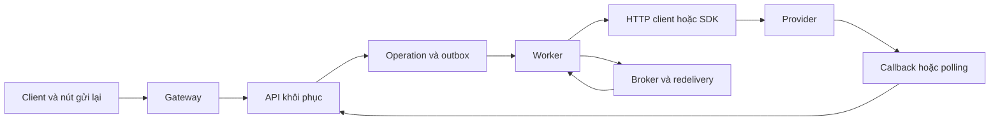

# Recovery retry storm test — Kiểm thử bão retry trong khôi phục tài khoản

## 1. Mục tiêu: hệ thống phục hồi được mà vẫn giữ ràng buộc bảo mật

Một người dùng không nhận được email khôi phục có thể bấm gửi lại. Ứng dụng thấy timeout có thể thử lại. HTTP client, SDK, worker và message broker cũng có thể tự thực hiện thêm lần gọi. Khi nhiều lớp cùng phản ứng với một sự cố, một lượng yêu cầu ban đầu nhỏ có thể tạo tải lớn hơn nhiều lên hệ thống đang yếu.

**Recovery retry storm** là tình trạng các lần thử lại trong luồng khôi phục làm tải tích tụ hoặc khuếch đại đến mức cản trở khả năng phục hồi. Hậu quả không chỉ là chậm gửi email. Hệ thống có thể gửi hàng loạt mã, làm người dùng liên tục nhận token cũ, tiêu hết quota SMS, giữ đầy connection pool hoặc khiến các API đăng nhập khác bị ảnh hưởng.

Trong module khôi phục mật khẩu, MFA, passkey và thiết bị xác thực, bài kiểm thử cần chứng minh đồng thời:

- Tải phát sinh do retry được chặn bằng các giới hạn có thể đo.
- Sau khi dependency hồi phục, hệ thống giải quyết công việc còn hợp lệ trong phạm vi đã thiết kế.
- Retry không tạo thêm quyền khôi phục, không dùng lại bằng chứng một lần và không bỏ qua policy.
- Người dùng hoặc tenant khác không bị một nhóm yêu cầu làm cạn tài nguyên chung.
- Hệ thống không giữ tác vụ vô hạn, không gửi thông điệp lỗi thời và không làm lộ dữ liệu nhạy cảm khi chẩn đoán.

Các cơ chế timeout, backoff và jitter giúp tránh việc các client cùng tăng tải khi gặp lỗi; chúng vẫn cần đi kèm giới hạn và kiểm soát tác động lặp. Tham khảo nền tảng trong [AWS Builders’ Library: Timeouts, retries, and backoff with jitter](https://aws.amazon.com/builders-library/timeouts-retries-and-backoff-with-jitter/). Những cấu hình và kịch bản bên dưới là thiết kế minh họa cho luồng khôi phục, không phải mức mặc định cho production.

## 2. Phân biệt những việc đang được gọi là retry

Không thể đo storm chính xác nếu mọi hành động đều được đếm thành một loại request.

| Khái niệm | Ý nghĩa trong bài | Ví dụ |
|---|---|---|
| Recovery intent | Ý định nghiệp vụ của người dùng | Muốn khôi phục quyền truy cập sau khi mất MFA |
| Recovery attempt | Hồ sơ một lần xử lý theo policy | Attempt có tenant, account, purpose, thời hạn và trạng thái |
| Provider operation | Một tác vụ có định danh ổn định | Gửi một thông điệp hoặc tạo một phiên xác minh |
| Physical invocation | Một lần gọi thực sự tới dependency | Một HTTP request đến nhà cung cấp email |
| Retry | Lần gọi bổ sung cho cùng operation | Gọi lại vì timeout với cùng định danh tác vụ |
| Resend | Một yêu cầu gửi lại có ý nghĩa nghiệp vụ | Người dùng bấm gửi lại mã theo policy |
| Redelivery | Broker hoặc provider giao lại dữ liệu | Cùng message hoặc callback đến nhiều lần |
| Polling | Tra cứu trạng thái lặp theo lịch | Kiểm tra phiên xác minh danh tính đã xong chưa |

Resend có thể được policy gộp với operation đang chờ hoặc tạo operation mới. Nó không tự động được hưởng quyền bỏ qua rate limit hay thay thế challenge.

Một retry kỹ thuật không nên tạo token mới chỉ vì invocation trước chưa có response. Nếu có việc thay challenge, đó phải là một chuyển trạng thái nghiệp vụ rõ ràng, có thế hệ mới và luật vô hiệu hóa thế hệ cũ.

Polling và callback redelivery cũng tạo tải. Bộ kiểm thử phải ghi nhận chúng, dù chúng không nằm trong counter có tên `retry_count`.

## 3. Lập bản đồ các tầng có thể khuếch đại

Một luồng minh họa:



Với mỗi cạnh, ghi rõ timeout, số lần thử tối đa, lịch chờ, điều kiện retry và ai sở hữu ngân sách. Kiểm tra cả cấu hình ẩn của SDK, proxy và framework queue.

Nếu có k tầng, mỗi tầng được phép thực hiện tối đa aᵢ **lần thử tổng cộng**, một upper bound đơn giản khi tất cả lớp đều retry độc lập là:

```text
Số lần gọi tầng cuối cho một yêu cầu tầng đầu <= a₁ × a₂ × ... × aₖ
```

Ví dụ tự xây dựng: gateway tối đa 2 lần, worker 3 lần và HTTP client 2 lần có thể tạo đến 12 lần gọi dưới cùng cho một yêu cầu ban đầu, nếu đường thực thi cho phép mọi lớp tiêu hết giới hạn.

Phân biệt “ba lần retry” với “ba lần thử tổng cộng”. Trường hợp đầu có thể là bốn lần gọi tính cả lần đầu. Sự không thống nhất cách đếm này thường làm sai dự toán tải.

Google SRE khuyến nghị giới hạn retry cho từng request, cân nhắc ngân sách retry rộng hơn và tránh khuếch đại qua nhiều tầng. Tham khảo [Addressing Cascading Failures](https://sre.google/sre-book/addressing-cascading-failures/). Trong bài kiểm thử, cần đếm physical invocation ở ranh giới dependency để kiểm chứng cấu hình thực, thay vì chỉ đọc con số ở worker.

### Không gộp mọi dependency thành một phép đo

Một retry gửi email có thể tạo thêm truy vấn database, kiểm tra quota, gọi kho khóa hoặc ghi audit. Provider chưa quá tải không có nghĩa toàn hệ thống vẫn ổn.

Lập bản đồ tải cho những tài nguyên chung: connection pool, executor, timer queue, database, cache giới hạn, kho token, broker, hệ thống quan sát và các dịch vụ bảo mật liên quan.

## 4. Xác định bất biến làm oracle trước khi gây lỗi

Oracle là điều kiện dùng để đánh giá kết quả đúng hay sai. Với storm test, phải có cả oracle tài nguyên và oracle bảo mật.

### 4.1. Oracle tài nguyên

Một hợp đồng minh họa có thể quy định:

- Số invocation đồng thời tới provider không vượt giới hạn C.
- Retry chỉ được phát khi còn ngân sách cho phép.
- Tổng invocation, gồm lần đầu và retry, còn chịu giới hạn tải của provider.
- Queue và buffer có dung lượng hoặc chính sách từ chối đã xác định.
- Mỗi operation có số lần thử và deadline hữu hạn.
- Tác vụ hết hạn, bị hủy hoặc bị thay thế không được dispatch lại.
- Sau khi lỗi được gỡ, queue hợp lệ giảm dưới ngưỡng trong cửa sổ đo đã định.

Mỗi điều kiện phải gắn với một vị trí thực thi. Giới hạn trên từng process không tự trở thành giới hạn toàn cụm.

### 4.2. Oracle bảo mật

Đối với hệ thống minh họa:

1. Timeout hoặc hết retry budget không tạo bằng chứng xác minh thành công.
2. Một operation retry giữ đúng tenant, account, purpose và challenge generation.
3. Lần gọi lại không tự cấp một recovery grant mới.
4. Một grant dùng một lần không làm credential bị thay hai lần khi request bị gửi lặp.
5. Callback trễ không hồi sinh attempt terminal hoặc thế hệ đã bị thay thế.
6. Fallback vẫn phải đạt các điều kiện bằng chứng của policy.
7. Lỗi hạ tầng không làm bỏ qua thời gian chờ, phê duyệt hỗ trợ hoặc kiểm soát session.
8. Dữ liệu bí mật không bị đưa vào log, trace hoặc label để theo dõi storm.

Với passkey, việc provider phục hồi không tạo lại private key của thiết bị đã mất. Luồng có thể cho phép đăng ký authenticator mới sau khi đủ điều kiện; retry không mở rộng quyền đó sang mọi hành động bảo mật.

### 4.3. Oracle khả dụng phải có mẫu số rõ ràng

Không đòi mọi attempt thành công sau một outage dài hơn thời hạn của chính attempt. Phân loại:

```text
eligible: còn hợp lệ để tiếp tục theo policy
expired: đã hết hạn
cancelled: đã hủy
superseded: đã bị thay thế
exhausted: đã hết giới hạn xử lý
```

Đo liveness trên nhóm còn đủ điều kiện, đồng thời kiểm tra nhóm còn lại kết thúc đúng trạng thái. Việc đánh dấu tất cả là lỗi vĩnh viễn sẽ làm retry rate bằng không nhưng không chứng minh khả năng phục hồi.

## 5. Định nghĩa phép đo và ngân sách

### 5.1. Hệ số khuếch đại

Với một cohort cố định gồm U operation được nhận, có thể đo:

```text
A_provider = tổng physical invocation tới provider của cohort / U
A_db       = tổng truy vấn database được quy cho cohort / U
```

Mẫu số là operation của cohort, không phải số request thành công. Tử số cần tính cả các invocation xảy ra sau cửa sổ phát tải ban đầu, cho đến khi cohort kết thúc hoặc đến mốc quan sát đã công bố.

Một phép chia “request provider trong một phút / request người dùng trong cùng phút” có thể sai khi retry của phút trước tràn sang phút sau. Dùng cohort hoặc báo cáo rõ tồn đọng đầu và cuối cửa sổ.

Đo thêm resend intent, duplicate request bị gộp, callback và polling riêng. Không giấu tác động gửi lặp trong một chỉ số trung bình.

### 5.2. Retry budget theo token bucket

Giả sử một bucket dành riêng cho retry có burst capacity B và refill rate r. Nếu tại đầu khoảng quan sát bucket có không quá B token, số retry được phép trong khoảng dài Δt có upper bound:

```text
R(Δt) <= B + r × Δt
```

Đây là giới hạn tích lũy của mô hình bucket lý tưởng, cần cộng sai số đo đã xác định nếu dùng thời gian thực. Nó không có nghĩa mọi cửa sổ một giây chỉ có r request: bucket có thể cho phép burst.

Nếu mỗi process có bucket riêng, N process có thể cho phép đến khoảng N lần burst và refill tổng tương ứng. Khi autoscale, rolling restart hoặc failover, giới hạn có thể tăng nếu trạng thái bucket không được quản lý theo thiết kế.

Ngân sách retry chỉ giới hạn invocation bổ sung. Cần một giới hạn khác cho tổng lưu lượng tới provider để các lần gọi đầu tiên không tự vượt công suất.

Nếu SDK còn tự retry bên trong, ngân sách ở worker chưa chắc bao phủ số physical invocation. Có thể tắt retry ẩn hoặc đưa nó vào mô hình ngân sách; test phải chứng minh lựa chọn đang được thực thi.

### 5.3. Rate, concurrency và queue là ba giới hạn khác nhau

Rate limit kiểm soát tốc độ phát tác vụ. Concurrency limit kiểm soát số tác vụ đang giữ tài nguyên. Queue bound kiểm soát công việc đang chờ.

Provider trở nên chậm có thể làm số tác vụ đồng thời tăng dù rate không đổi. Timer queue chứa rất nhiều retry chưa đến hạn có thể chiếm bộ nhớ dù worker đang rảnh.

Cần quan sát ít nhất:

- Tổng invocation/s, retry/s và số invocation đang chạy.
- Queue ready, delayed, in-flight và tuổi của tác vụ còn hợp lệ.
- Số lần từ chối admission, hoãn retry, hết hạn và hủy.
- Connection, thread, CPU, heap và số timer.
- Quota/chi phí provider từ tác động thật của stub.
- Liveness và độ trễ của nhóm người dùng hoặc tenant cần được bảo vệ.

Tránh đưa token, email hoặc operation ID có số lượng rất lớn vào metric label. Dùng counter theo lớp lỗi và cohort; giữ ledger test riêng để đối chiếu từng operation.

## 6. Thiết kế một thí nghiệm có thể tái hiện

Bài kiểm thử nên bắt đầu từ câu giả thuyết cụ thể:

> Khi provider chậm và từ chối một phần yêu cầu trong 30 giây, ứng dụng vẫn giữ giới hạn tổng invocation và concurrency; retry không làm phát sinh quyền khôi phục; sau khi lỗi được gỡ, những operation còn hợp lệ tiếp tục trong ngân sách đã định.

Câu này phải được chuyển thành ngưỡng số dựa trên môi trường test đã đo baseline.

Ví dụ cấu hình **chỉ để minh họa cách viết thí nghiệm**:

```yaml
workload:
  newOperationsPerSecond: 8
  durationSeconds: 180
  tenantCount: 3

phases:
  baselineSeconds: 60
  faultSeconds: 30
  recoverySeconds: 60
  cooldownSeconds: 30

operation:
  maxAttemptsTotal: 4
  deadlineSeconds: 45
  attemptLifetimeSeconds: 120

retry:
  baseDelayMillis: 200
  maxBackoffWindowMillis: 5000
  retryBucketBurst: 16
  retryBucketRefillPerSecond: 8

providerDispatch:
  totalBucketBurst: 20
  totalBucketRefillPerSecond: 30
  maxInFlight: 16
```

Các giá trị trên không phải capacity plan. Trước khi dùng, phải đo xem stub, database và hạ tầng test chịu được tải nào, rồi đặt ngưỡng theo mục tiêu của thí nghiệm. Deadline của operation và tuổi thọ attempt là hai ràng buộc khác nhau.

Với total bucket như ví dụ, một khoảng một giây có thể cho phép burst cộng refill, không phải hard cap 30 request/s trong mọi cửa sổ. Nếu hợp đồng provider giới hạn kiểu khác, mô hình điều tiết và oracle phải theo đúng kiểu đó.

### Những thành phần cần điều khiển

- Provider stub có thể trả response chậm, lỗi, 429 hoặc ngắt kết nối sau tác động.
- Clock và scheduler cho các test xác định về deadline, lịch retry và hết hạn.
- Nguồn random có seed cho việc tái hiện jitter.
- Queue và database thật ở tầng integration cần kiểm tra.
- Barrier để dừng worker ở đúng điểm trước/sau claim hoặc commit.
- Ledger ghi nhận invocation, operation reference, thời gian và số tác động ở stub.

Không cần gây lỗi trên dịch vụ của người dùng thật để học cơ chế. Các thí nghiệm trong bài dùng tài khoản tổng hợp, kênh gửi giả và dependency cô lập. Không chạy một load generator ra provider thật chỉ từ cấu hình minh họa này.

### Giữ workload được đo đúng

Một generator kiểu closed-loop chờ request trước hoàn thành mới gửi request sau. Khi hệ thống chậm, generator tự giảm tải và có thể che mức quá tải theo lịch đến dự kiến.

Nếu cần giữ arrival rate, dùng một nguồn phát theo lịch độc lập với thời gian response, đồng thời đo request đã gửi đúng lịch, bị trễ hoặc bị generator bỏ. Không tạo vô hạn thread để duy trì tải.

Các request gửi vào nhưng bị admission control từ chối phải được ghi nhận riêng. Không dùng tải “đã lên lịch” làm bằng chứng rằng service thực sự tiếp nhận từng request ấy.

## 7. Ma trận lỗi để tạo và phân tích storm

| Lỗi được chèn | Cơ chế khuếch đại cần quan sát | Oracle chính |
|---|---|---|
| Provider trả 5xx nhanh | Worker gọi lại liên tục | Retry budget, backoff và max attempts được giữ |
| Response chậm hơn timeout | Nhiều invocation chồng lấn | Concurrency hữu hạn; không coi timeout là chưa có tác động |
| Provider trả 429 theo đợt | Client cùng retry một thời điểm | Tôn trọng thời gian chờ và phân tán trong ngân sách |
| Mất response sau khi provider thực hiện | Tạo tác động nghiệp vụ lặp | Cùng operation/key theo hợp đồng idempotency |
| Broker giao lại đồng thời | Hai worker cùng xử lý một message | Claim, idempotency và cập nhật trạng thái nhất quán |
| Limiter hoặc cache bị lỗi | Giới hạn biến mất hoặc local fallback tăng tải | Hành vi fallback đúng phạm vi ngân sách đã thiết kế |
| Rolling restart | Counter và lịch retry bị reset | Không đặt lại attempts/deadline hoặc tạo burst ngoài hợp đồng |
| Provider vừa hồi phục | Toàn backlog cùng được dispatch | Tốc độ xả backlog và tài nguyên bị giới hạn |
| Một tenant bùng tải | Cạn quota chung | Tenant khác còn mức phục vụ theo policy |
| Callback gửi lặp | Inbox/DB bị tải dù không gọi provider | Khử trùng và giới hạn xử lý event |
| Polling trạng thái | Query storm song song với retry | Có lịch, ngân sách và thời hạn riêng |
| Log/exporter chậm | Lỗi dependency lan sang quan sát | Buffer có giới hạn, không làm bỏ kiểm soát bảo mật |

Đầu tiên kiểm thử từng lỗi để nhận diện nguyên nhân. Sau đó ghép những tổ hợp có ý nghĩa, chẳng hạn response chậm cộng worker restart hoặc 429 cộng limiter failover.

Không tăng số loại lỗi chỉ để gọi là chaos. Một thí nghiệm có nhiều biến không kiểm soát sẽ khó chứng minh vì sao hệ thống vượt giới hạn.

## 8. Backoff, jitter và Retry-After

Một exponential backoff minh họa với lần retry thứ k bắt đầu từ 1:

```text
window(k) = min(cap, base × 2^(k - 1))
spread(k) = số được chọn trong [0, window(k)]
```

Đó là một dạng full jitter. Cần định nghĩa rõ thời điểm bắt đầu k và cách lấy mẫu; đừng chỉ ghi “có jitter” trong cấu hình.

Test đơn vị nên xác minh:

- Giá trị lịch chờ không âm và nằm trong cửa sổ.
- Cửa sổ tăng và dừng ở cap.
- Phép tính không tràn số khi số lần thử lớn hoặc cấu hình sai.
- Seed tái hiện được lịch của scenario.
- Các instance không vô tình dùng cùng một lịch cố định.
- Việc chờ không giữ connection hoặc worker thread một cách không cần thiết theo thiết kế.

Jitter không bảo đảm hai retry không bao giờ trùng nhau. Không viết assertion “mọi timestamp phải khác nhau”. Giới hạn tải cứng phải đến từ admission, rate và concurrency control; jitter chỉ giúp phân tán.

### Tôn trọng thời gian provider yêu cầu chờ

HTTP Retry-After có thể biểu diễn bằng số giây hoặc HTTP-date theo [RFC 9110, mục Retry-After](https://www.rfc-editor.org/rfc/rfc9110.html#name-retry-after). Parser cần được kiểm tra với cả dạng hợp lệ, giá trị quá lớn, quá khứ, sai định dạng và sai lệch đồng hồ liên quan.

Một policy minh họa có thể dùng:

```text
notBefore = now + minimumWaitFromProvider + sampledBackoff
```

Ở đây minimum wait được cộng với phần phân tán không âm. Nếu provider bảo chờ lâu hơn backoff cap, không ép thời gian ấy xuống cap rồi retry sớm. Cap giới hạn cửa sổ backoff trong ví dụ, không phải quyền bỏ qua minimum wait.

Nếu lịch chờ khiến operation không còn đủ thời gian thực hiện, chuyển sang trạng thái chờ/terminal phù hợp policy. Không kéo dài token hoặc attempt để ép một retry xảy ra.

Khi nhiều client cùng nhận một mốc Retry-After, cần kiểm thử lịch phát sau mốc đó. Chờ đúng một timestamp chung mà không có điều tiết tiếp theo có thể tạo một đợt tải mới.

## 9. Ví dụ Java: kiểm tra quyết định lập lịch retry

Đoạn dưới dùng Java 17 và JUnit 5. Nó chỉ mô hình hóa việc lập lịch một retry; chưa có HTTP client, token bucket, database hoặc thay đổi credential.

`attemptsMade` là số lần thử đã được tính trước đó, gồm lần đầu. Trong hệ thống thực, cách ghi nhận/reserve một lần thử phải bền vững và có quy tắc rõ khi tiến trình bị dừng.

`safeToRepeat` là kết quả đánh giá hợp đồng thao tác, chẳng hạn provider có idempotency phù hợp hoặc có cách đối soát được thiết kế. Nó không được lấy từ một field do client tự khai.

```java
import org.junit.jupiter.api.Test;

import java.time.DateTimeException;
import java.time.Instant;
import java.util.List;
import java.util.Optional;
import java.util.function.LongUnaryOperator;

import static org.junit.jupiter.api.Assertions.assertEquals;
import static org.junit.jupiter.api.Assertions.assertThrows;
import static org.junit.jupiter.api.Assertions.assertTrue;

class RecoveryRetryPlannerTest {
    record Policy(
            int maxAttemptsTotal,
            long baseMillis,
            long capMillis,
            long minCallBudgetMillis) {
        Policy {
            if (maxAttemptsTotal < 1
                    || baseMillis < 1
                    || capMillis < baseMillis
                    || minCallBudgetMillis < 1) {
                throw new IllegalArgumentException("Invalid policy");
            }
        }
    }

    record State(
            int attemptsMade,
            boolean terminal,
            boolean retryable,
            boolean safeToRepeat) {}

    record Plan(int nextAttempt, Instant notBefore) {}

    static Optional<Plan> plan(
            Policy policy,
            State state,
            Instant now,
            Instant deadline,
            long minimumWaitMillis,
            LongUnaryOperator sampleWithinWindow) {

        if (state.attemptsMade() < 1 || minimumWaitMillis < 0) {
            throw new IllegalArgumentException("Invalid retry input");
        }

        if (state.terminal()
                || !state.retryable()
                || !state.safeToRepeat()
                || state.attemptsMade() >= policy.maxAttemptsTotal()
                || !now.isBefore(deadline)) {
            return Optional.empty();
        }

        long window = policy.baseMillis();
        for (int n = 1;
                n < state.attemptsMade()
                        && window < policy.capMillis();
                n++) {
            window = window > policy.capMillis() / 2
                    ? policy.capMillis()
                    : Math.min(policy.capMillis(), window * 2);
        }

        long spread = sampleWithinWindow.applyAsLong(window);
        if (spread < 0 || spread > window) {
            throw new IllegalArgumentException(
                    "Sample outside the backoff window");
        }

        try {
            long delay = Math.addExact(minimumWaitMillis, spread);
            Instant notBefore = now.plusMillis(delay);
            Instant earliestFinish =
                    notBefore.plusMillis(policy.minCallBudgetMillis());

            if (!earliestFinish.isBefore(deadline)) {
                return Optional.empty();
            }

            return Optional.of(new Plan(
                    state.attemptsMade() + 1, notBefore));
        } catch (ArithmeticException | DateTimeException overflow) {
            return Optional.empty();
        }
    }

    static final Instant NOW =
            Instant.parse("2030-01-01T00:00:00Z");
    static final Policy POLICY =
            new Policy(4, 200, 5000, 100);

    @Test
    void providerMinimumWaitIsNotClampedToBackoffCap() {
        var state = new State(1, false, true, true);

        Plan next = plan(
                POLICY, state, NOW, NOW.plusSeconds(20),
                6000, window -> window / 2).orElseThrow();

        assertEquals(2, next.nextAttempt());
        assertEquals(NOW.plusMillis(6100), next.notBefore());
    }

    @Test
    void noRetryWhenItsScheduleCannotFitTheDeadline() {
        var state = new State(1, false, true, true);

        assertTrue(plan(
                POLICY, state, NOW, NOW.plusSeconds(6),
                6000, window -> window / 2).isEmpty());
    }

    @Test
    void terminalExhaustedAndUnsafeOperationsStop() {
        var states = List.of(
                new State(4, false, true, true),
                new State(1, true, true, true),
                new State(1, false, false, true),
                new State(1, false, true, false));

        for (State state : states) {
            assertTrue(plan(
                    POLICY, state, NOW, NOW.plusSeconds(20),
                    0, window -> 0).isEmpty());
        }
    }

    @Test
    void exponentialWindowSaturatesAtTheCap() {
        var policy = new Policy(60, 200, 5000, 100);
        var state = new State(40, false, true, true);
        long[] observedWindow = new long[1];

        Plan next = plan(
                policy, state, NOW, NOW.plusSeconds(20), 0,
                window -> {
                    observedWindow[0] = window;
                    return window;
                }).orElseThrow();

        assertEquals(5000L, observedWindow[0]);
        assertEquals(NOW.plusMillis(5000), next.notBefore());
    }

    @Test
    void invalidJitterSourceIsDetected() {
        assertThrows(
                IllegalArgumentException.class,
                () -> plan(
                        POLICY,
                        new State(1, false, true, true),
                        NOW, NOW.plusSeconds(20),
                        0, window -> window + 1));
    }
}
```

Ở ví dụ, completion deadline là exclusive: không lập lịch nếu phần thời gian tối thiểu dự kiến kết thúc đúng hoặc sau deadline. Đây là quy tắc minh họa; deadline thực cần bao gồm các bước còn lại theo thiết kế.

Một plan hợp lệ chưa có nghĩa được gửi ngay. Dispatcher vẫn phải kiểm tra lại trạng thái authoritative, deadline, generation, ngân sách và tài nguyên tại thời điểm thực thi. Giữa lúc lập lịch và lúc dispatch, người dùng có thể hủy attempt hoặc đã hoàn tất qua một đường hợp lệ khác.

Ví dụ dùng sampler inject để kiểm tra biên một cách xác định. Bộ kiểm thử phân bố jitter và bộ kiểm thử tải nhiều instance là những phép kiểm tra riêng.

Thời gian hết hạn nghiệp vụ có thể dùng một nguồn thời gian tường nhất quán theo thiết kế. Khoảng chờ timeout trong tiến trình nên dựa trên phép đo thời gian phù hợp để không bị thay đổi đồng hồ làm sai. Test cần bao phủ cách hệ thống chuyển giữa hai loại thời gian, thay vì chỉ sửa clock toàn máy rồi suy ra scheduler hoạt động đúng.

## 10. Kiểm tra ngân sách bằng ledger của invocation thật

Đặt ledger ở provider stub hoặc một ranh giới có thể quan sát invocation thật. Một record tối thiểu:

```text
scenarioRef
operationRef
providerAccountRef
invocationStartedAt
invocationFinishedAt
attemptReservationRef
idempotencyKeyRef
resultClass
sideEffectReference
```

Các reference phục vụ test không chứa reset token hoặc dữ liệu liên hệ thật. Ledger là bằng chứng chẩn đoán của môi trường test, không phải lý do để tạo metric label theo từng operation.

Với mô hình mọi lần gọi thêm đều phải được cấp retry token, oracle có thể kiểm tra:

```text
Với các khoảng thời gian đã chọn:
  retry dispatch <= burst + refill × khoảng_thời_gian

Với mọi thời điểm có thay đổi invocation:
  số invocation đang chạy <= maxInFlight

Với mỗi operation:
  số slot được reserve <= maxAttemptsTotal
  không có invocation mới sau deadline hoặc trạng thái terminal
```

Nếu hệ thống có nhiều scope bucket, kiểm tra cả từng scope và tổng cần bảo vệ. Một biểu đồ trung bình toàn cụm có thể che việc một provider account vượt quota.

### Ghi nhận trước hay sau khi gửi?

Nếu chỉ tăng counter sau response, crash giữa gửi và ghi counter có thể làm lần gửi mất khỏi ngân sách. Nếu reserve slot bền vững trước khi gửi, crash trước network call có thể tiêu một slot dù chưa tạo invocation.

Thiết kế cần chọn semantics và test đúng semantics ấy. Sự chênh lệch giữa reservation và invocation có thể chấp nhận trong giới hạn, nhưng phải đo và xử lý được; không tự đặt lại số lần thử sau restart để “bù”.

Tương tự, không hoàn token budget khi timeout nếu invocation đã có thể gây tải hoặc tác động ở provider. Quy tắc trả lại reservation chỉ áp dụng khi chứng minh được điều kiện mà thiết kế đã cho phép.

### Kiểm tra retry ẩn

Tạo lỗi 5xx hoặc ngắt kết nối ở stub, cho phép một lần dispatch tại worker và đếm request nhận ở stub. Nếu worker báo một lần nhưng stub nhận nhiều lần, cần xem SDK, HTTP client, proxy hoặc cơ chế redirect có gửi thêm không.

Đổi cấu hình retry của từng tầng trong môi trường test để xác minh ledger phát hiện được thay đổi. Nếu test chỉ đọc counter worker, nó sẽ không nhận ra chính kiểu khuếch đại cần kiểm tra.

## 11. Token, idempotency và trạng thái một lần dưới tải lặp

Một storm không được biến một yếu tố xác minh thành nhiều yếu tố độc lập hoặc nhiều lần cấp quyền.

### 11.1. Timeout sau tác động từ xa

Provider stub cần có khả năng:

```text
1. Nhận operation có key ổn định.
2. Ghi nhận một tác động gửi/thực hiện.
3. Không trả response hoặc đóng kết nối.
4. Nhận invocation retry cùng operation.
5. Trả trạng thái của tác động trước theo hợp đồng giả.
```

Kiểm tra số physical invocation và số tác động nghiệp vụ riêng. Chúng có thể khác nhau. Nếu provider hỗ trợ idempotency trong một cửa sổ, test phải nằm trong và ngoài cửa sổ ấy để xác định hành vi.

Nếu provider không hỗ trợ một bảo đảm cần thiết, không tuyên bố exactly-once bằng cách chỉ có một lock local. Có thể cần đối soát hoặc chuyển operation sang trạng thái chưa xác định theo policy.

### 11.2. Không cấp token mới mỗi retry

Đối chiếu dữ liệu test sau nhiều invocation:

- Operation vẫn liên kết với đúng attempt và purpose.
- Token hoặc challenge generation chỉ thay theo chuyển trạng thái được cho phép.
- Hạn dùng không tăng theo số lần retry.
- Retry không làm mất dấu operation cũ còn chưa xác định.
- Các thông điệp gửi lại không làm challenge bị xoay liên tục ngoài policy.

Nếu resend tạo challenge mới, test phải kiểm tra luật vô hiệu hóa challenge cũ và callback còn trên đường tới. Chỉ đổi record hiện tại mà không xử lý tác vụ cũ trong queue có thể làm hệ thống gửi bằng chứng đã mất hiệu lực sau đó.

### 11.3. Request hoàn tất bị gửi lặp

Sau khi có bằng chứng hợp lệ, tạo nhiều request hoàn tất cùng lúc hoặc mô phỏng client không nhận response sau commit.

Assertions cần chứng minh:

- Grant một lần được consume theo giao dịch hoặc cơ chế nhất quán đã thiết kế.
- Mật khẩu, MFA hoặc enrollment passkey chỉ chịu một quyết định thay đổi hợp lệ.
- Request lặp không tạo thêm grant có scope rộng hơn.
- Các tác vụ kiểm soát session được ghi nhận và thực hiện theo semantics đã chọn.
- API đối với request lặp phản ánh đúng kết quả mà không trả lại bí mật.

Nếu session nằm ở dịch vụ khác, không giả định rollback database local sẽ thu hồi mọi session từ xa. Kiểm tra cơ chế auth version, outbox hoặc hạn chế quyền đang được dùng trong khoảng trễ.

### 11.4. Phân biệt lỗi xác minh và lỗi hạ tầng

Một OTP sai có thể tác động tới bộ đếm chống đoán mã. Một timeout chưa biết kết quả là một sự kiện khác. Test phải kiểm tra policy phân loại chúng; không cho mọi lỗi provider cùng trở thành “mã sai”, cũng không bỏ đếm những lần thử bằng chứng thực sự bị từ chối.

Việc hết ngân sách retry kỹ thuật không tự trở thành lý do khóa tài khoản vĩnh viễn. Các giới hạn chống lạm dụng, trạng thái attempt và quyền đăng nhập hiện tại cần theo đúng chính sách riêng.

## 12. Queue, restart và scale: storm có thể quay lại sau khi tưởng đã dừng

### 12.1. Redelivery và lease

Một worker gọi provider chậm hơn visibility timeout hoặc lease có thể khiến worker khác nhận cùng tác vụ. Kiểm tra bằng cách giữ invocation đầu chưa kết thúc rồi cho phép redelivery.

Local lease hoặc fencing có thể bảo vệ cập nhật local khi được triển khai đúng, nhưng không nhất thiết dừng một HTTP request cũ đã ra khỏi tiến trình. Vì vậy cần kiểm tra cả số tác động ở provider và tính idempotent của operation.

Assertions không chỉ là “có một worker giữ lock”:

- Số invocation đồng thời toàn hệ thống vẫn trong giới hạn.
- Worker cũ không được ghi đè trạng thái mới bằng dữ liệu lỗi thời.
- Worker mới không tạo một operation khác chỉ vì thiếu response.
- Callback và đối soát vẫn gắn đúng generation.
- Tác vụ đã terminal không được redelivery làm hoạt động lại.

### 12.2. Restart trong các thời điểm khác nhau

Lặp lại thí nghiệm với restart:

```text
A. Sau khi lưu operation nhưng trước khi phát lần đầu.
B. Sau khi reserve slot nhưng trước network call.
C. Sau tác động từ xa nhưng trước response.
D. Sau response nhưng trước khi lưu trạng thái.
E. Trong lúc retry đang chờ.
F. Ngay khi dependency phục hồi.
```

Theo dõi attempts, deadline, not-before, idempotency reference và trạng thái claim sau restart. Counter trong RAM mất đi không được âm thầm cấp lại toàn bộ quyền retry.

Với nhiều process, restart có thể nạp đầy bucket local và tạo burst mới. Nếu thiết kế cho phép burst mỗi instance, oracle phải tính nó; nếu mục tiêu là quota toàn cụm, cần chứng minh cơ chế toàn cụm giữ được mục tiêu.

### 12.3. Autoscale không tự giải quyết quota provider

Thêm worker có thể giúp xử lý nội bộ nhưng cũng làm tăng số client gọi một provider có quota cố định. Test cần tăng số worker trong khi giữ nguyên quota giả của provider.

Quan sát các giới hạn liên quan: tổng bucket, max in-flight, fairness và số operation mới được admit. Không kết luận tốt hơn chỉ vì queue giảm nhanh nếu provider đang bị gọi vượt ngưỡng hoặc nhiều tác vụ bị bỏ không có kết quả đúng.

### 12.4. Limiter bị lỗi

Nếu global limiter dùng một dependency khác, mô phỏng dependency ấy timeout hoặc partition. Kiểm tra fallback thật sự được thiết kế: tạm dừng, giới hạn local bảo thủ, quota reserve hoặc phương án khác.

Không mặc định fallback local còn cùng tổng ngân sách khi N instance hoạt động. Không tự suy ra mọi cache error đều có thể cho phép request đi tiếp.

Thí nghiệm cần ghi nhận trạng thái limiter, số instance và phần ngân sách cho từng scope để lý giải được invocation thực tế.

## 13. Đo giai đoạn provider hồi phục và xả backlog

Một hệ thống có thể chịu được thời gian outage nhưng tự gây outage thứ hai khi provider hoạt động lại.

Sau khi gỡ lỗi, theo dõi đồng thời:

- Invocation mới, retry và polling.
- Queue còn hợp lệ và queue đã hết hạn.
- Tỷ lệ hoàn tất của từng cohort.
- Tuổi tác vụ, lỗi provider và mức sử dụng tài nguyên.
- Lưu lượng của tenant hoặc API khác cần được bảo vệ.

Nếu dùng cùng đơn vị công việc, một xấp xỉ để lập kỳ vọng xả backlog là:

```text
tốc độ giảm backlog ≈ năng lực xử lý hữu ích an toàn
                       - công việc mới được nhận mỗi giây
```

Chỉ có thể dùng phép tính này khi hai vế cùng đơn vị và các giả định về năng lực tương đối ổn định. Một intent gọi provider ba lần không tương đương một intent chỉ gọi một lần. Chi phí callback, đối soát và lưu trữ cũng có thể giới hạn tốc độ.

Nếu năng lực hữu ích không lớn hơn công việc mới, backlog có thể không giảm dù retry đã được giới hạn. Test cần báo điều kiện ấy, không tăng số worker vô hạn để che thiếu năng lực.

### Không nhầm hết hạn với thành công

Queue có thể giảm vì hàng nghìn tác vụ hết hạn hoặc bị đẩy sang dead-letter. Vì vậy báo riêng:

```text
completedEligible
expiredBeforeDispatch
cancelledBeforeDispatch
exhausted
deadLettered
stillPendingEligible
```

Độ sâu queue bằng không chỉ là một phép đo tài nguyên. Nó không chứng minh người dùng còn đủ điều kiện đã lấy lại quyền truy cập.

### Giới hạn làn sóng sau circuit breaker

Nếu có circuit breaker, thử trường hợp nhiều instance cùng vào half-open. Kiểm tra số probe thực tế, tác động của probe và việc các request đang chờ không đồng loạt thoát khi breaker đóng.

Một probe có tác động không an toàn cần được xem xét như một operation nghiệp vụ. Đừng dùng việc gửi thêm mã thật làm một phép kiểm tra sức khỏe không được quản lý.

### Dừng gửi công việc lỗi thời

Ngay trước dispatch, kiểm tra lại attempt, generation, deadline và trạng thái kênh theo policy. Một item trong delayed queue không tự còn hợp lệ chỉ vì nó được tạo trước outage.

Sau khi recovery hoàn tất hoặc bị hủy, một thông điệp muộn có thể gây hiểu nhầm và hỗ trợ lừa đảo. Test cần xác minh công việc chưa gửi được bỏ hoặc đối soát đúng; với tác động từ xa đã xảy ra, kiểm tra callback và nội dung vẫn không cấp quyền mới.

## 14. Tenant gây tải lớn, người dùng bấm gửi lại và fairness

Storm có thể bắt đầu từ hành vi hợp lệ hoặc bị cố ý kích hoạt. Trong môi trường test, tạo ba cohort:

```text
Cohort A: nhiều resend tới cùng tài khoản tổng hợp.
Cohort B: nhiều tài khoản tổng hợp cùng tenant.
Cohort C: tải thấp, liên tục từ tenant khác.
```

Đo sự phục vụ của C trong khi A và B gặp lỗi và retry. Định nghĩa fairness bằng mục tiêu cụ thể của sản phẩm, chẳng hạn một mức phục vụ tối thiểu hoặc latency bound cho workload test đó. Không chỉ kiểm tra tỷ lệ trung bình toàn hệ thống.

Các giới hạn có thể tồn tại ở scope account, tenant, provider account, kênh và toàn hệ thống. Scope phải lấy từ ngữ cảnh tin cậy. Client không được đổi một header tenant tùy ý để lấy bucket mới.

### Gửi lại không được reset ngân sách vô hạn

Nếu người dùng bấm liên tục, policy có thể gộp intent đang chờ hoặc nhận một yêu cầu mới trong giới hạn. Test cần kiểm tra:

- Không kéo dài attempt vô hạn.
- Không reset counters chỉ vì có request resend.
- Không tạo vô hạn delayed task cho cùng mục đích.
- Không phát nhiều mã khác nhau làm người dùng không biết mã nào còn hiệu lực.
- Public API giữ phản hồi và thời gian chờ phù hợp chính sách chống dò tài khoản.
- Status polling không khởi tạo operation mới.

Không dùng một giới hạn theo IP làm bằng chứng duy nhất cho chống lạm dụng: nhiều người dùng có thể dùng chung IP, và một nguồn gây tải có thể phân tán request. Thí nghiệm cần phản ánh các scope mà thiết kế thực sự hỗ trợ.

### Bảo vệ các tác vụ bảo mật quan trọng khác

Nếu queue gửi mã dùng chung executor với thu hồi session hoặc ghi trạng thái credential, storm có thể làm chậm một hành động bảo mật đã được quyết định.

Duy trì workload nền cho những tác vụ ấy trong test và đo kết quả thực thi. Một request “đã xếp hàng thu hồi session” chưa chứng minh session cũ đã mất quyền theo đúng mốc mà policy yêu cầu.

Có thể cần tách tài nguyên hoặc ưu tiên theo thiết kế, nhưng test phải kiểm chứng hành vi cuối cùng thay vì suy ra từ tên queue.

## 15. Quan sát và stop condition của thí nghiệm

Đặt stop condition trước khi phát tải. Ví dụ trong môi trường cô lập:

- Invocation hoặc concurrency vượt giới hạn hợp đồng.
- Một attempt bị cấp grant khi không có bằng chứng hợp lệ.
- Có thay đổi credential hoặc session trái policy.
- Queue, bộ nhớ hoặc chi phí giả lập vượt giới hạn của thí nghiệm.
- Lỗi không còn nằm trong dependency hoặc cohort đã chọn.

Khi stop condition xảy ra, ngừng phát tải và gỡ fault theo cơ chế thí nghiệm. Sau đó vẫn cần kiểm tra tác vụ đang chạy, delayed queue, deadline và khả năng đạt trạng thái ổn định. Dừng load generator không có nghĩa retry trong hệ thống đã dừng.

Sử dụng event có reason code như `RETRY_DEFERRED`, `BUDGET_EXHAUSTED`, `ATTEMPT_EXPIRED` hoặc `OPERATION_SUPERSEDED` để phân biệt nguyên nhân. Không dump reset token, recovery code, OTP, cookie hoặc hồ sơ xác minh danh tính khi cần đối chiếu.

Metric và trace cần thể hiện việc throttling có chủ đích khác với lỗi không kiểm soát. Một hệ thống từ chối bớt yêu cầu theo hợp đồng có thể an toàn hơn việc cố nhận mọi thứ rồi giữ queue vô hạn; oracle của test phải phản ánh mục tiêu admission đã chọn.

Giữ seed, lịch fault, cấu hình các lớp retry, số instance và ledger đã làm sạch. Những dữ liệu ấy giúp tái hiện một spike mà không giữ bí mật của scenario.

## 16. Kịch bản xuyên suốt: outage, restart và callback đến muộn

Một scenario có thể diễn ra theo lịch do test điều khiển:

```text
T0: Tạo các attempt tổng hợp và xác nhận baseline.
T1: Provider bắt đầu thực hiện tác động nhưng làm mất một phần response.
T2: Retry phát sinh; ledger ghi invocation và tác động riêng.
T3: Restart một worker đang có operation chưa biết kết quả.
T4: Một số attempt bị hủy hoặc bị thay challenge generation.
T5: Gỡ fault; provider phục hồi, backlog bắt đầu được xử lý.
T6: Thả callback cũ của các operation trước T4.
T7: Chờ cohort kết thúc hoặc tới mốc quan sát đã định.
```

Không cần mọi operation đi qua toàn bộ trạng thái. Tạo nhóm fixture riêng để bảo đảm có đủ các nhánh cần quan sát.

Assertions quan trọng:

1. Không có amplification ngoài mô hình cấu hình đã công bố.
2. Giới hạn tổng invocation và concurrency vẫn giữ qua restart.
3. Operation chưa xác định được retry/đối soát theo hợp đồng, không tạo tác động mới ngoài semantics.
4. Operation bị hủy hoặc superseded không được gửi thêm sau khi dispatcher thấy trạng thái mới.
5. Callback cũ không tạo evidence dùng được cho generation hiện tại.
6. Không phát sinh credential mutation, grant hay session có quyền từ timeout.
7. Cohort còn đủ điều kiện tiến triển sau phục hồi trong ngưỡng đã định.
8. Cohort hết hạn kết thúc đúng trạng thái và không tiếp tục tiêu ngân sách.
9. Tenant tải thấp còn đạt mục tiêu phục vụ của thí nghiệm.
10. Queue, timer, connection và thread trở về trạng thái ổn định theo baseline cho phép.

Một assertion về “sau khi dispatcher thấy trạng thái mới” phải phù hợp điểm đồng bộ của thiết kế. Nếu invocation đã gửi trước khi thao tác hủy commit, không thể giả định packet sẽ bị thu hồi. Cần kiểm tra kết quả muộn không được áp dụng trái policy và tác động từ xa được xử lý theo hợp đồng.

## 17. Báo cáo kết quả để phân biệt phục hồi thật với giảm tải giả

Một báo cáo nên mô tả giả thuyết và bằng chứng đủ để người khác đánh giá, không chỉ ghi “chaos test passed”.

```text
SCENARIO=RECOVERY_RETRY_STORM
SEED=<seed-cua-moi-truong-test>
FAULT=<loai-loi-va-ranh-gioi>
LOAD_MODEL=<arrival-rate-va-cac-cohort>
RETRY_LAYERS=<cac-lop-thuc-su-co-retry>
BUDGET_SCOPE=<process/tenant/provider/cluster>
MAX_IN_FLIGHT_OBSERVED=<gia-tri-do>
PHYSICAL_INVOCATIONS=<gia-tri-do>
REMOTE_SIDE_EFFECTS=<gia-tri-do>
AMPLIFICATION_BY_COHORT=<ket-qua-do>
ELIGIBLE_COMPLETED=<ket-qua-do>
EXPIRED_OR_CANCELLED=<ket-qua-do>
PENDING_AT_END=<ket-qua-do>
UNAUTHORIZED_GRANTS=<ket-qua-do>
SECURITY_INVARIANTS=<PASS/FAIL>
RECOVERY_WINDOW=<ket-qua-do>
FAULT_REMOVED=<YES/NO>
RESULT=<PASS/FAIL/INCONCLUSIVE>
```

Đây là mẫu báo cáo, không phải kết quả đã chạy. Một lần chạy thiếu ledger provider hoặc không xác nhận fault thực sự tác động có thể là inconclusive, thay vì pass.

Đánh giá độ mạnh của bộ test bằng các biến thể có lỗi trong môi trường kiểm soát: bỏ jitter, reset attempts khi restart, cấp đầy bucket local ở mọi worker, bỏ kiểm tra deadline trước dispatch hoặc tạo key mới mỗi retry. Oracle phù hợp phải phát hiện tác động liên quan.

Bài kiểm thử đạt mục tiêu khi chứng minh được rằng retry giúp hoàn thành công việc còn hợp lệ mà không trở thành nguồn khuếch đại vô hạn, đồng thời mọi quyết định khôi phục vẫn giữ đúng ngữ cảnh, bằng chứng một lần và kiểm soát session.
