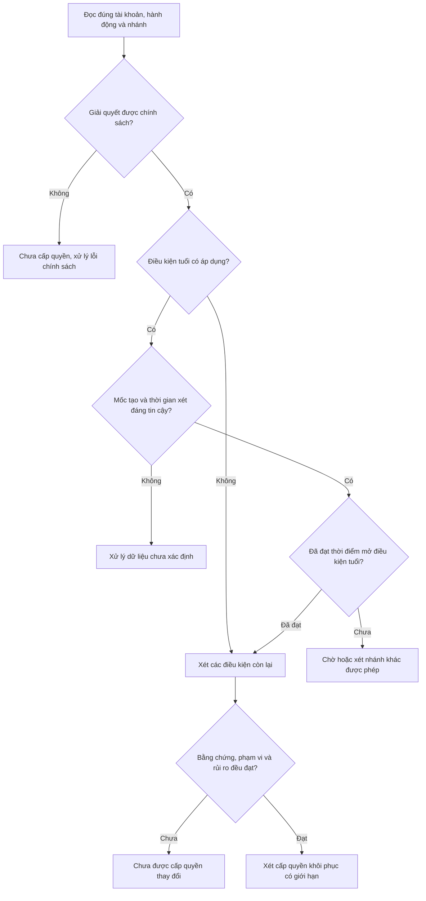

# Giới hạn khôi phục theo tuổi tài khoản

## 1. Tuổi tài khoản có ý nghĩa gì trong điều kiện khôi phục?

**Giới hạn theo tuổi tài khoản — account age restrictions — là quy tắc dùng khoảng thời gian kể từ một mốc tạo lập tài khoản đáng tin cậy để quyết định một loại yêu cầu khôi phục có thể đi tiếp, cần chờ hay cần được xử lý theo một nhánh khác.**

Trong chương Eligibility Rules của module `SECURITY_AUTHENTICATION_ACCOUNT_RECOVERY`, quy tắc này có thể áp dụng khi khôi phục mật khẩu, MFA, passkey hoặc thiết bị xác thực. Phạm vi cụ thể phải do chính sách xác định; không có một ngưỡng thời gian dùng chung phù hợp cho mọi sản phẩm và mọi thao tác.

Ở đây, “tuổi tài khoản” là thời gian tồn tại của một thực thể tài khoản trong hệ thống, không phải tuổi của người dùng. Tài khoản được tạo từ lâu cũng không có nghĩa người đang yêu cầu khôi phục đã kiểm soát nó từ lâu.

Ví dụ, một chính sách có thể hạn chế một nhánh khôi phục thay yếu tố xác thực đối với tài khoản mới tạo, trong khi vẫn cho phép đặt lại mật khẩu nếu đủ bằng chứng theo quy trình phù hợp. Đây là hai quyết định khác nhau về phạm vi, không phải một cờ chung “tài khoản mới không được hỗ trợ”.

Điểm quan trọng nhất là: **đạt điều kiện tuổi tài khoản chỉ vượt qua một điều kiện xét duyệt, không tự chứng minh quyền của người yêu cầu và không tự cấp quyền thay đổi phương tiện xác thực.**

## 2. Vì sao tuổi tài khoản có thể liên quan đến rủi ro?

### 2.1. Hạn chế một số đường lạm dụng ngay sau đăng ký

Các luồng đăng ký, thiết lập phương tiện và khôi phục có thể có yêu cầu khác nhau. Nếu nhánh khôi phục yếu hơn, một đối thủ có thể tìm cách sử dụng nó ngay sau khi tạo tài khoản để né một yêu cầu của giai đoạn thiết lập.

Ví dụ, hệ thống yêu cầu xác nhận một phương tiện bổ sung nhưng lại cho phép nhân viên xóa yêu cầu đó qua một nhánh hỗ trợ dễ dãi. Giới hạn tuổi có thể làm chậm một phần hành vi khai thác, nhưng vấn đề gốc vẫn là sự thiếu nhất quán giữa các chính sách.

Một số hình thức lạm dụng còn gồm tạo nhiều tài khoản để phát hành yêu cầu khôi phục hàng loạt hoặc dùng các tài khoản mới để gây tải lên kênh gửi và bộ phận hỗ trợ. Quy tắc tuổi có thể là một lớp kiểm soát trong mô hình đó.

Tuy nhiên, cần chỉ ra đường lạm dụng cụ thể mà quy tắc đang giảm. Nếu vấn đề là gửi thư hàng loạt, giới hạn tần suất tại điểm khởi tạo vẫn cần thiết. Một kiểm tra tuổi đặt ở bước cuối không ngăn được toàn bộ chi phí đã phát sinh ở các bước trước.

### 2.2. Giới hạn tác dụng của khoảng chờ

Đối thủ có thể tạo tài khoản rồi chờ đủ thời gian. Họ cũng có thể chiếm một tài khoản lâu năm. Vì vậy, tài khoản đủ tuổi không được mặc định là tài khoản an toàn.

Tuổi tài khoản không thay thế:

- Bằng chứng người yêu cầu có quyền với tài khoản.
- Xác minh quyền sử dụng kênh hoặc phương tiện khôi phục.
- Kiểm tra phạm vi thao tác được cho phép.
- Kiểm soát token dùng một lần, thời hạn và phát lại.
- Đánh giá dấu hiệu chiếm đoạt và xử lý session.
- Giới hạn hành vi tự động hóa hoặc gửi yêu cầu hàng loạt.

Một tài khoản mới có thể thuộc người dùng hợp lệ đang thật sự mất thiết bị. Một tài khoản cũ có thể bị bỏ quên, có dữ liệu liên hệ lỗi thời hoặc đã bị chiếm quyền. Chính sách cần xét các tình huống này thay vì dùng tuổi như một thước đo danh tính duy nhất.

### 2.3. Chi phí đối với người dùng hợp lệ

Người dùng có thể quên mật khẩu ngay trong ngày đăng ký, mất điện thoại sau khi thiết lập MFA hoặc tạo passkey trên một thiết bị sau đó không còn sử dụng được.

Nếu mọi đường khôi phục đều bị chặn theo tuổi, tài khoản mới có thể rơi vào tình trạng không thể lấy lại quyền kiểm soát dù người dùng có bằng chứng phù hợp. Thiết kế cần cân nhắc phạm vi hạn chế và các đường xử lý được phép từ đầu.

Không nên buộc người dùng tạo một tài khoản khác chỉ để né điều kiện. Việc này có thể làm phân tán dữ liệu, quyền và hồ sơ mà không giải quyết được quyền kiểm soát tài khoản ban đầu.

## 3. Phân biệt tuổi tài khoản với những khoảng thời gian khác

| Đại lượng | Mốc bắt đầu | Ý nghĩa đối với khôi phục |
| --- | --- | --- |
| Tuổi tài khoản | Mốc tạo lập tài khoản được hệ thống công nhận | Xét điều kiện gắn với thời gian tồn tại của tài khoản |
| Tuổi địa chỉ khôi phục đã xác minh | Mốc kênh được xác minh hoặc được chấp nhận theo chính sách | Xét mức ổn định và hiệu lực của kênh dùng để khôi phục |
| Tuổi phương tiện xác thực | Mốc phương tiện được gắn hợp lệ | Xét phương tiện mới thêm hoặc thay đổi gần đây |
| Thời gian từ lần đổi cấu hình bảo mật | Sự kiện thay email, MFA, passkey hoặc cấu hình liên quan | Áp dụng giới hạn sau thay đổi nếu chính sách có yêu cầu |
| Thời gian chờ của hồ sơ | Mốc tiếp nhận, phê duyệt hoặc một bước xử lý | Quản lý tiến độ và thời điểm được phép tiếp tục |
| Tuổi session | Mốc tạo hoặc xác thực của session | Đánh giá ngữ cảnh truy cập và yêu cầu xác thực lại |
| Thời gian không hoạt động | Lần hoạt động hợp lệ gần nhất theo định nghĩa sản phẩm | Xét tài khoản ngủ lâu hoặc ngữ cảnh ít thông tin gần đây |
| Thời gian tham gia tổ chức | Mốc được gắn vào một tổ chức hoặc miền quản lý | Xét phạm vi và chính sách của tổ chức đó |

Một tài khoản tồn tại ba năm có thể vừa đổi email khôi phục vài phút trước. Nếu dùng tuổi tài khoản để bỏ qua điều kiện dành cho kênh mới, hệ thống có thể gửi quyền khôi phục tới một kênh vừa bị đối thủ thay đổi.

Tương tự, một tài khoản toàn cục lâu năm có thể mới được thêm vào một tổ chức. Tuổi toàn cục không tự chứng minh quan hệ quản lý trong tổ chức đã ổn định hoặc quyền quản trị mới được cấp là hợp lệ.

Các khoảng thời gian này cần có tên trường và quy tắc riêng. Không nên sử dụng một trường `created_at` để đại diện đồng thời cho ngày tạo tài khoản, ngày nhập dữ liệu và ngày xác minh kênh.

## 4. Xác định mốc tạo lập và cách tính tuổi

### 4.1. Chọn sự kiện có thẩm quyền

Một định nghĩa có thể dùng là thời điểm backend ghi nhận việc tạo tài khoản thành công. Đây phải là sự kiện thuộc vòng đời tài khoản, không phải thời điểm người dùng mở biểu mẫu hoặc thời điểm trình duyệt gửi yêu cầu.

Mốc sử dụng cần có các thuộc tính phù hợp:

- Được ghi nhận bởi thành phần có thẩm quyền.
- Gắn với đúng thực thể tài khoản và miền quản lý.
- Không cho người dùng hoặc nhân viên thông thường tự sửa để vượt điều kiện.
- Có nguồn gốc rõ ràng khi nhập, chuyển đổi hoặc phục hồi dữ liệu.
- Được lưu và so sánh dưới dạng thời điểm có ý nghĩa thống nhất.

Nếu hệ thống có trạng thái tạo tạm, chưa hoàn tất hoặc chưa xác minh ban đầu, cần xác định mốc nào được dùng. Một bản ghi tạm tồn tại nhiều ngày không nhất thiết có cùng ý nghĩa với một tài khoản đã được tạo lập hợp lệ.

Tình trạng hoạt động và tuổi tài khoản vẫn là hai điều kiện khác nhau. Đủ tuổi không tự làm tài khoản bị vô hiệu hóa trở thành tài khoản được phép khôi phục.

### 4.2. Dùng thời gian máy chủ và quy ước rõ ràng

Một công thức khái niệm:

```text
account_age = evaluation_time - trusted_account_created_at

eligible_after = trusted_account_created_at + minimum_account_age

Đạt điều kiện thời gian khi:
  evaluation_time >= eligible_after
```

`evaluation_time` cần đến từ nguồn thời gian đáng tin cậy phía máy chủ. Đồng hồ trình duyệt, ngày do người dùng nhập hoặc múi giờ thiết bị không được quyết định kết quả.

Chính sách cũng cần nói rõ “ngày” có nghĩa là khoảng thời gian cố định hay ngày trên lịch. Chẳng hạn, 48 giờ kể từ một thời điểm không giống quy tắc “sau hai ngày lịch theo múi giờ địa phương”.

Trong một chính sách dùng khoảng thời gian cố định, lưu và so sánh các thời điểm theo một quy ước thống nhất như UTC giúp tránh nhầm lẫn. Múi giờ người dùng có thể phục vụ hiển thị thời điểm chờ, nhưng không nên làm thay đổi điều kiện.

### 4.3. Ví dụ ở đúng ranh giới

Giả sử riêng một nhánh khôi phục minh họa yêu cầu tài khoản tồn tại ít nhất 48 giờ. Đây là số liệu giả định để giải thích phép tính, không phải mức thời gian khuyến nghị áp dụng chung.

```text
trusted_account_created_at = 2026-06-01T10:00:00Z
minimum_account_age        = 48 giờ
eligible_after             = 2026-06-03T10:00:00Z
```

| Thời điểm xét | Kết quả riêng của điều kiện tuổi |
| --- | --- |
| 2026-06-03T09:59:00Z | Chưa đạt |
| 2026-06-03T10:00:00Z | Đạt nếu chính sách dùng điều kiện lớn hơn hoặc bằng |
| 2026-06-03T10:01:00Z | Đạt điều kiện tuổi; vẫn cần xét các điều kiện khác |

Không nên làm tròn tuổi thành số ngày nguyên rồi dùng một quy tắc khác với đặc tả. Cách hiển thị “2 ngày” cho người dùng không nhất thiết có độ chính xác đủ để quyết định tại ranh giới.

### 4.4. Dữ liệu thiếu, ngày tương lai và sai lệch đồng hồ

Nếu mốc tạo bị thiếu, không hợp lệ hoặc nằm trong tương lai ngoài điều kiện thời gian được chấp nhận, hệ thống chưa có căn cứ để khẳng định tài khoản đủ tuổi.

Không tự thay giá trị thiếu bằng một mốc rất cũ để phép tính luôn đạt. Cũng không coi một số âm hoặc lỗi chuyển đổi là kết quả bằng không rồi tiếp tục mà không ghi nhận nguyên nhân.

Cần có trạng thái như “chưa xác định được dữ liệu tuổi” và đường xử lý phù hợp. Trạng thái này khác với kết luận người dùng có ý đồ xấu hoặc vĩnh viễn không được khôi phục.

Sự cố nguồn thời gian cũng không phải lý do tự tắt quy tắc. Khi chưa đánh giá được một điều kiện bắt buộc, hệ thống không nên tự cấp quyền dựa trên giả định điều kiện đã đạt.

## 5. Đặt quy tắc theo hành động và nhánh khôi phục

### 5.1. Không áp dụng một giới hạn rộng hơn mục tiêu

Một chính sách cần xác định ít nhất:

| Thành phần | Nội dung phải rõ |
| --- | --- |
| Đối tượng áp dụng | Loại tài khoản, tổ chức hoặc miền quản lý nào |
| Hành động | Đặt lại mật khẩu, thay MFA, đăng ký passkey mới hay đổi kênh |
| Nhánh khôi phục | Tự phục vụ, phương án dự phòng, hỗ trợ hoặc nhánh đặc biệt |
| Mốc thời gian | Sự kiện nào được dùng để tính tuổi |
| Ngưỡng | Giá trị, đơn vị và điều kiện tại ranh giới |
| Kết quả khi chưa đạt | Chờ, chuyển xét duyệt hoặc không hỗ trợ nhánh đó |
| Xử lý dữ liệu không rõ | Ai có quyền xác minh nguồn dữ liệu và xử lý tiếp |
| Ngoại lệ | Có hay không, điều kiện và thẩm quyền áp dụng |
| Phiên bản | Khi nào quy tắc có hiệu lực và áp dụng ra sao cho yêu cầu đang mở |

Một cấu hình chỉ có `minimum_age_days` nhưng không nêu hành động và nhánh áp dụng dễ dẫn đến chặn quá mức hoặc bỏ sót đường thay thế.

### 5.2. Ví dụ về một tập chính sách giả định

| Hành động hoặc nhánh | Điều kiện tuổi trong ví dụ | Những điều kiện vẫn phải có |
| --- | --- | --- |
| Đặt lại mật khẩu bằng phương án được chấp nhận | Không đặt giới hạn tuổi riêng | Bằng chứng, quyền đặt lại, chống lạm dụng và xử lý sau thay đổi |
| Một nhánh tự phục vụ để thay yếu tố đã mất | Tối thiểu 48 giờ | Bằng chứng phù hợp và các điều kiện rủi ro của nhánh |
| Thay kênh khôi phục vừa được cập nhật | Không dùng riêng tuổi tài khoản để quyết định | Quy tắc về kênh, thay đổi gần đây và thẩm quyền |
| Nhánh hỗ trợ có kiểm tra bổ sung | Theo chính sách riêng của nhánh | Không tự kế thừa quyền từ việc gọi được nhân viên |
| Đăng ký passkey sau khi được phép khôi phục | Xét quy tắc của nhánh đã cấp quyền | Kiểm tra đăng ký đúng tài khoản, phạm vi và điều kiện của phương tiện mới |

Bảng này minh họa cách tách phạm vi, không quy định sản phẩm phải có các nhánh đó hoặc buộc dùng 48 giờ.

Nếu tuổi là điều kiện bắt buộc cho toàn bộ một loại thay đổi, nhánh hỗ trợ không được tự bỏ qua. Nếu chính sách chỉ hạn chế một đường tự phục vụ, một nhánh khác có thể được xét theo các điều kiện riêng đã được phê chuẩn. Hai thiết kế này cần được phân biệt ngay trong đặc tả.

### 5.3. Vượt điều kiện tuổi không phải quyết định cho phép

Có thể biểu diễn một quyết định khái niệm:

```text
Được xem xét cấp quyền khôi phục
    = đúng tài khoản và phạm vi
      AND trạng thái tài khoản phù hợp
      AND điều kiện tuổi áp dụng đã đạt
      AND bằng chứng đáp ứng chính sách
      AND yêu cầu rủi ro và chống lạm dụng được đáp ứng
      AND các phê duyệt bắt buộc còn hiệu lực
```

Tuổi tài khoản không được nối bằng điều kiện “hoặc” để thay bằng chứng: “đủ bằng chứng HOẶC tài khoản đủ cũ” có thể khiến một người chỉ biết định danh của tài khoản lâu năm được đi tiếp.

Tương tự, một phương án khôi phục chưa được xác minh không trở nên đáng tin cậy chỉ vì tài khoản đã tồn tại lâu. Mỗi điều kiện cần giữ đúng ý nghĩa của nó.

## 6. Mô hình đánh giá riêng điều kiện tuổi

### 6.1. Trả về kết quả đủ rõ

Một hàm kiểm tra tuổi có thể trả về các kết quả nội bộ sau:

| Kết quả | Ý nghĩa |
| --- | --- |
| `NOT_APPLICABLE` | Chính sách đã được giải quyết đầy đủ và không áp dụng điều kiện tuổi cho phạm vi này |
| `AGE_GATE_PASS` | Điều kiện tuổi áp dụng đã đạt tại thời điểm xét |
| `WAIT_FOR_AGE` | Mốc đáng tin cậy đã biết nhưng chưa đủ thời gian |
| `AGE_DATA_UNCERTAIN` | Chưa đủ dữ liệu hoặc độ tin cậy để tính tuổi |
| `POLICY_UNAVAILABLE` | Không giải quyết được chính sách áp dụng hoặc cấu hình không hợp lệ |

Không nên dùng cùng một giá trị `false` cho chưa đủ tuổi, thiếu dữ liệu và lỗi đọc cấu hình. Những tình huống đó có hướng xử lý khác nhau.

Đặc biệt, không tìm được cấu hình không đồng nghĩa chính sách đã xác nhận không có hạn chế. Muốn trả về `NOT_APPLICABLE`, hệ thống cần biết rõ rằng quy tắc không áp dụng trong phạm vi đang xét.

### 6.2. Mã giả minh họa

```text
evaluateAccountAgeGate(account, action, route, policy, evaluationTime):
    require accountWasLoadedFromAuthoritativeScope()

    if not policy.isResolvedFor(account, action, route):
        return POLICY_UNAVAILABLE

    if not policy.ageRuleApplies(account, action, route):
        return NOT_APPLICABLE

    rule = policy.resolvedAgeRule
    if not rule.hasValidNonNegativeDuration():
        return POLICY_UNAVAILABLE

    createdAt = account.trustedLifecycleStart
    if not isTrustedInstant(createdAt):
        return AGE_DATA_UNCERTAIN

    if not isTrustedEvaluationTime(evaluationTime):
        return AGE_DATA_UNCERTAIN

    if evaluationTime < createdAt:
        return AGE_DATA_UNCERTAIN

    ageGateOpensAt = checkedAdd(createdAt, rule.minimumDuration)
    if ageGateOpensAt could not be calculated safely:
        return AGE_DATA_UNCERTAIN

    if evaluationTime < ageGateOpensAt:
        return WAIT_FOR_AGE(ageGateOpensAt, policy.version)

    return AGE_GATE_PASS(policy.version, evaluationTime)
```

Mã giả chỉ đánh giá một điều kiện. Nó không xác minh người yêu cầu, không phát hành token và không thay đổi phương tiện. Tài khoản đầu vào phải đã được tải theo đúng định danh và phạm vi có thẩm quyền; không lấy mốc tạo do client khai báo để đưa vào hàm như dữ liệu tin cậy.

Phép cộng thời gian cần xử lý giá trị ngoài miền và cấu hình sai một cách rõ ràng. Không để tràn số hoặc lỗi chuyển đổi làm một ngưỡng lớn trở thành thời gian âm và tự đạt điều kiện.

### 6.3. Sơ đồ hội tụ về các điều kiện còn lại



Đi qua nhánh “không áp dụng” hay “đã đạt” đều dẫn tới các điều kiện khác. Không nhánh nào được đi thẳng từ tuổi tài khoản đến xóa MFA hoặc tạo session đầy đủ.

## 7. Xử lý khoảng chờ mà không khóa nhầm tài khoản

### 7.1. Hạn chế một yêu cầu, không mặc định vô hiệu hóa tài khoản

Nếu nhánh khôi phục chưa đủ điều kiện tuổi, có thể lưu trạng thái chờ cho hồ sơ hoặc trả hướng dẫn phù hợp. Điều đó không tự yêu cầu vô hiệu hóa mật khẩu, passkey hay session vẫn hợp lệ của chủ tài khoản.

Một biểu mẫu công khai không nên cho người ngoài khóa tài khoản mới của người khác chỉ bằng việc yêu cầu khôi phục. Các biện pháp hạn chế truy cập phải có căn cứ và chính sách riêng.

Việc gửi lại cùng yêu cầu cũng không nên làm mốc tuổi bị đẩy về sau. Tuổi tính từ sự kiện tài khoản, không phải lần người dùng bấm nút gần nhất, trừ khi sản phẩm đang áp dụng một khoảng chờ khác đã được định nghĩa riêng.

### 7.2. Nói đúng ý nghĩa của thời điểm có thể xét lại

Với người có quyền xem phù hợp, thông điệp có thể nêu:

> Nhánh khôi phục này hiện chưa đáp ứng điều kiện thời gian. Điều kiện tuổi có thể được xét lại từ thời điểm hiển thị. Các yêu cầu xác minh khác vẫn áp dụng.

Thời điểm mở điều kiện tuổi không phải lời hứa rằng hệ thống sẽ khôi phục thành công ngay lúc đó. Bằng chứng có thể chưa đạt, tài khoản có thể thay đổi trạng thái hoặc chính sách áp dụng có thể cần được kiểm tra lại.

Ở bề mặt công khai, không nên tiết lộ ngày tạo tài khoản, tuổi chính xác hoặc việc tài khoản có tồn tại hay không chỉ để giải thích hạn chế. Một phản hồi chung có thể phù hợp hơn; chi tiết chỉ được mở trong ngữ cảnh có quyền tương ứng.

Nếu hiển thị bộ đếm, bộ đếm chỉ giúp người dùng hiểu thời gian. Máy chủ vẫn quyết định điều kiện. Thay đồng hồ thiết bị hoặc sửa giao diện không được làm vượt giới hạn.

### 7.3. Không kéo dài token để vượt qua khoảng chờ

Tuổi tài khoản và thời hạn token là hai đại lượng độc lập. Token xác minh hoặc quyền khôi phục hết hạn trong lúc chờ không được tự kéo dài chỉ vì tài khoản sẽ đủ tuổi sau đó.

Một thiết kế có thể giữ hồ sơ chờ mà không giữ một bí mật có thể sử dụng vô hạn. Khi tiếp tục, hệ thống cần thu thập lại hoặc kiểm tra bằng chứng còn hiệu lực theo chính sách.

Thời gian trôi qua cũng không nên tự kích hoạt thay mật khẩu, xóa MFA hoặc đăng ký phương tiện. Tác vụ đánh thức hồ sơ cần xét lại điều kiện hiện tại và chỉ cho phép bước tiếp theo trong phạm vi phù hợp.

### 7.4. Giữ khả năng chống lạm dụng trong lúc chờ

Các yêu cầu chờ có thể bị gửi lặp để tạo tải hoặc làm phiền người dùng. Cần có cơ chế giới hạn, gộp hoặc nhận diện yêu cầu trùng phù hợp.

Quy tắc tuổi không thay thế giới hạn phát hành thông báo, chống dò tài khoản và kiểm soát số lần thử bằng chứng. Cũng không nên gửi thư nhắc liên tục vào tài khoản chưa được xác minh chỉ vì có nhiều hồ sơ chờ.

## 8. Ngoại lệ và các phương án khôi phục khác

### 8.1. Ngoại lệ phải được định nghĩa, không suy ra từ sự khẩn cấp

Người dùng mất thiết bị ngay sau đăng ký có thể cần được hỗ trợ gấp. Sự khẩn cấp giúp xác định mức ưu tiên, nhưng không tự là bằng chứng danh tính hoặc thẩm quyền.

Nếu chính sách cho phép ngoại lệ, cần nêu rõ:

- Loại hạn chế nào được phép thay thế hoặc miễn áp dụng.
- Bằng chứng và đánh giá bổ sung cần có.
- Ai được đề nghị, ai có quyền phê duyệt.
- Phạm vi thao tác, thời hạn và đối tượng cụ thể.
- Dấu vết quyết định và cách theo dõi kết quả.

Một ghi chú “khách hàng quan trọng” hoặc một nút bỏ qua trong công cụ hỗ trợ không đủ thay cho quyết định này. Nếu điều kiện tuổi được xác định là bắt buộc và không có ngoại lệ, nhân viên không được tự đổi mốc tạo để làm điều kiện đạt.

### 8.2. Phương án đã đăng ký có thể dẫn tới một nhánh khác

Giả sử người dùng mới tạo tài khoản nhưng còn một phương tiện dự phòng đã được đăng ký và được chính sách chấp nhận. Họ có thể được dẫn tới một nhánh dùng phương tiện đó nếu nhánh này có điều kiện phù hợp.

Không nên gọi đó là “vượt kiểm tra tuổi” khi thực tế là đang xét một nhánh khác không chịu cùng hạn chế. Quyết định phải thể hiện đúng nhánh, bằng chứng và phạm vi để kiểm tra được tính hợp lệ.

Ngược lại, chỉ đổi tên endpoint hoặc chuyển từ web sang ứng dụng không tạo ra một nhánh có chính sách mới. Cùng một hành động không được nhận yêu cầu yếu hơn chỉ vì người dùng tìm được giao diện khác.

### 8.3. Khôi phục khi còn session

Người dùng còn đăng nhập trên một thiết bị có thêm ngữ cảnh, nhưng session có thể cũ hoặc bị chiếm. Cần xét session có đủ thẩm quyền cho việc thay phương tiện hay cần xác thực bổ sung.

Nếu thao tác là quản lý phương tiện thông thường và người dùng đáp ứng đầy đủ điều kiện, có thể áp dụng chính sách của thao tác đó. Nếu thực chất đang dùng recovery để thay một phương tiện đã mất, không được tự bỏ giới hạn chỉ vì còn cookie đăng nhập.

### 8.4. Nghi bị chiếm đoạt trước khi đủ tuổi

Một tài khoản mới vẫn có thể bị chiếm. Hệ thống cần có khả năng tiếp nhận báo cáo và đánh giá rủi ro ngay cả khi một nhánh thay phương tiện đang chịu giới hạn tuổi.

Những biện pháp bảo vệ được chính sách cho phép có thể cần thực hiện theo bằng chứng và thẩm quyền tương ứng. Không nên trì hoãn mọi xử lý sự cố chỉ vì tài khoản chưa đủ tuổi cho một loại khôi phục.

Tuy nhiên, người ngoài gửi báo cáo cũng không tự có quyền vô hiệu hóa mọi phương tiện của chủ tài khoản. Việc ngăn truy cập trái phép và việc cấp quyền khôi phục cho người báo cần được xét riêng.

## 9. Dữ liệu nhập chuyển, khôi phục và vòng đời tài khoản

### 9.1. Tách thời điểm tạo gốc khỏi thời điểm nhập

Một tài khoản được nhập từ hệ thống cũ có thể có các mốc:

```text
original_created_at : thời điểm lịch sử do nguồn cũ cung cấp
imported_at         : thời điểm nhập vào hệ thống hiện tại
local_recorded_at   : thời điểm bản ghi cục bộ được tạo
```

Không mốc nào tự đúng cho mọi chính sách. Nếu chọn thời điểm lịch sử để tính tuổi, hệ thống cần biết nguồn có đáng tin cậy không và việc ánh xạ có đúng cùng một tài khoản hay không.

Một trường ngày tạo do file nhập tự khai báo không nên được dùng để biến tài khoản mới thành tài khoản lâu năm mà không có kiểm tra nguồn gốc. Ngược lại, dùng ngày nhập cho mọi tài khoản cũ có thể gây hạn chế hàng loạt đối với người dùng hợp lệ.

Thiết kế cần lưu mốc gốc, nguồn và quy tắc lựa chọn rõ ràng. Nếu chưa xác định được, đưa vào trạng thái dữ liệu chưa rõ thay vì tự chọn mốc có lợi nhất cho việc cấp quyền.

### 9.2. Xóa rồi tạo lại không mặc nhiên kế thừa tuổi

Nếu email cũ được dùng để tạo một tài khoản mới, đó có thể là một thực thể mới. Không nên lấy ngày tạo của tài khoản đã xóa chỉ vì chuỗi email trùng nhau.

Quyền khôi phục cần gắn với định danh và vòng đời thích hợp, không chỉ với địa chỉ liên hệ có thể được tái sử dụng. Một token của thực thể cũ không được trở thành quyền thay đổi thực thể mới.

Nếu hệ thống thật sự khôi phục cùng tài khoản từ trạng thái lưu trữ, việc giữ mốc tạo gốc phải dựa trên định nghĩa vòng đời và kiểm soát phục hồi dữ liệu. Không nên tự đặt lại ngày tạo về hôm nay hoặc giữ ngày cũ một cách tùy tiện.

### 9.3. Tài khoản toàn cục và tư cách thành viên tổ chức

Trong hệ thống nhiều tổ chức, cần xác định quy tắc áp dụng lên thực thể nào. Tài khoản toàn cục có thể tồn tại lâu, nhưng tư cách thành viên, quyền quản trị hoặc liên kết danh tính trong một tổ chức vừa được tạo.

Nếu mục tiêu là hạn chế lạm dụng quyền mới cấp trong tổ chức, tuổi tài khoản toàn cục có thể không phải đại lượng đúng. Cần dùng một quy tắc khác có tên và nguồn dữ liệu riêng, thay vì âm thầm đổi ý nghĩa của tuổi tài khoản.

Máy chủ phải kiểm tra đúng phạm vi. Không để client chọn một tổ chức có quy tắc nhẹ hơn để tính tuổi cho thay đổi thuộc tổ chức khác.

## 10. Xét lại điều kiện tại các thời điểm quan trọng

### 10.1. Kiểm tra sớm và kiểm tra trước tác động

Kiểm tra ở lúc tiếp nhận có thể giúp hướng người dùng tới đúng nhánh. Tuy nhiên, kết quả lúc đó không nhất thiết còn đủ cho lúc cấp quyền hoặc áp dụng thay đổi.

Các mốc thường cần xác định trong thiết kế:

| Mốc | Mục đích đánh giá |
| --- | --- |
| Tiếp nhận yêu cầu | Chọn nhánh và hướng dẫn, không tự thay đổi tài khoản |
| Trước bước xác minh tốn kém | Tránh thu thập hoặc xử lý không cần thiết nếu chính sách không cho nhánh đó |
| Trước cấp quyền khôi phục | Xác nhận điều kiện áp dụng đang đạt |
| Trước thực thi thay đổi | Kiểm tra quyền, phạm vi, hiệu lực và điều kiện bắt buộc ở thời điểm sử dụng |
| Tiếp tục hồ sơ chờ | Xét lại dữ liệu, chính sách và bằng chứng thay vì tin vào nhãn cũ |

Trong mô hình nguồn thời gian ổn định, tuổi tài khoản thường tăng. Dù vậy, các điều kiện liên quan có thể thay đổi: tài khoản bị vô hiệu hóa, nguồn dữ liệu được sửa, chính sách mới có hiệu lực hoặc hồ sơ chuyển sang một nhánh khác.

### 10.2. Phiên bản chính sách không phải quyền vĩnh viễn

Cần ghi nhận phiên bản đã dùng để quyết định. Đồng thời, thiết kế phải xác định phiên bản nào áp dụng cho hồ sơ đang mở và quyền đã cấp khi chính sách thay đổi.

Không nên tự chọn phiên bản có ngưỡng thấp nhất. Nếu quy tắc mới bắt buộc xét lại các yêu cầu chưa thực thi, hệ thống cần thực hiện việc đó. Nếu có cơ chế chuyển tiếp hợp lệ, phạm vi và thời hạn chuyển tiếp phải rõ ràng.

Khi không xác định được phiên bản áp dụng, không mặc định điều kiện tuổi đã được miễn. Đây là lỗi giải quyết chính sách cần xử lý, không phải một quyết định cho phép.

### 10.3. Cạnh tranh giữa các yêu cầu và thay đổi vòng đời

Hai hồ sơ có thể cùng được mở cho một tài khoản. Một hồ sơ vừa đủ tuổi không được làm hồ sơ kia tự nhận phê duyệt, cũng không cho phép dùng lại một bằng chứng hoặc token ngoài số lần được phép.

Nếu tài khoản bị xóa, khôi phục hoặc ánh xạ lại trong lúc hồ sơ chờ, quyền thực thi cần được kiểm tra với đúng thực thể và vòng đời hiện tại. Không tra lại bằng email rồi áp dụng quyền cũ lên một tài khoản mới tìm thấy.

Cơ chế nhất quán cần bảo vệ các bước quyết định và thực thi. Kết quả kiểm tra tuổi là một dữ kiện của quyết định, không thay thế ràng buộc dùng một lần hay kiểm soát cập nhật đồng thời.

## 11. Ví dụ kết hợp các điều kiện

### 11.1. Tài khoản mới mất điện thoại nhưng còn phương án dự phòng

Minh tạo tài khoản được 20 giờ và mất điện thoại dùng cho MFA. Trong ví dụ, nhánh tự phục vụ R để thay yếu tố có giới hạn 48 giờ.

Nếu Minh chọn nhánh R, kết quả riêng điều kiện tuổi là chưa đạt. Hệ thống không nên xóa MFA hoặc khóa mọi session chỉ vì nhận được yêu cầu.

Nếu Minh còn một phương án dự phòng hợp lệ và sản phẩm có nhánh S cho phép sử dụng nó, nhánh S cần được đánh giá theo chính sách của chính nó. Không tự coi 20 giờ là đủ 48 giờ; cũng không giả vờ rằng nhánh R đã được phê duyệt.

Nếu không có nhánh nào phù hợp, hướng dẫn chờ hoặc xử lý bổ sung cần được nói rõ. Khi tới thời điểm mở điều kiện tuổi, các bằng chứng và quyền vẫn phải được kiểm tra.

### 11.2. Tài khoản lâu năm nhưng kênh vừa bị thay

Hà có tài khoản ba năm tuổi, nhưng email khôi phục vừa được thay trong một hoạt động nghi vấn.

Điều kiện tuổi tài khoản có thể đạt. Điều này không làm email mới trở thành kênh an toàn. Quy tắc về thay đổi gần đây, bằng chứng và dấu hiệu chiếm đoạt vẫn cần áp dụng.

Nếu gửi token ngay vào kênh mới chỉ vì tài khoản lâu năm, hệ thống đã dùng sai ý nghĩa của điều kiện tuổi. Token ngẫu nhiên và dùng một lần cũng không khắc phục việc cấp quyền cho người nhận sai.

### 11.3. Tài khoản nhập từ hệ thống cũ thiếu ngày tạo đáng tin cậy

Một lô nhập chỉ có địa chỉ liên hệ và một ngày tạo không rõ nguồn. Hệ thống chưa biết nên dùng ngày lịch sử hay ngày nhập.

Kết quả phù hợp là dữ liệu tuổi chưa xác định cho những quy tắc cần dữ liệu đó. Không tự gán một ngày rất cũ để tăng tỷ lệ khôi phục thành công.

Nhánh có thẩm quyền xử lý dữ liệu có thể đối chiếu nguồn, ghi quyết định và khắc phục ánh xạ. Việc đó cần phân biệt với yêu cầu khôi phục của người dùng; nhân viên xử lý hồ sơ không nên tùy ý sửa ngày tạo để vượt điều kiện.

## 12. Dấu vết quyết định và tiêu chí đặc tả

Một bản ghi đánh giá có thể lưu các thông tin sau theo quyền truy cập phù hợp:

```text
recovery_case_reference
target_account_reference
account_lifecycle_reference
action_and_route
policy_version
age_rule_identifier
trusted_creation_source
evaluation_time
minimum_duration
age_gate_result
age_gate_opens_at_if_known
exception_decision_reference_if_any
```

Không cần ghi mật khẩu, OTP, token nguyên vẹn hoặc toàn bộ bằng chứng để chứng minh đã kiểm tra tuổi. Tham chiếu và kết quả có kiểm soát thường phù hợp hơn.

Số liệu vận hành cần phân biệt chưa đủ tuổi, dữ liệu chưa rõ, lỗi chính sách và từ chối vì bằng chứng. Nếu gộp tất cả thành “người dùng không đủ điều kiện”, đội vận hành khó nhận ra một lỗi nhập dữ liệu đang chặn hàng loạt người dùng.

Những tình huống sau cần được mô tả rõ trong đặc tả:

| Tình huống | Kết luận cần giữ |
| --- | --- |
| Ngay trước ranh giới thời gian | Chưa đạt điều kiện nếu chưa tới mốc được định nghĩa |
| Đúng tại ranh giới | Tuân theo phép so sánh đã công bố, không làm tròn tùy ý |
| Đổi múi giờ hoặc đồng hồ thiết bị | Không thay đổi quyết định của máy chủ |
| Thiếu ngày tạo hoặc ngày nằm trong tương lai | Không tự coi là đủ tuổi |
| Không đọc được cấu hình | Không nhầm với chính sách không áp dụng |
| Tài khoản đủ tuổi nhưng bằng chứng không đạt | Không cấp quyền chỉ dựa trên tuổi |
| Tài khoản cũ vừa thay kênh khôi phục | Vẫn xét điều kiện của kênh và thay đổi gần đây |
| Token hết hạn trong lúc chờ | Không tự gia hạn hoặc mở lại quyền đã tiêu thụ |
| Gửi lại yêu cầu nhiều lần | Không đặt lại tuổi tài khoản hay gây khóa truy cập tùy tiện |
| Cùng email được dùng cho tài khoản mới | Không kế thừa tuổi và quyền của thực thể cũ |
| Hồ sơ chờ chuyển sang chính sách khác | Áp dụng quy tắc chuyển tiếp có thẩm quyền |
| Nhân viên đề nghị ngoại lệ | Kiểm tra đúng thẩm quyền, bằng chứng, phạm vi và dấu vết |

Một quy tắc tuổi có ý nghĩa khi chỉ rõ nó giảm đường lạm dụng nào, áp dụng cho thực thể và hành động nào, dựa trên dữ liệu thời gian nào và dẫn đến bước tiếp theo gì. Khi các ranh giới đó rõ ràng, tuổi tài khoản có thể hỗ trợ quyết định khôi phục mà vẫn giữ nguyên vai trò của xác minh danh tính, token dùng một lần, chống lạm dụng và kiểm soát session.
