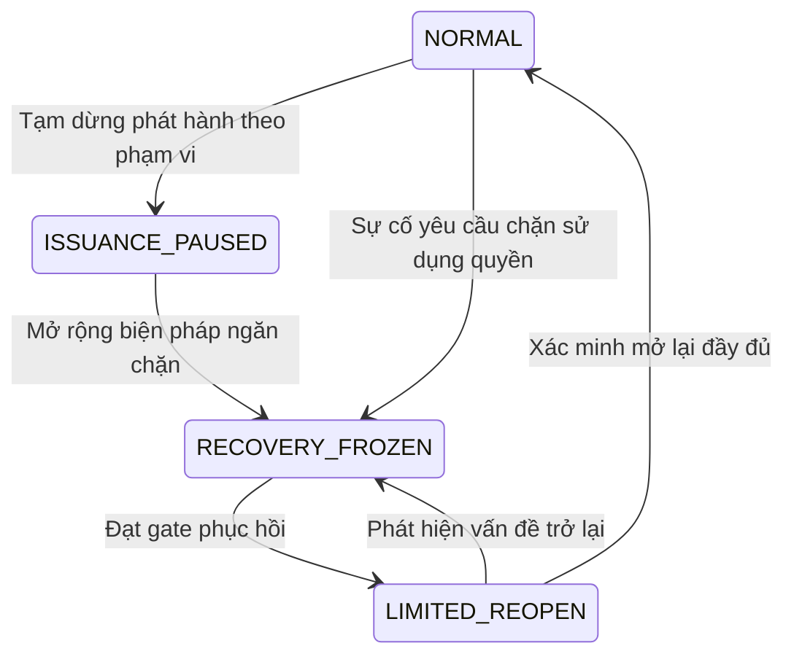

# Emergency recovery shutdown: dừng khẩn cấp luồng khôi phục tài khoản

## 1. Dừng khẩn cấp nhằm chặn quyền nào?

**Emergency recovery shutdown** là biện pháp tạm thời ngăn các thao tác khôi phục tài khoản trong phạm vi bị ảnh hưởng bởi một sự cố. Mục tiêu là dừng việc tạo hoặc sử dụng quyền có thể bị lợi dụng để đổi mật khẩu, gỡ MFA, thêm passkey hoặc thay thiết bị xác thực, đồng thời giữ khả năng điều tra, thông báo và hỗ trợ người dùng theo một quy trình còn đáng tin cậy.

Trong module `SECURITY_AUTHENTICATION_ACCOUNT_RECOVERY`, recovery là đường thay đổi quyền kiểm soát tài khoản khi người dùng không còn một hoặc nhiều phương thức xác thực. Nếu đường này có lỗi xác minh hoặc bị xâm nhập, chỉ một khoảng thời gian ngắn cũng có thể tạo ra credential và session mà bên tấn công tiếp tục dùng sau khi endpoint đã đóng.

Ví dụ, hệ thống phát hiện một recovery grant có thể dùng để thay MFA của account khác cùng tenant. Tạm dừng gửi email reset không chặn được grant đã phát hành, endpoint hoàn tất MFA reset, worker đang xử lý hoặc giao diện hỗ trợ dùng chung service. Quyết định dừng phải chỉ rõ hành động nào cần bị chặn ở nơi quyền thực sự được thực thi.

[NIST SP 800-61 Rev. 3](https://csrc.nist.gov/pubs/sp/800/61/r3/final) đặt hoạt động ứng phó sự cố trong quản lý rủi ro, gồm chuẩn bị, phát hiện, ứng phó và phục hồi. Bài học này cụ thể hóa một biện pháp kiểm soát ở tầng ứng dụng; các trạng thái, ví dụ và tiêu chí bên dưới là thiết kế minh họa, không phải một giao thức shutdown do NIST quy định.

Dừng khẩn cấp không tự giải quyết nguyên nhân gốc. Nó cũng không tự thu hồi mọi session đã cấp hoặc hoàn tác thay đổi credential đã commit. Ba việc cần được quản lý riêng là **ngăn thay đổi mới**, **xử lý quyền đã tồn tại** và **khôi phục dịch vụ có điều kiện**.

## 2. Chọn phạm vi dựa trên bằng chứng sự cố

Một nút dừng toàn hệ thống có thể cần thiết, nhưng không phải mọi sự cố đều có cùng phạm vi. Phải cân bằng khả năng chặn đường bị khai thác với ảnh hưởng tới người dùng đang cần lấy lại tài khoản.

| Tình huống minh họa | Phạm vi có thể xem xét | Điều chưa được giả định |
| --- | --- | --- |
| Kênh gửi SMS của một nhà cung cấp bị nghi lạm dụng | Kênh phát hành và bằng chứng liên quan tới nhà cung cấp đó | Các bằng chứng SMS đã gửi đều tự mất hiệu lực |
| Lỗi xác minh MFA reset dùng chung mọi tenant | Các thao tác MFA recovery bị lỗi trên toàn hệ thống | Chỉ tenant phát hiện đầu tiên bị ảnh hưởng |
| Tài khoản hỗ trợ của một tenant bị chiếm | Recovery thủ công và các thay đổi đã thực hiện trong phạm vi đó | Tắt web self-service sẽ chặn được công cụ hỗ trợ |
| Dịch vụ phát grant hoặc khóa ký bị nghi xâm nhập | Phát hành, trao đổi và sử dụng các grant có thể bị giả mạo | Đổi key phát hành mới đã chặn mọi verifier còn tin key cũ |
| Tăng đột biến yêu cầu nhưng chưa có bằng chứng vượt quyền | Hạn chế lưu lượng hoặc cô lập nguồn theo điều tra | Tăng traffic luôn đồng nghĩa cần đóng toàn bộ recovery |
| Không xác định được đường khai thác và có mutation trái phép đang tiếp diễn | Phạm vi rộng đủ để chặn các đường có thể thực thi cùng quyền | Hệ thống đã được chặn chỉ vì giao diện báo bảo trì |

Scope nên có các chiều rõ ràng: tenant, loại recovery, kênh, tập account nếu có căn cứ và các điểm thực thi trong hạ tầng. Region thường là chiều triển khai cần bao phủ; việc chỉ chặn một region không đủ nếu request có thể chuyển sang region khác.

Khi bằng chứng cho thấy một thành phần dùng chung bị ảnh hưởng, không được giới hạn scope chỉ vì alert hiện mới thấy ở một nhóm account. Ngược lại, một IP hoặc user-agent trùng nhau chưa đủ để gộp mọi account vào cùng phạm vi thu hồi.

[OWASP Multifactor Authentication Cheat Sheet, phần Resetting MFA](https://cheatsheetseries.owasp.org/cheatsheets/Multifactor_Authentication_Cheat_Sheet.html#resetting-mfa) nhấn mạnh đường lấy lại quyền truy cập không được trở thành cách vượt MFA. Khi đóng một kênh, đường hỗ trợ thay thế vẫn phải giữ điều kiện xác minh phù hợp; không tự chuyển sang một phương thức yếu hơn chỉ để tiếp tục phục vụ.

## 3. Tách dừng phát hành khỏi đóng toàn bộ recovery

Một mô hình trạng thái minh họa:

| Trạng thái | Ý nghĩa | Hành động cần kiểm soát |
| --- | --- | --- |
| `NORMAL` | Recovery hoạt động theo policy bình thường | Vẫn xác minh, giới hạn thử và single-use như thiết kế |
| `ISSUANCE_PAUSED` | Tạm dừng tạo hoặc gửi bằng chứng mới | Chặn start/resend; bằng chứng cũ xử lý theo quyết định riêng |
| `RECOVERY_FROZEN` | Dừng việc chấp nhận quyền recovery trong scope | Chặn xác minh cấp quyền, trao đổi grant, đổi credential và cấp recovery session |
| `LIMITED_REOPEN` | Mở lại một tập hành động đã kiểm chứng | Chỉ cho phép scope và hành động được xác định, vẫn giữ các kiểm soát còn lại |

Tên trạng thái phải đi cùng contract. Không dùng một biến `recoveryEnabled=false` mà mỗi service tự hiểu khác nhau. Với `ISSUANCE_PAUSED`, việc token cũ còn dùng được có thể là chủ ý, nhưng phải ghi rõ rằng trạng thái này chưa tương đương đóng toàn bộ recovery.

Trong `RECOVERY_FROZEN`, vẫn có thể cần các đường đọc trạng thái sự cố, xem receipt của operation đã hoàn tất, tiếp nhận báo cáo bị chiếm tài khoản và thực hiện thu hồi quyền để bảo vệ account. Các đường đó có authorization và giới hạn riêng; “read-only” không có nghĩa dữ liệu operation được công khai.



Sơ đồ không quy định mọi sự cố phải đi qua tất cả trạng thái. Mỗi chuyển trạng thái cần lý do, người có quyền thực hiện, scope, phiên bản policy và bằng chứng readback. Một deadline xem xét quyết định không phải lệnh tự mở lại khi hết giờ.

## 4. Những đường phải nằm trong bản đồ dừng khẩn cấp

Danh sách endpoint web thường không phải toàn bộ bề mặt thực thi. Cần xác định mọi đường có thể tạo hoặc dùng cùng quyền recovery.

| Bề mặt | Ví dụ hành động | Kiểm soát cần có |
| --- | --- | --- |
| Web, mobile và API công khai | Start, resend, verify, complete | Cùng áp dụng policy hiệu lực theo scope |
| Endpoint đổi bằng chứng lấy grant | OTP hoặc link thành recovery session | Không cấp quyền mới khi scope đã freeze |
| Endpoint thay credential | Reset password, gỡ MFA, đăng ký lại passkey | Kiểm tra policy ở ranh giới thực thi mutation |
| API cũ hoặc route nội bộ | Phiên bản cũ của complete recovery | Không bỏ sót chỉ vì giao diện mới không còn gọi |
| Công cụ hỗ trợ và quản trị | Manual recovery, thay recovery address | Không tạo bypass ngoài quyết định sự cố |
| Queue và job định kỳ | Hoàn tất hoặc tiếp tục flow bất đồng bộ | Đọc quyết định hiện tại trước khi thực thi quyền |
| Callback của nhà cung cấp | Xác minh hoặc chuyển trạng thái sau khi gửi | Không làm flow đã dừng tự tiếp tục |
| Verifier ở nhiều region | Chấp nhận grant hoặc session recovery | Không dùng cấu hình cũ để cấp quyền mới |

Đặt chặn ở gateway có ích để giảm traffic và tác động ngay lên đường công khai. Tuy nhiên, gateway không thay thế kiểm soát trong service thực thi, đặc biệt với job và API nội bộ. Ẩn nút “Quên mật khẩu” chỉ thay đổi giao diện; client vẫn có thể gửi request trực tiếp.

Một lệnh dừng thường có ít nhất hai lớp: chặn tiếp nhận để giảm việc mới, và chặn cấp hoặc sử dụng quyền tại service có thẩm quyền. Việc triển khai nhiều lớp phải có cùng scope và semantics để người vận hành biết lớp nào đang có hiệu lực.

## 5. Control plane phải còn đáng tin cậy

**Control plane** ở đây là cơ chế quản lý trạng thái shutdown, khác với request recovery thông thường. Nó có thể nằm ở một dịch vụ policy, một kho cấu hình có kiểm soát hoặc một record trong cơ sở dữ liệu ứng dụng.

Một record minh họa:

```yaml
exampleOnly: true
incidentRef: IR-DEMO-42
policyVersion: 43
scope:
  tenant: tenant-A
  recoveryKinds:
    - PASSWORD
    - MFA
    - PASSKEY
  channels: ALL
mode: RECOVERY_FROZEN
minimumAcceptedRecoveryEpoch: 8
reasonCode: SUSPECTED_RECOVERY_AUTHORIZATION_BYPASS
changedByRef: authorized-responder-7
changedAt: '2026-11-24T03:00:00Z'
reviewAt: '2026-11-24T03:30:00Z'
automaticReopen: false
```

Các thời gian chỉ là dữ liệu ví dụ. `policyVersion` theo dõi thay đổi quyết định; `minimumAcceptedRecoveryEpoch` là cơ chế minh họa để từ chối quyền thuộc thế hệ cũ. Chúng không thay nhau: một cấu hình mới có thể giữ nguyên epoch, còn một đợt thu hồi có thể tăng epoch nhưng vẫn giữ trạng thái freeze.

Không cho client recovery gửi tenant, phiên bản hoặc trạng thái dừng để tự quyết định policy. Scope phải được resolve từ ngữ cảnh tin cậy và đối chiếu với grant hoặc principal liên quan. Khi nhiều policy cùng áp dụng, quy tắc ưu tiên phải rõ ràng; một whitelist ở tenant không được vô tình vượt qua freeze toàn cục.

Quyền kích hoạt và quyền mở lại có thể được tách để thao tác chặn diễn ra nhanh trong khi mở lại có điều kiện chặt hơn. Nếu tổ chức yêu cầu phê duyệt hai người hoặc một vai trò chuyên biệt, chuẩn bị cơ chế đó từ trước, không để việc ngăn chặn sự cố phụ thuộc vào một tài khoản hoặc kênh đang bị nghi xâm nhập.

Audit cần ghi ai đổi, từ phiên bản nào sang phiên bản nào, scope gì, lý do và kết quả áp dụng. Sử dụng cập nhật có điều kiện theo phiên bản kỳ vọng giúp tránh hai người vận hành ghi đè quyết định của nhau. Quyền sửa audit và quyền thay policy cần được giới hạn phù hợp.

Nếu control plane không đọc được, quyết định về hành động nhạy cảm phải theo cơ chế đã định. Một lease xác nhận policy còn mới có thể có thời hạn; lease hết hạn không được tự chuyển thành `NORMAL`. Chế độ freeze bền vững cũng không được biến mất do restart process, cache bị evict hoặc một rollout đưa cấu hình mặc định cũ trở lại.

## 6. Quy trình kích hoạt và xác minh biện pháp chặn

Một trình tự thực hiện ở mức runbook:

1. Tạo incident reference và ghi bằng chứng ban đầu, loại quyền có nguy cơ bị lạm dụng.
2. Chọn scope đủ để chặn các đường liên quan; xác định thao tác nào vẫn được phép để bảo vệ account và điều tra.
3. Kích hoạt policy bằng kênh quản trị còn tin cậy, có kiểm soát phiên bản.
4. Đọc lại trạng thái tại nguồn có thẩm quyền, ghi version và thời điểm cập nhật được xác nhận.
5. Kiểm tra các điểm thực thi, worker và region liên quan; cô lập đường chưa áp dụng được quyết định.
6. Đối soát request đang chạy, grant cũ và operation có kết quả chưa rõ.
7. Chạy probe chức năng chứng minh quyền mới không còn được tạo hoặc sử dụng trong scope.

Không trì hoãn việc chặn lạm dụng đang tiếp diễn chỉ để thu thập mọi log có thể có. Song song với ngăn chặn, bảo toàn các bằng chứng có nguy cơ mất như phiên bản policy, record operation và dấu vết triển khai. Không cần chép token hoặc mật khẩu thô vào hồ sơ sự cố.

“Lệnh cập nhật cấu hình thành công” chỉ chứng minh control plane nhận lệnh. Nó chưa chứng minh mọi điểm thực thi đã áp dụng. Cần phân biệt acknowledgement của nguồn cấu hình, acknowledgement của từng nhóm thực thi và bằng chứng hành vi ở endpoint hoặc worker.

Probe nên dùng fixture tổng hợp, định danh riêng và token kiểm thử được quản lý. Không phát một mutation thử vào account thật chỉ để kiểm tra nút dừng. Đối với queue, cần probe hoặc bằng chứng ở consumer; việc HTTP đã trả bảo trì không chứng minh job nền đã dừng cấp quyền.

## 7. Xử lý request đang chạy và ranh giới có hiệu lực

Một race đơn giản:

```text
t0  Request A đọc policy NORMAL
t1  Người vận hành ghi RECOVERY_FROZEN
t2  Gateway bắt đầu từ chối request mới
t3  Request A dùng kết quả ở t0 để đổi credential
```

Nếu chỉ kiểm tra đầu request, mutation ở t3 vẫn có thể xảy ra. Thêm một lần đọc policy trước khi gọi repository có thể giảm cửa sổ nhưng vẫn còn race nếu policy thay đổi giữa lần đọc đó với lúc ghi credential.

[OWASP Transaction Authorization Cheat Sheet](https://cheatsheetseries.owasp.org/cheatsheets/Transaction_Authorization_Cheat_Sheet.html#28-system-should-check-each-transaction-execution-and-make-sure-it-has-been-properly-authorized) khuyến nghị có kiểm soát cuối gắn với việc thực thi giao dịch để tránh bỏ qua authorization và lỗi TOCTOU. Áp dụng vào shutdown, việc cho phép recovery cần được phối hợp với ranh giới thực thi thay đổi nhạy cảm.

### Phân biệt các mốc thời gian

| Mốc | Ý nghĩa | Chưa chứng minh |
| --- | --- | --- |
| `T_requested` | Người vận hành yêu cầu dừng | Policy đã được lưu |
| `T_control_committed` | Nguồn control plane xác nhận quyết định | Mọi executor đã áp dụng |
| `T_enforcers_confirmed` | Các điểm thực thi trong scope đã xác nhận hoặc bị cô lập | Mọi operation cũ đã có kết quả cuối |
| `T_barrier` | Ranh giới dừng theo contract đã được chứng minh | Các thay đổi trước đó đã được thu hồi hoặc sửa chữa |

Contract phải nói rõ sau mốc nào không được có thêm mutation được chấp nhận. Không lấy thời gian bấm nút làm bằng chứng tức thời cho hệ thống phân tán. Nếu thiết kế chỉ cung cấp một cửa sổ lan truyền có giới hạn, công bố và đo giới hạn đó; không mô tả nó thành dừng đồng thời tuyệt đối.

### Một mô hình phối hợp khi policy và mutation cùng database

Có thể xây dựng mô hình đơn giản như sau:

```text
Transaction recovery:
  Lấy khóa chia sẻ trên các record policy có liên quan
  Resolve quyết định hiệu lực theo scope và thứ tự khóa cố định
  Nếu được phép: xác minh quyền, consume và đổi credential
  Commit rồi mới nhả khóa policy

Transaction freeze:
  Lấy khóa độc quyền trên record policy cần đóng
  Chờ các transaction đang giữ khóa tương ứng kết thúc
  Ghi trạng thái freeze và phiên bản mới
  Commit quyết định
```

Trong mô hình này, các transaction recovery đã giành quyền thực thi trước có thể hoàn tất trước khi transaction freeze lấy được khóa. Recovery bắt đầu sau quyết định freeze phải đọc trạng thái mới và bị chặn. Khi mọi đường ghi liên quan đều tuân thủ cùng cơ chế, commit của freeze có thể tạo một ranh giới rõ ràng cho các mutation ở chính database đó.

Đây là mô hình đồng bộ hóa, không phải hướng dẫn dùng một loại khóa cho mọi database. Nếu có policy toàn cục, tenant và kênh, các record cần được khóa và resolve theo thứ tự thống nhất. Thiếu một hàng policy không được hiểu là cho phép khi thiết kế đòi quyết định tường minh. Giao dịch dài có thể làm lệnh freeze chờ lâu; cần hạn chế tiếp nhận sớm, deadline và phương án cô lập đường thực thi phù hợp.

### Khi policy ở một dịch vụ khác

Một flag đọc qua HTTP không tự nguyên tử với transaction credential ở database khác. Có thể cần cơ chế lease, version hoặc fencing được kiểm tra tại nơi ghi có thẩm quyền. Fencing chỉ có hiệu lực nếu writer thực sự từ chối quyền hoặc phiên bản cũ; đưa `policyVersion` vào token mà không kiểm tra khi ghi chưa tạo ra hàng rào nào.

Cache và lease có thể tạo cửa sổ mà một executor còn dùng quyết định cũ. Hết lease phải chặn hành động nhạy cảm theo contract, không tự cấp lease mới từ dữ liệu cũ. Nếu một region mất control plane nhưng vẫn có thể ghi credential bằng policy cache, phải đo cửa sổ đó hoặc cô lập đường ghi trước khi tuyên bố dừng đủ scope.

Không lấy việc gửi thông điệp “stop” vào queue làm bằng chứng rằng mọi message trước hoặc sau nó đã được xử lý đúng thứ tự trên mọi partition. Cần cơ chế kiểm tra ở consumer và ranh giới chấp nhận quyền của tác vụ.

### Operation đã commit nhưng người gọi chưa biết

Request mất phản hồi có thể đã đổi credential trước khi freeze. Đối soát operation ở nguồn có thẩm quyền và cho xem receipt theo đúng authorization. Không chạy lại mutation để “hoàn tất nốt” chỉ vì client chưa nhận 200.

Một receipt thành công trả trong thời gian freeze không tự chứng minh có mutation mới. Cần phân biệt thời điểm trả response, thời điểm chấp nhận quyền và thời điểm commit. Ngược lại, 503 không chứng minh không có mutation nếu server đã ghi trước khi trả lỗi.

## 8. Xử lý token, grant và session đã tồn tại

Đóng recovery và thu hồi quyền cũ là hai hành động khác nhau. Runbook cần quy định rõ trạng thái nào chỉ tạm ngăn sử dụng, trạng thái nào làm bằng chứng mất hiệu lực vĩnh viễn trong vòng đời của nó.

| Loại quyền | Cách xử lý cần cân nhắc trong scope sự cố |
| --- | --- |
| Reset token chưa dùng | Tạm chặn redeem hoặc thu hồi theo thế hệ, account hoặc incident scope |
| OTP hoặc challenge đang mở | Chặn trao đổi thành quyền; thu hồi challenge nếu không còn đáng tin |
| Recovery grant đã xác minh | Không cho complete trong scope freeze; đánh giá thu hồi grant liên quan |
| Recovery session giới hạn | Chặn các endpoint có thể đổi credential hoặc tạo quyền con |
| Recovery code lưu sẵn | Quyết định theo nguy cơ lộ code hoặc lỗi verifier, không tự vô hiệu toàn bộ khi chưa cần |
| Full session và refresh token đã cấp | Thu hồi theo bằng chứng chiếm đoạt và policy ứng phó riêng |
| MFA hoặc passkey do thao tác đáng ngờ thêm vào | Điều tra ownership và vô hiệu credential không còn đáng tin theo quy trình |

Nếu dùng epoch hoặc generation, một token chỉ được chấp nhận khi epoch trong quyền phù hợp với ngưỡng hiện tại của account hoặc scope. Việc tăng epoch phải đến được verifier; claim trong token không tự biết rằng hệ thống đã có ngưỡng mới.

Một timestamp cutoff cũng cần giải quyết clock skew, nguồn thời gian và việc người phát hành bị nghi có thể tự đặt `issuedAt`. Khi issuer có thể bị xâm nhập, không nên coi timestamp do chính issuer khai báo là bằng chứng duy nhất để phân biệt token an toàn với token bị giả mạo.

Chỉ rotate khóa khi tình huống và thiết kế yêu cầu. Nếu phải dừng tin cậy key cũ, phải kiểm tra verifier, cache key và các loại token cùng dùng key; thay key phát hành mà mọi verifier vẫn chấp nhận key cũ chưa thu hồi được grant đã phát. Không xóa dữ liệu điều tra hoặc làm mất khả năng xác định operation nào đã dùng key nào chỉ để dọn trạng thái.

Khi mở lại, một token đã bị thu hồi không được sống lại vì state toàn cục trở về `NORMAL`. Nếu quyết định chỉ tạm pause một tập token còn đáng tin, cần kiểm tra lại thời hạn và policy hiện tại trước khi chấp nhận; thời gian dừng không tự gia hạn token. Với bằng chứng không còn đáng tin, phát hành lại qua luồng đã được sửa và đủ điều kiện xác minh.

### Full session cần quyết định riêng

[OWASP Session Management Cheat Sheet](https://cheatsheetseries.owasp.org/cheatsheets/Session_Management_Cheat_Sheet.html#manual-session-expiration) mô tả việc vô hiệu session cần có tác động phía server; chỉ xóa cookie ở client không đủ. Trong một sự cố recovery, kiểm tra các session hoặc refresh token được cấp từ operation đáng ngờ và những credential mà bên tấn công có thể còn dùng.

Dừng recovery không tự thu hồi JWT đã cấp cho các verifier xác minh offline. Cần cơ chế thu hồi hoặc cửa sổ chấp nhận theo thiết kế và bằng chứng rằng giới hạn đó được thực thi. Tránh tuyên bố account đã an toàn chỉ vì nút reset không còn hoạt động.

## 9. Queue, callback và đường hỗ trợ thủ công

Tác vụ đã được tiếp nhận có thể còn nằm trong queue khi hệ thống bị freeze. Cần phân loại tác vụ theo tác động:

| Nhóm tác vụ | Hành vi minh họa trong freeze |
| --- | --- |
| Cấp grant, đổi credential hoặc thêm authenticator | Không thực thi quyền mới trong scope; giữ trạng thái đủ để đối soát |
| Gửi lại OTP hoặc link mới | Chặn nếu thuộc scope dừng phát hành |
| Gửi thông báo bảo mật cho operation đã commit | Có thể tiếp tục qua kênh còn tin cậy |
| Thu hồi session hoặc credential nguy hiểm | Có thể cần tiếp tục để bảo vệ account |
| Đọc receipt và xử lý yêu cầu hỗ trợ | Giữ authorization, giới hạn dữ liệu và audit |

Đừng dừng toàn bộ worker một cách máy móc nếu việc đó làm mất cả đường thu hồi session đang bị chiếm. Ngược lại, một consumer “chỉ xử lý backlog” vẫn có thể đổi mật khẩu bằng grant cũ; nó phải tuân thủ policy tại thời điểm thực thi.

Có thể đánh dấu công việc bị giữ vì incident hoặc đưa vào vùng cách ly có kiểm soát. Không xóa hàng loạt queue để chứng minh không còn request, vì thao tác đó có thể làm mất bằng chứng, receipt hoặc công việc bảo mật bắt buộc. Cách lưu giữ và quyền truy cập phải phù hợp với dữ liệu thực tế, đặc biệt khi payload có thông tin nhạy cảm.

Callback đến muộn không được tự chuyển flow từ trạng thái đã bị thu hồi sang được phép hoàn tất. Duplicate callback và retry của provider cũng cần bị ràng buộc với operation hoặc flow, thay vì tạo thêm grant sau khi dừng.

Với recovery thủ công, công cụ hỗ trợ phải kiểm tra cùng policy hoặc một cơ chế ngoại lệ đã được thiết kế riêng. Ngoại lệ không thể chỉ là nút “bỏ qua MFA” dành cho nhân viên. Một quy trình khẩn cấp được chuẩn bị trước cần có người đủ quyền, bằng chứng danh tính phù hợp, scope hẹp, hạn chế thời gian và operation có audit; nó không tự động được mở chỉ vì self-service bị đóng.

Kênh hỗ trợ thay thế cần xác minh thông báo sự cố và đường liên hệ từ nguồn tin cậy. Một địa chỉ email hoặc số điện thoại mới xuất hiện trong request của người tự xưng là chủ account không được coi là kênh an toàn chỉ vì recovery đang gặp sự cố.

## 10. Java minh họa quyết định policy tại một điểm kiểm tra

Đoạn mã Java 17 sau chỉ biểu diễn quyết định theo **policy hiệu lực đã được resolve**. Nó không tải policy, không xác minh người dùng và không tạo cơ chế đồng bộ với transaction. Các phần đó phải được thực hiện ở hạ tầng và service có thẩm quyền.

```java
import java.util.Objects;
import java.util.Set;

final class EmergencyRecoveryPolicy {
    enum Mode {
        NORMAL, ISSUANCE_PAUSED, RECOVERY_FROZEN, LIMITED_REOPEN
    }

    enum Action {
        ISSUE_EVIDENCE,
        VERIFY_AND_GRANT,
        COMMIT_CREDENTIAL,
        ISSUE_RECOVERY_SESSION,
        READ_RECEIPT
    }

    record Snapshot(long version, Mode mode, boolean trustedAndFresh,
                    Set<Action> allowedDuringReopen) {
        Snapshot {
            Objects.requireNonNull(mode, "mode");
            allowedDuringReopen = Set.copyOf(allowedDuringReopen);
        }
    }

    record Decision(boolean policyAllows, String reason, long policyVersion) {}

    static Decision decide(Snapshot snapshot, Action action) {
        if (action == null) {
            return new Decision(false, "UNKNOWN_ACTION", -1);
        }
        if (snapshot == null || !snapshot.trustedAndFresh()) {
            return new Decision(false, "CONTROL_STATE_UNAVAILABLE", -1);
        }
        if (action == Action.READ_RECEIPT) {
            return new Decision(true, "RECEIPT_STILL_REQUIRES_AUTHORIZATION",
                    snapshot.version());
        }

        boolean allowed = switch (snapshot.mode()) {
            case NORMAL -> true;
            case ISSUANCE_PAUSED -> action != Action.ISSUE_EVIDENCE;
            case RECOVERY_FROZEN -> false;
            case LIMITED_REOPEN -> snapshot.allowedDuringReopen().contains(action);
        };
        return new Decision(allowed,
                allowed ? "POLICY_ALLOWS_CONTINUATION" : "RECOVERY_TEMPORARILY_BLOCKED",
                snapshot.version());
    }
}
```

`trustedAndFresh` phải được xác định từ kênh policy tin cậy và semantics về freshness đã thiết kế; không nhận từ request của client. `allowedDuringReopen` được resolve sau khi xét scope và các policy có độ ưu tiên cao hơn. Một whitelist cục bộ không có quyền ghi đè freeze đang áp dụng ở tầng khác.

Kết quả `policyAllows=true` chỉ cho phép tiếp tục các kiểm tra nghiệp vụ. Nó không chứng minh token hợp lệ, đúng account, đủ điều kiện MFA, còn thời hạn hay chưa dùng. Tương tự, `READ_RECEIPT` vẫn phải xác minh người gọi được xem đúng operation; đoạn mã không công khai receipt.

`policyVersion` trong kết quả giúp quan sát quyết định. Để nó ngăn race, phiên bản hoặc quyền tương ứng phải được phối hợp với điểm ghi theo một cơ chế có thẩm quyền; không chỉ log version rồi tiếp tục ghi credential bằng snapshot cũ.

Trong ví dụ, `ISSUANCE_PAUSED` vẫn cho các hành động khác đi qua bước policy. Đây là chủ ý để cho thấy nó khác `RECOVERY_FROZEN`. Khi sản phẩm có thêm hành động như thay recovery address, phê duyệt thủ công hoặc đăng ký passkey theo nhiều bước, cần ánh xạ đủ hành động và mặc định xử lý trường hợp chưa được mô hình hóa một cách rõ ràng.

## 11. Thông báo và bảo toàn khả năng hỗ trợ

Người dùng bị mất phương thức xác thực thường ở trạng thái dễ chấp nhận một hướng dẫn khẩn cấp. Thông báo shutdown cần hướng họ tới nguồn hỗ trợ đáng tin cậy, không tạo thêm cơ hội phishing.

Thông báo công khai minh họa:

> Một số thao tác khôi phục tài khoản đang tạm ngừng. Bạn có thể theo dõi thông tin trên trang trạng thái chính thức hoặc dùng kênh hỗ trợ đã công bố. Nhân viên hỗ trợ không yêu cầu bạn gửi mật khẩu, OTP hoặc recovery code qua cuộc trò chuyện.

Nội dung thực tế phải đúng phạm vi: không nói mọi recovery ngừng nếu chỉ một kênh bị ảnh hưởng, và không hứa “không có tài khoản nào bị tác động” khi điều tra chưa đủ bằng chứng. Không đưa chi tiết khai thác, danh sách account, trạng thái MFA hoặc cách vượt hàng rào vào response công khai.

Endpoint chưa xác thực vẫn cần giữ policy chống enumeration. Một account có thật và một định danh không tồn tại không nên tạo dấu hiệu khác nhau vượt phần disclosure đã được chấp nhận chỉ vì nhánh thứ nhất đi tới service đang freeze. Với người đã được phép xem operation của mình, có thể cung cấp thông tin phù hợp để phân biệt đã hoàn tất, đang đối soát hoặc phải bắt đầu lại.

Không thông báo reset thành công chỉ vì yêu cầu đã được ghi nhận trước freeze. Nếu operation đã commit nhưng response bị mất, hướng dẫn kiểm tra kết quả cần dựa trên receipt đã được đối soát. Không khuyến khích bấm gửi lại liên tục hoặc tự chuyển sang một kênh mới chưa được xác minh.

Các thông báo bảo mật cho thay đổi thực sự đã xảy ra có thể cần tiếp tục qua kênh còn tin cậy. Nếu chính kênh thông báo bị nghi xâm nhập, chọn phương án liên lạc theo quy trình sự cố thay vì gửi thêm link recovery qua cùng kênh đó.

Nhóm hỗ trợ cần một hướng dẫn thống nhất: phạm vi đang dừng, hành động nào được phép, cách chuyển cấp và dữ liệu nào được thu thập. Không yêu cầu người dùng gửi ảnh chứa recovery code hoặc trích nguyên link reset vào ticket. Gắn incident reference và account reference nội bộ để liên kết vụ việc mà hạn chế sao chép secret.

## 12. Kiểm chứng shutdown bằng hành vi thực tế

Một bộ kiểm chứng nên đi qua điểm thực thi có thẩm quyền, không chỉ kiểm tra giá trị flag trong dashboard.

| ID | Kịch bản | Bằng chứng cần đạt |
| --- | --- | --- |
| S01 | Start và resend trong scope bị dừng phát hành | Không có bằng chứng mới được cấp hoặc gửi ngoài contract |
| S02 | Dùng token đã cấp trước freeze | Không đổi credential hoặc cấp grant khi policy freeze có hiệu lực |
| S03 | Hoàn tất bằng recovery session đã mở | Không tạo mutation hoặc quyền con ngoài quyết định hiện tại |
| S04 | Request đọc `NORMAL`, dừng tại barrier rồi kích hoạt freeze | Kết quả tuân thủ ranh giới transaction đã định, không có mutation bị bỏ sót |
| S05 | Message hoặc callback đến sau freeze | Consumer không dùng quyền cũ để tiếp tục flow |
| S06 | API cũ và công cụ hỗ trợ | Cùng tuân thủ scope hoặc ngoại lệ được thiết kế tường minh |
| S07 | Một region hoặc instance không nhận được policy mới | Hành động nhạy cảm bị chặn theo lease hoặc đường thực thi được cô lập |
| S08 | Control plane không truy cập được | Không dùng mặc định `NORMAL` để cấp quyền |
| S09 | Restart process hoặc evict cache trong freeze | Freeze vẫn có hiệu lực, không phát hành lại quyền |
| S10 | Triển khai hoặc rollback phiên bản ứng dụng | Không đưa quyết định ứng phó về cấu hình cũ ngoài ý muốn |
| S11 | Scope không bị ảnh hưởng | Hành vi đúng policy riêng, không bị mở rộng hay thu hẹp quyền bất ngờ |
| S12 | Mở lại giới hạn rồi thử token đã thu hồi | Token vẫn không hợp lệ, quyền cũ không sống lại |
| S13 | Tra cứu receipt của operation trước freeze | Chỉ người đủ quyền xem được, không phát sinh mutation mới |
| S14 | Tác vụ thu hồi session đang được thực hiện | Không bị lệnh dừng recovery vô tình làm ngừng bảo vệ account |

Trong S04, cần tạo lịch xen kẽ có kiểm soát. Nếu request đã commit trước ranh giới mà contract cho phép, đó không phải lỗi của cơ chế freeze; cần tiếp tục điều tra và xử lý tác động của operation đó. Nếu mutation được chấp nhận sau ranh giới đã cam kết, đó là bằng chứng hàng rào chưa bao phủ đường thực thi.

Một test gửi request đồng thời từ client chưa bảo đảm nó chạm đúng thời điểm race. Có thể dùng hook kiểm thử ở ranh giới kiểm tra policy, consume hoặc commit, rồi đối chiếu với operation journal. Hook chỉ dùng trong hạ tầng kiểm thử, không tạo API bỏ qua policy cho sản phẩm.

Oracle nên có credential version, grant state, số operation commit, số authenticator hoặc session mới và phiên bản quyết định policy liên quan. HTTP status, số email hoặc số access log không đủ để thay các đại lượng này.

Để kiểm tra token hoặc grant cũ, dùng fixture đại diện cho các trạng thái: chưa dùng, đã dùng, đã hết hạn, bị thu hồi và đang có operation chưa rõ kết quả. Một token đã hết hạn bị từ chối không chứng minh một token còn hạn cũng bị freeze đúng cách.

Không lấy số mutation bằng 0 trong một khoảng thời gian không có traffic làm bằng chứng chặn hiệu quả. Cần biết probe hoặc request đại diện đã tới các điểm thực thi liên quan. Nếu log bị thiếu hoặc một executor chưa quan sát được, ghi rõ phần chưa xác minh và giữ biện pháp cô lập tương ứng.

### Các chỉ số cần đặt tên rõ

| Chỉ số | Ý nghĩa minh họa |
| --- | --- |
| Thời gian chấp nhận lệnh dừng | Từ `T_requested` đến `T_control_committed` |
| Thời gian bao phủ thực thi | Từ yêu cầu dừng đến xác nhận executor hoặc cô lập đường còn hở |
| Số mutation sau ranh giới cam kết | Phát hiện thay đổi mới trái contract shutdown |
| Số operation chưa xác định | Công việc cần đối soát trước khi kết luận tác động |
| Số token hoặc session bị thu hồi đã xác minh | Quyền cũ thực sự không còn được chấp nhận theo scope |
| Tác động người dùng hợp lệ | Đo số lần bị chặn và khả năng tiếp cận hỗ trợ an toàn |

Giữ incident reference, policy version và operation reference trong log hoặc trace được kiểm soát. Tránh dùng email, token hoặc mọi operation ID làm metric label có cardinality không giới hạn. Một audit event nói “shutdown requested” không được gộp chung với “shutdown enforced”.

## 13. Điều kiện mở lại và bảo toàn quyết định thu hồi

Mở lại là một thay đổi quyền cần có gate cụ thể. Giảm alert hoặc hết thời gian review chưa chứng minh đường khai thác đã được loại bỏ.

Một gate phục hồi có thể yêu cầu:

- Đã xác định phạm vi đủ để đánh giá nguyên nhân và các đường bị ảnh hưởng; phần chưa chắc chắn vẫn có biện pháp kiểm soát.
- Lỗi xác minh hoặc đường vượt policy đã được sửa hoặc được chặn bằng biện pháp tạm thời có thể kiểm chứng.
- Các operation chưa rõ kết quả đã được đối soát hoặc được giữ ở trạng thái không thể tự cấp quyền mới.
- Bằng chứng, grant, authenticator hoặc session bị đánh giá không còn đáng tin đã được xử lý theo scope.
- Probe và kiểm thử race, replay, queue, support flow đạt tiêu chí liên quan.
- Có người chịu trách nhiệm quyết định mở lại, phạm vi theo dõi và điều kiện quay về freeze.

Việc một account đã đổi password không tự chứng minh account đó sạch. Cần xem các thay đổi recovery address, MFA, passkey và session có thể đã bị thêm trong cửa sổ sự cố. Không tự hoàn nguyên toàn bộ account về một snapshot cũ: snapshot có thể chứa thông tin đã bị thay hợp lệ hoặc credential đã được xác định không còn an toàn.

### Mở lại theo scope đã kiểm chứng

`LIMITED_REOPEN` có thể áp dụng cho một loại recovery hoặc nhóm tenant đã đủ điều kiện, sau đó mở rộng khi có bằng chứng. Không mở một giai đoạn cuối như complete mà bỏ qua việc grant hiện có còn đáng tin hay không. Quyền mới cần được cấp qua đường xác minh đã khôi phục và policy hiện tại.

Các scope đang freeze ở tầng cao hơn vẫn có hiệu lực cho tới khi được thay đổi đúng quyền. Khi cập nhật allowlist, đọc lại quyết định hiệu lực tại service; việc một record tenant đã đổi không chứng minh policy toàn cục đã cho phép.

Giữ lại epoch hoặc dấu thu hồi đã được áp dụng trong sự cố. Chuyển mode về `NORMAL` không được hạ `minimumAcceptedRecoveryEpoch`, xóa dấu consume hoặc khôi phục grant bị thu hồi. Nếu có một hành động phục hồi quyền đặc biệt, nó cần được coi là một thay đổi riêng có lý do và xác minh phù hợp.

### Rollback ứng dụng không rollback quyết định sự cố

Rollback code có thể đưa trở lại một implementation không hiểu trạng thái freeze mới hoặc một cấu hình mặc định cho phép recovery. Cần kiểm tra khả năng tương thích của policy, dữ liệu thu hồi và phiên bản triển khai trước khi coi rollback là biện pháp an toàn.

Khi phải khôi phục database từ backup, cũng cần xem backup có cũ hơn quyết định thu hồi hoặc operation đã hoàn tất không. Không để dữ liệu phục hồi làm token đã dùng hoạt động lại hoặc làm mất record incident đang chặn quyền. Cách đối soát và khôi phục các quyết định đó phải thuộc kế hoạch lưu bền và phục hồi, không chỉ là câu lệnh bật dịch vụ.

Sau mỗi lần mở rộng phạm vi, chạy probe chức năng và quan sát mutation, replay rejection, session và workload hỗ trợ. Nếu phát hiện đường cấp quyền trái kỳ vọng, quay về freeze theo quy trình đã chuẩn bị. Không cần đợi tất cả chỉ số khả dụng xấu đi mới xử lý một bằng chứng vượt quyền rõ ràng.

## 14. Mẫu handoff sự cố có thể kiểm chứng

Mẫu dưới là **dữ liệu giả định**, minh họa cách ghi trạng thái ứng phó; không phải kết quả thao tác trên hệ thống thật:

```yaml
exampleOnly: true
incidentRef: IR-DEMO-42
decision:
  effectiveMode: RECOVERY_FROZEN
  policyVersion: 43
  scope: tenant-A-all-recovery-kinds
  minimumAcceptedRecoveryEpoch: 8
  automaticReopen: false
enforcement:
  controlPlaneReadback: confirmed
  applicationExecutors: confirmed
  backgroundConsumers: confirmed
  legacyAndSupportRoutes: confirmed
  uncoveredReachableExecutors: 0
inFlight:
  committedBeforeBarrier: 2
  rejectedOrStoppedByBarrier: 3
  unresolvedOperations: 0
verification:
  newIssuanceBlocked: confirmed
  credentialMutationBlocked: confirmed
  recoverySessionPrivilegeBlocked: confirmed
  revokedGrantRejected: confirmed
  securityRevocationJobsStillRun: confirmed
reopen:
  state: NOT_AUTHORIZED_BY_THIS_RECORD
  nextAction: evaluate-remediation-and-recovery-gates
```

Một handoff thực tế cần dẫn tới bằng chứng đã che secret: bản readback policy, danh sách điểm thực thi theo scope, trace probe và operation liên quan. Không cần dán toàn bộ hồ sơ account hay bearer token vào nội dung bàn giao.

Nếu còn executor chưa xác minh, phải ghi nó và cách cô lập thay vì chỉ liệt kê các nơi đã PASS. Nếu còn operation chưa rõ kết quả, chỉ rõ người hoặc hệ thống chịu trách nhiệm đối soát; không tự coi chúng là rollback.

Tách kết luận “đã ngăn cấp quyền mới trong scope” khỏi “đã xử lý hết tác động của sự cố” và “đã đủ điều kiện mở lại”. Ba kết luận này có thể đạt vào các thời điểm khác nhau và cần các bằng chứng khác nhau.

## 15. Các tình huống tự kiểm tra

**Tình huống 1:** Đã ẩn form quên mật khẩu và chặn `/recovery/start`, nhưng link cũ vẫn complete được MFA reset. Có thể báo đã emergency shutdown toàn bộ recovery không?

Không. Biện pháp hiện tại mới chặn một phần tiếp nhận hoặc phát hành. Cần kiểm tra endpoint sử dụng grant, recovery session, API cũ, worker và các đường hỗ trợ có thể thực thi cùng quyền.

**Tình huống 2:** Config service báo cập nhật thành công, một region mất mạng với config service vẫn dùng cache `NORMAL`. Điều gì còn thiếu?

Chưa có bằng chứng policy đã được thực thi đủ scope. Cần freshness hoặc lease có semantics rõ ràng, cơ chế kiểm tra ở nơi ghi và biện pháp cô lập executor chưa áp dụng được quyết định. Không thể lấy acknowledgement của nguồn cấu hình làm acknowledgement của mọi verifier.

**Tình huống 3:** Request trả receipt thành công sau khi freeze, nhưng operation đã commit trước ranh giới dừng. Đây có chắc là hàng rào bị vượt không?

Không. Cần đối chiếu thời điểm commit và quyết định quyền với contract. Trả lại receipt đúng quyền không phải mutation mới. Tuy vậy, operation trước ranh giới vẫn cần được đánh giá tác động nếu nó thuộc cửa sổ sự cố.

**Tình huống 4:** Mở lại bằng cách khôi phục policy version cũ và epoch cũ vì đó là cấu hình trước sự cố. Có vấn đề gì?

Cách làm đó có thể làm sống lại grant hoặc token đã bị thu hồi. Mở lại cần một quyết định mới giữ các dấu thu hồi còn hiệu lực, thay vì hoàn tác toàn bộ trạng thái bảo mật về thời điểm trước khi phát hiện sự cố.

**Tình huống 5:** Nhân viên hỗ trợ được cho phép bỏ MFA vì người dùng không thể self-service trong lúc freeze. Đây có phải đường dự phòng đủ an toàn không?

Chưa đủ. Đường dự phòng phải có quy trình xác minh và quyền vận hành được thiết kế trước, scope rõ ràng và audit theo operation. Nếu việc đóng self-service chỉ chuyển khai thác sang công cụ hỗ trợ, mục tiêu ngăn chặn chưa đạt.

Emergency recovery shutdown có hiệu lực khi quyết định dừng chạm tới nơi tạo và sử dụng quyền, các operation đang chạy được đối soát, quyền cũ được xử lý có căn cứ và việc mở lại không xóa bỏ kết quả ngăn chặn đã đạt. Đó là những thuộc tính cần được chuẩn bị và kiểm chứng trước khi một sự cố thực tế buộc hệ thống phải dùng tới nút dừng.
