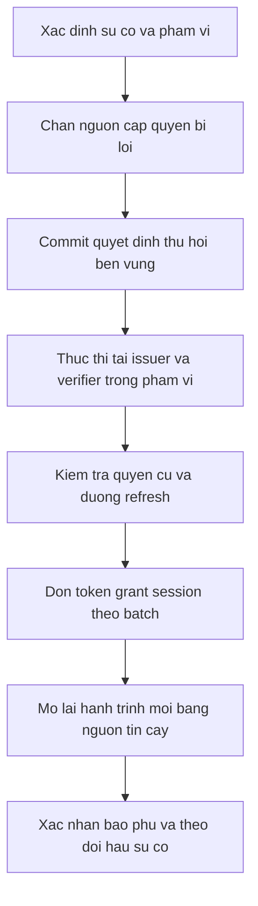

# Token mass revocation — Thu hồi token hàng loạt khi ứng phó sự cố

## 1. Thu hồi hàng loạt nhằm cắt quyền nào?

Một hệ thống phát hiện liên kết khôi phục tài khoản đã bị ghi vào một kho log mà người không có thẩm quyền có thể đọc. Các liên kết chưa hết hạn vẫn có khả năng đổi mật khẩu hoặc mở một bước xác minh. Sửa cấu hình log chỉ ngăn lộ thêm dữ liệu; những token đã lộ cần được xử lý theo phạm vi sự cố.

Token mass revocation là việc làm mất hiệu lực một tập token hoặc quyền được suy ra từ chúng theo một quyết định ứng phó có kiểm soát. “Hàng loạt” có thể là mọi token của một account, một tenant, một loại recovery, một đợt phát hành hoặc một miền tin cậy bị ảnh hưởng. Nó không mặc nhiên có nghĩa đăng xuất mọi người dùng của toàn hệ thống.

Trong module `SECURITY_AUTHENTICATION_ACCOUNT_RECOVERY`, thu hồi hàng loạt giúp cắt những đường có thể chiếm đoạt tài khoản khi mật khẩu, MFA, passkey, thiết bị xác thực hoặc hạ tầng recovery gặp sự cố. Mục tiêu có hai mặt: quyền cũ trong phạm vi phải bị chặn, còn người dùng hợp lệ cần có cách lấy lại quyền bằng bằng chứng và credential mới đáng tin cậy.

Bài học trình bày cách xác định phạm vi, chọn cơ chế, thực thi quyết định bền vững, xác minh trên các điểm cấp quyền và phục hồi dịch vụ. Các manifest, interface và số liệu ví dụ là mô hình học tập; chúng không phải lệnh vận hành cho một hệ thống đang chạy.

Sau bài học, người học có thể:

- Phân biệt thu hồi recovery token, session, access token, refresh family và khóa ký.
- Chọn phạm vi đủ để xử lý sự cố, đồng thời phát hiện tác động ngoài phạm vi.
- Hiểu vì sao đổi password, xóa cookie hoặc dừng phát hành token chưa đủ để thu hồi quyền cũ.
- Thiết kế một đợt thu hồi có idempotency, checkpoint và bằng chứng thực thi.
- Kiểm tra việc cấp quyền mới sau sự cố mà không hồi sinh những token đã bị thu hồi.

## 2. Nhận diện sự cố trước khi chọn cơ chế

### 2.1. Token bị lộ khác với khả năng tự tạo token

Một danh sách bearer token bị lộ cho phép sử dụng những token đó trong giới hạn mà hệ thống còn chấp nhận. Khóa ký bị lộ có thể cho phép tạo thêm token có chữ ký hợp lệ. Một lỗi xác minh có thể khiến server chấp nhận cả dữ liệu không nên được tin cậy ngay từ đầu.

Ba tình huống này đòi hỏi biện pháp khác nhau. Nếu đối phương còn khả năng phát hành hoặc giả mạo token, thu hồi một danh sách token đã biết sẽ không chặn được những token mới chưa nằm trong danh sách.

| Dấu hiệu sự cố | Phạm vi cần điều tra | Hướng xử lý cần đánh giá |
| --- | --- | --- |
| Recovery URL xuất hiện trong log | Loại token, đợt phát hành, thời gian lộ, nơi có quyền đọc | Thu hồi cohort token và các grant liên quan; chặn nguồn lộ |
| Một account bị chiếm đoạt | Session, refresh family, recovery attempt và phương thức bị thay đổi | Thu hồi theo chủ thể và kiểm tra lại quyền mới đã được cấp |
| Khóa ký hoặc signing service bị kiểm soát | Mọi verifier tin khóa và mọi loại token dùng khóa đó | Loại bỏ đường tin cậy bị compromise, thay khóa và xử lý quyền đã phát sinh |
| Lỗi kiểm tra purpose/tenant | Các token đã đi qua nhánh xác minh lỗi | Chặn nhánh lỗi, xác định phạm vi quyền bị cấp sai, thu hồi tương ứng |
| Token store hoặc replay store mất dữ liệu | Những token còn có thể được chấp nhận khi thiếu trạng thái | Áp dụng chính sách không mặc định cho phép; phục hồi state hoặc vô hiệu hóa generation cũ |
| Bằng chứng recovery bị thay đổi trái phép | Kênh liên lạc, MFA/passkey mới, session phát sinh | Xác minh lại chủ sở hữu và loại bỏ những thay đổi không được phép |

Tín hiệu điều tra cần có độ tin cậy và thẩm quyền phù hợp với phạm vi tác động. Một yêu cầu recovery công khai chưa được xác minh không nên tự trở thành lệnh thu hồi hàng loạt session của nạn nhân.

### 2.2. Cắt nguồn tạo quyền và cắt quyền đã tồn tại

Dừng phát hành token qua đường lỗi giúp ngăn quyền mới phát sinh, nhưng token cũ vẫn có thể được dùng. Thu hồi access token giúp chặn một đường truy cập, nhưng refresh token còn hoạt động có thể tạo access token mới. Xóa session hiện tại không ngăn remember-me credential cũ tự đăng nhập lại.

Vì vậy, kế hoạch phải liệt kê cả đối tượng đang mang quyền và những đường có khả năng tái tạo quyền. Không dùng một trạng thái “đã logout” duy nhất để đại diện cho tất cả chúng.

## 3. Lập danh mục đối tượng và phạm vi sự cố

### 3.1. Những quyền thường liên quan đến account recovery

| Đối tượng | Hành động cần đạt nếu thuộc phạm vi | Điều không tự được suy ra |
| --- | --- | --- |
| Recovery token chưa dùng | Không tiếp tục được luồng nhạy cảm | Session đăng nhập cũ đã mất quyền |
| Recovery grant sau xác minh | Không hoàn tất bằng giao dịch đã bị thu hồi | Token đầu vào bị chặn sẽ tự vô hiệu hóa grant đã đổi ra |
| Session ID | Request mới bằng ID cũ không được cấp quyền | Remember-me không thể tạo session mới |
| Access token | Resource server từ chối theo deadline | Refresh token hoặc grant gốc đã bị thu hồi |
| Refresh token/family | Không xin tiếp được quyền mới thuộc phạm vi | Access token đã cấp trước đó lập tức mất hiệu lực ở mọi nơi |
| Recovery code dự phòng | Mã thuộc phạm vi không còn dùng được | TOTP seed hoặc passkey cũng bị vô hiệu hóa |
| MFA/passkey bị compromise | Không xác thực lại được bằng phương thức đó | Mọi session đã cấp từ trước đều bị kết thúc |
| Khóa ký bị compromise | Chữ ký tạo bằng khóa đó không còn được tin tại các điểm liên quan | Chỉ đổi khóa phát hành mới là đủ |

Một grant đã được đổi từ token cũ cần có thông tin liên kết hoặc generation đủ để bị xử lý cùng phạm vi. Nếu mất liên kết này, chặn token đầu vào có thể để sót quyền nằm ở bước sau của recovery.

### 3.2. Manifest làm rõ đối tượng sẽ bị tác động

Trước khi thực thi, xác định phạm vi bằng dữ liệu bền vững, có thể xem xét và đối chiếu. Ví dụ:

```yaml
incidentRef: recovery-log-exposure-example
manifestVersion: 1
scope:
  issuer: https://identity.example.test
  tenantRef: tenant-test-a
  purposes:
    - PASSWORD_RECOVERY
    - MFA_RECOVERY
  issuanceCohortRef: affected-delivery-batch-example
actions:
  - revoke-pending-recovery-tokens
  - revoke-derived-recovery-grants
  - review-derived-authenticated-sessions
enforcement:
  policyRef: incident-recovery-revocation-policy
excluded:
  - unrelated-tenant-scopes
  - independent-unaffected-credentials
```

Đây là cấu trúc minh họa. Những nhãn `example` không định danh một sự cố thật. Nếu hệ thống không có cohort đáng tin cậy, phải dùng nguồn điều tra khác hoặc mở rộng phạm vi theo quyết định có căn cứ; không suy đoán cohort từ claim mà đối phương có thể tự tạo.

Phân biệt số token, số account, số grant và số session. Một account có thể có nhiều token, còn một token đã được sử dụng có thể dẫn đến nhiều quyền tiếp theo. Không báo “đã thu hồi 10.000 người dùng” từ một bộ đếm 10.000 bản ghi token.

Nếu phạm vi dựa trên thời gian phát hành, ghi rõ timezone, độ phân giải và nguồn timestamp. Sai lệch clock hoặc token có `iat` do khóa bị compromise ký ra có thể làm việc chọn phạm vi bằng timestamp không đủ đáng tin cậy.

## 4. Những bất biến của một đợt thu hồi

Một kế hoạch nên nêu điều kiện hoàn tất trước khi chạy. Với một tập phạm vi đã xác định, các bất biến có thể gồm:

1. Token và grant cũ trong phạm vi không tạo được mutation hoặc quyền mới sau mốc có hiệu lực đã cam kết.
2. Refresh, remember-me và những đường cấp quyền tiếp theo không phục hồi quyền đã bị thu hồi.
3. Những chủ thể hoặc loại credential ngoài phạm vi không bị vô hiệu hóa do lookup sai.
4. Chạy lại cùng một quyết định không làm thay đổi phạm vi hoặc tăng generation thêm lần ngoài ý muốn.
5. Node restart, event giao lặp hoặc phục hồi cache không làm quyền cũ sống lại.
6. Người dùng hợp lệ có thể bắt đầu một hành trình mới sau khi nguồn tin cậy đã được khôi phục.
7. Báo cáo phân biệt quyết định đã commit với quyền đã được chặn tại các điểm thực thi.

Thu hồi không đảo ngược những thay đổi đã commit trước đó. Nếu một token bị lộ đã dùng để thêm passkey của đối phương, cần xử lý passkey và những quyền phát sinh theo cuộc điều tra; thu hồi token đầu vào không tự sửa lại trạng thái account.

Một request đã được cấp quyền trước mốc thu hồi có thể vẫn đang xử lý. Các thao tác đặc biệt nhạy cảm cần hợp đồng kiểm tra lại tại commit hoặc một cơ chế tương đương. Không hứa chặn mọi thao tác đang chạy chỉ từ việc cập nhật danh sách thu hồi.

## 5. Chọn cơ chế phù hợp với kiến trúc

| Cơ chế | Điểm phù hợp | Giới hạn cần xử lý |
| --- | --- | --- |
| Cập nhật trạng thái token trong store | Token opaque và recovery stateful | Mọi verifier phải thật sự tra trạng thái mới |
| Thu hồi grant hoặc refresh family | Chặn khả năng cấp tiếp access token | Cần xử lý access token đã cấp và race khi refresh |
| Denylist token ID/digest | Một tập token xác định, cần chặn riêng | Cần biết đúng đối tượng, giữ marker đủ lâu và đồng bộ cache |
| Epoch/generation theo phạm vi | Chặn một lớp token cũ bằng trạng thái nhỏ | Mọi đường cấp/xác minh phải tham gia; không chữa được khóa ký vẫn bị tin |
| Cutoff theo thời điểm | Hệ thống đã hỗ trợ đối chiếu tuổi token | Nhạy với clock, độ phân giải và nguồn claim |
| Loại bỏ khóa ký khỏi miền tin cậy | Khóa hoặc signing service bị compromise | Phạm vi rộng; cache khóa và cấu hình pinning có thể giữ tin cậy cũ |
| TTL ngắn | Giảm thời gian tồn tại tự nhiên của quyền | Là giới hạn thời hạn, không phải cơ chế thu hồi tức thời |

Denylist có thể dùng định danh token đã xác minh hoặc digest của token theo thiết kế, thay vì lưu token plaintext. Bản thân digest không nên trở thành một API công khai cho phép dò trạng thái tùy ý. Với mã ngắn như OTP, không coi một hash nhanh là cơ chế đủ để bảo vệ trước mọi kiểu lộ store.

Đừng thay kế hoạch bằng việc xóa toàn bộ cache hay flush một kho dữ liệu dùng chung. Việc đó có thể xóa bằng chứng dùng một lần, bộ đếm chống lạm dụng hoặc state không liên quan, đồng thời chưa chặn JWT tự chứa ở các verifier khác.

### 5.1. OAuth revocation không tự là một API thu hồi toàn hệ thống

[RFC 7009, mục 2](https://www.rfc-editor.org/rfc/rfc7009.html#section-2) mô tả cơ chế thu hồi token OAuth và những tác động có thể áp dụng tới token liên quan theo chính sách server. Một chiến dịch hàng loạt vẫn cần cơ chế điều phối và phạm vi phù hợp của hệ thống triển khai.

Đặc biệt, response `200` của endpoint thu hồi có thể xuất hiện khi token được thu hồi hoặc khi token gửi lên không hợp lệ. Vì vậy, đếm response `200` không chứng minh đã tác động đúng token, càng không chứng minh mọi resource server đã thực thi quyết định.

### 5.2. Session ứng dụng và session liên kết cần được xem riêng

Theo phần federation trong [NIST SP 800-63B, Session Management](https://pages.nist.gov/800-63-4/sp800-63b.html#session-management), phiên tại IdP và relying party được quản lý riêng. Không suy ra rằng kết thúc phiên ở một phía tự kết thúc mọi phiên ở phía còn lại.

Kế hoạch global logout hoặc thu hồi liên ứng dụng phải liệt kê những relying party, API và giao thức đang dùng. Nếu một bên không hỗ trợ thực thi cần thiết, ghi nhận khoảng trống cùng biện pháp bù đắp được lựa chọn; không gộp nó vào trạng thái đã hoàn tất.

## 6. Epoch và generation: chặn một lớp token cũ

### 6.1. Mô hình cơ bản

Giả sử recovery token hoặc grant mang generation đã được xác thực toàn vẹn, còn server giữ generation hiện hành theo đúng phạm vi:

```text
Scope: (issuer, tenant, purpose)
Trước sự cố: currentGeneration = 12
Token cũ: generation = 12
Quyết định thu hồi: currentGeneration = 13

Token mang generation 12 => không còn thuộc thế hệ được chấp nhận
Token mới sau khôi phục tin cậy => được cấp theo generation 13
```

Đây là một điều kiện xác minh bổ sung. Nó không thay chữ ký, thời hạn, account binding, purpose binding, trạng thái đã dùng hoặc bằng chứng MFA bắt buộc.

Generation hiện hành phải đến từ nguồn trạng thái tin cậy. Nếu token không có claim generation vì được cấp theo schema cũ, không mặc định gán generation hiện tại cho nó. Cần một quy tắc migration rõ ràng để tránh biến token cũ thành token mới hợp lệ.

Nếu hệ thống có epoch toàn miền tin cậy, epoch tenant và epoch account, token cần đáp ứng mọi phạm vi liên quan. Chỉ chọn một epoch thuận tiện nhất có thể bỏ sót quyết định thu hồi ở phạm vi khác.

### 6.2. Minh họa một guard Java có phạm vi rõ ràng

Ví dụ dưới đây dùng `record` và chỉ biểu diễn điều kiện generation. `VerifiedTokenMetadata` được hiểu là metadata đã đi qua bước xác minh toàn vẹn cùng nguồn issuer đáng tin cậy; đoạn mã không tự thực hiện bước đó.

```java
import java.util.Objects;
import java.util.Optional;

final class RecoveryGenerationGuard {
    enum Purpose {
        PASSWORD_RECOVERY, MFA_RECOVERY, PASSKEY_RECOVERY
    }

    record Scope(String issuer, String tenantRef, Purpose purpose) {
        Scope {
            Objects.requireNonNull(issuer);
            Objects.requireNonNull(tenantRef);
            Objects.requireNonNull(purpose);
        }
    }

    record VerifiedTokenMetadata(Scope scope, long generation) {}

    record TrustedFence(Scope scope, long currentGeneration) {}

    enum GenerationDecision {
        MATCHED,
        OLD_GENERATION,
        UNEXPECTED_FUTURE_GENERATION,
        SCOPE_MISMATCH,
        STATE_UNAVAILABLE
    }

    GenerationDecision evaluate(
            VerifiedTokenMetadata token,
            Optional<TrustedFence> currentFence) {
        if (currentFence.isEmpty()) {
            return GenerationDecision.STATE_UNAVAILABLE;
        }

        TrustedFence fence = currentFence.get();
        if (!token.scope().equals(fence.scope())) {
            return GenerationDecision.SCOPE_MISMATCH;
        }
        if (token.generation() < fence.currentGeneration()) {
            return GenerationDecision.OLD_GENERATION;
        }
        if (token.generation() > fence.currentGeneration()) {
            return GenerationDecision.UNEXPECTED_FUTURE_GENERATION;
        }
        return GenerationDecision.MATCHED;
    }
}
```

`MATCHED` chỉ có nghĩa generation khớp, không phải token đã đủ điều kiện để đổi credential. Những kết quả khác không được chuyển thành cho phép bằng một giá trị mặc định. Hành vi khi state không đọc được cần theo chính sách của loại hành động; trong nhánh recovery nhạy cảm, lỗi state không được tự bỏ qua quyết định thu hồi.

Ví dụ chưa triển khai lookup, cache freshness, persistence, chống tràn generation hoặc transaction. Các ràng buộc miền giá trị và độ mới của `TrustedFence` phải được thiết kế ở lớp tương ứng. Không đặt tên một snapshot cache là “trusted” rồi giả định nó đã mới hơn sự kiện thu hồi.

### 6.3. Vì sao generation không đủ khi khóa ký bị lộ?

Nếu đối phương vẫn ký được token và verifier vẫn tin khóa đó, họ có thể tạo claim generation phù hợp. Do đó, tăng generation không thay thế việc loại bỏ khả năng giả mạo khỏi miền tin cậy.

Trong sự cố khóa ký, phạm vi không chỉ là những token đã được quan sát. Cần xử lý vật liệu khóa, signing service và mọi verifier còn chấp nhận chúng. Generation có thể hỗ trợ quản lý vòng đời sau khi nguồn phát hành đã đáng tin trở lại, nhưng không là bằng chứng độc lập về nguồn gốc token.

## 7. Trình tự ứng phó: thiết lập điều kiện chặn trước, dọn dữ liệu sau

Một đợt thu hồi an toàn thường có các giai đoạn khác nhau. “Đã cập nhật một triệu dòng” là tiến độ xử lý dữ liệu; “credential cũ đã bị từ chối ở các điểm cấp quyền” là kết quả bảo mật cần chứng minh.



Thứ tự cụ thể phụ thuộc sự cố và kiến trúc. Có thể phải cách ly điểm phát hành hoặc tạm chặn hành động nhạy cảm trước khi cập nhật đủ dữ liệu. Không có một transaction duy nhất tự làm mọi region đồng bộ ngay nếu kiến trúc chưa có khả năng đó.

Điểm quan trọng là tránh coi một tác vụ quét batch kéo dài như hàng rào duy nhất trong khi hệ thống vẫn phát hành và tiêu thụ token cũ. Nếu chưa có generation hoặc cơ chế chặn tương đương, cần một chiến lược được đặc tả cho khoảng chuyển tiếp, như tạm ngừng đường bị ảnh hưởng và xác minh việc ngừng đã có hiệu lực.

Sự kiện phát hành, đổi token thành grant và commit thay đổi credential đang chạy đồng thời phải có thứ tự xử lý rõ. Quyền được cấp trước quyết định thu hồi phải nằm trong tập bị xử lý; quyền cấp sau phải dùng trạng thái mới hoặc bị chặn cho tới khi nguồn tin cậy phục hồi.

## 8. Thực thi theo batch mà không mất tính nhất quán

### 8.1. Quyết định thu hồi cần idempotency riêng

Một job có thể chạy lại vì worker chết sau commit nhưng trước khi gửi acknowledgment. Nếu mỗi lần chạy lại đều tăng generation, token mới cấp giữa hai lần có thể bị thu hồi ngoài kế hoạch.

Dùng định danh quyết định gắn với incident, phiên bản manifest và scope. Cùng định danh với cùng nội dung trả lại receipt đã commit. Cùng định danh nhưng nội dung khác cần bị phát hiện như xung đột, không âm thầm mở rộng phạm vi.

Một mô hình giao dịch cho một scope có thể được mô tả như sau:

```text
BEGIN transaction cho một scope
    Khóa hoặc kiểm soát cạnh tranh state của scope
    Đọc decision theo (incidentRef, manifestVersion, scope, action)

    Nếu decision đã tồn tại:
        Xác nhận digest nội dung trùng khớp
        Trả receipt cũ; không tăng generation lần nữa
    Nếu chưa tồn tại:
        Kiểm tra precondition của state hiện tại
        Tạo generation mới theo quy tắc tăng đơn điệu
        Lưu decision cùng generation đích
        Lưu outbox event trong cùng transaction nếu dùng outbox
COMMIT
```

Đây là mô tả ngữ nghĩa, không phải SQL dùng được cho mọi database. Với nhiều scope hoặc nhiều shard, mỗi phần có thể commit ở thời điểm khác nhau. Cần ghi trạng thái từng phần và chỉ kết luận toàn đợt đạt khi mọi scope yêu cầu đã qua gate tương ứng.

Nếu một incident khác đã thay đổi state, precondition có thể không còn đúng. Điều phối viên phải đối chiếu với quyết định mới, thay vì ghi đè generation thấp hơn hoặc bỏ qua một đợt thu hồi khác đang có hiệu lực.

### 8.2. Checkpoint theo dữ liệu ổn định

Sau khi có điều kiện chặn phù hợp, batch xử lý token, grant, session và marker trong manifest. Chọn khóa phân trang ổn định cùng tiêu chí cutoff rõ ràng. Tránh offset pagination trên một tập đang bị xóa hoặc đổi trạng thái vì các hàng có thể dịch vị trí và bị bỏ sót.

Nếu membership của tập dữ liệu thay đổi, phải biết batch đang xử lý snapshot hay tập động được bảo vệ bởi generation/fence. Một account đổi tenant, một token mới phát hành hoặc một grant vừa được tạo không được rơi vào trạng thái không thuộc kế hoạch nào.

Checkpoint nên chứa phạm vi, khóa tiếp tục, số bản ghi đối chiếu và kết quả của batch đã commit. Chỉ ghi checkpoint sau khi phần công việc tương ứng bền vững. Không checkpoint trước khi commit rồi coi những hàng bị bỏ qua là đã thu hồi.

### 8.3. Giới hạn tải và xử lý lỗi từng phần

Thu hồi hàng loạt có thể tạo tải đồng thời lên database, cache, event bus, KMS, hệ thống thông báo và dịch vụ hỗ trợ. Dùng batch size, concurrency và retry budget phù hợp với năng lực đã đo của môi trường.

Retry phải giữ nguyên idempotency key. Phân biệt lỗi tạm thời với scope không còn khớp manifest, lỗi quyền vận hành hoặc dữ liệu không hợp lệ. Một hàng lỗi không được biến mất trong bộ đếm “đã xử lý”; cần trạng thái riêng để đối chiếu.

Không yêu cầu một batch khổng lồ giữ transaction mở suốt cả chiến dịch. Quyết định chặn bền vững và cleanup dữ liệu có thể có cơ chế khác nhau, nhưng phải chứng minh khoảng chuyển tiếp không làm quyền cũ tiếp tục được chấp nhận ngoài hợp đồng.

## 9. Hiệu lực phân tán: commit chưa đồng nghĩa mọi nơi đã chặn

### 9.1. Các trạng thái cần phân biệt

Một mô hình tiến độ có thể gồm:

| Trạng thái | Ý nghĩa |
| --- | --- |
| PLANNED | Manifest và biện pháp đã được xác định |
| DECISION_COMMITTED | Quyết định thu hồi đã được lưu bền vững |
| ENFORCING | Các điểm cấp/xác minh quyền đang áp dụng state mới |
| PARTIAL | Còn scope hoặc điểm thực thi chưa đạt điều kiện |
| ENFORCED | Những điểm bắt buộc đã có bằng chứng đạt gate hiệu lực |
| CLEANUP_COMPLETE | Công việc xử lý dữ liệu theo manifest đã được đối chiếu |
| RECOVERY_REOPENED | Hành trình mới hoạt động với nguồn tin cậy đã khôi phục |

Các trạng thái trên là ví dụ thiết kế. `ENFORCED` không nên được suy ra chỉ từ việc event bus đã nhận message hoặc database đã cập nhật đúng số hàng.

### 9.2. Cache và introspection

[RFC 7662, mục 4](https://www.rfc-editor.org/rfc/rfc7662.html#section-4) chỉ ra rằng cache kết quả introspection có thể giữ thông tin token đang active sau khi token bị thu hồi. Vì vậy, cần xem cả cache session, cache generation, cache introspection và cache khóa trong kế hoạch thực thi.

Độ trễ thực tế phụ thuộc chuỗi xử lý và điểm thực thi. Không lấy riêng TTL cache nhỏ nhất làm giới hạn của toàn hệ thống. Một gateway có thể cache quyết định, một service khác có thể cache generation và một region có thể nhận event trễ.

Định nghĩa deadline từ một mốc được đặc tả, như lúc quyết định đã commit. Sau deadline, request dùng quyền cũ phải bị từ chối tại những điểm trong phạm vi. Nếu hệ thống yêu cầu hiệu lực đồng bộ, không tự thêm một khoảng chờ tùy ý để biến vi phạm thành đạt.

Nếu dùng invalidation event, cần chịu được giao lặp, mất kết nối và đổi thứ tự. Consumer nên xử lý version tăng đơn điệu để event cũ không ghi đè state mới. Khi node quay lại sau sự cố, nó cần đồng bộ đủ state trước khi phục vụ quyền nhạy cảm.

### 9.3. Điểm chưa đạt không được ẩn trong tỷ lệ trung bình

Một node chưa áp dụng thu hồi vẫn có thể là đường sử dụng token bị lộ. Báo cáo phải chỉ ra node, region, client hoặc service chưa đạt, cùng biện pháp hiện tại như cách ly khỏi đường phục vụ hoặc chặn hành động nhạy cảm theo thiết kế.

Không coi node không có traffic là đã thu hồi. Không coi health check chung trả `200` là đã nạp generation mới. Bằng chứng hiệu lực cần gắn với state và quyết định xác thực ở chính điểm đó.

Nếu dependency kiểm tra thu hồi không đọc được, hành vi phải theo chính sách đã xác định. Một fallback luôn cho phép khi cache miss có thể vô hiệu hóa toàn bộ chiến dịch. Ngược lại, một lỗi dịch vụ khiến mọi request bị `503` cũng chưa chứng minh state thu hồi đã bền vững; phải kiểm tra lại sau khi dependency phục hồi.

## 10. Sự cố khóa ký: thay khóa và dừng tin khóa cũ

Routine key rotation thường cho phép một khoảng chồng lấp để token cũ tiếp tục được xác minh. Khi khóa đã bị compromise, giữ nguyên khoảng chồng lấp có thể duy trì khả năng dùng token giả. Kế hoạch ứng phó phải phân biệt hai tình huống.

Các câu hỏi cần giải quyết gồm:

- Đối phương có vật liệu khóa, quyền gọi signing service hay quyền thay cấu hình issuer?
- Những token type, issuer, audience và ứng dụng nào đang dùng cùng miền khóa?
- Có verifier pin khóa, cache JWKS lâu hoặc dùng bản sao cấu hình độc lập không?
- Có alias hoặc `kid` khác nhau cùng tham chiếu vật liệu khóa bị lộ không?
- Đã có session, refresh grant hoặc phương thức xác thực mới được tạo từ token không đáng tin chưa?

`kid` là chỉ dấu chọn khóa trong ngữ cảnh xác minh, không phải bằng chứng tin cậy độc lập. Nếu khóa bị lộ còn được chấp nhận dưới một alias khác, chặn một chuỗi `kid` duy nhất có thể không đủ.

Việc đưa khóa mới vào KMS không tự làm mọi verifier ngừng tin khóa cũ. Cần cập nhật trust policy, xử lý cache và xác minh từng điểm liên quan. Node không thể cập nhật theo deadline phải được xử lý theo cơ chế containment đã chọn.

Không giới hạn điều tra bằng `iat` hoặc subject trong các token giả nếu những claim đó có thể do đối phương ký. Khi chữ ký không còn tạo ra nguồn gốc đáng tin, cần dùng bằng chứng hạ tầng và phạm vi miền tin cậy để quyết định biện pháp.

Sau khi sửa nguồn phát hành, kiểm tra token mới hợp lệ hoạt động và token ký bằng nguồn bị loại bỏ không còn được chấp nhận. Những quyền dài hạn đã được tạo trước khi containment có hiệu lực vẫn cần được xem xét riêng.

## 11. Refresh, recovery grant và hàng đợi thông điệp

### 11.1. Chặn khả năng tạo quyền tiếp theo

Một refresh family thuộc phạm vi cần được thu hồi sao cho các hậu duệ còn hiệu lực cũng không tạo được quyền mới trái chính sách. Chỉ chặn một refresh token cũ đã bị rotation từ trước có thể để token hiện hành của family tiếp tục hoạt động.

Đặt một phép thử refresh đang chạy đồng thời với quyết định thu hồi. Nếu refresh được tuần tự hóa trước quyết định, quyền nó tạo ra phải thuộc tập bị xử lý sau đó. Nếu được tuần tự hóa sau quyết định, nó phải dùng state mới hoặc bị từ chối theo chính sách. Không để có quyền được sinh ra ở khoảng trống giữa hai quy tắc.

Tương tự, recovery token có thể đã đổi thành một grant dùng để đăng ký MFA hoặc passkey mới. Đường hoàn tất phải nhận biết generation/quyết định thu hồi tương ứng; việc chỉ chặn bước mở liên kết không đủ bảo vệ bước cuối.

### 11.2. Email hoặc SMS đã nằm trong queue

Trong lúc thu hồi, nhiều thông điệp chứa link cũ có thể còn chờ gửi hoặc retry. Consumer nên kiểm tra attempt/generation theo thiết kế trước khi gửi để giảm việc tiếp tục phát tán liên kết không còn dùng được.

Tuy nhiên, thư đã gửi không thể được coi là đã biến mất chỉ vì đã xóa bản ghi queue. Ranh giới bảo mật vẫn phải nằm ở verifier. Nếu worker đã lấy message trước thao tác hủy, link cũ vẫn cần bị từ chối khi người nhận mở nó.

Không purge một queue dùng chung chỉ để loại các thông điệp liên quan. Xử lý bằng thông tin scope, attempt và generation phù hợp; giữ metadata cần thiết cho đối chiếu mà không lưu lại token plaintext trong log hoặc ticket sự cố.

### 11.3. Phân biệt thông báo sự cố và cấp lại quyền

Thông báo “liên kết cũ không còn hiệu lực” không nhất thiết cần chứa link recovery mới. Có thể hướng người dùng đến địa chỉ dịch vụ chính thức hoặc quy trình đã được thiết kế, tránh một làn sóng thông điệp tự tạo token mới khi nguồn tin cậy chưa khôi phục.

Không gửi token, mã dự phòng hay mật khẩu trong nội dung ticket hỗ trợ. Kênh thông báo và kênh xác minh cần được chọn theo độ tin cậy còn lại của account, đặc biệt nếu email hoặc thiết bị hiện tại cũng bị nghi kiểm soát.

## 12. Xác minh: đo quyền cũ bị chặn, quyền mới hợp lệ và tác động ngoài phạm vi

### 12.1. Ba nhóm kiểm tra bắt buộc theo phạm vi

| Nhóm | Ví dụ kiểm tra | Sai lầm dễ mắc |
| --- | --- | --- |
| Quyền cũ trong phạm vi | Token recovery, grant và refresh hiện hành trước quyết định | Chọn token vốn đã hết hạn nên từ chối không chứng minh thu hồi |
| Quyền ngoài phạm vi | Token của tenant/purpose không bị ảnh hưởng | Thu hồi mọi thứ rồi báo thành công vì token cũ đều chết |
| Quyền mới hợp lệ | Recovery mới sau khi nguồn tin cậy phục hồi | Mở lại bằng token cũ hoặc bỏ qua bước xác minh còn bắt buộc |

Dùng tài khoản và token tổng hợp được phép cho probe có thể tạo tác động. Đối với token thật bị lộ, việc truy cập và điều tra cần quy trình bằng chứng riêng; không phát lại chúng tùy ý lên endpoint đổi mật khẩu chỉ để xem hệ thống có chặn hay không.

Trước quyết định thu hồi, chứng minh credential tổng hợp đang hợp lệ theo hợp đồng. Sau quyết định, gửi lại đúng bằng chứng cũ bằng client không tự refresh hoặc tự đăng nhập lại. Oracle cần phân biệt lỗi xác thực với lỗi quyền nghiệp vụ, lỗi mạng và lỗi server.

Với tài nguyên riêng tư, kiểm tra cả status và việc không trả marker/dữ liệu riêng tư. Với recovery, kiểm tra không có mutation credential, không có grant mới và không tăng revision ngoài hành động hợp lệ.

### 12.2. Kiểm tra những đường dễ bị bỏ sót

Ma trận xác minh nên bao gồm các nhánh phù hợp với kiến trúc:

1. Token opaque bị thu hồi trong store và verifier ở nhiều điểm thực thi.
2. JWT còn thời hạn tự nhiên nhưng generation hoặc trust policy đã thay đổi.
3. Cache đã làm nóng trước khi quyết định thu hồi được commit.
4. Refresh family, remember-me và recovery grant phát sinh từ bằng chứng cũ.
5. Node restart, node tạm offline và event cũ đến sau event mới.
6. Request phát hành/tiêu thụ đang chạy tại thời điểm cutover.
7. Browser/tab đang mở form từ trước; thao tác submit tiếp theo vẫn bị server chặn.
8. WebSocket hoặc stream cũ nếu chúng thuộc phạm vi chặn quyền.
9. Người dùng hợp lệ bắt đầu hành trình mới mà không hạ mức xác minh cần thiết.

Chỉ thử một gateway không chứng minh mọi resource server đều thực thi. Gửi nhiều request qua load balancer cũng chưa bảo đảm đã đi qua mọi node. Cần thông tin routing hoặc serving-instance được phép để đối chiếu bao phủ.

### 12.3. Bằng chứng control plane và data plane

Control plane cho biết quyết định, generation hoặc khóa tin cậy đã được cập nhật. Data plane cho biết request thật đang được cho phép hay từ chối. Chiến dịch cần bằng chứng từ cả hai.

Một bản ghi đã làm sạch có thể như sau:

```text
incidentRef=recovery-log-exposure-example
scopeRef=tenant-test-a-password-recovery
decisionVersion=13
target=verifier-test-instance-2
probeCredentialRef=synthetic-old-generation-token
observedDecision=revoked
credentialMutation=false
phase=after-enforcement-deadline
```

Không dùng bearer token, cookie value, OTP hoặc recovery URL làm mã correlation. Một log ghi “deny” nhưng response vẫn chứa dữ liệu riêng tư cần được xem là vấn đề, không phải xác nhận thu hồi thành công.

## 13. Ví dụ diễn tập: lộ token trong một lô thông điệp

Giả sử một ứng dụng thử nghiệm phát hiện token recovery của tenant A xuất hiện trong log của một adapter gửi thông điệp. Điều tra ban đầu cho thấy khóa ký và issuer chưa bị compromise. Những con số và phạm vi sau chỉ dùng để minh họa cách ra quyết định.

### 13.1. Xác định và chặn nguồn lộ

Đội ứng phó xác nhận adapter nào ghi URL, khoảng dữ liệu bị ảnh hưởng và nơi còn có bản sao. Việc sửa adapter, bảo vệ kho log và bảo quản bằng chứng cần thiết được xử lý theo kế hoạch sự cố. Không tiếp tục phát hành qua đường vẫn đang làm lộ token.

Manifest ban đầu nhắm vào một cohort delivery. Tuy nhiên, generation hiện có chỉ áp dụng cho toàn bộ `PASSWORD_RECOVERY` của tenant A, không có generation riêng theo cohort. Đội phải chọn giữa cơ chế chặn cohort khác đã hỗ trợ và việc mở rộng phạm vi sang mọi token pending thuộc purpose đó của tenant A.

Nếu chọn phạm vi rộng hơn, tác động này được ghi rõ trong manifest cùng lý do. Không tuyên bố generation theo tenant/purpose chỉ thu hồi đúng một cohort nhỏ khi kiến trúc không có khả năng phân biệt đó.

### 13.2. Commit và thực thi quyết định

Quyết định đưa generation từ 12 lên 13 được lưu cùng idempotency key và metadata sự cố. Những verifier thuộc phạm vi bắt đầu áp dụng generation mới theo cơ chế của hệ thống. Issuer chưa mở lại cho tới khi nguồn lộ đã được xử lý và luồng cấp quyền mới dùng đúng state.

Một verifier chưa cập nhật được theo deadline được đánh dấu PARTIAL và xử lý containment theo kế hoạch. Không lấy việc đa số node đã đạt làm lý do ghi ENFORCED cho cả phạm vi.

Batch cleanup tiếp tục xử lý token pending, grant dẫn xuất và thông điệp còn trong queue. Nếu worker chết sau commit, worker tiếp theo tiếp tục bằng receipt và checkpoint cũ; generation không bị tăng lên 14 chỉ do retry.

### 13.3. Kiểm tra hậu quả đã xảy ra

Một phần token trong cohort có thể đã được sử dụng trước khi thu hồi. Đội điều tra lần theo attempt và audit event để xác định credential, session hoặc phương thức xác thực nào đã thay đổi, thay vì chỉ nhìn danh sách token còn pending.

Nếu phát hiện quyền của đối phương được thêm vào account, việc phục hồi cần một quy trình xác minh chủ sở hữu và xử lý quyền đó theo thẩm quyền. Không tự khôi phục mọi recovery address cũ vì một địa chỉ cũ cũng có thể đã bị bỏ do mất hoặc compromise.

### 13.4. Mở lại luồng hợp lệ

Sau khi xác minh token cũ bị từ chối tại các điểm yêu cầu, token ngoài phạm vi vẫn hoạt động và nguồn lộ đã được xử lý, hệ thống mở hành trình recovery mới dùng generation 13. Người dùng nhận hướng dẫn phù hợp để bắt đầu lại.

Việc mở lại không giảm generation về 12. Nếu có người dùng hợp lệ bị tác động, họ nhận token hoặc bằng chứng mới qua quy trình an toàn; token đã lộ không được phục hồi chỉ để giảm số ticket hỗ trợ.

## 14. Phục hồi quyền truy cập mà không làm yếu xác minh

Mass revocation có thể làm nhiều người dùng bị đăng xuất hoặc phải làm lại recovery. Chuẩn bị thông báo rõ điều gì không còn dùng được, cách vào dịch vụ chính thức và cách báo cáo hoạt động không phải của họ.

Khôi phục dịch vụ không đồng nghĩa tài khoản của mọi người đã được xác minh lại. Người dùng vẫn cần bằng chứng phù hợp với trường hợp mất mật khẩu, mất MFA hoặc mất passkey. Một ticket tự khai cùng email không nên trở thành đường bỏ qua toàn bộ kiểm soát chỉ vì đang có nhiều yêu cầu hỗ trợ.

Nếu authenticator bị compromise, xử lý binding của nó riêng với session và token. [NIST SP 800-63B, mục Loss, Theft, Damage, and Compromise](https://pages.nist.gov/800-63-4/sp800-63b.html#loss-theft-damage-and-compromise) trình bày việc xử lý authenticator bị compromise. Điều này nhắc rằng cắt session không thay thế việc ngăn lần xác thực lại bằng phương thức đã không còn đáng tin.

Những thay đổi như thêm MFA/passkey mới hoặc đổi kênh recovery cần thông báo qua các kênh còn đáng tin theo thiết kế. Nếu nghi kênh hiện tại bị kiểm soát, không coi việc gửi một link mới về chính kênh đó là đã khôi phục quyền sở hữu account.

Theo dõi tải đăng nhập, mail/SMS, tỷ lệ hoàn tất recovery và năng lực hỗ trợ sau khi mở lại. Rate limit và cơ chế chống lạm dụng vẫn cần giữ hiệu lực; việc giảm kiểm soát để giải quyết lượng yêu cầu tăng có thể tạo một đường chiếm đoạt mới.

## 15. Gate hoàn tất và những điều không được rollback

Một đợt thu hồi có thể được chốt khi bằng chứng đáp ứng những điều kiện đã định cho phạm vi, ví dụ:

- Mọi decision trong manifest đã commit và không còn phần chưa đối chiếu.
- Những điểm thực thi bắt buộc đã áp dụng phiên bản yêu cầu hoặc được cách ly phù hợp.
- Probe chứng minh token/grant cũ bị chặn và đường tái tạo quyền cũ không còn hoạt động.
- Kiểm tra ngoài phạm vi không phát hiện vô hiệu hóa nhầm.
- Hành trình mới hoạt động bằng nguồn phát hành và bằng chứng đáng tin cậy.
- Cleanup, retry và thông báo được theo dõi với những phần chưa hoàn tất có người chịu trách nhiệm rõ ràng.
- Bằng chứng sự cố không bị lộ thêm qua log, ticket hoặc artifact của đợt xử lý.

Không đánh đồng số batch hoàn tất với mức bao phủ thực thi. Nếu còn một resource server độc lập chấp nhận token cũ, báo cáo phải thể hiện khoảng trống đó, kể cả khi cleanup database đã đạt 100%.

Giữ generation và quyết định thu hồi theo hướng tăng đơn điệu. Rollback mã ứng dụng hoặc khôi phục backup không được tự đưa trust policy, epoch hay denylist về trạng thái cho phép quyền cũ. Kế hoạch phục hồi dữ liệu cần biết cách nạp lại quyết định bảo mật mới hơn snapshot.

Marker thu hồi cần được giữ đủ lâu theo vòng đời những token còn có thể được chấp nhận, bao gồm dung sai và cache liên quan. Nếu khóa đã bị compromise, đừng suy ra chỉ cần chờ những `exp` đã quan sát, vì đối phương có thể từng tạo token với claim thời gian khác. Việc ngừng tin khóa là một phần độc lập của containment.

Sau sự cố, xem xét vì sao token lọt vào log, vì sao khó xác định cohort hoặc điểm thực thi nào không có khả năng thu hồi. Các cải tiến có thể là metadata lineage cho grant, cơ chế generation theo purpose, manifest có kiểm chứng và diễn tập cache/race; chọn theo nguyên nhân đã tìm được.

## 16. Bài tập áp dụng

Thiết kế một diễn tập cho ứng dụng thử nghiệm có recovery token, recovery grant, session và refresh token. Tạo ít nhất hai tenant và hai purpose để kiểm tra phạm vi.

Thực hiện các phần sau:

1. Viết manifest cho một sự cố lộ token recovery, phân biệt đối tượng trực tiếp với quyền dẫn xuất.
2. Chọn cơ chế thu hồi và nêu giới hạn của nó khi không có cohort generation.
3. Tạo baseline bằng credential tổng hợp hợp lệ trong và ngoài phạm vi.
4. Thiết lập decision có idempotency rồi mô phỏng worker chết sau commit trước acknowledgment.
5. Chạy lại cùng decision, xác nhận không tăng generation ngoài ý muốn.
6. Làm nóng cache trước sự kiện và kiểm tra hiệu lực tại các điểm xác minh được chỉ định.
7. Đặt một refresh hoặc token-to-grant exchange ở hai phía của điểm cutover bằng barrier.
8. Restart một verifier và xác nhận quyền cũ không sống lại.
9. Mở hành trình mới, xác nhận vẫn yêu cầu bằng chứng phù hợp cho nhánh recovery.
10. Thay giả định thành sự cố khóa ký và giải thích vì sao kế hoạch epoch cũ chưa đủ.

Mỗi phần cần có trạng thái đầu, hành động, deadline nếu có, nguồn bằng chứng và giới hạn bao phủ. Không ghi một node chưa được quan sát là đã đạt; không phát lại credential thật bị lộ lên thao tác nhạy cảm chỉ để tạo kết quả test.

Tiêu chí hoàn thành là kế hoạch chứng minh được quyền cũ bị cắt đúng phạm vi, không có đường tạo lại quyền từ bằng chứng đã thu hồi, và người dùng hợp lệ có thể nhận quyền mới sau khi nguồn tin cậy được khôi phục.
