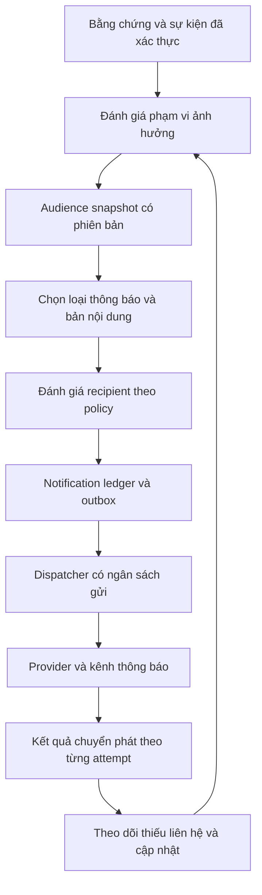

# Affected user notification

## 1. Thông báo phải giúp người bị ảnh hưởng hành động đúng

Trong ứng phó sự cố khôi phục tài khoản, **affected user notification** là việc thông báo cho người dùng thuộc phạm vi ảnh hưởng về những gì đã biết, biện pháp bảo vệ đã thực hiện và hành động họ cần làm tiếp.

Sự cố có thể liên quan đến link recovery bị lộ, một lỗi xác minh danh tính, MFA bị thay trái phép, passkey mới được đăng ký bởi người không có quyền hoặc session của kẻ chiếm tài khoản vẫn còn hoạt động sau recovery. Nội dung thông báo phải phản ánh đúng loại sự kiện và mức độ bằng chứng.

Một email chỉ nói “có hoạt động đáng ngờ” nhưng không có thời điểm, trạng thái bảo vệ hoặc cách phản hồi sẽ khó giúp người dùng. Một email khẳng định “tài khoản đã an toàn” khi session cũ chưa được thu hồi lại tạo cảm giác bảo vệ sai.

Mục tiêu kỹ thuật và vận hành gồm:

- Liên hệ đúng người thuộc phạm vi ảnh hưởng, qua kênh phù hợp.
- Trình bày sự thật và phần chưa biết một cách rõ ràng.
- Hướng dẫn bước tiếp theo mà không tạo thêm đường lừa đảo.
- Không tiết lộ token, credential, bằng chứng danh tính hoặc dữ liệu của người khác.
- Theo dõi được việc lập kế hoạch, gửi, lỗi chuyển phát và các bản cập nhật.
- Giữ cơ chế thông báo tách biệt khỏi cơ chế cấp quyền recovery.

NIST SP 800-61 Rev. 3 phân biệt thông báo sự cố với phối hợp ứng phó, truyền thông công khai và chia sẻ thông tin. Việc thông báo cho bên bị ảnh hưởng cần là một phần có chuẩn bị của quy trình ứng phó, thay vì một hành động gửi thư tự phát khi sự cố đã xảy ra. [NIST SP 800-61 Rev. 3](https://nvlpubs.nist.gov/nistpubs/SpecialPublications/NIST.SP.800-61r3.pdf).

Bài học sử dụng trạng thái, biểu mẫu và mã Java minh họa. Nó mô tả thiết kế cho module khôi phục tài khoản; không đại diện một chiến dịch thông báo đã được triển khai hoặc gửi thực tế.

## 2. Phân biệt cảnh báo tài khoản, thông báo sự cố và quyền khôi phục

Không nên dùng chung một loại “security email” cho mọi sự kiện.

| Loại thông điệp | Điều đã biết | Mục tiêu |
|---|---|---|
| Yêu cầu recovery được ghi nhận | Có yêu cầu theo hợp đồng công khai | Cho người dùng biết cách tiếp tục nếu yêu cầu hợp lệ |
| Thay đổi yếu tố xác thực đã commit | Có một thay đổi cụ thể trong tài khoản | Giúp chủ tài khoản phát hiện thay đổi không mong muốn |
| Cảnh báo đang điều tra | Có bằng chứng thuộc phạm vi nghi ảnh hưởng | Hướng dẫn bảo vệ và cập nhật phần chưa xác nhận |
| Thông báo ảnh hưởng đã xác nhận | Đã xác định được loại tác động theo bằng chứng | Mô tả tác động, biện pháp và hành động phù hợp |
| Cập nhật hoặc đính chính | Kết quả điều tra thay đổi thông tin trước | Sửa hiểu biết và hướng dẫn của người nhận |
| Thông báo kết thúc giai đoạn xử lý | Những điều kiện đã định đã đạt | Nêu kết quả, việc còn lại và cách tiếp tục liên hệ |

Một yêu cầu recovery công khai không chứng minh người yêu cầu là chủ tài khoản. Tương tự, một email được chuyển phát không chứng minh người nhận đã xác minh danh tính.

OWASP khuyến nghị thông báo qua kênh ngoài phiên hiện tại khi yếu tố MFA được thay đổi. Điều này giúp chủ tài khoản phát hiện việc thay thế trái phép, nhưng bản thân thông báo không thay thế kiểm tra quyền cho thao tác thay yếu tố. [OWASP Multifactor Authentication Cheat Sheet](https://cheatsheetseries.owasp.org/cheatsheets/Multifactor_Authentication_Cheat_Sheet.html).

### Thông báo không phải recovery capability

Một security notice không nên ngầm chứa quyền đổi mật khẩu, bỏ MFA hoặc đăng ký passkey mới. Nếu sản phẩm có đường report hoặc challenge được bảo vệ bằng capability, capability đó phải có mục đích, thời hạn và phạm vi riêng.

Không dùng một nút “Tôi không thực hiện” để tự động chứng minh quyền sở hữu tài khoản. Người có bản forward của email hoặc một hệ thống quét link cũng có thể truy cập URL đó.

Một thông báo có thể giúp tiếp nhận báo cáo và kích hoạt triage. Những thay đổi có tác động lớn, như thu hồi yếu tố xác thực hoặc chuyển quyền tài khoản, vẫn cần authorization theo chính sách.

### Thông báo vận hành và nghĩa vụ thông báo chính thức

Thông báo bảo mật cho người dùng và các nghĩa vụ thông báo theo hợp đồng, quy định hoặc pháp luật có thể liên quan nhưng không hoàn toàn giống nhau. Tổ chức cần xác định đối tượng, nội dung, thời điểm và trách nhiệm tương ứng trong quy trình của mình.

Không suy ra một thời hạn số giờ chung cho mọi sự cố, mọi quốc gia hoặc mọi khách hàng. Bản ghi quyết định cần nêu căn cứ áp dụng, người chịu trách nhiệm và các mốc thời gian đã được xác định cho trường hợp cụ thể.

## 3. Xác định người bị ảnh hưởng bằng dữ liệu có nguồn gốc

Một danh sách tài khoản có request thất bại chưa phải danh sách tài khoản bị chiếm. Người dùng trong một khoảng thời gian deploy cũng chưa chắc đều chịu cùng tác động.

Cần xây tập ảnh hưởng từ các quan hệ có thể kiểm tra, ví dụ:

```text
Incident
  -> phiên bản hệ thống hoặc điều kiện lỗi
  -> các recovery operation thuộc điều kiện đó
  -> token / grant / thay đổi credential liên quan
  -> tài khoản và tenant bị ảnh hưởng
  -> nhóm nội dung thông báo phù hợp
```

Nguồn bằng chứng có thể gồm operation journal, token issuance/consumption metadata, credential version, session revocation result và audit có bảo vệ. Log HTTP chỉ ghi `200` thường không đủ để xác định một thao tác nhạy cảm đã xảy ra.

### Phân loại mức độ bằng chứng

| Nhóm | Ví dụ | Cách diễn đạt phù hợp |
|---|---|---|
| Xác nhận thay đổi trái phép | Có mutation không được chủ thể có quyền thực hiện | Nêu thay đổi đã xác nhận và biện pháp xử lý |
| Có khả năng phơi lộ | Token thuộc nhóm dữ liệu đã bị truy cập trái phép | Nêu khả năng ảnh hưởng và phần đang điều tra |
| Bị nhắm tới nhưng chưa thấy hoàn tất | Có nhiều thử recovery bất thường, không có grant hoặc mutation tương ứng trong nguồn đã kiểm tra | Nêu dấu hiệu và giới hạn của kết luận |
| Chưa đủ dữ liệu | Mất một phần telemetry hoặc kết quả operation chưa đối soát | Nêu điều chưa xác định; không khẳng định an toàn |
| Không thuộc phạm vi sau đối soát | Bằng chứng loại tài khoản khỏi điều kiện ảnh hưởng | Ghi lại quyết định; đính chính nếu đã thông báo sai |

“Chưa thấy bằng chứng” cần gắn với phạm vi quan sát. Nó khác “đã chứng minh không có truy cập”. Nếu đang thiếu nhật ký của một node, thông báo không nên dùng kết luận tuyệt đối chỉ vì các node còn lại không ghi nhận bất thường.

### Lưu phiên bản tập ảnh hưởng

Một audience snapshot nên có `incidentId`, `scopeVersion`, tiêu chí chọn, nguồn dữ liệu, thời điểm chốt và danh sách subject theo tenant. Không đưa toàn bộ bằng chứng nhạy cảm vào file phục vụ gửi thư.

Khi điều tra bổ sung tài khoản mới, tạo bản mở rộng có nguồn gốc và tính phần cần gửi. Không sửa âm thầm danh sách cũ rồi làm mất khả năng giải thích ai đã được thông báo theo bằng chứng nào.

Nếu một người có tài khoản ở nhiều tenant, quyền nhận thông tin của từng tenant vẫn cần được xét riêng. Không gộp thư theo cùng địa chỉ email rồi làm lộ việc tham gia các tổ chức khác nhau.

Thông báo cho quản trị viên tenant cũng cần đúng phạm vi ủy quyền. Một người có vai trò quản trị hệ thống không tự động có quyền nhận mọi bằng chứng định danh, hành trình recovery hoặc nội dung riêng của người dùng.

## 4. Chọn người nhận khi thông tin liên hệ có thể đã bị thay

Một trong những rủi ro lớn nhất của incident recovery là đọc email hiện tại từ profile sau khi kẻ chiếm tài khoản đã thay địa chỉ. Hệ thống có thể gửi toàn bộ cảnh báo cho người tấn công và không liên hệ được chủ tài khoản.

Cần phân biệt:

- Notification address đã được thiết lập và xác minh theo quy trình.
- Recovery address dùng để nhận mã.
- Contact vừa thay trong khoảng thời gian sự cố.
- Địa chỉ đã bị đánh dấu mất quyền kiểm soát hoặc không còn thuộc người dùng.
- Kênh mà người dùng hoặc người được chỉ định có quyền nhận loại thông tin tương ứng.

Các vai trò này có thể trùng trên một địa chỉ nhưng không nên bị đồng nhất trong thiết kế dữ liệu.

NIST SP 800-63B-4 mô tả account notification như việc thông báo độc lập về các sự kiện như recovery hoặc binding authenticator, đồng thời yêu cầu hướng dẫn rõ để người nhận phản đối sự kiện không mong muốn. Khi áp dụng tiêu chuẩn này, cần đối chiếu đầy đủ yêu cầu về địa chỉ và trường hợp gửi, không suy ra tính tuân thủ chỉ từ việc đã gửi một email. [NIST SP 800-63B-4: Account Notifications](https://pages.nist.gov/800-63-4/sp800-63b/events/#notification).

### Dùng lịch sử contact, nhưng không mặc định địa chỉ cũ an toàn

Lịch sử thay đổi giúp tìm kênh đã tồn tại trước sự cố. Tuy nhiên, một địa chỉ cũ có thể đã bị mất, bị thu hồi hoặc được thay vì bị chiếm. Việc “cũ hơn” chỉ là một tín hiệu, không phải chứng minh quyền kiểm soát hiện tại.

Một resolver người nhận cần xét nguồn gốc xác minh, lịch sử thay đổi, cờ compromise, phạm vi tenant, loại thông báo và policy áp dụng. Nếu kênh nào bị nghi chiếm, không gửi thêm chi tiết nhạy cảm hoặc link có quyền tới đó chỉ vì nó từng được dùng.

OWASP cũng lưu ý rằng recovery sau nghi chiếm tài khoản không nên chỉ dựa vào thông tin recovery mới được thay và việc khôi phục không nên tự động trả lại mọi địa chỉ cũ. Đây là lý do cần đánh giá contact thay vì lấy trực tiếp giá trị mới nhất hoặc cũ nhất. [OWASP Forgot Password Cheat Sheet: Suspected Compromise](https://cheatsheetseries.owasp.org/cheatsheets/Forgot_Password_Cheat_Sheet.html#account-recovery-after-suspected-compromise).

### Ví dụ tuyến người nhận

| Trạng thái kênh trong fixture | Quyết định minh họa |
|---|---|
| Email đã xác minh từ trước, không có dấu hiệu mất kiểm soát | Đưa vào kế hoạch theo loại thông báo và policy |
| Email mới thêm trong hành vi takeover đang điều tra | Không coi là bằng chứng độc lập; đánh giá riêng |
| Email cũ đã được người dùng xác nhận bị mất | Không tự kích hoạt lại hoặc gửi bí mật tới đó |
| Push trên thiết bị gắn với session nghi bị chiếm | Không coi là kênh độc lập an toàn chỉ vì push gửi được |
| Không có kênh đủ điều kiện | Ghi trạng thái cần xử lý, dùng đường liên hệ đã được tổ chức thiết kế |
| Người được chỉ định nhận thông báo | Kiểm tra phạm vi chỉ định và mức thông tin được phép tiết lộ |

Bảng là ví dụ policy cho việc lập kế hoạch, không thay thế mọi yêu cầu gửi thông báo của một hệ thống cụ thể. Nếu loại thông báo có yêu cầu gửi nhiều địa chỉ, resolver cần thực hiện đúng yêu cầu đó và xử lý rủi ro từng kênh theo quy trình đã định.

Không lấy địa chỉ do người báo cáo mới nhập làm recipient chính thức chỉ vì họ nói đã mất email cũ. Đó là một bước thay đổi thông tin liên hệ cần bằng chứng riêng.

## 5. Nội dung tối thiểu để người nhận hiểu và phản ứng

Một thông báo hữu ích cần trả lời những câu hỏi cụ thể:

| Thành phần | Nội dung cần có |
|---|---|
| Vì sao nhận thông báo | Sự kiện hoặc nhóm ảnh hưởng liên quan tới tài khoản |
| Điều đã xác nhận | Thay đổi, truy cập hoặc phơi lộ đã có bằng chứng |
| Điều chưa xác định | Phần điều tra còn mở, nếu có |
| Mốc thời gian | Thời điểm hoặc khoảng thời gian, kèm múi giờ rõ |
| Việc hệ thống đã làm | Chỉ nêu biện pháp thực sự đã hoàn tất hoặc đang thực hiện |
| Việc người dùng cần làm | Các bước phù hợp với loại credential và khả năng truy cập |
| Cách báo không thực hiện | Đường hỗ trợ hoặc báo cáo qua kênh chính thức |
| Bản cập nhật tiếp theo | Nơi theo dõi và mốc cập nhật nếu đã có kế hoạch |
| Dấu hiệu chống giả mạo | Không yêu cầu gửi mật khẩu, OTP, recovery code hoặc private key |

Mức chi tiết cần phù hợp kênh. Nội dung hiển thị trên lock screen nên tối giản hơn trang trạng thái mà chủ thể đã xác minh có quyền xem.

Không đưa danh sách IP, ảnh giấy tờ, định danh pháp lý, địa chỉ mới của kẻ nghi tấn công hoặc dữ liệu tài khoản khác vào thông báo mặc định. Chỉ một phần thông tin được che cũng có thể tiết lộ dữ liệu không cần thiết.

### Nói đúng mức độ chắc chắn

Thay vì “dữ liệu của bạn hoàn toàn an toàn”, có thể nêu: “Chúng tôi đã thu hồi các link khôi phục thuộc nhóm xác định trong sự cố. Việc kiểm tra những thay đổi yếu tố xác thực liên quan vẫn đang tiếp tục.”

Thay vì “bạn đã đổi MFA”, có thể nêu: “Hệ thống ghi nhận thay đổi phương thức MFA của tài khoản vào thời điểm… Nếu bạn không thực hiện, hãy mở ứng dụng hoặc sử dụng kênh hỗ trợ chính thức.”

Nếu vị trí địa lý được suy ra từ IP, gọi đó là vị trí ước lượng. User-agent và tên thiết bị do client cung cấp cũng không phải bằng chứng về người thực hiện; nội dung phải được escape trước khi render.

Mỗi bản thông báo cần có phiên bản nội dung và nguồn dữ kiện đã được chốt.

## 6. Mẫu thông báo cho các tình huống khác nhau

Các mẫu dưới dùng dữ kiện giả định để thể hiện cấu trúc. Chỉ dùng một câu khẳng định biện pháp đã hoàn tất khi nguồn trạng thái có thẩm quyền xác nhận điều đó.

### 6.1. Có khả năng token bị phơi lộ, chưa xác nhận bị sử dụng

Giả sử nhóm điều tra xác định một nhóm token có thể đã bị truy cập trái phép, đã vô hiệu toàn bộ token thuộc nhóm và chưa kết luận về việc sử dụng chúng.

> **Tiêu đề:** Thông tin bảo mật về một yêu cầu khôi phục tài khoản
>
> Chúng tôi đang điều tra sự cố có thể liên quan đến thông tin của một số yêu cầu khôi phục tài khoản, trong đó có yêu cầu thuộc tài khoản của bạn.
>
> Chúng tôi đã vô hiệu các link khôi phục được xác định thuộc nhóm này. Hiện việc kiểm tra xem các link đó có bị sử dụng trái phép hay không vẫn đang tiếp tục.
>
> Nếu bạn đang cần khôi phục quyền truy cập, hãy tự mở ứng dụng hoặc website chính thức để bắt đầu lại theo hướng dẫn tại đó. Không gửi mật khẩu, mã OTP hoặc recovery code qua email trả lời.
>
> Nếu bạn nhận thấy thay đổi tài khoản không do mình thực hiện hoặc không thể truy cập, hãy liên hệ bộ phận hỗ trợ qua mục Hỗ trợ trên ứng dụng hoặc website chính thức và cung cấp mã tham chiếu của thông báo.
>
> Chúng tôi sẽ cập nhật thông tin tại trang trạng thái chính thức được truy cập từ ứng dụng.

Mẫu này không nói tài khoản đã bị chiếm và không nói chắc chắn chưa có thiệt hại. Nó mô tả phạm vi điều tra và hành động cụ thể mà người dùng có thể làm.

Nếu token chưa được thu hồi đầy đủ, cần thay câu về biện pháp bằng trạng thái thực tế và hướng dẫn tương ứng. Không gửi lời khẳng định sớm rồi trông chờ backend hoàn thành sau.

### 6.2. Xác nhận có thay đổi MFA không được phép

Giả sử đã xác nhận một thay đổi MFA trái phép, thu hồi phương thức bị thêm trái phép và hoàn tất thu hồi session theo policy của tài khoản liên quan.

> **Tiêu đề:** Cần kiểm tra thay đổi bảo mật trên tài khoản của bạn
>
> Chúng tôi đã xác nhận một thay đổi phương thức xác thực nhiều yếu tố không được phép trên tài khoản của bạn trong khoảng thời gian nêu trong thông báo này.
>
> Chúng tôi đã vô hiệu phương thức được thêm trái phép và thu hồi các phiên đăng nhập thuộc phạm vi xử lý của sự cố.
>
> Hãy tự mở ứng dụng hoặc website chính thức để xem hướng dẫn lấy lại quyền truy cập và kiểm tra các phương thức xác thực, thông tin khôi phục đang được gắn với tài khoản. Nếu bạn đã mất các phương thức còn lại, sử dụng mục hỗ trợ khôi phục chính thức.
>
> Nhân viên hỗ trợ không yêu cầu bạn đọc OTP, gửi recovery code hoặc cung cấp private key của passkey qua cuộc gọi hay email.
>
> Nếu bạn cho rằng thông tin trong thông báo không đúng hoặc cần hỗ trợ thêm, hãy sử dụng kênh liên hệ chính thức cùng mã tham chiếu của thông báo.

Trong một sản phẩm thực tế, cần bổ sung thời gian, mức tác động và hành động người dùng phù hợp. Không yêu cầu người dùng xóa mọi yếu tố xác thực trước khi họ có đường truy cập thay thế đã được xác minh.

Thông báo về passkey cần nêu đúng phạm vi: credential đã được đăng ký hoặc thu hồi, không mặc định kết luận private key đã bị lấy khỏi thiết bị.

### 6.3. Đính chính thông báo trước

Một bản đính chính nên nói rõ nội dung nào thay đổi:

> **Tiêu đề:** Cập nhật thông báo bảo mật có mã tham chiếu …
>
> Trong thông báo trước, chúng tôi nêu rằng chưa phát hiện việc thay đổi phương thức xác thực trong các dữ liệu đã kiểm tra tại thời điểm đó.
>
> Kết quả đối soát bổ sung đã xác định một thay đổi cần xử lý trên tài khoản của bạn. Phần hướng dẫn mới dưới đây thay thế hướng dẫn tương ứng trong thông báo trước.
>
> Chúng tôi đã … và đang … . Bạn cần … qua ứng dụng hoặc website chính thức.
>
> Các bước không liên quan đến thay đổi này vẫn giữ nguyên như đã thông báo.

Các phần bỏ lửng phải được điền từ dữ kiện đã kiểm tra khi soạn thông báo thực. Đây là khung biên tập, không phải nội dung sẵn sàng gửi.

Không chỉ gửi lại thông báo cũ với một đoạn nhỏ khác ở cuối. Người nhận cần nhận ra có bản cập nhật ảnh hưởng đến hành động của mình.

## 7. Hướng dẫn hành động không tạo thêm một chiến dịch phishing

Sau một sự cố, người dùng dễ tin các thông điệp khẩn cấp mang tên dịch vụ. Một notification hợp lệ vẫn có thể huấn luyện họ làm việc nguy hiểm nếu yêu cầu nhập OTP vào một trang lạ hoặc gọi số điện thoại không thể tự xác minh.

Một thiết kế phù hợp nên:

- Cho phép tự mở ứng dụng hoặc website chính thức để xem thông báo.
- Dùng domain và danh tính gửi đã được tổ chức quản lý, không dựng URL từ Host header của request.
- Tránh URL rút gọn và redirect khó kiểm tra trong đường xử lý nhạy cảm.
- Không yêu cầu trả lời email bằng mật khẩu, OTP, recovery code hay ảnh giấy tờ.
- Nếu cần bằng chứng danh tính, đưa người dùng vào quy trình bảo vệ và có quyền truy cập riêng.
- Có kênh hỗ trợ mà người dùng có thể tự tìm từ ứng dụng, website hoặc thông tin đã lưu trước đó.
- Tách mã tham chiếu hỗ trợ khỏi bearer token có quyền truy cập.

Nếu có link trong thông báo, link chỉ nên đưa tới đích được kiểm soát theo đúng mục đích. Truy cập link không được ngầm đổi credential, cấp grant hoặc xác nhận sự kiện là do chủ tài khoản thực hiện.

### Link preview và email scanner

Nhiều hệ thống tự mở link trước khi con người nhìn thấy email. Vì vậy, `GET` từ một scanner không được tự coi là “người dùng đã xác nhận”, “đã báo gian lận” hoặc “đồng ý khôi phục”.

Trang đích có thể hiển thị thông tin hạn chế và yêu cầu thao tác chủ động cùng các điều kiện quyền cần thiết. Chống CSRF, kiểm tra mục đích capability và xác minh ngữ cảnh vẫn quan trọng với hành động thay đổi trạng thái.

Một report link có thể giúp gửi tín hiệu cần triage, nhưng tín hiệu đó không chứng minh quyền sở hữu. Cần kiểm soát lạm dụng để người có link forward không thể khóa tài khoản người khác vô thời hạn.

### Nếu người dùng không thể đăng nhập

Không bắt người đã mất toàn bộ yếu tố xác thực phải đăng nhập bình thường mới xem được cách liên hệ hỗ trợ. Có thể cung cấp hướng dẫn công khai tối thiểu và một quy trình recovery có mức bảo đảm phù hợp.

Hướng dẫn công khai không nên cung cấp chi tiết tài khoản, xác nhận membership của tenant hoặc trạng thái investigation cho bất kỳ ai biết email. Sau khi có bằng chứng phù hợp, giao diện bảo vệ có thể trình bày phần chi tiết được phép.

## 8. Luồng xử lý từ bằng chứng tới notification

Một kiến trúc minh họa:



Một event chỉ có trường `incident=true` chưa đủ quyền để bắt đầu chiến dịch gửi. Cần xác thực nguồn, kiểm tra tenant, loại sự kiện, version và các quyết định đã được cấp quyền trong workflow của tổ chức.

Mỗi logical notice có thể gắn với:

```text
incidentId
subjectId
tenantId
noticeStage
contentRevision
scopeVersion
recipientPlanVersion
policyVersion
evidenceReference
```

Không đưa token, toàn bộ contact history hoặc bằng chứng danh tính vào message dùng để điều phối gửi. Tham chiếu tới nguồn dữ liệu có kiểm soát thường phù hợp hơn sao chép toàn bộ thông tin.

### Vì sao cần snapshot người nhận và kiểm tra trước dispatch?

Snapshot giúp giải thích tại sao địa chỉ được chọn tại thời điểm lập kế hoạch. Kiểm tra eligibility trước dispatch giúp phát hiện kênh vừa bị đánh dấu mất kiểm soát hoặc quyền nhận vừa bị thu hồi.

Hai cơ chế bổ sung nhau. Không thay snapshot bằng việc luôn đọc email hiện tại, vì việc đó có thể chuyển thư sang địa chỉ của kẻ chiếm tài khoản. Cũng không gửi theo snapshot cũ bất chấp một cảnh báo compromise mới.

Khi cần đổi recipient plan, lưu quyết định và version mới theo quy trình. Công việc cũ không được âm thầm biến thành thông báo tới một người khác mà ledger vẫn ghi cùng recipient.

Nếu không tìm được kênh đủ điều kiện, giữ trạng thái như `CONTACT_REVIEW_REQUIRED` hoặc một trạng thái tương đương, có owner và thời hạn xử lý. Không đánh dấu `NOTIFIED` để làm sạch dashboard.

### Tenant và template cũng là ranh giới bảo mật

Tên hiển thị, domain gửi, ngôn ngữ, brand và kênh hỗ trợ cần lấy từ cấu hình tenant có thẩm quyền. Không dùng dữ liệu do người gọi tự nhập để render đường hỗ trợ chính thức.

Chọn sai template tenant có thể làm lộ quan hệ tài khoản hoặc đưa người nhận sang một nhóm hỗ trợ không có quyền. Test cần kiểm tra subject, tenant, template và recipient như một binding thống nhất.

## 9. Ledger, retry và idempotency

Một ledger nên phân biệt ít nhất:

| Trạng thái | Ý nghĩa |
|---|---|
| `PLANNED` | Có kế hoạch thông báo và version nội dung |
| `READY` | Recipient và điều kiện dispatch phù hợp |
| `RETRY_WAIT` | Đang đợi một attempt tiếp theo theo policy |
| `SUBMISSION_UNKNOWN` | Có khả năng provider đã nhận nhưng chưa có kết quả chắc chắn |
| `PROVIDER_ACCEPTED` | Provider xác nhận nhận yêu cầu |
| `DELIVERY_REPORTED` | Có bằng chứng chuyển phát theo định nghĩa của kênh |
| `FAILED_TERMINAL` | Không tiếp tục theo ngân sách hiện tại |
| `CONTACT_REVIEW_REQUIRED` | Cần xử lý vấn đề người nhận hoặc kênh |
| `SUPERSEDED` | Nội dung được thay bằng version khác theo quy tắc đã định |

Các tên có thể khác ở implementation. Không dùng một field `sent=true` để đại diện đồng thời cho đã tạo kế hoạch, đã gửi tới provider, đã tới thiết bị và đã được người dùng hiểu.

Một key chống tạo trùng logical notice có thể gắn với:

```text
incident + tenant + subject + noticeStage + contentRevision
```

Một người có nhiều kênh có thể cần nhiều delivery job thuộc cùng logical notice. Vì vậy, key của từng delivery job còn cần recipient reference hoặc channel destination theo mô hình dữ liệu.

### Replay và cập nhật không giống nhau

Replay cùng một initial notice và cùng revision không nên tạo thêm một logical notice mới. Nhưng bản đính chính có revision mới phải được phép đi qua, ngay cả khi initial notice đã được provider nhận.

Nếu key chỉ là `incident + subject`, hệ thống có thể chặn cả thông báo cập nhật quan trọng. Nếu mỗi retry dùng một UUID ngẫu nhiên mới làm key logic, hệ thống lại có thể gửi lặp không kiểm soát.

Thay đổi nội dung không nên diễn ra dưới cùng một revision đã phát hành. Lưu bản nội dung render hoặc fingerprint có nguồn gốc phù hợp để giải thích người dùng đã nhận phiên bản nào.

### Provider timeout không bảo đảm chưa gửi

Khi provider đã nhận rồi mất acknowledgment, retry có thể tạo hai bản thư. Outbox và ledger giúp quản lý công việc nhưng không tự bảo đảm email ngoài hệ thống được nhận đúng một lần.

Cần ngân sách attempt, lịch retry, đối soát khi provider hỗ trợ và cách liên kết callback theo từng attempt. Không cấp thêm quyền hoặc thay đổi phạm vi sự cố chỉ vì một message bị gửi lặp.

Callback delivery, open tracking và việc người dùng bấm link là những tín hiệu khác nhau. Không chuyển một trong các tín hiệu đó thành xác nhận đã đọc hiểu, đã lấy lại quyền tài khoản hoặc đã chấp thuận thao tác recovery.

## 10. Phối hợp vận hành và khả năng tiếp cận

Một kế hoạch thông báo nên có chủ sở hữu rõ: người xác nhận dữ kiện, người điều phối incident, người quản lý recipient policy, nhóm hỗ trợ và người vận hành delivery. Các vai trò có thể do ít người đảm nhiệm trong một hệ thống nhỏ, nhưng trách nhiệm cần được ghi lại.

Nhóm hỗ trợ cần biết phiên bản nội dung, điều gì đã được xác nhận, những câu hỏi có thể trả lời và đường escalation. Không đưa OTP, token hoặc toàn bộ bằng chứng danh tính vào hướng dẫn hỗ trợ diện rộng.

### Mốc thời gian cần đo

Đo riêng các khoảng:

- Từ khi phát hiện incident tới khi có quyết định về nhóm cần thông báo.
- Từ quyết định tới khi hoàn thành kế hoạch recipient.
- Từ khi đủ điều kiện gửi tới attempt đầu.
- Từ submission tới provider acceptance và tín hiệu chuyển phát.
- Từ khi phát hiện lỗi contact tới khi có cách xử lý.
- Từ thay đổi kết luận điều tra tới bản cập nhật được phát hành.

Một metric “notification latency” duy nhất có thể che việc audience bị bỏ sót hoặc nhiều recipient chưa có kênh. Các mốc này phục vụ vận hành; không tự thay thế mốc bắt buộc được xác định theo nghĩa vụ áp dụng.

### Ngôn ngữ và khả năng sử dụng

Giữ mã tham chiếu ổn định, diễn đạt ngắn và tách việc đã làm khỏi việc cần làm. Bản dịch phải giữ nguyên mức độ chắc chắn của nội dung: “có thể bị ảnh hưởng” không được biến thành “đã bị xâm nhập”.

Giao diện cần đọc được bằng công nghệ hỗ trợ, không dựa duy nhất vào màu cảnh báo và không đặt thông tin hành động quan trọng chỉ trong hình ảnh. SMS hoặc push ngắn có thể hướng dẫn mở ứng dụng chính thức để xem chi tiết mà không đưa dữ liệu riêng lên lock screen.

Security notice cần được quản lý đúng loại thông điệp, tách khỏi marketing preference. Khi một kênh bị chặn hoặc không được phép dùng, ghi nhận trạng thái và xử lý theo policy, thay vì đánh dấu đã tiếp cận hoặc tự bỏ qua mọi ràng buộc của provider.

## 11. Ví dụ Java: kiểm tra recipient, replay và quyền

Khung JUnit sau minh họa ba bất biến. Fixture thứ nhất có một kênh đã được thiết lập, đã xác minh và vẫn an toàn, cùng một địa chỉ mới do hành vi takeover thêm vào. Điều kiện “vẫn an toàn” là dữ kiện của fixture, không được suy ra chỉ từ tuổi địa chỉ.

Transport trong test chỉ thu nhận thông báo vào mailbox tổng hợp; adapter lập kế hoạch, ledger, resolver và kiểm tra quyền cần đi qua đường xử lý thực.

```java
import org.junit.jupiter.api.Test;

import static org.junit.jupiter.api.Assertions.*;

abstract class AffectedUserNotificationTest {

    protected abstract Harness isolatedFixture();

    @Test
    void suspiciousContactChangeDoesNotRedirectSecurityNotice() {
        try (Harness fx = isolatedFixture()) {
            fx.prepareAffectedAccountWithSuspiciousContactChange();
            SecuritySnapshot before = fx.securitySnapshot();

            fx.publishNotice(NoticeStage.INITIAL, 1);
            fx.dispatchReadyNoticesWithinBound();

            assertEquals(1L, fx.logicalNoticeCount());
            assertEquals(1L, fx.capturedForEstablishedSafeContact());
            assertEquals(0L, fx.capturedForSuspiciousNewContact());
            assertEquals(0L, fx.capturedForOtherTenant());
            assertEquals(before, fx.securitySnapshot());
        }
    }

    @Test
    void replayIsDeduplicatedButCorrectionCanBeDelivered() {
        try (Harness fx = isolatedFixture()) {
            fx.prepareAffectedAccountWithEligibleContact();

            fx.publishNotice(NoticeStage.INITIAL, 1);
            fx.publishNotice(NoticeStage.INITIAL, 1);
            fx.dispatchReadyNoticesWithinBound();

            assertEquals(1L, fx.logicalNoticeCount());
            assertEquals(1L,
                    fx.capturedForRevision(NoticeStage.INITIAL, 1));

            fx.publishNotice(NoticeStage.CORRECTION, 2);
            fx.dispatchReadyNoticesWithinBound();

            assertEquals(2L, fx.logicalNoticeCount());
            assertEquals(1L,
                    fx.capturedForRevision(NoticeStage.CORRECTION, 2));
            assertTrue(fx.correctionReferencesPriorNotice());
        }
    }

    @Test
    void deliveryCallbackAndLinkPreviewDoNotGrantRecovery() {
        try (Harness fx = isolatedFixture()) {
            fx.prepareAffectedAccountWithEligibleContact();
            SecuritySnapshot before = fx.securitySnapshot();

            fx.publishNotice(NoticeStage.INITIAL, 1);
            fx.dispatchReadyNoticesWithinBound();

            fx.replayAuthenticDeliveryCallback();
            fx.replayAuthenticDeliveryCallback();
            fx.visitNoticeLinkAsPreviewScanner();
            fx.awaitRelatedWorkWithinBound();

            assertEquals(1L, fx.logicalNoticeCount());
            assertEquals(before, fx.securitySnapshot());
            assertFalse(fx.previewCallerCanChangeCredentials());
        }
    }

    enum NoticeStage {
        INITIAL,
        CORRECTION
    }

    record SecuritySnapshot(
            long recoveryGrantCount,
            long passwordVersion,
            long mfaVersion,
            long passkeyVersion,
            long sessionEpoch) {}

    interface Harness extends AutoCloseable {
        void prepareAffectedAccountWithSuspiciousContactChange();
        void prepareAffectedAccountWithEligibleContact();

        SecuritySnapshot securitySnapshot();
        void publishNotice(NoticeStage stage, int contentRevision);
        void dispatchReadyNoticesWithinBound();

        long logicalNoticeCount();
        long capturedForEstablishedSafeContact();
        long capturedForSuspiciousNewContact();
        long capturedForOtherTenant();
        long capturedForRevision(NoticeStage stage, int revision);
        boolean correctionReferencesPriorNotice();

        void replayAuthenticDeliveryCallback();
        void visitNoticeLinkAsPreviewScanner();
        void awaitRelatedWorkWithinBound();
        boolean previewCallerCanChangeCredentials();

        @Override
        void close();
    }
}
```

### Điều kiện để các assertion có ý nghĩa

`publishNotice(...)` đi qua cùng cơ chế xác thực event, chọn policy và ghi ledger của implementation. Nó không trực tiếp chèn một bản thư đúng vào mailbox rồi bỏ qua resolver.

Các hàm `capturedFor...` đếm theo recipient reference, subject và tenant của fixture. Chúng không cần in địa chỉ email hoặc payload có dữ liệu riêng trong output test.

`logicalNoticeCount()` đếm bản ghi nghiệp vụ, không đếm số attempt. Fixture của test replay dùng transport có acceptance rõ ràng và không tạo lỗi mất acknowledgment. Trường hợp provider nhận rồi mất response cần scenario riêng vì có thể có bản chuyển phát trùng.

`replayAuthenticDeliveryCallback()` sử dụng callback đã được xác thực trong môi trường thử. Cần bổ sung negative case cho chữ ký hoặc credential callback không hợp lệ; một callback giả không được cập nhật bằng chứng chuyển phát.

`visitNoticeLinkAsPreviewScanner()` gửi request đọc không có quyền recovery của chủ tài khoản. Nó không được mang sẵn cookie hoặc capability có quyền đổi credential của một test khác.

`previewCallerCanChangeCredentials()` kiểm tra quyết định authorization ở đúng boundary nhạy cảm, thay vì chỉ nhìn giao diện có hiển thị nút hay không.

Snapshot lấy dữ liệu từ nguồn có thẩm quyền và không chứa token hoặc credential. Ledger và audit được phép thay đổi khi gửi thông báo; việc cấp grant hoặc sửa credential do callback hoặc preview là điều cần bị chặn.

Các test trên là ví dụ về hợp đồng cho fixture được mô tả. Chúng chưa bao phủ mọi yêu cầu gửi nhiều địa chỉ, mọi kênh hoặc mọi tiêu chuẩn mà sản phẩm áp dụng.

## 12. Ma trận kiểm tra trước một chiến dịch thông báo

| Nhóm kiểm tra | Scenario minh họa | Kỳ vọng |
|---|---|---|
| Phạm vi ảnh hưởng | Hai tài khoản có request tương tự nhưng chỉ một thuộc bằng chứng incident | Không gửi nhầm kết luận tác động cho tài khoản ngoài phạm vi |
| Tenant isolation | Cùng email liên hệ xuất hiện ở hai tenant | Không lộ incident hoặc membership của tenant khác |
| Contact history | Contact mới thêm trong takeover, contact trước đó vẫn đủ điều kiện | Không chuyển notice độc lập sang kênh của kẻ chiếm |
| Contact compromise | Kênh snapshot bị đánh dấu mất kiểm soát trước dispatch | Đánh giá lại và ghi quyết định, không gửi mù theo snapshot |
| Không có kênh | Mọi recipient đều không đủ điều kiện theo policy | Có trạng thái và owner xử lý, không báo đã thông báo |
| Mức độ chắc chắn | Cohort nghi ảnh hưởng và cohort đã xác nhận có tác động | Template giữ đúng mức bằng chứng |
| Nội dung | Tên thiết bị chứa HTML hoặc ký tự điều khiển | Escape phù hợp; không chèn nội dung ngoài template |
| Dữ liệu nhạy cảm | Evidence có token, OTP và ảnh định danh | Không xuất hiện trong subject, body mặc định hoặc log |
| Replay | Cùng event và revision được xử lý hai lần | Một logical notice theo key đã định |
| Đính chính | Revision mới sửa kết luận trước đó | Không bị deduplication của initial notice chặn |
| Thứ tự gửi | Bản cập nhật quan trọng sẵn sàng trước initial notice bị chậm | Quy tắc supersede hoặc thứ tự rõ, không gửi hướng dẫn lỗi thời |
| Callback | Delivery event lặp hoặc đến muộn | Không tăng quyền, không hồi sinh nội dung bị thay |
| Link preview | Scanner tự truy cập URL | Không có hành động bảo mật ngoài quyền |
| Provider timeout | Provider nhận rồi mất acknowledgment | Theo dõi kết quả chưa chắc chắn, retry có giới hạn |
| Support handoff | Người dùng mất mọi yếu tố xác thực liên hệ qua kênh chính thức | Có đường xác minh riêng, không yêu cầu gửi secret |
| Bản dịch | Mức độ nghi ngờ và hành động khác nhau theo locale | Giữ cùng nghĩa và cùng version dữ kiện |

Có thể kiểm tra nội dung trước bằng preview trên dữ liệu tổng hợp, sau đó kiểm tra tích hợp với provider thử nghiệm. Preview đẹp không chứng minh resolver đúng; delivery callback thành công không chứng minh người nhận có quyền biết nội dung.

Một dry run nên cho phép xem số subject, tenant, loại notice, version nội dung, số kênh đủ điều kiện và số trường hợp cần xử lý. Không cần export toàn bộ recipient hoặc bằng chứng nhạy cảm vào bảng chia sẻ rộng để đạt mục tiêu này.

Đối với gửi theo đợt, kiểm tra từng batch dùng cùng scope/content version đã chốt và có cách dừng phần chưa gửi nếu phát hiện sai phạm vi hoặc lộ dữ liệu. Bản đã ra ngoài không thể mặc định thu hồi; đính chính và xử lý hệ quả cần có trong kế hoạch.

## 13. Đo hiệu quả mà không nhầm tín hiệu

Một báo cáo có thể phân biệt:

```text
eligibleSubjects
subjectsWithRecipientPlan
subjectsRequiringContactReview
logicalNoticesReady
logicalNoticesSubmitted
providerAcceptedAttempts
deliveryReportedRecipients
terminalDeliveryFailures
correctionsOutstanding
supportReportsAwaitingTriage
```

Không cộng mọi attempt rồi gọi đó là số người đã được thông báo. Một người có nhiều kênh hoặc nhiều lần retry có thể xuất hiện nhiều lần trong dữ liệu chuyển phát.

Tương tự, ảnh tracking được tải không chứng minh người dùng đã đọc thông báo. Client email, privacy proxy hoặc scanner có thể làm thay đổi tín hiệu. Việc click link cũng không xác minh chủ tài khoản nếu chưa có bằng chứng phù hợp.

### Số đo gắn với hành động

- Nhiều subject chưa có recipient plan: kiểm tra chất lượng dữ liệu và quy tắc resolver.
- Nhiều contact cần review: phân công owner và đường liên hệ thay thế đã được thiết kế.
- Nhiều provider timeout: kiểm tra backlog, retry budget và kết quả chưa chắc chắn.
- Nhiều report “không thực hiện”: triage theo bằng chứng, không chỉ đếm tổng.
- Nhiều bản cập nhật chưa gửi: kiểm tra key deduplication và trạng thái superseded.
- Một tenant có tỷ lệ sai khác: kiểm tra template, cấu hình kênh và quyền hỗ trợ của tenant đó.

Giới hạn truy cập dashboard và export recipient. Một danh sách những người đang gặp sự cố recovery cũng là thông tin có thể bị lợi dụng cho social engineering.

## 14. Tình huống thực hành: cảnh báo bị gửi cho địa chỉ của kẻ chiếm

Một lỗi trong luồng recovery cho phép một nhóm thao tác thay MFA trái phép. Trước khi incident được phát hiện, một số tài khoản bị đổi email liên hệ. Job thông báo ban đầu đọc `profile.email` tại thời điểm gửi.

Hậu quả là thư của một số người được gửi tới địa chỉ mới do kẻ chiếm kiểm soát. Chủ tài khoản không nhận được cảnh báo; một số nội dung điều tra còn bị lộ cho người đang tấn công.

Không nên giải quyết bằng cách luôn gửi vào email cũ nhất. Trong các tài khoản khác, địa chỉ cũ có thể đã bị thay hợp lệ hoặc không còn thuộc người dùng.

Một kế hoạch xử lý có thể gồm:

1. Chốt scope theo operation và credential mutation liên quan, có phiên bản bằng chứng.
2. Dừng phần chiến dịch chưa gửi nếu recipient policy sai.
3. Đánh giá contact history cùng cờ mất kiểm soát, dữ liệu xác minh và phạm vi người nhận.
4. Tạo recipient plan mới có nguồn gốc; giữ lại bằng chứng thư nào đã ra ngoài.
5. Loại thông tin không cần thiết khỏi nội dung, đặc biệt dữ liệu hỗ trợ cuộc điều tra.
6. Gửi notice và bản đính chính phù hợp qua các kênh đã được đánh giá theo policy.
7. Đưa trường hợp không có kênh vào quy trình xử lý có owner, không đánh dấu hoàn tất.
8. Kiểm tra callback và link preview không làm thay đổi grant, credential hoặc session.
9. Cập nhật hướng dẫn hỗ trợ để tiếp nhận người mất quyền truy cập mà không xin secret.
10. Bổ sung test cho contact bị thay trong incident và thay đổi eligibility trước dispatch.

Thông báo đã gửi sai cần được xem là một sự kiện có tác động riêng để đánh giá, thay vì chỉ xóa job rồi gửi lại. Ledger phải giữ được recipient plan và content version đã sử dụng để hiểu phạm vi hệ quả.

## 15. Tiêu chí hoàn tất và hồ sơ bàn giao

Một chiến dịch không nên được đóng chỉ vì queue trống. Trước khi ghi nhận hoàn tất giai đoạn thông báo, cần đối chiếu các nhóm subject và trạng thái xử lý theo tiêu chí đã định.

| Tiêu chí | Bằng chứng |
|---|---|
| Đúng phạm vi | Audience snapshot, tiêu chí chọn và nguồn điều tra |
| Đúng mức thông tin | Content revision gắn với dữ kiện và cohort |
| Đúng người nhận | Recipient plan, policy version và kết quả eligibility |
| Không bỏ sót âm thầm | Danh sách còn thiếu kênh, lỗi terminal hoặc việc chờ xử lý có owner |
| Không chặn bản cập nhật | Ledger của initial, correction và update theo version |
| Không tạo quyền ngoài ý muốn | Kết quả kiểm tra grant, credential và session |
| Theo dõi chuyển phát đúng nghĩa | Tách submission, acceptance, delivery signal và phản hồi |
| Hỗ trợ hoạt động được | Hướng dẫn của nhóm hỗ trợ, escalation và kết quả diễn tập |
| Bảo vệ bằng chứng | Quyền đọc, retention và redaction cho dữ liệu incident |
| Có cách cập nhật tiếp | Chủ sở hữu và điều kiện phát hành nội dung mới |

“Hoàn tất giai đoạn” có thể vẫn bao gồm các trường hợp không tiếp cận được đã có quyết định và owner theo quy trình. Cần báo rõ số lượng và cách xử lý còn lại, không chuyển chúng thành “người dùng đã đọc”.

Hồ sơ bàn giao nên cho biết phiên bản phạm vi và nội dung cuối, các thay đổi đáng kể so với bản trước, trạng thái liên hệ còn mở và nơi lưu bằng chứng có kiểm soát. Không gộp toàn bộ dữ liệu nhạy cảm vào một bản tóm tắt gửi rộng.

Một thông báo tốt giúp người bị ảnh hưởng nhận ra sự kiện, hiểu mức độ chắc chắn và đi tới một đường xử lý đáng tin cậy. Nó cần phối hợp với thu hồi token, kiểm soát credential, xác minh danh tính và quản lý session; việc thư được gửi không tự hoàn thành các biện pháp đó.
