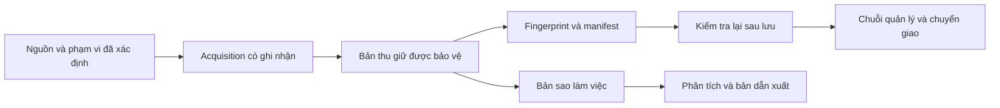

# Forensic evidence preservation — Bảo toàn bằng chứng số trong sự cố khôi phục tài khoản

## 1. Mục tiêu: giữ được dữ liệu và giải thích được nguồn gốc

Khi người dùng báo bị chiếm tài khoản sau một lần khôi phục mật khẩu, reset MFA hoặc đăng ký passkey thay thế, câu hỏi không chỉ là “có log hay không”. Đội ứng phó cần xác định dữ liệu đến từ đâu, được thu lúc nào, đã qua những biến đổi nào và liệu nó còn đủ ngữ cảnh để đánh giá một hành động bảo mật.

**Forensic evidence preservation** là quá trình nhận diện, thu thập và bảo vệ dữ liệu liên quan để có thể kiểm tra lại tính toàn vẹn, nguồn gốc và cách xử lý của nó. Trong bài này, phạm vi là sự cố của hệ thống khôi phục tài khoản; không phải một hướng dẫn tự tiến hành điều tra mọi thiết bị hoặc tài khoản liên quan.

Các câu hỏi điển hình cần dữ liệu hỗ trợ:

- Ai hoặc thành phần nào đã khởi tạo yêu cầu khôi phục?
- Hệ thống đã yêu cầu và chấp nhận loại bằng chứng nào?
- Token hoặc recovery grant được phát, dùng, hủy và hết hạn ra sao?
- Có thay đổi kênh liên hệ, MFA hoặc passkey trước/sau quá trình đó không?
- Session nào vẫn có quyền sau khi credential thay đổi?
- Quyết định dựa trên phiên bản policy, cấu hình và mã ứng dụng nào?
- Thao tác ứng phó của đội vận hành đã làm thay đổi dữ liệu gì?

Một lần export thành công chưa trả lời được tất cả các câu hỏi ấy. Dữ liệu có thể thiếu trang, bị lệch thời gian, chỉ phản ánh trạng thái hiện tại hoặc xuất phát từ một thành phần đã bị can thiệp.

NIST SP 800-61 Rev. 3 nhấn mạnh việc bảo vệ tính bí mật, toàn vẹn và nguồn gốc của hồ sơ ứng phó, đồng thời thu giữ dữ liệu sự cố theo quy trình bảo toàn và lưu giữ của tổ chức. Tham khảo [NIST SP 800-61 Rev. 3](https://csrc.nist.gov/pubs/sp/800/61/r3/final). Quy trình minh họa dưới đây cụ thể hóa các mục tiêu ấy cho miền khôi phục tài khoản.

## 2. Phân biệt bằng chứng điều tra với bằng chứng cấp quyền khôi phục

Trong module account recovery, từ “bằng chứng” có hai nghĩa dễ bị trộn lẫn.

**Bằng chứng xác minh người dùng** là thứ policy có thể sử dụng để quyết định một hành động khôi phục: mã khôi phục, challenge hợp lệ, kết quả xác minh danh tính hoặc một tổ hợp yếu tố được chấp nhận.

**Bằng chứng điều tra** là dữ liệu dùng để tái dựng và đánh giá sự cố: bản ghi phát mã, kết quả verifier, lịch sử thay MFA, audit event hoặc export từ provider.

Một audit event ghi `VERIFIED` không tự biến người nộp bản ghi ấy thành chủ tài khoản. Một file chứa reset token được thu giữ cũng không được phép dùng như một công cụ đăng nhập để “xác nhận cho chắc”.

Bảo toàn dữ liệu không đồng nghĩa xác nhận nội dung dữ liệu đúng. Cần phân biệt:

| Thuộc tính | Câu hỏi cần trả lời |
|---|---|
| Toàn vẹn | Các byte của artifact có thay đổi so với mốc đã ghi nhận không? |
| Nguồn gốc | Artifact được lấy từ hệ thống, tài khoản dịch vụ và phiên bản đối tượng nào? |
| Độ tin cậy của nguồn | Nguồn có thể đã bị sửa, giả mạo hoặc ảnh hưởng bởi sự cố không? |
| Độ đầy đủ trong phạm vi | Có đủ trang, partition, khoảng thời gian và trường cần thiết không? |
| Chuỗi xử lý | Ai nhận, sao chép, biến đổi hoặc chuyển giao artifact? |
| Ngữ nghĩa thời gian | Thời điểm trong dữ liệu là lúc sự kiện xảy ra, được nhận hay được export? |
| Bí mật và quyền riêng tư | Ai được phép xem dữ liệu và bản dẫn xuất nào có thể chia sẻ? |

Checksum hỗ trợ kiểm tra toàn vẹn byte. Nó không tự chứng minh tài khoản nào đã thực hiện hành động, dữ liệu chưa từng bị sửa trước lúc thu hoặc bản export chứa đầy đủ mọi sự kiện.

## 3. Xác định phạm vi và trách nhiệm thu giữ

Trước khi thu, cần có incident reference và phạm vi làm việc được xác định theo quy trình ứng phó của tổ chức. Ví dụ:

```text
Case reference: IR-RECOVERY-DEMO-17
Tenant scope: tenant-blue
Account scope: account-ref-17 và các đối tượng liên kết được xác định
Initial time window: một khoảng thời gian có ranh giới rõ
Sources: recovery service, authentication audit, provider, control plane
Collector: danh tính ứng phó được quản lý
Custodian: người hoặc nhóm chịu trách nhiệm kho bằng chứng
```

Đây là dữ liệu tổng hợp minh họa, không phải thông tin của một sự cố đang diễn ra.

Vai trò có thể được phân chia như sau:

- Incident lead xác định ưu tiên, phạm vi và quyết định phối hợp với containment.
- Collector thực hiện acquisition và ghi lại phương pháp, kết quả, giới hạn.
- Evidence custodian quản lý kho lưu, quyền truy cập và chuyển giao.
- Analyst làm việc trên bản sao và ghi rõ các phép biến đổi, suy luận.
- Nhóm sở hữu hệ thống/provider hỗ trợ snapshot hoặc export theo hợp đồng.
- Bộ phận phụ trách yêu cầu pháp lý, quyền riêng tư và lưu giữ xác định ràng buộc tương ứng khi cần.

Không phải sự cố nào cũng cần cùng một mức thủ tục hình thức. Nhưng việc có phạm vi, danh tính người xử lý và lịch sử hành động giúp kiểm tra lại chất lượng dữ liệu. Không tự suy ra một chính sách pháp lý hoặc thời hạn lưu chung cho mọi tổ chức.

Nếu tài khoản quản trị hoặc hệ thống logging có thể bị chiếm quyền, ghi nhận rủi ro ấy trong hồ sơ nguồn. Một collector có credential hợp lệ không làm dữ liệu từ nguồn bị can thiệp trở nên đáng tin tuyệt đối.

## 4. Lập bản đồ dữ liệu cần bảo toàn trong account recovery

Chọn nguồn theo câu hỏi điều tra, thay vì mặc định sao chép mọi dữ liệu người dùng.

| Nguồn | Dữ liệu có ích | Giới hạn cần ghi nhận |
|---|---|---|
| Recovery attempt | Tenant/account binding, purpose, generation, trạng thái, thời hạn | Record hiện tại có thể đã ghi đè lịch sử chuyển trạng thái |
| Token/grant metadata | Định danh an toàn, thời điểm phát/dùng/hủy, scope, phiên bản | Không cần có token thô để đánh giá mọi sự kiện |
| Policy và cấu hình | Phiên bản policy, feature flag, thời gian chờ, luật fallback | Cấu hình hiện tại có thể khác thời điểm xảy ra sự cố |
| Audit xác thực | Loại bằng chứng, quyết định, actor, correlation reference | Một field tự khai hoặc message tự do không tương đương actor đã xác thực |
| Outbox/inbox/queue | Operation, trạng thái giao, retry, callback dedup | Một thao tác đọc queue có thể làm đổi visibility hoặc ack |
| Provider | Request/event ID, thời điểm, tài khoản provider, loại kết quả | Accepted, delivered và verified là các nghĩa khác nhau |
| Credential lifecycle | Thay mật khẩu, thêm/xóa MFA hoặc passkey, đổi recovery channel | Sự thay đổi không tự chứng minh đã được chủ tài khoản cho phép |
| Session | Phát session, refresh, auth version, yêu cầu và kết quả thu hồi | Ghi “revocation requested” chưa chứng minh mọi session đã mất quyền |
| Access và control-plane log | Thao tác quản trị, deploy, đổi quyền, đổi key/config | Proxy, NAT hoặc tài khoản dùng chung có thể hạn chế quy kết actor |
| Hỗ trợ người dùng | Ticket, quyết định duyệt, dữ liệu xác minh được phép thu | Có thể chứa dữ liệu cá nhân và thông tin không được phát tán |
| Build và triển khai | Artifact/version triển khai, cấu hình liên quan, migration | Repository mới nhất không nhất thiết là code đã chạy lúc sự cố |

Một bằng chứng quan trọng thường là **liên kết** giữa các nguồn: attempt nào tạo provider operation nào, bằng chứng nào tạo grant nào, grant nào cho phép thay credential và session nào còn tồn tại sau đó.

### Không bỏ qua thay đổi trước sự kiện chính

Kẻ tấn công có thể đổi email khôi phục hoặc thêm authenticator trước khi sử dụng luồng recovery. Khoảng thời gian điều tra chỉ bắt đầu từ lúc người dùng nhận thông báo có thể bỏ sót bước chuẩn bị.

Mở rộng phạm vi theo căn cứ và quy trình, đồng thời ghi lại lý do. Không mặc định mọi tài khoản cùng tenant đều thuộc phạm vi chỉ vì có chung một provider.

### Bằng chứng về việc không có sự kiện cũng cần ngữ cảnh

Không tìm thấy event thu hồi session có thể do nó chưa được phát, đã bị xóa, nằm ở shard khác hoặc không thuộc query đang dùng. Ghi rõ độ bao phủ và hạn chế trước khi kết luận “không có thu hồi”.

## 5. Ưu tiên dữ liệu có nguy cơ mất hoặc thay đổi

Thứ tự acquisition dựa trên giá trị điều tra, khả năng mất dữ liệu, tác động tới dịch vụ và phương pháp sẵn có. Không có một thứ tự cứng phù hợp mọi kiến trúc.

| Dữ liệu | Cơ chế làm mất/thay đổi | Hành động chuẩn bị bảo toàn |
|---|---|---|
| Record cache/TTL | Tự hết hạn hoặc eviction | Xác định thời hạn, export/snapshot đúng phạm vi nếu được phép |
| Queue tạm và trạng thái in-flight | Ack, redelivery, lease hết hạn | Dùng cơ chế quan sát/snapshot phù hợp, ghi nhận tác dụng phụ |
| Log rotation | File bị xoay hoặc xóa | Xác định segment và nguồn lưu tập trung liên quan |
| Provider history | Retention ngắn, export bất đồng bộ | Yêu cầu lưu giữ/export sớm qua đầu mối được chỉ định |
| Runtime state | Restart hoặc deploy làm mất | Thu có mục tiêu nếu cần và có công cụ phù hợp |
| Config/feature flag | Thay đổi trong containment | Ghi phiên bản trước/sau cùng audit control-plane |
| Session và token metadata | Thu hồi hoặc cleanup làm đổi trạng thái | Ghi trạng thái cần thiết khi khả thi, kèm hành động containment |
| Database history | Compaction, cleanup, ghi đè record | Chọn snapshot, change log hoặc bản lưu phù hợp |

Memory dump có thể chứa token và credential còn hiệu lực, dữ liệu của nhiều người dùng và thông tin ngoài phạm vi. Nó không phải bước mặc định cho mọi sự cố khôi phục. Nếu cần, phải có mục tiêu và quy trình bảo quản tương ứng.

Đừng kéo dài quyền truy cập của kẻ tấn công chỉ để có một bản chụp “đẹp”. Bảo toàn và cô lập cần phối hợp: có thể thu một tập tối thiểu nhanh, đồng thời ghi rõ tác động của thao tác thu hồi credential hoặc session.

## 6. Quy trình acquisition có thể kiểm tra lại

Một acquisition là một lần lấy dữ liệu có định danh, phạm vi và kết quả riêng. Cùng một nguồn được export hai lần tại hai mốc khác nhau nên có hai acquisition record, kể cả nội dung gần giống nhau.

Một luồng minh họa:



### Bước 1: ghi mốc ban đầu

Ghi case ID, evidence ID, người thu, mục đích, thời điểm bắt đầu, nguồn, tài khoản dịch vụ sử dụng và những thay đổi đã biết. Nếu dùng công cụ, lưu tên, phiên bản và chế độ chạy cần thiết để tái hiện.

Không ghi access key, password hoặc bearer token của collector vào command log hoặc manifest. Ghi reference tới danh tính được quản lý là đủ cho nhiều nhu cầu đối chiếu.

### Bước 2: chốt cách nhận diện nguồn

Tùy hệ thống, cần source locator gồm cluster/region, tenant, dataset, object key, object version, snapshot ID, partition hoặc export job ID.

Tên file như `recovery-log.json` không nhận diện được nguồn nếu có nhiều bản cùng tên. Một đường dẫn có thể trỏ tới nội dung khác sau overwrite; version hoặc snapshot reference giúp phân biệt.

### Bước 3: ghi điều kiện export

Lưu query, filter, khoảng thời gian, timezone, thứ tự sắp xếp, page size, schema/API version và chế độ nhất quán khi phù hợp. Nếu query chứa dữ liệu nhạy cảm, giữ nó ở phần hồ sơ có quyền truy cập tương ứng.

Dùng khoảng thời gian có ranh giới rõ, chẳng hạn bắt đầu inclusive và kết thúc exclusive. Tránh mô tả mơ hồ “log buổi sáng” hoặc “tất cả sự kiện gần đây”.

### Bước 4: thu dữ liệu và ghi mọi hạn chế

Ghi số trang/đối tượng/byte nhận được, cảnh báo, page token, lỗi mạng và thời điểm kết thúc. Với export job bất đồng bộ, giữ job reference và trạng thái cuối cùng.

Nếu một trang lỗi, đánh dấu acquisition partial. Không tự đổi sang complete chỉ vì đã tải được một file không rỗng.

### Bước 5: bảo vệ bản thu giữ, lập manifest và kiểm tra

Tính fingerprint theo phương pháp đã định, lưu artifact vào kho được kiểm soát, đọc lại và đối chiếu. Manifest cũng cần được bảo vệ; checksum nằm cạnh một file trong thư mục ai cũng ghi được chưa tạo một mốc tin cậy.

### Bước 6: tạo bản làm việc

Phân tích trên bản sao có liên kết về evidence ID gốc. Nếu cần parse, đổi định dạng, lọc hoặc che dữ liệu, mỗi bản dẫn xuất có mô tả phép biến đổi và fingerprint riêng.

NIST SP 800-86 trình bày nguyên tắc ghi nhận quá trình xử lý, kiểm tra toàn vẹn và làm việc trên bản sao trong quy trình forensic. Đây là tài liệu xuất bản từ năm 2006; sử dụng các nguyên tắc phù hợp, không sao chép nguyên các lựa chọn công cụ hay thuật toán cũ vào thiết kế hiện tại. Tham khảo [NIST SP 800-86](https://nvlpubs.nist.gov/nistpubs/legacy/sp/nistspecialpublication800-86.pdf).

## 7. “Bản gốc” của dữ liệu cloud và ứng dụng là gì?

Với log hoặc dữ liệu SaaS, thường không có quyền đọc thiết bị vật lý. Bản thu giữ có thể là byte của một object version, kết quả export được provider cung cấp hoặc snapshot logic của database.

Cần đặt tên chính xác cho artifact:

```text
Acquired object version
Provider export response
Database snapshot export
HTTP callback bytes as received
Derived normalized event table
Analyst timeline
```

Không gọi một CSV đã lọc là “ảnh nguyên bản toàn hệ thống”. Không coi screenshot dashboard là thay thế đầy đủ cho bản export có metadata và query; screenshot có thể bổ sung ngữ cảnh hiển thị nhưng thường thiếu dữ liệu để đối chiếu.

### Giữ byte của bản đã thu

JSON có cùng nội dung ngữ nghĩa có thể khác whitespace, thứ tự key, encoding hoặc dấu xuống dòng. Nếu bản acquisition là một response JSON, giữ byte nhận được làm artifact; parser có thể tạo một bản dẫn xuất riêng.

Nếu callback dùng chữ ký trên raw body, parse rồi serialize lại có thể làm mất khả năng kiểm tra chữ ký theo hợp đồng. Bảo toàn body và metadata xác thực cần thiết theo phạm vi cho phép. Không đưa secret ký webhook vào manifest phổ biến.

Một kết quả “signature verified” cần có nguồn ghi nhận, thời điểm và key version/reference liên quan. Nếu sau rotation không còn khả năng xác minh độc lập, ghi rõ giới hạn; không suy ra payload bất kỳ là xác thực chỉ vì có một field `verified=true`.

### Export lặp không nhất thiết giống nhau

Nguồn vẫn đang nhận sự kiện có thể thay đổi giữa hai lần export. Khác digest không tự chứng minh có can thiệp. Cần đối chiếu object version, snapshot, watermark và phạm vi truy vấn trước.

ETag hoặc tên version có ích để nhận diện theo hợp đồng của dịch vụ, nhưng không mặc định ETag là SHA-256 hay là checksum nội dung ở mọi nền tảng.

## 8. Tính nhất quán, pagination và dữ liệu đang thay đổi

Một lỗi dễ gặp là thu nhiều bảng hoặc nhiều trang ở những thời điểm khác nhau rồi suy luận chúng cùng mô tả một trạng thái.

Ví dụ:

```text
T1: Export recovery_attempt thấy state=VERIFIED.
T2: Một request hoàn tất consume grant và thay MFA.
T3: Export recovery_grant thấy state=CONSUMED.
T4: Export session thấy một phần session đã bị thu hồi.
```

Các artifact có thể đều đúng tại thời điểm thu riêng, nhưng không tạo một snapshot nguyên tử của toàn luồng. Báo cáo phải giữ ngữ cảnh này.

### Chọn chế độ nhất quán phù hợp

Nếu có transaction snapshot, database snapshot hoặc export theo watermark, ghi rõ reference và semantics. Với read replica, ghi độ trễ đã biết hoặc thông tin xác định vị trí replication nếu được cung cấp.

Nếu không thể có snapshot chung, ghi khoảng acquisition của từng nguồn và giới hạn khi ghép chúng. Không “sửa” bản thu để làm trạng thái trông nhất quán.

### Pagination phải kiểm tra được

Với API phân trang, lưu bằng chứng rằng đã đi đến kết thúc trong phạm vi query. Kiểm tra duplicate, page bị thiếu, limit của hệ thống tìm kiếm và khả năng nguồn thay đổi giữa các trang.

Không mặc định `totalCount` từ một backend đang cập nhật sẽ bằng chính xác số record tải về. Cần hiểu hợp đồng count, ordering và cursor.

Một acquisition có thể hoàn chỉnh theo một snapshot được xác định, nhưng không bao quát mọi dữ liệu của incident. Phân biệt **complete acquisition trong phạm vi** với **điều tra đã đầy đủ**.

### Queue và callback cần phương thức thu phù hợp

Một lệnh nhận message thông thường có thể làm đổi lease hoặc visibility, thậm chí ack/xóa message. Chọn cơ chế hỗ trợ điều tra như snapshot/export hoặc bản sao sự kiện khi có; nếu thao tác có tác dụng phụ, ghi rõ và phối hợp với người sở hữu hệ thống.

Tương tự, không gọi endpoint consume token hay hoàn tất recovery để kiểm tra trạng thái. Dùng nguồn read-only hoặc metadata phù hợp; hành động điều tra không được tự tạo credential hoặc session mới.

## 9. Fingerprint: bảo vệ byte nhưng không thay thế nguồn gốc

Một fingerprint mật mã giúp so sánh artifact tại các mốc xử lý. Ví dụ sử dụng SHA-256 theo chính sách của hệ thống để lưu thuật toán, digest và số byte.

Cần xác định fingerprint được tính trên cái gì:

```text
Artifact A: byte export gốc đã thu
Artifact B: file nén chứa A và metadata
Artifact C: ciphertext của B
Artifact D: bảng dữ liệu chuẩn hóa từ A
```

Mỗi artifact có digest riêng. B và C không có cùng digest với A; điều đó không chứng minh A bị sửa. Manifest cần ghi quan hệ giữa các artifact và bước biến đổi tương ứng.

### Mốc tin cậy của digest

Nếu người có thể sửa file cũng sửa được manifest và checksum, họ có thể thay cả hai. Tùy thiết kế, cần kho có quyền tách biệt, version được bảo vệ, chữ ký hoặc cơ chế niêm phong theo quy trình tổ chức.

Hash chain hoặc chữ ký hỗ trợ phát hiện một số loại thay đổi khi mốc xác minh và key còn được tin cậy. Chúng không tự chứng minh nội dung nguồn đúng, thu đủ dữ liệu hoặc actor trong log chính là một con người cụ thể.

Không đưa digest của chính manifest vào bên trong cùng manifest rồi coi đó là cách niêm phong hoàn chỉnh. Có thể đặt digest/chữ ký của manifest trong một seal record riêng, được bảo vệ theo thiết kế.

### Ví dụ Java tính fingerprint của một byte stream

Đoạn sau dùng Java 17 và JUnit 5. Nó không mở file production, không sao chép bằng chứng và không thực hiện một quy trình forensic đầy đủ. Nó chỉ minh họa việc tính digest, đếm byte và không báo thành công khi đọc lỗi.

```java
import org.junit.jupiter.api.Test;

import java.io.ByteArrayInputStream;
import java.io.IOException;
import java.io.InputStream;
import java.security.MessageDigest;
import java.security.NoSuchAlgorithmException;
import java.util.Arrays;
import java.util.HexFormat;

import static org.junit.jupiter.api.Assertions.assertEquals;
import static org.junit.jupiter.api.Assertions.assertNotEquals;
import static org.junit.jupiter.api.Assertions.assertThrows;

class EvidenceFingerprintTest {
    record Fingerprint(
            String algorithm,
            long byteCount,
            String hexDigest) {}

    static Fingerprint fingerprint(InputStream input)
            throws IOException, NoSuchAlgorithmException {
        MessageDigest digest = MessageDigest.getInstance("SHA-256");
        byte[] buffer = new byte[8192];
        long byteCount = 0;

        for (int count; (count = input.read(buffer)) != -1;) {
            digest.update(buffer, 0, count);
            byteCount = Math.addExact(byteCount, count);
        }

        return new Fingerprint(
                "SHA-256",
                byteCount,
                HexFormat.of().formatHex(digest.digest()));
    }

    @Test
    void emptyInputMatchesTheKnownSha256Value() throws Exception {
        try (var input = new ByteArrayInputStream(new byte[0])) {
            Fingerprint result = fingerprint(input);

            assertEquals(0L, result.byteCount());
            assertEquals(
                    "e3b0c44298fc1c149afbf4c8996fb92427ae41e4649b934ca"
                            + "495991b7852b855",
                    result.hexDigest());
        }
    }

    @Test
    void anExactCopyHasTheSameFingerprint() throws Exception {
        byte[] acquired = { 1, 2, 3, 4, 5 };
        byte[] workingCopy = Arrays.copyOf(
                acquired, acquired.length);

        try (var first = new ByteArrayInputStream(acquired);
             var second = new ByteArrayInputStream(workingCopy)) {
            assertEquals(
                    fingerprint(first),
                    fingerprint(second));
        }
    }

    @Test
    void aChangedByteIsDetectedByComparison() throws Exception {
        byte[] acquired = { 1, 2, 3, 4, 5 };
        byte[] changed = Arrays.copyOf(
                acquired, acquired.length);
        changed[2] = 9;

        try (var first = new ByteArrayInputStream(acquired);
             var second = new ByteArrayInputStream(changed)) {
            assertNotEquals(
                    fingerprint(first).hexDigest(),
                    fingerprint(second).hexDigest());
        }
    }

    @Test
    void aReadFailureDoesNotReturnACompletedFingerprint() {
        InputStream failingInput = new InputStream() {
            @Override
            public int read() throws IOException {
                throw new IOException("Synthetic acquisition failure");
            }
        };

        assertThrows(
                IOException.class,
                () -> fingerprint(failingInput));
    }
}
```

Caller chịu trách nhiệm đóng stream và chọn nguồn ổn định. Nếu nguồn file bị thay trong lúc đọc, một digest trả về không chứng minh đó là một snapshot nguyên tử. Cần acquisition method và source version phù hợp ở tầng phía trên.

Các test trên chứng minh hành vi của helper trong ví dụ. Chúng chưa chứng minh manifest được bảo vệ, người thu có đúng phạm vi hay toàn bộ trang export đã được tải.

## 10. Manifest: mô tả artifact đủ để kiểm tra lại

Manifest là hồ sơ gắn artifact với nguồn, acquisition và ràng buộc xử lý. Ví dụ dưới đây chỉ minh họa schema; trường digest là placeholder, không phải kết quả đã tính.

```json
{
  "schemaVersion": 1,
  "caseId": "IR-RECOVERY-DEMO-17",
  "evidenceId": "EV-001",
  "artifactRole": "ACQUIRED_EXPORT",
  "source": {
    "systemRef": "recovery-audit-service",
    "tenantRef": "tenant-blue",
    "datasetRef": "recovery-events",
    "snapshotRef": "snapshot-demo-91",
    "exportJobRef": "export-demo-42"
  },
  "scope": {
    "queryRecordRef": "QUERY-001",
    "startInclusiveUtc": "2030-01-01T01:30:00Z",
    "endExclusiveUtc": "2030-01-01T03:00:00Z"
  },
  "acquisition": {
    "collectorRef": "responder-collector-3",
    "toolRef": "approved-export-tool",
    "toolVersion": "demo-version",
    "startedAtUtc": "2030-01-01T03:05:00Z",
    "completedAtUtc": "2030-01-01T03:06:00Z",
    "status": "COMPLETE_WITHIN_DECLARED_SCOPE",
    "pageCount": 4,
    "recordCount": 217
  },
  "integrity": {
    "algorithm": "SHA-256",
    "hexDigest": "<computed-64-hex-character-digest>",
    "byteCount": 58312
  },
  "storage": {
    "objectRef": "evidence-object-001",
    "versionRef": "object-version-demo-7",
    "classification": "RESTRICTED_INCIDENT"
  },
  "limitations": [
    "Completeness applies to the declared snapshot and query scope"
  ]
}
```

Các số lượng và thời điểm trong ví dụ là dữ liệu tổng hợp. Trong quy trình thật, không điền `COMPLETE` nếu pageCount hoặc job status chưa được xác minh.

Một manifest tốt cần tránh hai cực: thiếu thông tin để tái hiện và chứa quá nhiều bí mật. Query chi tiết, danh tính tài khoản hoặc dữ liệu nhận dạng có thể được giữ trong hồ sơ liên kết có quyền phù hợp, thay vì sao chép vào mọi bản manifest chia sẻ.

### Bản dẫn xuất có manifest riêng

Ví dụ `EV-001-D1` là JSON đã chuẩn hóa từ `EV-001`. Hồ sơ dẫn xuất cần thêm:

```text
parentEvidenceId
parentArtifactVersion
transformationMethod
toolVersion
transformationParametersRef
createdBy
createdAt
outputFingerprint
knownLossesOrRedactions
```

Nếu sort sự kiện theo thời gian, đổi timezone hoặc bỏ field, ghi rõ. Một analyst khác cần biết vì sao digest của bản dẫn xuất không khớp digest của bản acquisition.

Các quan hệ này cũng hỗ trợ kiểm tra rằng kết luận trong báo cáo dựa vào artifact nào, thay vì một bảng được chỉnh thủ công không có lịch sử.

## 11. Chain of custody: ghi nhận việc quản lý và chuyển giao

**Chain of custody** là chuỗi ghi nhận ai chịu trách nhiệm, đã truy cập/xử lý/chuyển giao bằng chứng như thế nào và ở thời điểm nào theo quy trình áp dụng.

Trong môi trường số, nó có thể gồm việc thu artifact, đưa vào kho, tạo bản sao, giao analyst, export cho bên liên quan hoặc chuyển kho lưu. Không chỉ là một cột “người sở hữu hiện tại”.

| Mốc | Nội dung cần ghi |
|---|---|
| Acquisition | Evidence ID, nguồn, người thu, thời gian, phương pháp |
| Seal/store | Fingerprint, manifest reference, object version, người xác nhận |
| Transfer | Bên giao/nhận, mục đích, phạm vi artifact, thời điểm |
| Receipt verification | Digest/version nhận được và kết quả đối chiếu |
| Analysis | Bản sao sử dụng, công cụ, thao tác và output liên quan |
| Correction | Thông tin bổ sung hoặc sửa sai, người thực hiện, lý do |
| Retention/disposition | Quyết định giữ/chuyển/xử lý theo chính sách và người chịu trách nhiệm |

NIST mô tả quản lý bằng chứng là việc bảo vệ nó khỏi bị ảnh hưởng hoặc suy giảm trong quá trình xử lý và theo dõi chuỗi quản lý. Tham khảo [NIST Evidence Management](https://www.nist.gov/forensic-science/interdisciplinary-topics/evidence-management). Mức hình thức và cách ghi nhận cụ thể cần phù hợp loại sự cố và quy trình tổ chức.

### Không ghi đè lịch sử để sửa lỗi

Nếu ghi nhầm thời điểm hoặc tên công cụ, tạo correction record chỉ rõ thông tin cũ, thông tin đúng và căn cứ. Không sửa âm thầm acquisition record để làm timeline trông hợp lý.

Nếu chuyển giao thất bại hoặc digest không khớp, ghi trạng thái không đạt và giữ dữ liệu phục vụ phân tích nguyên nhân. Không tự xóa bản khác biệt rồi thay bằng bản đúng mà không để lại dấu vết.

### Truy cập cũng cần có kiểm soát

Người phân tích không cần quyền sửa bản thu giữ. Một đường dẫn chia sẻ có thể tiếp cận rộng không phù hợp chỉ vì file đã được mã hóa ở nơi lưu chính.

Quản lý cả quyền đọc, tải xuống, tạo signed URL, export và thao tác quản trị retention. Bản sao cá nhân không được quản lý có thể phá vỡ ý nghĩa của kho bằng chứng tập trung.

## 12. Tái dựng timeline mà không sửa dữ liệu thô

Trong sự cố khôi phục, cùng một hành động có thể có nhiều loại thời gian:

```text
eventTime: nguồn cho biết sự kiện xảy ra khi nào
receivedAt: hệ thống nhận sự kiện khi nào
persistedAt: dữ liệu được ghi bền vững khi nào
exportedAt: nguồn tạo bản export khi nào
acquiredAt: đội ứng phó thu bản đó khi nào
```

Đừng thay tất cả bằng một cột `timestamp` rồi sort.

Nếu nguồn có timezone hoặc độ chính xác khác nhau, giữ giá trị gốc và tạo cột normalized trong bản dẫn xuất. Ghi phương pháp chuyển đổi, timezone dùng và sai lệch đồng hồ đã biết. Không tự điền độ chính xác mili giây khi nguồn chỉ có độ chính xác giây.

### Thời điểm nhận không thay thế thời điểm xảy ra

Một callback xác minh có thể đến sau khi attempt đã bị hủy. Timeline cần cho thấy cả:

- Provider khai đã xác minh lúc nào.
- Callback thực sự tới hệ thống lúc nào.
- Attempt chuyển trạng thái lúc nào theo nguồn local.
- Quyết định của policy đã sử dụng thông tin nào.

Không dùng thời điểm provider tự khai để xóa bỏ một bằng chứng local rằng attempt đã terminal tại lúc xử lý. Ngược lại, cũng không coi callback nhận muộn là bằng chứng provider đã tạo kết quả sau lúc hủy nếu chưa có dữ liệu chứng minh.

### Thứ tự hiển thị không luôn là thứ tự nhân quả

Log bất đồng bộ, clock skew và ingestion delay có thể đảo vị trí. Dùng các liên kết tin cậy như operation ID, transaction reference, generation và event sequence khi hợp đồng nguồn cung cấp.

Nếu chỉ có dấu thời gian gần nhau và chung IP, chưa đủ để kết luận cùng actor hoặc một hành động gây ra hành động khác. Tách quan sát, suy luận và điều chưa biết trong báo cáo.

Một bảng timeline phân tích có thể chứa:

| Thông tin | Ý nghĩa |
|---|---|
| Evidence reference | Artifact và vị trí record hỗ trợ |
| Raw time | Giá trị nguồn nguyên gốc |
| Normalized time/range | Giá trị chuyển đổi hoặc khoảng ước lượng |
| Event interpretation | Diễn giải hành động |
| Correlation basis | Khóa liên kết và nguồn |
| Confidence/limitations | Mức chắc chắn và hạn chế cụ thể |

Không gán một mức confidence chung chỉ vì mọi record đều có checksum. Chất lượng acquisition và sức mạnh suy luận là hai chuyện khác nhau.

## 13. Giữ bí mật của bằng chứng mà không làm hỏng bản thu giữ

Dữ liệu điều tra có thể chứa bí mật đang có hiệu lực hoặc thông tin nhạy cảm đã bị rò trong log gốc. Mục tiêu là bảo quản nó đúng phạm vi, không tạo thêm các bản rò rỉ.

### Tách bản hạn chế và bản dùng để chia sẻ

Nếu raw artifact chứa secret nằm trong phạm vi thu giữ, giữ nó ở lớp lưu có quyền nghiêm ngặt theo quy trình. Tạo bản đã che cho analyst hoặc báo cáo khi phù hợp, và ghi phép biến đổi.

Không sửa raw artifact rồi giữ nguyên digest/manifest cũ. Nếu cần một bản loại bỏ field, đó là artifact dẫn xuất mới.

Việc giữ một file gốc nhạy cảm cũng không có nghĩa mọi analyst cần đọc mọi field. Có thể dùng reference hoặc view được kiểm soát cho một số câu hỏi điều tra.

### Đừng chủ động tạo thêm secret trong quá trình thu

Không cần yêu cầu người dùng cung cấp password, private key của passkey hay recovery code còn hiệu lực để bổ sung vào hồ sơ điều tra thông thường.

Để liên kết token với attempt, metadata, token reference hoặc đối chiếu trong một môi trường được kiểm soát có thể đủ. Không in token ra terminal, ticket hoặc báo cáo chỉ để dễ tìm kiếm.

Hash của một OTP ngắn không bảo đảm ẩn danh vì không gian giá trị nhỏ. Việc giả danh hóa ID hoặc email cũng cần đánh giá khả năng liên kết; không tự coi một phép hash là quyền chia sẻ dữ liệu ra ngoài phạm vi.

### Collector và công cụ phân tích cũng có log

Kiểm tra nơi lưu command history, stdout, debug output, crash report và artifact tự động của công cụ. Một công cụ export có thể in URL chứa credential hoặc response body trong nhánh lỗi.

Nếu hồ sơ cần giữ query hoặc thông điệp lỗi có dữ liệu nhạy cảm, đặt chúng vào artifact hạn chế phù hợp. Bản tóm tắt vận hành chỉ cần mã lỗi an toàn và reference.

Không tải raw evidence lên dịch vụ phân tích bên ngoài hoặc gửi qua kênh chat thông thường chỉ vì tiện. Phương thức chuyển giao phải nằm trong quy trình và phạm vi được chấp nhận của tổ chức.

### Xử lý nội dung như dữ liệu không tin cậy

File, URL hoặc lệnh xuất hiện trong log có thể do đối tượng tấn công cung cấp. Không thực thi script, mở liên kết có tác động hoặc bật nội dung chủ động chỉ để đọc bằng chứng.

Phân tích trong môi trường phù hợp, có giới hạn tài nguyên và công cụ đã được kiểm tra. Giữ phiên bản parser để tái hiện, đặc biệt khi input lỗi hoặc khác schema.

## 14. Phối hợp containment và ghi lại tác động của đội ứng phó

Bảo toàn bằng chứng và containment có thể ảnh hưởng nhau. Reset credential, thu hồi session, rotate key hoặc tắt provider callback có thể thay đổi chính dữ liệu cần điều tra.

Một action record nên có:

```text
actionReference
authorizedResponderReference
reasonAndScope
startedAt / completedAt
targetReferences
preStateEvidenceReferences
requestedChange
observedResult
postStateEvidenceReferences
knownCollectionImpact
```

Nếu không thể thu pre-state vì cần chặn tác động đang diễn ra, ghi lý do và khoảng dữ liệu có thể mất. Không tạo một snapshot giả hoặc ghi rằng đã thu trước khi thực tế thu sau.

### Những thay đổi đặc thù account recovery

- Hủy hoặc vô hiệu hóa attempt, token và recovery grant liên quan.
- Thu hồi session hoặc tăng auth version theo cơ chế của hệ thống.
- Đình chỉ authenticator nghi bị chiếm quyền.
- Kiểm tra kênh recovery và enrollment mới.
- Thay credential của provider hoặc cấu hình callback khi chúng bị ảnh hưởng.
- Hạn chế một tuyến recovery có rủi ro trong khi giữ phương thức hỗ trợ được kiểm soát.

Đây là các loại hành động có thể nằm trong playbook; không phải danh sách phải áp dụng đồng loạt cho mọi sự cố.

Không tự phục hồi email, số điện thoại hoặc authenticator cũ chỉ vì chúng từng tồn tại. Chúng có thể đã bị mất hoặc bị thay vì lý do an toàn. Việc trả quyền cho chủ tài khoản vẫn cần policy và xác minh phù hợp.

### Ghi cả kết quả thực thi, không chỉ ý định

Một audit event “session revocation requested” là bằng chứng về yêu cầu. Để đánh giá hiệu quả, cần dữ liệu xử lý của dịch vụ session, trạng thái auth version hoặc kết quả kiểm tra quyền được thực hiện theo quy trình.

Nếu thao tác thu hồi bất đồng bộ, giữ reference tới outbox/queue và trạng thái xử lý. Không dùng HTTP 200 của API quản trị làm bằng chứng mọi session từ xa đã dừng.

Tương tự, provider nhận yêu cầu gửi email không chứng minh thông báo tới người dùng, và thông báo tới một địa chỉ không chứng minh địa chỉ ấy đang do chủ tài khoản kiểm soát.

## 15. Kho lưu bằng chứng, retention và khả năng đọc lại

Một kho phù hợp cần bảo vệ cả nội dung, manifest và khả năng xác minh lâu dài.

Các thuộc tính cần xem xét:

- Mã hóa trong truyền và lưu, cùng quản lý key tương ứng.
- Quyền đọc/ghi/xóa được phân chia theo vai trò.
- Versioning hoặc cơ chế hạn chế sửa/xóa phù hợp.
- Audit độc lập cho truy cập và thao tác quản trị.
- Backup/khôi phục nằm trong phạm vi bảo vệ.
- Chính sách retention và quyết định giữ lại cho case được liên kết rõ.
- Khả năng đọc định dạng và kiểm tra fingerprint về sau.

Một cờ “immutable” hoặc read-only không tự giải quyết toàn bộ vấn đề. Cần hiểu quyền quản trị, khả năng sửa retention, trạng thái khóa, phạm vi version và những bản sao khác.

Mã hóa cũng không thay thế quyền truy cập. Nếu cùng một vai trò có thể đọc ciphertext và lấy key, việc phân tách cần được đánh giá theo mô hình của tổ chức.

### Lưu được file nhưng mất key vẫn là mất khả năng sử dụng

Theo dõi việc rotate/thu hồi key và thời hạn giữ bằng chứng. Giữ khả năng giải mã/xác minh theo chính sách; không đưa private key hoặc secret quản trị vào cùng bundle chia sẻ để “đảm bảo mở được”.

Nếu artifact có chữ ký, lưu những thành phần xác minh và ngữ cảnh cần thiết theo thiết kế. Một chữ ký hợp lệ ở hiện tại không tự mô tả mọi trạng thái tin cậy trong quá khứ.

### Chuyển định dạng phải có provenance

Nếu cần đổi định dạng hoặc bổ sung thuật toán fingerprint về sau, giữ artifact cũ theo chính sách và ghi một transformation/verification record mới. Không ghi đè im lặng rồi dùng evidence ID cũ cho nội dung khác.

Tính byte của container nén hoặc ciphertext có thể thay đổi giữa các lần tạo hợp lệ. Cần giữ digest của đúng stage và quan hệ tới dữ liệu bên trong, thay vì ép mọi bản export hoặc encryption có cùng digest.

Retention kết thúc cũng cần một quyết định và record theo quy trình. Không xóa bằng chứng chỉ vì incident ticket đã đóng, và không giữ mọi dữ liệu cá nhân vô hạn chỉ vì từng có một incident.

## 16. Kiểm thử khả năng bảo toàn bằng chứng trước khi có sự cố

Forensic readiness là khả năng tạo và thu được dữ liệu cần thiết khi có sự cố. Có thể kiểm thử bằng fixture tổng hợp trong môi trường cô lập, không cần chờ một vụ chiếm tài khoản thật.

Một bài diễn tập có thể tạo:

```text
1. Account tổng hợp có MFA.
2. Attempt khôi phục với generation và policy version cố định.
3. Một operation provider và callback trễ.
4. Một grant hợp lệ được consume.
5. Thay đổi authenticator và yêu cầu thu hồi session.
6. Một thao tác containment của responder test.
7. Bộ export, manifest, bản sao làm việc và timeline dẫn xuất.
```

Oracle không chỉ là số file đã tạo. Cần chứng minh có thể liên kết từng quyết định tới nguồn đã thu và giải thích được giới hạn.

| Tình huống kiểm thử | Kết quả cần thấy |
|---|---|
| Copy đúng artifact | Digest và số byte khớp, có receipt verification |
| Sửa một byte ở bản sao | Phát hiện mismatch, ghi trạng thái và không âm thầm thay thế |
| Export lỗi giữa chừng | Acquisition partial/failed đúng thực tế, phần đã thu vẫn được quản lý |
| Pagination thiếu một trang | Không chứng nhận acquisition hoàn chỉnh |
| Source version thay đổi | Hai acquisition được phân biệt, không kết luận tamper chỉ từ digest khác |
| Normalize timezone | Bản gốc giữ nguyên, bản dẫn xuất ghi phép biến đổi |
| Redaction cho báo cáo | Raw artifact không bị ghi đè, derivative có fingerprint riêng |
| Người không đúng vai trò tải file | Quyền truy cập bị từ chối và có audit phù hợp |
| Chuyển giao sang kho khác | Bên nhận đối chiếu version, digest và phạm vi |
| Manifest bị sửa | Cơ chế bảo vệ/niêm phong của thiết kế phát hiện được thay đổi |
| Khôi phục từ backup | Artifact đọc được và đối chiếu được với mốc đã bảo vệ |
| Tool parse dữ liệu lỗi | Không thực thi nội dung, không làm mất artifact hoặc rò bí mật |

Một công cụ hash pass chưa chứng minh toàn workflow pass. Phải kiểm thử cả nơi lưu manifest, identity của collector, completeness và việc chuyển giao.

### Thực hành với bằng chứng thiếu

Cố tình bỏ một nguồn hoặc làm lệch clock trong fixture. Người phân tích phải ghi được “chưa đủ căn cứ”, thay vì tự điền một timeline hoàn chỉnh.

Một readiness exercise tốt còn đo thời gian tìm dữ liệu, nguồn sắp hết retention, người phụ trách và chi phí thu. Dữ liệu có tồn tại nhưng không thể định vị trước khi bị xóa vẫn là một khoảng trống vận hành.

## 17. Ví dụ phân tích sự cố: MFA mới xuất hiện sau recovery

Giả sử một chủ tài khoản tổng hợp báo rằng MFA cũ không còn sử dụng được và có thông báo khôi phục ngoài dự kiến.

Các artifact có thể được tổ chức:

| Evidence ID | Artifact | Câu hỏi được hỗ trợ |
|---|---|---|
| EV-001 | Export recovery events theo snapshot | Attempt đã qua các trạng thái nào? |
| EV-002 | Grant metadata và lịch sử consume | Quyền nào được phát và dùng cho purpose nào? |
| EV-003 | Provider operation/callback export | Kết quả ngoài hệ thống gắn với operation nào? |
| EV-004 | Credential/enrollment audit | Authenticator nào được thêm/xóa và actor nào được ghi nhận? |
| EV-005 | Session/auth version evidence | Quyền của session được thay đổi ra sao? |
| EV-006 | Policy/config tại thời điểm liên quan | Hệ thống dự kiến yêu cầu những điều kiện nào? |
| EV-007 | Control-plane và responder actions | Thay đổi nào do đội ứng phó hoặc quản trị thực hiện? |
| EV-008 | Ticket và thông tin người dùng được phép thu | Báo cáo của người dùng và mốc họ nhận biết sự việc |

Đây là inventory minh họa. Không có hàm ý mọi nguồn đều chắc chắn còn dữ liệu hoặc mọi tổ chức dùng cùng schema.

### Tách quan sát với suy luận

Một ghi nhận phù hợp:

```text
Quan sát:
  EV-001 cho thấy attempt A đạt trạng thái VERIFIED theo policy P.
  EV-002 ghi grant G được consume cho purpose MFA_REBIND.
  EV-004 ghi một enrollment mới liên kết transaction T.

Suy luận đang kiểm tra:
  Chuỗi A -> G -> T có thể giải thích việc thay MFA.

Chưa xác định:
  Người thực hiện có phải chủ tài khoản không.
  Kênh dùng để nhận bằng chứng có bị chiếm quyền không.
  Session nào của đối tượng tấn công còn hoạt động trong khoảng trễ.
```

Không đổi “hệ thống chấp nhận bằng chứng” thành “chủ tài khoản đã chấp thuận”. Cần thêm dữ liệu về nguồn bằng chứng, thay đổi kênh liên hệ, việc đánh giá rủi ro và khả năng lạm dụng.

Nếu EV-003 chỉ báo `DELIVERED`, không coi nó là xác minh người dùng. Nếu EV-005 chỉ có lệnh thu hồi nhưng chưa có kết quả, ghi rõ chưa chứng minh hiệu lực thu hồi.

### Đối chiếu với policy và phiên bản triển khai

Nếu policy yêu cầu thời gian chờ nhưng timeline cho thấy grant được dùng sớm, cần kiểm tra:

- Phiên bản policy thực sự áp dụng.
- Cách diễn giải thời gian và clock.
- Các exception/fallback được thiết kế.
- Thay đổi config hoặc feature flag.
- Khoảng thiếu dữ liệu và semantics của từng event.

Một dấu hiệu bất thường là cơ sở mở rộng phân tích, chưa tự đủ để kết luận nguyên nhân. Giữ liên kết tới artifact và query để người khác kiểm tra lại.

## 18. Bàn giao hồ sơ và điều kiện kết thúc preservation

Một gói bàn giao có ích thường gồm inventory, artifact được phép chia sẻ, manifest, seal/verification record, lịch sử custody, bản dẫn xuất và danh sách giới hạn. Không chỉ gửi một file ZIP không có nguồn gốc.

Ví dụ phần tóm tắt:

```text
CASE_ID=IR-RECOVERY-DEMO-17
SCOPE_REFERENCE=SCOPE-001
EVIDENCE_INVENTORY_REFERENCE=INVENTORY-001
ACQUISITION_COMPLETENESS=<per-artifact-status>
INTEGRITY_VERIFICATION=<per-artifact-result>
CUSTODY_RECORD_REFERENCE=CUSTODY-001
RESTRICTED_ARTIFACTS=<references-only>
DERIVED_ARTIFACTS=<references-only>
KNOWN_GAPS=<references-to-limitations>
CONTAINMENT_ACTIONS_REFERENCE=ACTIONS-001
RETENTION_OWNER=<responsible-role-reference>
HANDOFF_RECEIPT=<verified/pending/failed>
```

Đây là schema minh họa, không phải báo cáo kết quả của một cuộc điều tra đã thực hiện.

Trước khi kết thúc một lượt preservation, xác minh rằng artifact đọc được, digest đối chiếu được với mốc được bảo vệ, acquisition status phản ánh đúng các lỗi/thiếu, và người nhận hiểu phạm vi cùng hạn chế.

Nếu một nguồn không còn dữ liệu, ghi rõ không thu được và căn cứ xác định. Đừng tạo một bản suy đoán rồi đặt nó vào nhóm raw evidence.

Việc bảo toàn thành công nghĩa là dữ liệu liên quan đã được quản lý sao cho có thể kiểm tra lại nguồn gốc, toàn vẹn và cách xử lý trong phạm vi đã công bố. Nó không tự đồng nghĩa đã xác định được thủ phạm, nguyên nhân gốc, chủ tài khoản hợp lệ hoặc mọi tác động của sự cố.
