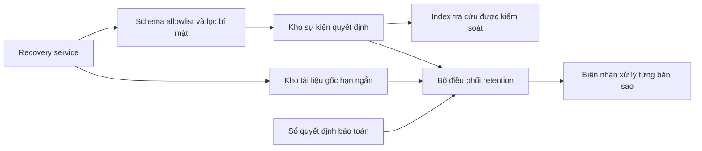
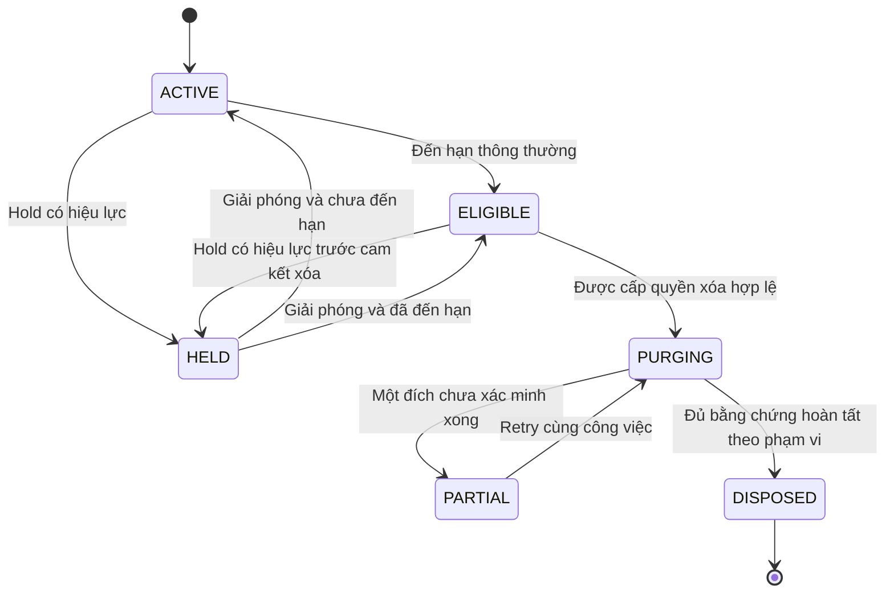

# Evidence retention policy — Chính sách lưu giữ bằng chứng khôi phục tài khoản

## 1. Vì sao recovery cần một chính sách lưu giữ riêng?

Một yêu cầu khôi phục tài khoản có thể bắt đầu bằng việc quên mật khẩu, mất điện thoại chứa MFA, mất passkey hoặc không còn thiết bị xác thực. Sau khi xử lý, hệ thống cần giải thích được: yêu cầu nào đã đến, những kiểm tra nào đã diễn ra, ai phê duyệt ngoại lệ, authenticator nào bị thay thế và các session cũ được xử lý ra sao.

Trong module `SECURITY_AUTHENTICATION_ACCOUNT_RECOVERY`, **evidence retention policy** là tập quy tắc về việc tạo, giữ, sử dụng, bảo vệ và loại bỏ bằng chứng của các quyết định đó. Chính sách phải phục vụ cả hai tình huống: chứng minh một recovery hợp lệ và điều tra một lần chiếm đoạt tài khoản qua recovery.

Ví dụ, người dùng báo: “Tôi chưa từng yêu cầu gỡ MFA vào ngày hôm qua”. Một dòng log `recovery_success=true` không giải thích được chuyện gì đã xảy ra. Ngược lại, giữ toàn bộ request body, ảnh giấy tờ, OTP và đường dẫn reset trong một kho không có ngày hết hạn tạo ra một mục tiêu tấn công mới.

Bài học này hướng tới khả năng thiết kế một hồ sơ đủ để tái dựng quyết định, đồng thời giới hạn dữ liệu và thời gian lưu theo mục đích đã xác định.

### 1.1. Bốn khái niệm cần phân biệt

| Khái niệm | Câu hỏi được trả lời | Ví dụ trong recovery |
|---|---|---|
| Thời gian hiệu lực | Sau thời điểm nào dữ liệu không còn được dùng để thực hiện hành động? | Reset token hết hạn sau một khoảng ngắn |
| Thời gian lưu vận hành | Hệ thống cần giữ trạng thái làm việc đến khi nào? | Challenge đã dùng được giữ ngắn hạn để xử lý retry |
| Thời gian lưu bằng chứng | Cần giữ dữ liệu nào để giải thích hoặc điều tra quyết định? | Sự kiện token được tiêu thụ, phiên bản policy |
| Thời gian bảo toàn đặc biệt | Hồ sơ nào phải tạm ngừng xóa vì một căn cứ cụ thể? | Hồ sơ liên quan vụ tranh chấp đang được bảo toàn |

Token hết hạn không có nghĩa mọi bằng chứng phải biến mất ngay. Ngược lại, việc giữ sự kiện trong hồ sơ kiểm toán không cho phép token tiếp tục có hiệu lực.

### 1.2. Mục tiêu học tập

Sau bài này, người học cần có khả năng:

- Phân loại bằng chứng recovery và tách chúng khỏi bí mật xác thực.
- Xác định mốc bắt đầu tính hạn, thời hạn, căn cứ và người chịu trách nhiệm.
- Thiết kế legal hold có phạm vi, hạn chế truy cập và quy trình giải phóng.
- Triển khai vòng đời dữ liệu xuyên database, object storage, log, bản sao và nhà cung cấp.
- Chứng minh được cả việc đã giữ đúng bằng chứng lẫn việc đã xóa đúng phạm vi.

## 2. Cơ sở để xây dựng policy

Không có một con số duy nhất phù hợp với mọi bằng chứng recovery. Phải xác định phạm vi dịch vụ, khu vực pháp lý, nghĩa vụ áp dụng, mục đích xử lý và rủi ro trước khi chọn thời hạn.

Theo phần “Records Retention Policy” của NIST SP 800-63B-4, verifier phải tuân thủ các yêu cầu lưu giữ áp dụng; khi lựa chọn giữ hồ sơ ngoài yêu cầu bắt buộc, cần đánh giá rủi ro riêng tư, an ninh để xác định thời gian và thông báo chính sách cho subscriber. Tài liệu này không đặt một thời hạn chung cho mọi hồ sơ recovery. [NIST SP 800-63B-4](https://pages.nist.gov/800-63-4/sp800-63b.html#records-retention-policy)

Nếu GDPR áp dụng, Điều 5 liên quan đến giới hạn mục đích, tối thiểu hóa và giới hạn lưu trữ; Điều 13(2)(a) đề cập thông tin về thời gian lưu hoặc tiêu chí xác định. Điều 17 có quyền xóa và các ngoại lệ, trong đó có yêu cầu pháp lý theo điều kiện của điều luật. Không được coi nhãn nội bộ “legal hold” là ngoại lệ tự động. [GDPR — Điều 5, 13 và 17](https://eur-lex.europa.eu/eli/reg/2016/679/oj/eng)

Để chuyển các nguyên tắc đó thành thiết kế kỹ thuật, tổ chức nên duy trì một danh mục nghĩa vụ:

| Thành phần | Nội dung cần ghi |
|---|---|
| Phạm vi | Nhóm người dùng, thị trường, loại dịch vụ và dữ liệu |
| Nguồn nghĩa vụ | Văn bản, điều khoản hợp đồng hoặc quyết định nội bộ có căn cứ |
| Mục đích | Điều tra gian lận, xử lý tranh chấp, chứng minh kiểm soát |
| Loại bằng chứng | Những record class thực sự nằm trong phạm vi |
| Điều kiện thời gian | Mốc bắt đầu, thời gian tối thiểu hoặc giới hạn cần tuân thủ |
| Người xác nhận | Vai trò pháp chế, riêng tư, an ninh và chủ sở hữu dữ liệu |
| Lần rà soát | Ngày rà soát, phiên bản áp dụng và thay đổi được duyệt |

Các khoảng 14, 30, 90 hoặc 180 ngày xuất hiện bên dưới chỉ là **giả định của một hệ thống học tập**, không phải thời hạn pháp luật, NIST hoặc OWASP yêu cầu. Khi triển khai, thay chúng bằng policy đã được đánh giá cho dịch vụ cụ thể.

## 3. Phân loại bằng chứng trước khi quyết định thời hạn

### 3.1. Danh mục dữ liệu điển hình

| Loại dữ liệu | Giá trị chứng minh | Cách xử lý trong thiết kế ví dụ |
|---|---|---|
| Yêu cầu bắt đầu recovery | Thời điểm, luồng và phạm vi tài khoản được yêu cầu | Giữ ID giao dịch, loại luồng và thời gian; hạn chế định danh trực tiếp |
| Kết quả challenge | Kiểm tra nào đã chạy và kết quả nào được hệ thống chấp nhận | Giữ mã kết quả, phương thức và phiên bản kiểm tra |
| Quyết định risk engine | Tại sao yêu cầu được cho phép, trì hoãn hoặc từ chối | Giữ reason code, policy/model version và feature tối thiểu cần giải thích |
| Phê duyệt hỗ trợ | Ai cho phép ngoại lệ và dựa trên quy trình nào | Giữ actor nội bộ, vai trò, lý do có cấu trúc và bằng chứng phê duyệt |
| Thay đổi authenticator | MFA/passkey nào được gỡ hoặc đăng ký lại | Giữ tham chiếu nội bộ phù hợp; tránh sao chép vật liệu khóa |
| Thu hồi session | Những phạm vi nào đã bị thu hồi và có hoàn tất không | Giữ yêu cầu, kết quả, số lượng hoặc generation; không giữ bearer token |
| Thông báo an ninh | Hệ thống đã yêu cầu gửi và nhà cung cấp báo trạng thái gì | Giữ template version, kênh và trạng thái; không giữ reset URL |
| Tài liệu xác minh gốc | Nội dung được dùng trong một bước xác minh tăng cường | Nếu thực sự cần thu thập, lưu riêng với hạn và quyền chặt hơn |
| Lịch sử truy cập bằng chứng | Ai xem, xuất hoặc thay đổi quyền bảo toàn | Giữ thành một loại hồ sơ có policy riêng |
| Biên nhận xóa | Bản sao nào được xử lý, khi nào và kết quả | Giữ tối thiểu để chứng minh thao tác, không sao chép lại payload |

Không phải hệ thống recovery nào cũng cần giấy tờ hoặc sinh trắc học. Mất mật khẩu hay MFA không tự tạo ra nhu cầu thu thập căn cước. Policy lưu giữ không được biến một phương án xác minh ít dữ liệu thành quy trình thu thập giấy tờ mặc định.

### 3.2. Dữ liệu không đưa vào hồ sơ evidence thông thường

Một schema evidence nên chủ động loại bỏ:

- Mật khẩu cũ hoặc mới, OTP, recovery code và khóa bí mật MFA.
- Reset token, magic link hoàn chỉnh, cookie và access/refresh token.
- Request/response body không lọc của endpoint recovery.
- Ảnh giấy tờ, video xác minh hoặc mẫu sinh trắc học trong log, trace và ticket hỗ trợ.
- Dữ liệu người dùng tự nhập không có giới hạn hoặc chưa xử lý ký tự điều khiển.

OWASP khuyến nghị loại bỏ hoặc bảo vệ phù hợp các bí mật và dữ liệu nhạy cảm trong log, hạn chế truy cập và theo dõi việc sử dụng log. Bài này áp dụng nguyên tắc đó bằng schema cho phép rõ từng field thay vì ghi toàn bộ đối tượng HTTP. [OWASP Logging Cheat Sheet — Data to exclude và Protection](https://cheatsheetseries.owasp.org/cheatsheets/Logging_Cheat_Sheet.html#data-to-exclude)

Nếu cần đối chiếu việc sử dụng token, tạo `challengeId` ngẫu nhiên không có quyền xác thực. Kho vận hành giữ verifier cần thiết cho kiểm tra token trong vòng đời ngắn của nó; kho audit chỉ ghi sự kiện gắn với `challengeId`. Không đưa token thô vào audit để “dễ tra cứu”.

### 3.3. Dữ liệu gốc và bản kết luận có thể có hạn khác nhau

Giả sử một quy trình xác minh đặc biệt cần nhận tài liệu qua một nhà cung cấp. Sau bước kiểm tra, dịch vụ có thể cần:

- Kết quả `VERIFICATION_ACCEPTED`.
- Tham chiếu giao dịch của nhà cung cấp.
- Phiên bản quy trình được áp dụng.
- Thời điểm và người phê duyệt nếu có ngoại lệ.

Các field này có thể đủ để chứng minh đã thực hiện kiểm tra, trong khi tài liệu gốc được xóa sớm hơn theo policy tương ứng. Tuy nhiên, không được mặc định rằng một kết quả boolean luôn đủ cho mọi tranh chấp. Phải đánh giá mức giải thích cần có và khả năng lấy bằng chứng từ nhà cung cấp trong thời hạn hợp lệ.

## 4. Thiết kế một retention schedule có thể thực thi

### 4.1. Mỗi dòng policy phải trả lời đủ câu hỏi

Một retention rule có thể biểu diễn bằng bộ:

```text
(recordClass, purpose, scope, trigger, duration,
 deletionDeadline, holdBehavior, policyVersion, owner)
```

Trong đó:

- `recordClass`: loại bằng chứng, không phải tên bảng ngẫu nhiên.
- `purpose`: mục đích đã được xác định, có thể kèm căn cứ áp dụng.
- `scope`: tenant, khu vực, sản phẩm hoặc nhóm người dùng liên quan.
- `trigger`: sự kiện bắt đầu tính thời gian.
- `duration`: khoảng lưu thông thường.
- `deletionDeadline`: thời điểm hoặc độ trễ tối đa để hoàn tất xử lý hết hạn.
- `holdBehavior`: cách nhận và kiểm tra quyết định bảo toàn.
- `policyVersion`: phiên bản dùng để giải thích lịch đã tính.
- `owner`: người chịu trách nhiệm và phê duyệt ngoại lệ.

Một database TTL chỉ giải quyết được một phần nhỏ của bộ này.

### 4.2. Chọn trigger cho đúng bản chất hồ sơ

| Loại hồ sơ | Trigger phù hợp có thể dùng | Sai lầm thường gặp |
|---|---|---|
| Sự kiện kiểm tra thất bại độc lập | `eventOccurredAt` | Tính từ lần dashboard được mở |
| Hồ sơ recovery có xử lý thủ công | `caseClosedAt` | Tính từ lúc tạo rồi xóa khi case còn đang xử lý |
| Tài liệu gốc phục vụ xác minh | Mốc hoàn tất hoặc chấm dứt bước xác minh theo policy | Reset hạn mỗi lần nhân viên xem |
| Quyết định phê duyệt | Thời điểm quyết định hoặc đóng hồ sơ, được quy định rõ | Sửa `updatedAt` làm kéo dài vô hạn |
| Export cho điều tra | Thời điểm tạo hoặc đóng mục đích xuất | Quên rằng export cũng là một bản sao có vòng đời |
| Biên nhận xóa | Thời điểm hoàn tất công việc xóa | Lưu biên nhận mãi không có chính sách |

Nếu chọn `caseClosedAt`, phải có quy trình đóng yêu cầu bị bỏ dở, giới hạn tuổi hồ sơ đang mở và cơ chế cảnh báo. “Chưa đóng” không được trở thành cách giữ dữ liệu vô thời hạn.

Thời điểm do máy khách gửi không nên là nguồn duy nhất để xác định hạn. Hệ thống cần thời gian nhận do server ghi, thời điểm sự kiện nếu đáng tin cậy và thông tin sai lệch khi nguồn bị trễ. Dữ liệu đến muộn không tự được hưởng thêm nguyên một chu kỳ lưu nếu policy tính theo thời điểm phát sinh.

### 4.3. Bảng lịch lưu minh họa

Giả định một dịch vụ đã đánh giá các mục đích bên dưới và chưa có yêu cầu áp dụng khác:

| Record class | Mục đích | Mốc tính | Khoảng lưu minh họa |
|---|---|---|---|
| `RECOVERY_CHALLENGE_EVENT` | Tra cứu retry và lạm dụng gần đây | Thời điểm sự kiện | 30 ngày |
| `RECOVERY_DECISION` | Giải thích quyết định và xử lý tranh chấp | Đóng hồ sơ | 180 ngày |
| `RAW_VERIFICATION_ARTIFACT` | Phục vụ bước kiểm tra đặc biệt | Kết thúc xác minh | 14 ngày |
| `SECURITY_NOTIFICATION_EVENT` | Đối chiếu thông báo | Thời điểm sự kiện | 90 ngày |
| `EVIDENCE_EXPORT` | Phục vụ một yêu cầu điều tra đã duyệt | Thời điểm xuất | 7 ngày, trừ phạm vi bảo toàn đã duyệt |
| `DISPOSAL_RECEIPT` | Chứng minh thi hành policy | Hoàn tất xóa | 180 ngày với payload tối thiểu |

Bảng này là ví dụ thiết kế. Không áp dụng các con số chỉ vì chúng có vẻ phổ biến. Dữ liệu bị từ chối, tài khoản không tồn tại và yêu cầu bị lạm dụng cũng cần rule rõ ràng; không chỉ các ca recovery thành công mới có thời hạn.

### 4.4. Tính hạn và xử lý xung đột

Với một rule đơn giản:

```text
normalDeleteAfter = triggerAt + approvedDuration
```

Nếu có thời hạn giữ tối thiểu hoặc hạn xóa bắt buộc, hệ thống phải kiểm tra tính khả thi của các ràng buộc đã được xác nhận. Không gom mọi nghĩa vụ vào một phép `max()` rồi coi như đã giải quyết.

Ví dụ, một nhóm yêu cầu giữ 180 ngày, nhóm khác yêu cầu loại bỏ cùng dữ liệu sau 30 ngày. Cần xem hai nhóm có thực sự nói về cùng field, cùng mục đích, cùng đối tượng và cùng khu vực hay không. Có thể tách payload gốc khỏi quyết định đã giảm dữ liệu; cũng có thể cần người có thẩm quyền giải quyết xung đột. Công cụ retention không tự diễn giải luật.

Khi policy thay đổi, version mới phải nêu rõ cách xử lý hồ sơ đang tồn tại. Không âm thầm kéo dài toàn bộ dữ liệu cũ. Việc rút ngắn cần một đợt migration có kiểm tra hold, dry run và xác minh kết quả; không chỉ đổi TTL của bảng sản xuất.

## 5. Mô hình dữ liệu bằng chứng

### 5.1. Một record minh họa

Ví dụ JSON dưới đây chỉ dùng giá trị giả:

```json
{
  "evidenceId": "ev_demo_841",
  "schemaVersion": 1,
  "tenantId": "tenant_demo",
  "subjectRef": "subj_random_275",
  "recoveryCaseId": "rc_demo_542",
  "recordClass": "RECOVERY_DECISION",
  "purposeCode": "RECOVERY_DISPUTE_REVIEW",
  "eventType": "RECOVERY_APPROVED",
  "occurredAt": "2026-11-24T02:10:00Z",
  "receivedAt": "2026-11-24T02:10:01Z",
  "caseClosedAt": "2026-11-24T02:20:00Z",
  "decision": {
    "outcome": "APPROVED",
    "reasonCodes": ["REGISTERED_CHANNEL_CONFIRMED"],
    "recoveryPolicyVersion": "recovery-policy-v7",
    "verifierVersion": "channel-verifier-v3"
  },
  "retentionPolicyVersion": "retention-demo-v2",
  "deleteAfter": "2027-05-23T02:20:00Z",
  "dispositionState": "ACTIVE",
  "revision": 1
}
```

`subjectRef` là tham chiếu giả danh được quản lý riêng, không phải email được băm trực tiếp. Có thể cần một mapping để xử lý yêu cầu hợp lệ của chủ thể hoặc điều tra có thẩm quyền. Khi còn có thể liên kết, dữ liệu giả danh vẫn cần được bảo vệ; thay tên bằng mã không tự biến hồ sơ thành dữ liệu ẩn danh.

Nếu dùng HMAC để tạo một số mã tương quan, phải có mục đích, phạm vi tenant, quản lý khóa và hạn cho chính dữ liệu tương quan. Băm email thuần túy có thể bị dò từ tập email dự đoán được.

### 5.2. Tách sự kiện bất biến và metadata điều phối

Nên phân biệt:

- **Nội dung sự kiện**: mô tả điều gì đã xảy ra, ghi theo cách có thể phát hiện sửa đổi.
- **Metadata vòng đời**: trạng thái xóa, phiên bản lịch lưu, tham chiếu hold, tiến độ xử lý từng bản sao.
- **Nhật ký thay đổi metadata**: ai đổi lịch, theo phê duyệt nào, giá trị trước và sau.

Nếu cập nhật `deleteAfter` mà không giữ dấu vết, tổ chức không thể giải thích tại sao cùng một loại record lại có các hạn khác nhau. Nếu nhét mọi metadata vào object bị khóa bất biến dài hạn, việc điều phối xóa và đáp ứng thay đổi hợp lệ sẽ khó hơn.

### 5.3. Tách các vùng lưu trữ

Một kiến trúc minh họa:



Kho tài liệu gốc không nên dùng chung quyền đọc với dashboard vận hành. Nhân viên hỗ trợ có thể cần thấy “đã xác minh qua kênh đăng ký” mà không cần xem tài liệu gốc hoặc chi tiết phiên xác thực.

## 6. Bảo vệ giá trị chứng minh của hồ sơ

Bằng chứng hữu ích phải phản ánh đúng giới hạn quan sát. Một webhook “đã giao email” chỉ chứng minh trạng thái nhà cung cấp báo về, không chứng minh người dùng chính chủ đã đọc email. Tương tự, chấp nhận một challenge chỉ chứng minh kiểm tra đó đã vượt qua; không tự chứng minh người thao tác là chủ sở hữu hợp pháp trong mọi tình huống.

### 6.1. Ghi đủ ngữ cảnh để tái dựng quyết định

Đối với một recovery nhạy cảm, một timeline có thể gồm:

1. Yêu cầu bắt đầu, loại recovery và ID giao dịch.
2. Các kiểm tra được yêu cầu, phương thức và mã kết quả.
3. Phiên bản policy, quyết định trì hoãn hoặc tăng cường xác minh.
4. Phê duyệt ngoại lệ nếu có, người thực hiện và người phê duyệt.
5. Thay đổi mật khẩu, MFA hoặc passkey được chấp nhận.
6. Yêu cầu thu hồi session và kết quả thực tế.
7. Thông báo an ninh và trạng thái quan sát được.
8. Đóng hồ sơ, policy retention áp dụng và lịch xử lý.

Không nên suy ra bước 6 đã hoàn tất chỉ vì bước 5 thành công. Nếu thao tác thu hồi chạy bất đồng bộ, evidence phải thể hiện cả yêu cầu lẫn kết quả hoặc trạng thái còn thiếu.

### 6.2. Toàn vẹn, nguồn gốc và thời gian

Có thể kết hợp phân quyền ghi, append-only, checksum, chữ ký theo lô, timestamp do nguồn tin cậy tạo và manifest xuất. Mỗi cơ chế giải quyết một vấn đề khác nhau.

Một hash đứng một mình không chứng minh nguồn gốc: người có thể thay file và thay hash cùng lúc vẫn giả mạo được. Hash chain có thể hỗ trợ phát hiện sửa thứ tự hoặc nội dung, nhưng cần checkpoint được bảo vệ ở nơi độc lập để phát hiện việc viết lại hoặc cắt đuôi chuỗi.

Bản ghi nên có `sourceSystem`, phiên bản schema và thời gian nhận. Đồng bộ đồng hồ giúp so sánh timeline; khi có sai lệch, cần ghi nhận mức tin cậy thay vì ép một thứ tự giả tạo.

Nếu chọn WORM hoặc object lock, phải kiểm tra trước thời gian khóa và phạm vi object. Một khóa không thể rút ngắn có thể gây khó khăn cho việc thực thi hạn xóa đã phê duyệt. Không đặt tài liệu gốc và sự kiện tối thiểu có thời hạn khác nhau vào cùng một object khóa dài hạn.

### 6.3. Truy cập và chain of custody

Mỗi lần xem hoặc xuất hồ sơ cần gắn với người yêu cầu, tenant, mục đích và phạm vi được duyệt. Tác vụ xuất nên tạo manifest gồm ID bằng chứng, thời điểm, người xuất, bộ lọc, checksum, nơi nhận được phép và hạn của bản xuất.

Chuỗi bàn giao này hỗ trợ giải thích hồ sơ đã đi qua đâu, nhưng không thay thế việc đánh giá giá trị pháp lý trong từng bối cảnh. Bản xuất để điều tra cũng phải có kiểm soát truy cập, bảo vệ khi truyền và lịch xử lý sau khi mục đích kết thúc.

Không mở quyền xem evidence chỉ vì một tài khoản vừa hoàn tất recovery. Kẻ đã chiếm đoạt tài khoản có thể dùng quyền đó để xem thông tin điều tra hoặc xóa dấu vết. Các yêu cầu truy cập, xuất hoặc xóa bằng chứng cần quy trình xác minh và phân quyền tương ứng.

## 7. Legal hold: bảo toàn có phạm vi và có điểm kết thúc

**Legal hold** trong thiết kế này là quyết định có thẩm quyền yêu cầu tạm ngừng tiêu hủy những dữ liệu xác định để phục vụ một vấn đề cụ thể. Hệ thống phải nhận quyết định và phạm vi đã được xác nhận; không tự tạo căn cứ pháp lý từ một cờ boolean.

Một hold cần ít nhất:

| Field | Ý nghĩa |
|---|---|
| `holdId` | Định danh quyết định bảo toàn |
| `matterRef` | Tham chiếu vụ việc, không ghi toàn bộ nội dung nhạy cảm vào log |
| `scope` | Tenant, hồ sơ, loại dữ liệu và khoảng thời gian liên quan |
| `authorityRef` | Phê duyệt hoặc căn cứ được tổ chức xác minh |
| `activatedAt` | Mốc hold bắt đầu có hiệu lực |
| `custodian` | Vai trò chịu trách nhiệm bảo toàn |
| `reviewAt` | Ngày phải rà soát |
| `releasedAt` | Mốc kết thúc khi đã được giải phóng hợp lệ |
| `accessRestriction` | Ai được dùng dữ liệu và cho mục đích nào |

### 7.1. Hold tác động đến xóa, không kéo dài quyền xác thực

Bảo toàn hồ sơ không giữ cho reset token, recovery code hoặc session tiếp tục hoạt động. Các bí mật vẫn phải hết hạn, bị tiêu thụ hoặc bị thu hồi theo luồng xác thực.

Không giữ tất cả lịch sử của một tenant nếu quyết định chỉ liên quan đến một hồ sơ. Không dùng hồ sơ đang hold để thử nghiệm sản phẩm hoặc huấn luyện mô hình chỉ vì dữ liệu vẫn tồn tại. Mọi cách sử dụng tiếp cần được xét theo mục đích và quyền phù hợp.

### 7.2. Nhiều hold và việc giải phóng

Một record có thể nằm trong nhiều hold. Xóa một hold không được gỡ các hold còn lại. Khi hold cuối cùng được giải phóng, tính lại điều kiện xử lý theo lịch thông thường đã được duyệt.

Nếu hạn thông thường đã qua, record trở thành ứng viên xử lý ngay theo quy trình, không mặc định được cộng lại 180 ngày từ ngày giải phóng. Nếu tổ chức thực sự cần một khoảng sau khi kết thúc vụ việc, đó phải là một rule riêng có căn cứ và version, không phải hành vi ngầm của code.

Hồ sơ hold quá hạn rà soát cần cảnh báo và người xử lý. Không tự giải phóng chỉ vì người phụ trách nghỉ việc hoặc trường `reviewAt` đã qua.

### 7.3. Chặn race giữa hold và xóa

Trình tự “đọc `hold=false`, sau đó xóa” có thể mất bằng chứng nếu một hold được kích hoạt ở giữa. Thiết kế phải có điểm quyết định rõ ràng:

- Việc nhận hold và cấp quyền xóa phải được tuần tự hóa theo cùng phạm vi dữ liệu.
- Tác vụ xóa nhận một lease hoặc quyền xử lý có version, chỉ có hiệu lực trong khoảng ngắn.
- Hold được xác nhận có hiệu lực phải chặn quyền xóa chưa cam kết và kiểm soát công việc đang chạy.
- Nếu xóa đã cam kết trước khi nhận hold, hệ thống phải báo chính xác dữ liệu còn lại; không báo bảo toàn thành công đối với dữ liệu không còn.

Khi nhiều kho vật lý không hỗ trợ cùng một transaction, bộ điều phối cần trạng thái bền vững và quy tắc ưu tiên đã xác định. Việc kiểm tra thêm lần nữa là hữu ích, nhưng không tự thay thế được một giao thức xử lý cạnh tranh.

## 8. Vòng đời xóa phải bao phủ toàn bộ bản sao

Một câu lệnh xóa khỏi bảng chính không đủ nếu cùng bằng chứng vẫn nằm trong index, object version, log xử lý lỗi, ticket hỗ trợ, export hoặc kho của nhà cung cấp.

### 8.1. Các trạng thái nên phân biệt



Đây là mô hình khái niệm. Một triển khai thực tế còn cần trạng thái lỗi, lease hết hạn và xử lý hold trong công việc nhiều đích. Không đánh dấu `DISPOSED` khi mới gửi yêu cầu xóa hoặc chỉ nhận HTTP 202.

### 8.2. Quy trình xử lý một record đến hạn

Một công việc xóa có thể thực hiện theo trình tự:

1. Chọn ứng viên bằng `deleteAfter`, loại dữ liệu và phạm vi tenant.
2. Kiểm tra policy version, trạng thái hồ sơ, các hold và yêu cầu hạn chế xử lý liên quan.
3. Nhận quyền xử lý có kiểm soát cạnh tranh từ bộ điều phối.
4. Chặn truy cập thông thường đối với dữ liệu đang được loại bỏ.
5. Xử lý các bản sao trong manifest: database, object, index, cache, export được quản lý và provider.
6. Ghi kết quả riêng cho từng đích, retry các đích lỗi theo cùng `jobId`.
7. Xác minh điều kiện hoàn tất; phát hành biên nhận tối thiểu.
8. Cập nhật trạng thái cuối cùng và đóng công việc.

Bước 4 là hạn chế truy cập trong thời gian chuyển tiếp, không tự chứng minh dữ liệu đã được xóa vật lý. Bước 7 phải dùng tiêu chí phù hợp với từng đích, không chỉ dựa vào trạng thái nội bộ của worker.

Một worker crash sau khi xóa object nhưng trước khi cập nhật database phải có thể retry an toàn. `NOT_FOUND` có thể được chấp nhận như trạng thái đã không còn tại một đích nếu truy vấn đúng object, đúng tenant và có quyền kiểm tra; lỗi xác thực hoặc timeout không được biến thành `NOT_FOUND`.

### 8.3. Đối chiếu từng nơi dữ liệu có thể tồn tại

| Nơi lưu | Điều cần xử lý |
|---|---|
| Database chính và read replica | Xóa bản ghi, kiểm tra propagation và giới hạn truy cập trong lúc chờ |
| Object storage | Xem xét mọi version, bản sao vùng khác, bản đang khóa và upload chưa hoàn tất |
| Search index | Loại document, đoạn trích và index phục vụ tìm kiếm phụ |
| Cache | Hủy entry và tránh nguồn cũ nạp trở lại sau khi đã xóa |
| Queue hoặc dead-letter queue | Giới hạn payload, hạn lưu và cơ chế ngăn replay phục hồi dữ liệu đã loại bỏ |
| Log, trace, error report | Ngăn dữ liệu nhạy cảm đi vào từ đầu; có vòng đời cho dữ liệu đã thu thập |
| Support ticket | Quản lý attachment và bản sao do nhân viên tải lên |
| Kho nhà cung cấp | Yêu cầu xóa, trạng thái xử lý, subprocessor trong phạm vi cần kiểm soát |
| Export, email hoặc file bàn giao | Quy định nơi nhận và việc xử lý sau mục đích xuất |
| Backup | Lịch hết hạn, quyền truy cập và cơ chế xử lý khi restore |

OWASP nêu rằng thời hạn xử lý phải bao gồm log, debug log và các bản sao, bản trích xuất, backup liên quan. Vì vậy, trong thiết kế này manifest phải theo dõi các đích, thay vì coi bảng chính là toàn bộ dữ liệu. [OWASP Logging Cheat Sheet — Disposal of logs](https://cheatsheetseries.owasp.org/cheatsheets/Logging_Cheat_Sheet.html#disposal-of-logs)

### 8.4. Hạn xóa và độ trễ của tác vụ

Nếu policy quy định dữ liệu phải được loại bỏ chậm nhất tại một thời điểm, scheduler phải chạy đủ sớm để dành thời gian cho propagation, provider bất đồng bộ và retry. Không được tự cộng thêm 24 giờ sau hạn rồi coi đó là thời gian lưu mới.

Một hệ thống cần đo ít nhất hai mốc:

```text
logicalInaccessibilityAt = thời điểm ngừng phục vụ dữ liệu theo quyền thông thường
verifiedDispositionAt   = thời điểm xác minh xong các nghĩa vụ xử lý đã định
```

Các tên này thể hiện mức hoàn tất khác nhau. Nếu còn một bản backup bị cách ly và đang chờ hết vòng đời, trạng thái và thông tin cung cấp phải phản ánh thực tế đó.

## 9. Backup, restore và xóa bằng mật mã

### 9.1. Không hứa “đã xóa mọi nơi” khi còn bản sao phục hồi

Một số cơ chế backup không cho phép sửa từng record mà vẫn giữ nguyên tính toàn vẹn của bản backup. Cách xử lý phải được đánh giá trong policy và nghĩa vụ áp dụng; không mặc định mọi backup đều được miễn yêu cầu xóa.

Một thiết kế có thể gồm:

- Backup được cách ly khỏi việc phục vụ hoặc phân tích thông thường.
- Có hạn vòng đời được phê duyệt, không gia hạn tự động ngoài mục đích phục hồi.
- Danh sách loại bỏ tối thiểu được quản lý để xử lý dữ liệu trước khi mở lại dịch vụ sau restore.
- Diễn tập restore để kiểm tra dữ liệu đã loại bỏ không quay trở lại index, cache hoặc portal.
- Theo dõi backup còn nằm trong hold và xử lý xung đột trước khi hết hạn.

Danh sách loại bỏ cũng là một loại dữ liệu. Nó cần thời hạn đủ bao phủ cửa sổ restore và độ trễ replay liên quan, cùng giới hạn định danh, quyền truy cập và policy riêng. Một danh sách có email nguyên văn được giữ mãi sẽ tái tạo vấn đề mà cơ chế xóa đang cố giải quyết.

### 9.2. Quy trình restore minh họa

```text
Khôi phục vào môi trường cách ly
    -> nạp các quyết định loại bỏ và hold còn hiệu lực
    -> tính lại dữ liệu nào đã quá hạn
    -> xử lý dữ liệu phải loại bỏ trước khi đưa vào phục vụ
    -> tái tạo index/cache từ tập đã lọc
    -> xác minh quyền truy cập và kết quả
    -> mới cho phép nhận traffic
```

Không được dùng backup làm nguồn để “tìm lại bằng chứng” ngoài thẩm quyền và policy. Một yêu cầu hold mới không thể khiến dữ liệu đã biến mất ở mọi bản sao xuất hiện trở lại.

### 9.3. Xóa bằng mật mã có điều kiện

Hủy khóa có thể hỗ trợ loại bỏ khả năng đọc ciphertext khi kiến trúc khóa và quản lý bản sao đáp ứng yêu cầu. Muốn tuyên bố điều đó, cần biết:

- Dữ liệu nào dùng khóa nào, có dùng chung với record còn cần giữ không.
- Có bản plaintext, index chứa nội dung, export hoặc cache đã giải mã hay không.
- Có bản sao khóa, khóa bọc, bản backup khóa hoặc cơ chế phục hồi ở đâu.
- Trạng thái hủy là đã hoàn tất hay chỉ mới lên lịch chờ.
- Có hold nào áp dụng cho dữ liệu cùng khóa không.

Nếu một khóa mã hóa toàn bộ tenant, hủy nó để xóa một hồ sơ có thể phá hủy cả bằng chứng đang cần bảo toàn. Nếu khóa vẫn phục hồi được, không nên ghi “cryptographically erased” chỉ vì đã gọi API lập lịch hủy.

Mã hóa là lớp bảo vệ quan trọng, nhưng ciphertext có thể giải mã được vẫn là dữ liệu đang được giữ trong mô hình này.

## 10. Ví dụ Java: đánh giá điều kiện trước khi điều phối xóa

Ví dụ sau dùng Java 17 trở lên. Đây là một hàm thuần minh họa **quyết định sơ bộ**, không thực hiện xóa và không tự giải quyết race với legal hold. Việc thu hồi quyền truy cập, cấp lease và xử lý bản sao thuộc bộ điều phối riêng.

```java
import java.time.Instant;
import java.util.Objects;

public final class EvidenceRetention {
    private EvidenceRetention() {
    }

    public enum HoldState {
        CLEAR,
        ACTIVE,
        UNKNOWN
    }

    public enum Action {
        RETAIN,
        RETAIN_UNDER_HOLD,
        REVIEW_REQUIRED,
        REQUEST_PURGE_LEASE
    }

    public record Snapshot(
            String tenantId,
            String evidenceId,
            Instant deleteAfter,
            String retentionPolicyVersion,
            long revision,
            HoldState holdState
    ) {
    }

    public record Evaluation(Action action, String reasonCode) {
    }

    public static Evaluation evaluate(
            Snapshot snapshot,
            String authorizedTenant,
            String approvedPolicyVersion,
            Instant now
    ) {
        Objects.requireNonNull(snapshot, "snapshot");
        Objects.requireNonNull(now, "now");

        if (authorizedTenant == null
                || !authorizedTenant.equals(snapshot.tenantId())) {
            throw new SecurityException("TENANT_SCOPE_MISMATCH");
        }

        if (snapshot.evidenceId() == null
                || snapshot.evidenceId().isBlank()
                || snapshot.deleteAfter() == null
                || snapshot.revision() < 0
                || approvedPolicyVersion == null
                || !approvedPolicyVersion.equals(
                        snapshot.retentionPolicyVersion())) {
            return new Evaluation(
                    Action.REVIEW_REQUIRED, "INVALID_RETENTION_METADATA");
        }

        if (snapshot.holdState() == null
                || snapshot.holdState() == HoldState.UNKNOWN) {
            return new Evaluation(
                    Action.REVIEW_REQUIRED, "HOLD_STATUS_UNAVAILABLE");
        }

        if (snapshot.holdState() == HoldState.ACTIVE) {
            return new Evaluation(
                    Action.RETAIN_UNDER_HOLD, "ACTIVE_HOLD");
        }

        if (now.isBefore(snapshot.deleteAfter())) {
            return new Evaluation(
                    Action.RETAIN, "WITHIN_RETENTION_WINDOW");
        }

        return new Evaluation(
                Action.REQUEST_PURGE_LEASE, "RETENTION_WINDOW_ENDED");
    }
}
```

Các điểm cần đọc đúng:

- `now` được truyền vào để có thể mô tả và kiểm tra ranh giới thời gian rõ ràng; không dựa vào đồng hồ máy khách.
- Hàm coi `now == deleteAfter` là đã đến hạn, phù hợp với quy ước “giữ trước mốc này”.
- Thiếu dữ liệu hoặc không xác định được hold dẫn đến một công việc cần xử lý, không tự xóa.
- `REQUEST_PURGE_LEASE` chỉ là yêu cầu đến bộ điều phối. Snapshot có thể đã cũ ngay sau khi hàm trả về.
- Policy version được so với rule đã phê duyệt cho record tương ứng, không nhất thiết là version mới nhất toàn hệ thống.

Một hệ thống vận hành phải có SLO xử lý `REVIEW_REQUIRED`, cảnh báo và người phụ trách. Chọn tạm giữ khi mất metadata có thể tránh mất bằng chứng, nhưng không cho phép giữ vô hạn hoặc bỏ qua hạn xóa.

### 10.1. Hợp đồng tối thiểu của bộ điều phối

Tác vụ tiếp theo có thể mang:

```text
tenantId
evidenceId
expectedRevision
retentionPolicyVersion
jobId
requestedAt
```

Bộ điều phối cần xác nhận snapshot vẫn đúng, không có hold chặn thao tác và worker chỉ có quyền với tenant đó. Khi cấp quyền xử lý, nó phải gắn với revision hoặc fencing token để một worker cũ không tiếp tục sau khi đã mất quyền.

Đối với object storage hoặc provider bên ngoài, quyền truy cập phải đủ hẹp, object key được lấy từ manifest đáng tin cậy và giao thức hold phải bao phủ thời điểm thực sự cam kết xóa. Không thể chỉ đặt một `if` trước lời gọi API rồi tuyên bố đã loại bỏ race.

### 10.2. Idempotency và lỗi từng phần

Giả sử job đã xóa database và index nhưng provider chưa phản hồi:

```text
jobId=purge_demo_41
database=VERIFIED_REMOVED
searchIndex=VERIFIED_REMOVED
provider=AWAITING_CONFIRMATION
overall=PARTIAL
```

Lần retry phải tiếp tục đúng job và đúng đích chưa hoàn tất. Nó không được tạo thêm export “để dự phòng”, không mở lại dữ liệu đã bị chặn và không ghi lại tài liệu gốc trong thông báo lỗi.

Một công việc ở trạng thái `PARTIAL` cần được rà soát nếu vượt thời gian cho phép. Việc các đích đầu tiên thành công không làm biến mất nghĩa vụ với đích còn lại.

## 11. Quyền của người dùng, yêu cầu xóa và thông báo retention

Khi nhận một yêu cầu xem hoặc xóa dữ liệu, hệ thống cần nhận diện đúng phạm vi dữ liệu, thẩm quyền và căn cứ xử lý. Trong account recovery, đây còn là vấn đề chống chiếm đoạt: một người vừa lấy lại quyền truy cập bằng một luồng bị nghi ngờ không nên có thể yêu cầu xóa ngay toàn bộ dấu vết của chính luồng đó mà không qua kiểm tra phù hợp.

Một quy trình kỹ thuật có thể gồm:

1. Xác minh yêu cầu qua kênh phù hợp và liên kết với hồ sơ xử lý riêng.
2. Xác định các loại bằng chứng và bản sao liên quan.
3. Áp dụng quyết định về phạm vi xóa, hạn chế sử dụng hoặc tiếp tục giữ đã được người có thẩm quyền đánh giá.
4. Tách dữ liệu được phép xóa khỏi dữ liệu còn cần giữ theo căn cứ đã xác định.
5. Điều phối xử lý và trả kết quả phản ánh đúng mức hoàn tất.
6. Lưu bằng chứng tối thiểu về việc đã xử lý yêu cầu, với hạn riêng.

Không coi mọi yêu cầu xóa là lý do để bỏ qua hold. Cũng không coi mọi nghi ngờ gian lận là lý do để từ chối xóa mọi dữ liệu. Thiết kế cần thể hiện quyết định theo từng loại dữ liệu và phạm vi thay vì một cờ “đã xóa tài khoản”.

Thông báo cho người dùng nên giải thích bằng ngôn ngữ dễ hiểu:

- Những nhóm dữ liệu được tạo trong quy trình recovery.
- Mục đích sử dụng và cách xác định thời gian lưu.
- Việc có thể dùng đơn vị xác minh hoặc nhà cung cấp khác.
- Kênh yêu cầu và cơ chế xử lý trường hợp có căn cứ tiếp tục giữ.

Không cần đưa thuật toán chấm điểm rủi ro hoặc đường dẫn nội bộ vào thông báo. Tuy nhiên, thông báo cũng không nên hứa “xóa ngay toàn bộ” trong khi kiến trúc thực tế còn có backup, export hoặc thủ tục đánh giá phạm vi.

## 12. Hệ thống nhiều tenant và nhà cung cấp bên ngoài

### 12.1. Tenant là một phần của mọi thao tác

Trong nền tảng nhiều tenant, `evidenceId` không nên là điều kiện truy vấn duy nhất. Người dùng hoặc worker của tenant A không được xem, xuất, đặt hold hoặc xóa hồ sơ của tenant B.

Kiểm soát phạm vi phải có ở API, truy vấn, object key, lease, job queue và manifest. Một cron job có quyền quản trị toàn bộ cần được chia thành tác vụ có phạm vi rõ để giảm khả năng một cấu hình sai tác động tất cả tenant.

Cấu hình do tenant nhập cần nằm trong giới hạn đã được nền tảng phê duyệt. Không cho tenant tự đặt “0 ngày” để loại bỏ bằng chứng đang có nghĩa vụ giữ, hoặc “vĩnh viễn” cho mọi tài liệu gốc mà không được đánh giá.

### 12.2. Provider receipt và trách nhiệm đối chiếu

Một phản hồi `delete_request_accepted` chỉ chứng minh nhà cung cấp nhận lệnh. Policy và hợp đồng kỹ thuật nên phân biệt tiếp nhận, hoàn tất và không còn có thể phục hồi theo phạm vi đã thỏa thuận.

Cần biết:

- Provider đang giữ payload gốc, kết quả kiểm tra hay cả hai.
- Có bản sao phụ, backup hoặc subprocessor nào trong phạm vi dịch vụ.
- Thời gian hoàn tất và cách lấy bằng chứng kết quả.
- Cách truyền hold và cách thông báo khi không thể bảo toàn.
- Điều gì xảy ra khi hợp đồng kết thúc hoặc đổi provider.

Giữ provider transaction ID trong hệ thống chính giúp đối chiếu; ID đó không nên chứa bí mật xác thực hoặc trở thành đường dẫn công khai tới tài liệu. Việc đổi provider không tự đặt lại đồng hồ retention của hồ sơ cũ.

## 13. Tình huống xuyên suốt: tranh chấp sau khi gỡ MFA

Giả sử dịch vụ học tập có hai rule minh họa:

- Tài liệu xác minh gốc: 14 ngày kể từ kết thúc xác minh.
- Hồ sơ quyết định recovery: 180 ngày kể từ khi đóng hồ sơ.

Diễn biến:

| Thời điểm giả định | Sự kiện | Tác động đến retention |
|---|---|---|
| 24/11/2026 | Người dùng báo mất thiết bị MFA; một bước xác minh đặc biệt hoàn tất | Tài liệu gốc có hạn thông thường 08/12/2026 theo giờ tương ứng |
| 24/11/2026 | Recovery được duyệt, authenticator thay đổi và hồ sơ đóng | Quyết định có hạn 180 ngày, độc lập với hạn tài liệu gốc |
| 07/12/2026 | Có tranh chấp; quyết định hold được duyệt cho đúng case | Chặn xóa các record trong phạm vi, đối chiếu cả provider |
| 08/12/2026 | Tài liệu đến hạn thông thường | Giữ dưới hold và hạn chế sử dụng, ghi lý do không xử lý xóa |
| 12/01/2027 | Hold cuối cùng được giải phóng hợp lệ | Tài liệu gốc đã quá hạn trở thành ứng viên xử lý ngay theo quy trình |
| Sau khi xử lý | Một provider chưa xác nhận hoàn tất | Hồ sơ xử lý xóa ở trạng thái một phần, có người theo dõi |

Tại ngày 12/01/2027, không tính lại 14 ngày chỉ vì hold kết thúc. Hồ sơ quyết định cũng không bị xóa cùng tài liệu gốc nếu hạn 180 ngày của nó chưa đến và không có yêu cầu hợp lệ khác làm thay đổi quyết định.

Nếu tranh chấp chỉ xuất hiện sau khi tài liệu đã bị xóa đúng lịch ở mọi nơi, hệ thống phải nói rõ giới hạn bằng chứng còn lại. Đó là lý do cần đánh giá trước giá trị của bản kết luận và khả năng tái dựng quyết định, thay vì kéo dài mọi tài liệu gốc vô thời hạn.

Khi xem xét vụ việc, đội điều tra cần nối được quyết định recovery với thay đổi MFA, kết quả thu hồi session và thông báo an ninh. Việc giữ bằng chứng không sửa được một luồng recovery vốn thiếu bước xác minh hoặc thu hồi session; nó chỉ giúp phát hiện và giải thích lỗi đó.

## 14. Những lỗi thiết kế thường gặp

| Lỗi | Hệ quả | Hướng sửa |
|---|---|---|
| Mọi dữ liệu cùng một TTL | Tài liệu nhạy cảm bị giữ dài hoặc quyết định bị xóa sớm | Phân loại và lập lịch theo mục đích |
| Dùng `updatedAt` làm trigger | Mỗi lần đọc hoặc chỉnh ticket lại kéo dài hạn | Dùng mốc nghiệp vụ đã định nghĩa |
| Xóa tài khoản nhưng bỏ qua recovery evidence | Trạng thái thực tế không khớp thông báo | Điều phối theo inventory, quyết định từng nhóm dữ liệu |
| Legal hold chỉ có boolean | Không biết căn cứ, phạm vi, người duyệt và ngày rà soát | Dùng sổ hold có version, quyền và lịch rà soát |
| Xóa hold cuối cùng rồi đặt lại toàn bộ hạn | Giữ thêm dữ liệu mà không có rule được duyệt | Trở về lịch thông thường hoặc rule sau hold rõ ràng |
| Ghi token hoặc reset link vào audit | Kho bằng chứng trở thành nguồn chiếm đoạt tài khoản | Dùng ID tương quan không có quyền xác thực |
| Provider trả 202 là đánh dấu xong | Bản sao còn tồn tại ngoài hệ thống chính | Theo dõi trạng thái đến khi có kết quả phù hợp |
| Restore backup rồi nhận traffic ngay | Dữ liệu đã loại bỏ xuất hiện lại | Lọc và xác minh trước khi phục vụ |
| Khóa WORM quá dài cho tất cả payload | Không thể thực thi lịch xóa theo từng loại | Thiết kế object và thời gian khóa theo policy |
| Dùng “anonymized” cho dữ liệu còn mapping | Đánh giá sai rủi ro liên kết | Phân biệt giả danh với ẩn danh thực sự |
| Hash file nhưng không bảo vệ nguồn hash | Kẻ sửa dữ liệu có thể sửa luôn dấu kiểm | Bảo vệ manifest, khóa ký và checkpoint |
| Job lỗi thì bỏ qua đến kỳ sau | Quá hạn kéo dài, không có người chịu trách nhiệm | Retry bền vững, SLO và cảnh báo theo độ trễ |

## 15. Tiêu chí kiểm chứng thiết kế

Các tình huống sau dùng để kiểm tra một triển khai retention của account recovery. Chúng là yêu cầu thiết kế cho người học, không phải tuyên bố hệ thống cụ thể đã vượt qua kiểm thử.

| Tình huống | Kết quả mong đợi |
|---|---|
| Trước `deleteAfter` một đơn vị thời gian | Chưa được cấp quyền xóa theo rule thông thường |
| Đúng `deleteAfter`, không có hold | Có thể yêu cầu quyền xử lý, không bỏ qua kiểm tra cạnh tranh |
| Hold được xác nhận trước cam kết xóa | Quyền xóa bị chặn hoặc thu hồi theo giao thức |
| Hai hold cùng áp dụng, chỉ một hold được giải phóng | Record vẫn được bảo toàn |
| Hold cuối cùng giải phóng sau hạn thông thường | Record quay lại hàng đợi xử lý, không tự đặt lại thời hạn |
| Không truy cập được sổ hold | Chuyển sang cần xử lý; có cảnh báo và giới hạn độ trễ |
| Tenant A gửi ID của tenant B | Không được xem, xuất, hold hoặc xóa record đó |
| Worker crash giữa hai đích | Retry cùng job và tiếp tục đúng phần chưa hoàn tất |
| Provider chỉ xác nhận tiếp nhận | Chưa báo đã xử lý xong toàn bộ |
| Backup được restore | Dữ liệu đã loại bỏ không trở lại các bề mặt phục vụ |
| Request chứa OTP và reset URL | Evidence được tạo vẫn không chứa những giá trị đó |
| Đổi phiên bản policy | Hồ sơ cũ có quyết định migration và dấu vết giải thích |
| Yêu cầu bị bỏ dở không được đóng | Có cảnh báo tuổi hồ sơ và quy trình xử lý theo policy |
| Object còn version trước | Kết quả không được coi là đầy đủ chỉ vì bản hiện hành đã xóa |

### 15.1. Chỉ số vận hành

Có thể theo dõi:

- Số record đến hạn nhưng chưa hoàn tất, phân theo loại và đích.
- Độ trễ từ hạn xử lý đến kết quả xác minh, gồm phân vị cao và trường hợp lâu nhất.
- Số job `PARTIAL`, tuổi job và loại lỗi provider.
- Số hold quá hạn rà soát và hold không có người phụ trách.
- Số lần truy cập hoặc export bị từ chối theo tenant và vai trò.
- Số lỗi phát hiện dữ liệu nhạy cảm trong log.
- Kết quả các lần diễn tập restore liên quan dữ liệu đã loại bỏ.

Chỉ số không nên mang nhãn theo email, số giấy tờ hoặc từng recovery case. Tự đưa định danh chi tiết vào hệ thống metrics có thể tạo một kho dữ liệu mới ngoài lịch lưu đã thiết kế.

### 15.2. Biên nhận xử lý tối thiểu

Một biên nhận có thể gồm `jobId`, loại record, policy version, thời điểm bắt đầu/kết thúc, tập đích được xử lý, số lượng và trạng thái còn chờ. Liên kết tới record cụ thể chỉ giữ khi có mục đích và quyền phù hợp.

Không đính kèm tài liệu gốc vào biên nhận để “chứng minh đã xóa”. Cũng không ghi nhận “không thể khôi phục” nếu mới hoàn tất xóa logic. Biên nhận phải mô tả thao tác và mức xác minh thực tế.

## 16. Bài tập áp dụng

Một nền tảng cho phép khôi phục khi mất mật khẩu, mất MFA và mất thiết bị chứa passkey. Đội hỗ trợ có thể phê duyệt ngoại lệ; nhà cung cấp ngoài xử lý một số trường hợp xác minh tăng cường.

Hãy thiết kế policy cho ba tình huống:

1. Yêu cầu quên mật khẩu bị từ chối vì kiểm tra kênh không thành công.
2. Người dùng mất MFA, được phê duyệt thủ công và session cũ đã bị thu hồi.
3. Người dùng báo mất passkey, hồ sơ có tranh chấp sau khi xử lý và một phần dữ liệu nằm ở provider.

Với mỗi tình huống, xác định loại bằng chứng cần có, dữ liệu phải loại khỏi log, trigger, căn cứ chọn thời gian, các bản sao, quyền truy cập và điều kiện hoàn tất xóa. Nếu cần bảo toàn, chỉ rõ thẩm quyền, phạm vi, lịch rà soát và cách xử lý khi giải phóng.

Một phương án tốt phải trả lời được hai câu hỏi bằng cùng inventory: “Còn bằng chứng nào để giải thích quyết định recovery?” và “Những dữ liệu nào đã được loại bỏ theo policy, với bằng chứng gì?”.

## 17. Tài liệu tham khảo

- [NIST SP 800-63B-4 — Authentication and Authenticator Management](https://pages.nist.gov/800-63-4/sp800-63b.html): tham khảo phần Records Retention Policy trong phạm vi hướng dẫn định danh số.
- [OWASP Logging Cheat Sheet](https://cheatsheetseries.owasp.org/cheatsheets/Logging_Cheat_Sheet.html): tham khảo Data to exclude, Protection và Disposal of logs.
- [Regulation (EU) 2016/679 — văn bản trên EUR-Lex](https://eur-lex.europa.eu/eli/reg/2016/679/oj/eng): tham khảo các điều được nêu khi dịch vụ thuộc phạm vi áp dụng.

Các schema, state machine, bảng thời hạn và ví dụ Java trong bài là thiết kế minh họa để học cách biến một policy đã được phê duyệt thành hành vi hệ thống.
