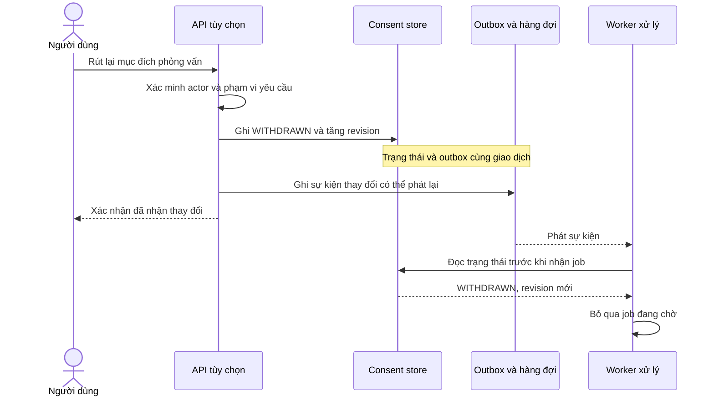

# User consent requirements — Yêu cầu đồng ý của người dùng trong khôi phục tài khoản

## 1. Vì sao consent cần được thiết kế riêng cho account recovery?

Một người dùng bị mất điện thoại nên không thể dùng ứng dụng MFA hoặc passkey trên thiết bị cũ. Hệ thống đề nghị xác minh qua phương thức khôi phục đã đăng ký, có thể chuyển sang kiểm tra danh tính khi chính sách yêu cầu. Trên màn hình xuất hiện nút “Tôi đồng ý”.

Nếu chỉ lưu `consent = true`, đội vận hành không thể biết người đó đã đồng ý điều gì: gửi mã, dùng ảnh giấy tờ, ghi âm cuộc gọi, thay MFA, hay nhận quảng cáo. Cũng chưa thể kết luận người bấm nút là chủ tài khoản.

Trong module `SECURITY_AUTHENTICATION_ACCOUNT_RECOVERY`, consent phải được đặt cạnh kiểm chứng danh tính, chống lạm dụng, token dùng một lần và kiểm soát session. Đó là các điều kiện độc lập của một luồng khôi phục an toàn. Một bản ghi đồng ý không tự tạo ra quyền đổi mật khẩu, gỡ MFA hoặc gắn passkey mới.

Bài thuộc chương Compliance, tập trung vào cách biến yêu cầu đồng ý thành hành vi có thể thực thi và giải thích được. Sau khi học, người đọc cần phân loại được các hành động trên giao diện, xây dựng mô hình lưu bằng chứng, và nhận diện lỗi khi việc rút lại đồng ý chạy đồng thời với tác vụ nền.

Các mô hình, tên chính sách và giao diện bên dưới là thiết kế minh họa. Những nhận định pháp lý được gắn với nguồn và phạm vi cụ thể; ngôn ngữ tiếng Việt của bài không xác định quốc gia áp dụng cho dịch vụ.

## 2. Tách bốn khái niệm thường bị gộp thành một checkbox

| Khái niệm | Câu hỏi thực sự | Ví dụ trong recovery | Không chứng minh được điều gì? |
| --- | --- | --- | --- |
| Thông báo xử lý dữ liệu | Hệ thống đã giải thích hoạt động nào? | Hiển thị mục đích dùng số liên hệ và nhật ký bảo mật | Người đọc đã đồng ý với mọi hoạt động |
| Consent cho một mục đích | Cá nhân cho phép hoạt động cụ thể nào dựa trên lựa chọn của họ? | Chấp thuận gửi lời mời phỏng vấn trải nghiệm sau recovery | Người đó sở hữu tài khoản đang được nhập |
| Xác nhận giao dịch | Người thao tác yêu cầu thay đổi cụ thể nào? | Xác nhận thay phương thức MFA bằng phương thức mới đang hiển thị | Mọi xử lý dữ liệu liên quan đều có cơ sở hợp lệ |
| Bằng chứng xác minh | Chính sách đã đạt mức tin cậy nào về người yêu cầu? | Kiểm tra mã khôi phục và yếu tố còn sử dụng được | Người đó đồng ý với mục đích nghiên cứu riêng biệt |

Một nút “Tiếp tục xác minh” có thể khởi tạo bước nghiệp vụ. Muốn dùng thao tác đó làm bằng chứng consent cho một mục đích, thiết kế phải mô tả rõ mục đích và lựa chọn tương ứng. Không tự chuyển sự kiện mở trang hoặc nhấn “Tiếp tục” thành quyền sử dụng ảnh giấy tờ cho mục đích khác.

Ví dụ hai dữ kiện sau phải được lưu độc lập:

```text
recovery_action = REPLACE_MFA
action_confirmation = CONFIRMED_FOR_ATTEMPT

optional_purpose = RECOVERY_EXPERIENCE_INTERVIEW
consent_state = DECLINED
```

Kết quả hợp lý của ví dụ là người dùng vẫn được xét khôi phục theo chính sách bảo mật, còn tác vụ mời phỏng vấn bị chặn.

Một lỗi khác là ghi `privacyPolicyAccepted = true` rồi dùng cho mọi API. Thông báo quyền riêng tư có thể bao trùm nhiều hoạt động; một cờ như vậy không cho biết mục đích, phiên bản nội dung, người thao tác hoặc thời điểm rút lại.

## 3. Xác định cơ sở xử lý trước khi thiết kế cách xin đồng ý

### 3.1. Ví dụ pháp lý có phạm vi rõ ràng

Trong phạm vi GDPR, consent là một cơ sở theo Điều 6, bên cạnh các cơ sở khác. Điều 7 quy định việc chứng minh và rút lại đồng ý. Với sinh trắc học nhằm định danh duy nhất, cần xem thêm Điều 9; explicit consent chỉ là một điều kiện ngoại lệ có thể áp dụng. Không thể suy ra mọi ảnh selfie đều thuộc cùng một loại xử lý. [Nguồn: GDPR, Điều 6–9](https://eur-lex.europa.eu/eli/reg/2016/679/oj/eng).

Ủy ban châu Âu mô tả consent hợp lệ bằng các yếu tố: tự nguyện, có thông tin, cụ thể, rõ ràng và có hành động khẳng định; đồng thời phải thông báo khả năng rút lại. [Nguồn: European Commission — Legal grounds for processing data](https://commission.europa.eu/law/law-topic/data-protection/information-business-and-organisations/legal-grounds-processing-data_en).

EDPB phân tích rủi ro khi buộc chấp thuận xử lý không cần thiết để được cung cấp dịch vụ, hoặc khi tồn tại chênh lệch quyền lực. Vì vậy, câu chữ “đồng ý” không tự chứng minh người dùng có lựa chọn thực tế. [Nguồn: EDPB Guidelines 05/2020, mục 3](https://www.edpb.europa.eu/system/files/documents/files/file1/edpb_guidelines_202005_consent_en.pdf).

Phần triển khai dưới đây là cách chuyển các vấn đề đó thành mô hình kỹ thuật. Cơ sở cụ thể của từng hoạt động phải được xác định trong chính sách đã đánh giá cho dịch vụ và thị trường tương ứng.

### 3.2. Không để client hoặc tên mục đích tự quyết định cơ sở pháp lý

Không viết quy tắc tổng quát như:

```text
Nếu purpose có chữ SECURITY thì được phép xử lý mọi dữ liệu.
Nếu người dùng tick checkbox thì được phép chuyển dữ liệu cho mọi vendor.
```

Tên “bảo mật” không giải thích được vì sao một trường dữ liệu cần thiết. Checkbox cũng không sửa được một hoạt động vượt phạm vi thiết kế.

Thay vào đó, đội sản phẩm, bảo mật và phụ trách dữ liệu xác định từng hoạt động. Backend nhận một cấu hình đã được duyệt, chẳng hạn:

| Hoạt động | Câu hỏi cần giải quyết trong chính sách | Quyết định kỹ thuật tương ứng |
| --- | --- | --- |
| Gửi thông điệp recovery | Dùng dữ liệu liên hệ nào, cho mục đích nào? | Giới hạn nội dung và người nhận |
| Xác minh giấy tờ qua nhà cung cấp | Cần trường nào, nhà cung cấp làm gì? | Chỉ xuất dữ liệu nằm trong hợp đồng xử lý |
| Ghi sự kiện chống lạm dụng | Sự kiện nào giúp điều tra hành vi giả mạo? | Ghi thông tin tối thiểu theo schema |
| Mời phỏng vấn trải nghiệm | Đây có phải mục đích tùy chọn riêng biệt? | Kiểm tra consent cho đúng mục đích |
| Thay phương thức xác thực | Người dùng đã xác nhận thay đổi nào? | Kiểm tra quyền và bằng chứng recovery |

Bảng này không ấn định sẵn cơ sở pháp lý cho từng hàng. Nó chỉ ra quyết định nào phải có trước khi lập trình.

Nếu cấu hình của hoạt động chưa được duyệt, trạng thái đúng là `POLICY_REVIEW_REQUIRED`. Không tự chọn `CONSENT` để hoàn thành biểu mẫu, cũng không tự đổi thành một cơ sở khác khi người dùng từ chối.

### 3.3. Tách mục đích khỏi phương tiện

“Dùng vendor X” là mô tả phương tiện hoặc bên tham gia, chưa phải mục đích hoàn chỉnh. “Xác minh người yêu cầu để quyết định có cho thay MFA hay không” mô tả rõ hơn hoạt động đang phục vụ điều gì.

Ngược lại, “cải thiện dịch vụ” quá rộng để backend xác định những job nào được chạy. Trong ví dụ bài này, dùng mã mục đích cụ thể:

```text
RECOVERY_IDENTITY_CHECK
RECOVERY_SECURITY_AUDIT
RECOVERY_EXPERIENCE_INTERVIEW
```

Cùng một tệp ảnh có thể bị yêu cầu dùng bởi hai hoạt động khác nhau. Hệ thống phải xét từng hoạt động; không truyền quyền sử dụng ảnh từ bước xác minh sang tác vụ nghiên cứu chỉ vì dữ liệu đã có sẵn.

## 4. Thiết kế giao diện để người dùng hiểu được lựa chọn

### 4.1. Trình bày theo từng quyết định

Một màn hình minh họa có thể chia thành ba khối:

```text
KHÔI PHỤC PHƯƠNG THỨC MFA

Thông tin về bước xác minh
Chúng tôi sẽ kiểm tra bằng chứng bạn cung cấp để đánh giá yêu cầu.
Xem dữ liệu cần dùng, bên xử lý và thời hạn lưu tại “Chi tiết”.

Thay đổi bạn đang yêu cầu
Phương thức MFA mới: khóa bảo mật vừa đăng ký trong phiên này.
Sau khi hoàn tất, các phiên thuộc phạm vi chính sách sẽ bị thu hồi.

[ Xác nhận yêu cầu thay MFA ]    [ Hủy yêu cầu ]

Lựa chọn riêng sau khôi phục
[ ] Tôi muốn được liên hệ qua email để phỏng vấn về trải nghiệm này.
    Bạn có thể thay đổi lựa chọn tại “Tùy chọn liên hệ”.
```

Đây là bố cục minh họa, không phải nội dung thông báo đầy đủ. Khi triển khai, “Chi tiết” phải mở được trước khi quyết định và phải có nội dung thật cho đúng phương thức đang sử dụng.

Nút xác nhận thay MFA không đồng thời bật lựa chọn phỏng vấn. Việc không chọn phỏng vấn không làm đổi ngưỡng kiểm chứng danh tính.

Trong thiết kế này, mục tùy chọn bắt đầu ở trạng thái chưa chọn. Backend cũng bắt đầu ở trạng thái `NOT_GRANTED`; không suy ra đồng ý từ việc field bị thiếu trong request.

### 4.2. Đưa thông tin quan trọng ra trước thời điểm thu thập

Nếu hệ thống xin ảnh giấy tờ rồi mới giải thích ảnh được chuyển đi đâu, người dùng đã không có thông tin đó lúc cung cấp dữ liệu.

Một luồng dễ kiểm soát hơn là:

1. Backend xác định phương thức và nội dung thông báo tương ứng.
2. Giao diện hiển thị những dữ liệu sắp được yêu cầu.
3. Người dùng chọn hoặc xác nhận theo yêu cầu của hoạt động.
4. Backend kiểm tra điều kiện trước khi phát hành quyền upload hoặc chuyển dữ liệu.

Việc kiểm tra ở bước 4 quan trọng vì người dùng có thể gọi API trực tiếp, dùng tab cũ hoặc sửa payload. Một checkbox chỉ tồn tại trong trình duyệt không bảo vệ được API.

### 4.3. Duy trì lựa chọn khi đổi ngôn ngữ và công nghệ hỗ trợ

Mỗi bản dịch của nội dung hiển thị cần ánh xạ đến một phiên bản được quản lý. Không giả định bản tiếng Việt và tiếng Anh diễn đạt cùng phạm vi chỉ vì dùng chung một khóa.

Thiết kế nên lưu cả locale và định danh nội dung đã hiển thị. Nhãn điều khiển cần đọc được bằng trình đọc màn hình; nút từ chối và đường dẫn rút lại phải sử dụng được bằng bàn phím.

Không dùng bộ đếm thời gian ngắn để ép người dùng quyết định về mục đích tùy chọn. Nếu token recovery sắp hết hạn, thông báo rõ tình trạng token và cung cấp cách tiếp tục phù hợp, thay vì biến thời hạn kỹ thuật thành sức ép phải chấp thuận thêm dữ liệu.

## 5. Consent không thay thế quyền khôi phục tài khoản

### 5.1. Người yêu cầu chưa chắc là chủ tài khoản

Trước khi xác minh, `claimant` chỉ là người đang đưa ra yêu cầu. Kẻ tấn công có thể nhập email của nạn nhân rồi tự tick mọi checkbox.

Vì vậy, bản ghi trước xác minh nên thể hiện rõ:

```text
actor_type = UNVERIFIED_CLAIMANT
recovery_attempt_id = att_7c...
claimed_account_reference = internal_target_reference
ownership_verified = false
```

Không đặt `actor_type = ACCOUNT_OWNER` chỉ vì request chứa email trùng với tài khoản. Cũng không cập nhật ngay tùy chọn liên hệ lâu dài của tài khoản từ một người chưa được xác minh.

Trong thiết kế của bài, mục đích phỏng vấn chỉ được đề nghị sau khi recovery hoàn tất và người dùng có phiên đăng nhập phù hợp. Cách bố trí này giảm việc phải gán lựa chọn của claimant cho một chủ thể chưa xác định.

Nếu nghiệp vụ cần quyết định trước xác minh cho một hoạt động cụ thể, bằng chứng phải gắn với claimant và lần thử đó. Việc liên kết nó với tài khoản sau này cần sự kiện xác minh rõ ràng; không sửa lịch sử để làm như danh tính đã được biết từ đầu.

### 5.2. Cổng thay authenticator độc lập với consent

Đối với thay MFA, backend phải có quyết định riêng về:

- Lần thử recovery còn hiệu lực và chưa bị hủy.
- Bằng chứng đạt chính sách của phương thức đang dùng.
- Thay đổi được xác nhận đúng với dữ liệu backend đang giữ.
- Quyền thực thi dùng một lần còn hiệu lực.
- Các điều kiện rủi ro, thời gian chờ và kiểm soát session đã được xét.

Không thêm điều kiện “đồng ý phỏng vấn” vào danh sách này. Nó không làm mạnh hơn bằng chứng sở hữu tài khoản.

Một trạng thái kỹ thuật hữu ích là:

```text
processing_permission != recovery_authorization
```

Vế trái trả lời hoạt động xử lý dữ liệu có được thực hiện hay không. Vế phải trả lời hành động khôi phục cụ thể có được phép hay không. Chúng có thể cùng cần cho một bước, nhưng không thể thay thế cho nhau.

## 6. Mô hình bằng chứng theo mục đích, phiên bản và actor

Hướng dẫn ICO cho UK GDPR đề cập việc lưu ai đã đồng ý, khi nào, bằng cách nào và nội dung họ được cung cấp. Phiên bản tài liệu giúp liên hệ bằng chứng với thông tin tại thời điểm đó. [Nguồn: ICO — Obtain, record and manage consent](https://ico.org.uk/for-organisations/uk-gdpr-guidance-and-resources/lawful-basis/consent/how-should-we-obtain-record-and-manage-consent/).

Với hệ thống minh họa, một sự kiện có thể có dạng:

```json
{
  "eventId": "evt_8b12",
  "tenantId": "tenant_example",
  "actorRef": "subject_internal_29",
  "actorAssurance": "AUTHENTICATED_AFTER_RECOVERY",
  "purposeId": "RECOVERY_EXPERIENCE_INTERVIEW",
  "purposeVersion": "interview-purpose-v2",
  "noticeArtifactId": "notice-interview-vi-v4",
  "noticeDigest": "sha256:example-digest",
  "locale": "vi",
  "action": "GRANTED",
  "effectiveRevision": 12,
  "recordedAt": "2026-11-24T08:00:00Z",
  "interactionId": "interaction_41",
  "source": "PRIVACY_PREFERENCES"
}
```

Các giá trị chỉ dùng để minh họa schema.

### 6.1. Những trường cần có ý nghĩa rõ ràng

`purposeId` xác định mục đích. `purposeVersion` phân biệt các phạm vi của mục đích đó. `noticeArtifactId` trỏ đến nội dung thực tế được hiển thị, còn digest hỗ trợ phát hiện thay đổi.

Hash không cho phép tái tạo nội dung gốc. Nếu chỉ giữ digest nhưng xóa mọi bản nội dung thông báo, hệ thống không thể trình bày người dùng đã được đọc gì. Thiết kế cần quản lý bản nội dung được tham chiếu với kiểm soát truy cập và vòng đời phù hợp.

`actorRef` là định danh nội bộ. Nó không tự chứng minh một mức xác minh; mức đó cần được thể hiện bằng `actorAssurance` và bằng chứng liên quan.

`recordedAt` lấy từ đồng hồ server. Thời gian client có thể được giữ như dữ kiện phụ nếu có nhu cầu, nhưng không được dùng làm mốc duy nhất để quyết định thứ tự các thay đổi.

`effectiveRevision` hỗ trợ phân biệt một lựa chọn cũ với trạng thái hiện hành. Đừng dùng thời gian gần đúng của hai hệ thống phân tán để quyết định sự kiện nào thắng khi đã có revision do hệ thống sở hữu.

### 6.2. Tách lịch sử khỏi trạng thái hiện hành

Có thể dùng hai cấu trúc:

```text
consent_event
  Lịch sử GRANTED / WITHDRAWN / RECONFIRMED với phạm vi cụ thể.

consent_current
  Trạng thái đang có hiệu lực cho tenant + subject + purpose,
  kèm purposeVersion và revision.
```

Lịch sử phục vụ giải thích quyết định; trạng thái hiện hành phục vụ kiểm tra trước khi xử lý. Nếu hai cấu trúc được cập nhật riêng rẽ và có thể lệch nhau, tác vụ nền có thể chạy với quyền cũ.

Trong ví dụ này, cập nhật lịch sử, trạng thái hiện hành và outbox trong cùng giao dịch. Idempotency key cần ràng buộc với tenant, actor, mục đích và thao tác; không nhận một khóa trùng của tenant khác rồi trả về bằng chứng không thuộc người gọi.

“Lịch sử không sửa tùy tiện” cũng không có nghĩa lưu dữ liệu cá nhân vĩnh viễn. Vòng đời của bằng chứng phải được thiết kế cùng cơ chế hạn chế truy cập và xóa phù hợp.

### 6.3. Không nhét bí mật vào bằng chứng

Không đưa mật khẩu, OTP, recovery code, reset URL đầy đủ hoặc token bearer vào sự kiện consent. Ảnh giấy tờ và nội dung sinh trắc học cũng không cần bị nhân bản vào log để chứng minh một nút đã được chọn.

Nếu cần liên kết với hồ sơ xác minh, dùng tham chiếu có kiểm soát thay vì sao chép dữ liệu nhạy cảm. Các dashboard không nên hiển thị token hoặc toàn bộ định danh liên hệ.

Một actor nội bộ có quyền đọc nhật ký consent không vì thế được quyền đọc mọi bằng chứng danh tính. Đây là hai nhu cầu truy cập khác nhau.

## 7. Mô hình Java: kiểm tra quyền xử lý cho một mục đích tùy chọn

Ví dụ sau chỉ mô hình hóa quyết định cho tác vụ phỏng vấn sau recovery. Nó không chọn cơ sở pháp lý, không cấp quyền thay MFA và không phải endpoint hoàn chỉnh.

Cấu hình `PurposePolicy` phải được nạp từ chính sách backend đã duyệt. `ConsentSnapshot` phải lấy từ kho trạng thái theo đúng tenant và subject mà server đã xác định.

```java
import java.util.Objects;

enum ConsentState {
    NOT_GRANTED,
    GRANTED,
    WITHDRAWN
}

enum ProcessingDecision {
    ALLOW,
    SKIP_NO_ACTIVE_GRANT,
    SKIP_SCOPE_CHANGED,
    SKIP_STALE_REVISION,
    POLICY_REVIEW_REQUIRED
}

record PurposePolicy(
        String tenantId,
        String purposeId,
        String requiredPurposeVersion,
        boolean approvedForThisConsentFlow) {
}

record ConsentSnapshot(
        String tenantId,
        String subjectRef,
        String purposeId,
        String purposeVersion,
        ConsentState state,
        long revision) {
}

record OptionalJob(
        String tenantId,
        String subjectRef,
        String purposeId,
        long consentRevisionAtEnqueue) {
}

final class OptionalProcessingGate {

    ProcessingDecision decide(
            PurposePolicy policy,
            ConsentSnapshot current,
            OptionalJob job) {

        if (!Objects.equals(policy.tenantId(), job.tenantId())
                || !Objects.equals(current.tenantId(), job.tenantId())
                || !Objects.equals(current.subjectRef(), job.subjectRef())
                || !Objects.equals(policy.purposeId(), job.purposeId())
                || !Objects.equals(current.purposeId(), job.purposeId())) {
            throw new SecurityException("Processing scope mismatch");
        }

        if (!policy.approvedForThisConsentFlow()) {
            return ProcessingDecision.POLICY_REVIEW_REQUIRED;
        }

        if (current.state() != ConsentState.GRANTED) {
            return ProcessingDecision.SKIP_NO_ACTIVE_GRANT;
        }

        if (!Objects.equals(
                current.purposeVersion(),
                policy.requiredPurposeVersion())) {
            return ProcessingDecision.SKIP_SCOPE_CHANGED;
        }

        if (current.revision() != job.consentRevisionAtEnqueue()) {
            return ProcessingDecision.SKIP_STALE_REVISION;
        }

        return ProcessingDecision.ALLOW;
    }
}
```

### 7.1. Vì sao job mang revision nhưng vẫn phải đọc trạng thái hiện hành?

Giả sử job được tạo lúc revision 12 và consent đang `GRANTED`. Sau đó người dùng rút lại, trạng thái chuyển sang revision 13.

Nếu job chỉ kiểm tra dữ liệu được sao chép lúc enqueue, nó sẽ tiếp tục gửi lời mời. Ở mô hình trên, job phải tải trạng thái mới; trạng thái `WITHDRAWN` làm nó bị bỏ qua.

Nếu người dùng lại cấp consent ở revision 14, job cũ vẫn không được tự sống lại. Việc cấp mới có thể thuộc một tương tác khác; hệ thống có thể tạo job mới nếu chính sách cho phép.

### 7.2. Kiểm tra thuần túy chưa giải quyết hết cạnh tranh dữ liệu

`decide()` chỉ đánh giá snapshot đầu vào. Sau khi hàm trả `ALLOW`, withdrawal vẫn có thể đến trước lúc gửi yêu cầu ra ngoài.

Thiết kế thực tế cần xác định một điểm cam kết rõ ràng giữa thu hồi và bắt đầu tác vụ. Ví dụ, dispatcher và thao tác withdrawal cùng dùng cơ chế tuần tự theo tenant + subject + purpose để ghi nhận job đã được nhận thực thi hay đã bị hủy. Không chỉ đọc cache rồi gửi.

Không nên tuyên bố rằng một giao dịch database có thể rollback email đã gửi hoặc dữ liệu đã được vendor nhận. Với tác vụ bên ngoài, cần mô tả ranh giới đã gửi, đang chờ và có thể hủy; đồng thời có cơ chế yêu cầu dừng hoặc xử lý dữ liệu ở phía nhận khi phù hợp.

Khi triển khai, service còn phải kiểm tra quyền người gọi, chống CSRF theo cơ chế xác thực đang sử dụng, giới hạn lưu lượng, xác thực đầu vào và ghi nhận idempotency. Chúng nằm ngoài hàm minh họa này.

## 8. Withdrawal là một sự kiện nghiệp vụ cần được thực thi

### 8.1. Phân biệt ba yêu cầu khác nhau

| Yêu cầu | Đối tượng bị tác động | Hành vi trong thiết kế minh họa |
| --- | --- | --- |
| Hủy recovery | Một lần thử khôi phục | Ngừng lần thử, vô hiệu quyền thực thi còn chờ |
| Rút lại consent phỏng vấn | Một mục đích tùy chọn | Cập nhật trạng thái và chặn job của mục đích đó |
| Báo “tôi không yêu cầu thay MFA” | Một sự kiện an ninh | Mở xử lý nghi ngờ chiếm đoạt theo quy trình |

Người dùng có thể muốn giữ tài khoản đã khôi phục nhưng không tham gia phỏng vấn nữa. Hệ thống không được hiểu thao tác đó thành “hủy tài khoản” hoặc “khôi phục lại mật khẩu cũ”.

Tương tự, một yêu cầu dừng xác minh đang chờ không tương đương với việc xóa ngay mọi nhật ký an ninh. Hệ thống cần trả lời hoạt động nào đã dừng và dữ liệu nào được xử lý tiếp theo chính sách của hoạt động đó.

Trong ví dụ GDPR, Điều 7 cho phép rút lại bất kỳ lúc nào và việc rút lại không làm mất tính hợp pháp của xử lý đã dựa trên consent trước đó. Đây không phải cơ chế đảo ngược mọi giao dịch đã hoàn tất. [Nguồn: GDPR, Điều 7(3)](https://eur-lex.europa.eu/eli/reg/2016/679/oj/eng).

### 8.2. Luồng rút lại minh họa



Sự kiện từ outbox giúp truyền thay đổi, nhưng không phải nguồn quyền duy nhất. Nếu worker chưa nhận được sự kiện, kiểm tra trạng thái trước khi nhận job vẫn cần hoạt động.

Trạng thái giao diện cũng cần phân biệt “đã ghi nhận withdrawal” với “đã hoàn thành mọi tác vụ xóa tại nhà cung cấp”. Nếu thao tác thứ hai cần thời gian, trả tiến độ riêng; không báo xong toàn bộ chỉ vì database nội bộ đã đổi một cờ.

### 8.3. Cho phép thao tác khi người dùng đang mất quyền đăng nhập

Một người bị mất thiết bị không thể luôn dùng phiên đăng nhập bình thường. Thiết kế cần có kênh xử lý phù hợp cho việc hủy lần thử hoặc quản lý yêu cầu đang diễn ra.

Tuy nhiên, một liên kết hủy lần thử không nên có quyền chỉnh mọi tùy chọn của tài khoản. Capability phải giới hạn vào hành động được cấp, lần thử tương ứng và thời hạn của nó.

Nếu dùng token cho hành động đó, áp dụng thiết kế token ngẫu nhiên, dùng một lần và hết hạn phù hợp; không tự đăng nhập người dùng chỉ vì họ vừa đặt lại mật khẩu. Đây là các khuyến nghị của OWASP cho luồng quên mật khẩu. [Nguồn: OWASP Forgot Password Cheat Sheet](https://cheatsheetseries.owasp.org/cheatsheets/Forgot_Password_Cheat_Sheet.html).

Không dùng đường dẫn công khai chỉ chứa email để thay đổi consent của tài khoản: bất kỳ ai biết email đều có thể gây thay đổi hoặc làm lộ trạng thái.

## 9. Thông báo bảo mật và thông điệp tùy chọn cần có tuyến xử lý riêng

NIST SP 800-63B-4 yêu cầu thông báo khi recovery trong phạm vi hệ thống áp dụng hướng dẫn này. Mục tiêu là giúp phát hiện hành vi khôi phục giả mạo. Đây là yêu cầu của một khung kỹ thuật cụ thể, không phải kết luận rằng mọi dịch vụ trên thế giới cùng chịu một nghĩa vụ pháp lý. [Nguồn: NIST SP 800-63B-4, mục 4.2.3 và 4.6](https://pages.nist.gov/800-63-4/sp800-63b.html).

Trong kiến trúc minh họa, tách:

```text
Security notification pipeline
  Nhận sự kiện recovery và chính sách thông báo đã duyệt.

Optional interview pipeline
  Nhận yêu cầu phỏng vấn và kiểm tra consent đang có hiệu lực.
```

Nếu hệ thống dùng chung một cờ `emailOptIn`, việc từ chối phỏng vấn có thể vô tình làm mất cảnh báo thay MFA. Ngược lại, việc cho phép nhận cảnh báo không nên tự bật phỏng vấn.

Thông báo security cần giải thích sự kiện và cách phản hồi khi người nhận không yêu cầu thay đổi. Không nhét nội dung quảng bá vào cùng template rồi gọi toàn bộ là cảnh báo an ninh.

Bên cạnh địa chỉ nhận, hãy kiểm soát dữ liệu trong thông điệp. Một email báo recovery không cần chứa mã khôi phục đã dùng, ảnh giấy tờ hoặc toàn bộ số điện thoại.

## 10. Khi có giấy tờ, sinh trắc học hoặc recovery contact

### 10.1. Xác minh danh tính qua nhà cung cấp

Trước khi bắt đầu upload, hệ thống phải biết nhà cung cấp thực hiện hoạt động nào trong cấu hình đã duyệt. Nếu chưa xác định được phạm vi, không gửi dữ liệu trước rồi tìm cách xin đồng ý bổ sung.

Thiết kế nên tách quyền bắt đầu upload khỏi quyền chuyển hồ sơ sang bước phân tích. Người dùng có thể hủy khi hồ sơ mới được lưu tạm; service cần biết chính xác trạng thái đó.

Không cho phép một trường `consent = true` mở rộng quyền của nhà cung cấp sang lưu ảnh lâu dài, huấn luyện mô hình hoặc chia sẻ tiếp. Mỗi hoạt động phải đi qua quyết định phạm vi của nó.

Tương tự, tên bước “selfie” không nói rõ hệ thống đang chụp ảnh để nhân viên xem hay tạo mẫu sinh trắc học để đối sánh. Inventory kỹ thuật cần mô tả xử lý thực tế.

### 10.2. Phương án khác phải được mô tả bằng quy trình thật

Nếu sản phẩm cung cấp lựa chọn xác minh thủ công thay vì một phương thức dùng consent, lựa chọn đó cần có đường dẫn hoạt động, nhân sự tiếp nhận và điều kiện rõ ràng. Không ghi “liên hệ hỗ trợ” nếu hỗ trợ chỉ chuyển người dùng về cùng màn hình.

Phương án thay thế vẫn phải đạt chính sách bảo mật phù hợp. “Không muốn cung cấp ảnh” không phải lý do để hệ thống tự bỏ mọi kiểm chứng rồi cho gắn MFA mới.

Nếu chính sách không có phương án đủ an toàn cho một trường hợp, luồng cần thể hiện kết quả không thể hoàn tất và quy trình xử lý tiếp theo, thay vì dùng câu chữ gây hiểu rằng chỉ cần thêm một checkbox sẽ giải quyết được.

### 10.3. Recovery contact là chủ thể khác

Khi người dùng chỉ định một người liên hệ khôi phục, dữ liệu của người liên hệ không trở thành dữ liệu có thể dùng cho mọi mục đích của chủ tài khoản.

Trong mô hình nên tách chủ tài khoản, người được liên hệ, trạng thái chấp nhận vai trò và phạm vi hỗ trợ. Việc người liên hệ chấp nhận vai trò cũng không chứng minh mọi yêu cầu khôi phục gửi về sau là hợp lệ.

Thông điệp mời hoặc xác nhận cần hạn chế lộ dữ liệu tài khoản. Không đưa chi tiết nhạy cảm vào lời mời gửi đến một địa chỉ chưa được kiểm soát đầy đủ.

## 11. Thay đổi phiên bản, tenant và vai trò đại diện

### 11.1. Không dùng mỗi phiên bản giao diện làm phạm vi consent

Thay màu nút không đồng nghĩa với việc đổi mục đích xử lý. Ngược lại, thêm một hoạt động sử dụng dữ liệu quan trọng không nên bị che bằng việc giữ nguyên `purposeVersion`.

Trong thiết kế này, mỗi lần sửa được phân loại thành:

- Chỉnh cách trình bày, giữ nguyên phạm vi.
- Làm rõ nội dung nhưng cần đánh giá tính tương thích.
- Thay đổi phạm vi, dữ liệu, bên tham gia hoặc cách sử dụng.

Kết quả đánh giá quyết định có thể tiếp tục dựa vào bằng chứng cũ hay phải có lựa chọn mới. Backend không tự đoán từ số phiên bản hoặc coi mọi bản dịch đều có thể thay thế lẫn nhau.

Nếu phiên bản mới yêu cầu lựa chọn mới cho một mục đích tùy chọn, luồng recovery chính vẫn được đánh giá theo điều kiện bảo mật riêng của nó.

### 11.2. Consent không tự đi xuyên tenant

Một người dùng có cùng email trong hai tổ chức vẫn có thể tương tác với hai bộ chính sách và hai bên chịu trách nhiệm khác nhau.

Mọi truy vấn trạng thái và xử lý job phải bao gồm tenant. Không tải consent bằng `email + purpose` rồi dùng cho toàn hệ thống.

Khi chuyển tài khoản giữa các tenant, cần quyết định rõ lịch sử nào được chuyển, bằng chứng có còn phù hợp và người dùng được thông báo thế nào. Không mặc định rằng chuyển dữ liệu đăng nhập cũng chuyển mọi quyền xử lý.

### 11.3. Tài khoản tổ chức và người đại diện

Một quản trị viên có quyền hỗ trợ reset MFA cho nhân viên không vì thế được quyền đồng ý mọi xử lý dữ liệu cá nhân thay nhân viên.

Nếu có cơ chế đại diện, hệ thống cần ghi actor thực, tư cách đại diện, phạm vi và cách kiểm tra thẩm quyền. Không dùng chung `subjectId` cho cả người thao tác lẫn người có dữ liệu.

Với trẻ em hoặc người giám hộ, cần cấu hình theo thị trường, loại dịch vụ và quy tắc đã đánh giá. Không hardcode một độ tuổi từ một ví dụ pháp lý thành quy tắc toàn cầu; cũng không cho quyền đại diện tồn tại vô thời hạn mà không có cơ chế xem xét.

## 12. Vòng đời dữ liệu và khả năng giải thích

Một kiến trúc có thể tách ba loại dữ liệu:

| Loại dữ liệu | Ví dụ | Hướng thiết kế vòng đời |
| --- | --- | --- |
| Dữ liệu tác nghiệp recovery | Hồ sơ đang chờ xác minh | Theo vòng đời lần thử và quy trình xử lý hồ sơ |
| Bằng chứng lựa chọn | Mục đích, phiên bản, actor, sự kiện rút lại | Theo chính sách bằng chứng có kiểm soát |
| Nhật ký an ninh | Quyết định rủi ro, mã sự kiện, kết quả kiểm chứng | Theo nhu cầu bảo mật đã được xác định |

Không dùng một thời hạn tùy ý cho tất cả các loại rồi gọi đó là yêu cầu pháp luật. Bài này không đặt con số ngày lưu chung, vì con số đó phụ thuộc hoạt động và chính sách áp dụng.

Quy trình xóa nên biết dữ liệu nào nằm trong database chính, object storage, hàng đợi, hệ thống hỗ trợ và nhà cung cấp. Việc xóa một hàng trong `consent_current` không bảo đảm các bản sao của dữ liệu tác nghiệp đã được xử lý.

Đồng thời, không xóa trạng thái withdrawal theo cách khiến job cũ hiểu nhầm là “chưa từng có lựa chọn nên được phép chạy”. Trạng thái không tồn tại phải có ngữ nghĩa an toàn cho mục đích tùy chọn: không có active grant.

Khi người dùng yêu cầu giải thích, hệ thống cần trả lời được bằng dữ liệu có cấu trúc: hoạt động nào được thực hiện, mục đích nào, dựa vào phiên bản nào, và trạng thái nào có hiệu lực tại thời điểm nhận thực thi.

## 13. Những lỗi triển khai điển hình và cách nhận diện

| Lỗi | Tình huống làm lộ lỗi | Thiết kế khắc phục |
| --- | --- | --- |
| Một cờ cho mọi mục đích | Từ chối phỏng vấn làm mất cảnh báo MFA | Tách policy và pipeline theo mục đích |
| Client quyết định cơ sở xử lý | Request tự gửi `basis = APPROVED` | Chỉ backend nạp policy đã duyệt |
| Claimant bị coi là chủ tài khoản | Nhập email người khác rồi sửa tùy chọn | Ghi assurance và kiểm tra actor |
| Chỉ kiểm tra consent lúc enqueue | Rút lại khi job đang nằm trong hàng đợi | Kiểm tra lại ở thời điểm nhận thực thi |
| Grant mới làm sống job cũ | Consent revision 12 bị rút rồi cấp lại ở 14 | Ràng buộc job với revision phù hợp |
| Chỉ lưu hash thông báo | Không thể trình bày nội dung đã hiển thị | Quản lý artifact được tham chiếu |
| Nhầm hủy recovery với withdrawal | Rút phỏng vấn làm hủy quyền đăng nhập mới | Tách hành động và phạm vi ảnh hưởng |
| Consent vượt tenant | Email giống nhau dùng chung lựa chọn | Kiểm tra tenant ở mọi lớp |
| Ghi quá nhiều vào audit | Log consent chứa reset URL và giấy tờ | Dùng tham chiếu, loại bỏ secret |
| Đánh giá xong rồi gửi từ cache cũ | Withdrawal chen giữa hai thao tác | Thiết kế điểm cam kết và điều phối cạnh tranh |

Các tình huống này là tiêu chí thiết kế và kiểm chứng cho hệ thống sẽ được triển khai, không phải cam kết rằng ví dụ Java đã xử lý toàn bộ chúng.

Khi kiểm tra một luồng cụ thể, hãy lần theo một lần thử recovery từ màn hình đến API, kho trạng thái, hàng đợi và vendor. Ở mỗi điểm, xác định actor, mục đích, phiên bản và quyền thực thi đang được dùng.

Một quyết định có thể giải thích được không chỉ cần bản ghi “đã đồng ý”. Nó cần liên kết được lựa chọn cụ thể với đúng người thao tác, đúng hoạt động và đúng trạng thái tại thời điểm xử lý, đồng thời giữ các điều kiện chống chiếm đoạt tài khoản hoạt động độc lập.
