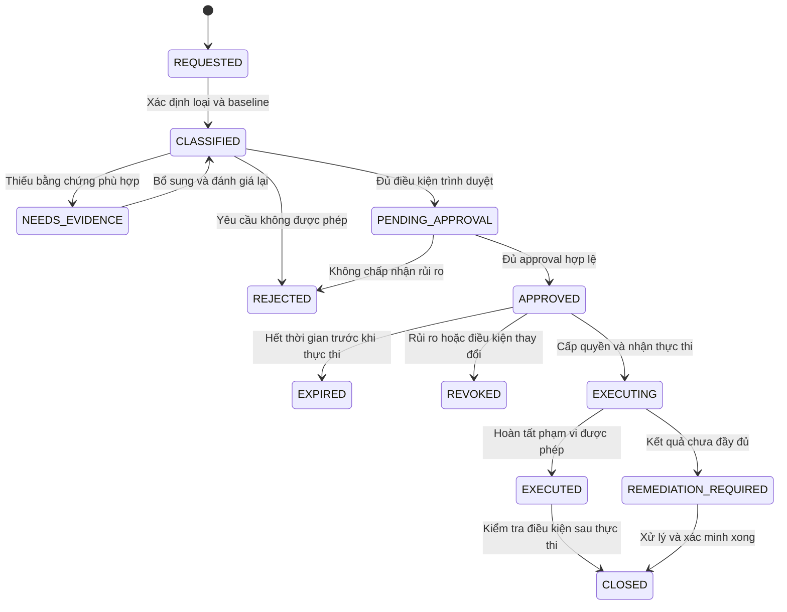

# Compliance exception handling — Xử lý ngoại lệ tuân thủ trong khôi phục tài khoản

## 1. Ngoại lệ xuất hiện ở đâu trong account recovery?

Một người dùng mất điện thoại chứa MFA, không còn máy tính có passkey và cũng không truy cập được hộp thư đăng ký. Nhân viên hỗ trợ nhận được yêu cầu “mở tài khoản ngay vì cần hoàn thành công việc”. Quy trình tiêu chuẩn không thể chạy đến cuối, nhưng việc cấp lại quyền chỉ dựa trên câu chuyện của người yêu cầu có thể dẫn đến chiếm đoạt tài khoản.

Trong module `SECURITY_AUTHENTICATION_ACCOUNT_RECOVERY`, **compliance exception handling** là cách tiếp nhận, phân loại, đánh giá, quyết định và kiểm soát một yêu cầu đi khác với kiểm soát đã được phê duyệt. Nó phải gắn với đúng tài khoản, luồng recovery, nghĩa vụ áp dụng và người có thẩm quyền chấp nhận rủi ro.

Một ngoại lệ hợp lệ không chỉ là ticket có chữ “approved”. Nó cần mô tả rõ kiểm soát nào thay đổi, vì sao, trong phạm vi nào, có biện pháp bù đắp gì, ai chịu trách nhiệm và hệ thống thực sự giới hạn việc thực thi ra sao.

Bài học hướng tới khả năng thiết kế quy trình ngoại lệ cho khôi phục mật khẩu, MFA, passkey và thiết bị xác thực, đồng thời giữ được kiểm soát token dùng một lần, chống lạm dụng, bằng chứng quyết định và xử lý session.

### 1.1. Ngoại lệ khác với một phương án recovery đã được duyệt

| Tình huống | Cách phân loại |
|---|---|
| Người dùng mất điện thoại nhưng còn recovery code đã đăng ký | Phương án recovery tiêu chuẩn nếu policy đã cho phép |
| Người dùng không dùng được giao diện hiện tại, được hỗ trợ qua một phương án tiếp cận đã thiết kế | Luồng hỗ trợ hoặc phương án tương đương đã duyệt |
| Nhà cung cấp kiểm tra gặp sự cố, đội vận hành đề nghị dùng một phương thức thay thế ngoài policy hiện hành | Yêu cầu đánh giá ngoại lệ hoặc thay đổi policy |
| Người dùng yêu cầu tắt MFA vì đang vội | Yêu cầu, chưa phải bằng chứng danh tính hoặc ngoại lệ được duyệt |
| Một nghĩa vụ có điều khoản ngoại lệ pháp lý cụ thể | Phải xác định đủ điều kiện và thẩm quyền áp dụng, không chỉ dựa vào ticket nội bộ |
| Đội hỗ trợ sửa trực tiếp database để bỏ qua kiểm tra | Thay đổi không được kiểm soát; cần xử lý theo quy trình sự cố hoặc vi phạm |

Nếu một phương án thay thế an toàn đã được duyệt trước, hệ thống nên gọi đúng tên của nó và thực thi theo policy tương ứng. Không đẩy mọi người dùng có hoàn cảnh khác biệt vào một quy trình “xin đặc cách”.

### 1.2. Ba quyết định không được gộp làm một

Cần tách:

1. **Có được xem xét thay đổi kiểm soát này không?** Câu hỏi về nghĩa vụ và thẩm quyền.
2. **Bằng chứng hiện có có đủ để chấp nhận rủi ro không?** Câu hỏi về danh tính và nguy cơ chiếm đoạt.
3. **Được phép thực hiện hành động nào ngay lúc này?** Câu hỏi về quyền hệ thống, phạm vi và trạng thái hiện tại.

Người quản lý đồng ý giúp khách hàng không tự trả lời được cả ba câu hỏi. Một chữ ký chấp nhận rủi ro cũng không biến bằng chứng danh tính yếu thành mạnh.

## 2. Xác định baseline trước khi xét ngoại lệ

**Baseline** là tập kiểm soát và nghĩa vụ đang áp dụng cho dịch vụ và trường hợp cụ thể. Có thể gồm điều kiện pháp lý, cam kết hợp đồng, assurance profile, policy an ninh, quy tắc riêng tư và các giới hạn vận hành.

Một bảng baseline nên có:

| Thành phần | Cần biết trước khi xét |
|---|---|
| Phạm vi dịch vụ | Sản phẩm, tenant, loại tài khoản và vai trò |
| Loại recovery | Mật khẩu, MFA, passkey, mất thiết bị hoặc kết hợp |
| Kiểm soát bị tác động | Điều khoản policy và phiên bản chính xác |
| Nguồn ràng buộc | Nội bộ, hợp đồng, quy định hoặc profile đã cam kết |
| Quyền quyết định | Vai trò có thể duyệt và giới hạn được giao |
| Thay thế đã được cho phép | Phương án tiêu chuẩn nào còn dùng được |
| Điều kiện không được miễn | Những yêu cầu vẫn phải đáp ứng |
| Tác động sau recovery | Quyền đặc biệt, session, giao dịch và dữ liệu có thể bị ảnh hưởng |

“Khách hàng VIP” hoặc “nhân viên đã xác nhận qua điện thoại” không phải là một nguồn ràng buộc có thể thay thế bảng này.

### 2.1. Hiểu đúng tailoring trong tiêu chuẩn

NIST SP 800-63-4 mô tả tailoring như một quá trình có quản trị để đánh giá và ghi nhận điều chỉnh assurance level, kiểm soát bổ sung hoặc bù đắp. Các quyết định và lý do liên quan cần được thể hiện trong Digital Identity Acceptance Statement theo hướng dẫn áp dụng. Điều đó không có nghĩa một agent hỗ trợ có thể tự thay tiêu chuẩn cho từng cuộc gọi. [NIST SP 800-63-4 — Digital Identity Risk Management](https://pages.nist.gov/800-63-4/sp800-63/dirm/)

NIST SP 800-63B-4 cũng yêu cầu phương thức recovery thay thế dựa trên phân tích rủi ro và được tài liệu hóa; account recovery có thông báo cho subscriber. Khi dựa trên profile này, phải đánh giá đủ các điều kiện liên quan, không chỉ trích một câu về phương thức thay thế để hợp thức hóa bỏ qua kiểm tra. [NIST SP 800-63B-4 — Account Recovery](https://pages.nist.gov/800-63-4/sp800-63b.html#account-recovery)

Trong bài này, các ma trận, thời gian, schema và quy tắc kỹ thuật là **thiết kế minh họa**. Chúng không tự tạo chứng nhận tuân thủ hay thay thế việc xác định nghĩa vụ cho dịch vụ thực tế.

### 2.2. Phê duyệt nội bộ có giới hạn

Người có thẩm quyền có thể chấp nhận một phần rủi ro vận hành trong giới hạn được giao. Họ không tự sửa được điều kiện của một nghĩa vụ bên ngoài chỉ bằng cách nhấn Approve.

Nếu một yêu cầu có vẻ mâu thuẫn với nghĩa vụ đang áp dụng, cần chuyển đến vai trò phụ trách xác định phạm vi và căn cứ, rồi quyết định có phương án hợp lệ nào hay không. Kết quả có thể là từ chối, chọn phương án khác, xin thay đổi hợp đồng hoặc thực hiện một quy trình chính thức khác. Không tạo một trường `legalOverride=true` dùng được cho mọi tình huống.

## 3. Phân loại yêu cầu để tránh “đặc cách” sai chỗ

Một bộ phân loại hữu ích:

| Nhóm | Ví dụ | Hướng xử lý |
|---|---|---|
| `APPROVED_ALTERNATIVE` | Recovery code hoặc kênh hỗ trợ đã nằm trong policy | Chạy đúng luồng, ghi bằng chứng như bình thường |
| `TEMPORARY_POLICY_EXCEPTION` | Tạm dùng phương thức đã đánh giá riêng vì một thành phần bị lỗi | Đánh giá phạm vi, phê duyệt, giới hạn thời gian và thu hồi |
| `ACCESSIBILITY_REVIEW` | Người dùng không thể thực hiện một bước vì rào cản tiếp cận | Tìm phương án an toàn phù hợp, tránh giảm kiểm tra tùy tiện |
| `INCIDENT_COORDINATION` | Nhiều tài khoản không recovery được do sự cố provider | Điều phối sự cố và thay đổi có kiểm soát, không duyệt tràn lan |
| `OBLIGATION_REVIEW` | Yêu cầu liên quan nghĩa vụ pháp lý hoặc hợp đồng chưa rõ | Xác định điều kiện và thẩm quyền trước hành động |
| `PROHIBITED_REQUEST` | Đòi xem mật khẩu, dùng lại token đã tiêu thụ, truy cập tenant khác | Từ chối; ghi nhận và điều tra nếu cần |
| `INSUFFICIENT_EVIDENCE` | Không có cách liên kết người yêu cầu với tài khoản đủ tin cậy | Yêu cầu phương án phù hợp hoặc từ chối khôi phục |

Một sự cố provider không tự chứng minh tất cả người đang gọi hỗ trợ đều là chủ tài khoản. Một yêu cầu tiếp cận hợp lý cũng không đồng nghĩa người dùng phải cung cấp thêm dữ liệu nhạy cảm không cần thiết.

### 3.1. Đánh giá rủi ro theo đường tấn công cụ thể

Đặt câu hỏi bằng hành vi quan sát được:

- Kẻ biết email và thông tin công khai có thể vượt qua bước thay thế không?
- Kênh được đề nghị có do chính người yêu cầu vừa thêm vào không?
- Các bằng chứng có độc lập hay cùng đến từ một hộp thư có thể bị chiếm đoạt?
- Tài khoản có quyền quản trị, thanh toán hoặc thay đổi bảo mật của người khác không?
- Có yêu cầu đồng thời, đăng nhập lạ hoặc thay đổi kênh liên hệ gần đây không?
- Nhân viên hỗ trợ hoặc tài khoản approver có dấu hiệu bị xâm nhập không?
- Nếu recovery sai, có thể thu hồi quyền hoặc hạn chế thiệt hại đến đâu?

Không cộng số lượng giấy tờ hoặc số người đồng ý rồi coi đó là điểm tin cậy tuyệt đối. Hai bằng chứng cùng lấy từ một nguồn bị kiểm soát không phải hai lớp độc lập.

## 4. Các kiểm soát giữ nguyên trong mô hình minh họa

Tổ chức cần xác định trước những điều kiện mà luồng ngoại lệ không được bỏ qua. Đối với thiết kế học tập này:

- Mọi hành động phải gắn với đúng tenant, tài khoản và recovery case.
- Nhân viên không được yêu cầu người dùng đọc OTP, mật khẩu hoặc recovery code bí mật cho mình.
- Phải có cách xác minh và liên kết với tài khoản phù hợp với phương án đã được chấp nhận.
- Requester không được tự duyệt yêu cầu của chính mình.
- Quyền ngoại lệ có phạm vi, thời gian hiệu lực, khả năng thu hồi và dấu vết.
- Token và quyền dùng một lần vẫn phải được tiêu thụ đúng, không replay.
- Thông báo an ninh và xử lý session vẫn được thực hiện theo policy đã phê duyệt.
- Không vô hiệu hóa kiểm soát toàn tenant chỉ để giải quyết một trường hợp.

Đây là tập bất biến của thiết kế minh họa, không phải khẳng định rằng mọi hệ thống phải có cùng một ma trận phê duyệt.

OWASP nhấn mạnh rằng quy trình reset hoặc bypass MFA có thể bị khai thác; nếu dùng hỗ trợ, cần một quy trình xác minh danh tính chặt chẽ. Bài này chuyển nguyên tắc đó thành luồng quyền có giới hạn, thay vì cho agent một nút tắt MFA chung. [OWASP Multifactor Authentication Cheat Sheet — Resetting MFA](https://cheatsheetseries.owasp.org/cheatsheets/Multifactor_Authentication_Cheat_Sheet.html#resetting-mfa)

### 4.1. Biện pháp bù đắp phải xử lý được rủi ro bị tăng

| Kiểm soát cần thay | Rủi ro bị tăng | Biện pháp có thể đánh giá |
|---|---|---|
| Một kênh recovery đã đăng ký tạm không dùng được | Nhầm người yêu cầu hoặc kênh mới bị kẻ tấn công kiểm soát | Phương án xác minh khác đã đánh giá, liên kết với dữ liệu có trước yêu cầu |
| Bỏ một bước tự động do provider lỗi | Thiếu kiểm tra mà hệ thống vốn dựa vào | Quy trình thay thế có người được đào tạo và bằng chứng tương ứng |
| Rút ngắn thời gian chờ | Giảm cơ hội chủ tài khoản phát hiện gian lận | Chỉ xem xét trong phạm vi được phép, tăng kiểm tra độc lập và hạn chế tác động |
| Cấp quyền đăng ký authenticator mới | Kẻ tấn công có thể chiếm quyền lâu dài | Recovery session hạn chế, gắn đúng tài khoản và quản lý việc thu hồi |
| Cho xử lý khẩn ngoài giờ | Ít người kiểm tra và dễ bị áp lực xã hội | Danh sách approver trực, phân tách vai trò, quyền tạm thời và giám sát |

“Có quản lý duyệt”, “có log” hoặc “có CAPTCHA” không tự bù được cho việc thiếu bằng chứng liên kết người yêu cầu với tài khoản. Phải giải thích biện pháp nào chặn đường tấn công nào và còn rủi ro gì.

## 5. Hồ sơ ngoại lệ là một quyết định có cấu trúc

Một hồ sơ cần có đủ ngữ cảnh để người khác tái dựng quyết định:

```json
{
  "exceptionId": "ex_demo_503",
  "tenantId": "tenant_demo",
  "accountRef": "acct_random_73",
  "recoveryCaseId": "rc_demo_281",
  "exceptionType": "TEMPORARY_POLICY_EXCEPTION",
  "baselinePolicyVersion": "recovery-v8",
  "affectedControl": "RECOVERY_PROVIDER_METHOD",
  "requestedAlternative": "ASSISTED_VERIFICATION_PROFILE_B",
  "reasonCode": "PROVIDER_UNAVAILABLE",
  "riskAssessmentRef": "risk_demo_18",
  "compensatingControlProfile": "comp-profile-b-v3",
  "evidenceManifestRef": "manifest_demo_84",
  "requesterRef": "staff_demo_12",
  "requiredApproverRoles": ["SECURITY_REVIEWER", "SERVICE_RISK_OWNER"],
  "notBefore": "2026-11-24T03:00:00Z",
  "expiresAt": "2026-11-24T03:30:00Z",
  "allowedAction": "ENROLL_REPLACEMENT_AUTHENTICATOR",
  "state": "PENDING_REVIEW",
  "revision": 1
}
```

Khoảng 30 phút chỉ là giả định cho ví dụ. Phải chọn thời gian theo loại hành động và policy; không xem đó là mức tiêu chuẩn.

Hồ sơ không chứa mật khẩu, OTP, reset token, ảnh giấy tờ hoặc bản sao không lọc của cuộc hội thoại. Dùng tham chiếu tới bằng chứng được bảo vệ và có lịch lưu riêng. Trường văn bản tự do cần giới hạn, hướng dẫn nhập và xử lý dữ liệu nhạy cảm.

`requestedAlternative` là đề nghị, chưa phải quyền thực thi. `requiredApproverRoles` cũng chỉ mô tả yêu cầu; quyết định cuối phải dựa trên các approval thực sự, quyền hiện tại của approver và version hồ sơ họ đã xem.

## 6. Vòng đời xử lý ngoại lệ

Một vòng đời tường minh giúp tránh tình trạng ticket đã đóng nhưng quyền bypass vẫn còn hoạt động.



Sơ đồ là mô hình khái niệm. Triển khai cần thêm các trạng thái retry, hủy và chuyển xử lý sự cố theo kiến trúc cụ thể.

### 6.1. Tiếp nhận và phân loại

Agent hỗ trợ thu thập loại vấn đề và phạm vi cần giúp, không tự hứa kết quả. Dịch vụ xác định tài khoản theo quy trình riêng tư phù hợp; phản hồi công khai không tiết lộ quá mức tài khoản có tồn tại, có MFA hay đang ở diện điều tra.

Yêu cầu phải đi qua cùng cổng quản lý dù đến từ email nội bộ, cuộc gọi của lãnh đạo hoặc một tenant lớn. Tin nhắn riêng không tự trở thành phê duyệt có thể thực thi.

### 6.2. Đánh giá và phê duyệt

Người đánh giá xem baseline, phương án thay thế và bằng chứng. Nếu đủ điều kiện, họ trình một đề xuất cụ thể: hành động nào, đối tượng nào, trong bao lâu, điều kiện trước và sau là gì.

Approver cần thấy phần thay đổi so với baseline và rủi ro còn lại. Một giao diện chỉ có “Approve customer recovery” dễ che giấu việc đề xuất đồng thời gỡ MFA, đổi email và cấp session đầy đủ.

Nếu sửa tài khoản, phương thức, phạm vi, thời gian hoặc biện pháp bù đắp sau khi được duyệt, phải tăng revision và xác định các approval nào cần lấy lại. Không dùng chữ ký cũ cho nội dung mới.

### 6.3. Thực thi và đóng hồ sơ

Sau khi đủ approval, hệ thống mới có thể tạo quyền thực thi hẹp. Khi quyền được dùng, service kiểm tra lại trạng thái hiện tại trước khi cam kết thao tác.

Đóng hồ sơ cần đối chiếu:

- Hành động thực tế khớp với hành động được duyệt.
- Token, recovery session hoặc grant tạm được tiêu thụ hoặc thu hồi đúng.
- Việc thay authenticator và xử lý session hoàn tất theo policy.
- Thông báo được yêu cầu gửi và trạng thái liên quan được ghi nhận.
- Không còn cấu hình bypass, feature flag hoặc quyền quản trị tạm ngoài phạm vi.
- Bằng chứng và kế hoạch khắc phục có chủ sở hữu, lịch rà soát phù hợp.

Đóng ticket hỗ trợ không phải là bằng chứng cho tất cả các điều kiện trên.

## 7. Phân tách vai trò và thẩm quyền quyết định

Ma trận dưới đây là ví dụ tổ chức, không phải yêu cầu pháp luật chung:

| Vai trò | Trách nhiệm | Giới hạn |
|---|---|---|
| Support requester | Tiếp nhận, định vị hồ sơ, ghi lý do có cấu trúc | Không tự cấp lại quyền truy cập |
| Identity reviewer | Đánh giá bằng chứng và phương án xác minh | Không mặc định là người chấp nhận mọi rủi ro kinh doanh |
| Security reviewer | Xem đường tấn công, session, phạm vi và biện pháp bù đắp | Không tự xác định ngoại lệ pháp lý khi ngoài thẩm quyền |
| Service risk owner | Chấp nhận phần rủi ro được giao và kế hoạch khắc phục | Không vượt giới hạn của nghĩa vụ áp dụng |
| Privacy hoặc legal reviewer | Xác định vấn đề thuộc chuyên môn khi phát sinh | Không cần tham gia mọi ca theo cùng một khuôn máy móc |
| Recovery executor | Service thực hiện hành động đã được cho phép | Không tự mở rộng tài khoản, phương thức hoặc thời gian |
| Independent reviewer | Kiểm tra kết quả và xu hướng lạm dụng | Không sửa lịch sử để hợp thức hóa quyết định |

### 7.1. Hai approval phải độc lập theo mô hình được chọn

Nếu policy yêu cầu hai người, hệ thống phải kiểm tra hai actor khác nhau, có vai trò phù hợp và không trùng requester. Hai tài khoản do cùng người kiểm soát hoặc một tài khoản dùng chung không tự tạo phân tách trách nhiệm.

Approval nên có:

```text
approvalId
exceptionId
reviewedRevision
reviewedProposalDigest
approverSubject
approverRole
decision
decidedAt
validUntil
authenticationContextRef
```

`reviewedProposalDigest` giúp liên kết với nội dung được xem; tính toàn vẹn của chính approval vẫn cần được bảo vệ. Không tin một digest do client tùy ý gửi mà không đối chiếu với proposal do server quản lý.

Khi approver mất quyền, tài khoản bị khóa hoặc hồ sơ thay đổi, hệ thống phải áp dụng quy tắc vô hiệu hóa tương ứng. Cache quyền cũ không nên cho phép tiếp tục duyệt một recovery nhạy cảm.

### 7.2. Approver vắng mặt không làm thay đổi tiêu chuẩn danh tính

Chuẩn bị trước danh sách trực và cơ chế ủy quyền có phạm vi. Nếu không có người có thẩm quyền và không có quy trình khẩn đã được phê duyệt, kết quả phù hợp có thể là giữ yêu cầu chờ hoặc chuyển sang phương án an toàn khác.

Áp lực thời gian phải được ghi như bối cảnh vận hành, không chuyển thành bằng chứng xác thực. Một quản lý biết người dùng đang cần tiền hay đang đi công tác không chứng minh người gọi đúng là người đó.

## 8. Từ approval đến quyền thực thi có giới hạn

### 8.1. Không dùng cờ bypass chung

Các thiết kế như sau tạo rủi ro lớn:

```text
account.mfaBypass = true
tenant.disableRecoveryChecks = true
supportAgent.canResetAnyAccount = true
```

Chúng thường thiếu giới hạn hành động, thời gian và liên kết với case. Nếu một flag tồn tại trong hệ thống, phải có thiết kế quản trị riêng, kiểm soát phạm vi và bằng chứng thu hồi; không xem đó là cơ chế mặc định cho ngoại lệ.

Một **exception grant** hẹp có thể biểu diễn:

```json
{
  "grantId": "grant_demo_19",
  "exceptionId": "ex_demo_503",
  "exceptionRevision": 4,
  "tenantId": "tenant_demo",
  "accountRef": "acct_random_73",
  "recoveryCaseId": "rc_demo_281",
  "audience": "recovery-executor",
  "action": "ENROLL_REPLACEMENT_AUTHENTICATOR",
  "notBefore": "2026-11-24T03:05:00Z",
  "expiresAt": "2026-11-24T03:20:00Z",
  "maxUses": 1,
  "requiredProfile": "comp-profile-b-v3",
  "state": "ISSUED"
}
```

Grant này có thể là record phía server và một tham chiếu ngẫu nhiên. Không nhất thiết phải dùng JWT. Nếu dùng token tự chứa, chữ ký và expiry không tự giải quyết việc thu hồi tức thời, dùng một lần hoặc thay đổi trạng thái ngoại lệ.

### 8.2. Grant không phải bằng chứng danh tính

Approval nội bộ là quyền cho service thực hiện một hành động dưới các điều kiện nhất định. Nó không thay thế việc kiểm tra người dùng hoặc chứng minh quyền kiểm soát kênh được phương án recovery yêu cầu.

Một thiết kế nên tách:

- Phiên làm việc của nhân viên nội bộ.
- Hồ sơ phê duyệt ngoại lệ.
- Recovery session của người dùng với quyền hạn chế.
- Grant giữa các service để thực hiện đúng hành động.

Không gửi grant nội bộ cho người dùng rồi coi bất kỳ ai cầm grant là chủ tài khoản. Tham chiếu mà người dùng nhận để tiếp tục luồng cũng phải được bảo vệ, có hạn, chống đoán và gắn đúng ngữ cảnh.

### 8.3. Kiểm tra tại thời điểm thực thi

Executor cần kiểm tra lại:

1. Tenant, tài khoản, recovery case, audience và action khớp hoàn toàn.
2. Ngoại lệ còn `APPROVED`, đúng revision và chưa bị thu hồi.
3. Thời gian nằm trong cửa sổ hiệu lực.
4. Đủ approval hợp lệ theo rule hiện hành cho proposal đó.
5. Điều kiện xác minh và biện pháp bù đắp vẫn được đáp ứng.
6. Không có thay đổi an ninh mới buộc đánh giá lại.
7. Grant chưa dùng và không có một execution khác đang cam kết.

Sau đó mới tiêu thụ grant theo cơ chế nguyên tử hoặc giao thức có kiểm soát cạnh tranh.

Kiểm tra ở UI không đủ. Một yêu cầu API trực tiếp, retry từ queue hoặc worker cũ phải đi qua cùng logic phân quyền.

### 8.4. Dùng một lần và retry phải đi cùng nhau

Giả sử hệ thống đánh dấu grant đã dùng rồi mất mạng trước khi nhận kết quả. Người dùng retry không nên vô tình tạo một lần gỡ MFA thứ hai, nhưng cũng không nên mất khả năng biết thao tác trước đã thành công hay chưa.

Có thể dùng `executionId` hoặc idempotency key gắn với grant và nội dung hành động. Cùng execution hợp lệ trả lại trạng thái đã ghi; một nội dung khác dùng lại grant bị từ chối.

Nếu thao tác chỉ thay đổi một database, có thể đặt claim grant, cập nhật authenticator và ghi execution trong cùng transaction phù hợp. Với nhiều service, cần trạng thái bền vững, outbox và quy tắc xử lý lỗi từng phần. Không được tuyên bố “exactly once” chỉ vì có một cột `used=true`.

## 9. Hậu điều kiện: ngoại lệ kết thúc, rủi ro còn phải được quản lý

### 9.1. Recovery session chỉ có quyền cần thiết

Một phiên dùng để đăng ký authenticator mới không nên mặc định được đổi địa chỉ nhận tiền, xem mọi tài liệu hoặc xuất dữ liệu nhạy cảm. Phân quyền recovery khác với quyền truy cập đầy đủ sau khi hoàn tất xác thực theo policy.

Với tài khoản rủi ro cao, tổ chức có thể đánh giá thêm giới hạn giao dịch hoặc thời gian chờ đã được phê duyệt. Cần nói rõ đây là kiểm soát bổ sung, không tự coi chúng bù được cho thiếu xác minh danh tính.

### 9.2. Session và token cũ

Luồng sau thực thi phải có quyết định rõ về authenticator bị mất, session hiện có, refresh token và các yêu cầu recovery còn treo. Không gộp tất cả bằng nhãn “reset completed”.

Trong tình huống nghi ngờ xâm nhập, OWASP khuyến nghị xem recovery cùng việc vô hiệu hóa các session và liên kết hoặc mã recovery còn hiệu lực, để chúng không khôi phục quyền của kẻ tấn công. Phạm vi xử lý cụ thể phải được thiết kế và ghi nhận theo policy của dịch vụ. [OWASP Forgot Password Cheat Sheet — Account Recovery After Suspected Compromise](https://cheatsheetseries.owasp.org/cheatsheets/Forgot_Password_Cheat_Sheet.html#account-recovery-after-suspected-compromise)

Nếu thu hồi session bất đồng bộ, hồ sơ cần phân biệt “đã yêu cầu” với “đã xác nhận”. Hệ thống có thể cần chặn các hành động rủi ro cho đến khi điều kiện sau recovery được đáp ứng.

### 9.3. Hết hạn grant không tự đảo ngược tác động

Khi grant hết hạn, nó không được dùng cho hành động mới. Nhưng nếu một authenticator mới đã được đăng ký, credential đó không tự biến mất chỉ vì grant đã hết hạn.

Muốn thu hồi tác động, phải thực hiện một hành động riêng theo policy: vô hiệu hóa authenticator liên quan, thu hồi session, bảo vệ tài khoản và phối hợp xử lý sự cố. Việc rollback cũng phải thận trọng để không khôi phục một thiết bị đã bị báo mất hoặc làm hại chủ tài khoản thật.

Đây là lý do phải phân biệt `expiresAt` của quyền thực thi với thời gian tồn tại của thay đổi mà quyền đó cho phép.

## 10. Ngoại lệ khẩn, sự cố diện rộng và khả năng tiếp cận

### 10.1. Khẩn cấp phải có thiết kế từ trước

“Break glass” là một cơ chế truy cập khẩn được quản trị, thường phục vụ tính liên tục vận hành. Nó không tự trở thành phương thức recovery hợp lệ cho mọi tài khoản người dùng.

Nếu dịch vụ có quy trình khẩn, cần xác định trước loại sự kiện được kích hoạt, người có quyền, giới hạn hành động, thời gian, cơ chế cảnh báo và rà soát. Rà soát sau sự kiện giúp phát hiện sai sót; nó không làm cho một hành động không có thẩm quyền trước đó trở nên hợp lệ.

### 10.2. Provider lỗi diện rộng

Thay vì tạo hàng nghìn ticket “bypass MFA”, có thể dùng một incident làm hồ sơ phối hợp và một phương án tạm đã được đánh giá. Mỗi lần recovery vẫn cần liên kết với tài khoản, kết quả kiểm tra và execution riêng.

Phải có giới hạn số lượng hoặc tốc độ phù hợp, kill switch cho phương án tạm, thông báo cho đội giám sát và ngày kết thúc. Feature flag phải có scope rõ; rollout toàn tenant chỉ được thực hiện nếu chính phạm vi đó đã được duyệt.

### 10.3. Khả năng tiếp cận

Một người không dùng được camera, không có điện thoại phù hợp hoặc không thao tác được trên giao diện không tự mang rủi ro gian lận cao hơn chỉ vì rào cản đó. Thiết kế nên có phương án tiếp cận đã đánh giá và hỗ trợ bằng ngôn ngữ dễ hiểu.

Tuy nhiên, nhân viên không được tùy tiện thay bằng câu hỏi thông tin công khai hoặc yêu cầu gửi thêm giấy tờ qua kênh không bảo vệ. Cần đo các điểm gây bế tắc và cải thiện policy, thay vì biến “đặc cách” thành cách thường xuyên duy nhất để sử dụng dịch vụ.

## 11. Bằng chứng và dấu vết tuân thủ của ngoại lệ

Một audit trail hữu ích phải nối được ba lớp:

```text
Baseline và đề xuất
    -> đánh giá rủi ro, approval và grant
    -> hành động thực tế và hậu điều kiện
```

### 11.1. Sự kiện cần ghi nhận

| Sự kiện | Nội dung nên có |
|---|---|
| Tiếp nhận | Case, tenant, loại yêu cầu, nguồn tiếp nhận và thời gian |
| Phân loại | Baseline version, control bị ảnh hưởng, kết quả phân loại |
| Bổ sung bằng chứng | Tham chiếu manifest, nguồn và kết quả đánh giá |
| Phê duyệt hoặc từ chối | Actor, vai trò, revision, quyết định, lý do có cấu trúc |
| Thay đổi đề xuất | Field thay đổi, người thay, revision mới và approval bị vô hiệu |
| Cấp grant | Scope, action, cửa sổ hiệu lực, profile và ID tương quan |
| Thực thi | Execution ID, grant ID, kết quả và thay đổi thực tế |
| Thu hồi hoặc hết hạn | Nguyên nhân, thời điểm, công việc đang chạy cần xử lý |
| Hoàn tất | Kết quả session, thông báo, kế hoạch khắc phục và người kiểm tra |

Phải có event cho từ chối và thử thực thi trái phép, không chỉ các ngoại lệ đã thành công. Tuy nhiên, không ghi mật khẩu, OTP, private key, bearer token hoặc ảnh giấy tờ vào log để tăng “độ đầy đủ”.

### 11.2. Thu thập vừa đủ và bảo vệ truy cập

Một kết luận kiểm tra có cấu trúc và tham chiếu tài liệu có thể phù hợp hơn sao chép toàn bộ hồ sơ vào nhiều ticket. Ai xem được bằng chứng, xuất được dữ liệu hoặc sửa metadata vòng đời cũng cần được kiểm soát.

Thời gian lưu cho quyết định ngoại lệ, tài liệu gốc, event execution và bản xuất có thể khác nhau. Mỗi loại cần mục đích, hạn và quy trình xử lý theo policy đã duyệt; không mặc định lưu vĩnh viễn vì hồ sơ mang nhãn “compliance”.

Việc chỉnh sửa sau sự kiện nên tạo một sự kiện bổ sung thể hiện nội dung đính chính. Không viết lại actor, thời gian hoặc lý do ban đầu để làm quyết định cũ có vẻ hợp lệ.

## 12. Ví dụ Java: cổng kiểm tra trước khi nhận execution

Ví dụ Java 17 dưới đây minh họa điều kiện để **đề nghị claim grant**. Các object phải được service nạp từ nguồn tin cậy; approval đã được xác nhận có đủ vai trò, độc lập và đúng proposal trước khi tạo snapshot.

Hàm không tự xác minh danh tính, không cấp quyền qua dữ liệu do client khai báo, và không thực hiện thao tác nguyên tử. Mục đích là làm rõ các ràng buộc phạm vi, revision và thời gian.

```java
import java.time.Instant;
import java.util.Objects;

public final class ExceptionExecutionGuard {
    private ExceptionExecutionGuard() {
    }

    public enum GrantState {
        ISSUED, CLAIMED, CONSUMED, REVOKED
    }

    public enum ApprovalState {
        APPROVED, REVOKED, SUPERSEDED
    }

    public enum Decision {
        REJECT_SCOPE,
        REJECT_STALE_APPROVAL,
        REJECT_TIME_WINDOW,
        REJECT_GRANT_STATE,
        ELIGIBLE_TO_REQUEST_ATOMIC_CLAIM
    }

    public record Scope(
            String tenantId,
            String accountRef,
            String recoveryCaseId,
            String action
    ) {
        public Scope {
            requireText(tenantId);
            requireText(accountRef);
            requireText(recoveryCaseId);
            requireText(action);
        }
    }

    public record Grant(
            Scope scope,
            long exceptionRevision,
            Instant notBefore,
            Instant expiresAt,
            GrantState state
    ) {
    }

    public record Approval(
            Scope scope,
            long reviewedRevision,
            Instant validUntil,
            ApprovalState state
    ) {
    }

    public static Decision evaluate(
            Grant grant,
            Approval approval,
            Scope authorizedRequestScope,
            Instant now
    ) {
        Objects.requireNonNull(grant, "grant");
        Objects.requireNonNull(approval, "approval");
        Objects.requireNonNull(authorizedRequestScope, "scope");
        Objects.requireNonNull(now, "now");

        if (!authorizedRequestScope.equals(grant.scope())
                || !authorizedRequestScope.equals(approval.scope())) {
            return Decision.REJECT_SCOPE;
        }

        if (approval.state() != ApprovalState.APPROVED
                || grant.exceptionRevision() < 1
                || grant.exceptionRevision() != approval.reviewedRevision()) {
            return Decision.REJECT_STALE_APPROVAL;
        }

        if (grant.notBefore() == null
                || grant.expiresAt() == null
                || approval.validUntil() == null
                || !grant.notBefore().isBefore(grant.expiresAt())
                || now.isBefore(grant.notBefore())
                || !now.isBefore(grant.expiresAt())
                || !now.isBefore(approval.validUntil())) {
            return Decision.REJECT_TIME_WINDOW;
        }

        if (grant.state() != GrantState.ISSUED) {
            return Decision.REJECT_GRANT_STATE;
        }

        return Decision.ELIGIBLE_TO_REQUEST_ATOMIC_CLAIM;
    }

    private static void requireText(String value) {
        if (value == null || value.isBlank()) {
            throw new IllegalArgumentException("EMPTY_SCOPE_FIELD");
        }
    }
}
```

### 12.1. Đọc đúng ranh giới thời gian

Khoảng hiệu lực của grant là `[notBefore, expiresAt)`: được xem xét tại `notBefore`, bị từ chối đúng tại `expiresAt`. Approval cũng phải còn hiệu lực.

Nếu approval hết hạn trước grant, điều kiện approval vẫn chặn. Không lấy expiry dài hơn giữa hai đối tượng để kéo dài quyền.

`authorizedRequestScope` là phạm vi đã qua phân quyền của request, không phải một object nhận nguyên từ JSON rồi coi là đáng tin. Nếu client có thể tự đặt tenant hoặc account mà service không đối chiếu quyền, phép so sánh trong hàm không bảo vệ được hệ thống.

### 12.2. Kết quả đủ điều kiện chưa phải authorization cuối cùng

Giữa lúc guard trả về và lúc thực thi, approver có thể bị thu hồi quyền, ngoại lệ bị hủy hoặc tài khoản chuyển sang trạng thái nghi ngờ xâm nhập.

Tại điểm claim, service cần phối hợp:

1. Đọc hoặc khóa các trạng thái có liên quan theo giao thức được chọn.
2. Đối chiếu revision, trạng thái approval, grant và điều kiện rủi ro.
3. Claim duy nhất cho execution có ID xác định.
4. Cam kết thay đổi hoặc ghi công việc bền vững để thực thi.
5. Lưu kết quả để retry cùng execution trả lại đúng trạng thái.

Một phép cập nhật có điều kiện trên grant có thể hỗ trợ chống hai worker tiêu thụ đồng thời, nhưng phải phối hợp với trạng thái ngoại lệ và thu hồi. Chỉ cập nhật `ISSUED -> CLAIMED` mà không kiểm soát trạng thái liên quan vẫn có race.

Nếu request retry khi grant đã `CONSUMED`, hệ thống có thể trả kết quả execution trước đó sau khi kiểm tra scope và idempotency. Không chạy lại hàm rồi cấp grant mới tự động chỉ để làm retry “thành công”.

### 12.3. Phần còn lại của triển khai

Ví dụ chưa bao gồm policy engine, xác thực approver, xác minh người dùng, chống CSRF, bảo vệ kênh service, xử lý session hoặc lưu audit. Những phần đó phải được triển khai tương ứng; không có một guard đơn lẻ nào thay thế toàn bộ luồng ngoại lệ.

Một thiết kế dùng token có chữ ký vẫn cần kiểm tra issuer, audience và thuật toán được cho phép, đồng thời đối chiếu trạng thái thu hồi và dùng một lần khi policy yêu cầu. Không coi các field trong token là đúng chỉ vì đã giải mã được JSON.

## 13. Tình huống xuyên suốt: mất MFA khi provider gặp sự cố

Giả sử một nền tảng có phương án xác minh hỗ trợ dành cho tài khoản đã được xác minh trước đó. Một provider đang gián đoạn; đội vận hành đề nghị áp dụng profile thay thế đã được đánh giá cho một trường hợp cụ thể.

### 13.1. Yêu cầu ban đầu

Người gọi biết email, tên, lịch sử mua hàng và nói rằng đã mất điện thoại. Họ đề nghị đổi email recovery sang địa chỉ mới rồi gỡ MFA.

Các thông tin này có thể là ngữ cảnh, nhưng chưa đủ để kết luận quyền sở hữu. Việc đổi kênh và dùng chính kênh mới để xác minh tạo vòng tin cậy do người yêu cầu tự xây.

Agent ghi nhận yêu cầu, tránh hứa gỡ MFA và tìm các phương án đã đăng ký hoặc đã được policy cho phép. Nếu có phương án tiêu chuẩn phù hợp, không cần tạo ngoại lệ chỉ vì khách hàng đã liên hệ hỗ trợ.

### 13.2. Đề xuất có giới hạn

Giả sử sau đánh giá có một phương án phù hợp và tổ chức có thẩm quyền chấp nhận thay đổi đó. Đề xuất chỉ cho phép đăng ký authenticator thay thế cho đúng tài khoản sau khi hoàn tất profile xác minh đã định.

Đề xuất không bao gồm đổi email, mở chức năng thanh toán hoặc tắt MFA toàn tenant. Hai approver theo ma trận minh họa xem cùng revision, các bằng chứng và rủi ro còn lại.

Một grant dùng một lần được cấp trong cửa sổ ngắn đã được duyệt. Recovery session chỉ có quyền cần thiết để hoàn tất đăng ký và bước tiếp theo của luồng.

### 13.3. Rủi ro thay đổi trước khi thực thi

Ngay trước khi dùng grant, hệ thống phát hiện một thay đổi bất thường trong hồ sơ hoặc có tín hiệu approver bị chiếm quyền. Quyết định có thể bị thu hồi và yêu cầu đánh giá lại.

Việc ticket có chữ “approved” không buộc executor phải tiếp tục. Quyền thực thi phụ thuộc trạng thái hiện tại và các điều kiện của quyết định đã duyệt.

### 13.4. Sau khi hoàn tất

Hệ thống đối chiếu authenticator mới, trạng thái vô hiệu hóa yếu tố đã báo mất, các session phải xử lý và thông báo an ninh. Nếu một bước thu hồi lỗi, giữ trạng thái cần khắc phục và giới hạn tác động theo policy, không đóng hồ sơ như thể mọi việc đã xong.

Nếu nhiều người gặp cùng vấn đề, đội sở hữu dịch vụ đánh giá cải tiến policy hoặc thêm một phương án tiêu chuẩn. Không gia hạn ngoại lệ cũ vô hạn hoặc tự sao chép approval sang các tài khoản khác.

### 13.5. Khi bằng chứng vẫn không đủ

Nếu không có phương án xác minh đáp ứng điều kiện, kết quả có thể là chưa thể recovery. Cần giải thích bước tiếp theo bằng ngôn ngữ phù hợp, có đường khiếu nại hoặc hỗ trợ theo policy và tránh tiết lộ thông tin có thể giúp kẻ tấn công.

Chấp nhận rằng có trường hợp chưa thể cấp lại quyền là một phần của thiết kế. Cấp quyền chỉ vì cảm thấy “cần giúp ngay” có thể gây hại trực tiếp cho chủ tài khoản thật.

## 14. Những lỗi cần nhận diện khi review thiết kế

| Lỗi | Rủi ro | Hướng xử lý |
|---|---|---|
| Một trường `complianceOverride=true` | Quyền bypass không thể hiện phạm vi và nghĩa vụ | Dùng quyết định có control, action, scope và điều kiện rõ |
| Requester tự duyệt | Mất phân tách trách nhiệm | Kiểm tra actor, vai trò và tính độc lập theo policy |
| Approval không gắn revision | Nội dung thay đổi vẫn dùng chữ ký cũ | Gắn approval với proposal bất biến hoặc revision đã xem |
| Grant không có account hoặc tenant | Có thể thực thi nhầm đối tượng | Ràng buộc scope xuyên API, queue và executor |
| JWT có expiry nhưng không có trạng thái thu hồi | Quyền vẫn dùng được sau khi ngoại lệ bị hủy | Thiết kế kiểm tra trạng thái hoặc cơ chế thu hồi phù hợp |
| Retry tạo lần thực thi mới | Lặp thay đổi bảo mật hoặc mất dấu kết quả | Dùng execution ID, idempotency và kết quả bền vững |
| Chỉ kiểm tra tại giao diện | API hoặc worker bỏ qua điều kiện | Kiểm tra ở nơi cam kết hành động |
| Xác minh qua email vừa được đổi trong cùng yêu cầu | Kẻ tấn công tự tạo kênh tin cậy | Yêu cầu cơ sở liên kết phù hợp theo phương án đã duyệt |
| Thêm log được xem là đủ bù rủi ro | Phát hiện sau không ngăn cấp nhầm quyền | Đánh giá biện pháp theo đường tấn công cụ thể |
| Hết hạn grant được coi là rollback | Authenticator hoặc session đã tạo vẫn còn | Thu hồi tác động bằng hành động riêng có kiểm soát |
| Emergency approval hợp thức hóa sau sự kiện | Không xác định được thẩm quyền khi hành động | Thiết kế quy trình khẩn trước khi dùng |
| Ngoại lệ lặp lại không có ngày kết thúc | Luồng tạm trở thành policy ngầm | Rà soát nguyên nhân, sửa policy hoặc dừng phương án |

Một audit trail đầy đủ không làm một quyết định yếu trở nên an toàn. Ngược lại, quy trình kỹ thuật chặt chẽ nhưng không có người chịu trách nhiệm về baseline cũng không đủ để đánh giá tuân thủ.

## 15. Các tình huống kiểm chứng

Bảng sau là yêu cầu kiểm chứng cho một triển khai tương lai, không phải báo cáo đã kiểm thử một hệ thống cụ thể.

| Tình huống | Kết quả mong đợi |
|---|---|
| Requester gửi approval cho yêu cầu của mình | Bị từ chối theo ma trận phân tách vai trò |
| Chỉ có một approver khi policy yêu cầu hai | Chưa cấp grant |
| Hai approval thuộc cùng actor | Không được tính thành hai người độc lập |
| Proposal đổi từ đăng ký MFA sang đổi email | Revision mới; approval cũ không cho phép hành động mới |
| Tenant A gửi grant có account của tenant B | Không thực thi và có dấu vết phù hợp |
| Đúng `notBefore` | Có thể tiếp tục nếu đủ mọi điều kiện |
| Đúng `expiresAt` | Bị từ chối cho execution mới |
| Approval hết hạn trước grant | Không dùng expiry của grant để kéo dài approval |
| Ngoại lệ bị thu hồi trước điểm cam kết | Executor chặn theo giao thức đã thiết kế |
| Hai worker nhận cùng grant | Chỉ một execution có thể claim hợp lệ |
| Retry cùng execution sau timeout | Trả hoặc tiếp tục trạng thái cũ, không tạo tác động mới |
| Cùng idempotency key nhưng nội dung khác | Từ chối xung đột |
| Tài khoản approver bị khóa giữa các bước | Áp dụng rule đánh giá lại, không tin cache cũ vô điều kiện |
| Thu hồi session bị lỗi sau đăng ký authenticator | Hiển thị trạng thái chưa đầy đủ và xử lý khắc phục |
| Tắt feature flag của profile tạm | Các lần thực thi mới bị chặn theo policy |
| Support cố nhập OTP vào ticket | Ngăn hoặc xử lý bảo vệ dữ liệu theo cơ chế đã thiết kế |
| Hết hạn grant sau khi đã đăng ký authenticator | Không tuyên bố credential đã tự bị xóa |
| Không có bằng chứng đủ mạnh | Không cấp lại quyền chỉ vì đủ người bấm duyệt |

Cần đặc biệt kiểm chứng cạnh tranh giữa revoke và execute. Một kiểm thử chỉ gọi API tuần tự không chứng minh giao thức xử lý được hai thao tác diễn ra đồng thời.

## 16. Giám sát, rà soát và ngừng ngoại lệ

### 16.1. Chỉ số có ích

Theo dõi theo loại luồng, policy và phạm vi vận hành phù hợp:

- Tỷ lệ yêu cầu cần ngoại lệ và lý do phổ biến.
- Tỷ lệ từ chối do thiếu bằng chứng, ngoài thẩm quyền hoặc sai scope.
- Số approval hết hạn, grant chưa dùng và ngoại lệ quá hạn rà soát.
- Số lần replay, xung đột idempotency hoặc thực thi bị chặn sau revoke.
- Thời gian từ thực thi đến hoàn tất session và các hậu điều kiện.
- Số vụ khiếu nại hoặc account takeover liên quan luồng ngoại lệ.
- Số lần gia hạn cùng một loại ngoại lệ.
- Các điểm người dùng bị bế tắc do khả năng tiếp cận hoặc thiết kế phương án recovery.

Không dùng “tỷ lệ duyệt càng cao càng tốt” làm mục tiêu duy nhất của support. Chỉ số như vậy có thể tạo áp lực bỏ qua xác minh. Metrics cũng không nên mang email, số giấy tờ hoặc token làm label.

### 16.2. Gia hạn là một quyết định mới

Gia hạn cần xem lại baseline, rủi ro hiện tại, phạm vi, biện pháp bù đắp và lý do giải pháp gốc chưa được khôi phục. Không chỉ sửa `expiresAt` trong database.

Nếu phải thay profile hoặc mở rộng sang nhiều tài khoản, đó có thể là một thay đổi policy hoặc rollout cần quản trị riêng. Approval cho một case không tự cấp quyền thay đổi hành vi toàn hệ thống.

### 16.3. Khi phát hiện ngoại lệ bị lạm dụng

Có thể cần thu hồi grant chưa dùng, ngừng profile tạm, hạn chế quyền tài khoản liên quan và phối hợp incident response. Giữ bằng chứng theo quyết định có thẩm quyền và tránh xóa lịch sử để “dọn sạch” cấu hình.

Khôi phục baseline không nhất thiết xóa được hậu quả. Phải kiểm kê authenticator, session và thay đổi dữ liệu đã được tạo trong thời gian ngoại lệ hoạt động, rồi xử lý theo phạm vi tác động thực tế.

## 17. Bài tập thiết kế

Hãy xây dựng một quy trình cho nền tảng có ba nhóm người dùng: tài khoản thông thường, quản trị viên tenant và nhân viên hỗ trợ. Một số người mất mật khẩu, một số mất MFA, một số mất thiết bị chứa passkey.

Chọn một tình huống phải xem xét phương án ngoài policy hiện hành, rồi tạo:

1. Bảng baseline, kiểm soát bị tác động và giới hạn thẩm quyền.
2. Đánh giá đường tấn công và biện pháp bù đắp tương ứng.
3. Hồ sơ ngoại lệ không chứa bí mật xác thực.
4. Ma trận phê duyệt, version và quy tắc vô hiệu hóa approval.
5. Scope của grant, ranh giới thời gian và giao thức dùng một lần.
6. Hậu điều kiện cho authenticator, session, thông báo và quyền tạm.
7. Bằng chứng để tái dựng quyết định, lịch rà soát và điều kiện đóng.
8. Tình huống trong đó yêu cầu phải bị từ chối dù có áp lực kinh doanh.

Một phương án có thể bảo vệ được cần chỉ ra rõ: ai được quyết định điều gì, bằng chứng nào được tin, service kiểm tra ở đâu và quyền chấm dứt như thế nào.

## 18. Tài liệu tham khảo

- [NIST SP 800-63-4 — Digital Identity Risk Management](https://pages.nist.gov/800-63-4/sp800-63/dirm/): tham khảo tailoring, governance và Digital Identity Acceptance Statement.
- [NIST SP 800-63B-4 — Authentication and Authenticator Management](https://pages.nist.gov/800-63-4/sp800-63b.html): tham khảo Account Recovery và các điều kiện liên quan.
- [OWASP Multifactor Authentication Cheat Sheet](https://cheatsheetseries.owasp.org/cheatsheets/Multifactor_Authentication_Cheat_Sheet.html): tham khảo Resetting MFA và Changing MFA Factors.
- [OWASP Forgot Password Cheat Sheet](https://cheatsheetseries.owasp.org/cheatsheets/Forgot_Password_Cheat_Sheet.html): tham khảo thiết kế recovery, token và xử lý sau nghi ngờ xâm nhập.

Các ví dụ về trạng thái, schema, vai trò và Java là mô hình học tập để làm rõ cách thực thi một quyết định ngoại lệ đã được xác định đúng thẩm quyền và phạm vi.
