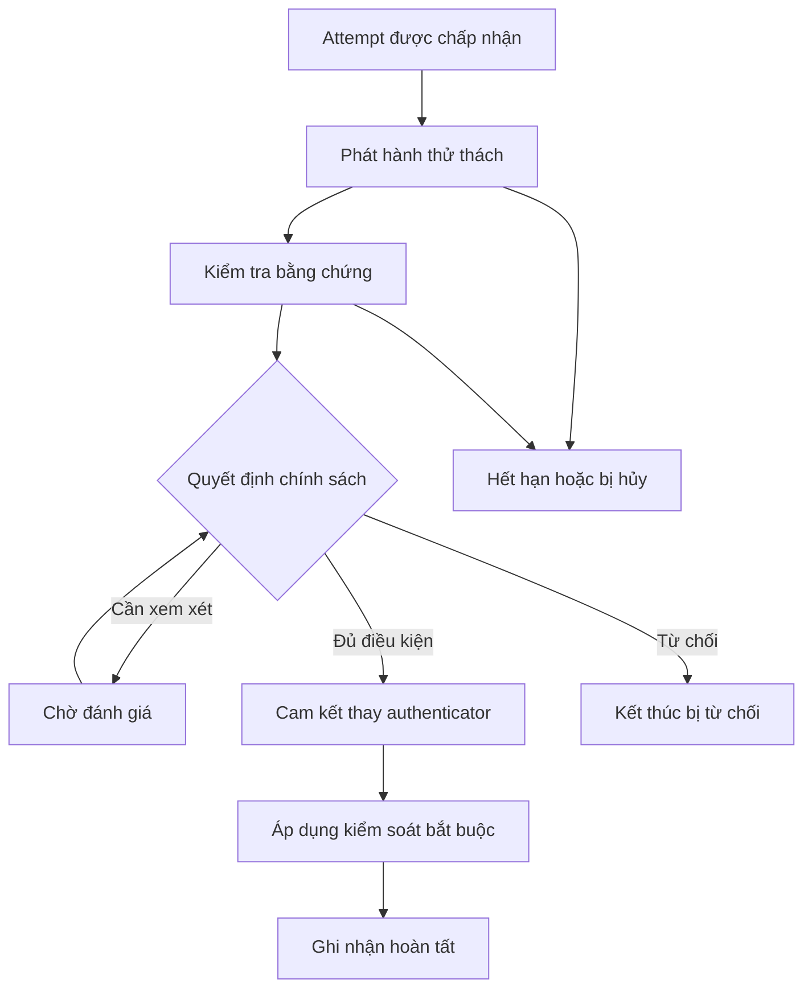

# Recovery completion rate — Đo tỷ lệ hoàn tất khôi phục tài khoản

## 1. Chỉ số này cần trả lời câu hỏi nào?

Người dùng bắt đầu khôi phục vì mất mật khẩu, MFA, passkey hoặc thiết bị xác thực. Hệ thống gửi thử thách, kiểm tra bằng chứng, có thể chờ đánh giá thủ công rồi mới cho thay thông tin xác thực và áp dụng kiểm soát session.

Trong module `SECURITY_AUTHENTICATION_ACCOUNT_RECOVERY`, recovery completion rate giúp trả lời: **trong những lần khôi phục thuộc một nhóm bắt đầu xác định, bao nhiêu lần đã hoàn tất theo tiêu chí của hệ thống trong thời gian quan sát?**

Đây không phải tỷ lệ HTTP 200, tỷ lệ email được nhà cung cấp chấp nhận hay tỷ lệ nhập đúng OTP. Những mốc đó có thể xảy ra trước khi tài khoản được khôi phục.

Một tỷ lệ cao cũng chưa chứng minh quy trình an toàn. Nếu hệ thống bỏ kiểm chứng danh tính hoặc gỡ MFA chỉ vì người yêu cầu biết email, tỷ lệ có thể tăng trong khi nguy cơ chiếm đoạt tài khoản tăng theo.

Bài thuộc chương Metrics, tập trung vào định nghĩa và sử dụng chỉ số. Các cửa sổ thời gian, tên bảng và mã trạng thái bên dưới là thiết kế minh họa; chúng không phải mức chuẩn bắt buộc cho mọi dịch vụ.

## 2. Chốt đơn vị đếm trước khi viết công thức

### 2.1. Request, attempt, case và account không giống nhau

| Đơn vị | Ví dụ | Rủi ro khi dùng làm mẫu số |
| --- | --- | --- |
| HTTP request | Một lần gọi gửi lại mã | Retry làm số lượng tăng dù không có hành trình mới |
| Recovery attempt | Một lần thử có định danh backend và vòng đời riêng | Một người có thể tạo nhiều attempt |
| Recovery case | Một hồ sơ gom các lần thử theo quy tắc nghiệp vụ | Quy tắc gom hồ sơ có thể làm thay đổi tỷ lệ |
| Account hoặc người dùng | Một tài khoản cần khôi phục | Không phải mọi người yêu cầu đã được xác minh là chủ tài khoản |

Trong bài, đơn vị chính là **canonical recovery attempt**: một lần thử được backend tạo bền vững, có `attempt_id` riêng và tiêu chí bắt đầu nhất quán.

Gửi lại mã trong cùng attempt không tạo thêm mẫu số. Khi hết hạn và người dùng chủ động mở một lần thử mới theo chính sách, lần thử mới có thể được tính thêm; quy tắc này phải được ghi trong hợp đồng chỉ số.

Không gộp tùy tiện các attempt chỉ vì có cùng IP. Một mạng công ty có thể có nhiều người dùng, còn một kẻ tấn công có thể thay IP liên tục.

### 2.2. Phải biết “bắt đầu” ở đâu

Một lựa chọn minh họa là phát sinh `ATTEMPT_STARTED` khi backend đã chấp nhận yêu cầu và lưu attempt thành công.

Theo định nghĩa này:

- Mở trang recovery nhưng chưa gửi yêu cầu thuộc lượt xem, chưa phải attempt.
- Request bị từ chối trước điểm chấp nhận thuộc chỉ số admission riêng.
- Retry cùng idempotency key trả về cùng attempt.
- Gửi lại thử thách trong attempt đang tồn tại không phát sinh start mới.

Nếu chỉ số bắt đầu ở thời điểm kiểm tra thành công OTP, phần lớn trở ngại trước đó đã bị loại khỏi mẫu số. Nó có thể là tỷ lệ hoàn tất sau xác minh, nhưng không đại diện cho toàn hành trình từ lúc bắt đầu.

### 2.3. Quy định phạm vi một lần và đặt phiên bản

Một hợp đồng chỉ số tối thiểu cần chỉ rõ:

```text
metric_definition_id = recovery_completion_v3
unit = canonical_attempt
start_boundary = durable_attempt_accepted
completion_boundary = policy_completion_committed
cohort_assignment = attempt_started_at
observation_horizon = 72 hours
environment = production
inclusion_policy = accepted_attempts_v2
```

Mốc 72 giờ chỉ là giả định để giải thích cách đo. Dịch vụ khác có thể cần cửa sổ khác vì thời gian chờ hoặc quy trình xác minh khác nhau.

Nếu thay mốc bắt đầu, cách loại traffic hoặc tiêu chí hoàn tất, cần quản lý thay đổi định nghĩa. Không nối hai chuỗi có ý nghĩa khác nhau rồi trình bày như một chuỗi liên tục.

## 3. Định nghĩa hoàn tất bằng kết quả nghiệp vụ đã cam kết

### 3.1. Không đánh đồng các mốc trong funnel

Một hành trình có thể có các mốc:



Các nhánh có thể khác theo phương thức. Không buộc mọi attempt đi qua cùng một OTP hoặc cùng một bước giấy tờ.

Ví dụ, `EVIDENCE_VERIFIED` chỉ nói bằng chứng đã qua kiểm tra tương ứng. Nếu thao tác thay MFA sau đó thất bại, attempt chưa hoàn tất theo định nghĩa trong bài.

### 3.2. Tiêu chí hoàn tất phải gắn với chính sách

Một chính sách có thể yêu cầu:

1. Đạt điều kiện xác minh của phương thức.
2. Lưu thay đổi authenticator thành công.
3. Vô hiệu quyền thực thi dùng một lần.
4. Đưa các kiểm soát session bắt buộc vào trạng thái có hiệu lực.
5. Hoàn thành điều kiện thông báo theo hợp đồng của chính sách.

Chỉ khi các điều kiện cần thiết được đáp ứng, backend ghi nhận `RECOVERY_COMPLETED`.

Nếu hệ thống phân tán, không phải mọi thao tác đều nằm trong một giao dịch database. Khi đó, cần một trạng thái trung gian và bằng chứng hoàn tất từng điều kiện. Không phát success chỉ vì đã enqueue một tác vụ thu hồi session mà quyền truy cập cũ vẫn còn sử dụng được.

Điều kiện thông báo cũng cần cụ thể: tạo yêu cầu gửi bền vững, nhà cung cấp chấp nhận, hay thực tế chuyển phát thành công là các mốc khác nhau. Không tuyên bố “đã được người dùng đọc” chỉ từ một callback gửi thành công.

### 3.3. Phân biệt recovery với đăng nhập sau recovery

Trong phạm vi hướng dẫn NIST, account recovery liên quan đến việc mất khả năng kiểm soát authenticator cần cho mức xác thực mong muốn. Đổi mật khẩu khi vẫn xác thực được bằng authenticator khác được phân loại là gắn authenticator mới. Hệ thống cần thống nhất taxonomy trước khi gom dữ liệu. [Nguồn: NIST SP 800-63B-4, mục 4.2](https://pages.nist.gov/800-63-4/sp800-63b.html).

Với luồng quên mật khẩu, OWASP khuyến nghị người dùng đăng nhập qua cơ chế thông thường sau khi đặt mật khẩu mới, thay vì tự động đăng nhập. Vì vậy, sự kiện login sau đó nên được đo riêng, không dùng việc tự cấp session để làm đẹp completion rate. [Nguồn: OWASP Forgot Password Cheat Sheet](https://cheatsheetseries.owasp.org/cheatsheets/Forgot_Password_Cheat_Sheet.html).

Dịch vụ có thể theo dõi thêm “khả năng sử dụng tài khoản sau khôi phục”, nhưng phải nêu rõ mốc và mẫu số của chỉ số đó.

## 4. Công thức theo cohort và cửa sổ quan sát

### 4.1. Cohort là tập các attempt bắt đầu trong cùng khoảng

Chọn khoảng bắt đầu `[a, b)`: bao gồm thời điểm `a`, không bao gồm `b`.

Gọi `C` là tập các attempt thỏa mãn phạm vi chỉ số và có:

```text
a <= started_at < b
```

Mỗi attempt chỉ xuất hiện một lần trong `C`.

Chọn cửa sổ theo dõi `H`. Trong ví dụ:

```text
H = 72 hours
deadline(i) = started_at(i) + H
```

Một attempt thành công trong cửa sổ nếu:

```text
completed_at không rỗng
started_at <= completed_at <= deadline
```

Bài chọn bao gồm mốc deadline. Đây là quy ước phải thống nhất giữa SQL, code và báo cáo.

### 4.2. Chỉ đánh giá hoàn chỉnh khi dữ liệu đủ trưởng thành

Gọi:

- `A`: thời điểm snapshot báo cáo.
- `W`: mốc thời gian sự kiện mà pipeline đánh giá đã thu thập đủ cho báo cáo.
- `W <= A`: dữ liệu hoàn chỉnh không đi trước thời điểm snapshot.

Tập các attempt đã đủ thời gian theo dõi là:

```text
M = { i thuộc C | started_at(i) + H <= W }
```

Khi đó:

```text
S = số attempt thuộc M hoàn tất trong H
N = số attempt thuộc M

RCR(H) = S / N                  khi N > 0
RCR(H) = không có dữ liệu        khi N = 0
```

Nếu hiển thị phần trăm, nhân kết quả với 100.

**Tử số và mẫu số phải cùng xuất phát từ `M`.** Không lấy những attempt mới đã thành công vào tử số nhưng bỏ những attempt mới còn chờ khỏi mẫu số.

### 4.3. Theo dõi cả mức trưởng thành của cohort

Nếu `|M| < |C|`, tỷ lệ trên mới đại diện cho phần đủ thời gian quan sát của cohort, chưa phải kết quả đầy đủ của toàn cohort.

Hiển thị thêm:

```text
maturity_coverage = |M| / |C|
```

Để công bố một ngày cohort là hoàn chỉnh, có thể dùng điều kiện bảo thủ:

```text
cohort_end + H <= W
```

Khi điều kiện này chưa đạt, dashboard cần ghi “chưa đủ thời gian theo dõi” hoặc “mature subset”, thay vì âm thầm coi các attempt còn trẻ là thất bại.

Nếu `C` rỗng, coverage cũng không có dữ liệu; không tự chuyển thành 100%.

### 4.4. Không dùng số hoàn tất hôm nay chia số bắt đầu hôm nay

Giả sử hôm nay có:

```text
100 attempt mới bắt đầu
810 attempt hoàn tất
```

Trong 810 lần hoàn tất có nhiều attempt bắt đầu từ những ngày trước. Phép chia `810 / 100 = 810%` không phải completion rate theo cohort.

Đây là tỷ số giữa hai luồng sự kiện trong một khoảng lịch. Nó có thể hỗ trợ hiểu tốc độ xử lý backlog, nhưng không phải xác suất một attempt bắt đầu hôm nay sẽ hoàn tất.

Tương tự, việc giới hạn tử số bằng `min(completed, started)` chỉ che lỗi định nghĩa, không sửa được nó.

## 5. Ví dụ tính đầy đủ với 1.000 attempt

Giả sử một cohort đã trưởng thành theo cửa sổ 72 giờ và được phân loại theo trạng thái tại deadline của từng attempt:

| Kết quả tại deadline | Số attempt |
| --- | ---: |
| Hoàn tất trong 72 giờ | 680 |
| Hết hạn | 120 |
| Người dùng hủy | 40 |
| Bị từ chối theo chính sách | 100 |
| Lỗi kỹ thuật đã kết thúc attempt | 20 |
| Vẫn chờ xử lý tại deadline | 40 |
| Tổng | 1.000 |

Kết quả:

```text
RCR(72h) = 680 / 1.000 = 68%
```

Các nhóm trong bảng được thiết kế loại trừ lẫn nhau. “Lỗi kỹ thuật” ở đây là kết quả kết thúc, không phải mỗi lỗi tạm thời có thể retry.

Nếu 15 trong 40 attempt còn chờ hoàn tất ở giờ thứ 90, completion trong 72 giờ vẫn là 68%. Một chỉ số eventual completion theo thời gian quan sát dài hơn có thể tăng; đó là chỉ số khác.

Ngược lại, nếu một sự kiện thực sự hoàn tất ở giờ thứ 60 nhưng đến kho dữ liệu muộn, kết quả 72 giờ có thể cần được điều chỉnh. Phải phân biệt **hoàn tất muộn trong nghiệp vụ** với **nhận muộn trong pipeline**.

Không sửa trạng thái nghiệp vụ của một attempt từ `WAITING_REVIEW` thành `FAILED` chỉ để đóng báo cáo 72 giờ. “Chưa hoàn tất trong H” là kết quả đo lường, không nhất thiết là trạng thái kết thúc của workflow.

## 6. Mẫu số nào đang được dùng?

### 6.1. Giữ một chỉ số toàn hành trình

Theo định nghĩa minh họa, mẫu số chính gồm các attempt đã được chấp nhận trong phạm vi đã công bố, kể cả những attempt sau đó bị từ chối hoặc không hoàn tất.

Điều này làm chỉ số phản ánh cả trở ngại, hành vi lạm dụng và cơ cấu traffic trong tập được chấp nhận. Nó không tự đại diện cho tỷ lệ thành công của người dùng hợp pháp.

Traffic bị chặn trước khi tạo attempt cần được đo bằng admission metrics riêng. Nếu thay đổi chính sách chặn đầu vào, phải xem đồng thời hai nhóm chỉ số vì lượng traffic đi vào mẫu số chính đã thay đổi.

### 6.2. Có thể có tỷ lệ có điều kiện, nhưng phải đặt tên khác

Ví dụ:

```text
RCR_from_accepted_attempt
RCR_after_evidence_verified
RCR_for_predefined_eligible_segment
```

Tỷ lệ sau xác minh có thể hữu ích để phát hiện lỗi tại bước commit hoặc kiểm soát session. Tuy nhiên, nó không cho biết bao nhiêu người bị kẹt trước xác minh.

Một segment “đủ điều kiện” cần có quy tắc xác định rõ, thời điểm phân loại và phiên bản. Không tạo định nghĩa vòng tròn “đủ điều kiện là những người cuối cùng thành công”.

Nếu thuộc tính chỉ biết sau kết quả, báo cáo phải giải thích giới hạn chọn mẫu. Không gọi đó là phân nhóm tại thời điểm bắt đầu.

### 6.3. Không tự nhận diện “người dùng thật” bằng tín hiệu yếu

Không coi mọi attempt không bị bot detector chặn là người dùng hợp pháp. Cũng không coi mọi người thất bại là kẻ tấn công.

Các nhãn xác nhận gian lận thường đến muộn và không bao phủ toàn bộ trường hợp. Nếu dùng nhãn để phân tích lại cohort, cần giữ thời điểm nhãn được biết và quy tắc điều chỉnh báo cáo.

Phân biệt rõ:

```text
attempt được chấp nhận
attempt đạt kiểm chứng
attempt được suy đoán ít rủi ro
attempt bị xác nhận là lạm dụng
```

Bốn nhóm này không phải các cách gọi khác nhau của cùng một tập.

## 7. Thiết kế sự kiện để đếm được một lần

### 7.1. Schema sự kiện tối thiểu

Một sự kiện hoàn tất có thể có dạng:

```json
{
  "event_id": "evt_942",
  "event_type": "RECOVERY_COMPLETED",
  "event_schema_version": 2,
  "metric_definition_id": "recovery_completion_v3",
  "attempt_id": "att_312",
  "tenant_ref": "tenant_example",
  "occurred_at": "2026-11-20T09:30:00Z",
  "ingested_at": "2026-11-20T09:30:04Z",
  "entry_method": "SAVED_RECOVERY_CODE",
  "final_method": "MANUAL_REVIEW",
  "policy_version": "recovery-policy-v8",
  "completion_contract": "policy-completion-v2",
  "state_version": 11,
  "environment": "production"
}
```

Đây chỉ là schema minh họa. `entry_method` và `final_method` có thể khác nhau vì có fallback.

`occurred_at` lấy từ hệ thống nghiệp vụ đáng tin cậy. `ingested_at` cho biết lúc hệ thống phân tích nhận dữ liệu. Thời gian trình duyệt không nên quyết định việc attempt đã hoàn tất trong cửa sổ hay chưa.

Không đưa OTP, mật khẩu, recovery code hoặc reset URL đầy đủ vào sự kiện. Những dữ liệu này không cần thiết để tính tỷ lệ.

### 7.2. Đếm attempt, không đếm số lần phát sự kiện

Pipeline có thể nhận cùng một sự kiện nhiều lần do retry. Hai lớp chống trùng thường cần được tách:

- `event_id` chống xử lý lại cùng một sự kiện.
- `attempt_id` cùng ràng buộc nghiệp vụ bảo đảm một attempt không có nhiều completion hợp lệ cho cùng hợp đồng.

Nếu consumer chỉ đếm số dòng `RECOVERY_COMPLETED`, một lần gửi lại có thể tạo hai success.

Kho tổng hợp nên có một dòng canonical cho mỗi attempt. Dòng đó giữ mốc bắt đầu, mốc hoàn tất được backend xác nhận và các thuộc tính phân nhóm cần thiết.

Nếu có nhiều completion mâu thuẫn cho cùng attempt, cần ghi nhận lỗi dữ liệu và đối chiếu nguồn nghiệp vụ. Không tùy tiện lấy thời điểm sớm nhất trong mọi trường hợp để biến kết quả thành thành công.

### 7.3. Phát sự kiện từ kết quả bền vững

Một cách thiết kế là ghi kết quả hoàn tất và outbox trong cùng giao dịch sau khi các điều kiện bắt buộc đã được đáp ứng.

Sau đó publisher chuyển sự kiện cho pipeline phân tích. Sự kiện có thể bị gửi lại; consumer vẫn phải idempotent.

Không phát completion từ một nút trên giao diện rồi coi nó là nguồn chính. Trang có thể báo thành công trước khi giao dịch backend rollback, hoặc bị client giả lập.

Nếu backend và kho phân tích lệch nhau, cần chỉ số đối soát và quy trình sửa dữ liệu. Không dùng dashboard đẹp làm bằng chứng rằng pipeline không mất sự kiện.

## 8. Event time, dữ liệu đến muộn và khả năng tái lập báo cáo

### 8.1. Watermark không đồng nghĩa với thời gian hiện tại

Báo cáo chạy lúc 12:00 không có nghĩa toàn bộ sự kiện trước 12:00 đã đến. Một shard hoặc nhà cung cấp có thể đang trễ.

`data_complete_through` nên dựa trên tình trạng nguồn và ingestion thực tế. Nếu các nguồn bắt buộc có tiến độ khác nhau, cần quy tắc xác định mức hoàn chỉnh chung.

Một watermark dựa vào phân bố độ trễ vẫn là giả định vận hành, không bảo đảm tuyệt đối rằng sẽ không có sự kiện muộn hơn. Bởi vậy, hệ thống cần chính sách restatement và nhãn chất lượng dữ liệu.

### 8.2. Lưu tham số của từng lần tính

Một bản kết quả có thể ghi:

```text
cohort_start
cohort_end
observation_horizon
report_as_of
data_complete_through
metric_definition_id
inclusion_policy_version
source_snapshot_id
computed_at
mature_starts
completed_within_horizon
data_quality_state
```

Nếu chỉ lưu số 68%, đội vận hành không thể biết nó được tính từ dữ liệu nào và với cửa sổ nào.

Để tái lập một báo cáo cũ, cần snapshot hoặc lịch sử dữ liệu tương ứng. Truy vấn một bảng mutable hôm nay với timestamp của tuần trước không tự tái tạo trạng thái mà pipeline đã biết ở tuần trước.

### 8.3. Không dùng thời gian ingest thay thời gian hoàn tất

Một attempt hoàn tất ở giờ thứ 71 nhưng được ingest ở giờ thứ 73 vẫn thuộc success trong 72 giờ theo định nghĩa event time của bài.

Một attempt hoàn tất ở giờ thứ 73 nhưng được ingest ngay lập tức không thuộc success trong 72 giờ.

Thay hai thời gian này cho nhau sẽ khiến độ trễ pipeline bị diễn giải thành trải nghiệm của người dùng.

## 9. Ví dụ SQL tính theo cohort

Giả sử có bảng snapshot `recovery_attempt_snapshot`, một dòng cho mỗi `attempt_id`. Dữ liệu đầu vào đã được đối soát, có `included_in_primary_metric` theo chính sách và có các cột thời gian kiểu `timestamptz`.

Truy vấn PostgreSQL sau tính phần cohort đã đủ thời gian quan sát. Các mốc thời gian và cửa sổ chỉ để minh họa:

```sql
WITH params AS (
    SELECT
        TIMESTAMPTZ '2026-11-20 00:00:00+00' AS cohort_start,
        TIMESTAMPTZ '2026-11-21 00:00:00+00' AS cohort_end,
        TIMESTAMPTZ '2026-11-24 00:00:00+00' AS report_as_of,
        TIMESTAMPTZ '2026-11-23 23:00:00+00' AS complete_through,
        INTERVAL '72 hours' AS horizon
),
cohort AS (
    SELECT
        a.attempt_id,
        a.started_at,
        a.completed_at,
        a.started_at + p.horizon AS deadline,
        a.started_at + p.horizon <= p.complete_through AS mature
    FROM recovery_attempt_snapshot a
    CROSS JOIN params p
    WHERE a.started_at >= p.cohort_start
      AND a.started_at < p.cohort_end
      AND a.environment = 'production'
      AND a.included_in_primary_metric
      AND a.metric_definition_id = 'recovery_completion_v3'
      AND p.complete_through <= p.report_as_of
),
counts AS (
    SELECT
        COUNT(*) AS cohort_starts,
        COUNT(*) FILTER (WHERE mature) AS mature_starts,
        COUNT(*) FILTER (
            WHERE mature
              AND completed_at >= started_at
              AND completed_at <= deadline
        ) AS completed_within_horizon
    FROM cohort
)
SELECT
    cohort_starts,
    mature_starts,
    completed_within_horizon,
    100.0 * completed_within_horizon
        / NULLIF(mature_starts, 0) AS completion_percent,
    100.0 * mature_starts
        / NULLIF(cohort_starts, 0) AS maturity_coverage_percent
FROM counts;
```

`FILTER` giới hạn các dòng đầu vào cho từng phép tổng hợp; `COUNT(*)` đếm dòng, còn `COUNT(column)` bỏ qua giá trị NULL. Các khác biệt này quan trọng khi `completed_at` có thể rỗng. [Nguồn cú pháp: PostgreSQL — Aggregate Expressions](https://www.postgresql.org/docs/current/sql-expressions.html#SYNTAX-AGGREGATES).

Ở ví dụ, toàn ngày cohort chưa trưởng thành vì watermark còn thiếu một giờ so với điều kiện `cohort_end + horizon`. Không gọi kết quả là tỷ lệ hoàn chỉnh của cả ngày nếu coverage chưa đạt đầy đủ.

Một số giới hạn cần xử lý trong job thật:

- Tham số không hợp lệ phải bị từ chối trước khi truy vấn; điều kiện trong SQL không thay thế kiểm tra đó.
- Snapshot phải thực sự tương ứng với `report_as_of`, không chỉ là một bảng hiện tại mang tên snapshot.
- Cần ràng buộc hoặc kiểm tra tính duy nhất của attempt trước khi `COUNT(*)`.
- `completed_at < started_at` là lỗi dữ liệu cần báo riêng, không chỉ bị loại âm thầm khỏi tử số.
- Phân tích theo tenant cần bộ lọc và quyền truy cập tương ứng.

Không thay mẫu số bằng `COUNT(completed_at)`. Làm vậy sẽ loại những attempt chưa thành công và có thể tạo kết quả 100% giả tạo.

## 10. Ví dụ Java xử lý cửa sổ và mẫu số rỗng

Ví dụ Java sau minh họa phần tính toán trên danh sách canonical đã được lọc đúng phạm vi. Nó không triển khai ingestion, phân loại eligibility hoặc pipeline chống gian lận.

```java
import java.time.Duration;
import java.time.Instant;
import java.util.HashSet;
import java.util.List;
import java.util.OptionalDouble;
import java.util.Set;

record RecoveryAttempt(
        String attemptId,
        Instant startedAt,
        Instant completedAt) {
}

record CompletionMeasurement(
        long cohortStarts,
        long matureStarts,
        long completedWithinHorizon) {

    OptionalDouble completionRate() {
        if (matureStarts == 0) {
            return OptionalDouble.empty();
        }
        return OptionalDouble.of(
                (double) completedWithinHorizon / matureStarts);
    }

    OptionalDouble maturityCoverage() {
        if (cohortStarts == 0) {
            return OptionalDouble.empty();
        }
        return OptionalDouble.of(
                (double) matureStarts / cohortStarts);
    }
}

final class RecoveryCompletionCalculator {

    CompletionMeasurement measure(
            List<RecoveryAttempt> canonicalAttempts,
            Instant cohortStart,
            Instant cohortEnd,
            Duration horizon,
            Instant reportAsOf,
            Instant completeThrough) {

        if (!cohortStart.isBefore(cohortEnd)
                || horizon.isZero()
                || horizon.isNegative()
                || completeThrough.isAfter(reportAsOf)) {
            throw new IllegalArgumentException("Invalid metric window");
        }

        Set<String> seenAttempts = new HashSet<>();
        long cohortStarts = 0;
        long matureStarts = 0;
        long completedWithinHorizon = 0;

        for (RecoveryAttempt attempt : canonicalAttempts) {
            Instant start = attempt.startedAt();

            if (start.isBefore(cohortStart)
                    || !start.isBefore(cohortEnd)) {
                continue;
            }

            if (!seenAttempts.add(attempt.attemptId())) {
                throw new IllegalStateException(
                        "Duplicate canonical attempt");
            }

            Instant completion = attempt.completedAt();
            if (completion != null && completion.isBefore(start)) {
                throw new IllegalStateException(
                        "Completion precedes attempt start");
            }

            cohortStarts++;
            Instant deadline = start.plus(horizon);

            if (deadline.isAfter(completeThrough)) {
                continue;
            }

            matureStarts++;
            if (completion != null && !completion.isAfter(deadline)) {
                completedWithinHorizon++;
            }
        }

        return new CompletionMeasurement(
                cohortStarts,
                matureStarts,
                completedWithinHorizon);
    }
}
```

Các điểm cần nhận ra:

- Cast sang `double` trước phép chia để tránh chia nguyên.
- Không dùng 0% cho mẫu số rỗng; `OptionalDouble.empty()` biểu thị không có dữ liệu.
- Attempt chưa trưởng thành không đi vào tử số hoặc mẫu số trưởng thành.
- Completion đúng deadline được tính theo quy ước đã chọn.
- Dữ liệu canonical trùng được báo lỗi thay vì làm tăng số đếm.
- Một completion sau deadline không được tính vào tỷ lệ trong H.

Đầu vào thật còn cần kiểm tra null, định danh hợp lệ, miền timestamp và giới hạn kích thước tập dữ liệu. Với dữ liệu lớn, thực hiện tổng hợp tại kho phân tích thay vì tải mọi attempt vào bộ nhớ ứng dụng.

Đây là code minh họa trong bài học, không phải thông báo rằng hệ thống đã được build hoặc kiểm thử.

## 11. Phân nhóm để hiểu nguyên nhân, không để thay đổi câu hỏi

### 11.1. Các chiều phân tích hữu ích

Có thể xem completion theo:

| Chiều | Câu hỏi hỗ trợ trả lời |
| --- | --- |
| Phương thức ở thời điểm bắt đầu | Nhóm đi vào bằng recovery code hay luồng khác có khác nhau không? |
| Mức rủi ro được xác định tại entry | Những attempt cần kiểm tra thêm có đang bị kẹt không? |
| Phiên bản chính sách | Tỷ lệ thay đổi có trùng thời điểm đổi policy không? |
| Kênh gửi thử thách | Một kênh giao nhận có xuất hiện trở ngại riêng không? |
| Client platform | Một phiên bản ứng dụng có lỗi giao diện không? |
| Nhóm thời gian chờ | Backlog có làm tăng số attempt vượt H không? |

Không phải chiều nào cũng có sẵn tại entry. Nếu method chỉ được chọn sau khi attempt bắt đầu, cần ghi thời điểm phân loại hoặc dùng giá trị `UNKNOWN_AT_ENTRY` phù hợp.

Với fallback, đếm mỗi attempt một lần trong tổng. “Entry method” và “final method” trả lời hai câu hỏi khác nhau; không cộng số attempt chạm từng kênh rồi coi đó là tổng attempt duy nhất.

### 11.2. Cẩn thận khi trộn các cửa sổ khác nhau

Tỷ lệ email trong 30 phút và tỷ lệ manual review trong 7 ngày không thể gộp rồi gọi là một RCR trong cùng H.

Có thể hiển thị nhiều cửa sổ cho từng phương thức để hiểu đường cong hoàn tất. Khi so sánh tổng, phải nêu rõ đang dùng cùng cửa sổ hay một tập tiêu chí khác nhau theo phương thức.

Đừng chọn H ngắn cho phiên bản cũ và H dài cho phiên bản mới rồi kết luận UX mới tốt hơn.

### 11.3. Ví dụ thay đổi cơ cấu làm tổng tỷ lệ giảm

Giả sử hai giai đoạn đều dùng cùng định nghĩa và cửa sổ:

| Phương thức | Giai đoạn A: bắt đầu | A: hoàn tất | A: tỷ lệ | Giai đoạn B: bắt đầu | B: hoàn tất | B: tỷ lệ |
| --- | ---: | ---: | ---: | ---: | ---: | ---: |
| Email | 900 | 810 | 90% | 100 | 92 | 92% |
| Manual review | 100 | 50 | 50% | 900 | 495 | 55% |
| Tổng | 1.000 | 860 | 86% | 1.000 | 587 | 58,7% |

Từng phương thức đều tăng tỷ lệ, nhưng tổng giảm do phần lớn attempt của giai đoạn B chuyển sang nhóm có tỷ lệ thấp hơn.

Để phân tích tác động cơ cấu, có thể tính thêm kết quả chuẩn hóa theo trọng số tham chiếu của A:

```text
standardized_B = 0,9 × 92% + 0,1 × 55% = 88,3%
```

Kết quả chuẩn hóa trả lời câu hỏi giả định về cùng cơ cấu, không thay thế tỷ lệ thực tế 58,7% của B. Dashboard nên hiển thị cả hai với nhãn rõ ràng nếu dùng phân tích này.

Khi tổng hợp nhiều nhóm cùng định nghĩa, tỷ lệ thực tế là tổng số hoàn tất chia tổng số bắt đầu trưởng thành. Không lấy trung bình cộng các phần trăm có quy mô mẫu khác nhau.

## 12. Giữ các chỉ số an toàn cạnh completion rate

### 12.1. Completion cao có thể là dấu hiệu xấu

Một thay đổi bỏ thời gian chờ hoặc giảm kiểm tra bằng chứng có thể làm RCR tăng. Nếu chỉ đánh giá bằng chỉ số này, đội sản phẩm có thể bị khuyến khích mở đường recovery yếu hơn đường đăng nhập bình thường.

Cần xem cùng những dữ kiện như:

- Sự cố chiếm đoạt được xác nhận có liên quan tới recovery.
- Số phản hồi “tôi không yêu cầu thay đổi này”.
- Khả năng session hoặc authenticator bị xâm phạm vẫn còn hiệu lực.
- Lỗi thực thi kiểm soát bắt buộc.
- Cơ cấu attempt bị từ chối hoặc bị chuyển sang kiểm tra thêm.

Mỗi dữ kiện cần định nghĩa riêng. Một phản hồi nghi ngờ không tự động là sự cố đã được xác nhận; không được gộp hai nhãn.

### 12.2. Chú ý độ trễ phát hiện sự cố

Giả sử muốn đo tỷ lệ completion có sự cố được xác nhận trong 14 ngày tiếp theo. Mẫu số phải là các completion đã có đủ 14 ngày theo dõi, và tử số phải thuộc chính tập đó.

Không chia sự cố phát hiện hôm nay cho số completion hôm nay. Sự cố có thể liên quan đến một cohort cũ.

Ngay cả khi đo đúng cửa sổ, kết quả vẫn là **tỷ lệ sự cố được biết và được gắn nhãn theo quy trình**, không phải toàn bộ tỷ lệ recovery trái phép thực tế. Không phát hiện được sự cố không chứng minh rằng không có sự cố.

Trong bài, 14 ngày cũng chỉ là ví dụ về cửa sổ theo dõi an toàn.

### 12.3. Không gọi mọi completion là “safe recovery”

Nếu tiêu chí nghiệp vụ đã được thực thi, có thể nói attempt hoàn tất theo hợp đồng chính sách. Không nên suy ra tất cả các attempt đó đều thuộc chủ tài khoản hợp pháp mà không có căn cứ độc lập.

Ngược lại, sự cố được xác nhận sau đó không nhất thiết làm mất sự kiện “workflow đã hoàn tất”. Có thể giữ sự kiện lịch sử và liên kết nhãn sự cố để phân tích chất lượng quyết định.

Nếu muốn tạo chỉ số đã điều chỉnh theo sự cố, hãy đặt tên, cửa sổ và phiên bản riêng, đồng thời giải thích vì sao kết quả cũ có thể thay đổi theo thời gian.

## 13. Tách dashboard cohort khỏi giám sát gần thời gian thực

### 13.1. Hai tầng phục vụ hai mục đích

**Tầng vận hành** cần phát hiện nhanh lỗi gửi thử thách, lỗi API, backlog tăng hoặc pipeline mất sự kiện.

**Tầng cohort** cần trả lời tỷ lệ hoàn tất trong cửa sổ theo dõi nhất quán, sau khi dữ liệu đã đủ trưởng thành.

Đợi 72 giờ mới báo một nhà cung cấp ngừng hoạt động là quá muộn. Nhưng lấy số completion trong 5 phút chia số start trong 5 phút cũng không thay được báo cáo cohort 72 giờ.

### 13.2. Counter sự kiện có ích nhưng không tự gắn được cohort

Ví dụ counter vận hành:

```text
recovery_events_total{event="started", method="saved_code"}
recovery_events_total{event="completed", method="saved_code"}
recovery_events_total{event="technical_failure", method="saved_code"}
```

Prometheus mô tả counter là loại số đếm tích lũy tăng và có thể reset khi tiến trình khởi động lại; đồng thời cảnh báo mỗi tổ hợp label tạo thêm time series. [Nguồn: Prometheus — Instrumentation](https://prometheus.io/docs/practices/instrumentation/).

Một tỷ số kiểu:

```promql
sum(increase(recovery_events_total{event="completed"}[1h]))
/
sum(increase(recovery_events_total{event="started"}[1h]))
```

chỉ so sánh hai luồng sự kiện trong một giờ. Nó không ghép từng completion với cohort bắt đầu, nên không được đặt nhãn là RCR(72h).

Nếu mẫu số bằng 0, không chuyển tùy tiện thành 100% hoặc dùng phép chặn để che kết quả bất thường.

### 13.3. Không đưa định danh attempt vào label metric

Trong thiết kế này, `attempt_id`, email, số điện thoại, recovery token và raw IP không phải label của counter.

Dữ liệu điều tra theo attempt nằm trong kho sự kiện có quyền truy cập phù hợp. Metric time series chỉ dùng những chiều hữu hạn, được lựa chọn cho nhu cầu giám sát.

Ngay cả tenant và policy version cũng cần kiểm soát số lượng giá trị và tổ hợp. Không đưa mọi chiều phân tích vào cùng một metric.

Không sampling tùy tiện các sự kiện start hoặc complete dùng cho tỷ lệ canonical. Nếu nguồn được lấy mẫu theo thiết kế khác, cần ước lượng và ghi rõ phương pháp; không trình bày số đếm mẫu như tổng đầy đủ.

## 14. Cách đọc dashboard và điều tra một đợt giảm tỷ lệ

### 14.1. Hiển thị đủ ngữ cảnh

Một ô dashboard hữu ích có thể hiển thị:

```text
Recovery completion trong 72 giờ
Cohort bắt đầu: 20/11/2026, theo timezone báo cáo đã công bố
Định nghĩa: recovery_completion_v3
Hoàn tất: 680
Mẫu số trưởng thành: 1.000
Tỷ lệ: 68%
Coverage trưởng thành: 100%
Chất lượng dữ liệu: đủ điều kiện công bố
Thời điểm snapshot và watermark: hiển thị riêng
```

Các ngày trong ví dụ chỉ minh họa. Dữ liệu sự kiện có thể lưu UTC, còn cohort theo ngày địa phương phải được chuyển thành khoảng UTC đúng với timezone đã chọn.

Cần có số đếm cạnh phần trăm. Tỷ lệ 100% từ hai attempt khác rất xa tỷ lệ 100% từ hàng chục nghìn attempt; dữ liệu ít không đủ để đưa ra kết luận mạnh.

Không có một mục tiêu 90% hay 99% tự nhiên phù hợp với mọi recovery. Mục tiêu phải xét phương thức, tập traffic, yêu cầu bảo đảm và rủi ro của dịch vụ.

### 14.2. Điều tra theo thứ tự các giả thuyết có thể kiểm tra

Khi RCR giảm, trước hết xác định định nghĩa, horizon và inclusion policy có đổi không. Sau đó xem coverage, watermark và đối soát sự kiện.

Nếu dữ liệu hợp lệ, phân tích cơ cấu phương thức và phiên bản chính sách. Tiếp tục xem các mốc funnel để xác định nơi người dùng dừng hoặc nơi hệ thống từ chối.

Ví dụ:

| Quan sát | Giả thuyết cần kiểm tra | Dữ kiện tiếp theo |
| --- | --- | --- |
| Start tăng mạnh, completion ổn định | Traffic lạm dụng tăng hoặc admission đổi | Phân bố nguồn và kết quả chặn |
| Delivery giảm trước completion | Kênh thử thách gặp sự cố | Phản hồi nhà cung cấp và độ trễ |
| Evidence đạt nhưng completion giảm | Lỗi commit hoặc kiểm soát sau xác minh | Sự kiện backend và trạng thái trung gian |
| Manual review vượt H | Backlog hoặc lịch vận hành thay đổi | Tuổi hồ sơ đang chờ |
| Chỉ dashboard giảm | Pipeline mất hoặc chậm dữ liệu | Đối soát nguồn và watermark |

Bảng thể hiện giả thuyết, không phải kết luận tự động. Completion giảm sau một đợt chặn gian lận có thể đi cùng cải thiện an toàn; cần xem chất lượng quyết định và tác động lên người dùng hợp pháp.

### 14.3. Đánh giá thay đổi sản phẩm bằng cùng hợp đồng đo

Nếu thử nghiệm giao diện hoặc phương thức mới, nên gắn nhóm thử nghiệm theo quy tắc xác định trước kết quả và giữ việc gán nhóm ổn định trong attempt.

Chờ các cohort so sánh đủ cửa sổ quan sát. Không so nhóm cũ đã theo dõi 72 giờ với nhóm mới chỉ có 6 giờ.

Nếu retry hoặc fallback tạo luồng khác, cần biết chúng vẫn thuộc attempt ban đầu hay mở attempt mới theo hợp đồng. Không để thay đổi giao diện vô tình thay cách đếm.

Mọi đánh giá cải thiện completion vẫn cần xem các chỉ số an toàn và dữ liệu đến muộn. Một kết quả tăng tỷ lệ chưa phải lý do để bỏ kiểm chứng hoặc thay đổi chính sách tự động.

## 15. Các điều kiện cần kiểm chứng trước khi tin vào kết quả

Một pipeline tính RCR nên có các kiểm tra dữ liệu tương ứng với hợp đồng:

| Điều kiện | Sai lệch có thể tạo ra |
| --- | --- |
| Một dòng canonical cho mỗi attempt | Retry làm tăng mẫu số hoặc tử số |
| Completion không trước start | Đồng hồ hoặc liên kết sự kiện sai |
| Tử số là tập con của mẫu số trưởng thành | Tỷ lệ trên 100% hoặc chọn lọc success mới |
| Mẫu số rỗng hiển thị không có dữ liệu | 0% giả bị hiểu thành sự cố |
| Attempt ở ranh giới cohort chỉ thuộc một khoảng | Đếm trùng giữa hai ngày |
| Completion đúng deadline có quy ước thống nhất | SQL và ứng dụng cho hai kết quả |
| Event time tách khỏi ingest time | Lỗi pipeline bị hiểu thành lỗi recovery |
| Metadata phân nhóm có thời điểm xác định | Fallback hoặc reclassification làm đổi cohort |
| Snapshot và phiên bản định nghĩa được lưu | Không tái lập được số liệu cũ |
| Dữ liệu lỗi được hiển thị riêng | Loại dữ liệu hỏng làm tỷ lệ trông tốt hơn |

Các mục này là yêu cầu kiểm chứng cho một triển khai, không phải báo cáo đã thực hiện kiểm thử trên hệ thống hiện có.

Khi đọc một con số completion rate, cần truy được bốn thành phần: **đơn vị đếm, điểm bắt đầu, tiêu chí hoàn tất và cửa sổ quan sát**. Sau đó mới có thể đánh giá thay đổi của con số là do trải nghiệm người dùng, cơ cấu traffic, quyết định bảo mật hay chất lượng dữ liệu.
