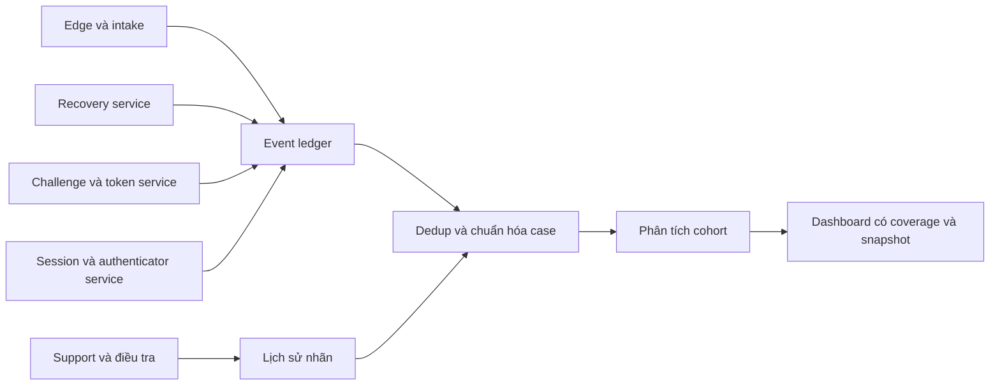

# Recovery abuse rate — Tỷ lệ lạm dụng luồng khôi phục tài khoản

## 1. Đo lạm dụng để trả lời câu hỏi nào?

Một hệ thống account recovery có thể báo tỷ lệ hoàn tất cao nhưng vẫn cho kẻ tấn công đăng ký MFA mới vào tài khoản của người khác. Ngược lại, số yêu cầu bị chặn tăng mạnh chưa chắc chứng minh hệ thống an toàn hơn: có thể đang có nhiều cuộc tấn công hơn, rule vừa trở nên quá nhạy hoặc một provider khiến người dùng thật bị đánh dấu nhầm.

Trong module `SECURITY_AUTHENTICATION_ACCOUNT_RECOVERY`, **recovery abuse rate** là nhóm chỉ số mô tả việc luồng khôi phục mật khẩu, MFA, passkey hoặc thiết bị xác thực bị sử dụng sai mục đích. Nó cần hỗ trợ đánh giá rủi ro, chống lạm dụng token dùng một lần, xác minh danh tính và kiểm soát session sau recovery.

Không nên có một ô duy nhất tên “abuse rate” mà không ghi rõ đang đếm điều gì. Trước khi dùng một tỷ lệ để thay policy, cần biết:

- Tử số là nghi ngờ, được báo cáo hay đã xác nhận?
- Mẫu số là HTTP request, recovery case, tài khoản hay lần recovery hoàn tất?
- Hai tập dữ liệu thuộc cùng thời gian và cùng phạm vi không?
- Kết quả điều tra đã đủ thời gian xuất hiện chưa?
- Hệ thống đang đo nỗ lực tấn công, quyết định chặn hay thiệt hại đã xảy ra?

Bài này xây dựng một bộ chỉ số có định nghĩa rõ, cách thu thập, ví dụ tính toán, SQL và PromQL minh họa. Các tên metric, ngưỡng và cửa sổ thời gian là lựa chọn thiết kế để học, không phải một chuẩn số liệu bắt buộc.

## 2. Định nghĩa “abuse” trước khi viết công thức

### 2.1. Các dạng lạm dụng liên quan recovery

| Nhóm | Ví dụ | Bằng chứng quan sát có thể có |
|---|---|---|
| Dò tài khoản | Gửi nhiều yêu cầu để suy ra tài khoản tồn tại | Mẫu truy vấn, khác biệt phản hồi, tập mục tiêu |
| Gây phiền nhiễu | Gửi lặp email hoặc SMS recovery tới người khác | Tần suất yêu cầu, phản ánh của chủ tài khoản |
| Đoán hoặc replay token | Thử token, dùng lại link đã tiêu thụ | Mã kiểm tra, ID challenge, trạng thái tiêu thụ |
| Giả mạo chủ tài khoản | Cung cấp thông tin nhằm qua bước xác minh | Hồ sơ điều tra, liên kết nguồn bằng chứng |
| Lạm dụng hỗ trợ | Gây áp lực để gỡ MFA hoặc đổi kênh recovery | Case hỗ trợ, approval và hành động thực tế |
| Chiếm quyền qua recovery | Người không có quyền được đăng ký authenticator hoặc lấy lại session | Kết quả điều tra liên kết với lần recovery |
| Lạm dụng tài nguyên | Tạo tải, tiêu thụ quota thông báo hoặc provider | Lưu lượng, chi phí và hành vi lặp có liên quan |

Không phải mọi lỗi nhập OTP, mọi token hết hạn hoặc mọi người dùng dùng VPN đều là abuse. Tín hiệu kỹ thuật cần được giải thích trong ngữ cảnh.

Một chiến dịch có thể thuộc nhiều nhóm. Nếu metric đếm **case có ít nhất một dạng abuse**, mỗi case chỉ được tính một lần vào tử số. Tổng các số đếm theo từng dạng có thể lớn hơn số case duy nhất; dashboard phải nói rõ các nhóm có chồng lấp.

### 2.2. Phân biệt tín hiệu với kết luận

Nên tách các lớp sau:

| Lớp | Ý nghĩa | Không được suy ra tự động |
|---|---|---|
| `SIGNAL` | Quan sát như request tăng hoặc token sai lặp lại | Người yêu cầu chắc chắn là kẻ tấn công |
| `SUSPECTED` | Rule hoặc người đánh giá cho rằng cần chú ý | Đã xác nhận có hành vi lạm dụng |
| `REPORTED` | Có báo cáo về recovery không được phép | Mọi báo cáo đều chính xác hoặc đã điều tra xong |
| `CONFIRMED_ABUSE` | Đã có kết luận theo tiêu chí và thẩm quyền xác định | Đã phát hiện hết mọi abuse trong quần thể |
| `CONFIRMED_LEGITIMATE` | Đã có kết luận đây là yêu cầu hợp lệ theo quy trình nhãn | Mọi yêu cầu chưa bị báo cáo cũng là hợp lệ |
| `INCONCLUSIVE` | Đã xem xét nhưng chưa đủ để kết luận | Có thể tùy ý tính vào nhóm sạch |
| `PENDING` | Chưa có kết luận cuối | Chắc chắn là không có abuse |

“Recovery thành công” là kết quả của luồng kỹ thuật. Nó không tự là nhãn `CONFIRMED_LEGITIMATE`; một cuộc chiếm đoạt chính là trường hợp kỹ thuật thành công nhưng không được phép.

NIST SP 800-63-4 phân biệt các metric về recovery attempts, suspected, reported và confirmed unauthorized access hoặc fraud trong chương trình đánh giá liên tục. Bài này áp dụng cách phân biệt đó cho riêng recovery; các công thức dưới đây có mẫu số được định nghĩa riêng, không phải sao chép một tỷ lệ chung của mọi transaction. [NIST SP 800-63-4 — Performance Metrics](https://pages.nist.gov/800-63-4/sp800-63/dirm/#performance-metrics)

## 3. Chọn đơn vị đếm và giữ nguyên qua tử số, mẫu số

### 3.1. Request, case và account là ba quần thể khác nhau

Giả sử một người dùng mở một recovery case, gửi lại thông báo hai lần và nhập OTP ba lần. Một chiến dịch khác gửi 5.000 HTTP request nhưng chỉ tạo được 50 case do giới hạn tại cổng vào.

Ta có thể đếm:

- **Request**: lần gọi endpoint được quan sát tại một ranh giới xác định.
- **Case**: một lần khởi tạo và tiếp tục quy trình recovery, có ID do server quản lý.
- **Account**: tài khoản mục tiêu đã được định vị nội bộ.
- **Challenge**: một thử thách hoặc mã phát hành trong case.
- **Completion**: lần luồng xác nhận hoàn tất theo định nghĩa nghiệp vụ.
- **Campaign**: cụm hành vi được điều tra là có liên quan.

Không lấy số request bị chặn chia cho số case được tạo rồi gọi là tỷ lệ case lạm dụng. Tỷ lệ đó có thể vượt 100% vì hai đơn vị khác nhau.

Đối với “case abuse rate”, một case là đơn vị cơ bản. Một case có 20 lần thử token không trở thành 20 case. Nếu kẻ tấn công cố tình tạo 20 case mới, đó là 20 case theo định nghĩa, đồng thời có thể cần một metric riêng theo account hoặc campaign.

### 3.2. Ranh giới tiếp nhận ảnh hưởng mẫu số

Nếu chỉ tạo case sau khi vượt qua bot filter, các request bị chặn trước đó không có trong quần thể case. Vì vậy, cần có số liệu riêng cho:

```text
Lưu lượng tới edge
    -> yêu cầu được tiếp nhận vào recovery
    -> case được tạo
    -> challenge và quyết định
    -> recovery hoàn tất
    -> kết quả điều tra sau đó
```

Không nhìn tỷ lệ case thấp rồi kết luận không có tấn công ở edge. Cũng không coi mọi request bị bot filter chặn đều là abuse đã xác nhận.

Hệ thống có thể theo dõi các intake chưa định vị được tài khoản bằng tham chiếu nội bộ phù hợp. Không tạo khác biệt công khai về ID hoặc phản hồi để vô tình tiết lộ tài khoản có tồn tại hay không.

### 3.3. Hợp đồng đo lường tối thiểu

Một định nghĩa metric nên gồm:

```yaml
name: observed_confirmed_recovery_case_abuse_ratio
unit: recovery_case
cohort_time_field: initiated_at
numerator: distinct_cases_with_confirmed_abuse_as_of_snapshot
denominator: distinct_cases_in_cohort
observation_horizon: explicitly_recorded
scope: explicitly_recorded
label_policy_version: explicitly_recorded
exclusions: explicitly_recorded
zero_denominator: no_data
```

Hợp đồng còn cần nguồn dữ liệu, chủ sở hữu, quy tắc dedup, độ trễ chấp nhận và cách sửa báo cáo khi nhãn thay đổi.

## 4. Bộ tỷ lệ nên dùng thay cho một con số mơ hồ

Gọi:

- `C(W)`: tập case khởi tạo trong cửa sổ W.
- `N`: số case duy nhất trong tập đó.
- `S`: số case có cờ nghi ngờ theo định nghĩa đã chọn.
- `A`: số case được xác nhận abuse tại thời điểm snapshot.
- `L`: số case được xác nhận hợp lệ tại thời điểm snapshot.
- `R`: số case thuộc nhóm có báo cáo abuse, theo quy tắc tiếp nhận báo cáo.
- `K`: số case trong cohort đã hoàn tất recovery tại snapshot.
- `U`: số case trong K được xác nhận là recovery hoàn tất không được phép.

Các tử số đều là tập con của quần thể tương ứng. Mốc “snapshot” là thời điểm dữ liệu được chốt cho phép tính, không nhất thiết là hiện tại.

### 4.1. Tỷ lệ nghi ngờ

```text
Suspected case ratio = S / N
```

Phải ghi rõ `S` là nghi ngờ ở lần đánh giá đầu tiên hay bị đánh dấu ở bất kỳ bước nào trong cửa sổ quan sát. Hai định nghĩa này không thể trộn lẫn.

Tỷ lệ này phản ánh tín hiệu của bộ phát hiện. Nó có thể tăng khi tấn công tăng, khi rule nhạy hơn hoặc khi hành vi người dùng thay đổi.

### 4.2. Tỷ lệ abuse đã xác nhận trên toàn cohort

```text
Observed confirmed abuse ratio = A / N
```

Đây là phần abuse **đã biết** trong cohort theo quy trình điều tra hiện có. Nếu còn case chưa điều tra, bị bỏ sót hoặc chưa có phản hồi, không được gọi nó là tỷ lệ abuse thật của toàn hệ thống.

Muốn so sánh các tuần, cần cùng định nghĩa, phạm vi, thời gian quan sát và chất lượng nhãn.

### 4.3. Tỷ lệ abuse trong nhóm đã có kết luận xác định

```text
Adjudicated abuse ratio = A / (A + L)
Determinate-label coverage = (A + L) / N
```

Tỷ lệ đầu trả lời câu hỏi khác: trong nhóm có kết luận abuse hoặc hợp lệ, bao nhiêu là abuse? Nó không tự đại diện cho mọi case nếu việc điều tra tập trung vào nhóm rủi ro cao.

Phải hiển thị coverage bên cạnh. `INCONCLUSIVE` và `PENDING` không được âm thầm đưa vào L.

### 4.4. Tỷ lệ có báo cáo

```text
Reported case ratio = R / N
```

Một case có nhiều cuộc gọi khiếu nại vẫn chỉ là một case có báo cáo trong phép tính này. Tổng số cuộc gọi là một metric workload khác.

Một báo cáo bị rút lại hoặc đính chính cần lịch sử và quy tắc snapshot. Không ghi đè dữ liệu cũ mà không thể tái dựng báo cáo đã phát hành.

### 4.5. Tỷ lệ recovery hoàn tất không được phép

```text
Confirmed unauthorized completion ratio = U / K
Unauthorized completions per 10,000 completions = 10,000 * U / K
```

Chỉ số này tập trung vào tác động nghiêm trọng: recovery đã hoàn tất nhưng không được phép. Nó khác với tỷ lệ nỗ lực abuse và khác tỷ lệ chặn.

Muốn dùng cửa sổ theo `completed_at` thay vì `initiated_at`, phải định nghĩa một cohort mới dựa trên completion và lấy cả tử số, mẫu số từ cohort mới đó. Không lấy U của các case cũ được phát hiện hôm nay chia cho K của các case mới hoàn tất hôm nay.

### 4.6. Tỷ lệ chặn là metric về hành động

```text
Blocked case ratio = distinct_cases_with_block / N
```

Một case bị challenge không nhất thiết đã bị block; một case có thể vượt challenge và tiếp tục. Nếu định nghĩa “block” là quyết định đầu tiên, phải dùng cùng thời điểm đánh giá cho mẫu số.

Tỷ lệ chặn cao không tự là thành công. Cần xem thêm abuse lọt qua, người dùng hợp lệ bị cản trở, thời gian recovery và workload hỗ trợ.

## 5. Ví dụ tính toán trên cùng một cohort

Giả sử một cohort có 10.000 recovery case. Tại một snapshot đã ghi rõ, nhãn hiện tại phân bố như sau:

| Nhãn kết luận | Số case |
|---|---:|
| `CONFIRMED_ABUSE` | 100 |
| `CONFIRMED_LEGITIMATE` | 7.900 |
| `INCONCLUSIVE` | 500 |
| `PENDING` | 1.500 |
| Tổng | 10.000 |

Ngoài ra:

- 800 case bị đánh dấu nghi ngờ theo định nghĩa “có cờ trong thời gian quan sát”.
- 7.000 case đã hoàn tất recovery tại snapshot.
- Trong 7.000 case hoàn tất, 12 case được xác nhận hoàn tất không được phép.
- Các số đếm đều được dedup theo cùng khóa case.

### 5.1. Các tỷ lệ không thay thế nhau

```text
Suspected case ratio:
800 / 10,000 = 8%

Observed confirmed abuse ratio:
100 / 10,000 = 1%

Adjudicated abuse ratio:
100 / (100 + 7,900) = 1.25%

Determinate-label coverage:
(100 + 7,900) / 10,000 = 80%

Confirmed unauthorized completion ratio:
12 / 7,000 ≈ 0.1714%

Unauthorized completions per 10,000 completions:
10,000 * 12 / 7,000 ≈ 17.14
```

12 case hoàn tất không được phép là tập con của 100 case abuse đã xác nhận trong ví dụ này. 88 case còn lại không thể tự động gọi là “tấn công đã chặn thành công”: một số có thể chưa hoàn tất, bỏ dở hoặc thuộc loại gây phiền nhiễu.

Tương tự, 800 case nghi ngờ không phải 800 case abuse đã xác nhận.

### 5.2. Điều gì còn chưa biết?

Có 2.000 case thuộc `INCONCLUSIVE` hoặc `PENDING`. Nếu tạm giả định các nhãn đã xác định là đúng và không thay đổi, số abuse có thể từ 100 đến 2.100 tùy kết quả của nhóm chưa xác định, tương ứng từ 1% đến 21%.

Đây chỉ là khoảng giới hạn theo số case chưa có kết luận, **không phải khoảng tin cậy thống kê** và không phải dự báo rằng tỷ lệ thật gần một đầu nào đó. Nếu nhãn có thể sai hoặc bỏ sót, giả định của phép giới hạn này cũng không còn đủ.

Một dashboard chỉ ghi “abuse = 1%” nhưng giấu 20% chưa có kết luận sẽ khiến người đọc tự tin quá mức.

### 5.3. Kiểm tra chất lượng của cờ nghi ngờ

Giả sử 800 case có cờ được phân bố:

| Cờ nghi ngờ | Confirmed abuse | Confirmed legitimate | Inconclusive | Pending | Tổng |
|---|---:|---:|---:|---:|---:|
| Có | 80 | 100 | 200 | 420 | 800 |
| Không | 20 | 7.800 | 300 | 1.080 | 9.200 |
| Tổng | 100 | 7.900 | 500 | 1.500 | 10.000 |

Trong tập đã có kết luận xác định:

```text
Precision của cờ trong nhóm đã có nhãn:
80 / (80 + 100) ≈ 44.44%

Tỷ lệ phát hiện trong các case abuse đã được xác nhận:
80 / (80 + 20) = 80%

Tỷ lệ có cờ trong các case đã xác nhận hợp lệ:
100 / 7,900 ≈ 1.27%

Coverage nhãn xác định riêng trong nhóm có cờ:
(80 + 100) / 800 = 22.5%
```

Không gọi `80 / 800 = 10%` là precision nếu 620 case có cờ còn chưa xác định. Đó chỉ là phần case có cờ đã được xác nhận abuse tại snapshot.

Các tỷ lệ dựa trên nhãn có thể bị lệch nếu ưu tiên điều tra case có cờ. Muốn ước lượng chất lượng trên toàn quần thể, cần một kế hoạch lấy mẫu và đánh giá cả nhóm không có cờ, với quyền truy cập và bảo vệ dữ liệu phù hợp.

## 6. Cửa sổ thời gian, cohort và nhãn đến muộn

### 6.1. Hai đồng hồ quan trọng

Một case có thể xảy ra vào ngày 01, chủ tài khoản báo vào ngày 05 và đội điều tra xác nhận vào ngày 10.

Cần phân biệt:

- `occurred_at`: hành vi hoặc outcome xảy ra khi nào.
- `recorded_at`: hệ thống biết và ghi nhận thông tin khi nào.

Đối với nhãn điều tra, còn có thể lưu `decided_at` và version. Không dùng thời điểm xử lý batch để thay thế mọi mốc.

Nếu muốn trả lời “ngày 06 chúng ta đã biết gì?”, không được dùng một nhãn chỉ được ghi nhận vào ngày 10. Nếu muốn tái đánh giá cohort ngày 01 theo hiểu biết hiện tại, có thể dùng nhãn mới nhưng phải gọi đó là báo cáo được cập nhật.

### 6.2. Ba cách báo cáo hợp lệ nhưng khác nhau

| Cách nhìn | Câu hỏi | Điểm cần ghi |
|---|---|---|
| Theo thời gian phát hiện | Hôm nay phát hiện bao nhiêu vụ? | Có thể liên quan case khởi tạo trước hôm nay |
| Cohort theo snapshot hiện tại | Các case khởi tạo trong W có nhãn gì tính đến T? | W, T, độ tuổi cohort và coverage |
| Cohort ở cùng độ tuổi | Mỗi case có kết quả gì khi đủ H ngày tuổi? | H và quy tắc dùng nhãn đã biết đến mốc đó |

Ví dụ chọn H = 14 ngày chỉ là giả định. Để tính chỉ số “đã biết khi case đủ 14 ngày”, mỗi case chỉ dùng thông tin đã ghi nhận đến `initiated_at + 14 ngày`. Một nhãn xuất hiện ngày thứ 15 không được đưa ngược vào snapshot ngày thứ 14.

Nếu thay vì vậy muốn “outcome xảy ra trong 14 ngày và được điều tra sau đó”, phải có hai giới hạn riêng: cửa sổ xảy ra outcome và thời gian chốt nhãn. Không gọi hai định nghĩa này bằng cùng một tên.

### 6.3. Cohort chưa đủ tuổi không phải dữ liệu sạch

Một rollout mới chạy hai ngày có thể chưa có khiếu nại nào. Điều đó không chứng minh abuse giảm so với một rollout đã quan sát một tháng.

Dashboard nên ghi `PROVISIONAL` cho cohort chưa đủ tuổi theo định nghĩa, hiển thị phân bố độ trễ báo cáo và điều tra, đồng thời giữ một báo cáo trưởng thành để so sánh.

Không ép mọi nhãn pending thành legitimate khi đến ngày phát hành báo cáo. Có thể công bố số đã biết, coverage và giới hạn của kết quả.

## 7. Pipeline dữ liệu và chất lượng nhãn

### 7.1. Nguồn dữ liệu cần nối

Một mô hình tổng quát:



Metric vận hành có thể đi trực tiếp từ service đến hệ thống monitoring. Phân tích cohort cần ledger và nhãn có version để tái dựng dữ liệu.

### 7.2. Schema sự kiện tối thiểu

Ví dụ dùng dữ liệu giả:

```json
{
  "eventId": "evt_demo_417",
  "tenantRef": "tenant_demo",
  "recoveryCaseId": "rc_demo_85",
  "eventType": "RECOVERY_INITIAL_ASSESSMENT",
  "recoveryMethod": "MFA_RECOVERY",
  "assessment": "SUSPECTED",
  "decision": "REVIEW",
  "policyVersion": "recovery-policy-v6",
  "occurredAt": "2026-11-24T02:00:00Z",
  "recordedAt": "2026-11-24T02:00:01Z",
  "schemaVersion": 1
}
```

Ledger có thể cần các field khác tùy kiến trúc, nhưng không chứa OTP, reset token, cookie, recovery code hoặc khóa bí mật. ID tương quan không có quyền xác thực thường phù hợp hơn lưu giá trị token.

Thông tin như IP hoặc thiết bị chỉ được thu thập, sử dụng và giữ theo mục đích đã xác định; không biến metrics thành kho theo dõi không có giới hạn.

### 7.3. Một case, nhiều sự kiện, nhiều version nhãn

Khóa nghiệp vụ nên bao gồm tenant và case. Việc dedup delivery dùng `eventId`, còn dedup số case dùng khóa case; đây là hai công việc khác nhau.

Một event bị gửi lại do outbox retry không được tăng số case. Một nhãn sửa từ suspected sang confirmed cũng không tạo ra case mới.

Lịch sử nhãn nên ghi:

```text
tenant_ref
recovery_case_id
label_version
adjudication_status
abuse_outcome
label_policy_version
evidence_ref
recorded_at
reviewer_ref
```

`abuse_outcome` giúp phân biệt attempt, gây phiền nhiễu và recovery hoàn tất không được phép. Nhãn về intent hoặc quyền của người yêu cầu không nên bị đồng nhất với quyết định của risk engine.

### 7.4. Quy tắc gắn nhãn và hiệu chỉnh

Cần quy định nguồn đủ tin cậy để kết luận, mức bằng chứng, cách xử lý tranh chấp, ai được sửa và khi nào đánh giá lại.

Một tín hiệu “IP nằm trong danh sách rủi ro” không nên vừa tự tạo nhãn confirmed vừa được dùng để chứng minh rule dựa trên IP có precision cao. Đó là vòng tự xác nhận.

Để giảm thiên lệch, có thể đánh giá mẫu từ các nhóm khác nhau, có kiểm tra độc lập theo quy trình và ghi rõ phương pháp lấy mẫu. Khi lấy mẫu không đều, tỷ lệ thô của mẫu không tự là tỷ lệ toàn quần thể; cần phương pháp suy rộng phù hợp.

### 7.5. Chỉ số chất lượng dữ liệu đi kèm

Theo dõi ít nhất:

- Tỷ lệ thiếu case ID, method hoặc policy version.
- Số event delivery trùng và số case nghi bị tách sai.
- Độ trễ event và độ trễ nhãn.
- Coverage nhãn theo phương thức recovery, tenant group và kênh hỗ trợ.
- Tỷ lệ nhãn bị sửa hoặc bất đồng sau review.
- Chênh lệch số case giữa nguồn nghiệp vụ và kho phân tích.
- Tỷ lệ completion không nối được với quyết định hoặc nhãn liên quan.

Nếu pipeline điều tra ngừng nhận dữ liệu, abuse đã xác nhận có thể giảm giả tạo. Cảnh báo chất lượng dữ liệu phải giúp người xem nhận ra tình huống đó.

## 8. SQL minh họa: tính cohort theo snapshot

Giả sử kho phân tích có ba bảng:

- `recovery_cases`: một dòng cho mỗi khóa `(tenant_ref, recovery_case_id)`, có `initiated_at`, `recorded_at` và `recovery_method`.
- `recovery_completion_events`: sự kiện hoàn tất đã dedup delivery, có thời điểm xảy ra và thời điểm được ghi nhận.
- `recovery_case_adjudications`: lịch sử nhãn được append theo version, có `adjudication_status`, `abuse_outcome` và `recorded_at`.

Ví dụ dùng cú pháp PostgreSQL. Các tham số `:tenant_ref`, `:start_at`, `:end_at`, `:as_of` là named parameter do lớp truy cập dữ liệu bind, không phải chuỗi để nối trực tiếp từ input.

Điều kiện đầu vào là `start_at < end_at <= as_of`. Tất cả thời gian được chuẩn hóa nhất quán, chẳng hạn bằng timestamp có timezone.

```sql
WITH cohort AS (
    SELECT
        tenant_ref,
        recovery_case_id,
        recovery_method
    FROM recovery_cases
    WHERE tenant_ref = :tenant_ref
      AND initiated_at >= :start_at
      AND initiated_at < :end_at
      AND recorded_at <= :as_of
),
ranked_labels AS (
    SELECT
        a.tenant_ref,
        a.recovery_case_id,
        a.adjudication_status,
        a.abuse_outcome,
        ROW_NUMBER() OVER (
            PARTITION BY a.tenant_ref, a.recovery_case_id
            ORDER BY a.recorded_at DESC, a.label_version DESC
        ) AS rn
    FROM recovery_case_adjudications a
    JOIN cohort c
      ON c.tenant_ref = a.tenant_ref
     AND c.recovery_case_id = a.recovery_case_id
    WHERE a.recorded_at <= :as_of
),
completed_cases AS (
    SELECT DISTINCT
        e.tenant_ref,
        e.recovery_case_id
    FROM recovery_completion_events e
    JOIN cohort c
      ON c.tenant_ref = e.tenant_ref
     AND c.recovery_case_id = e.recovery_case_id
    WHERE e.completed_at <= :as_of
      AND e.recorded_at <= :as_of
),
per_case AS (
    SELECT
        c.tenant_ref,
        c.recovery_case_id,
        c.recovery_method,
        COALESCE(a.adjudication_status, 'PENDING') AS label,
        a.abuse_outcome,
        (k.recovery_case_id IS NOT NULL) AS completed
    FROM cohort c
    LEFT JOIN ranked_labels a
      ON a.tenant_ref = c.tenant_ref
     AND a.recovery_case_id = c.recovery_case_id
     AND a.rn = 1
    LEFT JOIN completed_cases k
      ON k.tenant_ref = c.tenant_ref
     AND k.recovery_case_id = c.recovery_case_id
),
counts AS (
    SELECT
        COUNT(*) AS total_cases,
        COUNT(*) FILTER (
            WHERE label = 'CONFIRMED_ABUSE'
        ) AS abuse_cases,
        COUNT(*) FILTER (
            WHERE label = 'CONFIRMED_LEGITIMATE'
        ) AS legitimate_cases,
        COUNT(*) FILTER (
            WHERE label = 'INCONCLUSIVE'
        ) AS inconclusive_cases,
        COUNT(*) FILTER (
            WHERE label = 'PENDING'
        ) AS pending_cases,
        COUNT(*) FILTER (
            WHERE completed
        ) AS completed_cases,
        COUNT(*) FILTER (
            WHERE completed
              AND label = 'CONFIRMED_ABUSE'
              AND abuse_outcome = 'UNAUTHORIZED_COMPLETION'
        ) AS unauthorized_completed_cases
    FROM per_case
)
SELECT
    *,
    1.0 * abuse_cases
        / NULLIF(total_cases, 0) AS observed_confirmed_abuse_ratio,
    1.0 * abuse_cases
        / NULLIF(abuse_cases + legitimate_cases, 0)
        AS adjudicated_abuse_ratio,
    1.0 * (abuse_cases + legitimate_cases)
        / NULLIF(total_cases, 0) AS determinate_label_coverage,
    1.0 * unauthorized_completed_cases
        / NULLIF(completed_cases, 0)
        AS unauthorized_completion_ratio
FROM counts;
```

### 8.1. Vì sao cần các bước trung gian?

`ranked_labels` chọn đúng một nhãn mới nhất đã biết tại snapshot. Nếu join trực tiếp toàn bộ lịch sử nhãn vào case, cùng một case có thể bị đếm nhiều lần.

`completed_cases` cũng đưa dữ liệu về một dòng cho mỗi case. Nhiều sự kiện retry hoặc thông báo sau completion không được nhân mẫu số.

`recorded_at <= as_of` ngăn dùng thông tin chỉ được biết sau snapshot. Điều kiện `completed_at <= as_of` đồng thời chặn outcome xảy ra sau mốc đang báo cáo.

`NULLIF` trả tỷ lệ không xác định khi mẫu số bằng 0. Dashboard nên thể hiện `NO_DATA`, không đổi thành 0% và tô xanh.

Cú pháp window function và aggregate `FILTER` được mô tả trong tài liệu PostgreSQL. [PostgreSQL — Window Functions](https://www.postgresql.org/docs/current/tutorial-window.html), [PostgreSQL — Aggregate Expressions](https://www.postgresql.org/docs/current/sql-expressions.html#SYNTAX-AGGREGATES)

### 8.2. Giới hạn cần giữ rõ

Query trên là cohort khởi tạo trong W, biết thông tin đến T. Nó không tự tạo snapshot ở cùng độ tuổi H cho từng case. Muốn đo ở tuổi H, cần đưa `initiated_at` vào cohort và dùng cutoff riêng cho mỗi case trong cả nhãn lẫn completion.

Query cũng giả định case fact không bị sửa âm thầm và enum nhãn được kiểm soát. Nếu hệ thống cho phép sửa các field nền tảng, cần lịch sử hoặc snapshot dữ liệu đủ để tái dựng.

Một nhãn `UNAUTHORIZED_COMPLETION` không nối được với completion event là lỗi chất lượng dữ liệu cần điều tra, không chỉ bỏ qua rồi coi tỷ lệ thấp là tốt.

Phải bind tenant từ phạm vi đã được phân quyền. Việc có điều kiện `tenant_ref = :tenant_ref` không tự bảo vệ được nếu client được chọn tùy ý tenant mà service không kiểm tra.

## 9. Metric vận hành với Prometheus

### 9.1. Tách monitoring nhanh khỏi kết luận cohort

Monitoring cần phát hiện thay đổi trong vài phút. Báo cáo abuse đã xác nhận thường cần nhãn đến muộn và khả năng sửa kết luận. Không nên ép cả hai vào cùng một counter.

Một counter minh họa:

```text
recovery_initial_assessments_total{
  method="MFA_RECOVERY",
  assessment="SUSPECTED",
  decision="REVIEW"
}
```

Counter tăng khi case có **quyết định đánh giá ban đầu** được ghi nhận. Mỗi case chỉ có một lần đánh giá ban đầu theo định nghĩa nghiệp vụ; những lần đánh giá lại dùng metric khác.

Tỷ lệ từ counter này là “nghi ngờ ở đánh giá ban đầu”. Nó khác tỷ lệ “có cờ ở bất kỳ bước nào” trong ví dụ cohort. Không so sánh hai con số trực tiếp mà không ghi khác biệt.

### 9.2. Tính tỷ lệ theo cùng một quần thể

PromQL minh họa:

```promql
sum by (method) (
  rate(recovery_initial_assessments_total{
    assessment="SUSPECTED"
  }[15m])
)
/
sum by (method) (
  rate(recovery_initial_assessments_total[15m])
)
```

Kết quả là ratio từ 0 đến 1 khi dữ liệu và định nghĩa nhất quán; giao diện có thể nhân 100 để hiển thị phần trăm.

Áp dụng `rate()` trên từng time series rồi mới `sum` giúp xử lý counter reset đúng theo từng nguồn. Tài liệu Prometheus cũng lưu ý `rate()` là tốc độ tăng trung bình và có ngoại suy theo khoảng quan sát; nó không phải sổ cái đếm case chính xác. [Prometheus — rate()](https://prometheus.io/docs/prometheus/latest/querying/functions/#rate)

Để xem số quan sát ước lượng trong cửa sổ:

```promql
sum by (method) (
  increase(recovery_initial_assessments_total[15m])
)
```

Không dùng `clamp_min(denominator, 1)` chỉ để dashboard luôn có một số đẹp. Mẫu số 0, series vắng mặt và dữ liệu chưa đủ cần được xử lý như trạng thái không có dữ liệu, kèm kiểm tra sức khỏe telemetry.

### 9.3. Counter không thay thế ledger

Một case đã được cam kết có thể chưa kịp được scrape trước khi process dừng. Một event được consumer nhận lại có thể làm tăng metric hai lần nếu không có xử lý phù hợp.

Vì vậy:

- Nguồn nghiệp vụ phải có định nghĩa và cơ chế tránh tạo trùng sự kiện.
- Monitoring là tín hiệu gần thời gian thực với giới hạn đo lường được biết.
- Báo cáo cohort sử dụng ledger và dedup theo khóa phù hợp.
- Có đối chiếu chênh lệch giữa số quan sát monitoring và số nghiệp vụ.

Nếu export một snapshot abuse đã xác nhận, có thể dùng gauge cho số đếm hoặc ratio của snapshot, cùng timestamp của lần cập nhật thành công. Nhãn điều tra được sửa có thể làm snapshot giảm; không cố biểu diễn trạng thái hiện tại đó bằng counter đơn điệu.

### 9.4. Nhãn phải có tập giá trị kiểm soát

Các label có thể xem xét:

- `method`: nhóm recovery đã định nghĩa.
- `assessment`: một enum nhỏ.
- `decision`: allow, challenge, review hoặc block.
- `rollout_group`: control hoặc một số nhóm rollout được quản trị.

Không dùng email, account ID, case ID, token, IP hoặc device fingerprint làm label. Băm chúng vẫn để lại cardinality cao và khả năng liên kết; hash không giải quyết được hai vấn đề này.

Prometheus cảnh báo mỗi tổ hợp label tạo một time series và khuyến nghị tránh các chiều không giới hạn như user ID, email. Trong thiết kế này, điều tra chi tiết đi qua kho dữ liệu có quyền truy cập riêng. [Prometheus — Metric and Label Naming](https://prometheus.io/docs/practices/naming/)

Với 5 method, 2 assessment và 4 decision, chỉ riêng ba chiều đã có tối đa 40 tổ hợp cho mỗi bộ nhãn hạ tầng. Thêm tenant hoặc rule ID không giới hạn có thể khiến số series tăng rất nhanh.

## 10. Dashboard và cảnh báo có thể hành động

### 10.1. Một dashboard tối thiểu

Nên hiển thị cạnh nhau:

| Vùng | Nội dung |
|---|---|
| Lưu lượng | Request tại edge, intake, case và completion |
| Tín hiệu nhanh | Nghi ngờ ban đầu, quyết định challenge/review/block |
| Kết luận cohort | Confirmed abuse, reported, unauthorized completion |
| Độ tin cậy dữ liệu | Coverage, tuổi cohort, độ trễ nhãn, trạng thái provisional |
| Tác động người dùng | Hoàn tất, bỏ dở, thời gian chờ, khiếu nại và hỗ trợ |
| Chất lượng pipeline | Thiếu event, dedup, cập nhật snapshot và đối chiếu nguồn |

Mỗi ô tỷ lệ cần có số đếm tử số, mẫu số, cửa sổ và thời điểm cập nhật. “1% với 100/10.000 case” có ý nghĩa khác “1% với 1/100 case”.

### 10.2. Cảnh báo tín hiệu nhanh

Ví dụ minh họa cho một method:

```text
Tỷ lệ nghi ngờ ban đầu trong 15 phút > 15%
VÀ số quan sát trong cửa sổ >= 100
VÀ điều kiện kéo dài 10 phút
```

Các con số chỉ là ví dụ. Chọn ngưỡng dựa trên baseline của từng luồng, lưu lượng, mức độ ảnh hưởng và chi phí xử lý cảnh báo.

Ngoài tỷ lệ, cần nhìn số tuyệt đối và tốc độ tăng. Một chiến dịch có thể giữ tỷ lệ gần bình thường bằng cách làm mẫu số tăng mạnh.

Đối với recovery hoàn tất không được phép của tài khoản đặc quyền hoặc một vụ có tác động lớn, có thể cần điều tra ngay theo severity. Không dùng điều kiện “đủ 100 case” để tự động bỏ qua một sự kiện nghiêm trọng đơn lẻ.

### 10.3. Runbook sau cảnh báo

Một runbook có thể gồm:

1. Kiểm tra nguồn dữ liệu, scrape, event lag và thay đổi schema.
2. Xác định tăng ở request, case, challenge hay completion.
3. Phân đoạn theo method, kênh, rollout và nhóm rủi ro phù hợp.
4. Kiểm tra rule hoặc policy vừa thay đổi.
5. Đối chiếu support, báo cáo người dùng và bằng chứng điều tra có thẩm quyền.
6. Xác định có unauthorized completion hay chỉ là tín hiệu hoặc lỗi provider.
7. Thực hiện biện pháp giảm thiểu theo playbook đã duyệt.
8. Theo dõi cả tác động tới abuse lẫn người dùng hợp lệ.

Không tự động gỡ MFA, giảm xác minh hoặc bỏ thời gian chờ chỉ để kéo tỷ lệ cảnh báo xuống. Thay đổi kiểm soát phải được đánh giá theo rủi ro và phạm vi của hệ thống.

## 11. Phân đoạn và so sánh policy

### 11.1. Tỷ lệ tổng có thể che giấu cơ cấu luồng

Các nhóm cần xem xét có thể gồm:

- Khôi phục mật khẩu, MFA, passkey và mất thiết bị.
- Tự phục vụ và hỗ trợ thủ công.
- Tài khoản thông thường và tài khoản có quyền đặc biệt.
- Các nhóm rollout hoặc phiên bản policy được quản trị.
- Nhóm tenant hoặc vùng vận hành phù hợp với mục đích phân tích.

Không đưa quá nhiều chiều lên monitoring. Phân tích chi tiết có thể thực hiện trong kho dữ liệu, theo quyền truy cập và hạn lưu tương ứng.

Ví dụ giả định:

| Phương thức | Case trước | Abuse trước | Tỷ lệ trước | Case sau | Abuse sau | Tỷ lệ sau |
|---|---:|---:|---:|---:|---:|---:|
| Password recovery | 10.000 | 100 | 1% | 1.000 | 5 | 0,5% |
| Assisted recovery | 1.000 | 200 | 20% | 10.000 | 1.000 | 10% |
| Tổng | 11.000 | 300 | 2,73% | 11.000 | 1.005 | 9,14% |

Tỷ lệ ở từng phương thức đều giảm, nhưng tỷ lệ tổng tăng do tỷ trọng chuyển mạnh sang phương thức có mức abuse cao hơn. Đây là hiệu ứng cơ cấu quần thể, không thể kết luận chỉ từ một ô tổng.

Các số trên không phải benchmark thực tế. Muốn so sánh cần thêm coverage và tuổi nhãn tương đương; bảng chỉ minh họa phép tổng hợp.

### 11.2. Không lấy trung bình đơn giản của các tỷ lệ

Với hai nhóm có `A1/N1` và `A2/N2`, tỷ lệ tổng theo case là:

```text
(A1 + A2) / (N1 + N2)
```

Không phải:

```text
(A1/N1 + A2/N2) / 2
```

Công thức thứ hai cho hai nhóm trọng số bằng nhau dù số case rất khác nhau. Nó chỉ phù hợp nếu mục tiêu thật sự là một chỉ số trung bình theo nhóm và được đặt tên, giải thích đúng.

### 11.3. Đánh giá một thay đổi policy

Trước khi so sánh, kiểm tra:

- Định nghĩa abuse, unit và denominator có đổi không.
- Cửa sổ quan sát và độ trễ nhãn có tương đương không.
- Lưu lượng có đổi nguồn hoặc chuyển từ tự phục vụ sang hỗ trợ không.
- Quy trình điều tra có tăng cường hoặc giảm nguồn lực không.
- Provider có sự cố, gây retry hoặc ngừng gửi tín hiệu không.
- Policy có thay đổi cách tạo case, khiến denominator thay đổi không.

Một rollout có thể làm confirmed abuse tăng vì phát hiện tốt hơn. Một rollout khác có thể làm nó giảm vì không còn ghi nhận hoặc xử lý báo cáo. Cần dựa vào dữ liệu bổ sung và thiết kế đánh giá, không diễn giải mọi thay đổi tỷ lệ như quan hệ nhân quả.

### 11.4. Không có một mức “abuse rate tốt” chung

Một luồng ít lưu lượng, nhiều tài khoản đặc quyền và hậu quả lớn cần cách đánh giá khác luồng gửi reset email phổ thông.

Tỷ lệ cần đi cùng số vụ, mức độ thiệt hại, khả năng phát hiện và tác động tới người dùng. Mục tiêu chỉ “giảm abuse rate” có thể bị tối ưu sai bằng cách tăng mẫu số, đổi định nghĩa hoặc tránh điều tra.

## 12. Lấy mẫu, bất định và giới hạn của kết luận

### 12.1. Mẫu nhỏ và sự kiện hiếm

Một vụ trong 5 case tạo ra 20%; một vụ trong 50.000 case tạo ra 0,002%. Không nên phản ứng chỉ theo màu của tỷ lệ mà bỏ qua số lượng, độ nghiêm trọng và độ tin cậy.

Khi cần suy rộng từ mẫu, phải nêu phương pháp và giả định. Các case cùng một chiến dịch có thể phụ thuộc nhau, vì vậy không mặc định mọi case là quan sát độc lập. Khoảng bất định cho lấy mẫu cũng không tự xử lý được nhãn sai hoặc thiên lệch điều tra.

### 12.2. Không có báo cáo không đồng nghĩa không có nạn nhân

Một người dùng có thể không nhận thông báo, không nhận ra thay đổi hoặc không biết cách khiếu nại. Đội hỗ trợ có thể xử lý vụ việc nhưng chưa nối về đúng recovery case.

Cần đo khả năng tiếp nhận và liên kết báo cáo, không coi im lặng là nhãn hợp lệ. Nguồn phản hồi người dùng là một phần của quan sát, không phải toàn bộ sự thật.

### 12.3. Cân bằng chống lạm dụng và khả năng recovery

Nếu mọi case đều bị chặn, một số chỉ số về abuse hoàn tất có thể trông rất thấp trong khi người dùng thật không lấy lại được tài khoản.

Nên đọc recovery abuse rate cùng:

- Tỷ lệ hoàn tất của nhóm có kết luận hợp lệ, với giới hạn nhãn được nêu rõ.
- Tỷ lệ phải chuyển hỗ trợ và thời gian xử lý.
- Tỷ lệ người dùng bị chặn hoặc challenge nhầm trong nhóm đã được đánh giá.
- Khiếu nại, khả năng tiếp cận và số lần thử lại.
- Tác động sau recovery, gồm session không được thu hồi hoặc authenticator không được phép.

Không gọi tỷ lệ challenge là false-positive rate. False positive đòi hỏi định nghĩa positive và một nhãn tham chiếu đủ tin cậy cho legitimate; nhiều case được challenge vẫn có thể hoàn tất bình thường.

## 13. Bảo vệ dữ liệu và tránh để metric thành kênh lạm dụng

Dashboard recovery có thể tiết lộ tài khoản đang bị tấn công, cách rule hoạt động và nhóm nào dễ bị giả mạo. Cần phân quyền phù hợp cho dữ liệu tổng hợp và dữ liệu drill-down.

Một thiết kế nên:

- Dùng schema cho phép rõ field và enum, không sao chép request body.
- Giữ token, OTP, recovery code và cookie khỏi metrics, log và trace.
- Tách dữ liệu điều tra có định danh khỏi monitoring tổng hợp.
- Có mục đích, hạn lưu và quyền truy cập cho mapping case/account.
- Tránh công khai các nhóm rất nhỏ có thể suy ra một cá nhân.
- Theo dõi việc xuất hoặc truy cập bằng chứng chi tiết.
- Có quy trình xử lý dữ liệu sau khi mục đích hoặc thời hạn kết thúc.

Không thay đổi thông báo recovery công khai dựa trên nhãn abuse để lộ tài khoản tồn tại hoặc đang có MFA. Chỉ số nội bộ phục vụ phát hiện, không được trở thành oracle cho người gọi endpoint.

## 14. Các lỗi thường gặp

| Lỗi | Hệ quả | Cách sửa |
|---|---|---|
| Đếm token sai là abuse đã xác nhận | Đánh đồng lỗi thao tác với tấn công | Tách signal, suspicion và adjudication |
| Dùng request làm tử số, case làm mẫu số | Tỷ lệ không có nghĩa hoặc vượt 100% | Giữ cùng unit |
| Join toàn lịch sử nhãn | Nhân số case | Chọn một version đúng snapshot |
| Trộn ngày phát hiện với ngày recovery | Tử số và mẫu số khác cohort | Ghi rõ thời gian và tập gốc |
| Pending được coi là legitimate | Giảm tỷ lệ giả tạo | Hiển thị coverage và nhóm chưa kết luận |
| Chỉ điều tra case bị flag | Không thấy sai sót ở nhóm không flag | Có kế hoạch đánh giá phù hợp ở nhiều nhóm |
| Dùng chính rule tạo ground truth | Tự xác nhận chất lượng rule | Dùng tiêu chí nhãn có bằng chứng độc lập phù hợp |
| Tổng các tỷ lệ nhóm không có trọng số | Sai tỷ lệ tổng | Cộng số đếm rồi chia |
| Mẫu số 0 được đổi thành 0% | Trạng thái thiếu dữ liệu bị coi là tốt | Hiển thị no data |
| Metric giảm khi investigation pipeline lỗi | Tưởng an toàn hơn | Cảnh báo lag, coverage và đối chiếu nguồn |
| Tăng block rate được xem là mục tiêu duy nhất | Gây hại cho người dùng thật | Đọc cùng outcomes và tác động người dùng |
| Dùng case ID hoặc email làm label | Cardinality và rò rỉ dữ liệu | Giữ dimensions nhỏ, điều tra trong kho riêng |

## 15. Tình huống kiểm chứng thiết kế

Các tình huống dưới đây là yêu cầu cho một triển khai tương lai, không phải báo cáo đã chạy kiểm thử hệ thống cụ thể.

| Tình huống | Kết quả mong đợi |
|---|---|
| Một event được giao lại hai lần | Ledger dedup delivery, số case không đổi |
| Một case có nhiều challenge | Chỉ một case trong mẫu số case |
| Case chuyển từ pending sang confirmed abuse | Snapshot mới cập nhật; snapshot cũ có thể tái dựng |
| Nhãn đến sau mốc `as_of` | Không lọt vào báo cáo tại mốc cũ |
| Cohort chưa đủ tuổi H | Được đánh dấu provisional theo định nghĩa |
| Không có case | Ratio no data, không phải 0% an toàn |
| Không có nhãn abuse hoặc legitimate | Adjudicated ratio no data, coverage thể hiện thiếu kết luận |
| Một case có hai loại abuse | Tỷ lệ case tính một lần; bảng loại cho phép chồng lấp rõ |
| Completion có nhiều event trùng | Mẫu số completion không bị nhân |
| Tenant A và B có cùng chuỗi case ID | Không trộn do khóa gồm tenant |
| Confirmed unauthorized label thiếu completion fact | Có lỗi đối chiếu cần xử lý |
| Policy thay cách tạo case | Báo cáo nhận diện thay đổi định nghĩa/quần thể |
| Counter process reset | Query vận hành xử lý reset theo từng series |
| Scrape hoặc investigation feed ngừng | Có cảnh báo dữ liệu, không tô xanh vì số thấp |
| Mẫu số tăng 10 lần, số abuse giữ nguyên | Dashboard vẫn hiển thị số tuyệt đối |
| Tỷ trọng phương thức recovery thay đổi | Có phân đoạn trước khi kết luận policy tốt hoặc xấu |

## 16. Bài tập áp dụng

Một nền tảng có 20.000 recovery case trong một cohort. Tại snapshot:

- 120 case được xác nhận abuse.
- 15.880 case được xác nhận hợp lệ.
- 1.000 case inconclusive.
- 3.000 case pending.
- 1.600 case có cờ nghi ngờ.
- 14.000 case hoàn tất, trong đó 14 case được xác nhận hoàn tất không được phép.

Hãy:

1. Tính suspected ratio, observed confirmed abuse ratio, adjudicated abuse ratio và coverage.
2. Tính unauthorized completion ratio và số vụ trên 10.000 completion.
3. Nêu vì sao không thể gọi mọi case chưa có kết luận là legitimate.
4. Thiết kế báo cáo theo snapshot T và báo cáo ở tuổi H.
5. Chọn các chiều phân đoạn cần có khi đánh giá một policy mới.
6. Chỉ ra dữ liệu cần bổ sung để đánh giá false positive của cờ nghi ngờ.

Các kết quả số để đối chiếu phép tính:

```text
Suspected ratio = 1,600 / 20,000 = 8%
Observed confirmed abuse ratio = 120 / 20,000 = 0.6%
Adjudicated abuse ratio = 120 / 16,000 = 0.75%
Determinate-label coverage = 16,000 / 20,000 = 80%
Unauthorized completion ratio = 14 / 14,000 = 0.1%
Unauthorized completions per 10,000 completions = 10
```

Phép tính đúng là bước đầu. Một báo cáo sử dụng được còn phải giải thích đúng quần thể, nhãn, thời gian, coverage và giới hạn quan sát.

## 17. Tài liệu tham khảo

- [NIST SP 800-63-4 — Digital Identity Risk Management](https://pages.nist.gov/800-63-4/sp800-63/dirm/): tham khảo Performance Metrics và chương trình đánh giá liên tục.
- [Prometheus — Metric and Label Naming](https://prometheus.io/docs/practices/naming/): tham khảo unit, naming và cardinality.
- [Prometheus — Instrumentation](https://prometheus.io/docs/practices/instrumentation/): tham khảo lựa chọn counter/gauge và thiết kế label.
- [Prometheus — Query Functions](https://prometheus.io/docs/prometheus/latest/querying/functions/): tham khảo rate và increase.
- [PostgreSQL — Window Functions](https://www.postgresql.org/docs/current/tutorial-window.html): tham khảo chọn dòng theo từng partition.
- [PostgreSQL — Value Expressions](https://www.postgresql.org/docs/current/sql-expressions.html): tham khảo aggregate FILTER.

Các công thức theo cohort, schema, dữ liệu giả và truy vấn trong bài là ví dụ thiết kế cho account recovery. Khi triển khai cần chốt hợp đồng đo lường và kiểm chứng với dữ liệu, policy và kiến trúc thực tế của dịch vụ.
