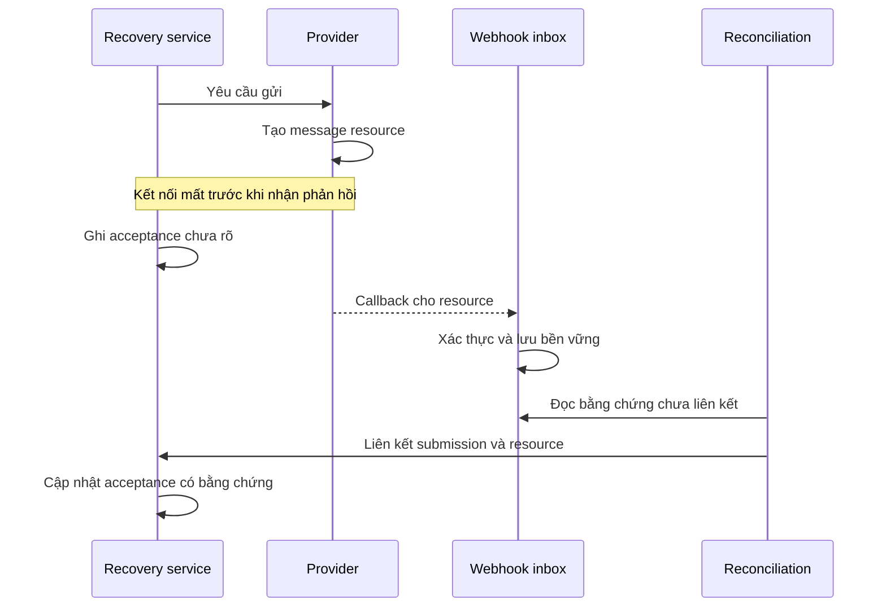

# Provider delivery rate — Đo tỷ lệ giao thông điệp của nhà cung cấp

## 1. “Gửi được” đang có nghĩa gì?

Một người dùng mất điện thoại và bắt đầu khôi phục MFA. Backend yêu cầu nhà cung cấp gửi email hoặc SMS chứa thử thách khôi phục. API trả thành công, nhưng thông điệp có thể vẫn đang chờ, bị từ chối ở tuyến sau hoặc đến khi thử thách đã hết hiệu lực.

Trong module `SECURITY_AUTHENTICATION_ACCOUNT_RECOVERY`, provider delivery rate giúp đánh giá một mắt xích của luồng khôi phục: **những thông điệp được nhà cung cấp nhận xử lý có bao nhiêu thông điệp đạt mốc giao được định nghĩa cho kênh đó?**

Đây là chỉ số của việc chuyển phát, không phải bằng chứng xác minh danh tính. Một SMS được báo delivered không chứng minh người cầm điện thoại là chủ tài khoản, cũng không cấp quyền đổi mật khẩu, gỡ MFA hoặc gắn passkey mới.

Bài thuộc chương Metrics, tập trung vào cách chọn đơn vị đếm, diễn giải trạng thái nhà cung cấp và xử lý dữ liệu bất định. Các cửa sổ thời gian, tên trường và ngưỡng minh họa không phải tiêu chuẩn bắt buộc cho mọi dịch vụ.

## 2. Tách các mốc của hành trình thông điệp

| Mốc | Điều hệ thống biết | Chưa được kết luận |
| --- | --- | --- |
| Quyết định gửi | Chính sách cho phép tạo thông điệp | Nhà cung cấp đã nhận |
| API nhận yêu cầu | Có bằng chứng nhà cung cấp nhận xử lý | Thông điệp đã được giao |
| Chuyển cho tuyến sau | Một hệ thống trung gian đã nhận | Đích cuối đã nhận |
| Delivery được xác nhận | Đạt nghĩa delivery của provider và channel | Người dùng hợp pháp đã đọc |
| Thử thách được kiểm tra | Backend kiểm tra bằng chứng người yêu cầu đưa vào | Toàn bộ recovery đã hoàn tất |
| Recovery hoàn tất | Đạt điều kiện nghiệp vụ và kiểm soát bắt buộc | Mọi thông điệp khác đều đã được giao |

Các mốc này cần sự kiện riêng. Nếu dùng HTTP 200 của send API làm delivery, dashboard có thể luôn xanh dù người dùng không nhận được mã.

### 2.1. Ví dụ SMS: sent khác delivered

Tài liệu Twilio Programmable Messaging mô tả `sent` là nhà mạng ở tuyến trên đã chấp nhận thông điệp; `delivered` là Twilio nhận xác nhận giao từ nhà mạng và, khi có, từ thiết bị đích. Đây là ý nghĩa theo sản phẩm và kênh cụ thể, không phải xác nhận danh tính người đọc. [Nguồn: Twilio — Message Status values](https://www.twilio.com/docs/messaging/api/message-resource).

Vì vậy, adapter không nên chuyển mọi trạng thái có chữ “sent” thành `CONFIRMED_DELIVERED`.

Một sản phẩm khác của cùng nhà cung cấp cũng có thể có taxonomy khác. Không dùng một bảng mapping cho mọi API chỉ vì chúng cùng thương hiệu.

### 2.2. Ví dụ email: mail server nhận chưa có nghĩa vào inbox

Amazon SES phân biệt `SEND` với `DELIVERY`: mốc thứ nhất cho biết yêu cầu gửi thành công và SES sẽ thử chuyển phát; mốc thứ hai là giao đến mail server của người nhận. SES cũng có sự kiện delay, bounce, reject và rendering failure. [Nguồn: Amazon SES — EventDestination](https://docs.aws.amazon.com/ses/latest/APIReference-V2/API_EventDestination.html).

Theo cách hiểu đó, delivery đến mail server không tự chứng minh thư nằm trong inbox, đã được mở hoặc người đọc là chủ tài khoản.

Không thay delivery bằng open hoặc click. Các mốc tương tác trả lời câu hỏi khác và không phải bằng chứng backend đã xác minh thử thách.

### 2.3. Hợp đồng chuẩn hóa phải giữ lại giới hạn bằng chứng

Một bảng mapping nội bộ có thể mô tả:

| Dữ kiện nguồn | Trạng thái chuẩn hóa minh họa | Loại bằng chứng |
| --- | --- | --- |
| API chấp nhận và tạo resource | `ACCEPTED` | Nhận xử lý |
| Handoff hoặc đang retry | `IN_PROGRESS` | Trung gian |
| Delivery receipt hợp lệ | `CONFIRMED_DELIVERED` | Theo mốc giao đã công bố |
| Kết quả không giao cuối cùng | `CONFIRMED_NON_DELIVERY` | Theo taxonomy của provider |
| Không có kết quả cuối trong cửa sổ | `NO_FINAL_RECEIPT` | Chưa xác định |
| Dữ kiện mâu thuẫn chưa giải quyết | `CONFLICT` | Chất lượng dữ liệu chưa đạt |

Bảng này là mô hình nội bộ, không phải tên enum dùng chung của mọi provider.

Mỗi mapping cần gắn provider, sản phẩm, channel, phiên bản hợp đồng và khả năng báo receipt của tuyến. Không đoán ý nghĩa một error code chỉ từ chuỗi mô tả ngắn.

## 3. Một yêu cầu recovery có thể tạo nhiều thông điệp

### 3.1. Phân biệt các định danh

Một mô hình quan hệ hữu ích là:

```text
recovery_attempt_id
  └─ logical_notification_id
       ├─ provider_submission_id A
       │    └─ provider_message_ref A
       └─ provider_submission_id B
            └─ provider_message_ref B
```

`recovery_attempt_id` đại diện cho lần khôi phục. `logical_notification_id` đại diện cho một nhu cầu thông báo, chẳng hạn gửi thử thách cho lần thử đó.

Một submission đại diện cho một lần gửi logic đến một provider. Nó liên kết với resource do provider tạo sau khi có bằng chứng nhận xử lý.

Nếu fallback tạo thông điệp khác qua provider B, đó là một submission khác. Cả hai vẫn có thể phục vụ cùng một logical notification.

Trong bài, mỗi thông điệp recovery hướng tới một người nhận. Nếu một API có thể gửi nhiều recipient, phải chuẩn hóa đến đơn vị message–recipient; không lấy số resource nhiều người nhận làm mẫu số cho số receipt theo người nhận.

### 3.2. HTTP retry không phải lúc nào cũng là một thông điệp mới

Nếu provider có cơ chế idempotency phù hợp và hệ thống dùng đúng hợp đồng của nó, nhiều HTTP request có thể cùng trỏ tới một resource.

Nếu provider không bảo đảm điều đó, một timeout rồi retry có thể tạo hai thông điệp thực. Không được gộp chúng thành một chỉ vì cùng nội dung hoặc cùng người nhận.

Cần lưu submission trước khi gọi provider và giữ bằng chứng liên kết với resource bên ngoài. Khi phát hiện nhiều resource thực, mô hình phải thể hiện chúng để đối soát, tính chi phí và xử lý nguy cơ gửi trùng.

### 3.3. Tách chỉ số provider khỏi chỉ số logical notification

Giả sử một logical notification tạo hai thông điệp:

```text
Provider A: đã nhận xử lý, sau đó báo không giao được
Provider B: đã nhận xử lý, sau đó báo giao được
```

Theo đơn vị provider message, có một success trong hai thông điệp. Theo đơn vị logical notification, có một nhu cầu thông báo được đáp ứng.

Hai kết quả đều có thể hữu ích, nhưng không được dùng lẫn mẫu số.

Nếu một recovery attempt còn cần thêm thông báo sau thay MFA, việc giao thử thách ban đầu cũng chưa có nghĩa mọi thông điệp bắt buộc của attempt đã được giao.

## 4. Định nghĩa tỷ lệ có thể tính lại được

### 4.1. Chọn phạm vi trước khi biết kết quả

Ví dụ một hợp đồng chỉ số:

```text
metric_definition_id = provider_confirmed_delivery_v2
unit = canonical_provider_message_recipient
channel = SMS
provider_product = selected_product
receipt_contract = carrier_delivery_receipt_v1
cohort_timestamp = submission_started_at
delivery_window = 30 minutes
environment = production
scope_policy = recovery_challenge_messages_v3
```

Cửa sổ 30 phút là giả định đo lường trong bài. Nó không phải TTL đề xuất cho OTP và không phải cam kết delivery của một provider.

`submission_started_at` là thời điểm backend bắt đầu submission được lưu bền vững. Cửa sổ bắt đầu ở mốc này để không bỏ qua thời gian chờ trước khi xác nhận acceptance.

Bằng chứng acceptance xác định thông điệp có thuộc mẫu số provider hay không. Nguồn bằng chứng có thể là phản hồi API hoặc dữ kiện provider đã được đối chiếu; không suy ra acceptance chỉ từ việc ứng dụng đã gọi hàm gửi.

Phạm vi receipt phải được xác định theo cấu hình tuyến và hợp đồng đã biết, không theo việc từng thông điệp có callback thành công hay không.

### 4.2. Mẫu số chính là các message đã được nhận xử lý

Chọn một cohort submission bắt đầu trong `[a, b)` và cùng phạm vi.

Gọi `A` là số message–recipient canonical:

1. Có bằng chứng nhà cung cấp nhận xử lý.
2. Thuộc cohort và hợp đồng delivery đang đo.
3. Đã đủ thời gian quan sát và điều kiện dữ liệu cho cửa sổ H.

Trong tập này, gọi:

- `D`: xác nhận delivery trong H.
- `F`: xác nhận không giao trong H.
- `U`: chưa có kết quả cuối đủ điều kiện tại H.
- `Q`: dữ kiện delivery và non-delivery mâu thuẫn, chưa giải quyết.

Với cách phân loại loại trừ lẫn nhau:

```text
A = D + F + U + Q
```

Tỷ lệ chính:

```text
provider_confirmed_delivery_rate(H) = D / A
```

Khi `A = 0`, kết quả là không có dữ liệu, không phải 0% hoặc 100%.

Tên “confirmed” nhấn mạnh rằng chỉ số đếm bằng chứng delivery theo hợp đồng. Nó không đo trực tiếp mọi thông điệp thực tế đã đến người dùng.

### 4.3. Luôn hiển thị độ đầy đủ của kết quả

Để biết số đo đang có bao nhiêu dữ kiện quyết định, dùng thêm:

```text
decisive_receipt_coverage = (D + F) / A

delivery_rate_among_resolved = D / (D + F)
```

Phép chia thứ hai chỉ có nghĩa khi `D + F > 0`. Nó là tỷ lệ trong tập đã có kết quả quyết định, không thay thế tỷ lệ chính.

Nếu bỏ U và Q khỏi mẫu số rồi chỉ công bố tỷ lệ trong tập resolved, provider có nhiều dữ liệu thiếu có thể trông tốt hơn thực tế quan sát được.

Không gọi U là failure. Chưa có receipt có thể do thiếu hỗ trợ, pipeline lỗi, callback chậm hoặc message vẫn đang được xử lý.

Q cũng phải được thấy trên dashboard. Không xóa các dòng mâu thuẫn khỏi dataset để làm tỷ lệ sạch hơn.

### 4.4. Receipt không được hỗ trợ cần một cách trình bày riêng

Nếu một nhóm tuyến không cung cấp loại receipt đang đo, báo `NOT_OBSERVABLE` cho nhóm đó và công bố quy mô traffic tương ứng.

Không đưa nhóm này vào phép so sánh chất lượng delivery như thể nó có cùng khả năng quan sát. Cũng không được âm thầm bỏ nó khỏi báo cáo tổng mà không cho biết mức bao phủ của phạm vi đo.

Cần phân biệt hai khái niệm:

```text
measurement_scope_coverage
  Bao nhiêu traffic thuộc hợp đồng có thể đo?

decisive_receipt_coverage
  Trong phạm vi đo, bao nhiêu message đã có kết quả quyết định?
```

Một provider có receipt coverage cao trong một phần rất nhỏ traffic chưa chắc cung cấp bức tranh đầy đủ cho toàn hệ thống.

## 5. Ví dụ số: ba tỷ lệ từ cùng một đợt gửi

Giả sử một đợt có 1.000 submission đã đủ thời gian đối soát, mỗi submission hướng tới một người nhận:

| Kết quả nhận xử lý | Số submission |
| --- | ---: |
| Có bằng chứng provider nhận | 900 |
| Provider từ chối, không tạo message được nhận xử lý | 60 |
| Chưa xác định provider đã nhận hay chưa | 40 |
| Tổng | 1.000 |

Trong 900 message đã nhận và thuộc cùng phạm vi receipt:

| Kết quả trong H | Số message |
| --- | ---: |
| D: xác nhận delivery | 810 |
| F: xác nhận non-delivery | 45 |
| U: chưa có kết quả cuối | 45 |
| Q: mâu thuẫn chưa giải quyết | 0 |
| Tổng A | 900 |

Kết quả:

```text
Provider confirmed delivery = 810 / 900 = 90%

Decisive receipt coverage = (810 + 45) / 900 = 95%

Delivery among resolved = 810 / 855 ≈ 94,74%
```

Nếu chỉ công bố 94,74%, người xem không thấy 45 message chưa có kết quả.

Nếu xem toàn đợt submission, có 810 bằng chứng delivery trên 1.000 submission, tức 81%. Đây là chỉ số bao phủ delivery từ đầu vào gửi, không phải cùng chỉ số provider có mẫu số 900.

40 submission chưa rõ acceptance phải được giữ thành nhóm riêng để đối soát. Không được coi chúng là bị từ chối chỉ vì request timeout; provider có thể đã tạo resource trước khi kết nối bị ngắt.

Nếu sau đối soát phát hiện một submission đã được nhận, mẫu số của cohort cũ có thể cần điều chỉnh. Báo cáo phải cho phép restatement có phiên bản và giải thích nguồn thay đổi.

## 6. Cửa sổ delivery khác thời hạn có ích của thử thách

### 6.1. Delivery muộn vẫn có thể vô ích cho recovery

Giả sử:

```text
09:00:00  Phát hành thử thách
09:00:10  Bắt đầu submission
09:05:00  Thử thách hết hiệu lực
09:12:00  Provider báo đã giao
```

Thông điệp có thể thuộc delivery trong cửa sổ đo 30 phút nhưng đến sau thời hạn của thử thách.

Do đó, cần hai chỉ số riêng:

```text
confirmed_delivery_within_H
timely_confirmed_delivery_before_challenge_invalid
```

Với chỉ số thứ hai, ngoài điều kiện delivery trong H, cần biết thông điệp được giao trước khi thử thách hết hiệu lực hoặc bị vô hiệu hóa.

Đừng kéo dài TTL chỉ để tăng tỷ lệ timely delivery. TTL thuộc chính sách bảo mật; dữ liệu delivery giúp nhận diện vấn đề, không tự thay thế quyết định đó.

### 6.2. Resend có thể làm thử thách cũ mất hiệu lực

Trong một thiết kế chỉ cho phép một thử thách hiện hành, phát hành thử thách mới có thể vô hiệu thử thách cũ.

Nếu SMS cũ đến sau thời điểm đó, việc provider báo delivered không làm thử thách cũ sống lại.

Một điều kiện minh họa:

```text
delivery_time < valid_until

valid_until = min(expires_at, invalidated_at nếu có)
```

Bài dùng mốc hết hiệu lực loại trừ: đúng tại `valid_until` thì không còn hợp lệ. Quy tắc này phải nhất quán với verifier.

Dữ kiện provider có độ chính xác thời gian hạn chế cần được gắn cờ. Nếu không xác định được thông điệp đến trước hay sau mốc vô hiệu hóa, không tự kết luận là timely.

### 6.3. Delivered trước TTL vẫn không chứng minh người dùng hoàn tất

Thông điệp có thể đến sớm nhưng người dùng không đọc, không còn kiểm soát địa chỉ nhận hoặc không vượt qua các bước tiếp theo.

Vì vậy, xem đồng thời:

- Tỷ lệ provider nhận xử lý.
- Tỷ lệ delivery và receipt coverage.
- Thời gian từ phát hành tới delivery.
- Tỷ lệ kiểm tra thử thách thành công.
- Tỷ lệ recovery hoàn tất theo chính sách.

Các chỉ số mô tả các đoạn khác nhau của hành trình; không thay thế chúng bằng một “success rate” chung.

## 7. Dữ liệu thời gian và cohort cần được bảo toàn

### 7.1. Không chia delivery hôm nay cho send hôm nay

Một message gửi hôm qua có thể nhận receipt hôm nay. Nếu chia số receipt hôm nay cho số submission hôm nay, tử số và mẫu số không cùng một cohort.

Báo cáo chính nên gắn mỗi receipt về message canonical và thời điểm submission của nó. Sau đó mới tính delivery trong H cho cùng nhóm gửi.

Số receipt theo thời gian nhận vẫn hữu ích để giám sát pipeline, nhưng cần nhãn riêng.

### 7.2. Tách các timestamp

Một bản ghi có thể có:

```text
submission_started_at
acceptance_confirmed_at
provider_event_at
webhook_received_at
normalized_at
warehouse_ingested_at
```

Các trường không đồng nghĩa. Callback có thể đến trước khi worker gửi kịp lưu phản hồi API; vì vậy, không lấy thứ tự ghi nhận cục bộ làm thứ tự nghiệp vụ duy nhất.

Ngay cả `provider_event_at` cũng cần có nguồn, độ chính xác và quy tắc xử lý clock skew. Không trộn thời gian provider với thời gian backend mà không đánh giá sai số.

Nếu chỉ có thời gian receipt được nhận, có thể đo “xác nhận nhận được trong H”. Không tự đặt tên là “thực tế giao trong H” khi không có bằng chứng về thời gian giao.

### 7.3. Chờ đủ thời gian quan sát và độ trễ dữ liệu

Một message mới gửi được hai phút chưa nên bị kết luận không giao trong cửa sổ 30 phút.

Để đánh giá cohort hoàn chỉnh, cần thời gian submission cộng H nằm trước mốc dữ liệu đủ hoàn chỉnh của các nguồn bắt buộc.

Receipt đến muộn nhưng cho biết delivery thực sự trong H có thể làm cập nhật kết quả cũ. Ngược lại, delivery thực sự xảy ra sau H vẫn nằm ngoài tử số của chỉ số trong H, dù callback đến rất nhanh.

Bản báo cáo cần giữ `report_as_of`, `data_complete_through`, nguồn snapshot và phiên bản mapping. Chỉ lưu một phần trăm không đủ để tái lập phép tính.

## 8. Pipeline nhận callback phải bảo vệ tính đúng của chỉ số

### 8.1. Callback là dữ liệu từ bên ngoài cần được xác thực

Một endpoint nhận `message_ref` và `status=delivered` không thể tin payload chỉ vì nó có hình dạng giống provider.

Twilio khuyến nghị dùng thư viện kiểm tra chữ ký trong SDK, lưu ý tập tham số webhook có thể thay đổi và cách xác thực phụ thuộc dạng request. Tích hợp cần theo đúng hợp đồng hiện hành của provider. [Nguồn: Twilio — Secure webhooks](https://www.twilio.com/docs/usage/webhooks/webhooks-security).

Trong kiến trúc minh họa, luồng nhận gồm:

1. Kiểm tra request theo cơ chế xác thực webhook đã cấu hình.
2. Xác định provider account và cấu hình tích hợp từ nguồn backend đáng tin.
3. Lưu sự kiện vào inbox bền vững với khóa chống trùng.
4. Trả phản hồi theo hợp đồng webhook sau khi đã nhận bền vững.
5. Chuẩn hóa và liên kết sự kiện với message canonical bằng worker.

Không tự viết lại thuật toán xác thực của provider trong một ví dụ business logic. Proxy, URL công khai, raw body và dạng mã hóa request đều có thể ảnh hưởng cách kiểm tra; cần dùng tài liệu và công cụ tương ứng với sản phẩm đang tích hợp.

### 8.2. Không tin tenant do payload tự khai

Khóa liên kết nên có phạm vi, ví dụ:

```text
integration_id
provider_account_ref
provider_product
provider_message_ref
recipient_unit_ref nếu API có nhiều recipient
```

Từ mapping được backend lưu khi gửi mới suy ra tenant, logical notification và attempt.

Không tìm message chỉ bằng một provider ID không có phạm vi, cũng không cho một field `tenantId` trong callback tự quyết định nơi ghi dữ liệu.

Nếu message chưa được liên kết, đưa sự kiện vào nhóm chờ đối soát. Không ghép bằng email, số điện thoại hoặc thời điểm gần nhất: một người nhận có thể có nhiều lần gửi khác nhau.

### 8.3. Có thể nhận callback trước phản hồi send API

Provider có thể xử lý nhanh trong khi worker gửi còn chờ phản hồi hoặc đang gặp timeout. Khi callback đến, mapping resource có thể chưa được lưu.

Thiết kế inbox giúp giữ bằng chứng cho tới khi có đủ liên kết. Sau khi mapping được hoàn tất, một tác vụ idempotent có thể xử lý lại sự kiện.

Cần theo dõi tuổi và số lượng sự kiện chưa liên kết. Không để chúng nằm im vô hạn rồi công bố delivery rate như thể không có dữ liệu thiếu.

Chính sách giữ payload phải xét dữ liệu cá nhân trong callback. Có thể lưu tập trường cần thiết và bản raw có bảo vệ trong thời gian phù hợp để điều tra, thay vì nhân bản mọi nội dung sang nhiều log.

### 8.4. Callback delivery không được trở thành lệnh xác thực

Dù callback là thật và message được liên kết đúng, nó chỉ bổ sung bằng chứng chuyển phát.

Không dùng `CONFIRMED_DELIVERED` để tự động:

- Đánh dấu OTP đã được nhập đúng.
- Chuyển claimant thành chủ tài khoản đã xác minh.
- Cho thay recovery address.
- Gỡ MFA hoặc tạo session đăng nhập đầy đủ.

Quyền thực hiện recovery vẫn phải đi qua verifier và chính sách kiểm soát độc lập.

## 9. Xử lý trùng, sai thứ tự và dữ kiện mâu thuẫn

### 9.1. Không dùng thứ tự callback đến để thay lịch sử

Twilio nêu rằng callback có thể không đến theo thứ tự gửi do độ trễ mạng khác nhau. Handler cần tính đến đặc điểm này. [Nguồn: Twilio — Track outbound message status](https://www.twilio.com/docs/messaging/guides/track-outbound-message-status).

Giả sử thứ tự nhận là:

```text
10:00:03  delivered
10:00:05  sent
10:00:07  delivered, bản gửi lại
```

Nếu cứ ghi trạng thái bằng callback mới nhất, message có thể bị lùi từ delivered về sent. Nếu tăng counter theo mọi callback delivered, một message có thể bị đếm hai lần.

Trong thiết kế này, lưu sự kiện nguồn và tạo projection theo quy tắc chuyển trạng thái đã phiên bản hóa. Callback trung gian đến muộn không tự xóa một kết quả cuối đã được chấp nhận.

### 9.2. Chống trùng có hai tầng

Tầng inbox nhận biết cùng một sự kiện provider được phát lại. Nếu provider có ID sự kiện ổn định, dùng ID đó trong phạm vi tích hợp.

Nếu sản phẩm không có ID sự kiện riêng, adapter phải có quy tắc xác định khóa chống trùng phù hợp với hợp đồng. Không dùng `message_ref` làm khóa duy nhất cho mọi callback, vì một message có nhiều sự kiện hợp lệ.

Tầng projection bảo đảm một message canonical chỉ đóng góp một đơn vị vào mỗi kết quả của phép đo.

Một ràng buộc inbox không tự bảo đảm counter nghiệp vụ đúng. Nếu cập nhật counter trước rồi lưu inbox sau, tiến trình lỗi giữa hai thao tác vẫn có thể tạo số đếm trùng.

### 9.3. Không giải quyết mâu thuẫn bằng một thứ tự ưu tiên tùy ý

Có trường hợp dữ kiện nguồn cần đối soát, chẳng hạn cùng message được chuẩn hóa thành cả delivered lẫn terminal non-delivery trong cùng cửa sổ.

Trước hết xem mapping có đang gộp khác recipient, khác resource hoặc khác loại sự kiện không. Một sự kiện complaint sau delivery không phải đơn giản là “email chưa từng được giao”.

Không mặc định “delivered luôn thắng” hoặc “callback cuối luôn thắng” cho mọi provider. Cần quy tắc giải thích được theo sản phẩm, bằng chứng nguồn và lịch sử hiệu chỉnh.

Khi chưa giải quyết, phân loại Q và giữ message trong mẫu số. Cảnh báo chất lượng dữ liệu thay vì ép nó về success hoặc failure.

### 9.4. Sửa projection cần có dấu vết

Nếu reconciliation hoặc sửa mapping làm thay đổi kết quả cũ, lưu:

```text
previous_outcome
new_outcome
source_event_refs
mapping_version
reconciliation_run_ref
changed_at
reason_category
```

Chỉ số tổng hợp có thể được tính lại từ projection canonical. Không nên cần sửa thủ công nhiều counter rời rạc mà không biết message nào tạo ra chênh lệch.

## 10. Ví dụ Java tổng hợp kết quả đã chuẩn hóa

Đoạn code sau chỉ tính trên snapshot đã được lọc đúng provider, channel, phạm vi receipt và cohort trưởng thành. Mỗi dòng đại diện cho một message–recipient canonical đã có bằng chứng acceptance.

`OutcomeAtDeadline` phải được adapter và bộ dựng snapshot xác định từ sự kiện đáng tin. Đây không phải enum mà client được phép gửi để cập nhật kết quả.

```java
import java.util.HashSet;
import java.util.List;
import java.util.Objects;
import java.util.OptionalDouble;
import java.util.Set;

enum OutcomeAtDeadline {
    CONFIRMED_DELIVERED,
    CONFIRMED_NON_DELIVERY,
    NO_FINAL_RECEIPT,
    CONFLICT
}

record DeliverySnapshot(
        String canonicalUnitRef,
        OutcomeAtDeadline outcome) {
}

record ProviderDeliveryMeasurement(
        long acceptedMature,
        long delivered,
        long nonDelivery,
        long unknown,
        long conflict) {

    OptionalDouble confirmedDeliveryRate() {
        if (acceptedMature == 0) {
            return OptionalDouble.empty();
        }
        return OptionalDouble.of(
                (double) delivered / acceptedMature);
    }

    OptionalDouble decisiveReceiptCoverage() {
        if (acceptedMature == 0) {
            return OptionalDouble.empty();
        }
        return OptionalDouble.of(
                (double) (delivered + nonDelivery) / acceptedMature);
    }

    OptionalDouble deliveryRateAmongResolved() {
        long resolved = delivered + nonDelivery;
        if (resolved == 0) {
            return OptionalDouble.empty();
        }
        return OptionalDouble.of(
                (double) delivered / resolved);
    }
}

final class ProviderDeliveryCalculator {

    ProviderDeliveryMeasurement calculate(
            List<DeliverySnapshot> canonicalRows) {

        Set<String> seen = new HashSet<>();
        long delivered = 0;
        long nonDelivery = 0;
        long unknown = 0;
        long conflict = 0;

        for (DeliverySnapshot row : canonicalRows) {
            String unitRef = Objects.requireNonNull(
                    row.canonicalUnitRef());

            if (unitRef.isBlank() || !seen.add(unitRef)) {
                throw new IllegalStateException(
                        "Invalid or duplicate canonical delivery unit");
            }

            OutcomeAtDeadline outcome =
                    Objects.requireNonNull(row.outcome());

            switch (outcome) {
                case CONFIRMED_DELIVERED -> delivered++;
                case CONFIRMED_NON_DELIVERY -> nonDelivery++;
                case NO_FINAL_RECEIPT -> unknown++;
                case CONFLICT -> conflict++;
            }
        }

        long acceptedMature =
                delivered + nonDelivery + unknown + conflict;

        return new ProviderDeliveryMeasurement(
                acceptedMature,
                delivered,
                nonDelivery,
                unknown,
                conflict);
    }
}
```

Ví dụ đầu vào tổng hợp 810 delivered, 45 non-delivery, 45 unknown và không có conflict sẽ tạo tỷ lệ chính 0,9 và coverage 0,95.

Những giới hạn cần giữ rõ:

- Code không xác thực webhook hoặc quyết định bảng mapping.
- Code không tự suy ra maturity từ thời gian hiện tại.
- Code không biết provider có hỗ trợ receipt hay không; phạm vi đã được xác định trước.
- Code không xử lý acceptance chưa rõ; nhóm đó được báo ở lớp gửi.
- `OptionalDouble.empty()` biểu thị không có mẫu số.
- Các ID canonical phải có phạm vi đầy đủ, không trùng giữa tenant hoặc provider account.

Trong triển khai lớn, có thể tổng hợp tại kho dữ liệu thay vì tải toàn bộ snapshot vào bộ nhớ. Đoạn code là minh họa bài học, không phải bằng chứng hệ thống đã được build hoặc kiểm thử.

## 11. Retry, fallback và đối soát acceptance chưa rõ

### 11.1. Timeout không phải bằng chứng provider chưa nhận

Một luồng gửi có thể xảy ra như sau:



Nếu retry ngay bằng một request tạo mới không có idempotency, hệ thống có thể gửi trùng. Chỉ số delivery có thể tăng số message trong khi trải nghiệm người dùng xấu hơn.

Cần chính sách đối soát dựa vào khả năng thực tế của provider. Không giả định mọi send API đều có thể truy vấn bằng idempotency key hoặc đều hỗ trợ hủy message.

### 11.2. Retry phải có giới hạn và hiểu nguyên nhân lỗi

Có thể retry lỗi tạm thời theo chính sách, nhưng không lặp vô hạn với mọi mã lỗi.

Một trạng thái địa chỉ không hợp lệ, bị suppression hoặc bị chặn theo chính sách không nên được xử lý giống một timeout mạng.

Theo dõi số submission trên mỗi logical notification, chi phí gửi và số lần resend mà người dùng tạo. Provider delivery rate riêng lẻ không cho biết hệ thống đang gửi quá nhiều thông điệp.

### 11.3. Fallback không được làm suy yếu recovery

Nếu provider A gặp sự cố, lựa chọn provider B cùng kênh có thể liên quan tới routing. Chuyển sang một kênh xác minh khác lại có thể thay đổi mức bảo đảm và cần chính sách riêng.

Không gửi thử thách tới địa chỉ mới do claimant tự nhập chỉ vì tuyến cũ đang lỗi. Không bỏ qua MFA hoặc các bằng chứng bổ sung để đạt tỷ lệ giao tốt hơn.

Mỗi fallback cần giữ liên kết với logical notification, challenge version và người nhận được phép. Nếu phát sinh thử thách mới, phải áp dụng quy tắc vô hiệu hóa và kiểm tra token tương ứng.

### 11.4. Hai provider cùng delivered không tạo hai quyền khôi phục

Một thông điệp từ A đến muộn sau khi B đã giao là tình huống cần dự liệu.

Nếu hai thông điệp mang cùng token, verifier vẫn phải kiểm soát hiệu lực và tính dùng một lần. Nếu chúng mang hai token khác nhau, chính sách phải xác định token nào còn hiệu lực và trạng thái toàn attempt.

Delivery callback không được tự cấp một quyền recovery mới. Sau khi attempt kết thúc hoặc bị hủy, receipt đến muộn chỉ cập nhật dữ liệu chuyển phát theo quy tắc, không mở lại workflow.

## 12. So sánh provider cần cùng cơ sở quan sát

### 12.1. Không so hai mốc delivery khác nhau như cùng một chất lượng

Một tỷ lệ email đến mail server và một tỷ lệ SMS có xác nhận của carrier không đo cùng mốc kỹ thuật.

Ngay trong một kênh, các tuyến có thể khác khả năng receipt, độ trễ, vùng địa lý và cơ cấu người nhận.

Báo cáo so sánh cần nêu ít nhất:

| Thuộc tính | Vì sao cần giữ nhất quán hoặc công bố? |
| --- | --- |
| Provider product và channel | Cùng thương hiệu chưa chắc cùng semantics |
| Phạm vi receipt | Tránh so có quan sát với không quan sát |
| Cohort và H | Tránh cho một bên thêm thời gian |
| Mốc bắt đầu cửa sổ | Không bỏ queue time ở một bên |
| Loại thông điệp | Thử thách và cảnh báo có hành vi khác nhau |
| Routing policy | Tuyến khó có thể dồn vào một provider |
| Acceptance chưa rõ | Không để API timeout biến mất khỏi báo cáo gửi |
| Mapping version | Thay chuẩn hóa có thể làm đổi kết quả |

Một provider có 99% trong tập resolved nhưng chỉ 20% decisive coverage không thể được đánh giá tương đương provider có coverage 99% mà không phân tích dữ liệu thiếu.

### 12.2. Cẩn thận với traffic được định tuyến không ngẫu nhiên

Hệ thống có thể gửi tuyến dễ cho A, còn B chỉ nhận các trường hợp fallback sau thất bại. So sánh tỷ lệ thô sẽ bất lợi cho B ngay từ đầu.

Nên phân tích theo những nhóm đủ tương đồng và giữ nhãn vai trò `PRIMARY` hoặc `FALLBACK` tại thời điểm gửi.

Nếu đánh giá thay đổi routing, cần một thiết kế phân bổ phù hợp với yêu cầu an toàn và điều kiện vận hành. Không đổi provider dựa trên vài receipt đầu tiên rồi gọi đó là thử nghiệm có kết luận.

### 12.3. Tỷ lệ tổng phải được tổng hợp từ số đếm

Khi các nhóm thực sự cùng định nghĩa, tỷ lệ gộp là:

```text
sum(delivered) / sum(accepted_mature)
```

Không lấy trung bình cộng các phần trăm có mẫu số khác nhau.

Nếu một provider xử lý rất ít message, công bố số đếm cạnh tỷ lệ. Một kết quả 100% từ ba message không đủ để suy ra độ tin cậy cho khối lượng lớn.

Chi phí, latency và sai sót gửi trùng cũng cần đặt cạnh delivery. Chọn tuyến chỉ vì một tỷ lệ đơn lẻ có thể tạo tăng chi phí hoặc tăng rủi ro lạm dụng.

## 13. Thiết kế dashboard và cảnh báo cho recovery

### 13.1. Một nhóm chỉ số cần đi cùng nhau

Một dashboard nội bộ có thể trình bày:

```text
Scope và mapping version
Submission bắt đầu
Acceptance đã xác nhận / bị từ chối / chưa rõ
Provider confirmed delivery trong H
Decisive receipt coverage
Unknown và conflict
Timely confirmed delivery trước khi challenge mất hiệu lực
Tuổi của callback chưa liên kết
Độ trễ webhook và kho dữ liệu
Số message trên logical notification
```

Không biến mọi chiều thành label của hệ thống time series. Các ID như attempt, notification, message, số điện thoại và email nên nằm trong kho điều tra có quyền truy cập phù hợp, không nằm trong label metric công khai.

Các phân nhóm provider, channel, route và mã lỗi cần có tập giá trị được kiểm soát. Phân tích chi tiết theo từng message thuộc tầng dữ liệu sự kiện.

### 13.2. Phân biệt lỗi delivery với lỗi khả năng quan sát

| Dấu hiệu | Giả thuyết cần kiểm tra |
| --- | --- |
| Acceptance giảm, API error tăng | Lỗi gọi provider, hạn mức hoặc cấu hình |
| Acceptance ổn, non-delivery tăng | Vấn đề tuyến, người nhận hoặc chính sách lọc |
| Acceptance ổn, unknown tăng đột ngột | Callback chậm, mất liên kết hoặc mất hỗ trợ receipt |
| Delivery ổn, timely delivery giảm | Queue hoặc tuyến bị trễ so với thời hạn thử thách |
| Provider báo nhiều delivery, kho nội bộ ít | Lỗi ingest, mapping hoặc projection |
| Giao tốt nhưng recovery không hoàn tất | Trở ngại hoặc từ chối ở bước sau chuyển phát |

Mỗi hàng là giả thuyết, không phải kết luận. Unknown tăng có thể đi cùng sự cố thực ở tuyến delivery hoặc sự cố webhook; cần bằng chứng để tách.

Không chuyển toàn bộ traffic sang fallback chỉ vì một callback endpoint nội bộ bị lỗi, nếu việc chuyển đó không giải quyết được nguyên nhân.

### 13.3. Cảnh báo phải xét quy mô và tuổi cohort

Có thể dùng cảnh báo nhanh trên API errors, backlog và độ trễ callback để phát hiện vận hành. Báo cáo delivery theo cohort dùng cửa sổ H để đánh giá kết quả.

Không đợi một cửa sổ dài kết thúc mới phát hiện send API đã ngừng hoạt động. Cũng không kết luận cohort vừa tạo là thất bại vì nó chưa có đủ receipt.

Ngưỡng cần dựa vào baseline của channel, tuyến, mức traffic và yêu cầu vận hành. Bài không đặt một ngưỡng 95% hay 99% làm chuẩn chung.

Nếu dữ liệu mapping hoặc reconciliation có sự cố nghiêm trọng, dashboard phải biểu thị chất lượng dữ liệu thay vì tiếp tục công bố xếp hạng provider như bình thường.

## 14. Bảo vệ thông tin tài khoản và dữ liệu đo lường

### 14.1. Dashboard chi tiết không đồng nghĩa với API công khai chi tiết

Một người chưa được xác minh không nên biết tài khoản nào có recovery address, địa chỉ nào bị bounce hoặc nhà cung cấp đã giao được mã cho ai.

Phản hồi công khai cần theo chính sách chống dò tài khoản của dịch vụ. Dữ kiện điều tra nội bộ có thể chi tiết hơn nhưng phải nằm sau quyền truy cập phù hợp.

Không gắn nguyên nhân nội bộ vào thông báo kiểu “email này tồn tại nhưng bị suppression” khi người gọi chưa có quyền biết thông tin đó.

### 14.2. Không đưa secret vào sự kiện hoặc callback URL

OTP, recovery code và reset token không cần xuất hiện trong metric event.

Không gắn token recovery vào callback URL để tiện liên kết. Dùng định danh correlation không mang quyền xác thực, rồi resolve qua mapping backend.

Payload provider có thể chứa địa chỉ nhận hoặc nội dung thông điệp. Cần kiểm soát log, truy cập, mã hóa và vòng đời dữ liệu; không sao chép raw payload sang mọi dashboard.

### 14.3. Delivery evidence có thể phục vụ điều tra nhưng không thay proof

Một địa chỉ được provider báo delivered có thể không còn thuộc chủ tài khoản. Ngược lại, không có receipt chưa chứng minh địa chỉ đó không tồn tại.

Trong khôi phục tài khoản, bằng chứng kênh chuyển phát và bằng chứng người yêu cầu kiểm soát thử thách là hai lớp khác nhau. Cần giữ ranh giới này cả trong code lẫn cách diễn giải chỉ số.

## 15. Những điều kiện cần kiểm chứng trước khi dùng chỉ số

| Điều kiện | Sai lệch nếu thiếu |
| --- | --- |
| Phân biệt acceptance và delivery | HTTP success bị tính thành giao thành công |
| Một đơn vị canonical theo message–recipient | Multi-recipient hoặc retry làm lệch số đếm |
| Mapping riêng theo sản phẩm và kênh | Sent bị chuyển nhầm thành delivered |
| Phạm vi receipt được xác định trước kết quả | Thiếu callback bị loại để làm đẹp tỷ lệ |
| Unknown và conflict vẫn được công bố | Tỷ lệ resolved bị trình bày như toàn bộ traffic |
| Callback được xác thực và ràng buộc đúng tích hợp | Payload giả hoặc sai tenant làm đổi chỉ số |
| Inbox và projection có tính idempotent | Callback phát lại tạo success trùng |
| Sự kiện sai thứ tự không làm mất lịch sử | Callback cũ ghi đè kết quả mới |
| Delivery gắn về cohort submission | Receipt hôm nay chia cho send hôm nay |
| Thời gian giao tách khỏi thời gian nhận callback | Độ trễ pipeline bị hiểu thành độ trễ tuyến |
| Receipt và challenge validity được liên kết | Thông điệp tới sau khi token vô hiệu vẫn bị coi là có ích |
| Acceptance chưa rõ có quy trình đối soát | Timeout bị coi nhầm là chưa gửi |
| Fallback có chính sách và giới hạn | Gửi trùng, tăng chi phí hoặc giảm mức bảo đảm |
| Snapshot và mapping version được lưu | Không giải thích được kết quả lịch sử |

Đây là các điều kiện thiết kế và kiểm chứng cho một triển khai, không phải báo cáo đã kiểm thử hệ thống hiện có.

Khi dùng provider delivery rate để ra quyết định, cần biết chính xác **provider xác nhận đã giao tới đâu, đơn vị nào được đếm và dữ liệu chưa biết đang nằm ở đâu**. Sau đó mới liên hệ kết quả chuyển phát với thời hạn thử thách, khả năng hoàn tất recovery và các điều kiện chống chiếm đoạt tài khoản.
